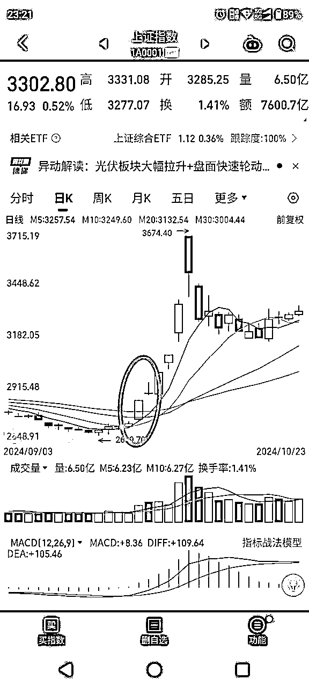
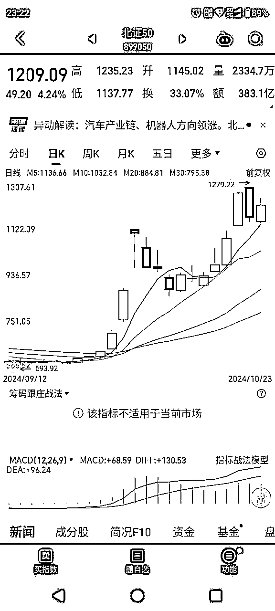
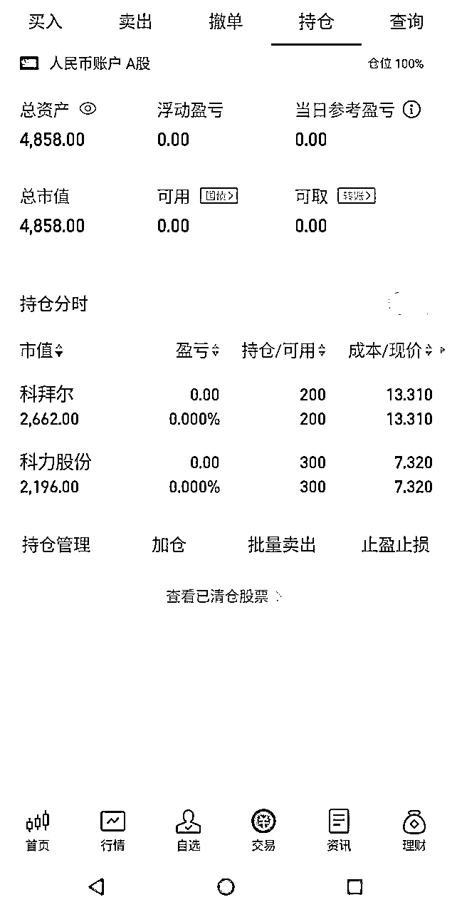
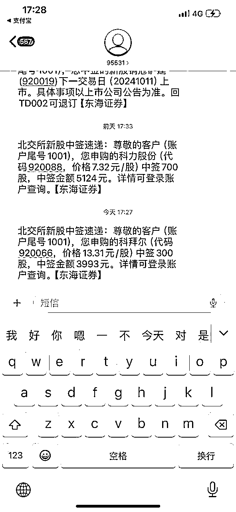
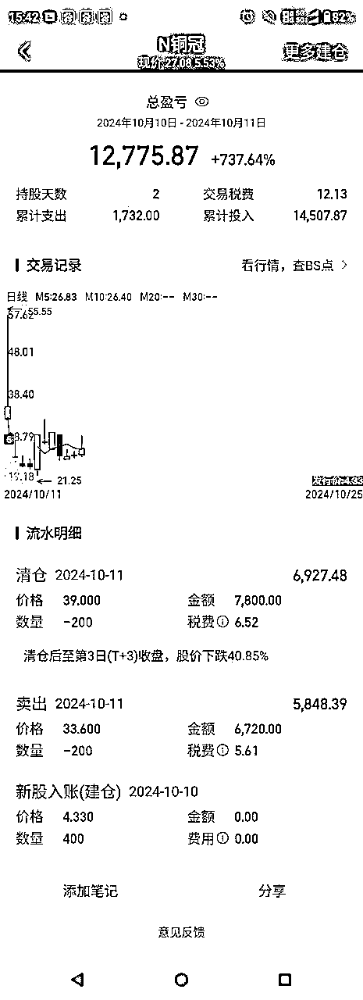
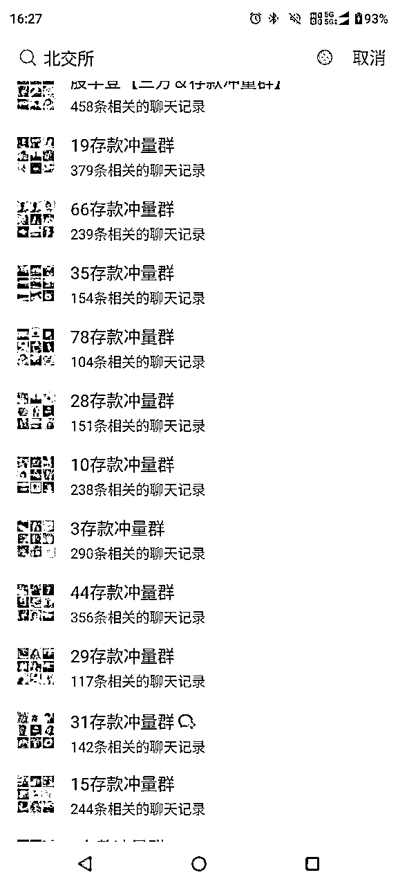
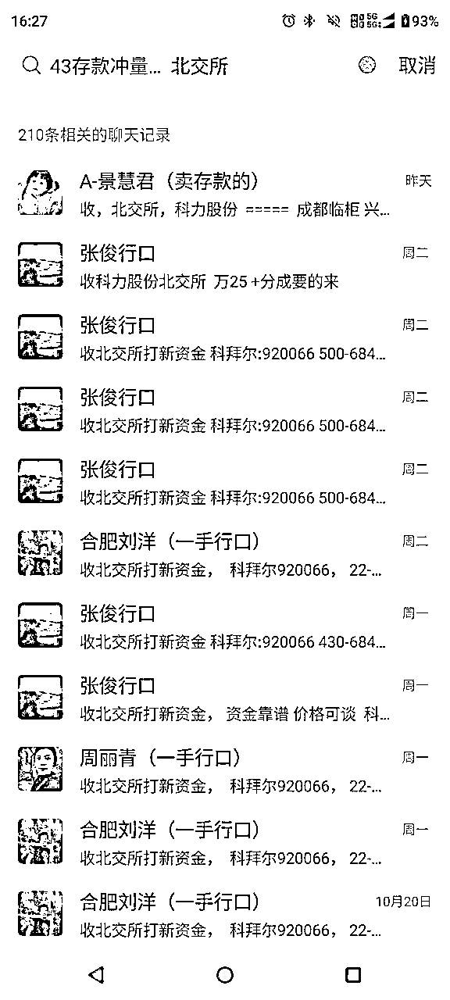
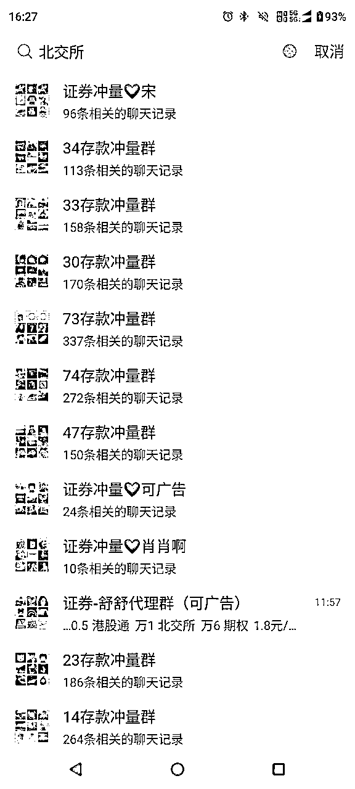

# 在牛市里，北交所这块地盘，真的能大干一场！说说我如何靠长期坚守，迎来一次单日净赚30万的爆发

* 大家好，我是龙哥。既做金融又做互联网的双栖从业者，对零售金融业务比较熟悉。17年起开始搞副业，第一份副业是当股票经纪人，现在还在做。说实话，当年身为金融人，收入也只是比打工强一点点。这些年买房买车装修养家，口袋里基本没剩什么。过得紧巴巴不说，机构的业绩压力还一直压着头。我现在的状态，就不赘述了。

* 近期到处都在说经济难、收入降、失业甚至断供的声音。我的创业经验未必能帮到你什么，但我这份坚持到最后爆发的经历，或许能让你看到在自己擅长的赛道里，时机到了就能起飞。

* 走到今天，见过太多不容易。金子终究会发光，烂泥也扶不上墙。金融和互联网都不是一夜暴富的游戏，都是时间喂出来的积累。别被外面那些虚假的繁荣迷了眼。深耕自己熟悉的领域，等到爆发窗口就来了。

* 互联网上赚钱教程很多，大部分都是把赚钱放大成流量生意。说白了，当老板无非是把0到1的本事吃透，然后在1后面不断加零。

* 打铁还需自身硬。扎实的技术、过硬的知识、宽广的人脉，归根结底是学会感恩和自律。多年的沉淀让我明白靠谱和真诚的重要性，也正因如此，才在一次次机会里捕捉到商机，有底气去迎接挑战。

# 我和北交所是怎么结缘的

### 想吃这行饭，先得入场

* 我第一次入市是2015年牛市。那一轮牛市，我没靠炒股赚到钱，也没亏，在新股申购上倒是有点收获。当时逻辑很简单：谁账户里有股票市值，谁就能借力去打新。靠银行信贷资金变通操作，当时从新股上赚了十几万。

* 我印象特别深，朋友中了一只新股，赚了十几万。那次让我对打新的魅力上了心。

* 新股也会破发，但赚钱的概率更大。某种程度上，这是一种风险可控的思路。

* 后来我做了存款冲量、证券冲量，认识了不少做资金套利的高手。在互相交流里，我学到了很多。北交所的打新也是在这个过程中，从0到1慢慢摸清楚的，后面就开始不断放大规模。

# 北交所的底层逻辑是什么

* 北京证券交易所，2021年9月3日成立，是国务院批准、证监会监管的第一家公司制交易所。它的使命是深化新三板改革，服务创新型中小企业。

* 国内现在有上交所、深交所、创业板、科创板、北交所，都是证监会体系内的正规板块。

* 北交所打新的流程很清晰：有股票账户→开通北交所权限→新股申购→上市交易→算盈亏。

* 现在的市场情况：北交所申购是当下相对低风险的理财方式之一，收益率很可观。历史来看，最近一段时间40次上市，仅1次破发，其余都盈利，破发也只亏几百块，完全可接受。牛市加持下，新股翻10倍并非难事。最关键的是，这个项目可以做大。只要资金运用得当，几乎能做到必中签，确定性极高。

# 项目走过的路

## 好项目，晚点入场也来得及

* 北交所2021年就有了，但早期破发多、流动性差、关注度低，参与体验一般。

* 真正行情起来是在2023年。我是2023年底才进场的。那段时间股民普遍悲观，谈股色变。但我通过朋友交流发现，打新是真的香，只要风险可控，基本稳赚。

## 垃圾行情里也能有收益

* 我总结出了一个套利公式。举个例子，调动100万资金，单次均值收益1000元，占用2天。银行贷款成本约180元，理财机会成本100元，净赚800-900元。放大到1000万，单次赚1万左右，一个月2次，轻松2万，扣成本也能有1.8万。股市再差，这套打新套利依然暴利。

## 如何把规模做大

* 确认这是个好项目后，我从一两百万起步，逐步做到一千多万，动用家族资金和银行信贷，合理分配收益，还收购客户资金打新。规模从2000万、3000万到上亿。每次赚几万，稳稳的幸福。北交所爆发前的前一年里，合计赚了近20万利润，中间还断档几个月。算下来也就40天的工作量，每天5000元，这样的套利谁不爱。

## 坚持到爆发

### 牛市正式点火

2024年9月24日，美联储降息、东风35试射、国家启动股票回购贷款，牛市正式开启。北交所随之大幅上涨，溢价水涨船高。低估值、小盘子、科技属性、新股资金集中，这些特点让它成为本轮牛市的先锋。

### 一只票打新，单日套利30多万

坚持不是一蹴而就的，有时候就是一场运气。

2024年9月底，我照常收购新股资金和家族资金打新，代码920019铜冠矿建。原本测算中签约43000元，预计赚两万左右。结果牛市爆发，这只上市最高翻11倍，我在8倍多就卖了，没吃到最高点。算下来43000*8.5=365500元，扣除分成和成本，单日净赚约30万。这是完全意外的惊喜。

### 后续的爆发机会

在牛市情绪下，北交所已经处于高度亢奋状态。市场不再关心基本面，只看情绪宣泄。而北交所正是情绪的最大出口，后续超额溢价行情值得期待。

# 北交所的优缺点

## 优点

* 不用买股票也能打新
* 有策略，基本能做到100%中签
* 破发概率极低
* 容易大涨，超额收益明显
* 当前最火板块之一
* 中签后资金占用低，100股约1500元以内

## 缺点

* 资金需求不固定，牛市里打新资金水涨船高，最近一只新股中签需160万以上
* 没有专业测算，很难判断中签率，盲目打等于浪费利息
* 开通权限要求严格：股票账户满2年交易经验+日均资产50万
* 申购需全额冻结资金，约2-4天无法使用

## 北交所必中策略

* 北交所打新和A股不一样，是纯靠资金打新。
* 利用碎股规则卡门槛，通过精确控制申购金额获取额外100股碎股；分户打新，用多账户提升中签率。正股按比例分配，碎股进入池子二次分配。
* 必中核心在于专业测算发行规模和申购资金，预估中签率，算出需要多少资金中一签。
* 下面是我部分中签记录，每个账户都中了，合作账户更多就不一一列了。

# 打新收益测算

## 理财成本 vs 银行资金成本对比

北交所打新占用约2天。1万元理财一天利息5毛，100万一天50元，2天100元。信贷资金成本2天约200元。

而当下行情，100万单次收益1500-2000元以上，是理财的15-20倍，是贷款成本的7-10倍。

更保守的例子，铜冠矿建，150万打新中400股，单价4.33元，成本1732元，盈利12775元，银行成本仅300元，收益是成本的42倍。随着热度上涨，收益会保持，打新难度也会提升。

## 放大规模的市场收购策略

要做大，就要从市场找资金。找能理解这套低风险套利逻辑的资金方，让他们省心安心赚钱。我们和客户有两种合作方式：纯合作模式、资金收购模式。

### 纯合作模式

承诺保本，未中签赔理财利息。中签后亏损我们补，收益按7:3分。客户资金在自己账户，500万理财利息才500元，我们完全能兜底。

### 资金收购模式

部分资金方不愿承担破发风险，按固定价格把资金卖给我们。比如500万资金，2天万10，就是5000元，客户成本仅1000元，净赚4000元，后续盈亏与客户无关。

能否拿到钱，最终看客户信用。

# 赚钱的核心逻辑，普通人怎么参与

我在这行做了近10年，从从业者到操盘手再到北交所放大项目，这不是几天能学会的。赚钱就是认知变现。市场行情给了机会，但参与方式也有门路。

## 有资金型和资源型客户

金融从业者或有资源的客户，可以直接分蛋糕。有100万起、能随时调动的资金，就能咨询我共同参与。这是风险最低、收益最高的群体，知识变现，多卖一份稳定收益。

## 风险投机型客户

资金量不大但风险偏好高的客户，可以用小钱收购大钱。比如几千到一万，就能撬动几百万上千万资金。我的风控体系会限制收购额度，避免过度集中。虽然信息差客户很多，但我更倾向分散风险。

总结逻辑：收购资金→上市卖出→资金方归还盈利→核算盈亏→按约定分成。

## 我们的核心优势

* 专业知识扎实，基本不存在打不中新股的情况
* 风险兜底机制，合作客户风险由我们承担，全程兜底
* 收购模式有专业测算，能评估单只新股收益和最大亏损
* 牛市下有成熟的客户获取和低风险控制经验
* 谈钱不伤感情，确定性项目里全力冲锋。机会来了就要牢牢抓住，我就是那个领头人。

# 普通人需要避开的风险点

## 认知不匹配

北交所从0到1后，关键是如何持续吃到肉。普通投资者没有专业服务，很难持续获利。比如新股发行时间节点，很多人就容易错过。

## 未中签浪费利息

不知道需要多少资金才能中签，没有专业指导，资金极易浪费或落空。

## 破发风险

北交所新股也可能破发，中签后反而亏损。需要结合个股质地、公开信息和市场情绪来规避高风险标的。

# 保姆级操作教程

1. 找行业内有认知的人，比如券商经理或像我这样的从业者
2. 去券商核查是否符合交易经验要求
3. 查看北交所新股发行信息，可在北京证券交易所官网查询，进行数据测算
4. 开通权限后，在打新前募集资金按时申购
5. 中签后对比历史新股数据，参考经验决策
6. 好行业要长期坚持学习总结，虚心请教。

# 结语

## 自古驱民在信诚，一言为重百金轻。今人未可非商鞅，商鞅能令政必行。

在金融圈，诚信比黄金贵。我从一百多万做到过亿规模，靠的就是信守承诺、提升专业、理解市场、合理分配利益。吃点利是对合作伙伴最好的回馈。这是一个谈钱不伤感情的平台，欢迎有识之士一起一言为重百金轻。