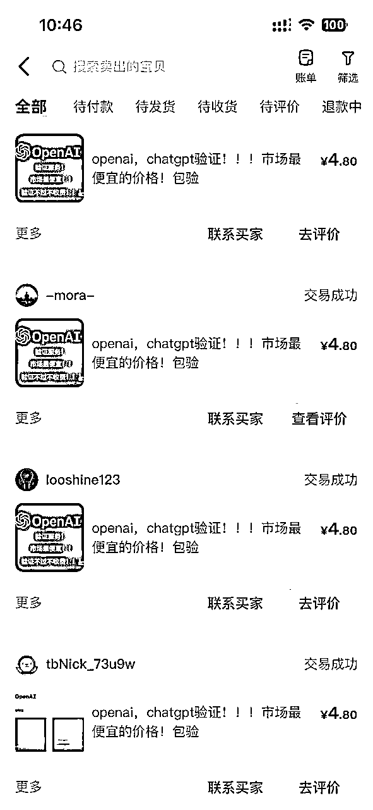
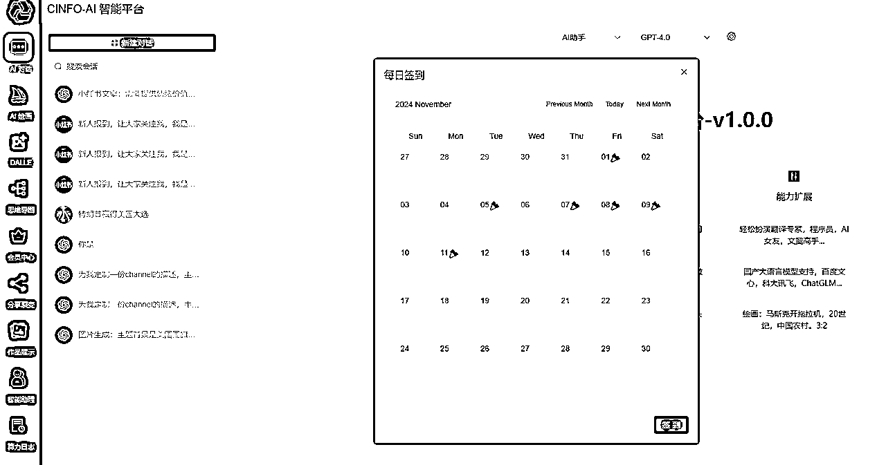
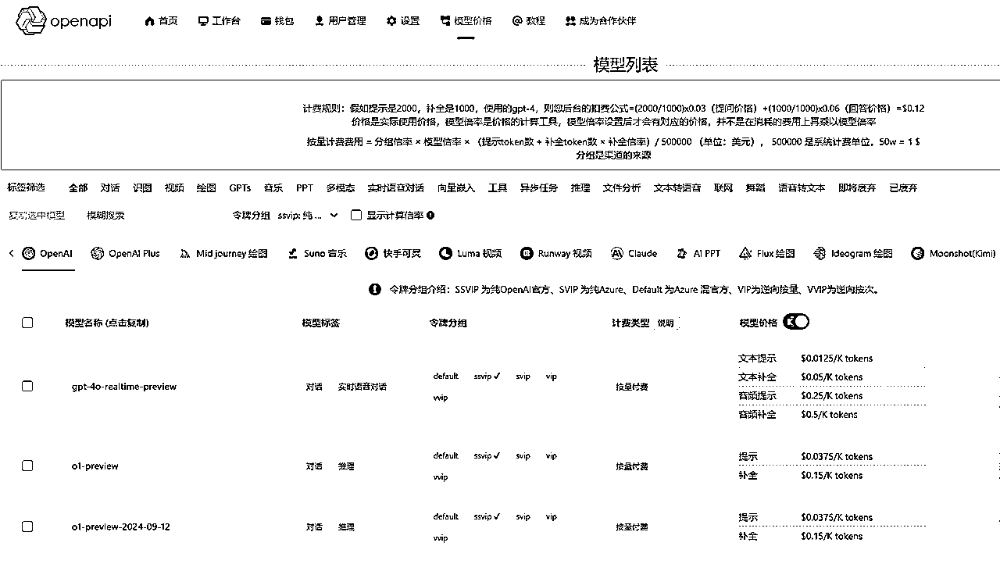
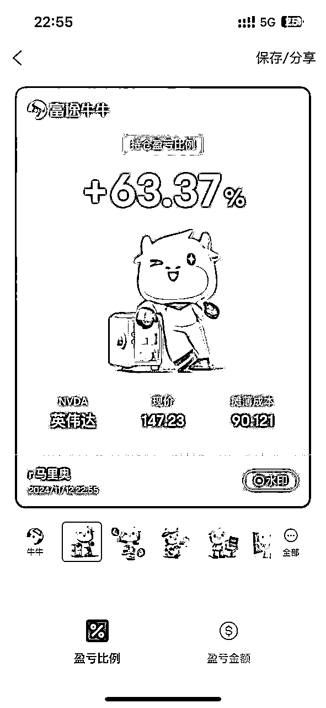

# 我的 AI 实战心得，有干货也有坑

大家好，今天就跟大家分享一下我这些年折腾 AI 项目的真实经历，每一条都是踩过坑、赚过钱才总结出来的。

## 一、海外 AI 账号的生意窗口

先说 ChatGPT、Claude 这类国外的 AI 账号。刚开始上手时就能感觉到，这里面是有信息差的。对大部分人来说，注册和获取成本很高，像一道坎。但对我而言，这坎就是机会。项目初期，市场供不应求，就像是没人抢的蛋糕。我硬是把账号资源搞下来做起了小生意。起初收益很小，但每来一单都特别有成就感，像是被市场点赞。新工具刚放量的时候，谁先把门槛打通、谁就先占到红利。

## 二、套壳产品走过的弯路

### 小程序这条路

小程序我玩过不少，比如纯对话的 ChatGPT 小程序，还有 ChatGPT 结合算命运势的。小时候没想太多，就做了最基础的体验版，放上去一个简单的功能界面，没想到也能有零星的流水。那段时间我特别兴奋，觉得方向是对的。

转折点很快就来了。微信审核收紧，不合规的一律下架，加上国家要求备案，整个行业瞬间降温。很多人直接撤场，赛道一下子冷掉了。

### 套壳网站

再聊聊 AI 套壳网站。这个形态很灵活，能整合很多模型。早期监管宽松，流量获取成本低，推广起来很顺。我当时铺得比较猛，用户也确实在涨。后来政策收紧后，玩法就不能硬刚了，得调整打法，找新的切口和新的用户群体，机会依然存在。

## 三、AI 绘画赛道的门槛

AI 绘画这块，像 ComfyUI、炼丹调参这类，都属于硬技术路线。想玩好，必须先把技术吃透，不是简单搭个界面就能成的。

## 四、卖铲子的生意逻辑

所谓的 AI 卖铲子，就是给想用大模型的人提供工具。我观察到一个现象：很多人对 ChatGPT、Claude 感兴趣，但 API 的调用方式太复杂了，像一道技术墙。于是我琢磨怎么把这堵墙拆掉，用类似 OpenAPI 的封装方案，让普通人也能无痛接入。做到这一步我花了不少时间，要理解 API 的底层逻辑、它的限制边界，还要兼顾易用性和安全性。

## 五、用 AI 快速试错的方法论

快速验证项目是我的核心武器。比如用 Cursor 快速生成一个 MVP，先把能跑的原型做出来立刻推向市场收集真实反馈。可行就继续迭代，不行就及时止损。这种快做快验的节奏，让我在变化极快的 AI 赛道里始终保持领先。

## 六、看好 AI 却不炒 AI 股

总的来说，我在 AI 赛道里摸爬滚打多年，领悟到的就是：这个行业变化快如闪电，必须保持敏锐的学习力、持续的创新勇气和敢于试错的胆量，才能真正抓住风口做出成绩！