# 新号冷启动：闲鱼虚拟资源从0到放量，选品与自动化操作拆解

我是在闲鱼深耕八年多的实操者，曾担任赚钱首期航海项目的主讲，也参与过多个航海训练营课程与实战手册的编写。今天把虚拟资料类目新店铺从起步到规模化跑量的完整做法整理出来。

很久没有做系统复盘了，总觉得缺少一个闭环。将一次验证有效的项目沉淀成可复用的方法论，让更多人少走弯路，这种传递价值的满足感正是我想要补齐的部分。酝酿的时间比较长，但落地效果没有打折。

先给一组实操数据做参照。

新店上线48小时内成交198单，毛利接近600元。还有单日毛利900元、1000元、2000元的记录，矩阵铺开后更平稳。

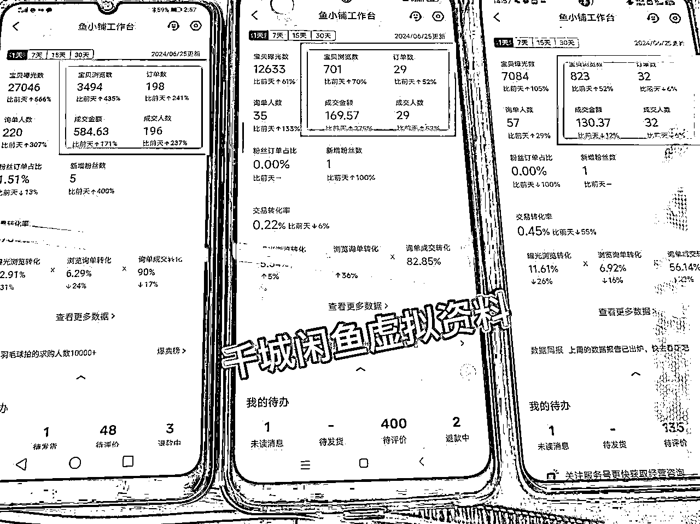

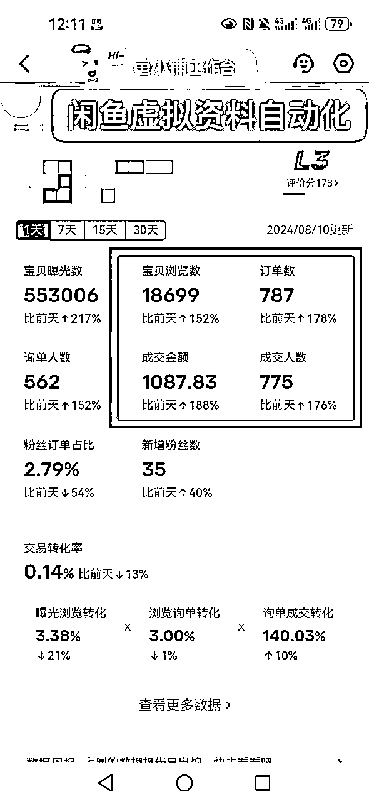

这些数字的意义不在于展示，而是说明赛道仍有空间，而下方的方法是经过验证可跑通的。

# 什么是闲鱼虚拟资料，以及它为什么能快起来

不少人对这个赛道认知模糊。简单说就是在闲鱼上售卖电子化资源，比如可编辑PPT模板、付费课程合集、行业资料包等。无需先行囤货，成交后再去同行处找一模一样的货源采购一份，随后可无限次售卖。

核心就三点：找到真实有需求的资源、把商品信息做成可被搜索到、让成交形成自循环。

先明确优势，判断是否适合执行。

*   启动资金极低，一部手机就能操作。实物类目需要周转备货，虚拟类目是现卖现采，边际成本接近零。
*   可半自动化运作。工具能批量上架，下单即自动推送文件，人只需处理少量咨询，大部分订单买家会自行确认收货。
*   无需物流。直接发送链接或文件，省去快递、售后扯皮的时间成本。
*   复制效率高。流程跑顺后可用工具同步多店铺运营，店铺稳定后日常维护耗时很少。
*   售后压力小。买家通常即买即确认，好评率偏高；若不满意全额退款，对卖家造成的损失也有限。

我同时在做虚拟和实物，各有侧重。实物客单更高、更稳，能沉淀电商底层能力；虚拟轻快易复制，适合快速启动和矩阵扩张。

整体拆成三部分：

一、虚拟爆款的判断框架
二、虚拟资料的五类选品路径
三、快速上架、自动发货与单人批量化

# 一、虚拟爆款的判断框架

与实物类目的判断逻辑相通，闲鱼没有生意参谋这类数据面板，只能靠平台自带信息叠加研判。分为三步。

1）心动指数
2）动态成交表现，被屏蔽时的替代指标
3）多店铺交叉比对

以“大学生创业PPT”为例说明。

## 1）心动指数

在闲鱼首页搜索关键词，进入单品后点击“我想要”或“聊一聊”，每次点击都会累加。数值越高，历史兴趣越强。

建议起步选心动指数在百位以上的品。这只能说明需求存在，还要看近期是否在持续成交。

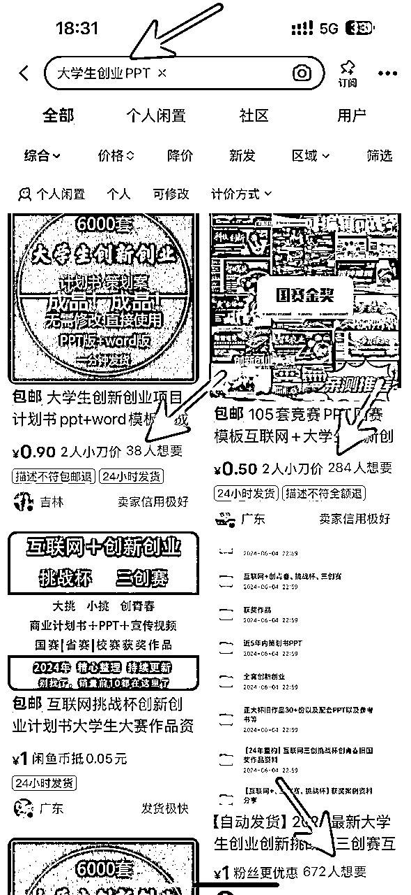

## 2）动态成交

这是最直观的指标。进商品→进卖家主页→点“动态”，可看到近期成交节奏。

示例中的商家近期仍有稳定成交。一般单商家单日3-6单可作为入围线，成交越多越可靠。

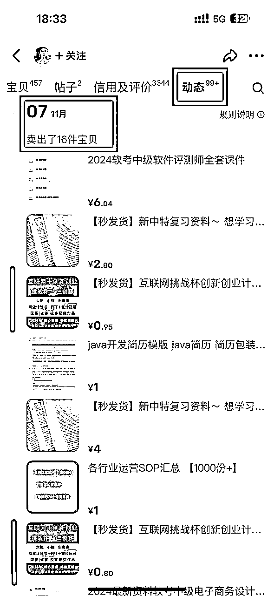

### 2.1 动态被屏蔽的替代判断

部分商家会隐藏动态，看不到成交。此时可通过四项指标综合判断：

*   心动/浏览比例≥1:10
*   鱼小铺等级
*   近期信用评价
*   商品下方留言时间

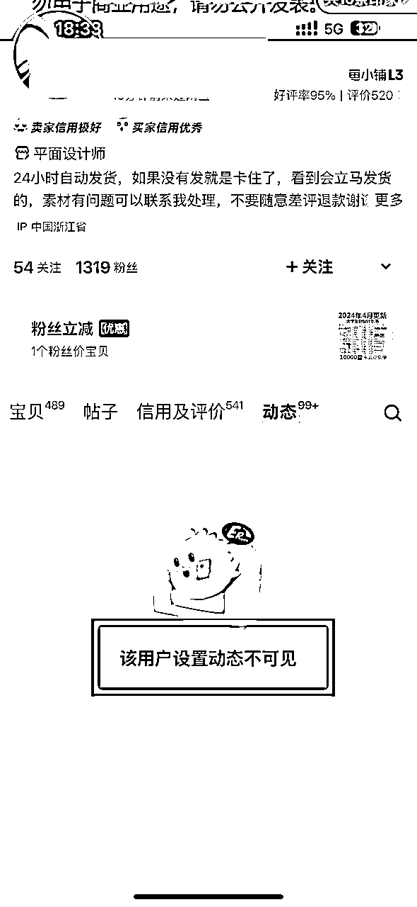

① 心动:浏览≥1:10
相当于十个浏览至少一个咨询，转化表现尚可。

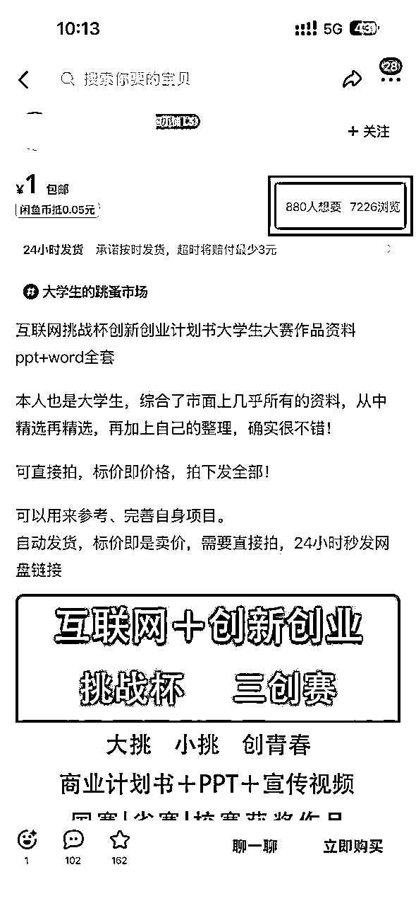

② 鱼小铺等级：L3以上通常说明近期有成交量，可作为加分项。

③ 信用与评价：看近7天是否出现与该商品相关的评价，至少1条算健康。因为评价会在发货后一段周期才展示，能看到是积极信号。

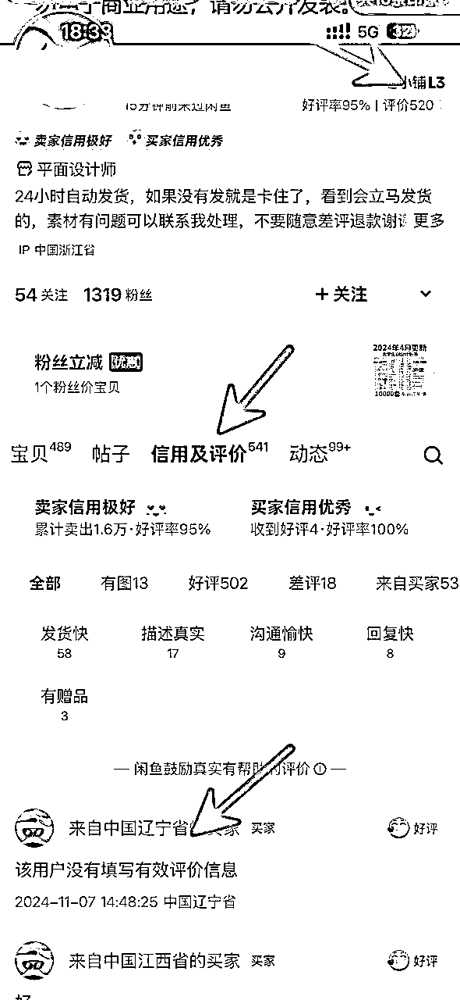

评价也能在商品页下方查看，近7天有2条且其中一条是1小时前，热度在线。

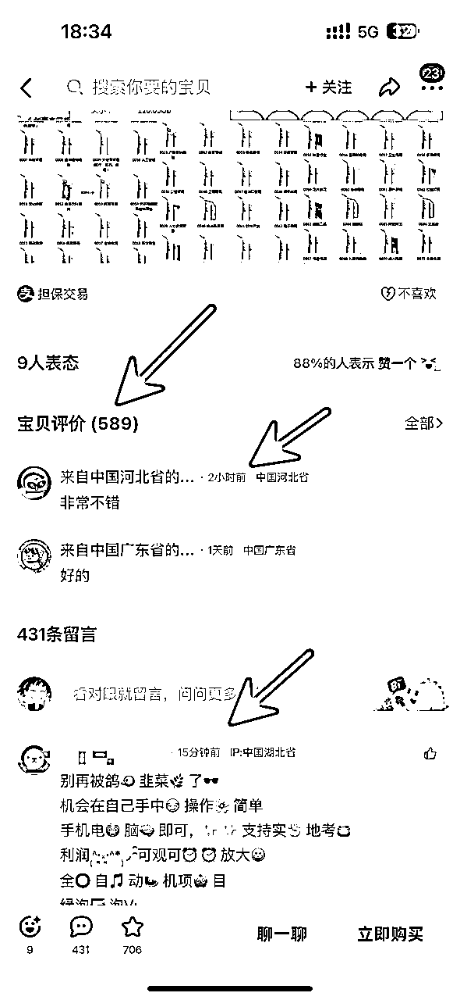

④ 下方留言时间：7天内有留言，广告留言也能侧面说明权重靠前，平台倾向推权重高的。

综合权重排序：信用评价 > 心动:浏览 > 下方留言 > 店铺等级。

### 3）看多家

单品判断容易失偏。至少找3家心动指数靠前的同款，看动态成交，若3家均达标，基本可判定为稳定畅销品。

验证逻辑与实物基本一致，只是多了一个屏蔽动态的补充方案。

实物积累的选品直觉迁移到虚拟类目，效率会快很多，底层相通，细节有差。

思路清楚后，常卡在“搜什么”。这就进入第二部分。

# 二、虚拟资料的五大爆款选品路径

与实物选品有共通点，也有品类特点。下面方法也覆盖了新号3天盈利近600、单日1000+的案例。

## 1）场景代入法

把自己代入购买力最强的群体：大学生、研究生、宝妈、职场新人。

大学生创业PPT、毕业答辩模板、四六级真题、考研笔记都是典型。再延伸日常场景：孩子纪录片、育儿指导、幼儿园试讲PPT、新上映影视资源等。版权类资源注意风险，可做短期快收。

## 2）平台推荐法

在闲鱼搜索框输入虚拟相关词，平台会给出热搜补全；首页也会主动推荐热销品。这两个入口本身就是现成的选品池，直接拿来验证。

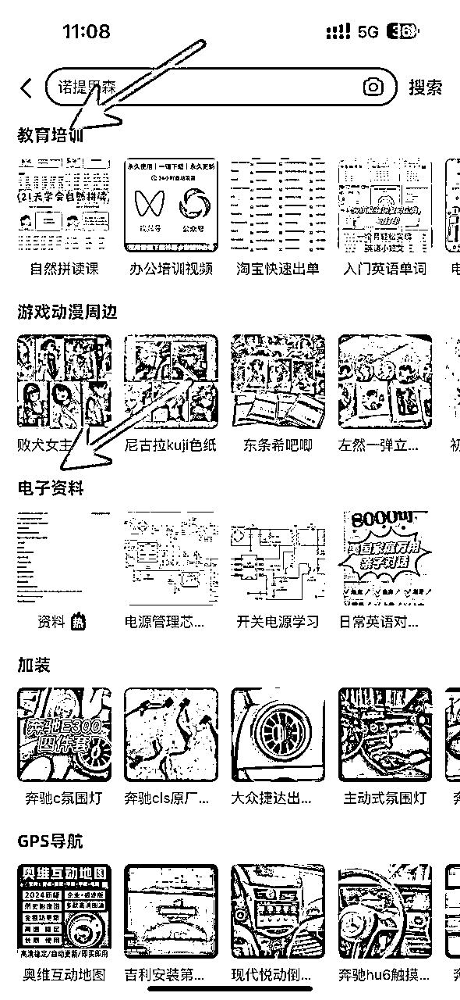

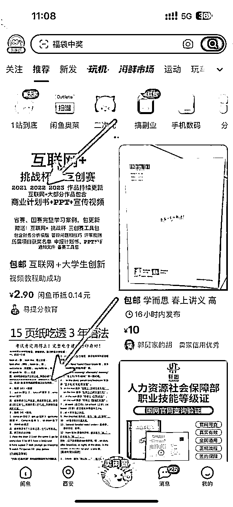

## 3）词根延展法

虚拟类目有固定词根，以词根为核心搜索，再用下拉词和关联词扩散。

高频词根：教程、资料、笔记、模板、数据、配方、纪录片、自动发货、秒发。

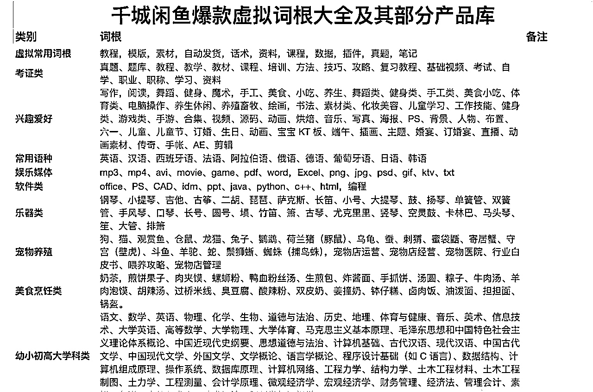

以“模板”举例，搜索后会出现模板PPT、模板简历等下拉，进入后能看到商业计划书模板、职业生涯模板等具体品，继续往下拉还能扩展。验证后上架。

该方法同样适用于淘宝、拼多多、📕做交叉验证。

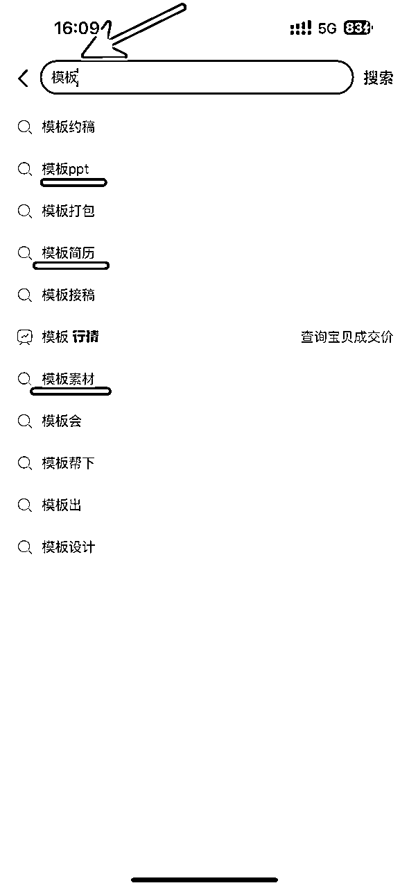

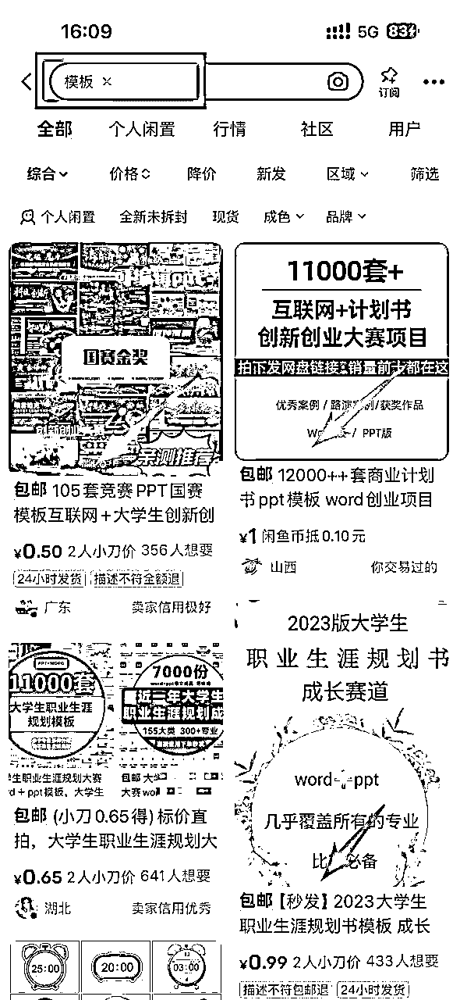

## 4）市场热点法

这是新号两天近600利润、单日1000+利润的核心打法。

当年高考刚结束，我搜索“高考志愿填报”，当天出40多单，利润200+，第二天198单，利润近600。把该品复制到多个店铺并同步给朋友，全部快速成交，热度持续20多天。

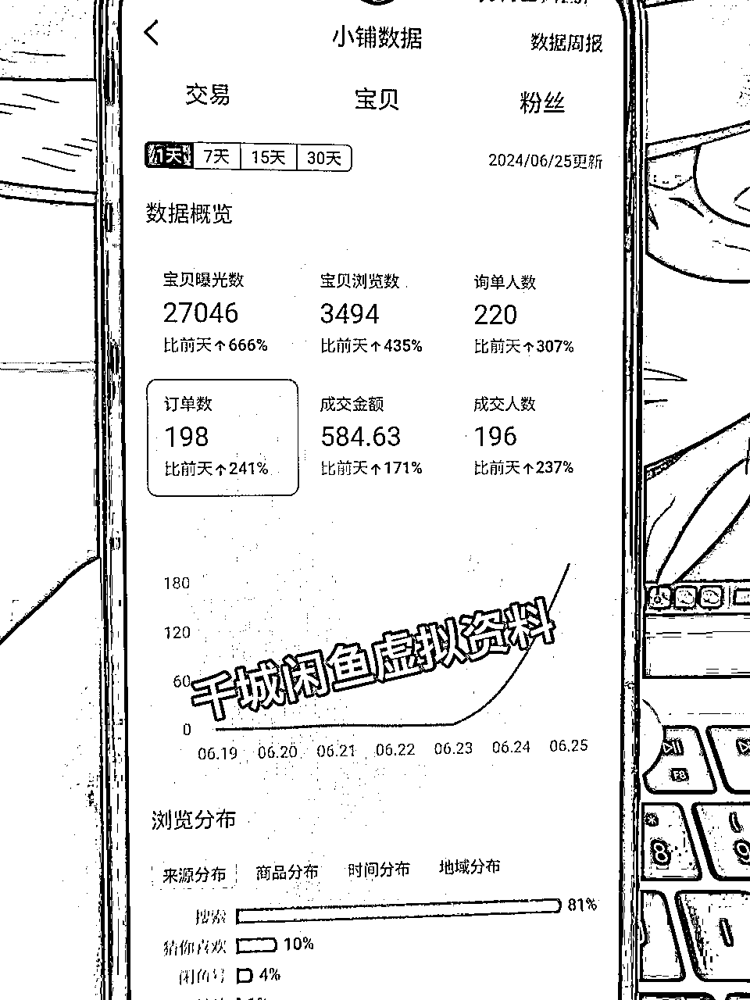

### 4.1 时间节点热点法

可提前1-2个月布局的确定性机会：

暑假电子课本、各年级资料；一建二建、社工、经济师考前资料；年底年会演讲PPT；6-7月毕业论文答辩、简历模板；6月末四六级；6月7/8号高考；5月中旬初级会计。

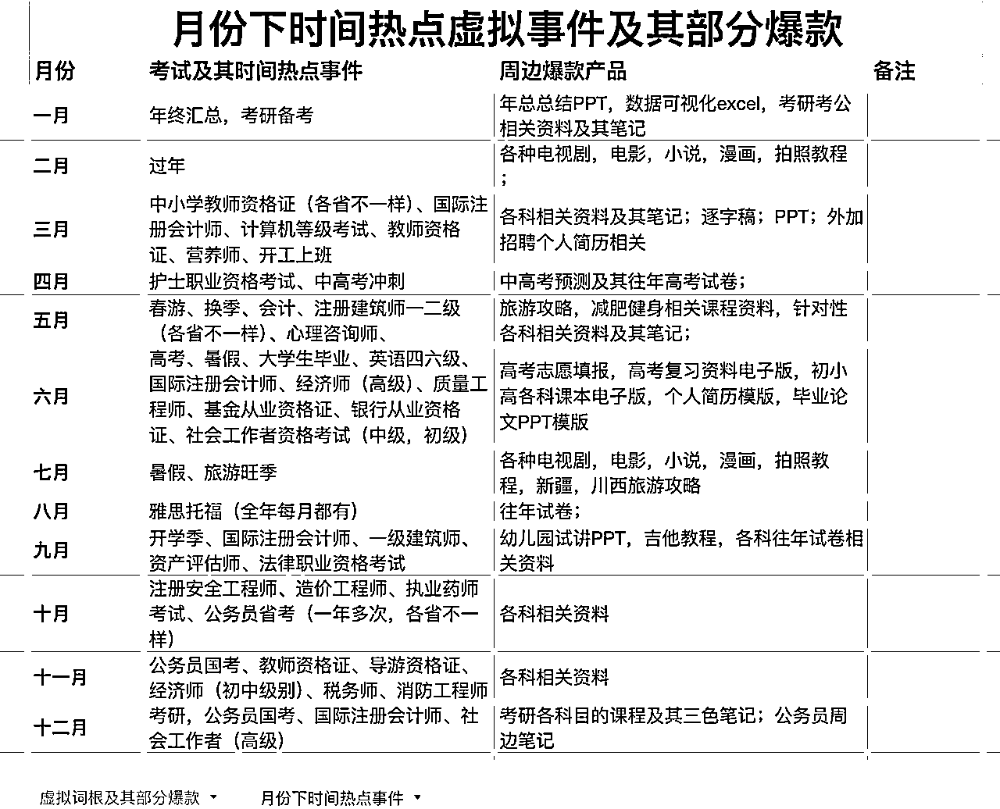

这类节点每年重复，提前卡位即可抢先。

### 4.2 热点趋势选品法

无规律的爆发型机会：哎呀咿呀照片动图教程、羊了个羊攻略、爆火短剧、AI聊天软件教程等。

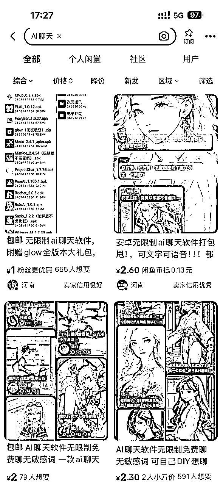

需要长期刷朋友圈、抖音、📕，看到近期裂变话题立刻去闲鱼验证，上车快是关键。

### 4.3 爆火行业热点法

今年AI、视频号、📕等行业火，相关教程和工具需求就起来。搜主关键词就能找到AI聊天软件、视频号下载工具等品，再不断横向延展。

## 5）同行拆解法

在验证“大学生创业计划书”时，发现同店也在卖“开发者简历模板”“各行业运营SOP”。一个入口带出多个品。

继续看同行动态或商品页，锁定心动指数高的爆款，源源不断补货品池。

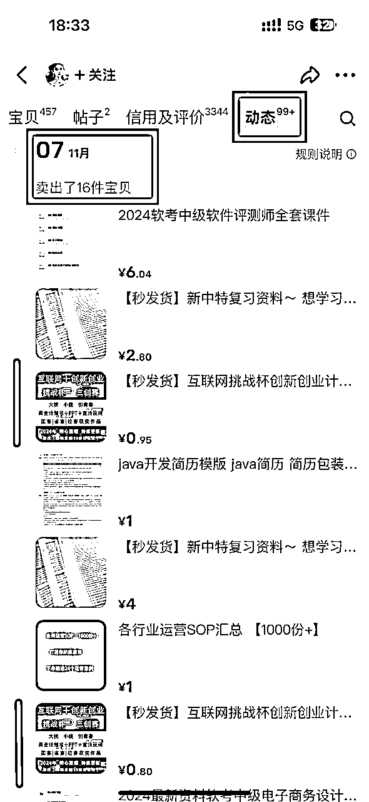

可以先在闲鱼用以上方法找品，再去淘宝、拼多多看市场热度，最终必须回流到闲鱼验证标准，不能直接照搬。

选品与验证搞定后，就是上架与批量化。

# 三、快速上架、自动发货与单人批量化

选好品不用先买。下单后再去市场采购一单，直接发给买家。流程很轻。

编辑上架最简单就是参考同行：借鉴优质标题、裁剪主图、修改图片MD5值避免重复，按同行的上架位置发布。

也可以用采集发布工具，一键从闲鱼、淘宝、拼多多抓取商品并自动改图改价，批量推送到多个店铺。

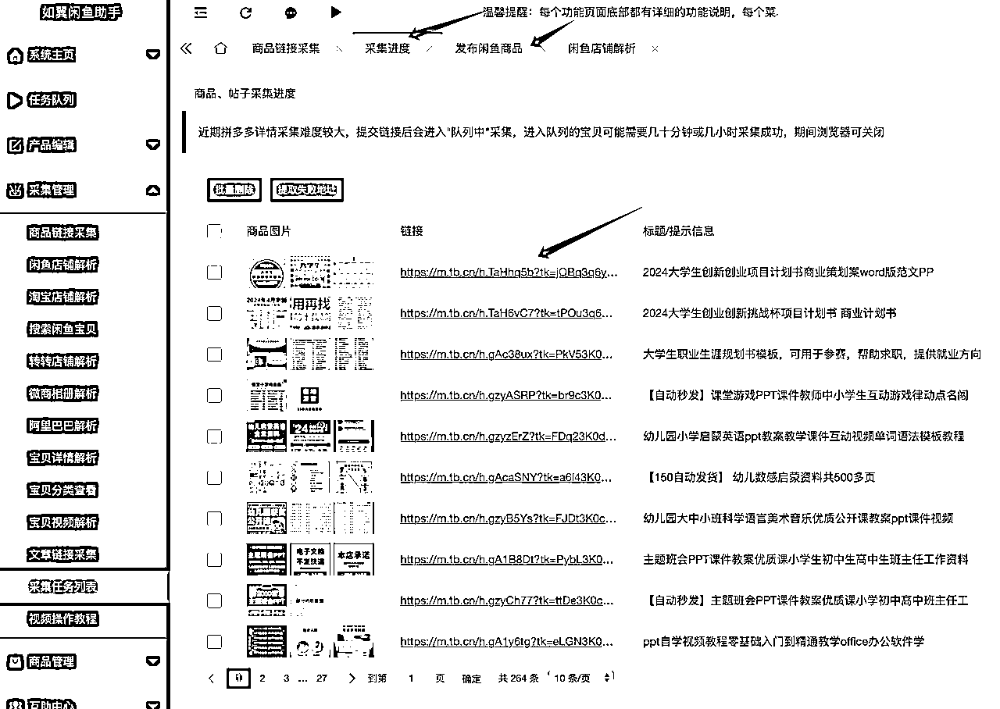

工具还可按心动指数排序采集，按条件自动上架。工具地址：https://ruyi.api-z.cn/ 仅作思路参考，建议先手动0-1跑通，再考虑工具化。

单人手动完全可行，前期建议手动熟悉逻辑，后期再上工具放大。

上架后，出单自动发货用闲管家。

官网：https://www.goofish.pro/ 注册登录后绑定账号，按指引设置。

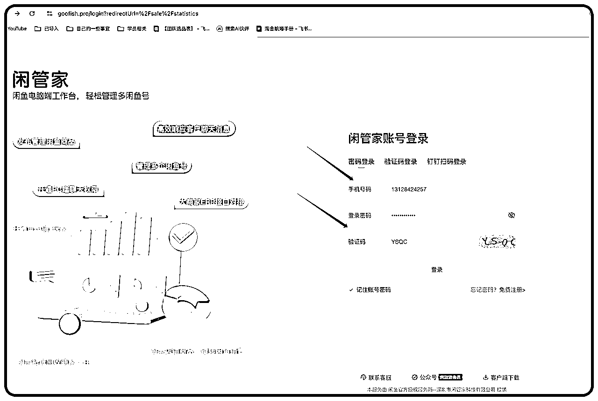

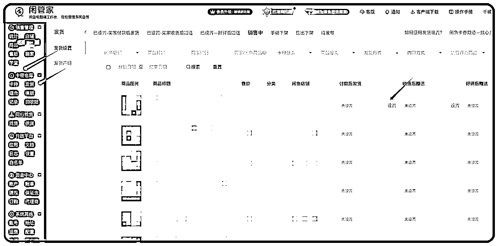

设置完成可在灭屏状态下自动发货，大大解放人力。鱼小铺权限没开前，记得出单后手动补上架。

阿奇索也是类似的第三方工具，可咨询客服代设。

操作注意点：

1. 前期消息要及时回，通知打开，空闲时多刷一下。
2. 只做验证思路达标的近期畅销品，心动指数至少100+。
3. 前期每天上新5个左右即可，未开通鱼小铺先控制在50个以内，开通后可到200个。

到此结束。希望这套方法能帮你把闲暇时间变成额外收入，跑出数据欢迎交流，祝起店顺利。