# 宠物攻略解说视频复刻：Youtube shorts 制作实操
作者：龙哥

大家好，我是龙，赚钱第8期新圈友~

这篇笔记想和大家拆解下我在 YouTube Shorts 上复刻【宠物攻略解说类】视频的心得，灵感来自@老馬🐎内容出海的分享帖。

PS：感谢大佬超细的拆解！我后面做 AI 猫猫视频的实操也是沿着这篇走的

本文主要安排如下，按需阅读即可：

1、为何会切入【宠物攻略类】赛道？
2、【宠物攻略类】账号收益拆解
3、【宠物攻略类】选题规律
4、【宠物攻略类】1:1 复刻全流程
5、起号节奏与难点
6、结语

# 1、为什么会尝试【宠物攻略类】赛道

龙哥老大分享的超级标核心是把 AI 生成的短视频发到 YouTube 和 Shorts 上变现。但不同 AI Shorts 的门槛差很多，比如【AI猫猫视频】比【AI萌娃走秀】更复杂。

我结合自身情况、赛道难度和收益预期做了筛选。

自身背景：
此前只用过 ChatGPT、Kimi 这类聊天模型，没碰过 AI 绘画和 AI 视频。

因此前期要求：
① 能看懂对标号的制作逻辑，或网上能找到教程方便模仿
② 对标号里至少有一部分已开通 YPP，目标就是赚钱，开不了 YPP 的赛道没意义

确定标准后，我对照@钱塘江鲤和@老馬🐎的内容做筛选。为了避免完美主义拖延，我给自己定了deadline：10月31日、11月1日两天内必须定方向并开做。否则很容易一直找“完美赛道”：好懂、可变现、制作轻、竞争小，尤其对 YouTube 新手来说，一开始就捡蓝海不现实。

两天后初步锁定三个方向：AI猫猫、AI 转绘、宠物攻略解说。

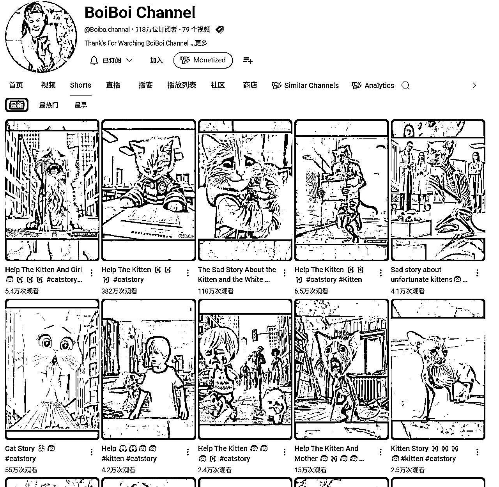

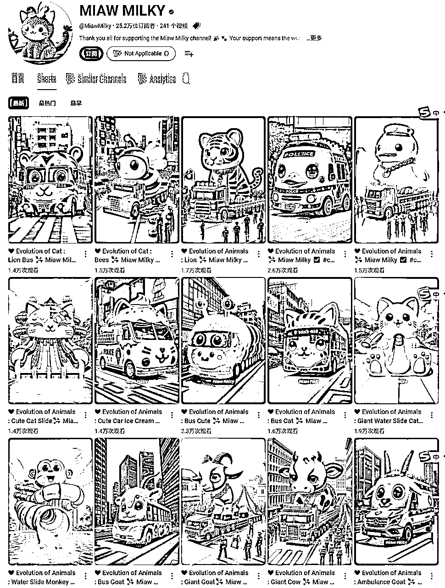

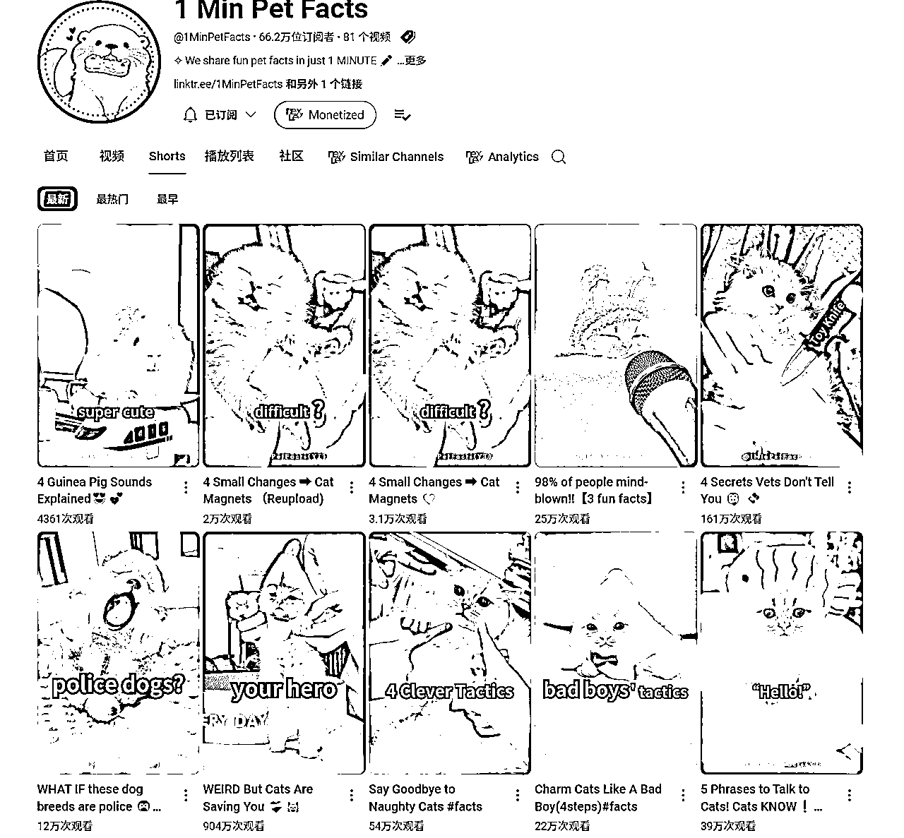

前两种能全程 AI 生成，宠物攻略解说旁白可用 AI 辅助，但剪辑和素材收集仍需手搓。龙哥老大在 AI shorts 超级标后开了龙珠悬赏，我判断会有不少圈友涌向 AI 方向，跟随大家的经验再入场会更快。宠物类反馈可能更少，因为手搓耗时更长。但@老馬🐎也分享过这个赛道，并说准备下阶段起号，说明仍有机会。而且所需技能基本在我能力范围内：逐字稿用 ChatGPT 改写，配音用圈友分享的 AI 配音站，找素材和剪辑之前有做过。

综合考虑，我先复刻宠物攻略类，再结合圈友分享尝试 AI 类。目前宠物攻略的 1:1 复刻已跑通，AI 猫猫和 AI 转绘也在跟进中。这篇文章先分享宠物攻略的分析和实操。

# 2、【宠物攻略类】账号收益分析

定方向后，先找对标号评估收益空间。

## 2.1 找对标的方法

1. 直接按分享帖里的对标截图，用标题在 YouTube 搜索，找到第一条账号。

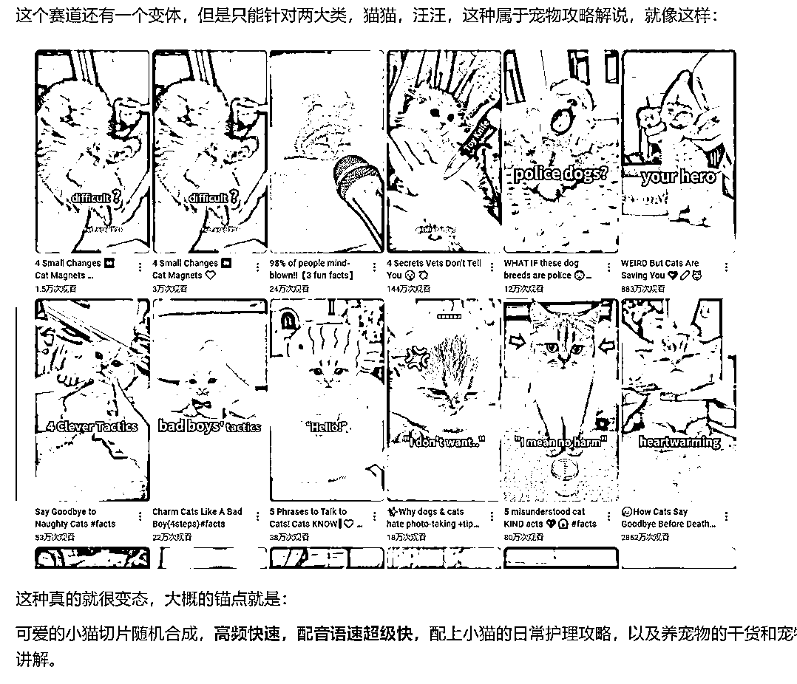

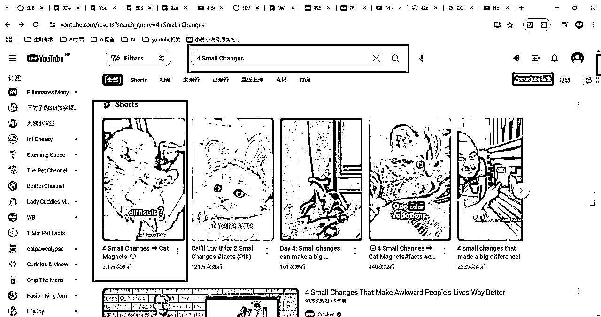

2. 按@老馬🐎的方法，对找到的账号关注、点赞，回首页刷新，看到相似视频就点进账号。

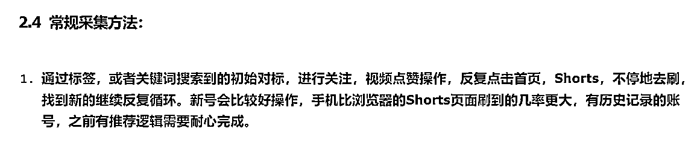

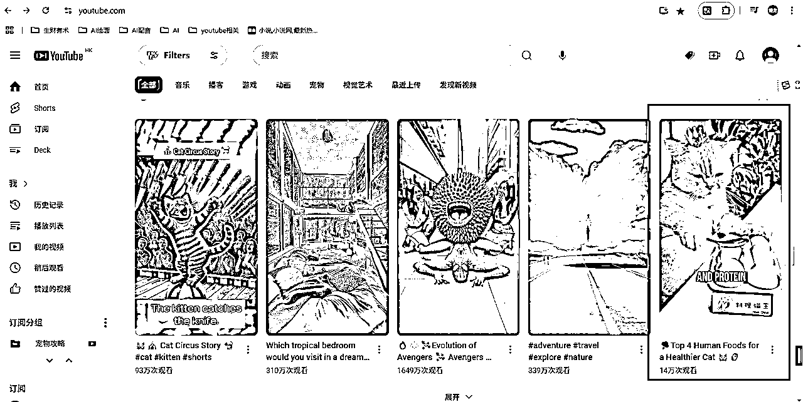

反复操作后一共找到 7 个对标号：

| 对标账号 | 所在国家 | 视频数 | 订阅数 | 播放数 |
| https://www.youtube.com/@1MinPetFacts | / | 81 | 66.2w | 318,799,186 |
| https://www.youtube.com/@ladycuddlesmeow | / | 1203 | 76.2w | 668,569,138 |
| https://www.youtube.com/@catpawcalypse | 美国 | 77 | 26.9w | 81,712,070 |
| https://www.youtube.com/@PetsCofe | 美国 | 92 | 7.93w | 19,775,560 |
| https://www.youtube.com/@cuddlecatstales | 摩洛哥 | 360 | 18.2w | 110,939,889 |
| https://www.youtube.com/@ChipTheManx | / | 923 | 48.9w | 361,910,856 |
| https://www.youtube.com/@petfactum5343 | 拉脱维亚 | 140 | 30.9w | 171,845,644 |

数量偏少，部分账号并非纯做宠物攻略。可能是方法问题，也可能是赛道本身参与者不多。

## 2.2 典型对标账号分析

我选的对标是 https://www.youtube.com/@1MinPetFacts

账号很典型，2023/6/27 前发的是可爱动物片段拼接，从 2023/6/27 开始转为宠物攻略解说，之后全是这个定位。

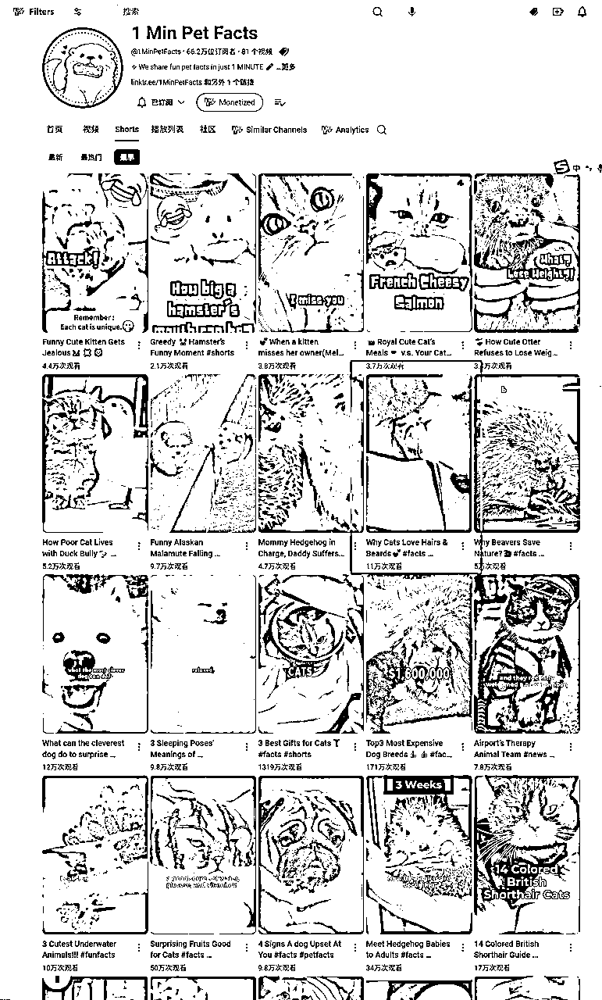

更新频率 1-3 天一更，我第一次复刻一条视频耗时约 9 小时。从转型开始，第 5 条视频就爆了，1300 万播放。

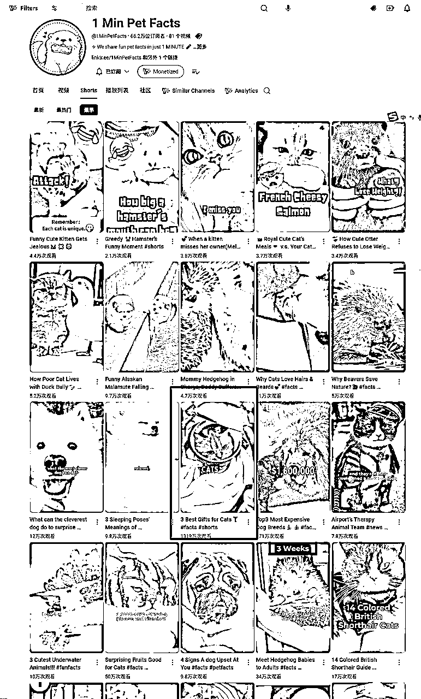

流量很稳，未爆款一般几万到几十万播放，且生命周期长。从 23 年 6 月第一个爆款起，时不时仍有百万级和千万级爆款。最近百万爆款在 24 年 8 月，近千万在 24 年 6 月。

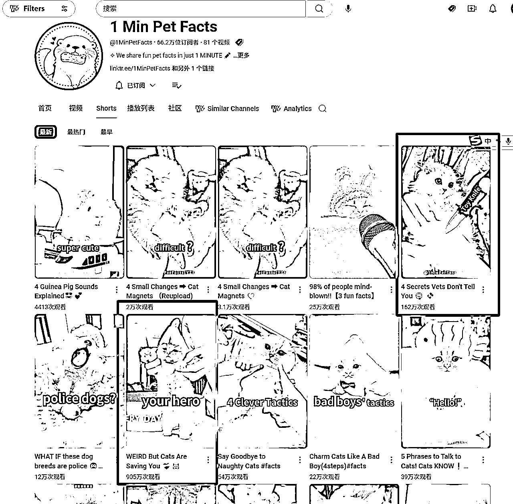

## 2.3 对标账号收益分析

该账号只发了 4 个长视频，播放约一万，可忽略。

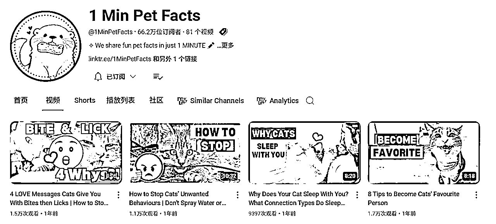

主页总播放 3.1 亿，减去开通 YPP 的 1000 万，Shorts 约 3 亿。

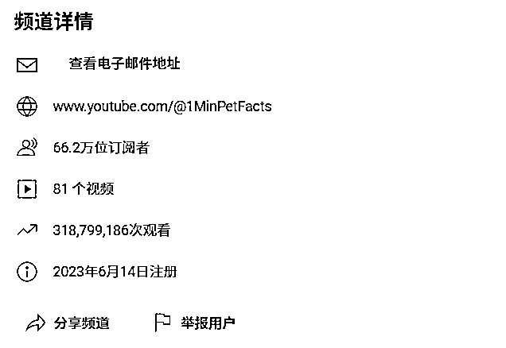

参考@老馬🐎的计算方法，万播 1 美元。

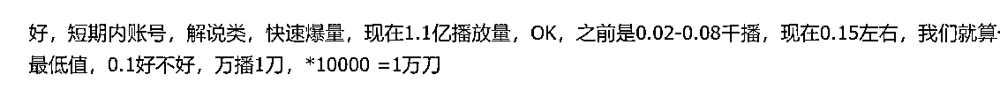

总收益 = 30000 万 / 1 万 * 1 = 30000 美元 ≈ 21 万人民币

共发 88 条，按 90 条算：

单条收益 = 21 万 / 90 ≈ 2333 元

我复刻一条典型视频首次耗时约 9 小时。

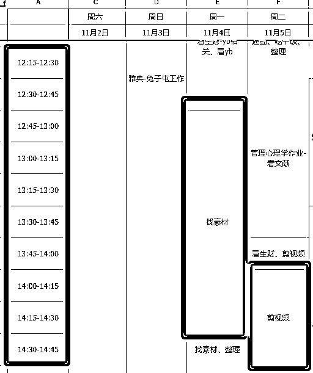

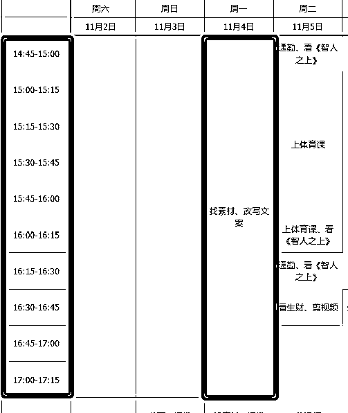

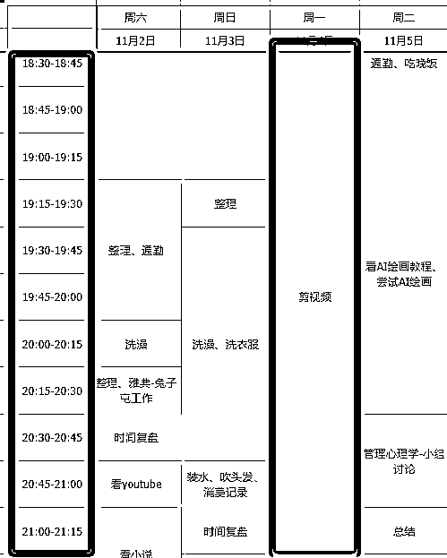

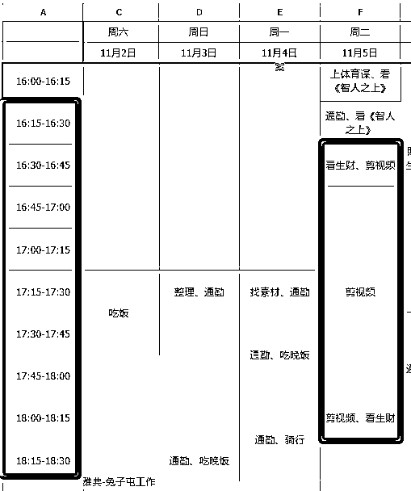

按 9 小时算：

时薪 = 2333 / 9 ≈ 259 元

这还是新手速度，熟练后会更快。市面剪一条视频几十到几百，YouTube Shorts 跑通后单条 2300 元，选哪个很清楚。

算收益很重要，能把回报具象化。写这篇文章前我只知道这个账号赚钱，具体赚多少很模糊。现在算下来一条 2400 元，剪 4 条月薪过万，动力完全不同。

# 3、【宠物攻略类】账号选题分析

以对标号看，爆款基本集中在猫相关攻略，狗的较少且多为百万级。

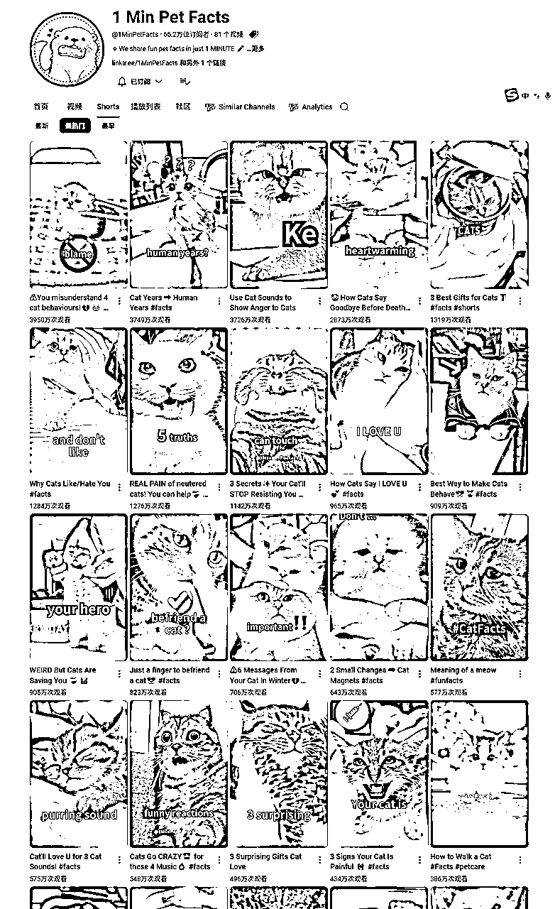

千万播放选题统计：

| 选题 | 发布时间 | 播放量 |
| You misunderstand 4 cat behaviours! | 2023/12/27 | 3950w |
| Cat Years ➡️ Human Year | 2023/10/25 | 3749w |
| Use Cat Sounds to Show Anger to Cats | 2023/8/24 | 3726w |
| How Cats Say Goodbye Before Death | 2024/3/17 | 2873w |
| 3 Best Gifts for Cats | 2023/7/3 | 1319w |
| Why Cats Like/Hate You | 2023/7/24 | 1284w |
| REAL PAIN of neutered cats! You can help | 2024/3/10 | 1276w |

大致两类：
① 如何解读猫的行为
② 如何对待猫

起号思路：先模仿后超越
① 统计对标号所有百万播放选题
② 按发布时间和播放量优先模仿近、热的爆款

如果对标号少、选题被吃完，可从其他平台迁移：
① TikTok 上找宠物攻略博主，按播放量和时间筛选
② 外网找完后再看抖音、📕

其他平台选题可参考框架，不可照抄。YouTube 视频基本在 1 分钟内，可容纳一定干货。可把其他平台逐字稿下载，用 AI 改写成 1 分钟内，开头模仿 YouTube 对标节奏。

# 4、【宠物攻略类】视频复刻全流程

重点来了，如何 1:1 复刻爆款。我选了“WEIRD But Cats Are Saving You”，发布于 2024/6/30，播放 905 万。

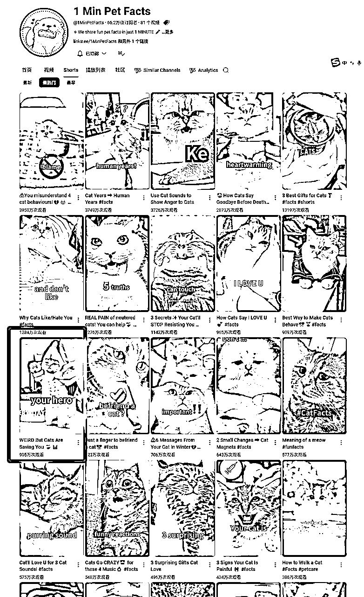

以下为对标视频和复刻视频对比。

从文案、配音、画面、BGM 四个维度拆解。

## 4.1 逐字稿抓取和改写

先下载视频，我用的是：

https://ytshorts.savetube.me/zh/29-youtube-video-downloader-1keen2

抓字幕，我先试了圈友推荐的插件：

https://chromewebstore.google.com/detail/youtube-summary-with-chat/nmmicjeknamkfloonkhhcjmomieiodli

实操发现只能抓长视频字幕，Shorts 不行。用 Google 找到的网站可抓 Shorts 字幕并多语言输出：

https://www.downloadyoutubesubtitles.com/zh

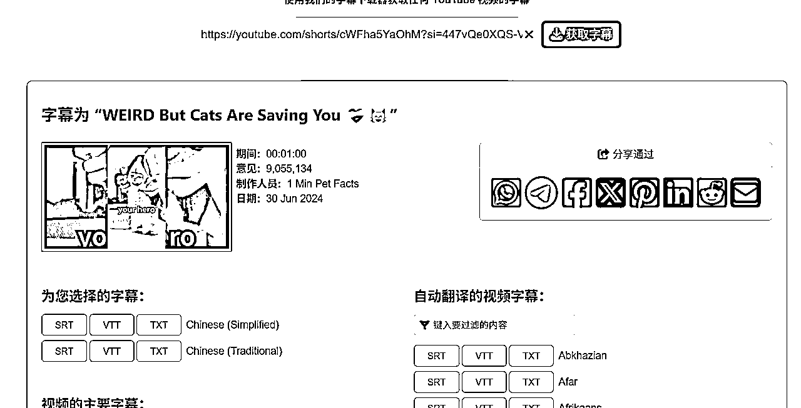

该网站偶尔识别不准，需核对。如我案例中 four 被抓成 or。

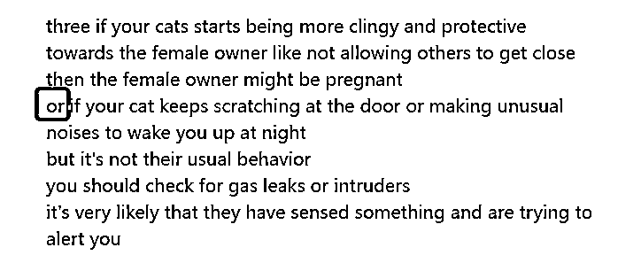

为避免查重，用 GPT 简单改写。

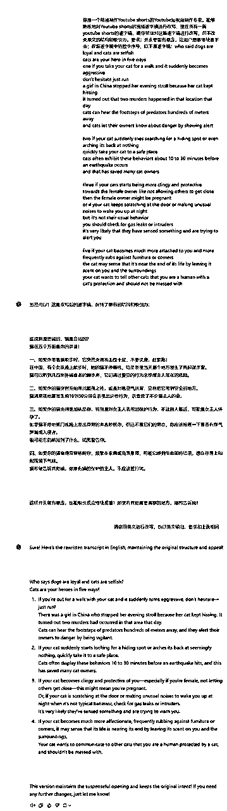

改写后与原文差异不大，后续需优化提示词，否则原创风险高。

## 4.2 AI 配音

画面按文案和配音剪，所以先做配音。

我用 ElevenLabs：

https://elevenlabs.io/app/speech-synthesis/text-to-speech

左侧 Voices 进 LIBRARY 选音色。对标是年轻女声，我选 English、American、Female、Young。

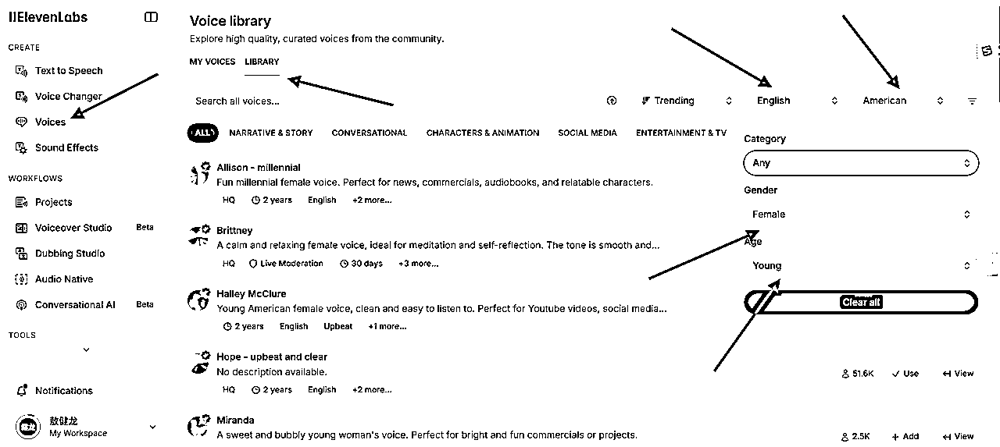

多听几款，选最像的。选定后点 MY VOICES 右侧 USE 弹出文本框。

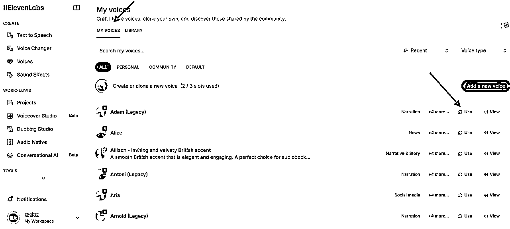

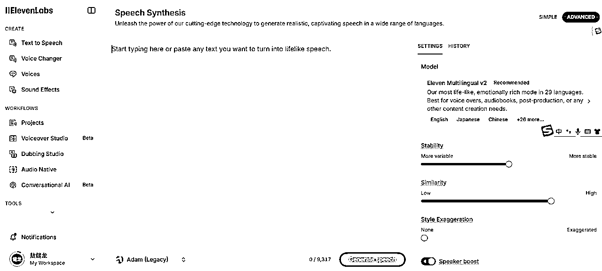

粘贴文案生成即可。该站有 10000 单词免费额度，后续需付费。后来看到@SunDay分享，OpenAI 的 https://ttsopenai.com/ 可免费无限配音，成本省掉。

踩坑提醒：
1. 对标视频说数字后会停顿，我没设置，导致数字连读不清晰
2. 需加停顿或情绪可参考：https://youtu.be/LUmjBtINiYs?si=V3rrRuyaVcc3jPZw
3. AI 配音无法控语速，我生成的时长比对标长约 15 秒，Shorts 需控在 1 分钟内
4. 解决：用剪映变速 1.1x-1.2x 就行，再快会怪。

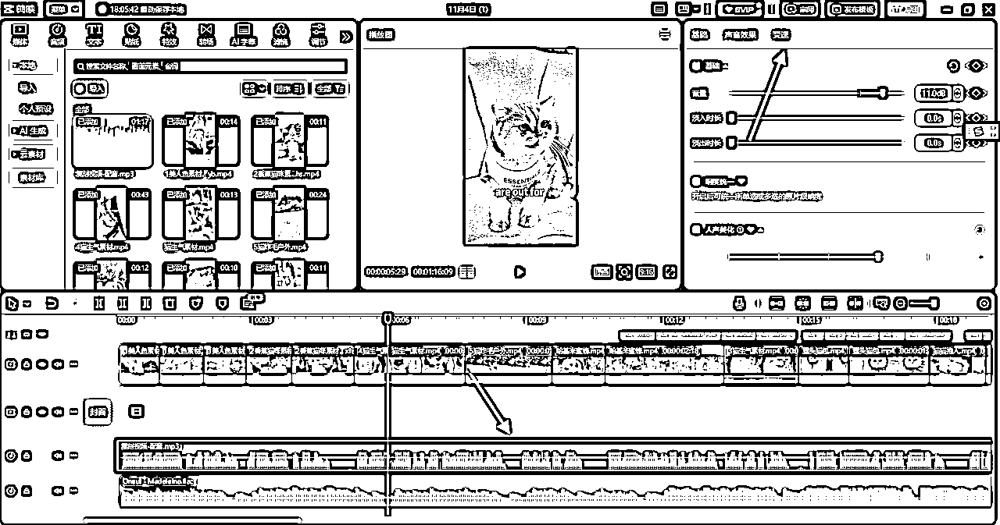

## 4.3 BGM

配音搞定后处理 BGM。最初想用 🐧 音乐识曲，但人声盖住 BGM 识别失败。先做人声伴奏分离。

剪映会员可分离，为保持低成本，我用 YouTube 找到的 Ultimate Vocal Remove 5.5 免费分离，效果不错。参考：https://www.youtube.com/watch?v=-_mp-Kuc6eA&t=345s

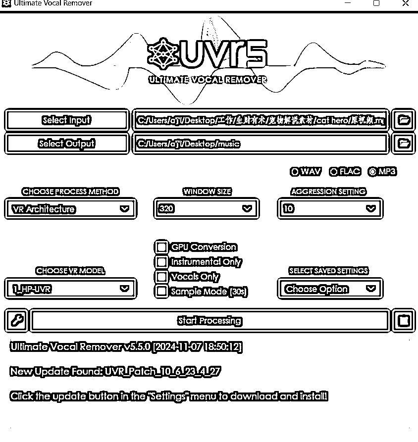

分离后 🐧 音乐可识别，找到音源下载备用。

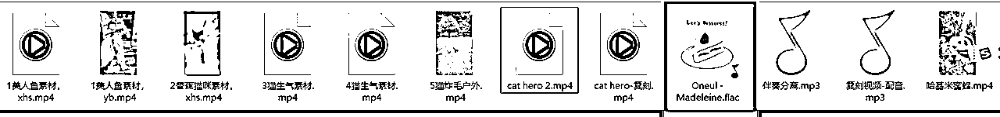

文案、配音、BGM 齐了，难点是画面。不能照抄，需找相似画面替换。

## 4.4 找画面素材的三种方法

第一种：Google 识图找替代素材。想过让 AI 看截图找相似，但实测豆包结果不相关。

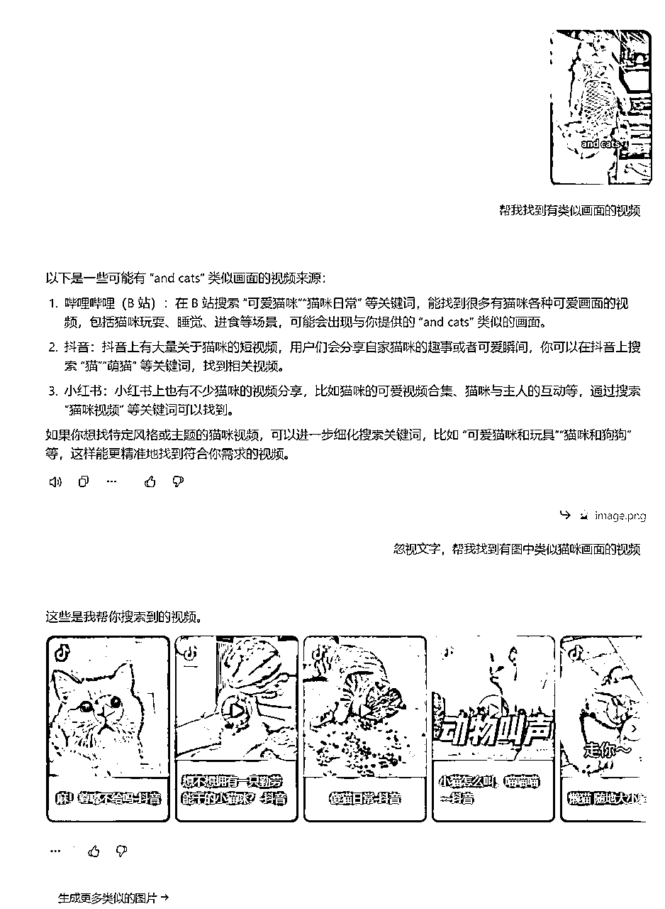

最终用 Google 识图，打开搜索点相机，上传对标视频截图，可在 YouTube、TikTok 找到相似画面视频，直接下载。

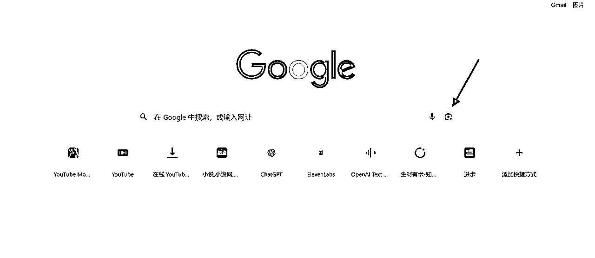

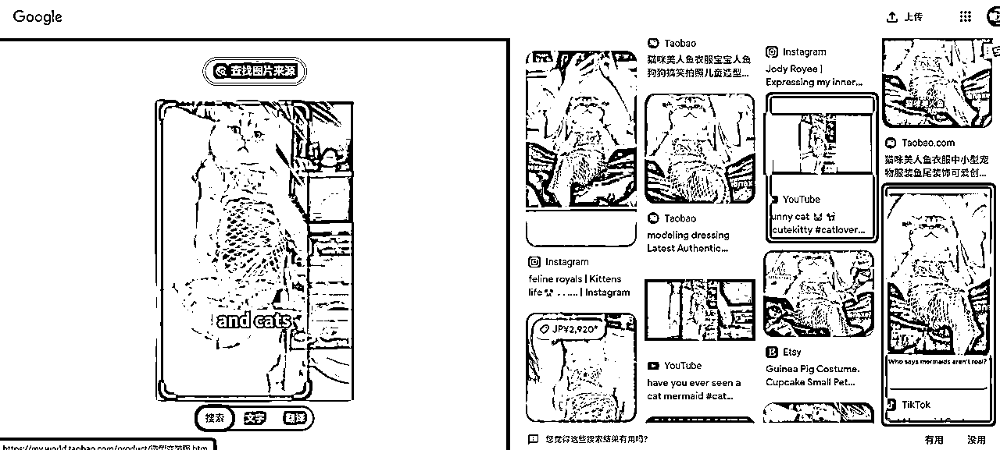

以上就是我从零复刻宠物攻略 Shorts 的完整经历。核心是先把收益算清再选赛道，吃透对标账号和选题规律，再在文案、配音、BGM、画面四环节逐项打磨。

做这类视频有一个核心原则希望大家牢记：不要直接照搬对标视频的画面。就算你顺藤摸瓜找到了它的源素材，也尽量挑不一样的帧来用。只要源头素材够长，操作起来就很简单——直接从里面截取其他镜头就行。

拿我自己举例，我的复刻视频和对标视频的开头都是"猫美人鱼"，但仔细比对就会发现画面完全不同。原因就在于我没用对标的那几帧，而是去源视频里挑了另外几帧来替代。这样既能保持整体感觉相似，又能在查重时安全过关。

但问题来了：如果你通过截图反查，找到的源视频本身就特别短，对标已经把关键画面用掉了，剩下的根本没得选，这时候该怎么办？

那就轮到第二个方案上场：

方案二：观察画面里主体的动作，然后去社交平台搜索类似素材。

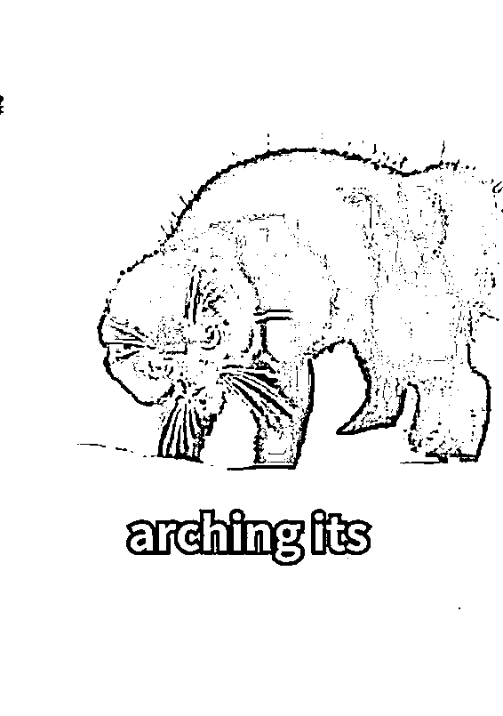

举个例子，上面那个画面里的猫，我追到源头视频后才发现整个素材只有几秒，而且最好的那段已经被对标视频用掉了。不过仔细看这只猫的状态——弓背、炸毛——思路一下子就打开了。我们没必要死磕同一个镜头，找其他猫弓背炸毛的画面来替代完全可行。

方向确定后，我直接切到📕搜"猫猫 炸毛"。

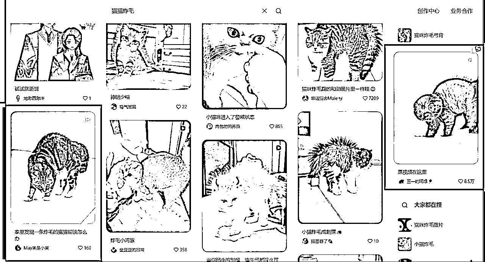

结果除了对标视频的源素材之外，还冒出来不少高质量的无字幕猫猫弓背炸毛视频。挑一个镜头角度接近的，比如左下角那个，下载下来把炸毛的几秒画面截出来，替换掉原视频即可。

其他画面也可以按同样的思路处理：先用Google识图反查源视频，看有没有和对标风格接近的镜头，有就直接用；没有的话，就根据画面中猫的动作，跑去📕、抖音这类平台搜索。

这段时间实测下来，TikTok和📕的素材质量是最稳的，尤其是📕。大量素人用户会分享自家猫咪的日常，几乎都不带字幕，下载下来就能直接用于替换。

（我用的📕下载工具是：#小程序://红薯宝库去水印/n9PgGKmVSC1pESt）

除了以上两种，还有第三种路子：长期关注那些高频分享宠物日常的博主，盯住他们的主页，以后素材直接去那里取。目前我收藏了TikTok的nabistiktok、📕的小嗲精仔仔等几个账号，质量都相当能打。大家平时找素材时可以多留心，看到不错的就顺手点进主页瞄一眼，关注起来。

按照这三条方法，我们可以把对标视频里用到的所有画面全部找齐替代素材，统一归档。

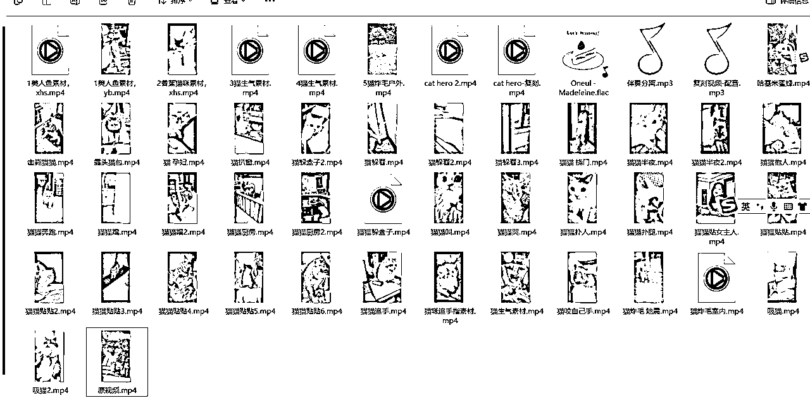

接下来就是按对标视频的节奏，把素材一段段替换进去。

考虑到文案改写和配音重录的误差，我们很难让时长和对标完全一致。这种情况下，配对画面也有两个思路。

## 4.5 替换画面的两种思路

第一种：盯住对标视频的字幕节点——它在哪两段字幕之间放了什么类型的素材，我们如法炮制。以开头部分为例，在who said dogs are loyal and cats are selfish这一段里，对标全程使用猫美人鱼素材，其中who said dogs are loyal是一段连续画面，到and cats are selfish时切到了另一段不同画面。我们复刻时也照这个节奏来，整段都用类似的猫美人鱼素材，但who said dogs are loyal和and cats are selfish这两段的画面不能连续。

（我因为配音语速偏慢，额外做了第三次切换，同样是猫美人鱼素材。一条素材别放太久，1-2秒左右比较合适。）

第二种：万一找不到对应的画面，就根据字幕传达的意思来配图。比如下图这一段对标视频：

内容为：

two if your cat suddenly tries searching for a hiding spot

or even arching its back at nothing

quickly take your cat to a safe place

cats often exhibit these behaviors about 10 to 30 minutes before an earthquake occurs

and that has saved many cat owners

大意是说：如果你家小猫突然试图找个地方躲起来，或者对着空气弓背炸毛，要立刻把它转移到安全地带。因为猫咪通常在地震前10到30分钟会发出这类警告，而且已经救过不少铲屎官。

我找不到太多与对标近似的素材，但根据内容含义判断，可以锁定两类视频：一类是猫弓背炸毛，一类是猫躲藏。按原视频的剪辑节奏把素材填充进去，大概率能成立——我的复刻版本就是这么拼出来的。

坦白说，这种模仿不算特别精致，但在实在找不到对应素材时，确实是个靠谱的兜底选择。优先级上，还是尽量找与对标接近的画面来替换。

把上面两种方法配合原视频的节奏使用，就可以把对标视频的画面全部换成我们自己找的素材，完成复刻。

这次复刻算不上完美，配音时没考虑语速，明显比对标慢了一截，视频总时长也被拉长了。语速不够快，画面和字幕切换就会跟着变慢，观众的刺激密度一降低，很容易直接划走。先完成再完美，后面慢慢迭代吧。

# 5、起号计划及难点分析

## 5.1 难点分析

想走【宠物攻略类】赛道起号，大概率会撞上这几个卡点：

1. 视频制作耗时过长。我复刻第一条视频花了9小时，找素材和剪辑几乎对半开。按我的效率，一个视频要2天才能出炉，在更新频率和起量上不占优势（和AI类内容对比起来尤其明显）。

解决方法：
- 剪辑环节很难大幅提速，只能靠熟能生巧；素材环节倒是可以建一个素材库，把常用素材分类归档，比如"猫猫弓背炸毛"一组、"猫猫贴贴"一组，每组攒几十个备用。等需要复刻时直接从库里取，搜索筛选的时间全省了。
- 另一个路子是去拼多多或闲鱼，买别人打包好的无水印萌宠素材，连自己动手整理都省了。不过这个方案我还没实测过，靠不靠谱暂时存疑。
- 如果你不想建素材库、坚持按上面流程手搓，可以用@老馬🐎内容出海分享的视频截取软件，把对标视频的不同画面一键截出来，然后直接去搜，省去手工截图的功夫。

2. 成本上主要还是时间消耗。真要算花钱的地方，无非AI配音和剪映字幕识别这两处。

解决方法：
- 前者可以用OpenAI的配音网站来省钱；后者直接下载CapCut（海外版剪映），国内要开会员才能解锁的字幕识别，CapCut居然免费——太坑了！

3. GPT改写文案的提示词还得继续打磨。我之前用的提示词，改写出来的文案和原文差别不大，查重这关恐怕过不了。

4. 做的时间长了，大概率会遇到一个转型问题：怎么把中文选题和文案转换成YouTube上更吸睛的形式。等对标账号的选题被消耗得差不多，这个问题就躲不掉了。

解决方法：
- 可以参考@老馬🐎内容出海提供的文案结构，试着交给GPT或Claude去训练学习，把文案压缩在1分钟以内，再把开头改得更抓眼球。

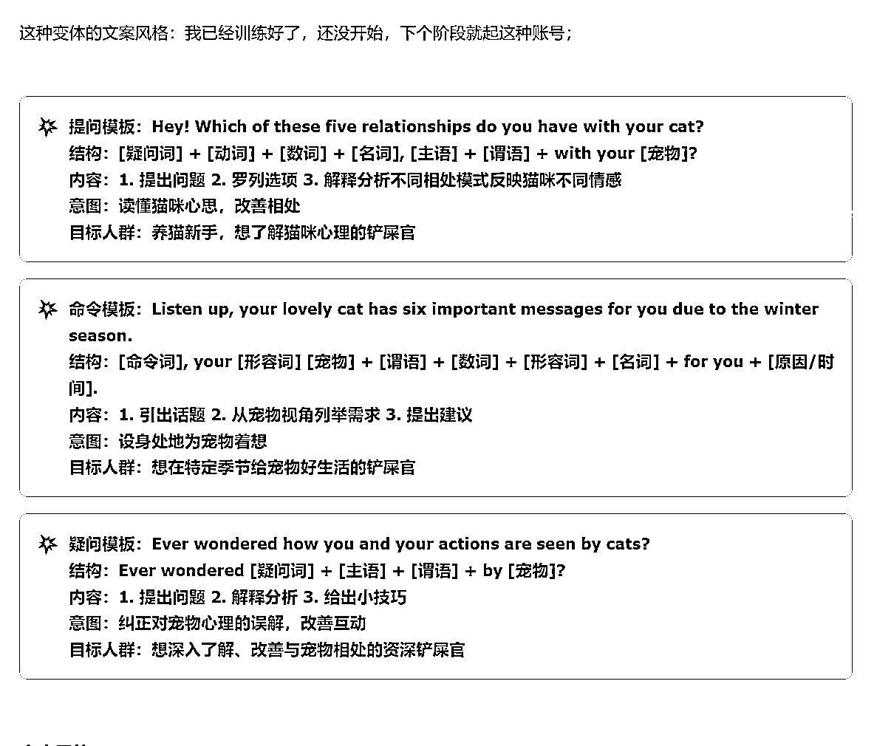

## 5.2 起号计划

YouTube Shorts的YPP开通门槛是：过去90天内拿下1000名订阅者和1000万次播放。

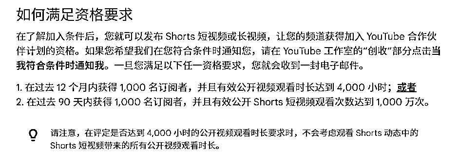

我的起号计划完全围绕这个门槛来设计。

①最低目标：
3个月内达到1000订阅和1000万播放，通过YPP审核。

这种体量的数据光靠shorts的常规流量（每条视频一万上下）根本跑不动，只能押注爆款。出一个千万级爆款，或者几个百万级，都能完成任务。目前的想法是保持1-3天一更，把对标的爆款全部模仿一遍，一边观察数据一边调整节奏。

②最高目标：
1个月内完成1000订阅和1000万播放，通过YPP审核。

要够到这个目标，更新频率必须拉满，尽量做到日更，持续模仿对标的爆款才行。通过YPP审核后，下一步就是跑矩阵起量，不过宠物赛道跑矩阵没那么顺手，大概率需要招人。一个人剪视频的效率终归有限，没法像AI类内容那样走暴力铺量的路线。

# 6、尾声

先感谢龙哥老大的第二轮龙珠悬赏，让我蹭着这股东风，在赚钱发出了第一帖。

加入赚钱才一个多月，但我真的超爱这里！过去我也习惯在朋友圈写点分享，可在赚钱发帖确实是头一回。之前总觉得自己实操经验太少，分享出来怕没什么价值，想着先潜伏几个月攒点积累再说。龙哥老大的龙珠悬赏，刚好给了我一记临门一脚。

这几天把大家的龙珠悬赏帖都翻了一遍，发现一个很大的妙处：不管分享写得详细还是简略，每个圈友的帖子都能让人榨出点东西来——可能是工具，也可能是思路。很多时候，我们习以为常的经验和操作细节，对别人来说恰恰是意想不到的启发。分享本身，就是一件极有价值的事。

感谢@老馬🐎内容出海大佬，我在超级标上的大部分灵感（萌宠解说、AI转绘）和实操（复刻AI猫猫）都是跟着你的思路在跑，你的分享价值真的拉满！

感谢@叉叉敌，看了你的分享才知道AI Shorts能全流程自动化，我之前的思路还停留在手动剪辑阶段。

感谢@钱塘江鲤大佬，自动抓取数据那招太牛了！我找YouTube对标，大多数是靠你整理的数据来索引的。等我学了AI编程，一定来尝试复刻你的能力。

感谢@SunDay，从你的帖子里找到了AI配音的省钱方案，又帮我省下一大笔钱（狂喜）。

感谢@星吟Singing，你分享的巨型海洋动物赛道对我启发很大，我当时找的时候压根没翻到。

感谢@一页书，你那个用数据分析和筛选赛道的方法很受用，我之前全是在手动硬刷，效率太低了。

感谢@竹子。，你分享的人+动物融合magic秀赛道真的很棒！我的可选赛道又多了一条。

感谢@方波妮，原来AI航海手册里就有萌娃走秀的实操步骤！我压根没往那想，光顾着去YouTube翻了（还没找到）。以后做项目，一定要多翻翻航海手册。

最后再次感谢龙哥老大的超级标和龙珠悬赏，让我看见了一个项目的N个实操方向和细节，还顺带产出了自己的第一篇帖子。下一个目标：11月YouTube航海，想申请当志愿者！（如果能被选上的话）

分享就先到这里。接下来我打算继续深耕AI方向，等有成果了再回来跟大家汇报。