# 【航海好事】 八期新手踏出舒适圈第一步，线下同城夜校航海复盘

> 来源：[https://c2z3ysmn07.feishu.cn/docx/B0DedJMh4onXE6xzUdicNH0AnWh](https://c2z3ysmn07.feishu.cn/docx/B0DedJMh4onXE6xzUdicNH0AnWh)

各位圈内朋友好，我是饮茶，又叫老陈，生财第8期新人。

很幸运抢到第一期夜校航海的名额，并通过生财筛选，全程参与这场为期一个月的线下同城夜校实战。恰逢双十一节点，和船员们一起吃到了一波明显的流量红利。

项目周期从十月中到十一月中，主要在小红书、视频号、抖音做素人账号，核心是引流与转化，把学员导入私域完成成交，课程交付与售后由合作商家负责。实操性强，上手门槛不高，有兴趣的圈友可以交流。

# 一、为何加入【线下同城夜校】

曾是设计圈的从业者，受《交换空间》《艺术创想》影响，与发小一起读了环境设计。毕业后做到独立设计师并开工作室。近年房地产低迷，设计相关业务承压，工作室推进缓慢，我开始迷茫，思考是否要换赛道。

家里一直做墨西哥、菲律宾五金配件的外贸，过去靠线下展会面谈。疫情冲击下，全球经济放缓，境内境外展会几乎停摆，传统渠道被阻断。

当时我嗅到线上机会，从朋友处了解到生财的信息，还在21年底去菲律宾实地考察过，本想接手家业做线上，家里觉得我资历浅未放手，我也不愿只做执行，便继续留在设计岗位。

### 同城业务的尝试与积累

我本身是线下销售出身，社交属性强，湖南群的拼局基本都参加。

年初一次聚会聊到同城流量，我与伙伴搭起了搭子群、读书会、爬山群、相亲群等。虽因经验不足，运营效果平平，却也积累了同城操作的体感。国庆前后又聊到同城医美，发现能对接手头的客户资源，对同城项目的好奇更浓。

就在这时，教练团队发布了“同城夜校”。一方面我已有同城试错经验，觉得夜校是加码同城的好入口；另一方面两位死党也极力推我试试。项目当时争议较大，有看好也有观望。综合自身职业瓶颈、过往经历以及朋友建议，我决定加入，期望借此打开新的增长口。

# 二、【线下同城夜校项目】实操拆解

先说个教训：后面的环节一定要照做，别再瞎改。

设计师通病：图文模板可以出，但不能容忍作品太丑。可是！！爆款远非你想的那样；牢记：照做即可。

起初大家都认为小红书用户偏女性，图片越精致浏览和点赞越高。结果全是收藏，没评论没点赞没私信……要它何用😭。对比我的笔记和清华哥的反馈，差距明显。

与伙伴、教练沟通后才明白：图文文案要有争议点、画面对比要强、呈现点要突出，才能拿到更高曝光；用户视角是：打开小红书的流里，你凭什么一眼被看到？

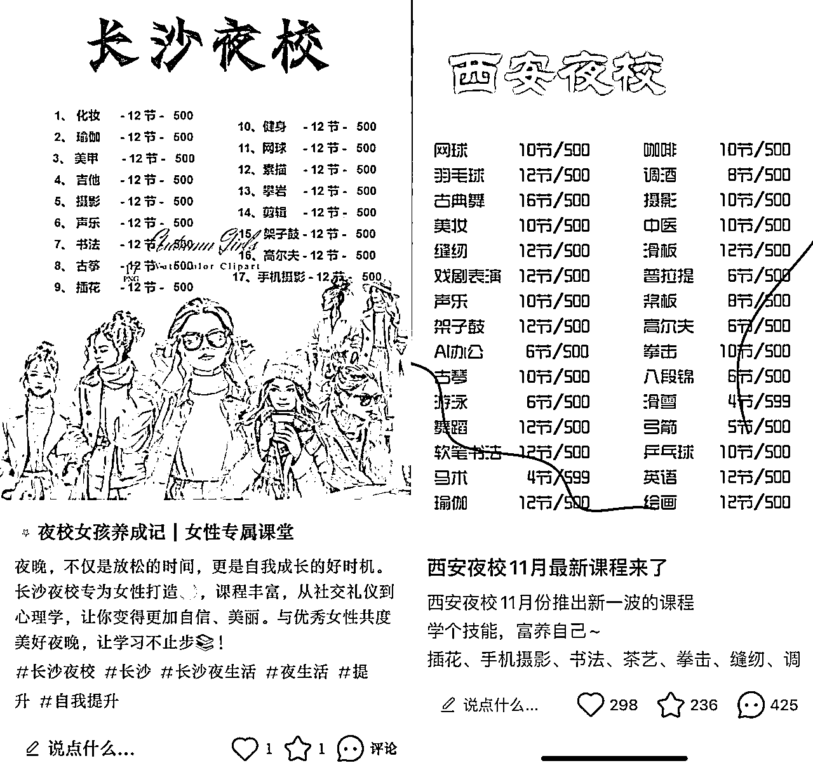

实操层面，同城项目核心是私域成交，夜校闭环即【引流-转化-下单-售后】

### 1、引流

项目不做废号流，每个号都要养数据，保证“一机一卡一号”；异地号可用改定位工具发帖。

#### 小红书
以图文为主。新号前期可跟热点，发“易建联”“甄嬛传”“饮料分享”等互动帖，检验账号流量是否正常，同时拉升权重。
后期数据不佳时，也可偶尔发一条激活。平常我们小红书不火时，帖子展现只有二三十个👀

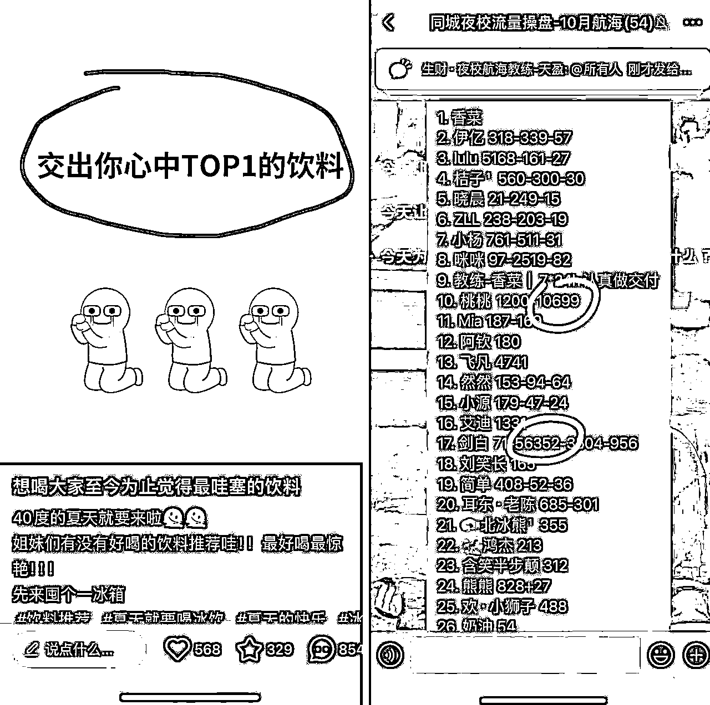
模仿爆款样式，改MD5值、改底色、AI改文案后批量发布。
常用工具：【美图秀秀】【PS自动化】【WPS演示】【可画】

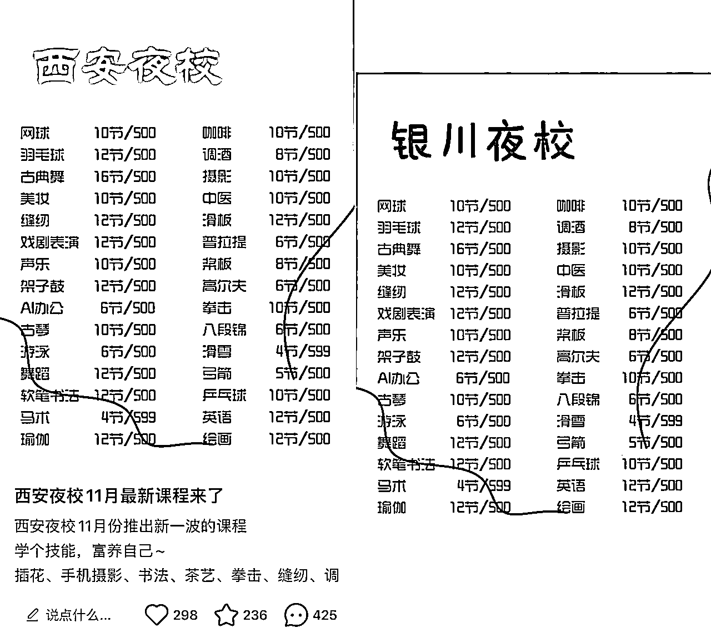
笔记、粉丝有少量数据后，可正式搭建账号：
*   建小红书群：群名：进裙领课表3裙
*   设管理员：拉一个小助理做管理员、发群公告（该号不发帖）
*   用小助理号置顶引流视频

点开置顶领最新课表进❤️裙，所有课程都是 500
更新：全部账号每日三更（可发1篇第三人称贴，2篇课表）

#### 视频号
按固定模板替换素材即可产出新片，直接右键点视频段，选替换素材，3分钟出一支，半小时搞定3天量。每日日更3篇/号。

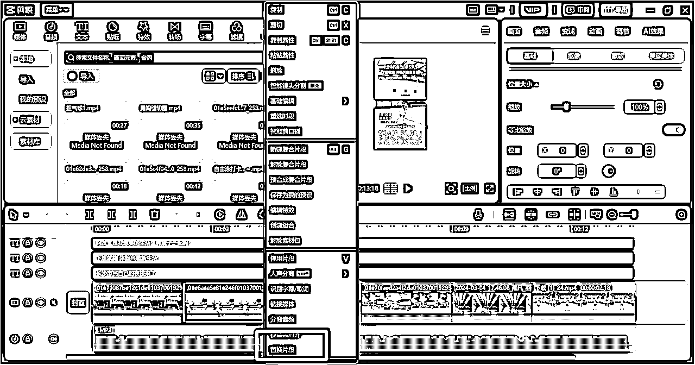
剪片看着简单，实则是很多人的卡点。前期半个月，伙伴们大半时间都耗在剪辑、作图。第一天开工，我本以为能跑完交付SOP，结果一天都在教剪辑。
对不少人而言，生财的价值就在于打破信息壁垒，工具操作也是其中一环。

“知识诅咒”：懂的人不明白为何别人不懂；不懂的人也不知道懂的人在说什么。

时间久了，团队出现消极情绪，一天苦干十二小时，全在剪视频做图发文，那时几乎不怎么开单，还要处理不下单客户的情绪，安抚群里随时可能“暴动”……

后来迎来转机：叶落影的自动化剪辑！会编程在当下真的是降维打击，极大提速全队效率。打call🥁🥁

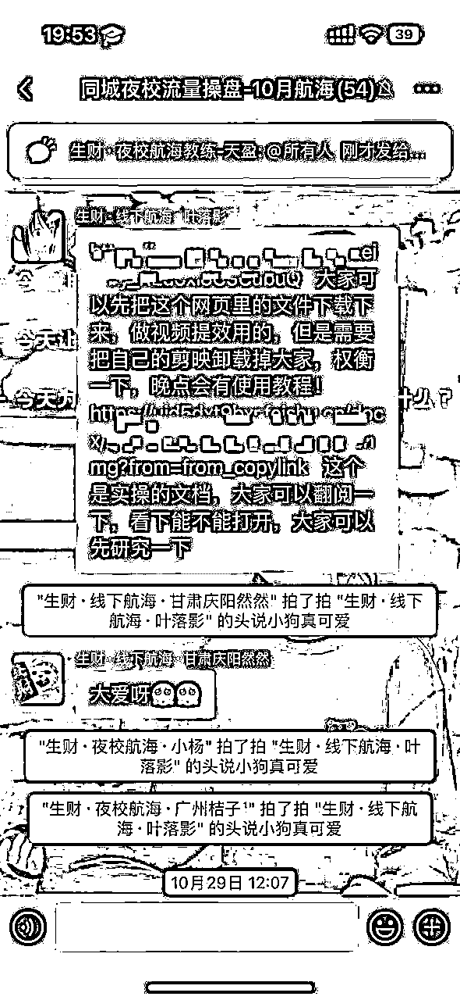

#### 抖音
抖音可在剪映剪完后同步发布，记得修改标题与定位，也可关联近期热点。

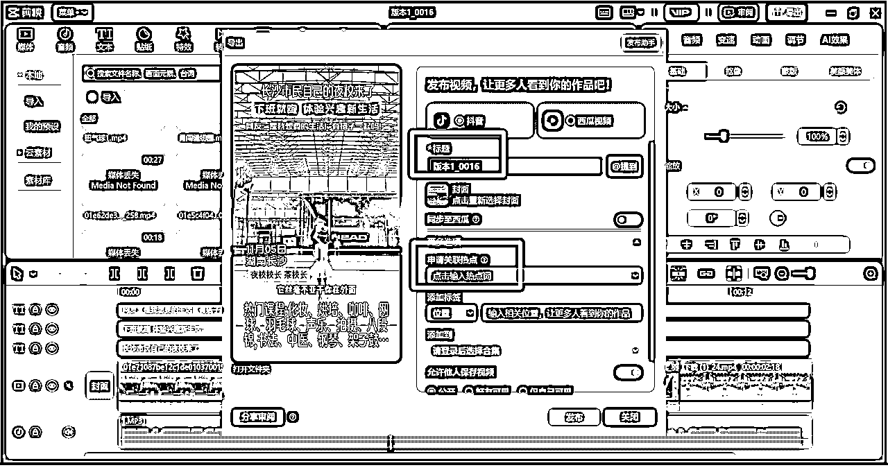

#### PS：改定位

##### Windows端
下载爱加速3天免费，月费十几块。

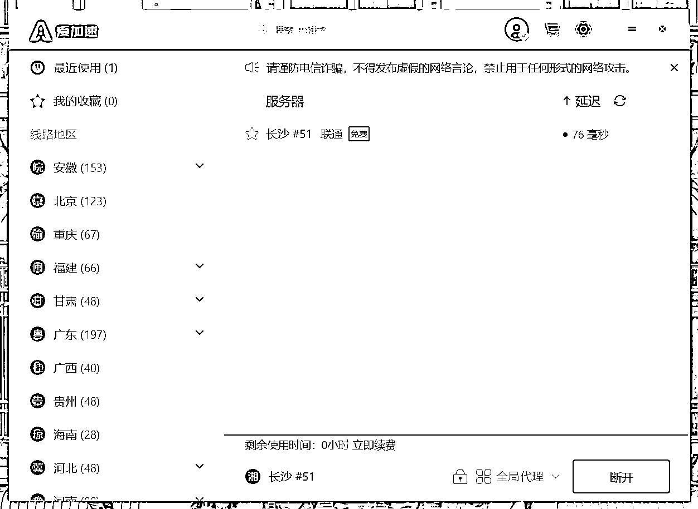

##### iPhone端
需数据线连电脑与iPhone，电脑端装爱思助手，再由电脑给iPhone装“爱思”。
打开iPhone“隐私与安全性”-“分析与改进”-开启“与开发者共享”。
电脑改好定位后拔线，若需恢复真实地址，可重连数据线或重启iPhone。

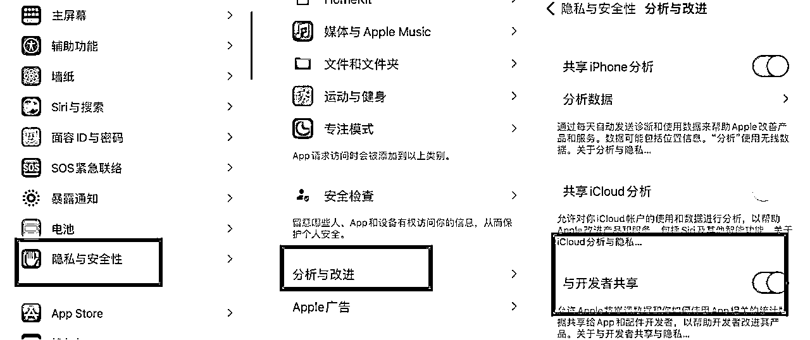

##### 安卓端
同Windows端，用爱加速会员。

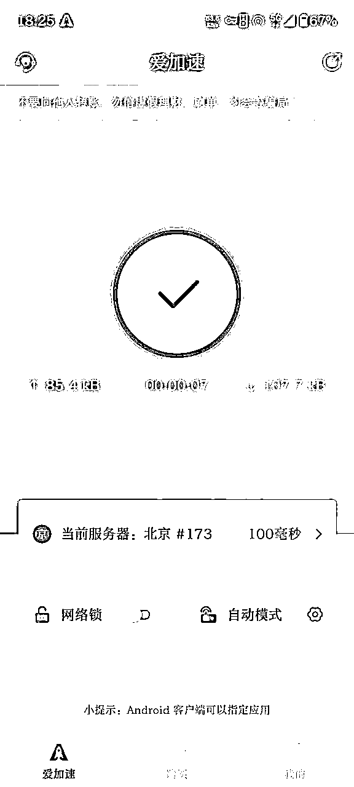

### 2、转化-下单
以往做面销、高客单的伙伴注意❕❕
互联网成交逻辑与面销不同。面销时品牌与产品负责吸引，后续暖聊、问诊、因人施策才是成单关键。
但互联网客户无忠诚度，产品看完就走，跑路速度极快，常规逼单基本无效。

因此我们后来的原则是“只吸引不骚扰”，减少沟通成本，只要给出真正可感的吸引点，如“价格优惠”“时间灵活”“区域便利”“有实惠可拿”即可。

#### 只吸引不骚扰

##### 单聊（客服宝）
前期筛选30个目标客户，把细节沟通打透，把可能遇到的问题全部整理进客服宝，形成话术库，后续无需逐字敲打。
产品介绍、夸奖完毕，下单交给用户即可。记住：基数够大、话术稳定，下单自然来。

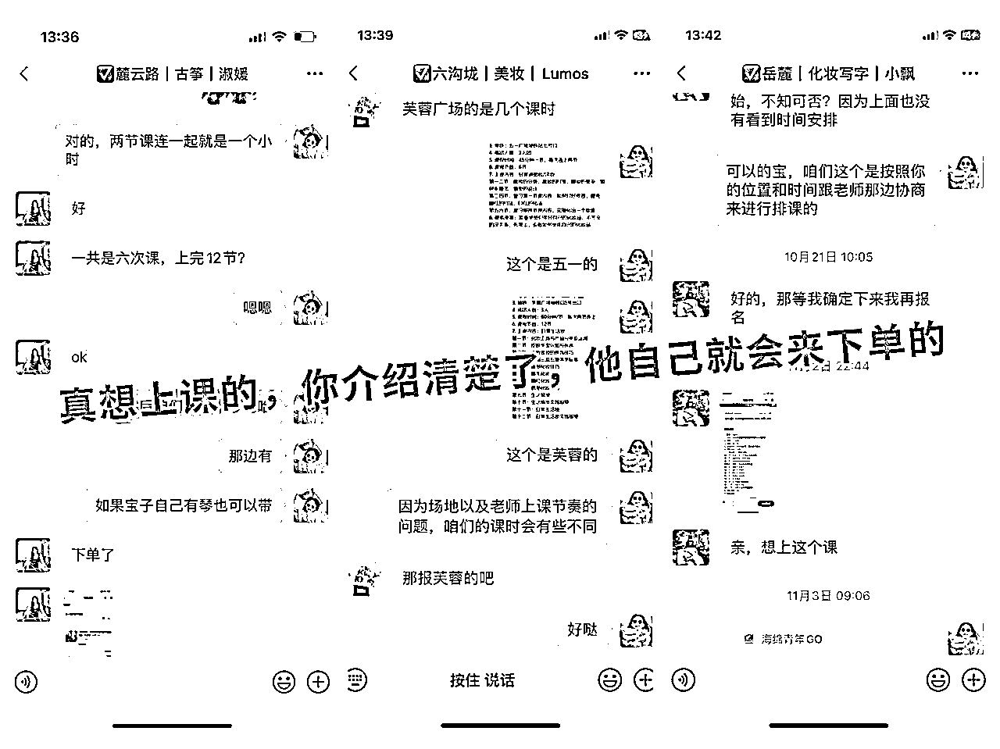

##### 朋友圈（成交=信任+需求）
第1步：建信任。发生活、爱好，展示你有自己的空间，这样聊天时聊爱好与玩笑也更自然。
第2步：激需求。人性密码：人因痛才变。
朋友圈种草万能公式：用户痛点=产品种草+引导成交。
夜校客户不下单常见原因：太远、没课、见效慢。对准这几个点，反复发已解决案例的朋友圈，告诉他们等你报名。

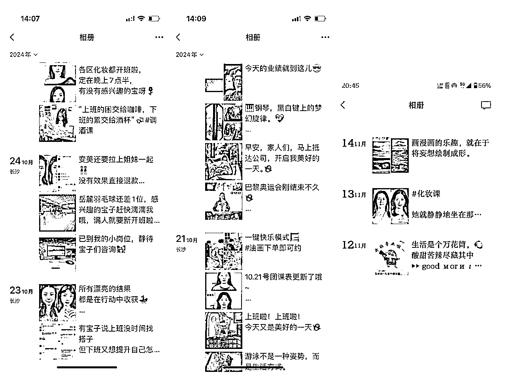

##### 群营销转化
一句话：早开群，早解放双手。
我们还在私聊时，桔子说：“根本不用单回，把人拉进群，课程、注意事项群里都有，试试群聊会多出一堆订单。”

香菜教练建议：每小时更新一次群内容，借鉴小红书风格素材，可提升效率、减少重复造轮子。
让群内多接龙、多自聊，正逢双十一，群内统一说清优惠，私聊下单的人不少。还可在各自群里安排互赞，客户一句夸赞，抵得上半个月拉扯。

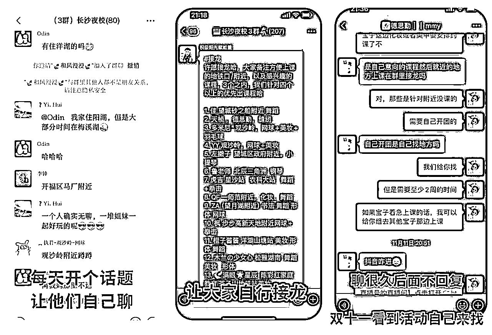

### 3、售后

##### 难成团退单
前期下单人数不足、商家不足，开课难成团，退单咨询不少。
需及时回复、安抚，前期沟通不做过度承诺也很重要。日常关注未交付订单，每隔两三天问候一下，拉感情，让客户感受到被在意。即便迟迟不开课，对抗也会降低。
半个月后，随着商家与客户体量起来，成团问题基本缓解。

##### 商家资质、环境问题退单
丑话说在前。合作初期即明确，若因商家服务、内容、资质问题导致退款，已上课可结算，后续不再结算且终止合作。

### 4、准备清单
团队架构：【销售+商务】
商务负责商家沟通、签约、安排成团上课；销售负责前端引流、下单与售后。
资金准备：【设备+场地】
设备：“拍机堂”400元/台；
场地：独立作战可在家执行，后续有员工可租工位500/人/月。

# 三、【展望未来】夜校变现方向

现阶段夜校的最大竞争对手不是同行，而是商家本身。商家亏本卖300元的课，加上合作环节的流量成本，首单后完全可复制模式，自建直播以299元售卖。深圳化妆圈即典型，片区商家抱团成“化妆城”，抢占流量高地。

教练所说，单打独斗会越来越难，团队与品牌加持才是长期立足之道。我们看重的不只是单客一两百的利润，而是盘子起来后精准同城粉的沉淀与运营。过去同城粉被线下人际强的商家垄断多年，疫情后线上渠道崛起，为我们分流提供了机会。

放眼全国，同城流量变现潜力高，“一粉多用”可行。通过陪伴式运营，可带动“高留存”“高裂变”“高复购”。夜校用户约七成女性，消费力强，是核心价值。

未来可拓展方向：

##### 同城相亲+读书会
女性向上需求旺盛，同城读书会线下参与性别比约女:男=8:2；相亲群线下约女:男=4:6。相亲机构提供场地，双场可同步接龙。

##### 同城医美、月子中心、少儿培训合作
女性是实体商家的核心客群，医美后延至月子中心，再延至少儿培训（K12、兴趣班），形成完整消费链。

##### 同城旅游、民宿合作
客户活动半径不止本地。如长沙客户可辐射宁乡温泉、株洲方特、韶山风景区等，链接周边旅社，朋友圈宣发，空间很大。

##### 同城B端运营合作
如深圳“化妆城”这类抱团少见，但多数实体商家流量运营能力不足，后续可通过独家代理或代运营深度合作，提升转化。

# 四、【夜校航海】带给我的变化

### 1.流量方法具有通用性
高客单商品流量难起，一直是痛点。航海尾声与“简单哥”交流，他分享一条做太空舱爆的视频号案例，逻辑一致：15秒视频以6-7个场景切换，文案、字号、呈现、切换节奏圈友可分别测试。

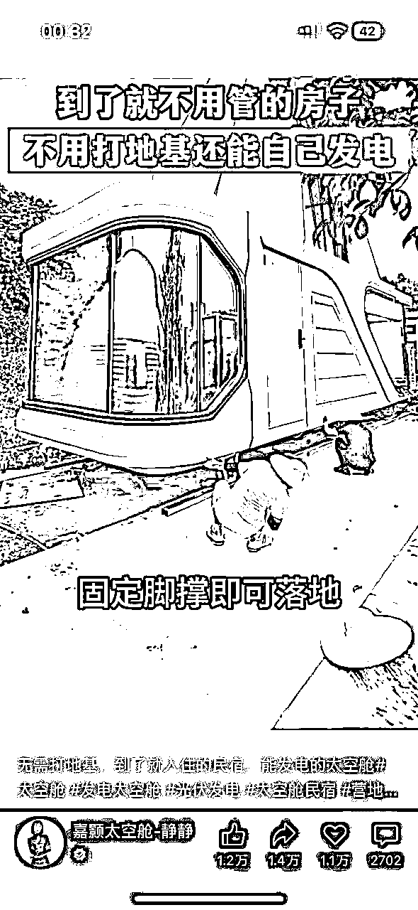

### 2.认识一群实战型圈友
单打独斗时或许是菜鸟，但“三个臭皮匠顶一个诸葛亮”。每日讨论总能碰撞出解法。遇到刁钻客户或流量爆满，与其手忙脚乱，不如拉三五伙伴上天台聊聊，开拓思路。

### 3.突破自己动手实践

以前觉得流量运营玄而难控。参与夜校后，我打破心理障碍，亲手从0到1沉淀出流量运营能力。这将成为未来商业的核心竞争力。

想了解更细的内容，可看教练团队帖子，以及两位学员经验：
阿钦的夜校干货讲解
桔子的流量成长之路https://articles.zsxq.com/id_s7qv6tcwgmr8.html

# 五：致谢

感谢生财，感谢亦仁老板搭建的优质场域，让我们参与线下航海，一起生财有术。
一群人做一件事的力量很大，这次航海结识的不只是同事，更是未来伙伴。30天每日灵感满满，疲惫时共打鸡血，迷茫时共规划未来。肯定还有更多故事，一起向前冲，顶峰再见。

感谢教练团队：天盈、香菜、阿Ken。正是你们的付出才有扎实成果，还有香菜教练的销售手册。

感谢同城伙伴：含笑半步癫、北冰熊、阿音、小杨、小源、叶落影、简单、奶油、阿钦、桔子、桃桃、关关、咪咪、小埋、熊笑长、刘笑长、剑白、然然、lulu、星空、喵喵、伊亿姐姐、小富婆、鸿杰、艾迪、曾丽、小狮子、徐Ken、锦熙、晓晨。共行的30天共同成长。

感谢倾情指导：胖大魔。同城入局始于大魔引导，我不断电话与长文请教，他从未厌烦，支撑我探索实践。

感谢老友：老高、心怡。多年的铁关系推我前行，也是他们引我加入本次夜校。

感谢后台后盾：阿闵、苗苗、娟凤等。

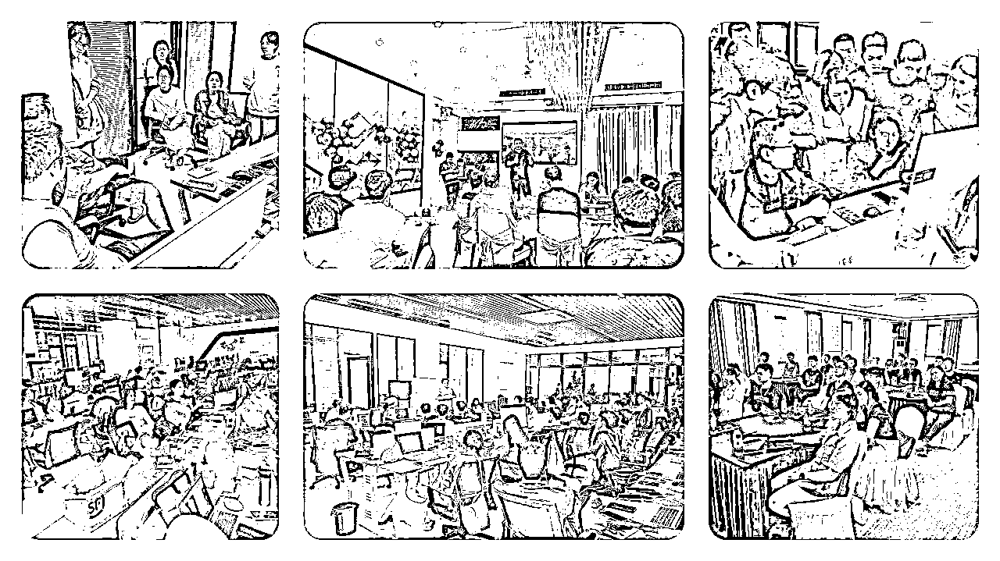

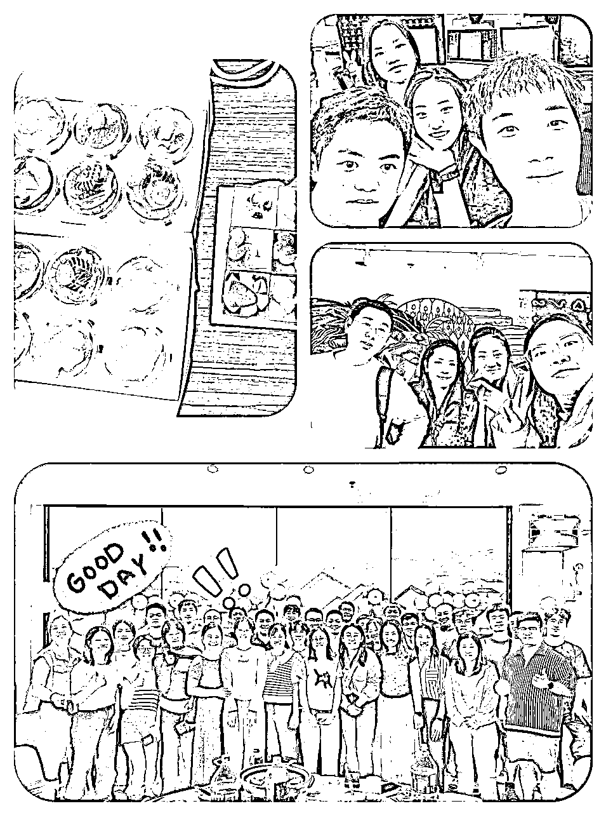