# 新手100元起步的副业样本：山姆代购实操拆解

各位朋友好，谢赚钱的邀请，今天把自己折腾了很久的山姆代购这条路聊一聊。

先简短自我介绍一下：我本职是传统电商，干了快八年。2021年受疫情影响主业下滑，就开始出来试水各种副业，也参加过不少航海营。后来在居住的业主群里常看到大家在问能不能拼单山姆，有的是不想办卡，有的是办了卡怕买多了吃不完。我觉得门槛不算高，就上手尝试了。

我现在做得不大，核心打法就是线下引流+群内维护。目前手上有一个约三百人的微信群，日常基本不怎么精养，客户有需求就接龙，或者直接私聊下单，基本属于半自动状态，现在主要由我太太在照看。

引流现场是这样：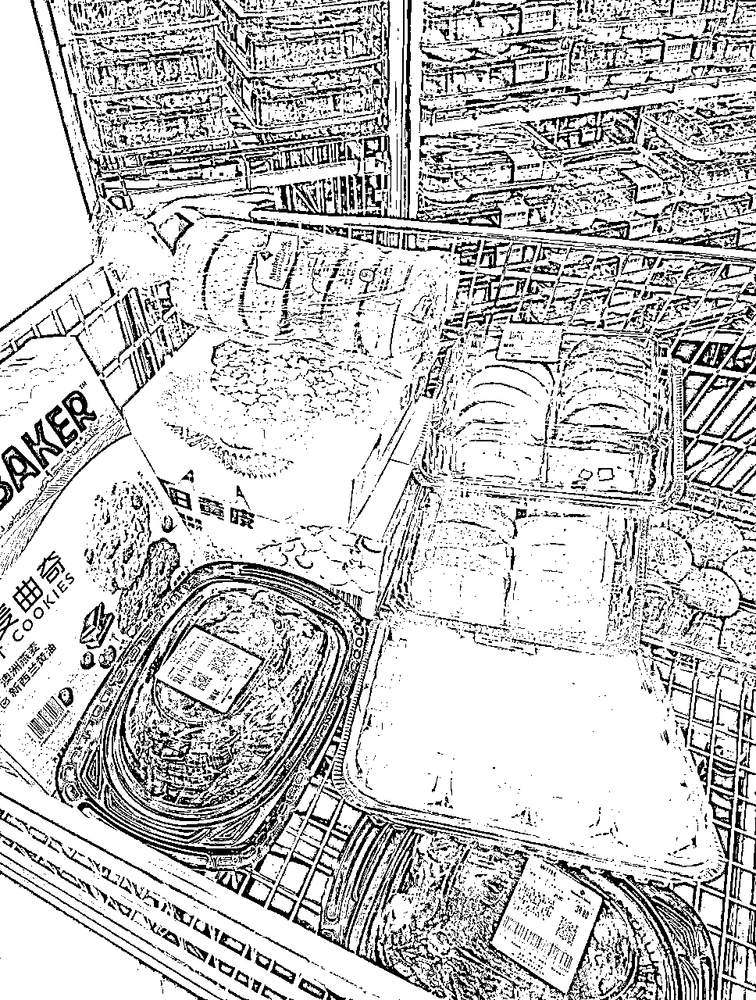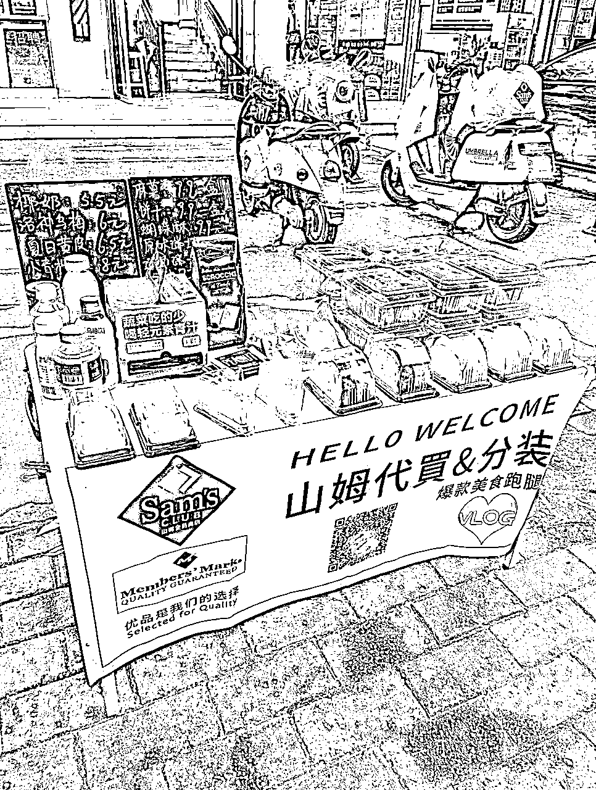
微信里接单的样子：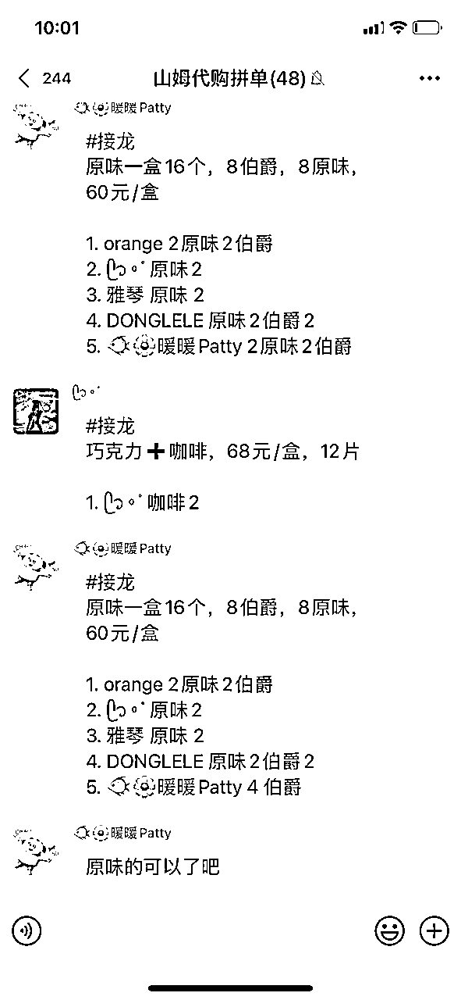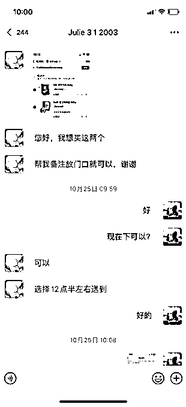

做到什么程度了？行情最好的月份能到四五千，保持现有三百个老客的情况下，月净到手轻松破千，收益比较平稳。能坚持下来，很大原因在于回头客比例很高，基本第一次成交后，后续会持续找你。

下面是群里在快团团上的部分流水，这只是冰山一角，微信转账的接龙没有算进来，单月净赚大概一千左右：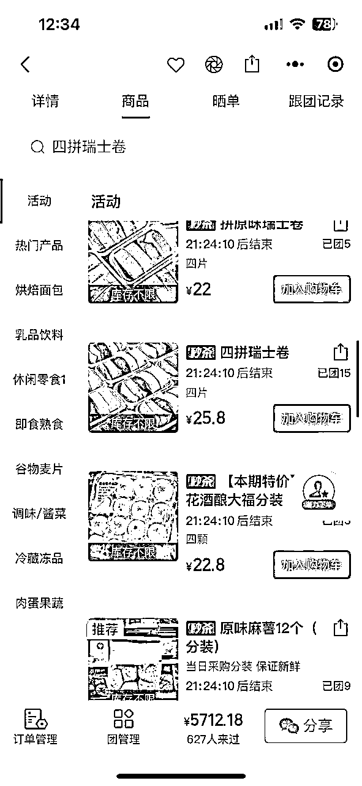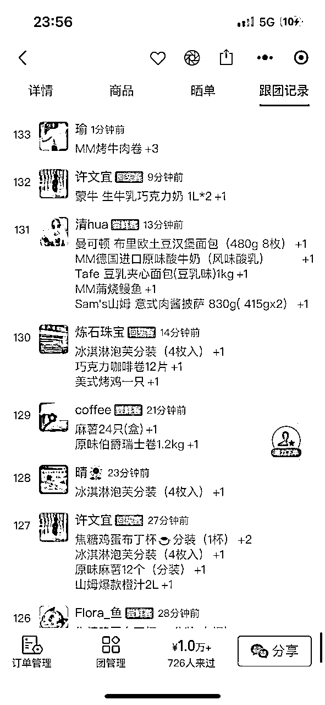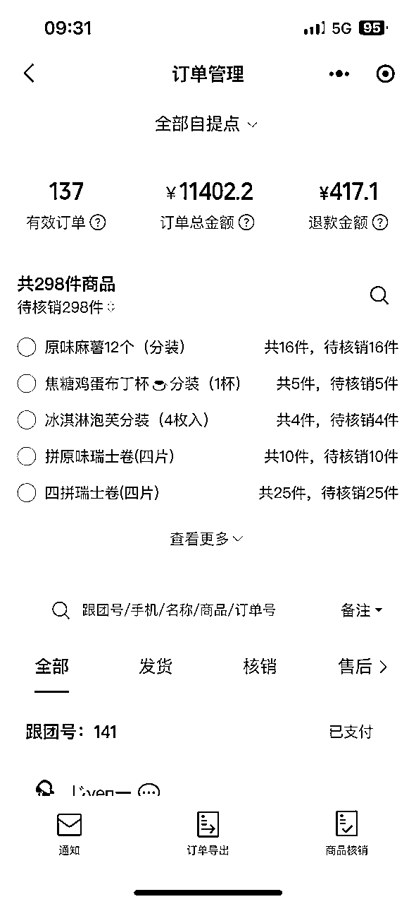

小红书上关于山姆的玩法很多，但比较零散。不少人只摸到一两项变现，就觉得赚不到钱放弃了。这篇我尽量把项目从赚钱逻辑到落地细节一次性讲清楚，有遗漏欢迎评论补充。

框架如下：
1. 项目是什么
2. 为什么能赚钱
3. 收入来自哪里
4. 客户从哪里来
5. 容易踩的坑
6. 入局建议与门槛

## 一、项目是什么

先说山姆。它是沃尔玛旗下定位中高端的高品质超市，进场必须持卡。普通会员年费260元，卓越会员年费680元。里面有免费试吃区，很多人冲着试吃去体验。热销品类以烘焙、优选水果为主，其次是肉类。

目前门店集中在一线、新一线和省会城市，全国二十多个城市可覆盖。采买方式也灵活：可线下自取，也可通过APP或京东下单配送。

* 极速达99元免邮，含打包费，冷冻商品2元、常温1元
* 同城配299元免邮，适合偏远区域
* 全球购走快递，比如部分美妆

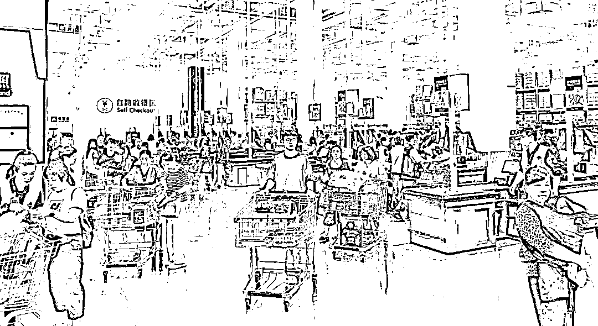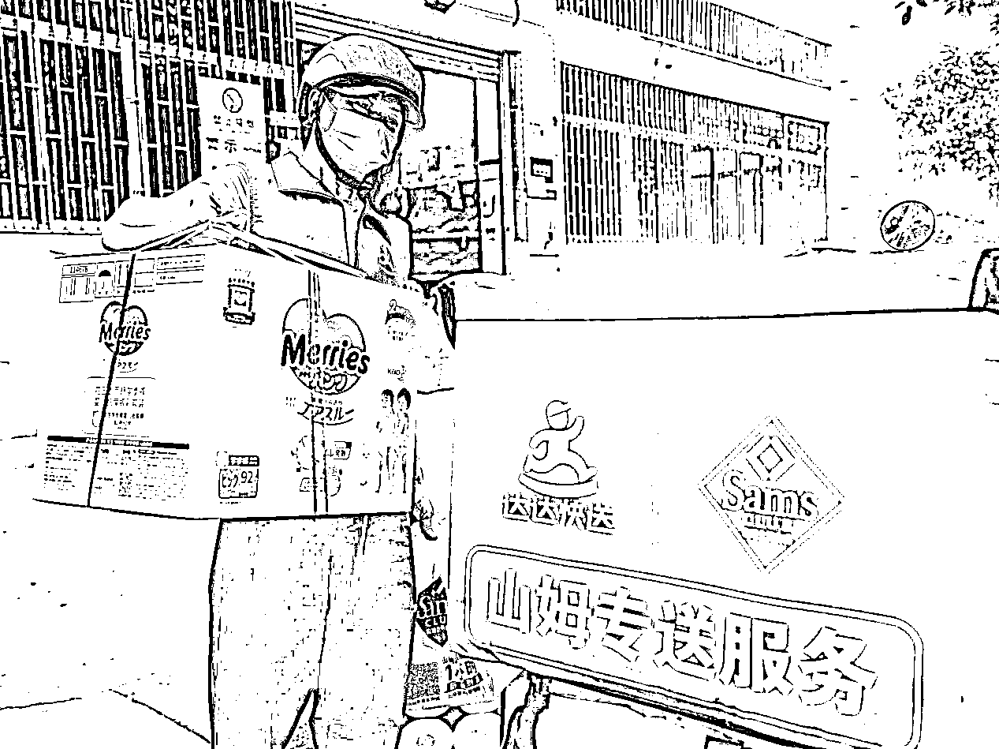

启动成本主要看会员卡：
* 卓越年卡680元
* 卡权益可变现：赠送副卡闲鱼成交约110元，洗车卡12张价值180元，洗牙卡30元，运费券一年60元。续费次年会再赠2张体验次卡，每张可进店一次，市场价约30元/张。另有50元全球购券、50元线下无门槛券、每月15元免邮券、洗牙券等。
折算下来实际投入不到200元，往往首月即可回本。

除一次性权益，持续利润来自：
山姆会员消费返2%，副卡消费返利汇入主卡；京东平台优惠券折现；活动期抢购；爆品/特价加价售卖等。细节放到第三节详述。

## 二、能赚钱的核心条件

1. 同城有山姆，最好在1公里内，方便带客进场；
2. 收益渠道要全。很多人只知道卖副卡或拼单，利润单薄。自己是通过摸索同行才把几个渠道串起来；
3. 有基础的社群运营意识。摆摊拉群是最快的突破口，老小区新小区都适用，目前做的人还不算多；
4. 耐得住。时间越长，被动收入越明显。

## 三、变现渠道有哪些

办卡后持续性收入主要来自以下几块：

1. 卓越会员消费返利2%，若绑定民生联名信用卡可再+2%。比如消费100元，返2-4元，可在APP或门店直接抵扣。
2. 可用沃尔玛购物卡支付，市面上一般9.5折回收。帮客户代付时，差价即为收益。可用于门店、APP、京东到家。
3. 绑定京东山姆自营店，网购免邮并计积分。
4. 若开通京东会员增值服务，每天会发运费券和大额优惠券，可叠加使用。做代购的通常会配一个，闲鱼成本约60元，官网要100+。
5. 活动期间部分门店可原价购茅台，属于活动商品抢购范畴，个人未抢到过，现多地缺货。
6. 热销爆品加价售卖，例如车厘子、KT麻将。
7. 特价区捡漏加价售卖，如近期走红的泡泡枪、金箍棒、充气独角兽，换季折扣很大。

其中最核心的利润是爆品和特价加价。消息灵通是关键，多刷小红书、闲鱼同行的动态。

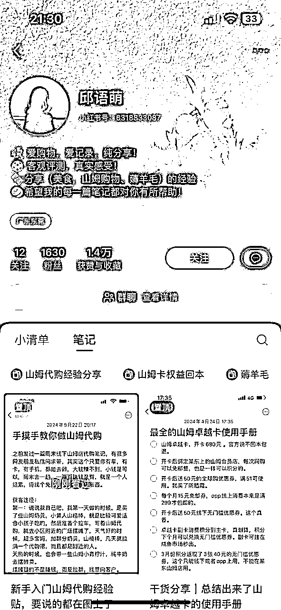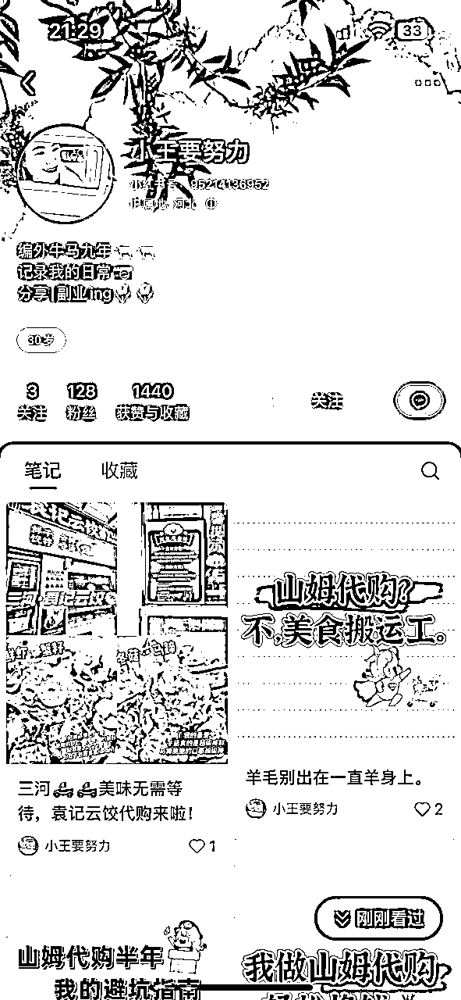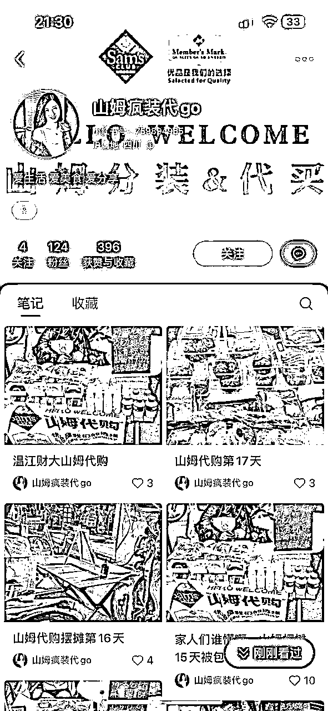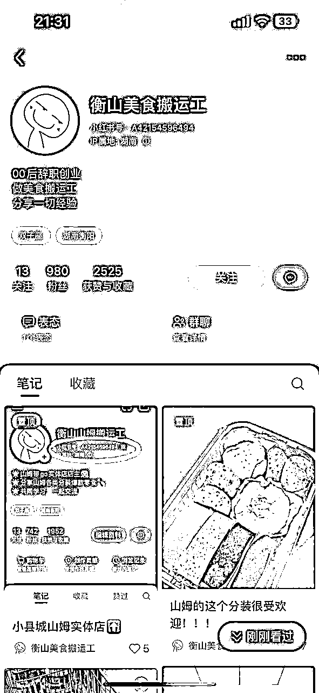

长期稳定的四种打法：

变现一：分装摆摊
玩法：推辆露营车到自家或邻近小区门口，一般下班时段或周末人多。套餐搭配与定价可参考小红书同行，备几款明星单品，现场试吃吸人气。前期投入小额获客成本，后期复购高。分装基本限同城，除非是饼干这类可邮寄商品，快递费3-4元，需与快递点谈价。摆摊本质是拉群，烘焙类最吸睛。

变现二：业主群拼单
玩法：建业主群内接龙，设定截止时间后统一通过APP下单，无需囤货。
特点：前期加熟人更好管理；回购最高的是山姆鸡蛋，大家冲着拼包邮而来，即便办了卡也会找你。群友也会自发接龙或私聊需求。
利润：通常每单加2-3元，拼鸡蛋一般不加价。价格透明，下单前务必告知客户。

变现三：带客进店
玩法：收费10元/人/次，逛店一般两人起步，一次带五人比较稳妥，一次可收50元外加2%返利。等候时可在门外餐吧休息，免费用。
劣势：需占用时间，且距离越近越有优势。

变现四：下沉市场开店
很多镇上没有山姆但需求存在，可在镇上做代购点，前期可在家操作，客户自提。
玩法：同样靠群接龙，跨城采购最新生产日期商品，最好自有车辆。可囤不易过期的饼干，收取5%-10%代买费。遇到车厘子等爆品可直接拉一车。
特色：下沉市场更常用抖音，可用抖音、小红书引流，锁定高消费人群，后续可延伸美妆代购等。线下可在便利店、快递点张贴海报。冷链商品需备保温箱。

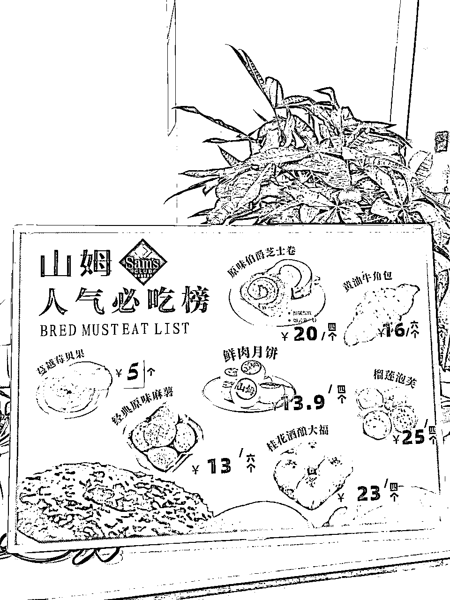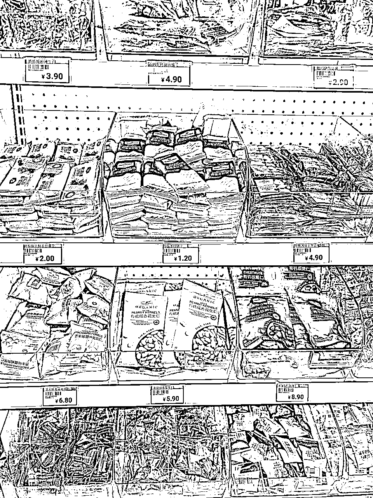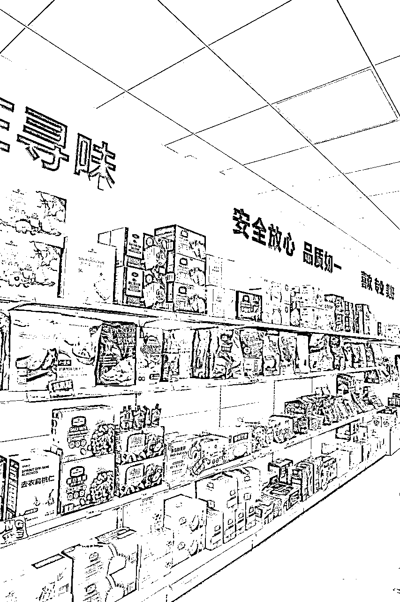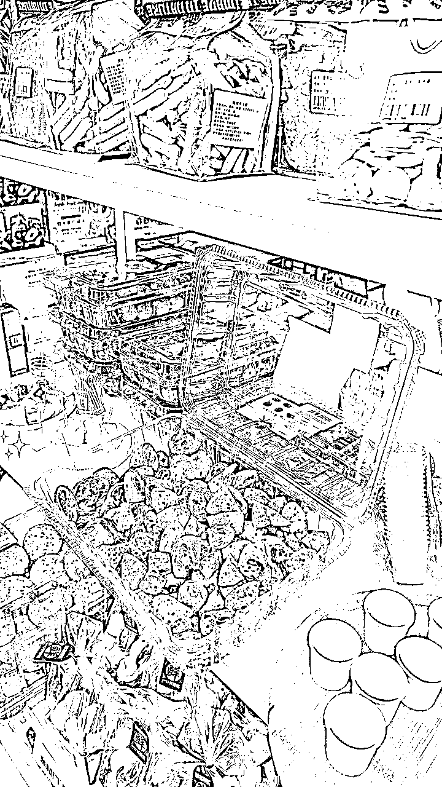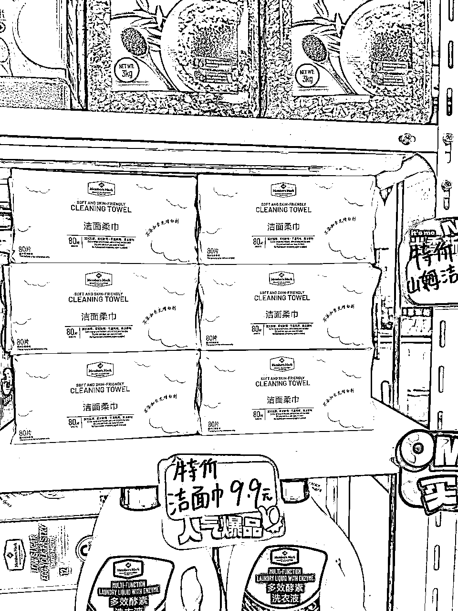

## 四、客源从哪来

* 闲鱼、小红书、抖音发帖引同城粉
* 业主区门口摆摊拉新
* 在快递点、便利店贴海报，几百元成本
* 商品上架电商/外卖平台，引流至私域
* 直播售卖分装

## 五、常见坑

1. 带客进店的风控
今年检查比往年严，以前发截图给工作人员即可，现在部分门店要求扫码。建议跟随顾客一同入场，一次带五人左右，分批处理。结账要求本人到场，出口多在餐吧处等候即可。若条件允许，极速达代下单更稳妥。

2. 复制快
门槛低易被模仿。若组团队分配不均，很快会被拆分。有同行已成立公司做后端社群服务，分成约70-80%，老板专注分装、网店、直播等流量业务。我个人主业较忙，不擅长深度客户维护，所以未放大。

## 六、怎么入场

门槛低意味着竞争也容易，利润率不高，前期别指望暴利，但赚到第一个100元很简单。小红书上优秀前辈很多，直接学习即可。核心在于坚持，成交客户约80%会复购。

建议从周边业主群和同城代单起步。适合有少量空闲时间、愿意做社群或擅长内容输出的人。专注半年，单人月入过万并非难事。也可作为引流入口，例如做美妆代购的，可用山姆代购撬动高消费人群。

如果这篇拆解对你有用，欢迎点赞收藏，评论区交流实操经验。