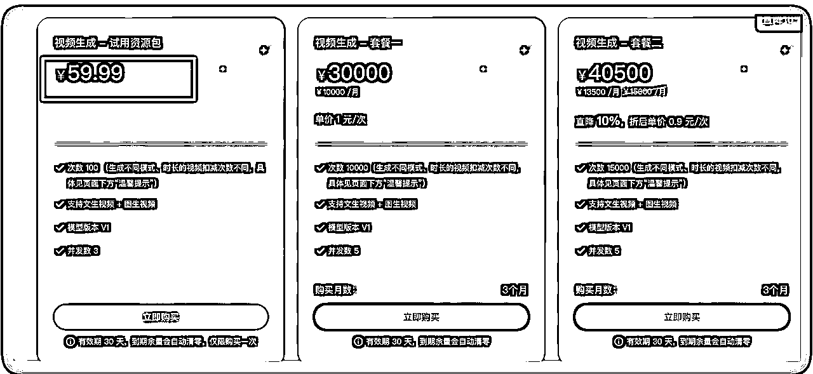
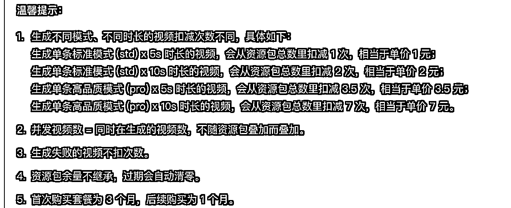
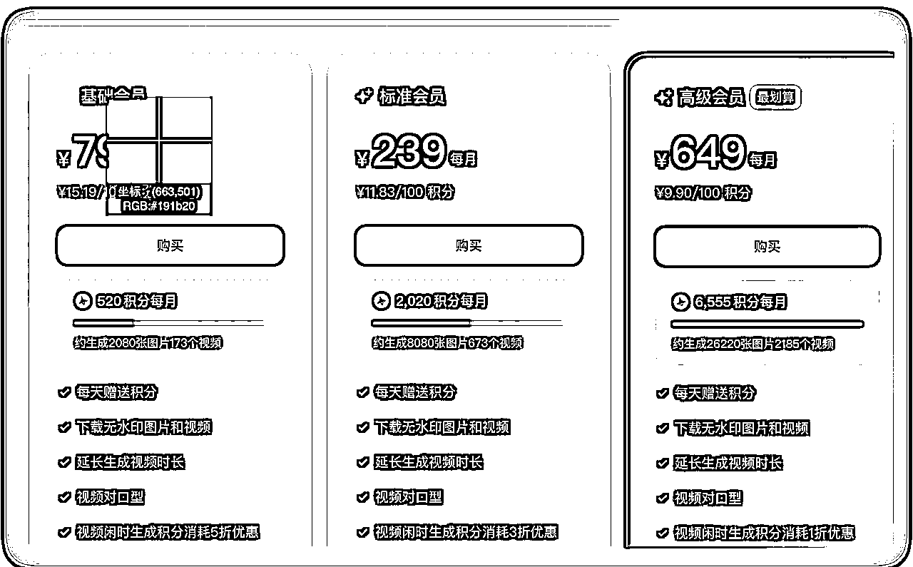
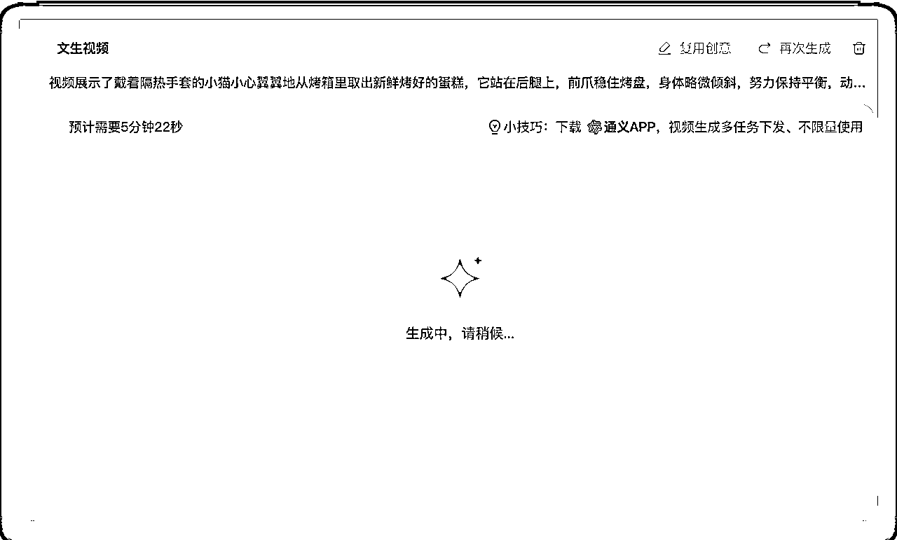
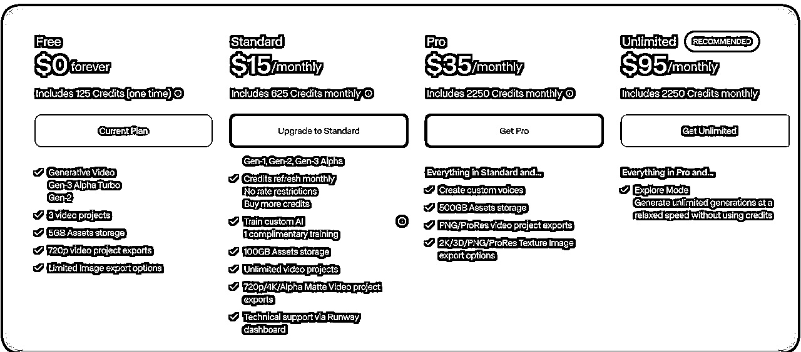

# 第三弹实测：AI Shorts视频生成，到底该选谁？


做YouTube Shorts，最头疼的就是视频质量不稳定。为了让赚钱圈友少走弯路，我干脆把市面上的主流视频模型都拉出来遛了一圈，结合赛道精选帖和各大评测，再加上自己的实际体验，今天直接给结论。

先说结论：**我推荐快手的可灵1.0 API**，代码已经封装好了，填上自己的token就能直接跑，省心省力。

以前我总以为国外的模型更牛，毕竟文本方面Claude、GPT-4确实吊打国内。但真到自己下场跑了一遍视频生成，才发现：**完全不是那么回事，视频这块，国内外各有各的绝活。**

市面上主流模型大致分三类：文生视频、图生视频、视频生视频。按场景选模型，才不会花冤枉钱。

视频模型迭代快得吓人，以下测试结果截止到2024年11月4日：

| 模型 | 价格 | 备注 | 时长 | 评分(10分制) |
|------|------|------|------|------|
| 智谱清影 | 免费 | 新用户2000次调用 | 6秒 | 6分 |
| 可灵AI 1.0 | 新用户60元/月，之后3万起 | 100个标准视频，有API | 5-10秒 | 8分 |
| 即梦AI | 新用户79元/月，无API | 179个标准视频 | 3-12秒 | 7.5分 |
| 海螺AI | 73元/月或9.9美元 | 国内3元/个，海外月1000积分 | - | 8分 |
| 通义万相 | 免费，无API | 生成需10分钟 | - | 6分 |
| Runway Gen3 Turbo | 15美元 | 625积分≈25个视频 | 4秒 | - |
| Luma AI | 9.9美元/月 | 720p 5秒视频约0.4美元 | 4秒 | - |

说明：价格均为月付，年付更划算；具体套餐随时变动，以官方为准。

国外那几款我试用了一下，**生成质量实在拉胯，都没敢给分**。

模型筛选参考了这个GitHub评测文档，优先选支持自动化生成的主流款。

---

## 智谱清影（免费但质量一般）

底层是智谱的CogVideoX大模型，输入文字或图片就能生成视频，分辨率1440×960。价格方面：单次0.5元，体验包9.9/30次，优享包399/1000次，超大包2499/10000次。注册白嫖2000次调用，但质量确实一般，且不可并发，一次约1分钟生成6秒视频。

## 快手可灵（强烈推荐）

官网有两个模型，但API目前只开放了v1.0。实测质量很高，适合批量生产高质量视频。缺点是并发低：普通账号3个，套餐内5个，生成一个视频要几分钟。

价格：试用60元只能买一次，正式版3万起步——摆明了先让你试，觉得好再掏钱。



注意不同模型价格不同，1元/次是最低保底消费。



付款后记得**关掉🪜**，否则控制台页面打不开：https://klingai.kuaishou.com/console

官网没给现成的lib，我手写了一个，改成自己的key和secret直接就能用。

```
import time
import jwt
import requests
import json

ak = "xxx" # 填写 access key
sk = "xxx" # 填写 secret key

api_key = '..xxx'

def encode_jwt_token(ak, sk):
    headers = {
        "alg": "HS256",
        "typ": "JWT"
    }
    payload = {
        "iss": ak,
        "exp": int(time.time()) + 1800, # 有效时间，此处示例代表当前时间 +1800s(30min)
        "nbf": int(time.time()) - 5 # 开始生效的时间，此处示例代表当前时间 -5 秒
    }
    token = jwt.encode(payload, sk, headers=headers)
    return token

def generate_video(api_key, prompt, negative_prompt=None, cfg_scale=0.5, mode="std", camera_control=None, aspect_ratio="9:16", duration="5", callback_url=None):
    """
    Generates a video using the Kling AI API.
    Args:
        api_key: Your Kling AI API key.
        prompt: The positive text prompt (required, max 2500 characters).
        negative_prompt: The negative text prompt (optional, max 2500 characters).
        cfg_scale: The CFG scale (optional, default 0.5, range [0, 1]).
        mode: The generation mode (optional, default "std", "std" or "pro").
        camera_control: Camera control settings (optional, see documentation).
        aspect_ratio: The aspect ratio (optional, default "16:9", "16:9", "9:16", or "1:1").
        duration: The video duration in seconds (optional, default "5", "5" or "10").
        callback_url: The callback URL (optional).
    Returns:
        The JSON response from the API, or None if an error occurred.  Raises an exception for HTTP errors.
    """
    url = "https://api.klingai.com/v1/videos/text2video"
    headers = {
        "Content-Type": "application/json",
        "Authorization": f'Bearer {api_key}'  # Replace with your actual authorization method
    }
    data = {
        "prompt": prompt,
        "negative_prompt": negative_prompt,
        "cfg_scale": cfg_scale,
        "mode": mode,
        "camera_control": camera_control,
        "aspect_ratio": aspect_ratio,
        "duration": duration,
        "callback_url": callback_url
    }
    # Remove None values to avoid issues with the API
    data = {k: v for k, v in data.items() if v is not None}
    try:
        response = requests.post(url, headers=headers, data=json.dumps(data))
        response.raise_for_status()  # Raise an exception for bad status codes (4xx or 5xx)
        return response.json()
    except requests.exceptions.RequestException as e:
        print(f"Error: {e}")
        return None

def query_task(api_key, task_id):
    url = f"https://api.klingai.com/v1/videos/text2video/{task_id}"
    headers = {
        "Content-Type": "application/json",
        "Authorization": f'Bearer {api_key}'  # Replace with your actual authorization method
    }
    try:
        response = requests.get(url, headers=headers)
        response.raise_for_status()  # Raise an exception for bad status codes (4xx or 5xx)
        return response.json()
    except requests.exceptions.RequestException as e:
        print(f"Error: {e}")
        return None

def main():
    # api_key = encode_jwt_token(ak, sk)
    print(api_key)
    # Example usage (replace with your actual values):
    prompt = "镜头 8：远景 + 仰视角度 + 柔和的暮光 + 小兔子和小松鼠（挥手告别）+ 向观众挥手告别 + 森林（随着夜幕降临）+ （温暖而美好的结束）"
    negative_prompt = "blurry, distorted"
    camera_control = {
        "type": "simple",
        "config": {"zoom": 2}
    }
    response = generate_video(api_key, prompt, negative_prompt=negative_prompt, camera_control=camera_control)
    if response:
        print(json.dumps(response, indent=4))  # Print the formatted JSON response

if __name__=="__main__":
    # main()
    print(json.dumps(query_task(api_key, 'xxxx'), indent=4))

```

想要可灵1.5最新模型，把model参数改成1.5即可，价格和v1一样。

```
data = {
        "model" : 'kling-v1.5',
        "prompt": prompt,
        "negative_prompt": negative_prompt,
        "cfg_scale": cfg_scale,
        "mode": mode,
        "camera_control": camera_control,
        "aspect_ratio": aspect_ratio,
        "duration": duration,
        "callback_url": callback_url
    }
```

成品效果：

## 抖音即梦

79元/月，目前**没有API**，不能自动化生成，这一点就直接劝退了。



## 通义万相

没有API，生成一个视频要等10分钟左右，但免费，签到一次可生成10个视频。
https://tongyi.aliyun.com/wanxiang/videoCreation



## 海螺AI

国内版需要申请API并付费，文生视频/图生视频接口在MiniMax开放平台用，支持自助充值，3元/个，官方有完整代码。也可以用国际版，但支付需要visa/master卡，不太方便。

## Luma AI & Runway Gen3

Luma做小猫做蛋糕这类效果还不错。Runway 15美元买124秒的Gen3 Turbo额度，试了同样提示词：“戴隔热手套的小猫从烤箱拿出蛋糕并保持平衡”，结果惨不忍睹。



---

## 总结

国内外视频模型各有千秋。**没亲自试之前，我也以为国外的月亮更圆。实测发现并不是这样——不同场景、不同画面，各有各的强项。**

重点说下：**快手可灵表现最突出，尤其在动画方面。可灵有1.0和1.5两个版本，API目前只开放1.0，但完全够用了。**