# 婚礼上的“15秒快乐生意”：我如何靠它做到日入2000
作者：龙哥

大家好，我是龙哥。大学起我就爱折腾赚钱，写小说、当编辑、开过淘宝和外卖店，还给美团做过推广。读书时最高月入4w。毕业后上了5年班，实在受不了凡事不能自己做主的感觉，去年干脆辞职单干。

## 一、这个副业到底是什么

一句话：把一台可移动的大头贴机搬进婚礼现场，让新娘和宾客拍照，15秒出片，照片最后贴进一本纪念册，大家再写上祝福，留给新人。

- 目标客户：希望婚礼更有记忆点、也想让宾客玩得尽兴的新娘，愿意为体验花钱
- 卖点：15秒拿照片、对镜拍不尴尬、相纸可以定制专属样式
- 利润：一单2000-3500元，利润超过60%，接15-20单就收回成本
- 适合谁：下班后有空闲的上班族，或者自由职业、创业者

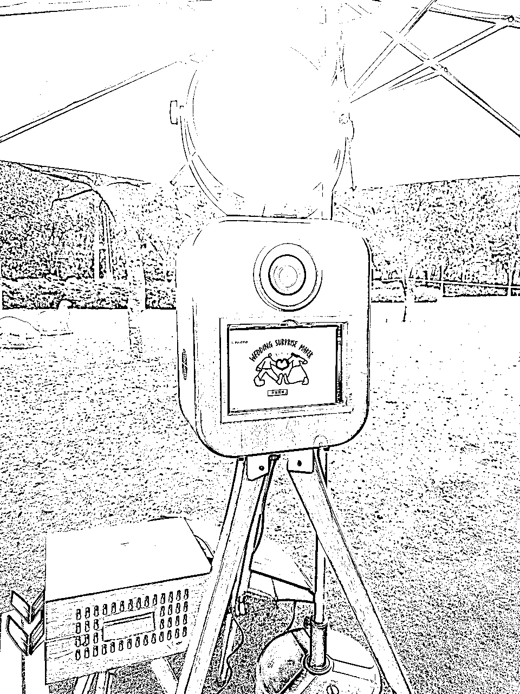

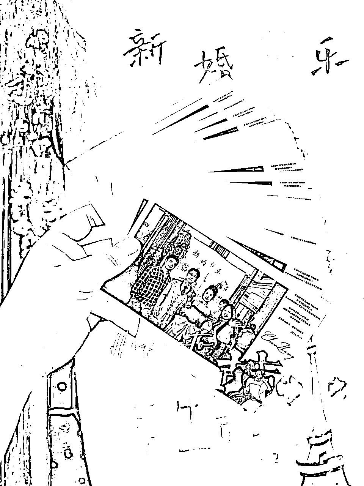

## 二、我是怎么从0做到1的

2023年我去北京参加朋友婚礼，她租了这个服务，花了6000左右。我上网一查，发现这东西全国还不普及，主要广东那边多一点。买设备大概3万，15单能回本。我在📕和抖音搜“杭州婚礼大头贴”，居然没有，离得最近的是上海，加路费要7000多。而且很多同行账号下面，外地网友都在问“我们这有没有”，因为太远都被拒了。

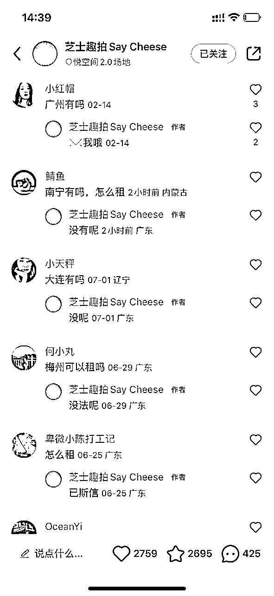

### 2.1 先判断能不能做

动手之前，我扒了当时做得好的几个同行，看他们的评论区，从用户互动里搞清楚大家到底想要什么、担心什么，确认市场确实有需求。

再看同行朋友圈发的内容，估摸他们的接单量，推算回本时间，觉得自己大概2-3个月就能回本。

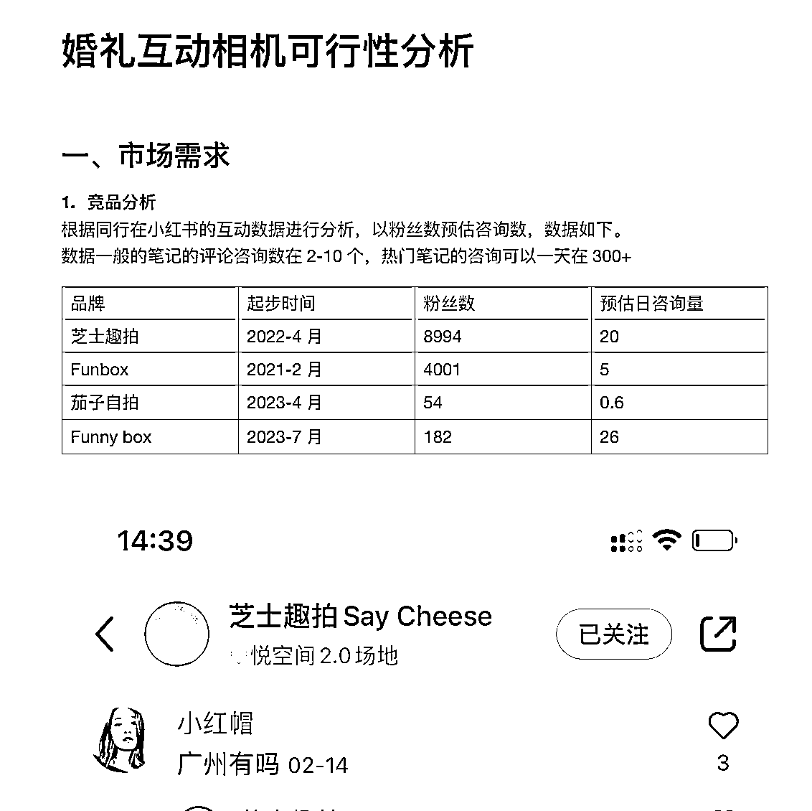

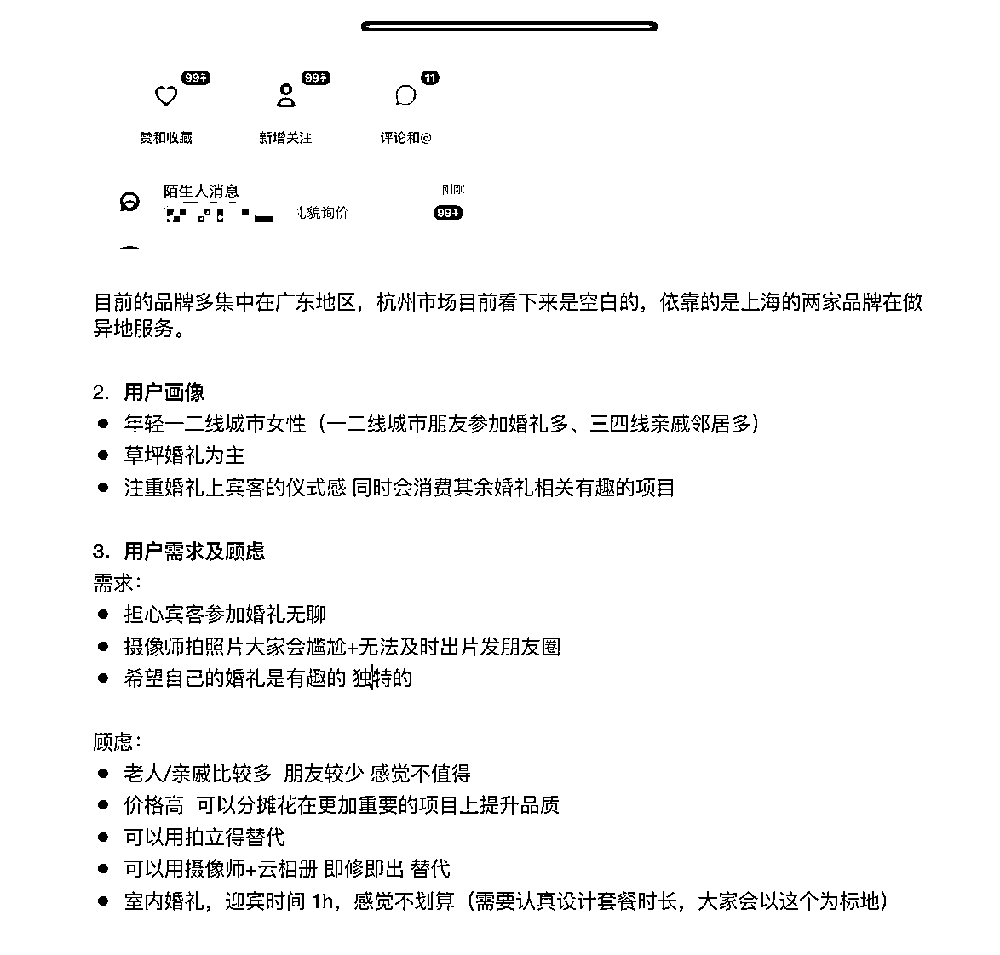

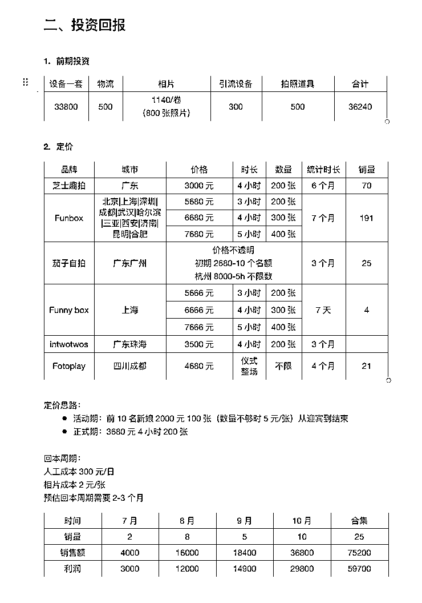

### 2.2 低成本试水

为了不花冤枉钱，我先在📕开了个号，试试能不能引流。毕竟之前做莆田鞋引流的时候，我已经很熟悉这个平台的玩法。

第一个坎是素材。我从同行的朋友圈、📕搜集无码素材，再“伪原创”。结果被封了3个号——盗图太容易被举报。听说今年10月后规则更严了。当时活下来的笔记，基本是文字为主，就像下面这样。

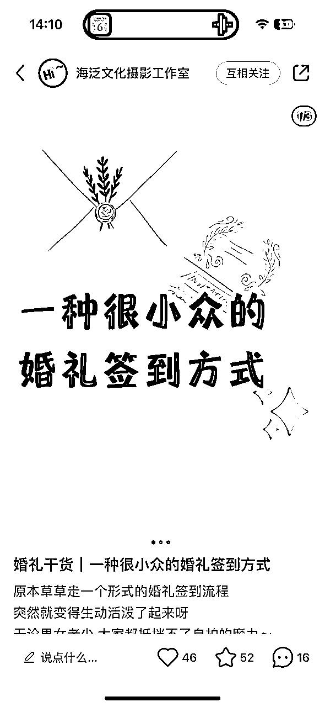

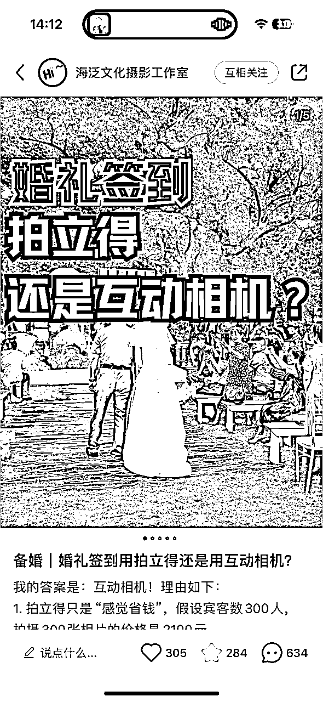

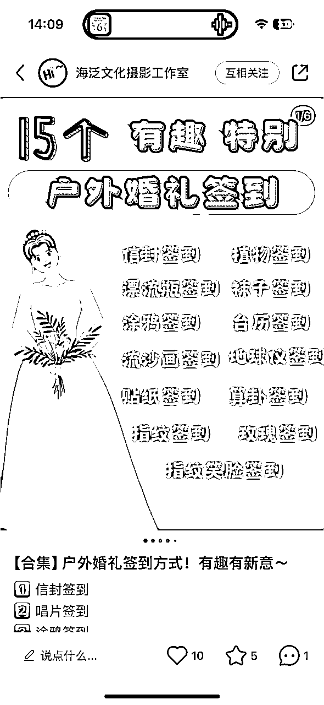

如果你也遇到违规，我的建议是别申诉，直接换号。除非是大号有粉丝，才值得发邮件申诉。

注册📕不用愁手机号，去营业厅办个副卡就行，和主卡共享套餐，不额外花钱。拼多多300多块的iPhone 6也能拿来注册，虽然卡，但便宜。

就这样摸索了一周，加了20多个🛰️好友。在和用户聊天中，我逐步把价目表、合同、服务流程都搭了起来。

关于价目表：同行都用一张价格表图片，我却觉得“需要被教育的产品”不能一上来就发价格，得先传递价值。所以我用🛰️笔记做成一份“价值型”价目表，先说我们是什么、为什么需要，最后才说多少钱。因为用户在📕上只是初步种草，很多人以为我们就是普通拍立得，或者以为只寄设备不派人服务。我在真实沟通里不断收集他们的疑问和顾虑，一点点完善了价目表。

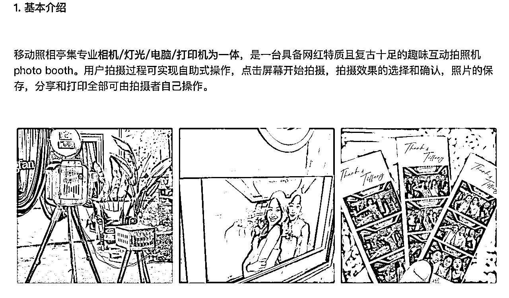

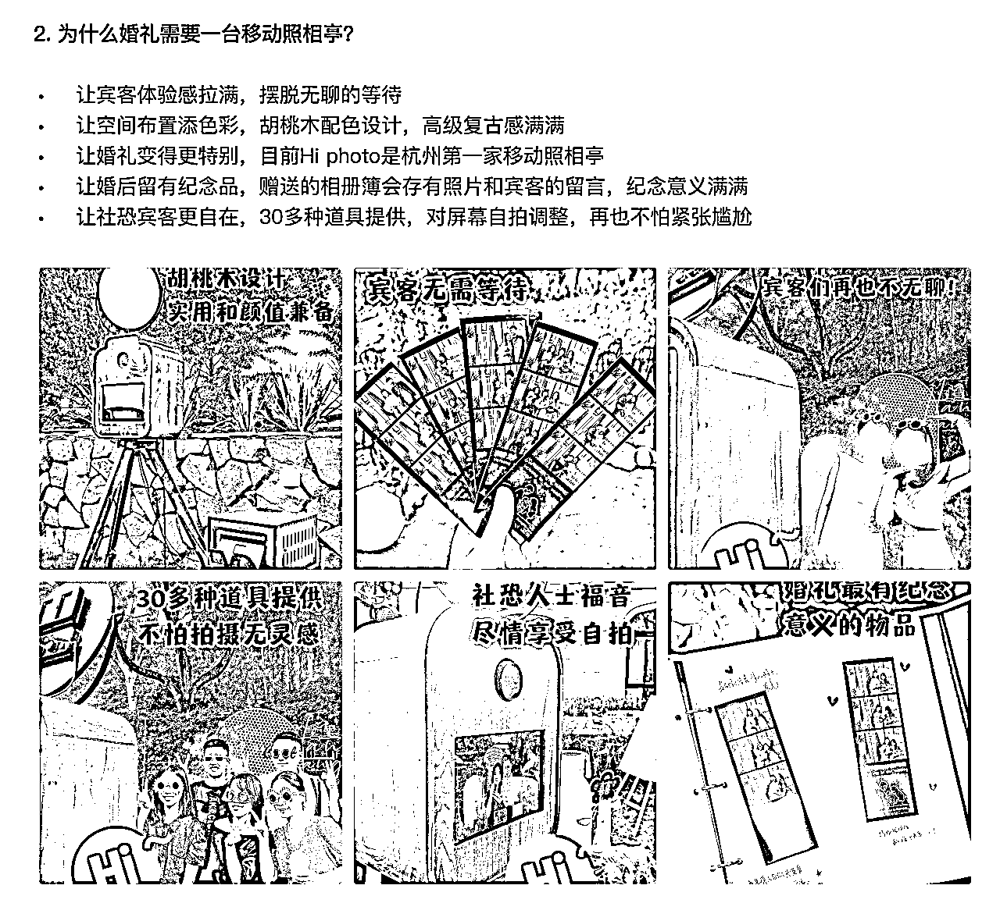

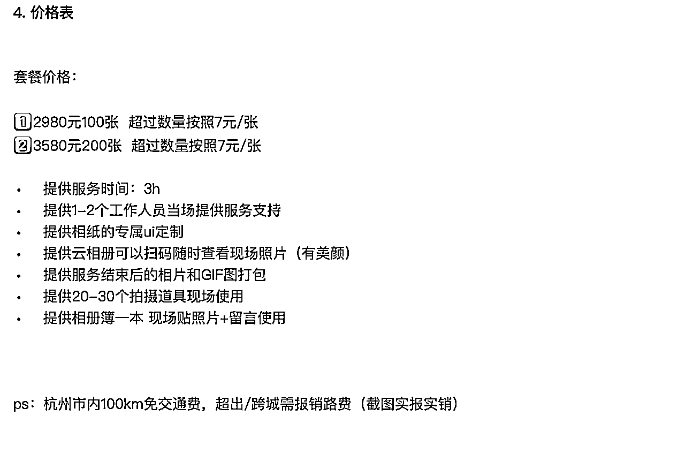

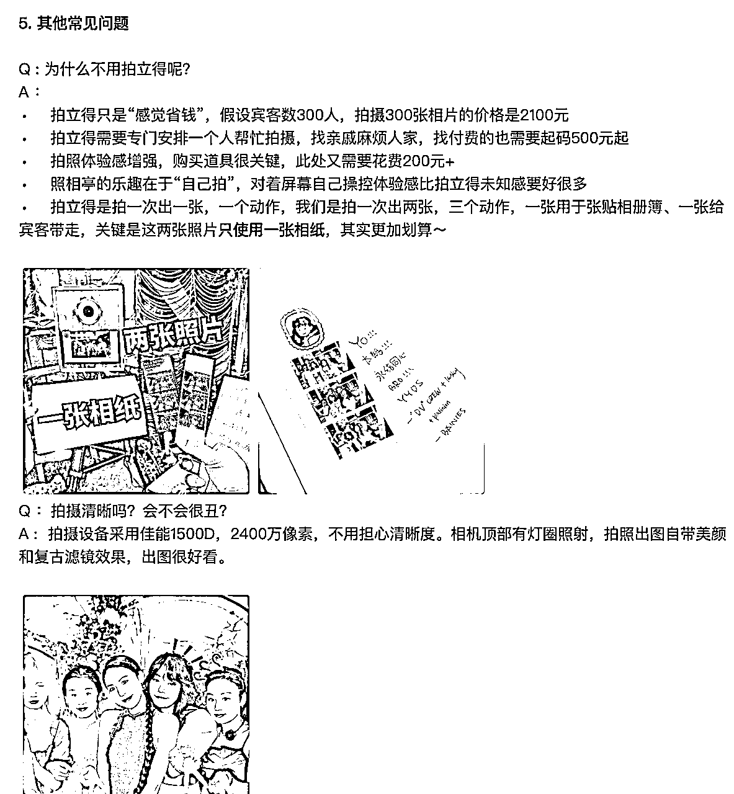

关于合同：我还没来得及准备合同，就有客户下单了。我赶紧找同行蹭了一份（感谢同行大佬！），快速改好发给客户。刚好我自己婚礼定主持人时用的电子签小程序，就直接套用来签约了。

谢谢第一位下单的妹子！那时候我朋友圈才发了两条广告。

### 2.3 正式放大

一周拿下6单后，我就知道这事能干。于是跑到广东，挨家厂家调研设备，对比价格差异，花了3天，最后选了最贵的一家。当时怕自己是冲动，专门花一整晚在备忘录里列了10个差异，确认我是被硬件实力打动，而不是被公司“文化氛围”忽悠。后来证明，这个设备厂的选择对我之后一年的发展至关重要。

设备到手后，最头疼的是缺📕素材。我主动找本地婚庆，提出免费做两场婚礼，换熟悉设备+拿到素材+建立合作。结果那两场婚礼，后来一年多给我推荐了10多单。世上没有白付出的“亏本”，所有付出都会在未来某个时刻回报你。

从客户变成“厂家”

订单越来越多，我在杭州投了两台设备，南京一台，到去年10月，累计成交单数突破了100。

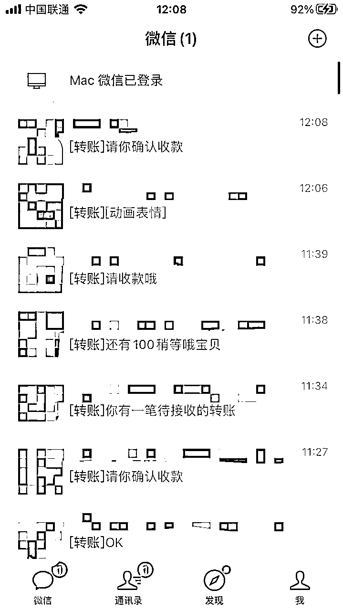

这时问题也来了：周边城市咨询很多，但加上路费太贵，用户不愿接受。比如我接过一单连云港的，加路费和酒店，新人花了5000多。于是我们决定自己造设备，全国铺开。

花了近两个月解决零配件生产加工问题。碰巧当初卖设备的厂家打算暂缓这块业务——他们觉得卖设备利润太低，售后又累又重，做一场互动装置活动就能报价1w+，利润比卖一台设备高。于是我们达成战略合作：他们做我们的软件供应商，只供我们一家，并负责软件售后。

正式卖设备前，我先在客服号朋友圈发消息，消化了朋友圈里感兴趣的新娘，卖出约10台。我打算先看看数据再决定要不要继续，怕坑了大家、被说割韭菜。

10月加入的小伙伴不仅都回本了，订单数也不错，有两个人还提出要买第二台。于是我们开始在📕发宣传帖，遇到有新娘咨询但当地没覆盖的情况，也主动告知我们可以卖设备。

这时来了个好机会：我一个朋友做播客，采访创业者，她请我录了一期，结果那期火了，播放量1w多。3月份我们迅速扩张，覆盖了30多个城市。

城市覆盖多了，📕内容能力也上来了。我雇了专门运营写内容，平均每天私域新增好友40个左右，给全国小伙伴派单的能力也一直在增强。

分享两个📕运营心得：

一、引流账号别光发“广告”，要学会“提供价值和解决办法”。广告是告诉大家“我这里有xxx”，吸引来的都是已被种草的人，她们纠结的是“我该选哪家”。你应该同时做“为什么你需要xxx”的内容。比如我们最早爆火的《婚礼迎宾的意义》，内容聚焦“婚礼迎宾”这个场景，而不是产品，在视频里展示产品带来的欢乐氛围，让大家无形中被种草。

二、现在📕引流越来越难，有一定业务量的人建议开通聚光，能自动回复🛰️、不怕被禁言（每月投放2000+）。

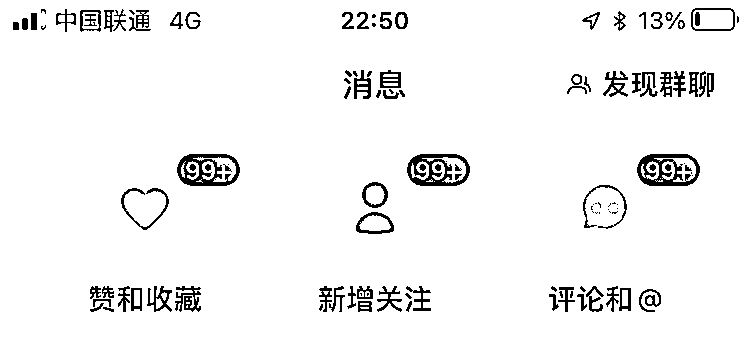

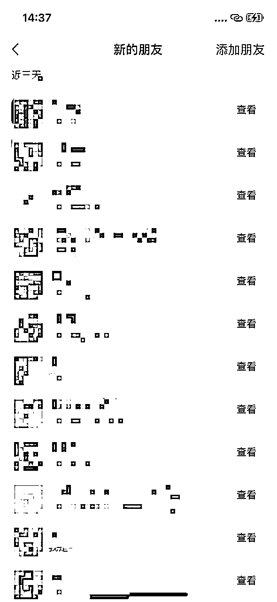

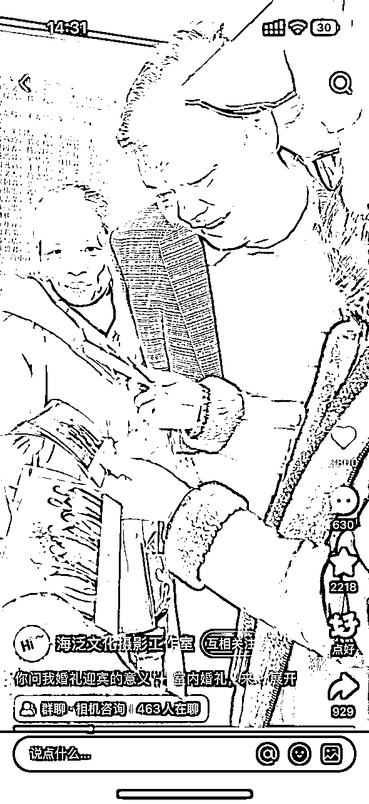

7月我回访了一波，发现上个季度卖出的设备80%已经回本，没回本的也只差最后几单。我更有信心了。于是我主动联系了做离职创业采访的博主《斐斐不会飞》，录了一期视频。发布后又带来一波大增长，城市覆盖直接破60，全国省会基本都有了我们的身影。

这时我们的派单能力也上来了，一个月能向全国派发100多单。

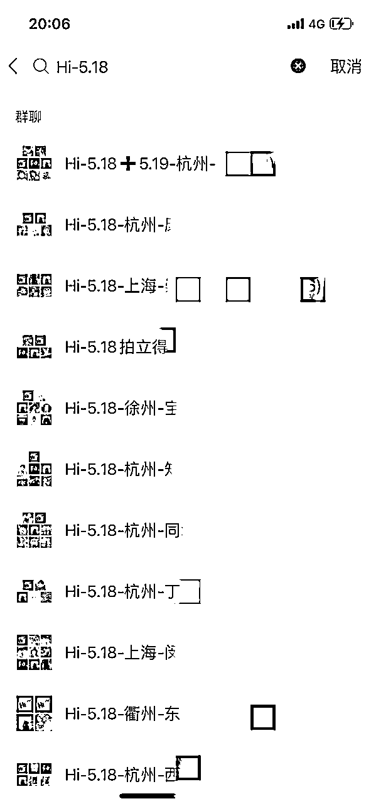

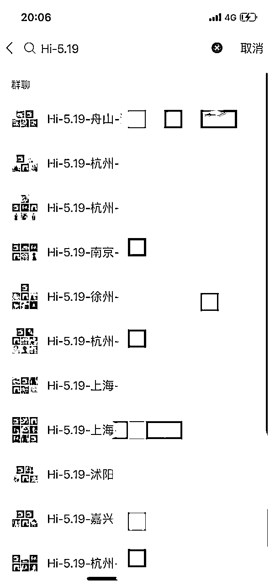

阶段性成果：目前我们是行业里城市覆盖数最高、📕粉丝最高的品牌。

熬过9月10月婚礼旺季后，我们在售后和软件上做了很多升级，拍摄和打印速度有了质的飞跃，还加了AI和AR功能，保持竞争力。

11月要进淡季了，我们打算继续向全国深度扩张。但近期观察发现，这行内卷挺快，成都、深圳等一线城市开始打价格战，入场的人越来越多。三四线城市却基本空白。比如搜“成都”能找出10家，但搜“泸州”“德阳”几乎找不到本地服务商。三四线的新娘宁愿花800路费把省会服务请回来，就是因为本地没有。

所以下一步目标是扩充三四线城市，2024年达成百城覆盖。

ps：想快速找我，🛰️直接找鱼丸就行～

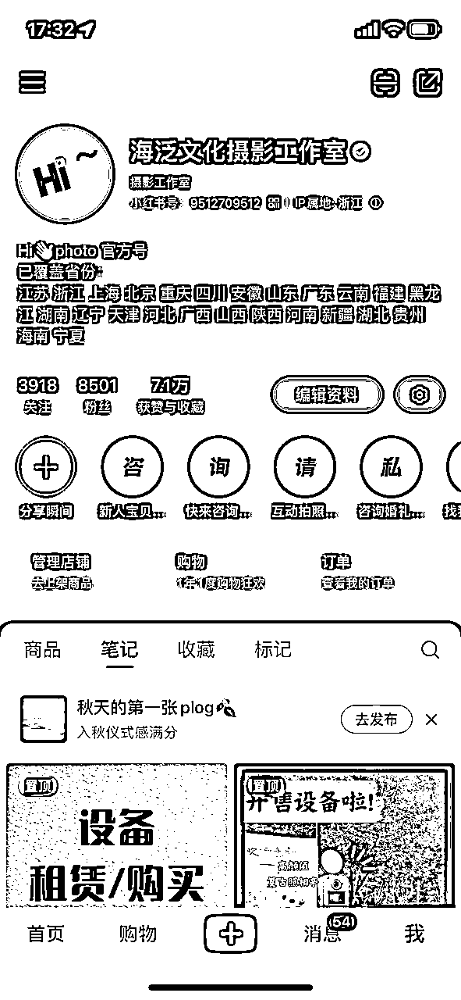

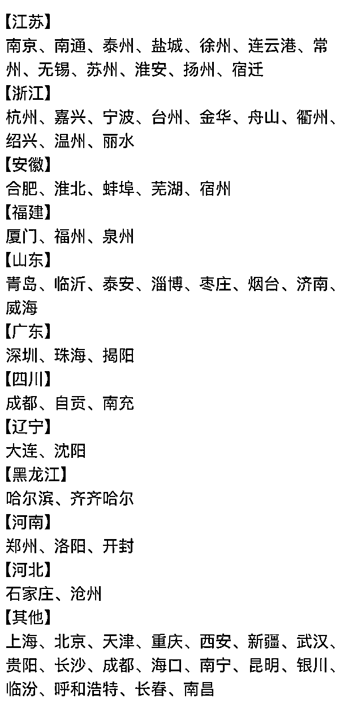

## 三、入局建议与门槛

1、门槛：投入3w多，周六日要有空闲时间
2、收益：一台设备每月能赚5k-15k
3、适合人群：有主业想加副业的人 / 时间自由想找事做的人 / 有婚庆或商业活动资源的人
4、适合城市：一二线基本饱和，三四线还在风口上