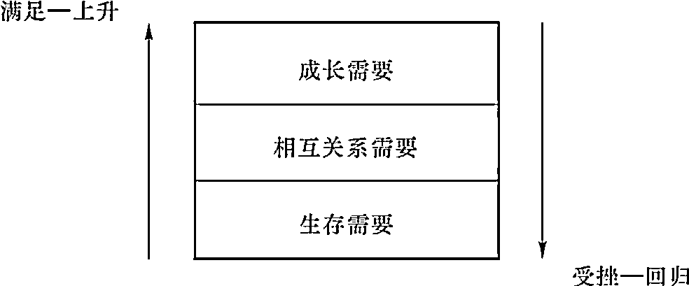
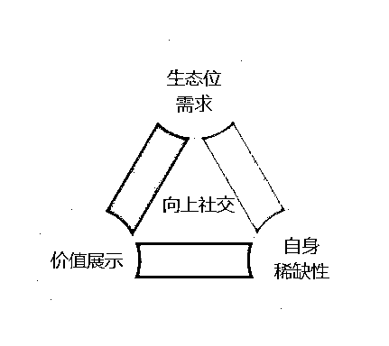

# 《从零搭起你的向上社交系统》 （重读《送东阳马生序》，你可能全看错了）
作者：龙哥

朋友你好，这篇文档是我放出来的唯一一份关于向上社交的深度拆解。

里面浓缩了我十年逆袭路上踩过的坑和悟到的东西，看完你就能摸清向上社交的底层逻辑，学会怎么快速成长、怎么打造自己的稀缺性。

先做个简单自我介绍，让内容更可信：

# 先认识我一下

昵称：修进
坐标：重庆
工作：安监经理
身份标签：

*   985高校毕业
*   央企在职员工
*   国家二级运动员
*   省部级以上作品超100项
*   文科本科发表C扩论文

我的逆袭节点：

1.  体育：基础最差靠死练被教练看见，成了主力
2.  学业：成绩垫底常自习到深夜，靠老师提点提分30进985
3.  求职：笔试倒数，面试翻盘40人进央企

我能带的：

*   向上社交方法论
*   进步与复盘方法
*   自强心法

一路走来既被贵人提携，也亲身吃过苦，所以对自强和向上社交有自己的理解，也整理成了可分享的体系。

# 开场先说点题外话

看到我的经历再加上“向上社交”这个词，你可能第一反应是：她是不是运气好、性格讨喜才被带的。

不是这样。

如果只遇到一两个贵人，那叫运气。但我每个阶段、几乎每年都能遇到愿意出手的人，就一定是我哪里做对了。

性格上，我中学时被校园霸凌过，状态是木讷、别扭、怕接触人的，谈不上讨喜。

恰恰是在这种情况下，老师和前辈只要能帮的上忙的，都会很自然地不求回报地拉我一把。

除了被我的上进打动，其实我无意间踩中了向上社交的本质。

我把这些经历提炼成了可复用的理论，这次就从为什么要做、到底是什么、怎么做三个层面来讲清楚。

# 第一部分，为什么要向上社交

## 一、让你的价值被放大，而不是被浪费

拿《送东阳马生序》来拆解特别清楚，这篇分析估计会颠覆你之前的认知。

课文里宋濂说“我幼时嗜学，家贫，无从致书以观，每假借于藏书之家，手自笔录，计日以还。”

上学时老师都念后面那句“天大寒，砚冰坚，手指不可屈伸，弗之怠”，用来讲自强。

但没人问：藏书人家凭什么借？元末明初一本书要100文左右，佣工一天30文，一年也攒不出多少钱。把贵重物借给穷人风险很大，为什么偏偏借给宋濂，还能让他“遍观群书”？

原文藏着答案：“录毕，走送之，不敢稍逾约”“计日以还”。

不敢逾期、按时归还，说明宋濂信用过硬，借出书的成本低。

光低成本还不够，藏书人也要有利可图。

借书给宋濂，等于帮自己做广告：看，我家主人生为寒门学子着想，是个识才惜才的人。以后有人要卖书，会优先找我。

家里也有孩子，借机还能敲打：“看看人家宋濂，一样穷却这么争气。”

如果宋濂不做向上社交，就维持不了“好读书”的名声，藏书人家也丢了个现成的代言人，双方都亏。

正因为持续交换，宋濂的名声被放大，藏书人家的口碑也被放大，价值才在互动中变大。

## 二、满足刻在基因里的成长欲

宋濂那么穷为什么不去打工？因为人有根本需求——成长需求。

克雷顿·奥尔德弗在马斯洛基础上提出人有三大基本需求：存在、关系、成长。

存在需求是生理和物质，饿了吃，渴了喝，困了睡，单身想恋爱。

关系需求是被看见被尊重。网上调侃领导在公司叫X总有人开门按电梯，在外面溜达就被叫“让开点”。这种被重视感就是关系需求。

成长需求是个体追求自我完善、渴望影响力、名垂后世的欲望。

“卷也卷不赢，躺也躺不平”流行的原因，就是成长欲还在驱动。

成长欲的满足需要环境托底，而向上社交是最快进入高维环境的通道。

马克思说人创造环境，环境也创造人。对个人而言，环境创造人的机会远大于人创造环境。

你是要考上985去拿平台资源，还是先进二本再想办法把学校升级成985？答案明显。

进入好环境，能力提升的速度才最快，性价比最高。

## 三、向上社交能具体带来什么

### 1.补信息差

信息能颠覆决策，而决策决定人生走向。

向上社交就是进高维度的门票，一句指点就能撬动命运。

举个我亲眼见的跨领域降维打击案例。

一个计算机本科、新闻传播硕士的人，叫他A吧。文科发文章有多难大家知道，新闻传播全国有16,350位老师，核心刊物C刊只有五大刊，每期十几篇，一年上刊六十多篇。

一万六千人抢六十篇，名校教授都不一定稳上。

A研二就已手握十几篇C刊，内定博士名额。985新传老师岗位随便挑。

同届计算机毕业生有多少？进大厂的有多少？考研的又有多少？能像A一样提前锁定副教授资质的又有几个？

他靠的是信息差：计算机传播这个小众赛道，别人不知道，他有人告诉他。

这就是向上社交带来的信息优势。

### 2.补思维差

有人说高位的人只是风口上的猪。运气耗尽就会摔。

但有一类人总能在高位站稳，因为思维方式取胜。

稻盛和夫的成功公式：成功 = 思维方式×热情×能力。思维方式可以为负，热情和能力最低为0。

一个人用的思维模型有十几个，只要一个有致命缺陷，努力就白费。

怎么知道自己的思维对不对？靠向上社交。

向认知高的人靠，观察他们的思路，对比自己的认知，汲取养分。一句话就能省掉几个月的弯路。

我初中的时候喜欢挑比我弱的单挑，输了不被罚。教练一次点破：比赛时哪有弱的给你挑？跟强的打，她就是你的免费陪练，输了交学费。

一句话点醒我，之后我只挑强的打，不到一年从最差到一挑二不在话下。

没有那句话，我会浪费很久才悟到。

总结一下要做向上社交的原因：放大价值、满足成长欲、补信息差和思维差。

# 第二部分，向上社交到底是什么

## 先说它不是什么

现在的误区有四种：

①向上社交=讨好=舔狗=没尊严 ×
②成功=直接拿到资源，什么都不用做 ×
③只有成功、有资源的人才能做，普通人不行 ×
④目的就是让固定的人在固定时间给你固定帮助 ×

向上社交不是做题，做完必有分。它更像营销，用自己当商品，曝光+质量决定能换多少资源。

本质是价值交换。

上位者与下位者交换什么？下位者满足对方当下的关系需求和长远的成长需求，换取对方的资源来满足自己的成长需求。

宋濂拜访老师“或遇其叱咄，色愈恭，礼愈至，不敢出一言以复”，当下满足了老师的被尊重感。

同时展现出巨大潜力，让老师觉得培养他将来有回报。老师有子孙，宋濂若成名，子孙也能沾光。

所以不是单纯恩情，也是一场价值交换。

向上社交的循环就是：找生态位需求→对照自身稀缺性→展示价值满足需求。

下面用我的实操来示范。

# 第三部分，怎么实操

案例：大一新生想跟老师搞好关系。

第一步 A觉察需求：
老师普遍缺什么？我给得出来吗？
物质和知识老师比我多，这条pass。
精神层面老师需要被需要感，但大学生上课不爱听、不提问，老师很没存在感，提问就能满足。

个性化需求要细看：
快退休的老教授，业务强科研一般，就多请教业务，别碰科研，说不定毕业能帮就业。
年轻老师没评副教授，缺科研论文，可能缺免费劳动力，给他打下手就对了。

第二步 B匹配需求：
我能提供被需要感吗？能，认真听讲、下课问好问题。
我能提供免费劳动力吗？能。

匹配上了，但还不行。

第三步 C制造稀缺性：
一节课认真听课的很多，十节课都这样的人多吗？问书本问题的很多，问老师自己论文问题的人多吗？

直接上赶着要加名的人很多，如果我摆出只为学习不为功利的姿态，自主学科研工具、看论文、带着选题请教，那我就从几百个学生里变成稀缺品。

我就是这么做的：一直认真听讲、积极提问、常在自习室自习，偶尔表现出对研究感兴趣。最后两位专业课老师主动要带我发文章。那时我的绩点还在年级后40%。

最后我成了学院几年里唯一发表C扩的本科生，直接达到研毕业要求。

从为什么要做，到是什么，到怎么做，基本讲完了。

篇幅有限，理论框架和操作细节我都已摊开。如果想进一步搭建自己的向上社交系统，欢迎找我聊聊。