嗨，我叫蓝蓝，坐标成都。读硕士那几年，我把精力全放在“CS考研”这条垂直方向上，以小X书和哔哩哔哩为主阵地，分享内容、出售复习资料。最终，我做出了一个4000多位成员付费加入的圈子，全网大约有10万人关注，去年还登上所在社群平台的年度Top100，累计营收超过40万。

在这个高手云集的圈子里，我大部分时间都在潜水，安静看别人怎么分享。转眼到了续费的日子，自然得果断续上。借着这篇文字，我想把这趟实战踩过的坑、得到的经验、遇到的开心事，一股脑写出来。篇幅不短，接近1.5万字，只要有一两句话对你有用，我就满足了。

这一路，我还收藏了圈内前辈们推荐过的好文章。希望你能用好这个圈子，享受过程，最后拿到属于你的结果。

我的变现链：备考→求职→Plan B；平台链：小X书/哔哩哔哩→微信公号→私域微信。

## 01 自我介绍

我叫蓝蓝。过去一整年，靠小X书加哔哩哔哩做CS备考项目，累计有6000多位读者为我的内容付过费；自己圈子里，超过3800位成员是付费进来的。平台年度Top100我侥幸上榜，营收做到40万以上。这篇文章会记下全过程：从找不到话题可拍，到内容多到拍不完；从没什么人看，到不断收到正向反馈。你读后能有点获得感，我就很高兴。

## 02 数字资料赛道复盘

最早我并不知道这类生意叫“数字资料”。我是刷到一篇《大二，通过微信公号年入10w》才开始懂。那位作者做的事情很简单：卖自己的笔记，养一个微信公号，靠广告和笔记两条路变现。

数字资料对新手很合适：几乎没有成本，不需要物流，有手机、有编辑工具就能开张。它还能让人把内容制作、抓取流量、经营朋友圈、维护社群这几大模块统统练一遍。

### 02.1 我为何要准备Plan B

Plan B，相当于打工人给自己安排的后备计划。无论互联网还是传统行业，没有谁是绝对安全的。行业一旦下行，公司一旦变动，饭碗就可能丢。手里有Plan B，至少能再端起一个碗。经济学家有一句经典比喻：鸡蛋不要放同一处。

我当时按毕业后的收入，结合成都房价一算，想在成都靠自己安身，相当难。说到底，就是穷、没安全感。但穷也逼出动力：我一有空就看别人怎么做生意，下班回家放下手机就开写，还能拒绝大量无用社交，专注做自己的规划。

回看过去的赚钱经历，真的很少。本科寒假在广东打寒假工，差点错过除夕年夜饭；在学校发过传单；读研后又去校外教过小朋友。这些活儿都是拿时间换钱，卖一次只算一次。经历过这些，我更想找到“一份作品反复卖”的方法。

我妈妈不识字，却是我最佩服的人。她年轻时摆过菜摊，后来开小服装店，独自去武汉进过货，一辈子勤勤恳恳撑起家里，把我和两个姐姐带大，还全力供我们读书、考研。任何人问我最敬佩谁，我都会不假思索地说：我妈妈。

中考我考了600分，刚好够县里普通高中的线。我妈问我想不想去市里那所更好的高中，她和爸爸存了一点钱。那所学校大概要650分，借读得多花2.4万。当时爸妈在外地打工，他们把钱交给表哥，表哥连夜赶到学校办妥手续，我这才进了一所管理更严、资源更好的高中。

真正的转折，发生在准备实习找工作的时候。爸爸突然因病住院，得的还是我们最不愿接受的肿瘤。白天我备考面试，晚上轮流陪床。昨天还精神奕奕的人，一转眼却成为需要照顾的小孩。医院的账单像水一样往外流。爸爸听说治疗费用要十几万，坚决说这笔钱该留着给妈妈养老。那时的我还在读书，姐姐也才工作不久，我们甚至想过发起筹款。我只希望他能快些恢复。

从那时起，我对赚钱的渴望变得特别强烈。拿着手机翻各种门路，我反复问自己两个问题：我能做什么？——我在准备面试，所以能分享面试记录。我能给别人什么？——我能告诉别人去哪儿找面试情报。接着，我在复习和面试时都随手拍照记录，这些资料后来成为我在网上赚到的第一桶金。

成长的每一站都可以用来沉淀。沙漠不是一夜形成的，而是一粒沙子、一粒沙子慢慢堆出来。

关于主业和Plan B，有前辈总结得特别精辟：主业为Plan B铺路，Plan B也会反过来滋养主业。我读的是CS，求职方向也是互联网，因此选CS备考作为第二曲线，等于再次打磨自己的专业底子。成长不需要一口气跨十步。方向正确，坚持走，就能走得稳、走得远。好比跑步，长期不跑突然来个5公里，第二天大概率浑身酸痛；要是每天坚持3公里，30天后，5公里也不是什么难事。

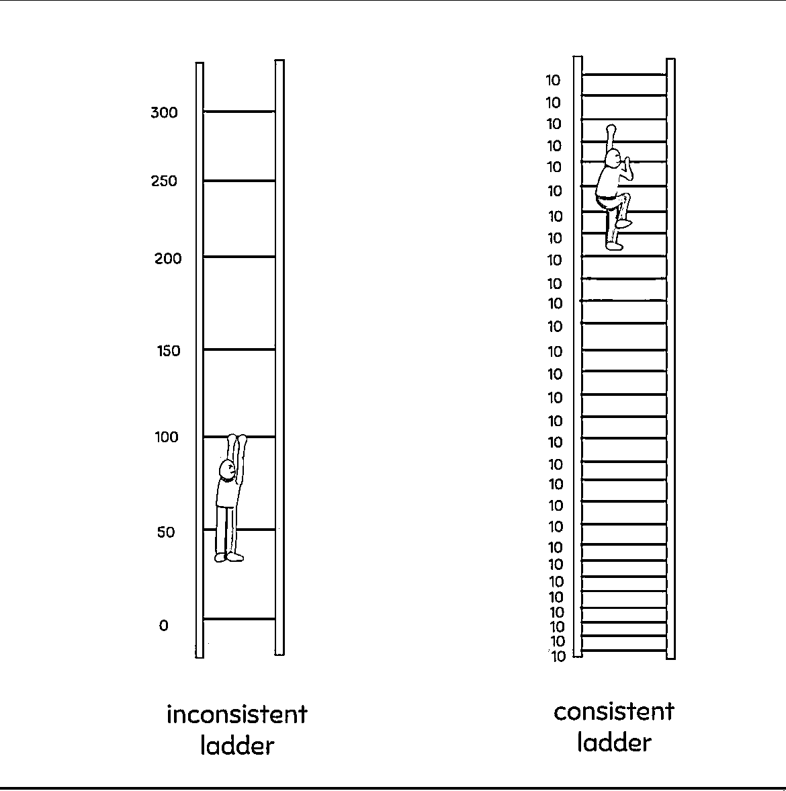

就这样，我从CS备考入手了。

### 02.2 数字资料项目的几个关键

#### 02.2.1 先找到自身切入点

航海家采访节目里，陈雪老师有句话我很认同：别总盯账号涨粉，要多想你能给读者带来什么。

切入点不是天生的，而是在动手做的过程中慢慢形成的。先完成，再完善，比一直等完美有用。

在此之前，我试过商单、闲鱼带货、拉新返利，它们都有窗口期，内容很难沉淀。后来我反复从自己身上找资源，忽然想到：我考过研呀！第二天就去注册哔哩哔哩，开始自学剪辑。你猜我最早用的剪辑软件是什么？既非剪映也非PR，而是AE。现在回头看，AE确实把视频制作搞复杂了，但当初为了AE下的功夫，让我意外接到好几个动画单子。

别人可以指出线索，实际操作还得自己跑。探索的过程本身就非常值钱。

因为方向足够精确，来找我的人基本就是CS备考的考生。如果你想做公务员、教资，底层方法一模一样，换换主题就行。

这类账号的常见人设公式是：领域+上岸分/上岸院校+路线。比如“CS考研｜390分上岸复旦｜全年规划”。

别等方向百分百清晰才动手，做着做着，路就会显现出来。

为了让选题不枯竭，我把一个大方向分成至少5个模块，每个模块再列10个小问题，这样就有50个备选主题。例如备考动机、择校理由、心理变化、关键节点、单科复习策略。

#### 02.2.2 调研市场

做项目前，如果这个方向几乎没有多少人做过，很可能就是机会。想快速了解一个陌生行业，可以看看《用4小时吃透一个陌生行业》。

我的调研方式很土：去平台搜“考研”“CS考研”“某门专业课”，把这些领域里的头部账号和热门视频找出来，再逐个拆。搜完之后我注意到，做得好且关注量破10万的账号很少，这不就是空白市场吗？做。

我把几个几万关注量的账号内容都刷了，找共同点，找差别，找例外。新手最该做的是“一比一模仿”。有套“守破离”法则讲得很清楚：先照着学，再突破，最后形成自己的风格。

我同时把账号的发布时间、标题、话题标记、数据放到一张表格里。看得多了，就会明白什么时候发哪个内容，标题怎么写更利于传播，标记也要有策略。

#### 02.2.3 找更细的切口

越是细分的领域，越可能出现高客单。拿代写来说，低端是做基础文案、PPT、简历优化，竞争激烈价格低；高端是写专业方案或数据分析，懂行的人少，价格自然高。

所以，如果你有专业能力，别做又大又全，要做又窄又深。越垂直，越能建立专业感。

再比如小学教辅，有的新手一上来就想覆盖全科。我通常劝他先挑某个年级、某一科去做。这样做调研和模仿都会更集中。等一个年级跑通了，再去扩其他科目，速度快很多。

教师方向也是这样。数学、英语、高中、初中都是完全不同的战场，新人最好先选一个足够小的切口，持续深挖，打出一篇爆文，然后反复测试，直到把它完全吃透。不然，你的爆文很快会被同行拿去复制。

#### 02.2.4 绕过版权风险

数字资料最怕惹版权麻烦。优先用开源内容；有垄断属性的大机构资料尽量不用。它们大多拥有版权，哪怕截图和图片也不能随意拿。真收到警告，马上主动下架。

换个角度，这些机构既是同行、学习对象，也是潜在合作方。关系维护好，后面的商务推广和课程分销都会顺很多。毕竟，谁不喜欢被人主动推荐呢？

### 02.3 怎么找参考对象

快速上手的第一步，是找对人。这里面一定会用到核心词和延伸词。

#### 02.3.1 什么是核心词和延伸词

一条帖子包含封面、标题和正文。封面与标题是用户最先接触的部分，也是你希望他们看了就想点进去的部分。它们通常会放进与内容关系密切的高频词，也就是核心词和延伸词。

这些词会影响平台把内容推荐给谁，也影响用户能否搜到你。心态要稳：只要作品给的价值够，流量不会缺。平台要留住访客，自然会给好作品曝光。数据不好时，先反省自己。

发完内容，别只盯着阅读数。后台的观众来源、年龄构成、推荐比例，都是值得看的信息。

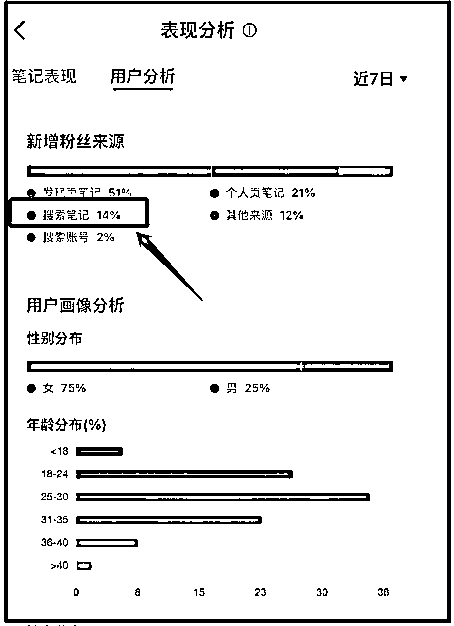

#### 02.3.2 这些词为何重要

因为平台会拆词。比如一句“王道CS考研规划保姆级规”，会被拆成好几个小标签，分发给不同人群。

找词有两条路：一是免费入口，比如搜索条下拉词、顶部标签、热门搜索、猜你想看、系统推荐；二是付费数据产品，比如千瓜、5118、灰豚，收费多少以官网为准。

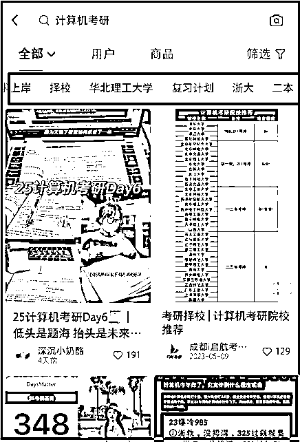

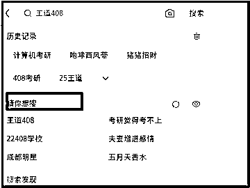

#### 02.3.3 参考账号的标准

不要上来就只盯着几十万关注量的大号。真正值得看的是那些关注量不大、但近期有爆文的账号。想筛选也不难，用站内自带条件就行。

#### 02.3.4 参考内容的形式

第一阶段是照着学；第二阶段是在学习基础上加入自己的元素，做到参考对象的九成火候。最近站内开始打击内容过度相似，反而逼着我们提高原创力。

#### 02.3.5 具体怎么找

- 主动输入：在搜索条里输入“CS考研”，按系统默认热度排列，排前面的账号权重往往更高；下面自动带出的词也值得记录。
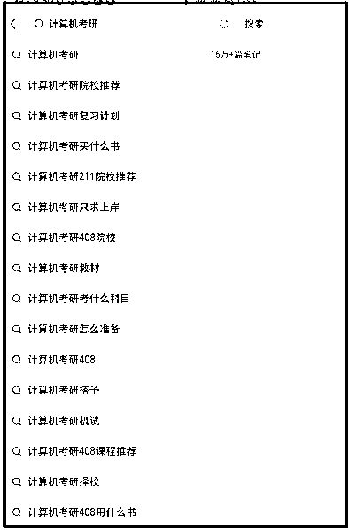
- 让系统来喂：连续搜过几次后，平台会推来相关内容。看到好封面、好标题、好段落，就存下来。
- 借助关注链：翻一翻参考博主自己关注了谁，那些人也大概率是优质样本。
- 看官方号：垂类官方账号常会转发或翻拍优秀创作者的作品。
- 用付费数据产品：千瓜、新红、灰豚有用。但我的领域太垂直、内容量不大，所以帮助有限。

用这些方法，就能逐渐锁定值得抄作业的标题、博主和形式。

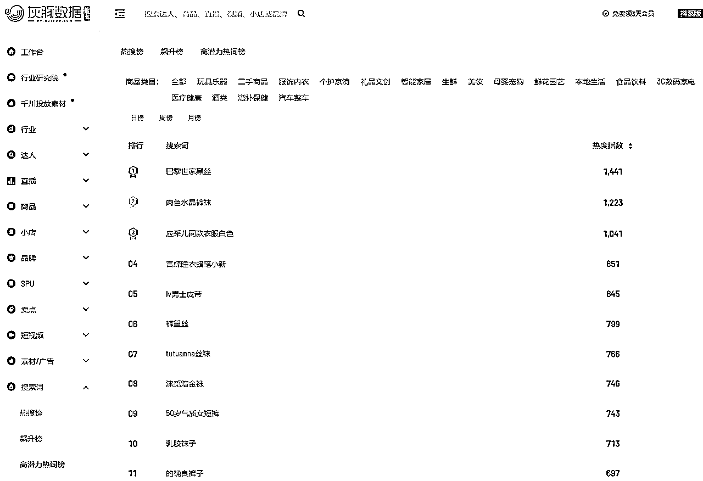

之后，把哔哩哔哩、小X书上的参考内容归拢起来，就形成了我的素材池。

哔哩哔哩参考博主：

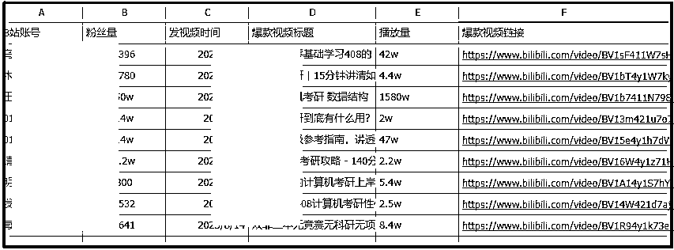

小X书参考笔记：

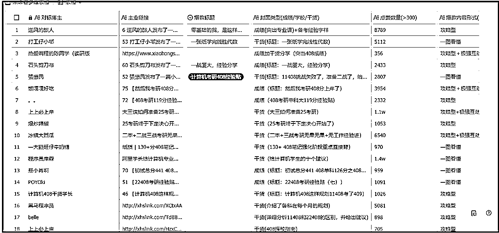

调研阶段小结：先定方向；然后靠搜索词去找对应作品；最后把这些信息收进表格。

#### 02.3.6 执行阶段

表格整理出来以后，就要刻意练三件事：第一，标题能不能对准用户需求；第二，封面能不能吸引点击；第三，视频里有没有给足价值。

### 02.4 几类容易跑出圈的内容形式

封面直接影响到用户是否愿意打开。我翻了很多热门作品后发现，能跑起来的无非两类：一是让人好奇，二是让人觉得很“干”。好奇就是看见封面就想看看答案；很干就是内容排得特别满，虽然看不完，但你会觉得作者足够用心。

备考方向，下面几种形式反复出现过：

- 手写笔记型：它给读者一种“研友”错觉。备考又长又枯燥，看到手写笔记就像遇到同行的人。字迹好看，再在留言区引导领取PDF，引流效果很自然。

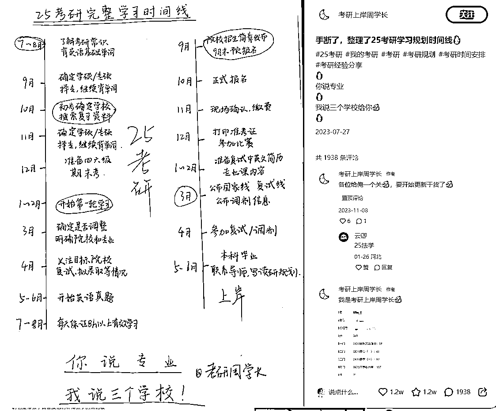

- 拼图配文字型：把多张图拼到一起，可以放生活照、学习照、笔记照。一次发4张图，既能显得信息丰富，以后谈商务合作时也多几个能放推广的位置。

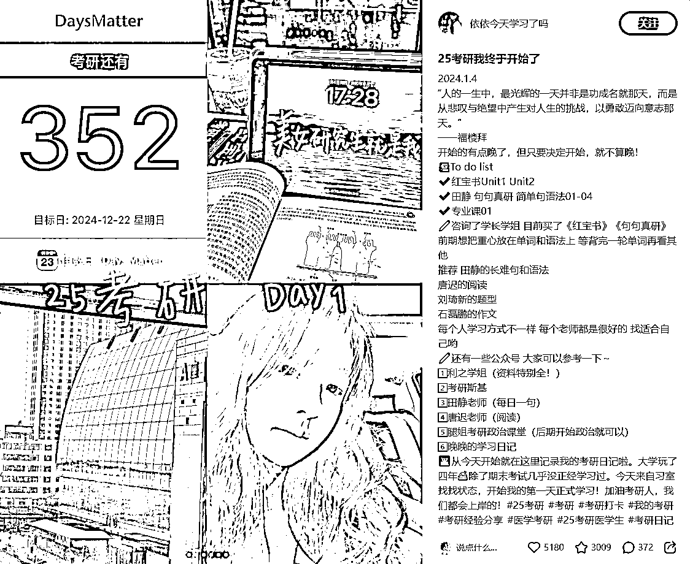

- 手机便签型：这是很多刚考完试的人的首选。手机里自带便签，写完直接截图发布，非常省事。

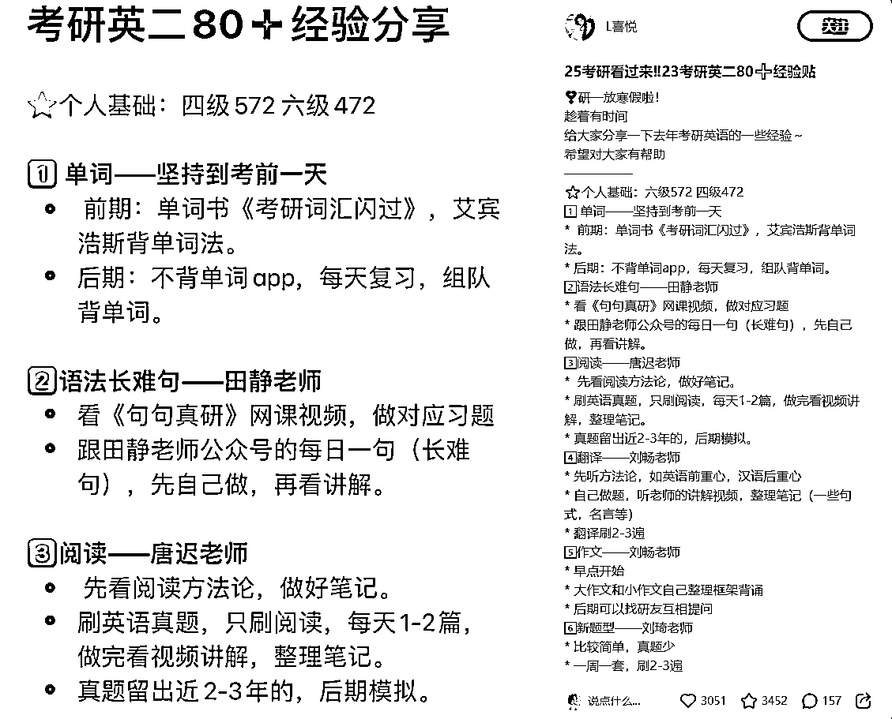

- 留言区截图加圈注型：留言区代表真实声音，再把重点句子描个圈，重点一下就出来了。

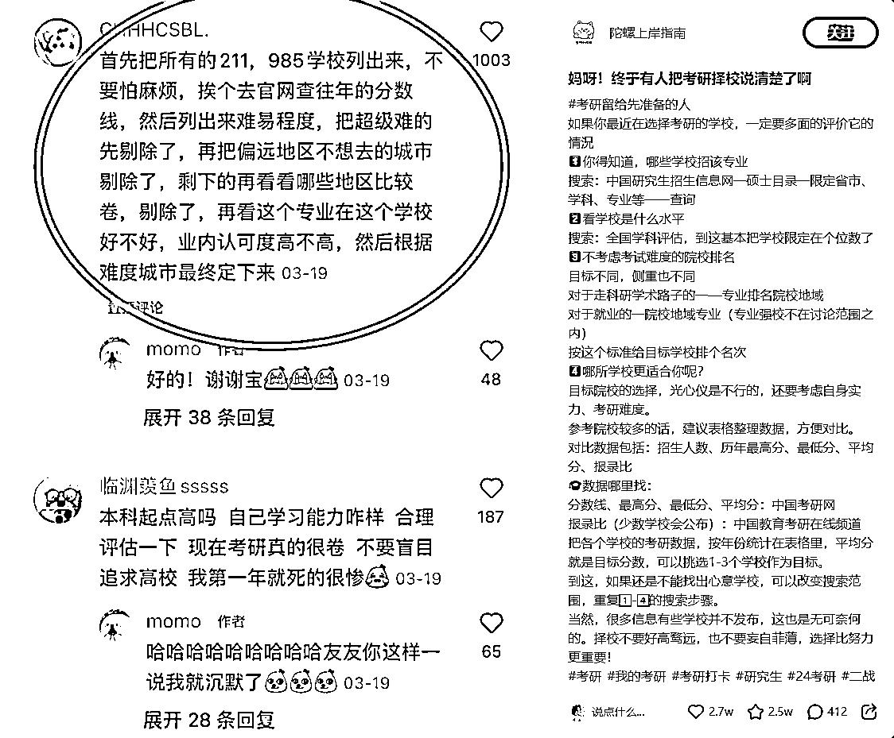

- 成绩截图型：分数是实力的硬证明。考出这个分数的人经历过什么，显然很有吸引力。至于图片放大效果怎么实现，后面会讲。

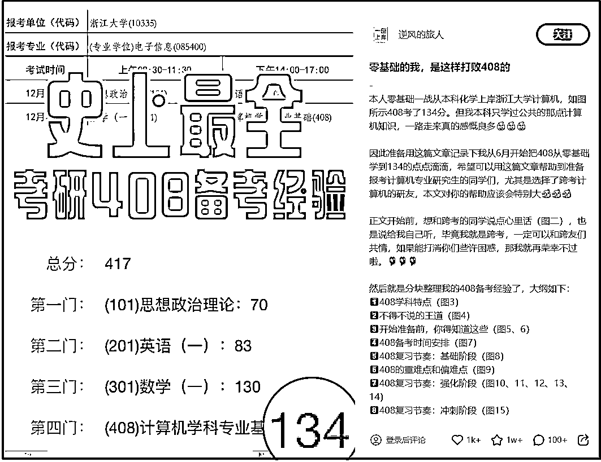

- GoodNotes手帐型：电子笔记排版整齐、观感舒服，也能传递出认真备考的真实感。

以上就是我过去一整年的复盘。这条路我能走通，你们当然可以走得更远。希望这篇长文能给你一点参考，也欢迎随时来聊。一起加油！

备考路上，无论是考研还是考公，越来越多同学选择用PAD做笔记。像GoodNotes这类知识管理工具就很受欢迎，还能自定义字体，让每页笔记的质感瞬间拉满，复习心情也跟着变好。

想要做出让人眼前一亮的小红书爆款图文，先得摸清平台的基础规则。封面建议用3:4的比例，图片务必清晰，千万别用微信传图，容易压缩失真，用QQ传会稳得多。封面最好直接放关键词，让用户一眼抓住重点。做图工具上，稿定设计自带小红书模板，免费版够用，想解锁更多资源也可以看看会员；美图秀秀适合P图和拼图；黄油相机则有很多干货类首图的花字和贴纸，免费素材也不少。如果需要批量收集素材，后羿采集器是免费的好帮手；给图片去水印、做后期，可以用优速等工具。平时收藏一些图标素材也很重要，比如活动、地点、心情、项目符号、学习职场、手势、日常、购物、鲜花、天气等分类的emoji，排版时能起到画龙点睛的作用。

现在做内容，AI是绕不开的效率神器。无论是找选题还是搭素材库，都可以借助AI来辅助完成，大大缩短创作路径。

说到引流，所有技巧都建立在扎实的内容基础上。再花哨的玩法，如果用户拿不到有价值的干货，也留不住人。蓝蓝的实操经验是：细分赛道虽然流量不大，但胜在精准，服务好这批人就能有不错收益。具体引流方式包括：准备小号在主页@小助理；在评论区用小号回复或@小号；拉群后小助理群发微信；小号发一条带微信号的笔记，大号点赞然后私信分享；让对方直接留微信，这样更安全；把微信号拆成两段发送，降低风险；做一张主页截图圈出小红书号，提示“绿软件”；小号昵称改成“完整资料看我主页”并评论私信用户；在群聊里用小号发引导加微信；还可以用群AI加打卡的方式活跃群。不过要注意，这些操作都有被平台检测的风险，见好就收。

同样的玩法放到B站，引流难度更低，新手容易拿到正反馈。早期的路径是B站到公众号再到微信，现在B站到微信也直接走通。当粉丝满1000，就能开自动回复，把公众号或微信地址放进去；视频里可以用“公主号”、“公总号”这类通假字引导用户；动态里也能发图文拉群。做视频别一上来就死磕AE，剪映足够用。选题要紧跟时间节点，比如考研的同学都在复习数据结构，就发对应内容；还要在创作中心设置投票这类互动，增加弹幕和推荐量。评论区可以发图片置顶引流，或者用小号发图再大号置顶；链接里加符号规避检测；在工坊挂个1元小商品，里面放干货和引流信息，也是很丝滑的做法。

付费资料的制作要更严谨。免费资料被挑错大家不好意思说，付费内容一旦有错就会招来批评。基本流程是：先定内容，再列大纲，自己通读五遍纠错，找几个学生帮忙审校并给奖励，图片单独加好水印，最后收集反馈。定价上，引流资料卖9.9，后面可以阶梯涨价，比如前200名9.9，之后19.9。PDF容易被盗卖，记得多留联系方式；在线文档用飞书或语雀，可设置水印和只读；打印渠道联系商家能拿到低价，实物质感更好。被盗版也别太郁闷，反而可以当作宣传素材，说明你的资料够好。

人一多就得建社群。蓝蓝选微信群而不是QQ群，分为免费群和产品交流群。社群不怕不热闹，怕的是死水一潭。可以按月做抽奖，或是发起问题接龙，既活跃气氛又能收集用户痛点。群里的拼单需求单独拉个QQ大群解决，避免违规。后期干货多了，升级到知识星球，支持打卡和专栏，第一年做到官方TOP100，定价99左右很合适。

有了内容沉淀，就能做课程。考研类课程可以拆成导学、基础前置、知识点讲解、强化、冲刺和刷题几个阶段。线上课成本极低，不需要租房水电，海报也能用AI做，卖一份就是一份利润。课程可以放在cctalk等平台，新手用千聊也行。一定记得留反馈模块，问卷也好，评论也好，既能改进内容，又能收集学员好评作为宣传素材。

最后是私域变现。平台挂商品最大的问题就是没法复购，所以一定要把用户引到微信。朋友圈不能全是广告，也不能只发鸡汤。要有生活，展示真实成长；要有软文，通过学员故事触达心智；要打标签，不同产品给不同人看，减少打扰；还可以用点赞送红包的方式激活沉默好友。就这样，一个靠谱的IP就立住了。

把每一步做扎实，从笔记到社群到课程，慢慢会看到复利的效果。别急，好内容永远是最好的通行证。

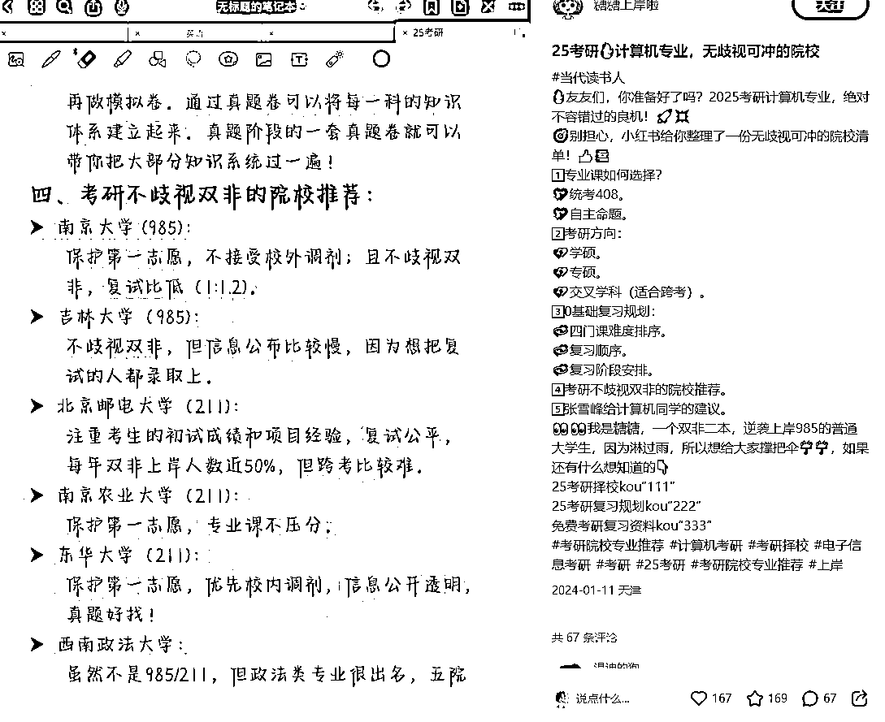
以上是笔记与工具的基本盘，接下来聊聊具体实操。

尺寸与工具有了，排版细节也要跟上。
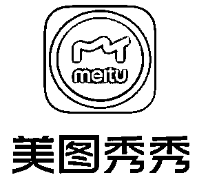
比如封面上的标题字体选择。
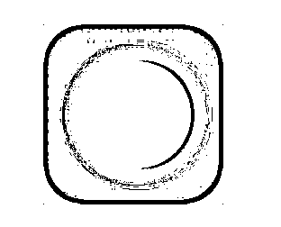
还有内页的间距和重点标记。

这套流程跑通后，爆款会越来越多。
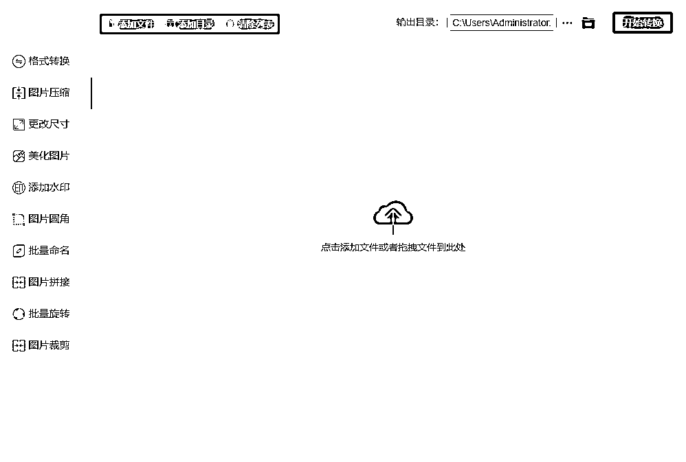
另外，素材采集和编辑也不能忽略。
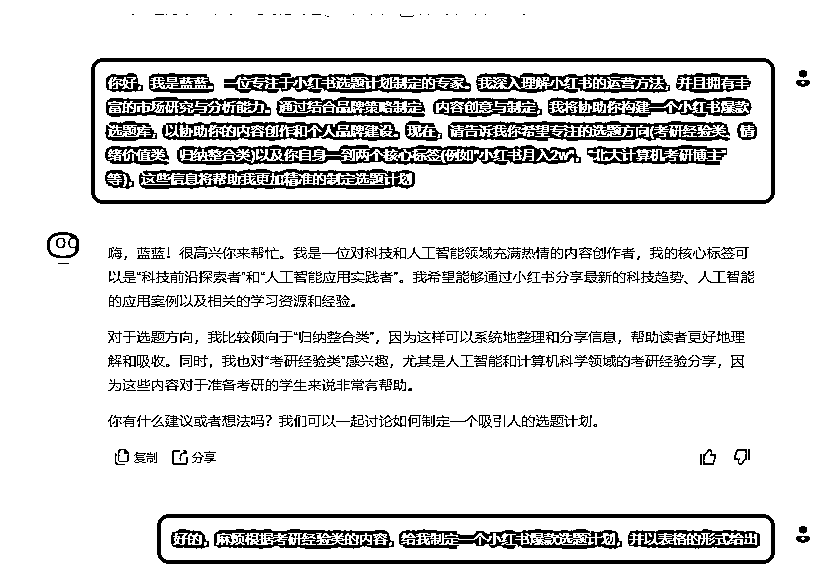
AI能帮你节省大量时间，值得多用。
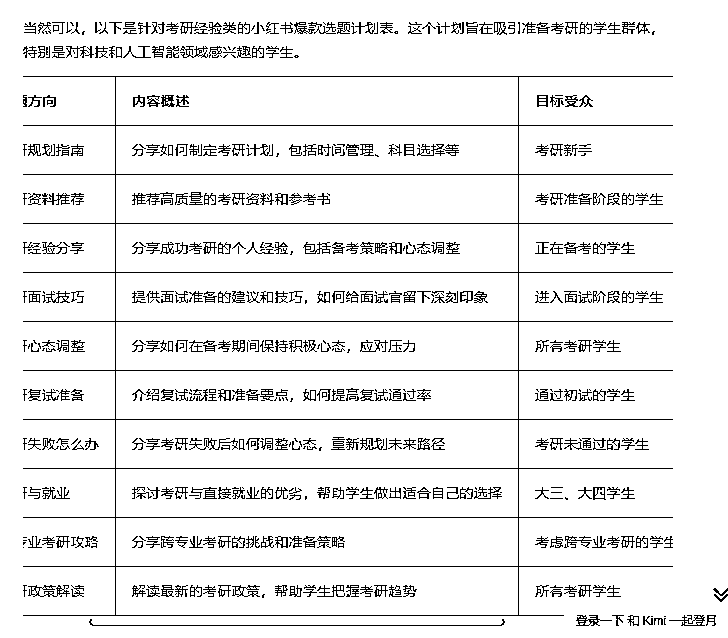
这里有几个我常用的提示词思路，后续可以展开。
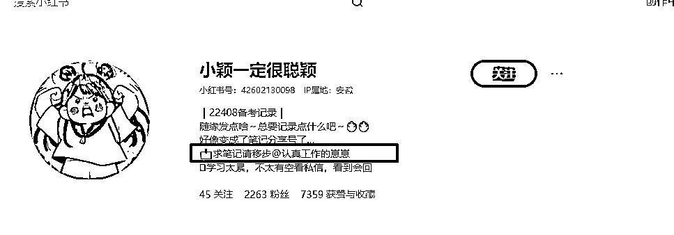
不过要注意，这个操作有被同行举报的风险。
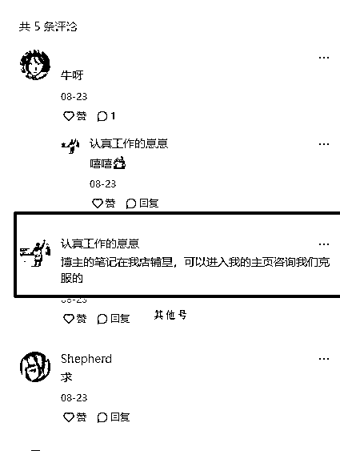
艾特太多也可能被限流，观察数据及时调整。

现在回头看，这个视频虽然数据一般，但意义不小。
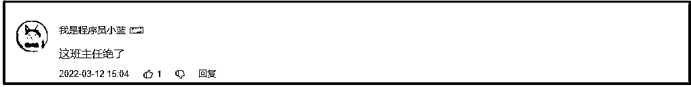
自己冷清的时候，去小号鼓励一下自己也很正常。
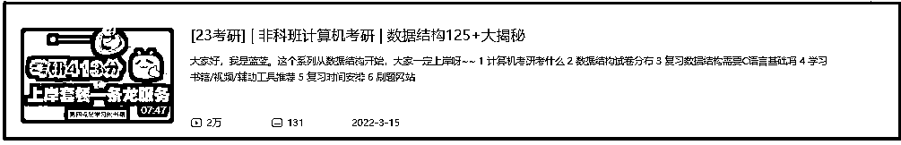
那条私信成了转折点，让我找到了内容方向。
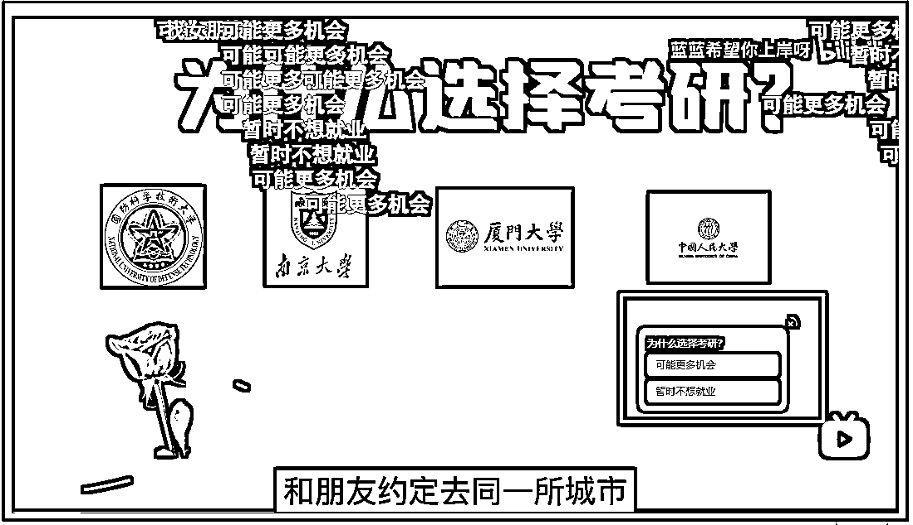
互动设计得好，系统推荐自然会增多。
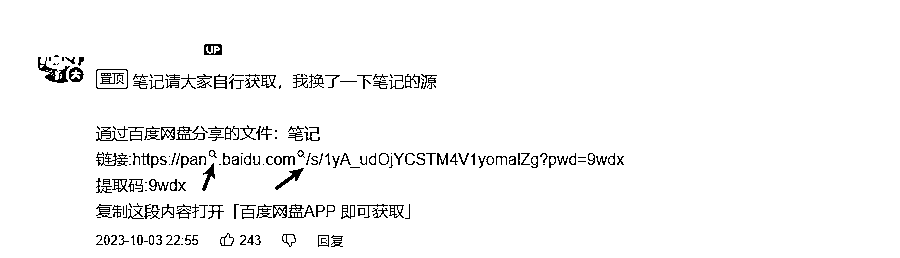
像这种链接处理，现在必须加符号防检测。
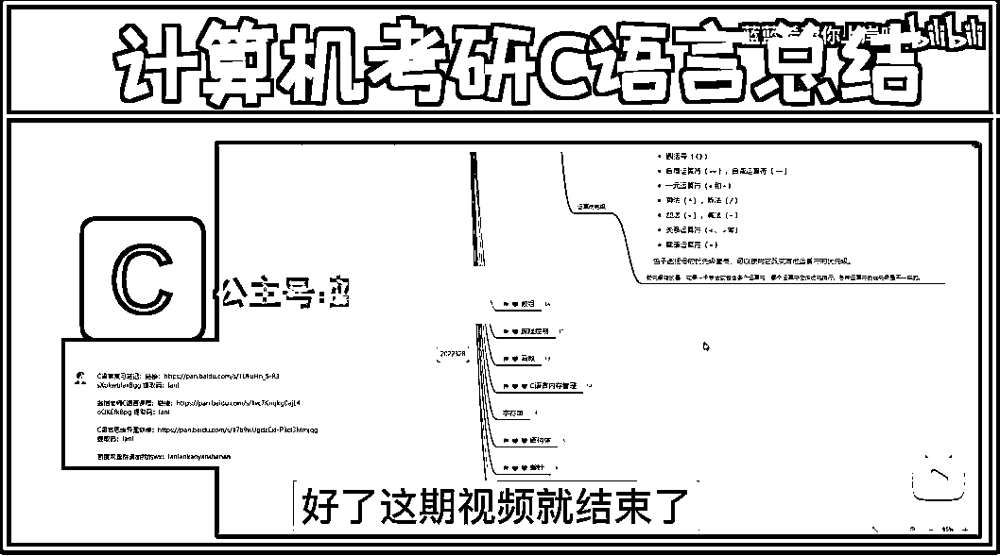
通假字在视频和评论区里都很管用。
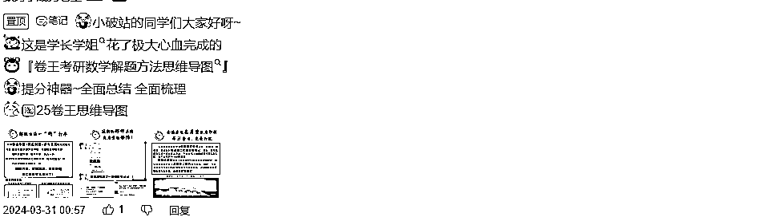
挂个小商品卖资料，用户下单很顺滑。
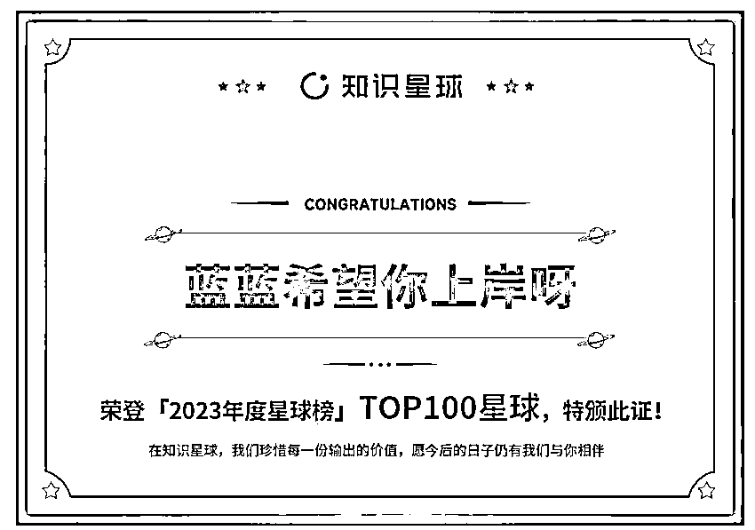
社群做到一定规模后，知识星球是很好的沉淀容器。
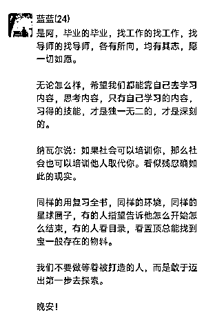
有烟火气的朋友圈，大家才愿意看。
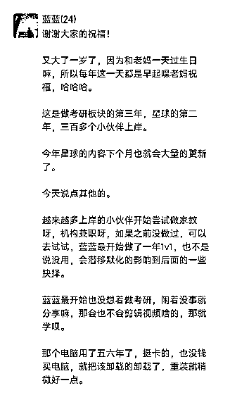
偶尔晒晒工作台和日常，也是不错的记忆点。
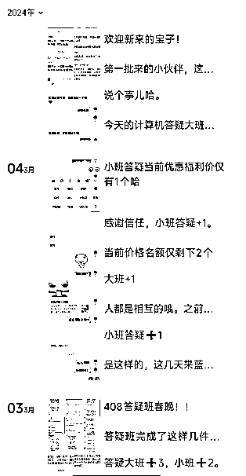
每次新品发售，用朋友圈连续触达6-8次效果更好。
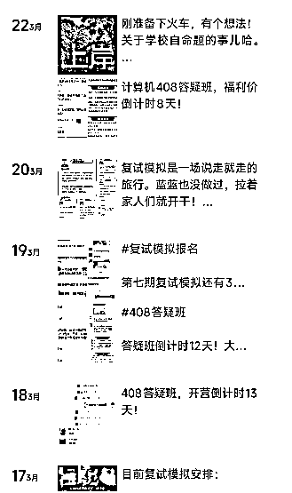
把学员的成长故事写进去，比硬广打动人多得多。
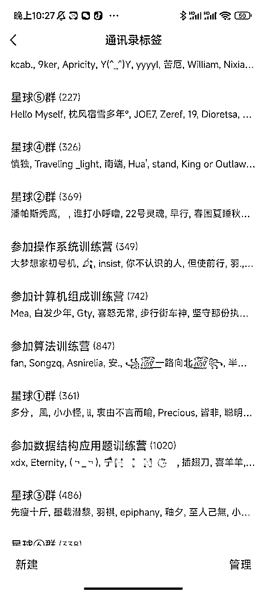
打标签能让你在推荐时更克制，也更有分寸。
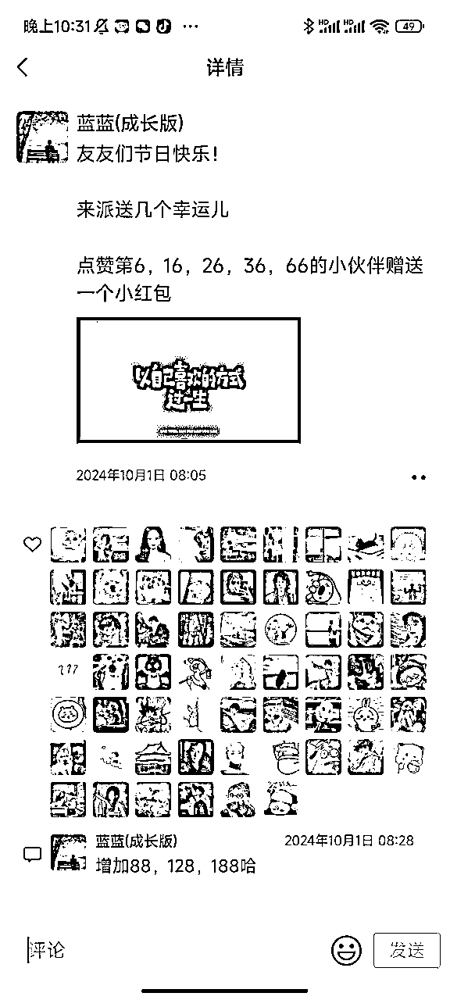
点赞送红包这个办法，能唤醒很多潜水好友。
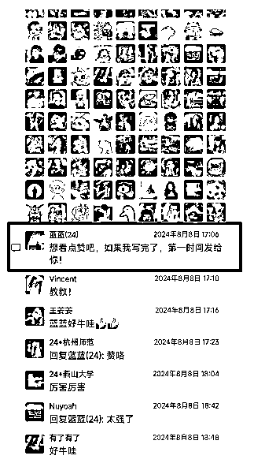
等互动热闹了，下次再发什么大家都会更关注。

很多人问我，最开始是怎么把流量沉淀下来的？其实答案特别简单：我专门注册了一个公众号，把所有免费资料的领取入口都放到了那里。当时也没想清楚怎么赚钱，直到有一天，有广告主主动找上门，我才发现原来可以靠接广告变现——对方开价1000元一条，我当时开心坏了，算下来一个月保底也有3000块。

不过，公众号说到底还是公域流量，真正要长久经营，还得把人引到自己的私域里。最笨也最有效的方法就一句话：“加我微信，资料免费领”。我在公众号的菜单栏、自动回复里都设置好了关键词，只要有人回复，系统就会自动推送我的微信号，引导大家加好友。从B站过来的粉丝，关注公众号后，我同样用自动回复引导他们进QQ群、加微信，这样既能避开平台限制，又能让用户更顺畅地了解我的整个产品体系。

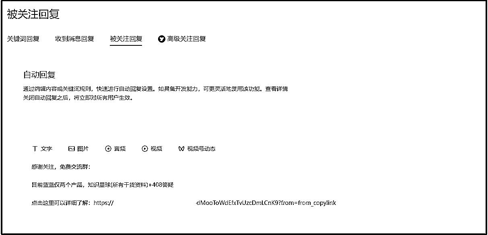

上面这张图，其实就是我今天为了留住新朋友而新增的一个入口——QQ群。群公告里放了一份很有分量的干货资料，想拿资料的同学，加蓝蓝微信就行。今年试下来，效果确实比预想中好。

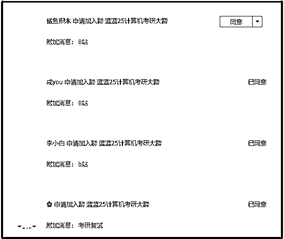

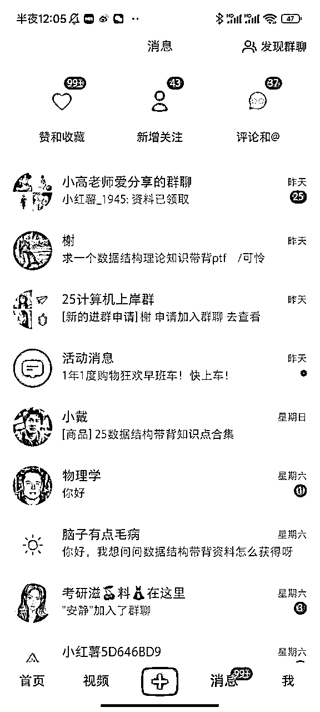

这里也顺带分享一个小细节：虽然是免费群，我也会往群文件里放一些硬核资料，但每份资料上都带了付费内容的专属水印。这样做的好处是，哪怕用户领的是免费资料，也能顺带看到我的其他付费产品，算是一种“润物细无声”的展示。至于怎么维持免费群的活跃度？我的答案很简单——发红包。隔三差五发一轮，群里的气氛就起来了。为了让更多人从QQ群转到微信，我还会让新来的同学在群里“接龙”一句“已领资料”。这么一刷屏，其他人看到了，也会跟着去加微信。毕竟是微信的触达率更高，后续沟通和转化都方便很多。

不过微信也有上限，现在能加10006个好友，但超过5000人之后，消息覆盖率会明显下降。我的应对方法是：建一个大容量QQ群，外加一个免费的知识星球，把每个人只邀请一次，后续想同步什么信息，就能在多个池子里同时触达，尽可能覆盖到更多人。

## 2.13、后端产品怎么做

说完了前端引流，再聊聊后端变现。蓝蓝目前跑通的路径是：考研→就业→副业。每一个阶段，我都能提供对应的产品，根据对方的预算和需求，推荐高性价比的方案就好。

1、卖笔记

最早的时候，我其实就是卖笔记的，各种各样的笔记都卖。考研的、高考的、数学的、小学的，甚至考公考编的笔记，全都能卖。你可能会问：这些笔记我自己都没有，也没经历过这些考试，怎么卖？办法总比困难多——没有就去“造”嘛。卖鞋的不怕光脚的，卖铲子的不怕卖小推车的。

具体怎么做？照着这几步走就行：

*   先找到对标笔记——我这边已经有现成的素材库，可以直接用；
*   用小号混进同行的社群（别骂我，这招真的管用）；
*   直接买对方的资料，我也不白嫖；
*   然后确认版权问题——虚拟资料尤其要留意这一点，多看几家店你会发现，大家用的其实就是同一份资料；
*   再多参考几个同行，多看几份资料，你就会有感觉：哦，原来我也能做出自己的笔记。

2、笔记要做出专一性

真正可怕的不是什么都卖，而是什么都卖不好。术业有专攻，个人IP也一样，方向越垂直越好。我最早卖得很杂，后来想通了，干脆专心做计算机方向。持续地发笔记、做视频，不断吸引同频的人。同时保持每天发朋友圈，生活和广告穿插着来，好友慢慢多起来后，重复的问题也越来越多——于是，我开始用一款能沉淀内容的APP，也就是知识星球。

3、用知识星球沉淀内容

分享的内容越来越多，大家问的问题也越来越多，而且很多是重复的。我之前也看过帅张、卡尔他们的星球，觉得这是个很好的沉淀载体，索性自己也开了一个，专门用来整理学习资料，同时回答大家的问题。这样就有了自己的知识星球。我把原来零散分享的图文内容全部传上去，做好专栏分类，持续更新。星球也慢慢有了自己的成长线。

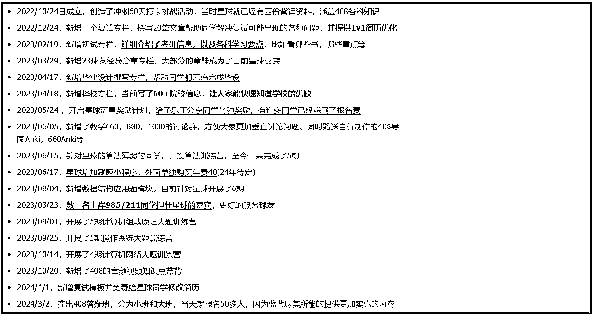

星球价格去年基本维持在70元左右，我很少做预售，用的就是一种很直接的方式：提前在朋友圈“剧透”，说这段时间在熬夜制作一份特别干的资料，给足情绪价值，让大家感受到你的用心。等正式上线时，再配合一句：“这份资料只对星球内的小伙伴开放，如果觉得有用，也可以领优惠券，限量50张。”这样一波操作下来，数据通常都不差。最高的一天，单日入账8000块，也就是一天新增了100多位同学。

4、星球资料共创

后来我参考了大佬们“案例共创、碎片奖励”的玩法，鼓励大家分享自己的笔记和资料。只要内容够好，我就加精华并给碎片，攒到一定数量，就能兑换实物或现金奖励。

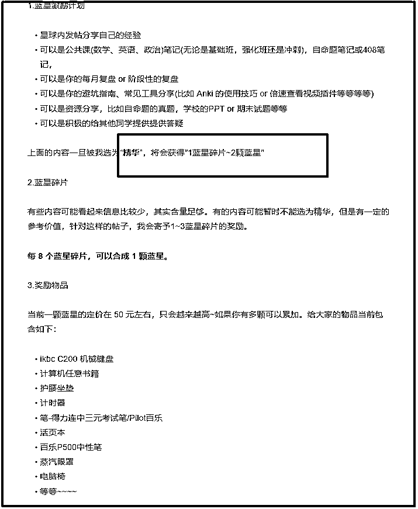

这个活动一搞，星球的活跃度立刻上来了。大家开始主动贡献自己的笔记和收藏，而我只需要把这些资料整理成目录。这样做最大的好处是：成本很低，但星球内容变得又厚又实，后面推广起来也更有底气。

5、小规模训练营

考研的同学应该都懂，专业课需要分模块突击，尤其是七八月的时候，很多人会专门针对薄弱环节集中训练。我也参照平台“航海”的模式，把一部分功能搬了过来——通过打卡训练营的方式，带着大家集中突破某个板块。这也为后续的高阶产品打下了基础。去年我们开了好几个高性价比训练营，比如：

*   45天算法集训：星球同学9.9元，外部29.9元；
*   15天应用题训练营：星球9.9元，外部29.9元；
*   30天组成原理训练营：星球19.9元，外部29.9元。

第一期我还开放了100个免费名额。为什么敢免费？因为能进星球的人，本身就有学习意愿，我相信他们进了训练营也不会划水。而他们学习过程中输出心得，又会反向影响其他同学，形成良性循环。同时，我也能从实际反馈里持续优化训练营的环节。如果收到的是好评，那就是最好的信任背书。

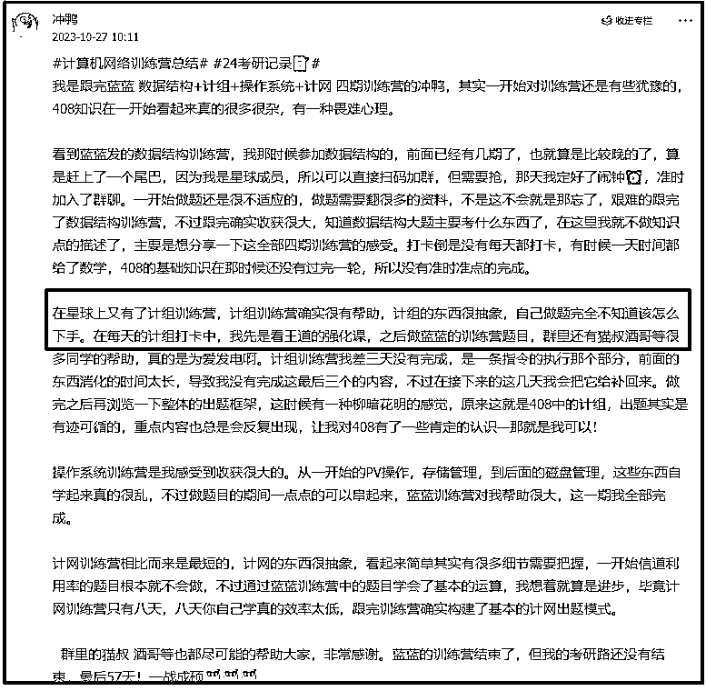

看到这里，你应该能理解我完整的一条链路：B站引流到公众号，公众号沉淀到星球。这中间有一个细节值得强调：一定要给每个付费用户打标签。付费用户相当于已经被筛过一遍，他们对你是有一定认可度的。去年我的付费用户差不多有6000+，这些人如果服务好了，后面会有很强的复利效应。比如初试结束后，有人要准备复试、调剂，有人会着手找工作，还有人想兼职赚点生活费。针对这些需求，我早早备好了对应的产品，目前反馈相当不错。所以说，认真打磨内容，才是最重要的事。我后续也在持续推一些高性价比产品，比如：

*   寒假学习规划：99元/人（收了20多个）；
*   复试资料群：29.9元/人（收了700多）；
*   调剂群：29.9或199元/人（收了200多）；
*   复试算法准备：39.9元/人（收了200多）。

6、把星球成员细致分层

考研本身是周期性的生意，一年结束，人可能就流失了。所以对已经付费的同学，我要尽可能把他们留下来。已经读研的，拉进“上岸群”；已经工作的，拉进“工作群”。为什么要这么分？还是那句话：不同标签的人，对应不同的朋友圈内容和产品。无论工作还是考研，他们未来也可能有自媒体、考公、找工作的念头。我给他们的定位就是——需要什么，我这边就能提供什么相应的产品。当然，很多产品我自己的做不了，所以后来我加入了阿猫的生态，写作的、读书的、销售的资源都有了，这样就齐活了。

7、提供咨询服务

每个人学习进度和目标都不一样，但很多人其实把握不好自己的节奏。这也是一个很明显的痛点。基于痛点，我会提供一些一对一的咨询服务，按半小时为单位收费即可。

8、做专业答疑类产品

有了低价产品，我一直还缺一个高阶的产品线。今年三月份，我专门打造了专业课知识答疑服务。招答疑学长的时候，我定了两个优先条件：一是参加过蓝蓝之前的训练营，二是知识星球的成员。倒不是说外面高分选手不好，而是从自己身边出来的人，认同感和责任感都更强，一起做事更放心。这款答疑产品本身也是被用户需求推着走的，之前因为一直没做，流失了不少人。现在分大班和小班两种班型，定价分别是599元和1399元，上线当天就成交了50多单。

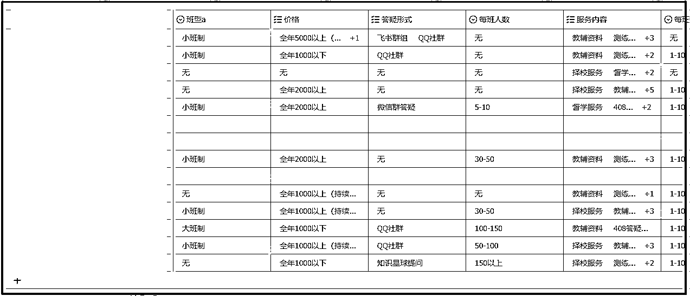

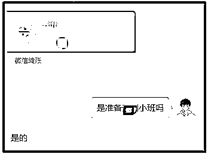

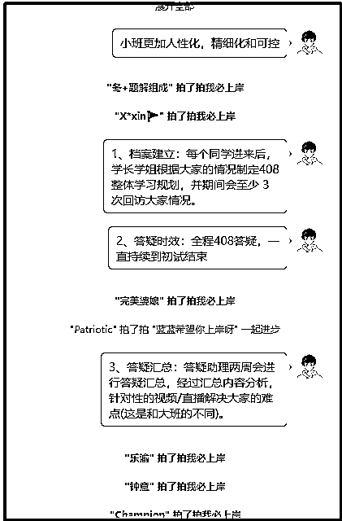

9、提供定制化服务

对虚拟资料了解得越深入，就越能衍生出更高阶的服务。之前有位同学考研后找我，我根据他的个人经历，帮他在小红书上规划了一个项目。实操了几次之后，我明显发现小红书的用户付费意识更强，高客单价的内容基本都是从小红书来的。而且这些用户不太需要反复聊天，上来直接转账。因为你的内容已经给了他们足够的“交互感”，信任感早就在内容里建立好了。这种服务的单价，通常会高出很多。

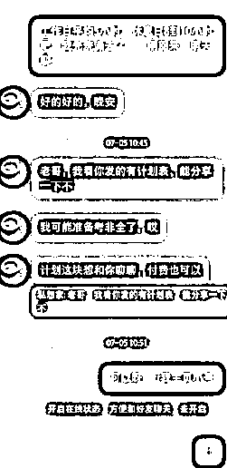

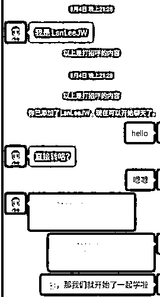

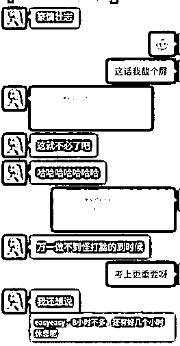

# 3、小结

谢谢你耐心看到这里。以上就是蓝蓝这一两年在虚拟资料变现上摸爬滚打出来的经验。任何一门生意，说到底都可以拆成四个字：定位、流量、产品、转化，环环相扣，形成闭环。请相信：只要方向是对的，再持续投入大量时间，拿到结果是早晚的事。

纳瓦尔有句话我很喜欢：“在成为自己这件事情上，没有人能比得过你。”

一年时间不算长，但足够淘汰大多数半途而废的人；一年时间也不算短，足够让一直坚持的人看到回报。因为真正难走的路，从来都不拥挤。

成长嘛，就是不断走进高能量圈子的过程。丢掉那些负能量的、毫无价值的圈子，真实地做自己，反而会有很多意想不到的惊喜。

最后，也谢谢这个平台给我机会。如果这篇文章让你觉得哪怕有一点点用，就点个赞吧。蓝蓝在这里谢过大家，也希望每个需要的人都能拿到自己想要的东西。