# 两年不到新增约2万家，无人值守桌球是门好生意吗？我用5间店跟你算笔细账

大家好，我叫tiger，做生意已有7年。读的是名校商科，后来做过企业管理咨询，再后来扎进实体行业，如今专注做无人值守桌球。我的祖籍在山东的德州，那里是远近闻名的桌球桌生产基地，从父辈起，家里就有不少亲戚靠这门手艺吃饭。毕业次年，我盘下了一间酒店，算是添了一份睡后收入。之后又试过若干种买卖，直到大约十二个月前，我决定把重注押在无人桌球上。眼下，我名下有5间店，也帮着几十位熟人把整套流程跑通了。这篇不打算讲空话，从大盘数据、盈利逻辑、选点、装潢到经营，一点点拆开给你看。

## 桌球的人气，远超多数人的感知

先看基本面。国内桌球爱好者数量已经从1亿跨到2亿，有人把它称作“中国头号运动”。这个说法不夸张。你随便刷开短视频平台，粉丝量过千万的桌球创作者就有好几位，百万级就更多了。

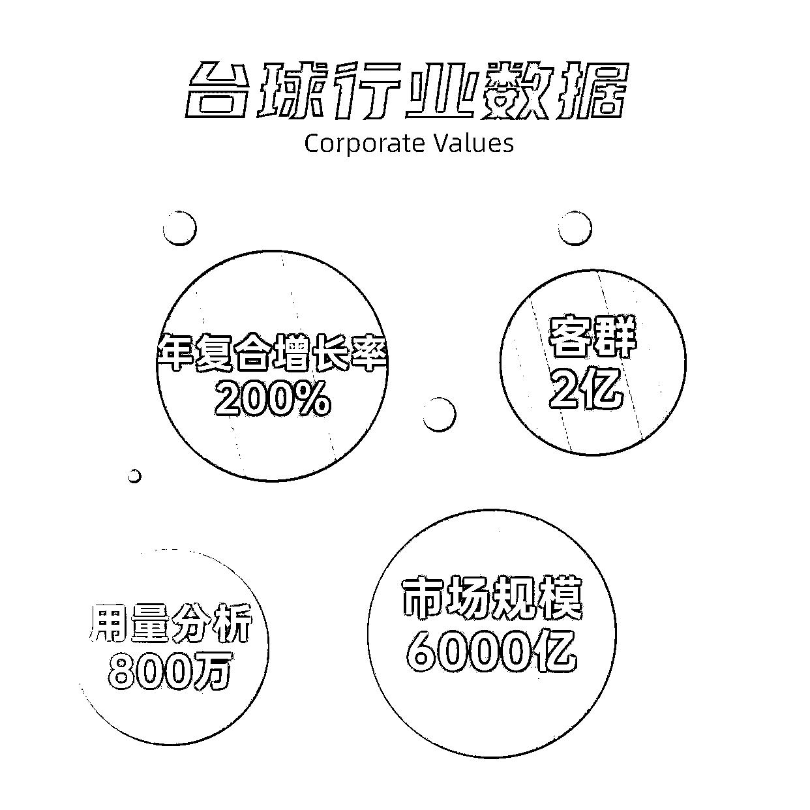

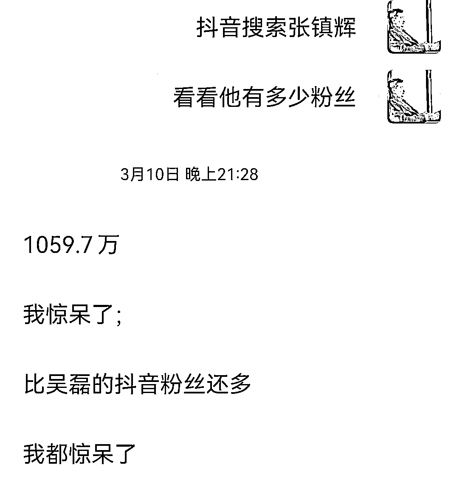

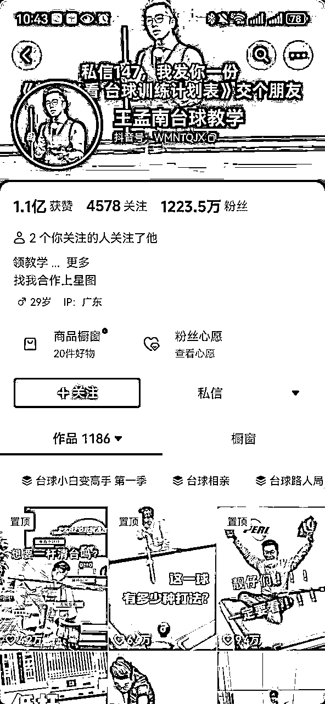

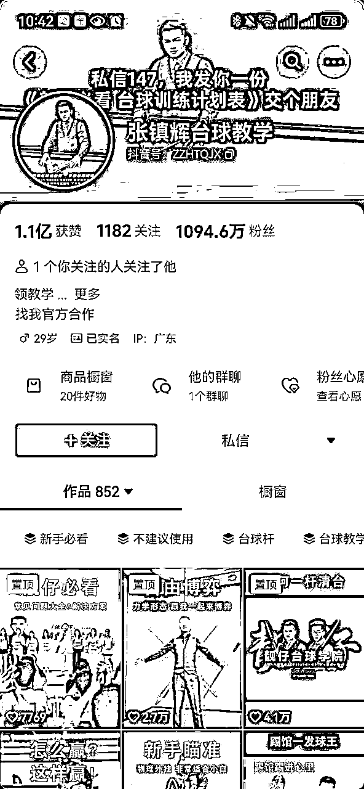

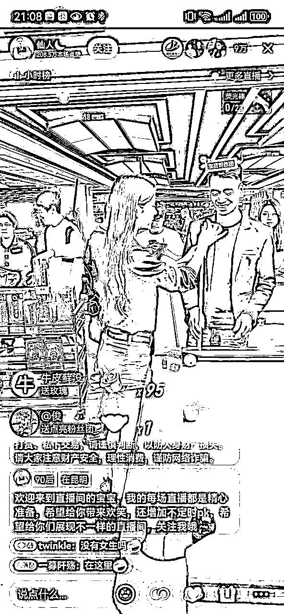

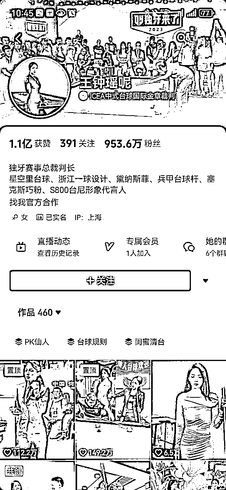

现实世界的感受更直白：你办公的那栋楼附近、住的小区周围、常去吃面的那条街，这两年是不是不知不觉冒出了好几间桌球室？

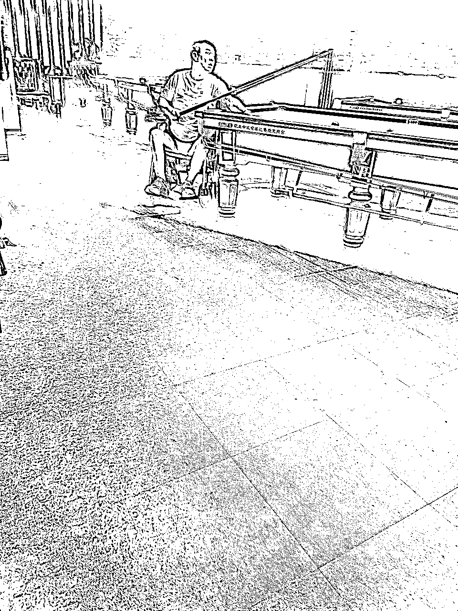

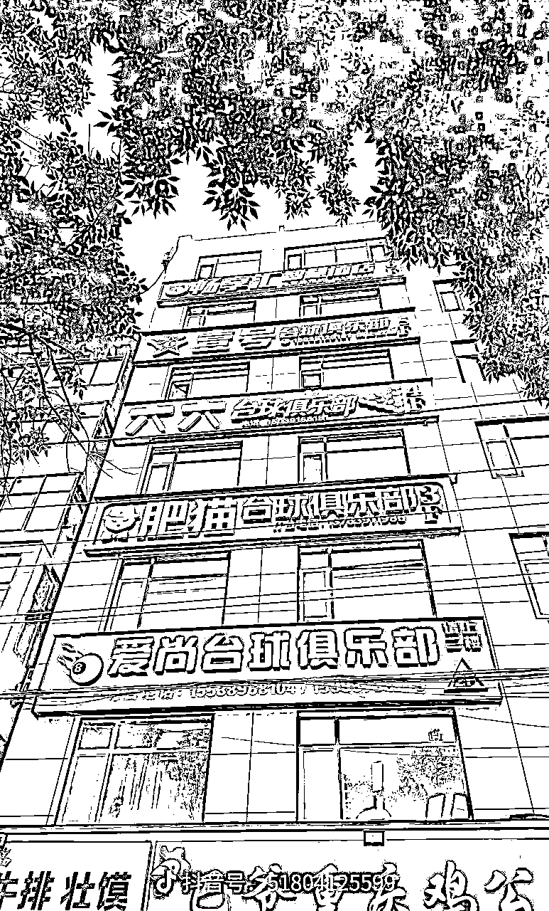

## 先算一笔账：这门生意真的能赚吗？

我习惯在下场前做测算。假设每张桌台每天运转8小时，这个目标对选址和经营水准有要求，但并非遥不可及。那阵子我常从傍晚6点泡到半夜12点，看到的球馆几乎桌桌有人；再把上午和午后的零散时段加进去，凑满8小时并不难。

如果一天只能做到6个钟头呢？按那会儿的算法，大约7个半月就能收回本金。跟人聊起这个数字，做过酒店的朋友大多第一反应是“不可能吧”。

哪怕再保守，一天只按4个钟头来算——工作日冷清些，周末热闹些，折中取个低值，一年出头也能把钱全部收回来。算完这笔账，我的结论很明确：这行能碰。

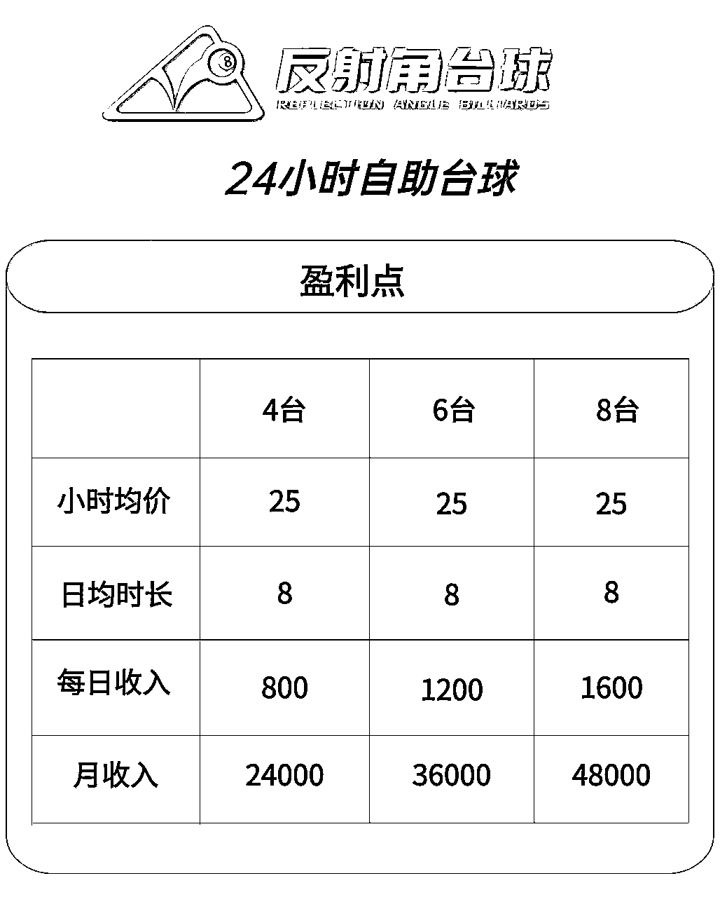

## 为什么这种模式走得通？老需求+新变量+软对象

刚接触这套玩法时，我也嘀咕：“躺着赚钱”怎么听都像童话。可拆开看，它其实踩中了三个点。早前在杭州的一次分享会上，一位讲师把它概括成三句话：需求是老的，技术是新的，对手是软的。

需求老：桌球从15世纪起就在英国流行，传入国内也已超过百年。眼下国内大概有两亿人参与这项运动，再往后50年、100年，它仍会是真实需求。这桩生意不需要教育用户。

技术新：新型技术带来的最大变化是，无人值守模式比传统门店的利润空间高出三成左右，钱回收的速度几乎快上一倍。这不是什么奇思妙想，而是技术升级省下的人力成本。

对手软：当下不少老式桌球室的经营者岁数偏大，对线上拉客基本没概念，甚至催生了代运营团购页面的服务。反过来看，我们这些常年钻研流量的人，正好握有优势。有人讲得好：你能打赢的领域就是蓝海。后续店面真正的壁垒，不在于设备多贵，而在于便宜的拉新途径和持续的回头客，这两点恰是我们的强项。

## 上限在哪儿？门槛又在哪儿？

亦仁大哥之前说过，要去找那些已被市场验证、且有机会做到年入百万的生意。无人桌球符合这个标准：单间投10万，10间就是100万，更打动人的是操心程度比传统门店低一大截。

不过，门槛同样清楚，主要集中在五件事：选点、球桌和球杆货源、装潢、日常打理、智能设备。我把它一项项放在眼前过了一遍：

选点和打理？我早年为某连锁茶饮品牌做过督导能力模型，这关不算难。

装潢？我亲手盯过造价几百万的酒店，几万元的桌球室装潢自然不是问题。

智能设备？身边有位关系很铁的老乡，管着20人的程序开发团队，他对这个方向也有兴趣，这块能力瞬间补齐。

货源？我的故乡本就是桌球桌的制造集散地，亲友中不少人在做这行，供应渠道伸手就有。

这些条件放在一起，我觉得没有不上场的理由。

## 摸底：把能看的球馆都跑了一遍

很多人定下方向后急着找店面，我反而不急，先去做调研。那段时间，我几乎逛遍了德州和广州的桌球室，最后将行业归成三类。

第一类，大型商务型球馆。少则30张桌，多则百余张甚至更多，场地几千平米，员工超过百人，人一进门就有助教迎宾。它们的较量重点在服务水准、店内风格和体量，背后需要极强的资金筹措能力。每张桌子采购价三四万起步，贵的五六万，摊到单桌综合成本大概4到6万。开间35张桌的店面，初始投入就接近200万。先不谈多久能收回本金，光是这个资金门槛和关门风险，就足以让人退开。

第二类，中等体量球馆。8张、10张、15张桌子的规模最为常见，大多是从街边小摊一步步进化来的。因为门槛不高，大批想做生意的人都挤了进来。

第三类，迷你桌球室。三五张到七八张桌，有的配了店员，有的直接无人值守。启动成本低、选址弹性大、对顾客来说又方便，这两年正在各处快速繁殖。

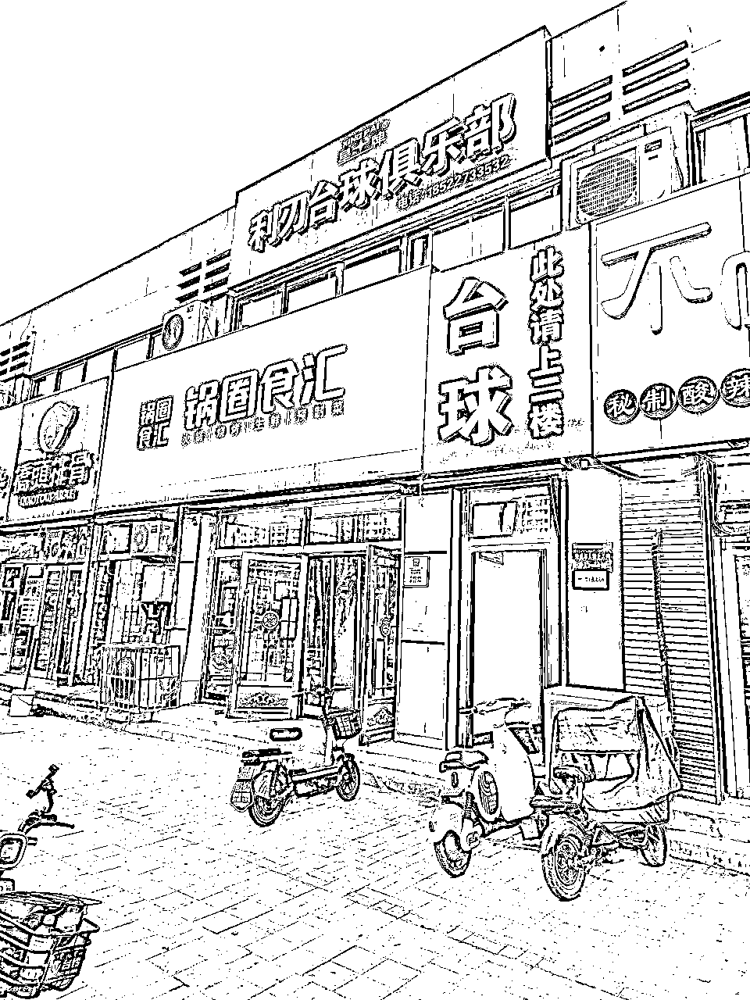

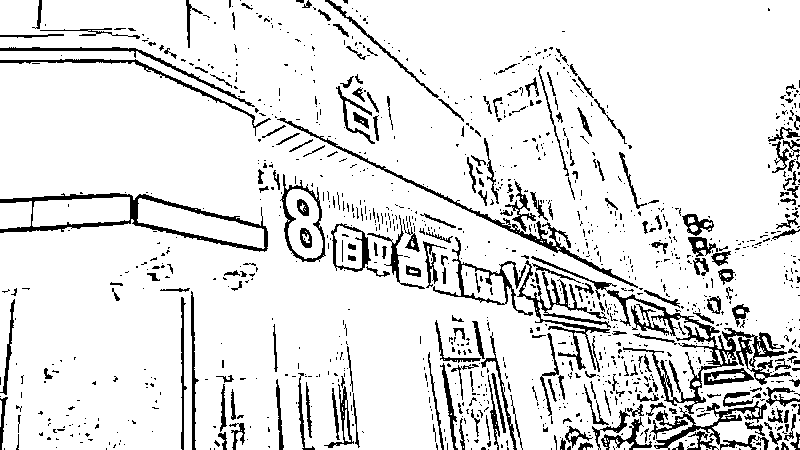

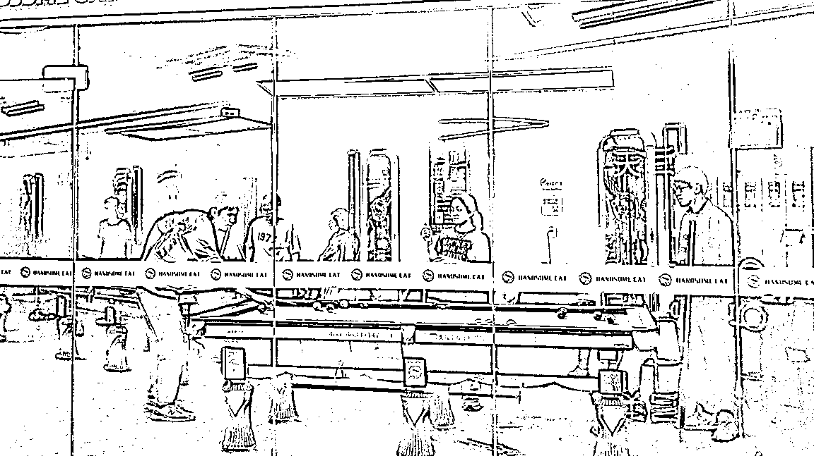

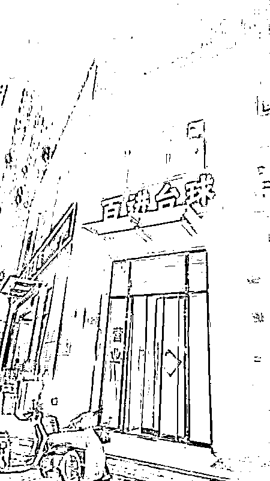

那这几类到底赚不赚？大型商务型球馆很容易亏；传统小本生意店摆五六张桌，人力成本占比太高，正在被无人模式挤压。反倒是迷你桌球室活得最好。喜欢打球的人选球馆时，最关心的是顺不顺路、击球感好不好、空间干不干净。绝大多数人下意识只会问：“周边哪家最近？”只要手感不差、环境清爽，他就会不断回头。是否有人专门在前台帮忙开台关台，其实一点也不重要。

## 选点定成败：好位置像井水，肯挖就有

查理·芒格有句话我常记着：想钓到鱼，就得到鱼多的地方去。想找人打球，就得去打球的人出没的地方。桌球爱好者的聚集点大体有三类：住的地方、工作学习的地方、日常逛街的地方。细分下来，就是居民区和老社区、办公场所和校园及工厂、商圈和美食街。

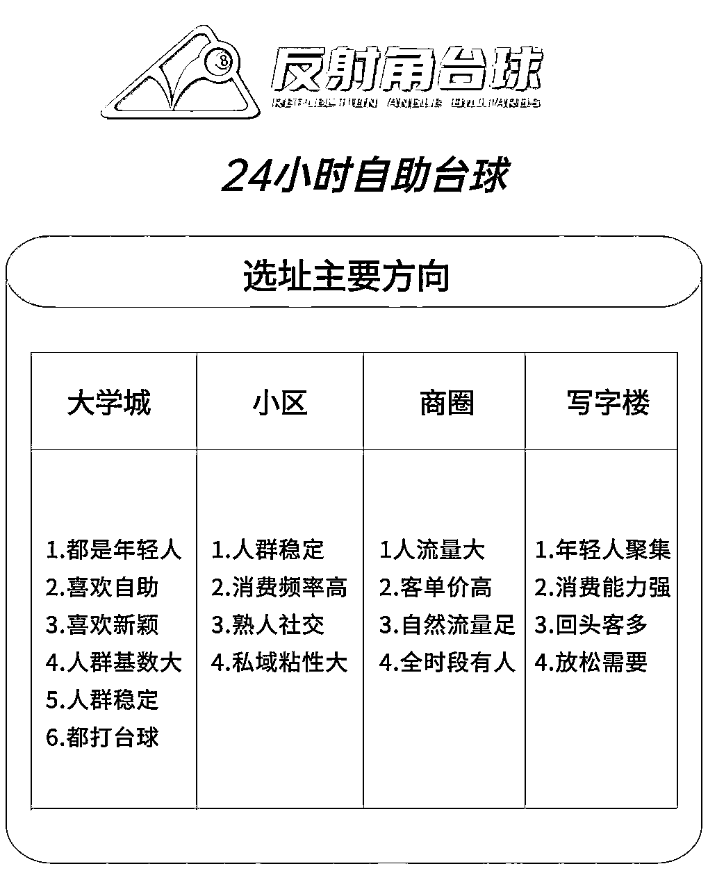

选点这件事，方法再多，最后都绕不开一双腿。许多好位置，信息刚传到网上就被订走，只有亲自沿街走，才能体会到顾客找店时的那种路线和感受。看过的样本多了，选起来自然更有底。

线上工具也可以辅助：同城信息网站、本地中介、熟人引荐、短视频平台上的本地大号，都能帮忙收集情报。

我原本设想两周内开业，结果光选点就磨了几个月。踩过的坑五花八门：底层铺面位置挺好，面积租金都合适，可惜开间短了一米，桌子放不下；推拿店上面那层租金便宜，中间也没立柱，可上楼的路太窄；还有家发廊的上一层，条件都不错，发廊却不同意从一楼进出；另外看中过大学旁边的一层，面积却足有600平方米，经营担子太重，只得放弃。

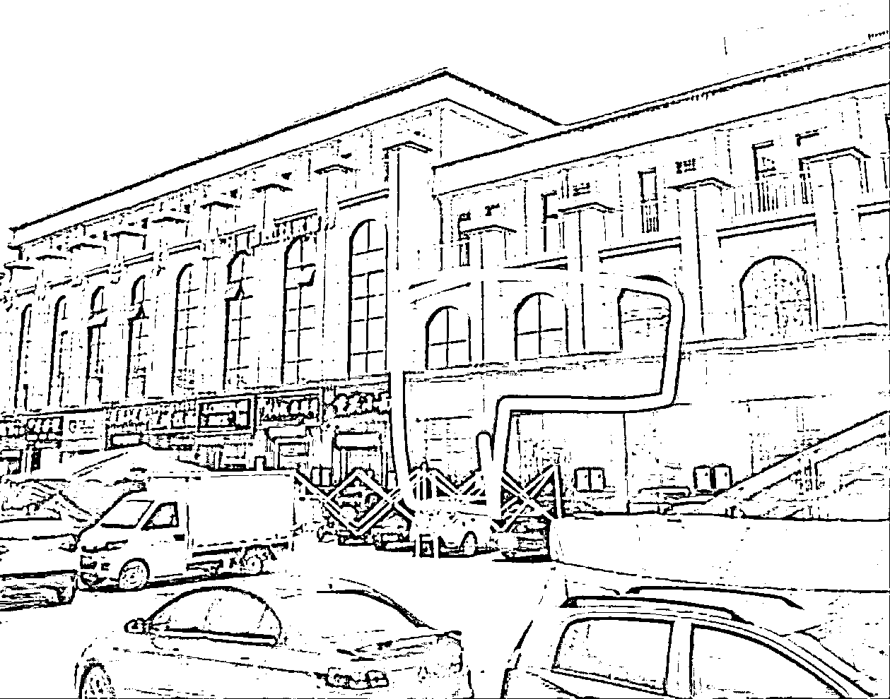

后来出现几个候选。其中一处紧挨大学，二三楼加起来能放15张桌，但头一次开店，我不想一下子铺太大。我对搭档说：“这位置半年内必有人抢。”结果是，45天左右，别人的球馆就在那里开了张。

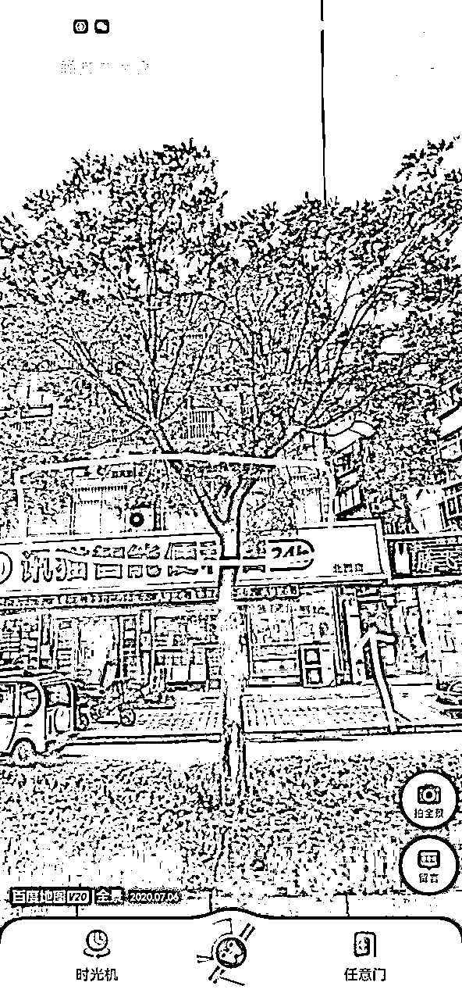

另一处原本是最高等级的候选，门口虽然有棵树挡了点招牌，但租金低、空间开阔、离学校很近，我们差一点就签约了。后来发现一楼边上正在建一家规模不小的球馆，只好作罢。

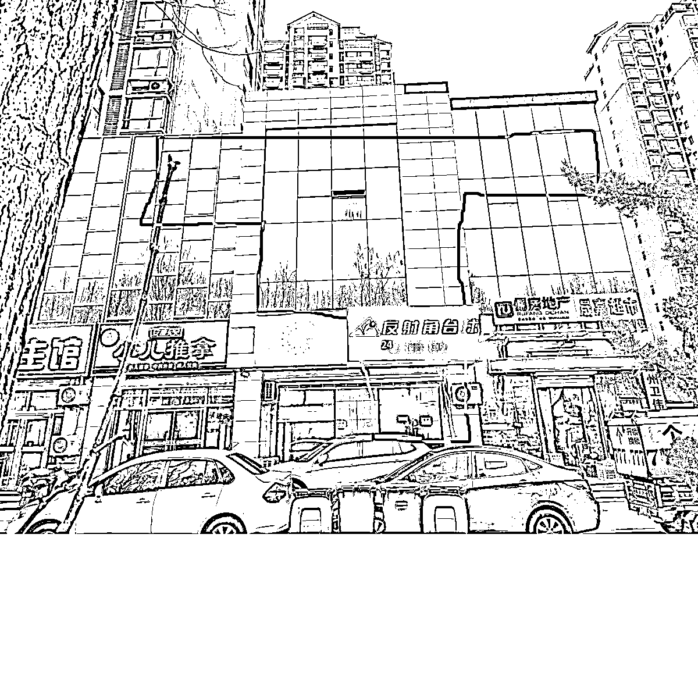

最后定下的那套，就是现在这家店。店铺在二三层，租金负担小，进出口也方便，面积刚好够用，背后是本地规模最大的住宅区，同时也是最好的学校片区，住了上万人。我们放了8张桌，另加一间棋牌室。

选完点还要蹲守。我连续几天去隔壁的球馆“观察”，几乎每晚6点到11点都满台，直到凌晨三四点才慢慢散场。隔壁能满台，说明这位置的需求是真的。在无人球馆，一张桌一小时左右就能收回当天成本，一位顾客平均要玩两小时。因此，只要出现一次满台，那天就亏不了。隔壁能满，我们把自己的服务和环境做得更扎实，同样能满。

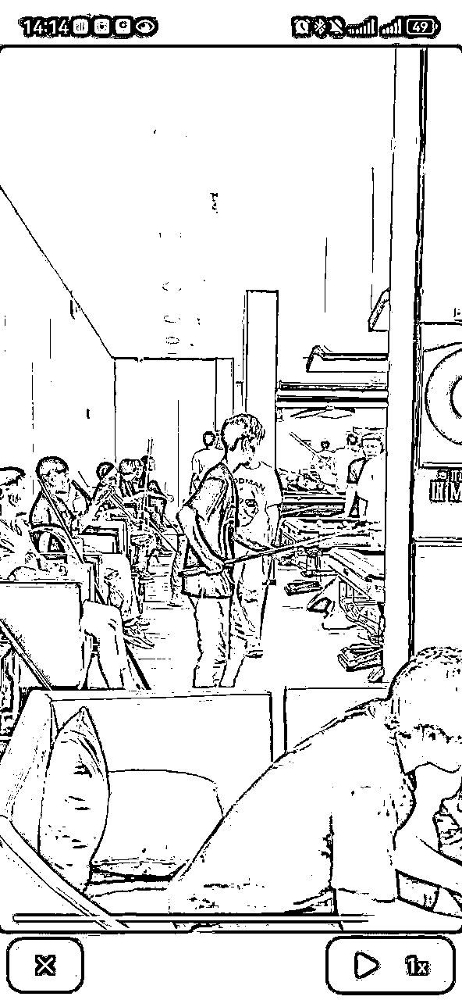

那一刻，我心里终于踏实了。

如果让我归纳选点要看什么，我不会只盯着某一条，而是综合评估：区域生态、交通条件、租金形式、内部格局、招牌是否显眼、周围有没有同类、附近住什么人、门口有多少真实客流，以及老商户在这里经营了多久、生意好不好。多问一句“为什么别人能扎下去”，多半能看出这块地养不养店。

担心好位置太难找？其实不用怕。国内有293个地级市、2844个县。无人桌球这种能渗透到大街小巷的新形态，眼下仍处于爆发早期。我们团队已经陆续筛出过四十几个优选点位，也把选点方法沉淀成了一套完整的工具。好位置就像井水，只要愿意下功夫挖，总会有的。

## 装潢：不该花的钱，一分也不花

无人桌球的装潢，比多数人想的要简单。通常不用改地暖，也很少动到厕所。硬装主要就看三样：吊顶、地面、墙面。

原有吊顶完好就留着；不好看的话，直接喷漆或者不做处理，裸顶也有股工业味。无人店的核心逻辑是省预算，把省下的钱放到客人能直接感受到的地方。客人只在意方不方便、手感如何、价格贵不贵，装潢的权重非常靠后。全国上万家门店已经验证过，墙面顶面用乳胶漆过一遍就够。

地面就更好办，无论原来是什么材料，铺一层地毯最省心，含辅材和人工，大约每平米三四十元。有位朋友装修时，施工队一直劝他做自流平，他差点听了，被我硬拦下来，省下好几千块。

墙面再强调一次：刷乳胶漆，刷乳胶漆，刷乳胶漆。大厅不装护墙板，也不贴瓷砖。另外，多数人不知道，彩色漆和白色漆价格几乎一样，也就是说，拿“刮大白”的钱就能让店里显得有质感。

木工的事主要是隔断，这一步要在前期规划中定清楚。

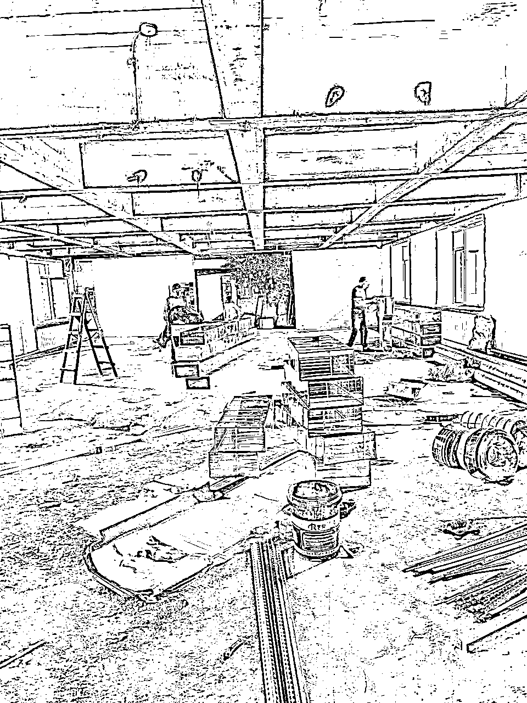

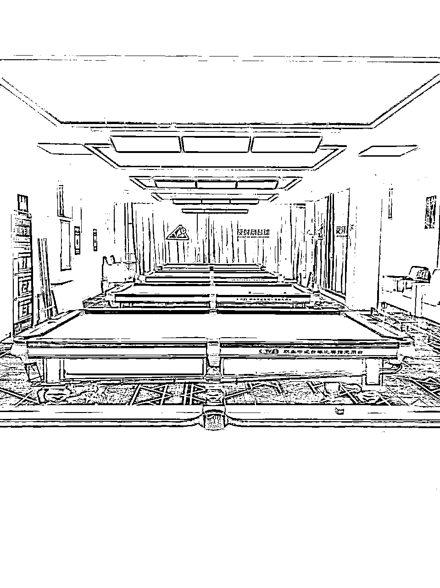

软装部分都是些平常物件：储物柜、自动售卖机、共享充电设备、座椅，按图纸摆放就行。

唯一要留神的，是球桌的搬运和安装。搬运工的到场时间，必须卡在装好货的货车抵达之后，最好让装潢负责人提前20分钟候场。如果搬运工先来，两个损失同时出现：货车在那边收等候费，搬运工在这边趁机加价。

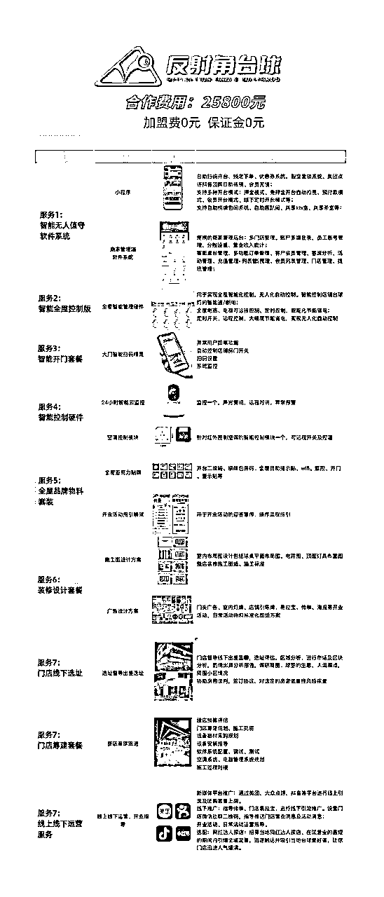

智能设备上，我们公司当时专门找了一批有多年大厂经验的后端程序员和硬件研发人员做自研，投入不小，因为我们想在全国铺开上千家店。但如果你既不懂程序也不懂硬件，别学我们自研，直接采用现成方案才划算。

最后附上施工计划表。这张表看着简单，运用得当能省掉一半的操心。装潢这东西，懂的人轻松，不懂的人抓瞎。

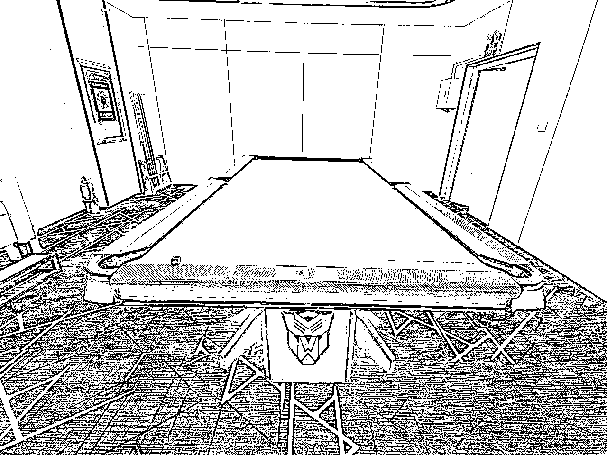

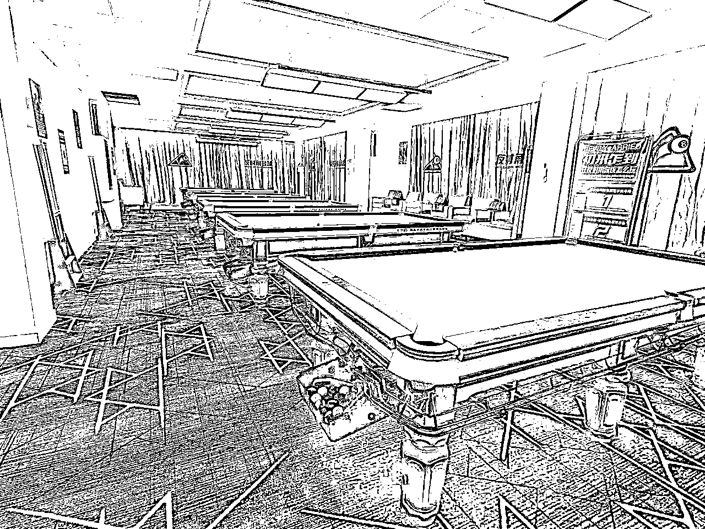

## 经营：让几百个熟客撑起一间店

桌球这行，复购属性很强。只要积累几百个熟客，养一间店绰绰有余。关键动作就两个：把人引进来，把店里的氛围养起来。

线上公开流量加私密社群的玩法，别的地方已经讲过很多，我这儿只补两招特别适合桌球室的。

第一招，街边挑战。在店门口或者人流密集的路边摆一张小桌，让路人拿球杆推球，撞倒目标就算赢。花费不大，再配点小奖品，围观者很容易凑上来，传播效果也很理想。

第二招，开业赛事。办比赛的主要目的不是赚钱，而是让整片区域的打球爱好者都进店体验一次。到底亏还是赚，要看周围竞争、参赛费用、人数规模和奖金设置。但不管怎样，这笔钱值得花。打球的人自成一个小江湖，哪里办比赛，消息传得飞快。一场比赛下来，半条街的人都认识你这家店了。

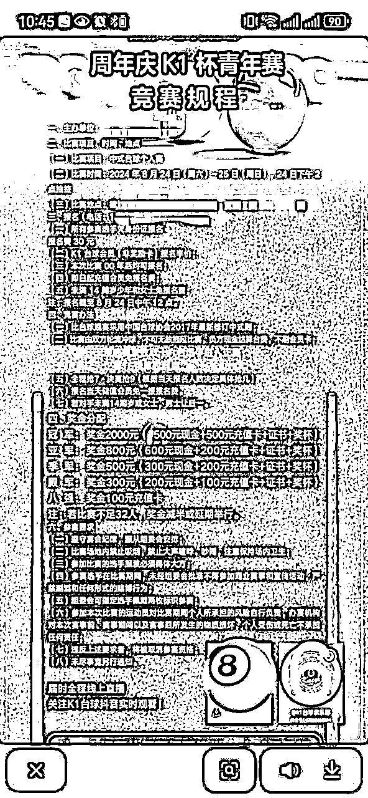

至于日常的私密群维护、周边固定人群的引流、短视频平台和团购平台的运营，内容还有很多，篇幅所限，改天另外整理一篇。

## 当下成绩与几条心得

单个店的玩法被验证后，隔月就连续开了3间，现在我自己手里一共经营着5间店。

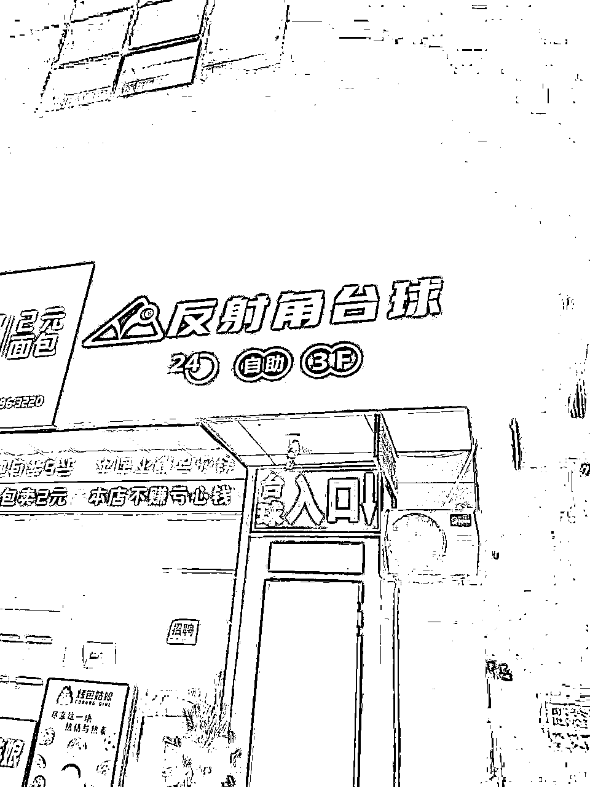

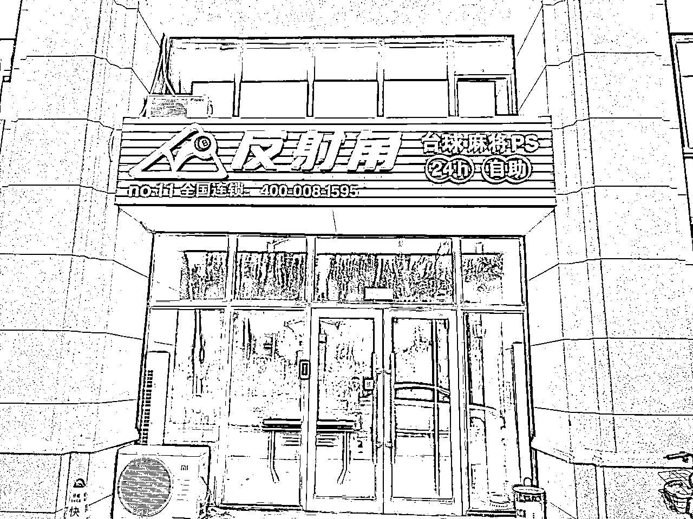

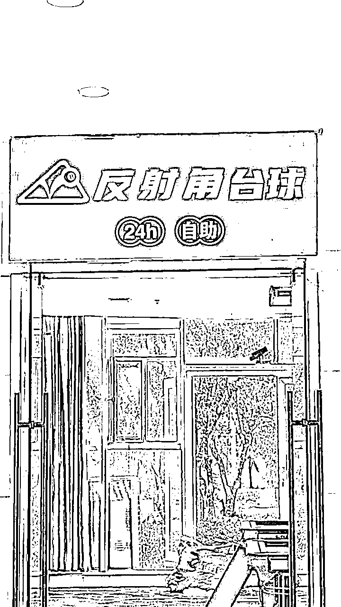

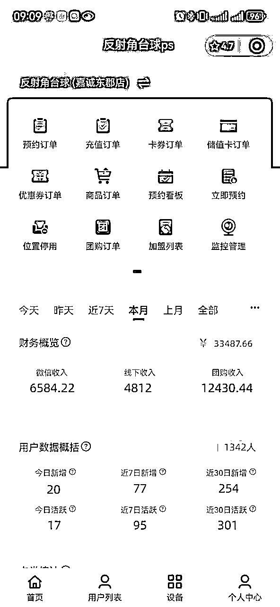

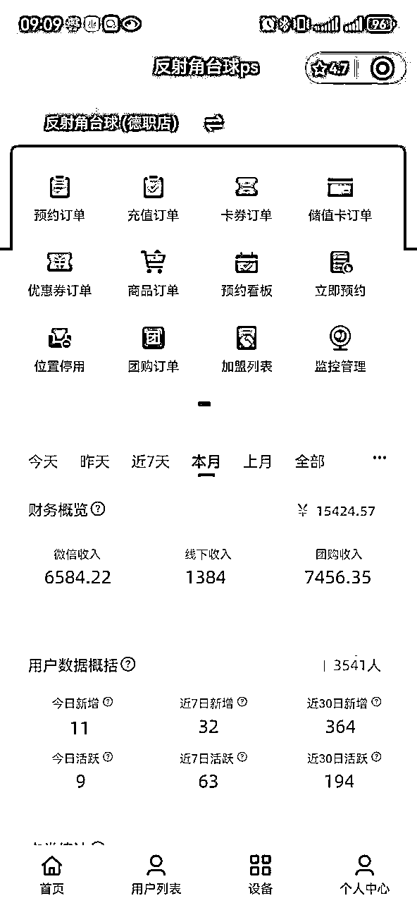

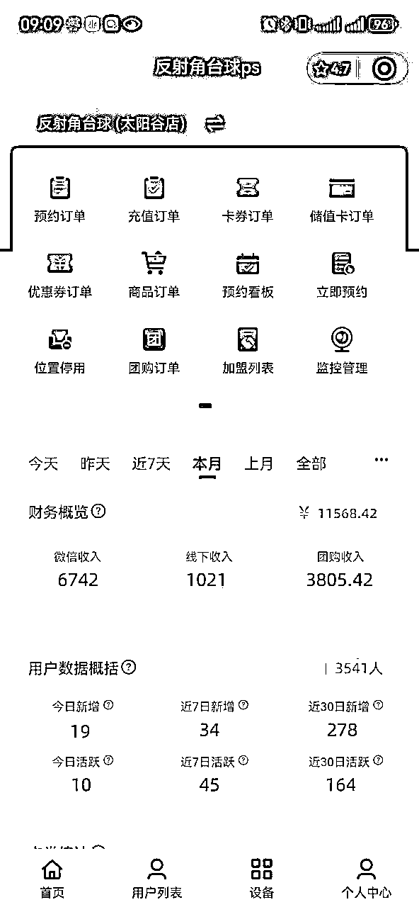

其中收回本金最快的那间用了3个月，最慢的一间也控制在一年以内。当然，朋友中也有花了18个月才收回本金的。我目前仍处在扩店阶段，想法很简单：有合适的位置就开，不设数量天花板。全国市场大概还能容纳8万家这样的店，凭我一人绝对吃不下。因此，我也帮不少朋友物色过店面，只是有些地方离我太远，后续就没有参与。

最后复盘，我把自己做过对的关键点总结为四条。

第一条，动手速度。很多人说，钱根本不是攒出来的，是顺着风口飘过来的。机会窗口很窄，犹豫几秒就可能错过。去年在德州，还能挑到出色的点位；如今选点的难度已经明显抬升。当初从广深咨询圈出来，我也曾恋恋不舍，但回头看，及早跳出来抢到时间红利，实在太关键。

第二条，答案在第一线。实体生意和坐写字楼完全是两回事，一切答案都在街头、在店里。只有亲自盯住每个细节，结果才会朝你想要的方向走。先放下身段去干脏活累活，才能真正吃透这套模式。

第三条，功课做得够。我一直沉在实体行业里，搭档也积攒了好些年的技术功底，所以风口出现时，我才有资格早上车。前期看过的球馆数量非常大，跑店、扫街都是海量地做，量变最终带来了质变。

第四条，走对方向。我从前合作开酒店的搭档，到现在还在四处找酒店项目，每个都重资产，收回本金往往要等四五年。相比之下，无人桌球轻投入、资金回转速度快，更适合普通人，至少适合现在的我。

以上，就是我对无人值守桌球这门生意的彻底拆解。如果你正在观望，希望这篇能让你少绕几段路。

算过账之后会发现，这类自助模型打出来的收益，投入只用传统方式的三分之一左右，花同样的钱能拿到更厚的利润，模型本身就有成本优势。

先复盘一下走了弯路的地方。

第一，优质铺位就是稀缺资源。确定方向是球厅，就不能让好铺位溜走。选第三家的时候跑了不少点位，有一家在园区里，价格其实还行，我纠结了两天想再压价，结果两天的空档就被别人签走了。铺子这东西不会等你想清楚。

第二，社区店别贪大。社区客群撑不住大体量，6台以下才舒服。我第一家生意看着不错，但管理起来很耗精力。要是做4台的轻体量，基本就是看数据、偶尔巡店，负担小很多。

第三，地段要选人，而不是选便宜。学校周边、商圈、城中村这几类位置盘活得最好。起步时应该往A级地段靠，不要只盯租金低。租金高是高，但能沉淀下固定消费人群，后续复购和口碑才能滚起来。

2024年，实体到底还能不能做？

身边倒闭的也在开，新模型也在疯长。零食店、台球自助、棋牌无人店，一年全国新增几万家。十年老店也照样在营业。实体里永远有人在赚钱，关键是选项目的标准：轻投入、真需求、轻精力。

自助台球在实体里算是少见的高性价比品类，优势很具体。

第一，利润是被传统成本结构送来的。我们去新商圈考察，旁边有人看守的球厅一小时25块，无人自助也是25块，客单价一模一样。面积一样、收入一样，但一个月直接省下6000到9000的人工费，这笔钱就是模型多出来的利润。

第二，客群稳定。线上项目要看平台脸色，规则一改就掉队。自助球厅是线下刚需，一旦满台口碑就起来了，靠的是身边固定人群和回头客，生意越做越厚。

第三，管理极轻，不依赖店长和员工。我们跑过数据，一个人最多能稳住5家店，完全可以作为副业来做，不用每天泡在店里。

第四，启动资金低。现在连锁药店、零食新锐、咖啡品牌，一家起步都要50万。4台的自助球厅，十万块左右就能搭起来，具体看城市租金浮动。

不是所有人都适合做。

第一类，是反复权衡的人。看到别人赚钱就心动，看到开店经验又怕失败，迟迟不动。好铺位几天就没了，犹豫就是把机会让出去。

第二类，是想完全甩手的。无人自助基本不用常驻，可以当副业，但彻底不管不问，设备、耗材、卫生、续费都是问题。

第三类，是没计划的人。创业就是算细账，该花的别省，该省的别花。每块成本最后都会体现在回本周期上，成本翻倍，回本时间就翻倍。

第四类，是带杠杆入场的人。别贷款开店。线上线下、古今中外，创业都有风险。这个店10到15万就能启动，负债会让你决策变形。

适合的人大概有这几类。

手里有点闲钱不知道怎么放的人。门槛低、风险可控，适合先拿一笔小资金试水。

真正爱打球的人。自己有球感、有圈子，能把店变成社交场。老板常去，氛围就起来，生意自然好。

已经在做传统球房的老板。智能化是趋势，早转型自助，可以用新模型对冲人力和同质化风险。

想做副业的上班族。球厅不会半夜叫你开会，不会无理修改，也不会空口承诺。能对抗职场不确定性，额外增加一层收入。

做公域和平台创业的人。平台三月一小变、六月一大变，还要防跨省执法。球厅吃的是本地固定人群，回头客会积累，不受算法影响，正好用来对冲线上波动。

再说说天花板。

全国台球相关营业执照统计在41万家，折半算也有20万家传统场馆。哪怕自助只占传统的一半，市场容量也在十万家以上。现在全国自助球房大概不到2万家，未来5年至少还能新增8万家，现在明显是上半场。

社会层面的意义也值得说。

台球是体育项目，不是单纯娱乐。团建、业余联赛都能在球厅落地。盘活的是存量闲置商铺，是城市里不好盘的铺面。

对小镇青年来说，这是一条低门槛出路。十万开店，或者靠打球参赛拿奖金，四线城市常规赛事奖金已经到5000，好的能到2000起步。

中式八球在中国用户最多，全球顶级球手都在打这个玩法，未来有希望走向国际化甚至入奥，文化输出的空间也在打开。

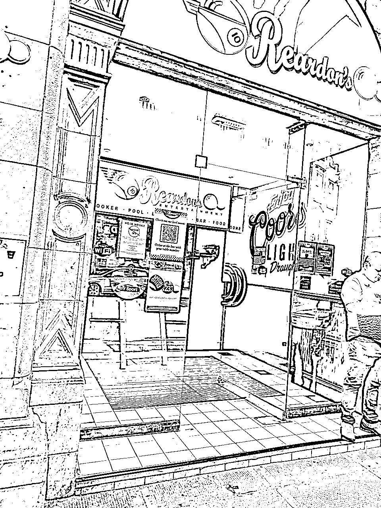

想清楚之后，这个赛道很干净，属于政策鼓励的体育细分。

我之前在内资头部的人力资源咨询公司，典型的加班文化。晚上两点还在加班，听着心跳声会想，ICU一天一万，我这份工资扛得住吗？早上通勤路上反复问自己：人生要复利，要时间自由和财务自由，上班还能做到吗？打工还能十倍增长吗？

纳瓦尔的那句话一直绕在我脑子里：把时薪乘以十，去做最重要的事。如果我的时间值一千一小时，我现在做的事是在创造价值吗？答案是否定的。那就离开。

离开之后内耗反而没了。感谢生财让我开眼，刚进生财时醒来第一件事就是打开社区看更新，大家的能量交换对我很重要。

自我介绍一下，我是Tiger老虎，反射角台球创始人，目前已经帮助几十位朋友开起自助球房，坐标深圳。这篇梳理得比预期久些，后面空了会把细节补上。想了解的可以关注主页，联系方式可以找鱼丸。

最后用一句话收尾，生财里常说：出来混，最重要的是先出来。

希望在生财，和大家一起慢慢变富。