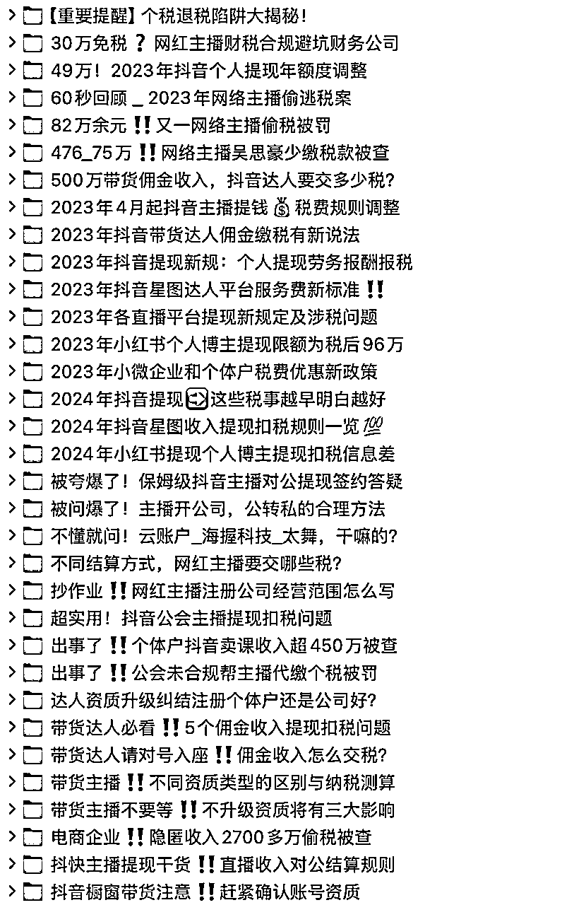
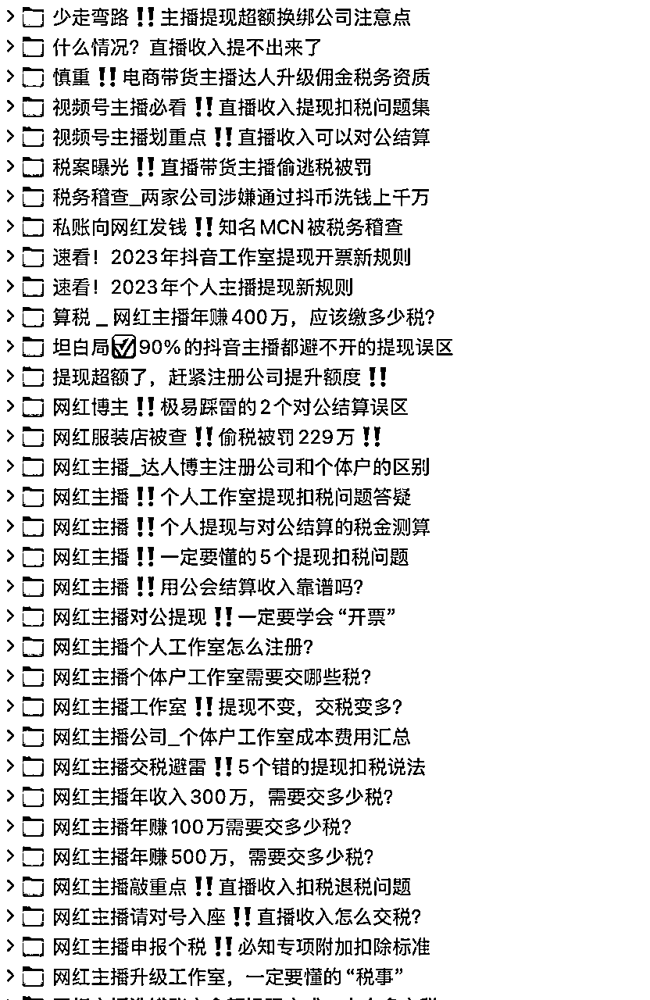
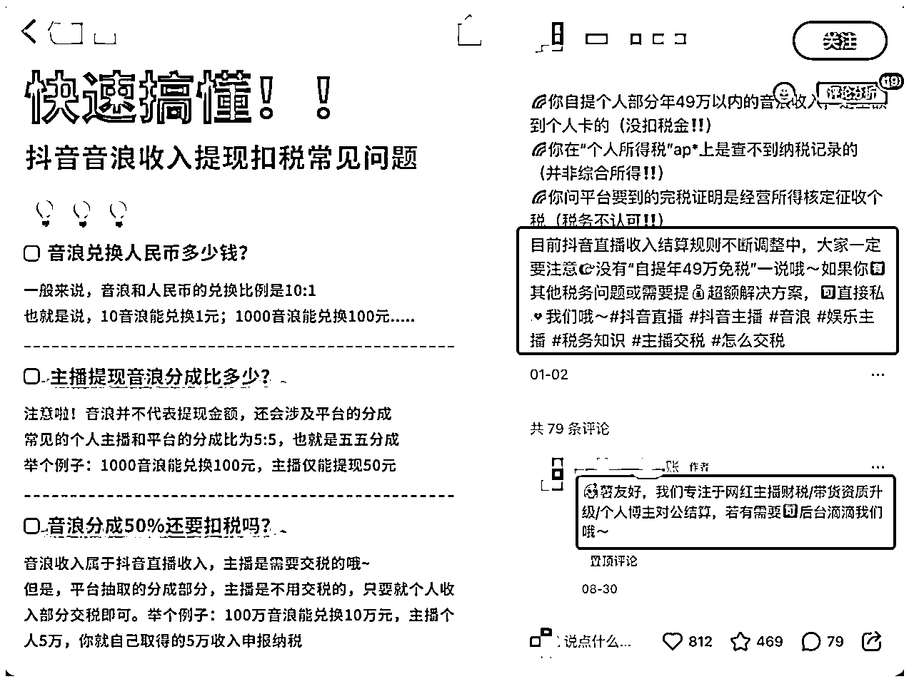
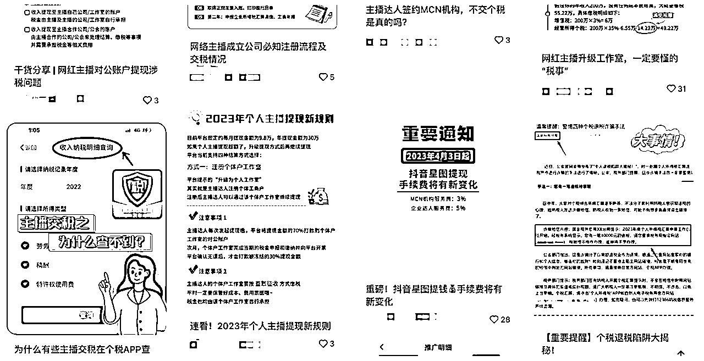
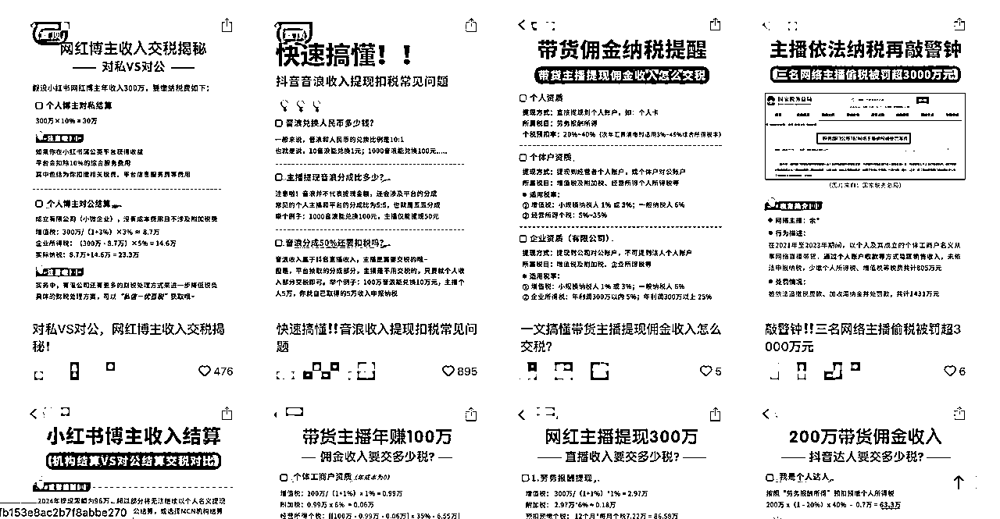
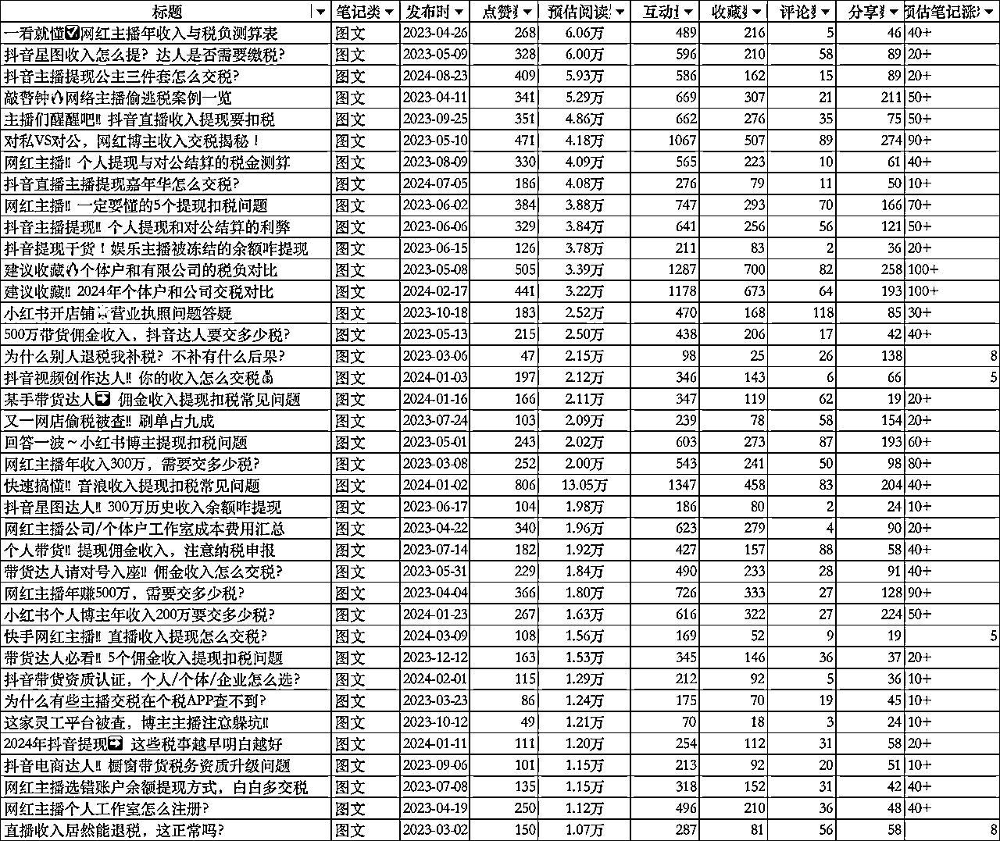
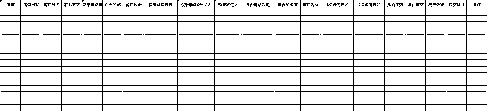
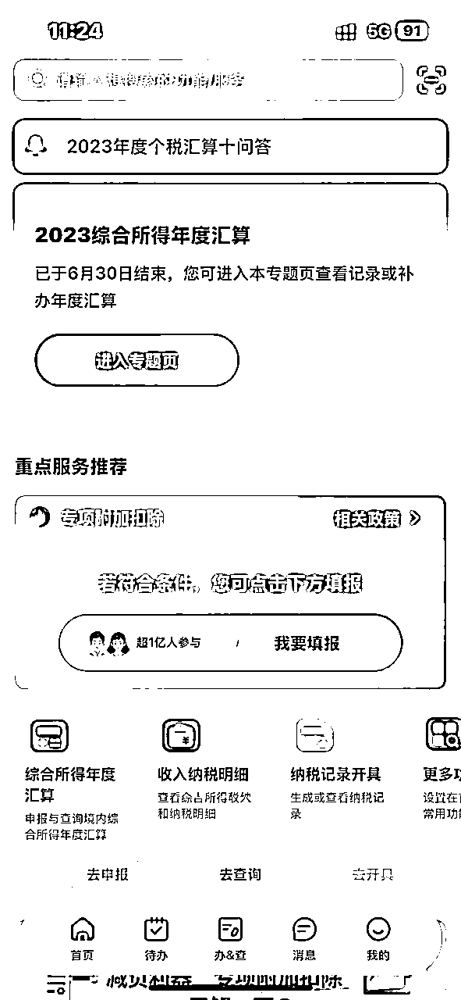
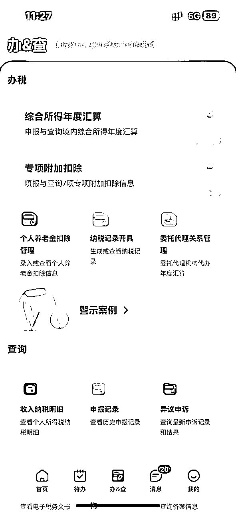
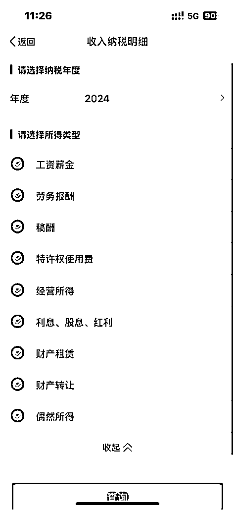

# 生财分享：为什么这家财税公司能在小红书精准捕获200+高意向线索？答案藏在定制化合规产品里

> 原文出处：[橙就咨询分享文档](https://chengjiu.feishu.cn/docx/DMq7dsAOeoj9PCxGFg3cSmxJnGb)

---

## 写在前面

各位圈友，见帖如面。先介绍一下自己——超群，橙就咨询创始人，前税友集团运营总监。在财税领域深耕8年，现在做的事非常聚焦：陪跑财税公司做高质量的长期增长。

今天拆解的，是我亲自辅导的一个头部财税客户的实际打法。他们锁定垂直行业，做出一款定制化税务合规产品，在小红书上持续捕获精准客资，峰值时期单月拿到200多条线索，客单价约3万，利润率明显优于传统记账业务。如果你正在经营财税公司，或是这个行业的从业者，希望这篇内容能带给你一些思路上的碰撞。

**名片速览**
- 称呼：超群
- 领域：财税
- 坐标：杭州
- 盖洛普TOP5：成就、战略、学习、行动、统筹
- MBTI：ESTJ

**几条关键履历**
1. 橙就咨询创始人。10年ToB客户增长实操经验，从0到1在杭州完成3次买房，操盘100多个项目，90%以上结果超出预期。
2. 前税友集团运营总监，带团队将亿企代账做到全国市占率第一，操盘多个行业营销爆款案例；现为多家头部财税公司双域营销顾问。
3. 原创内容作品：《代账经营增长秘籍》《新手创业实战指南》《代账日历》（2019-2022）《短视频获客36计》，擅长用“业务+内容”的设计实现批量获客与转化。

**我可以提供**
- 中小企业从注册到经营的全套服务：工商、代账、涉税合规、金融、法务、知识产权、项目申报等
- 企服公司全域成交闭环落地辅导
- 企服公司内部经营萃取＋知识管理辅导

**期待交流**
打开新视野，连接同频的朋友[握手]

---

## 一、行业变局：内卷与合规同时到来

这个项目之所以能跑出来，并不是拍脑袋的创意，而是被行业底层变化推着走的结果。

先看经济面。2022年底全面放开之后，经济并没有迎来想象中的快速回暖，2023到2024年整体增速依然偏慢。中小企业的生存压力肉眼可见地加大，“活下去”成了高频词。代账行业的竞争烈度也随之持续攀升——价格、服务、效率、技术，每个维度都在拼。组织机制更高效、服务体验更领先的机构还能守住利润，反应慢的只能被不断挤压。

再看政策面。金税四期强势落地，数电票推广、电子税务局全国统一、企业信息联网、纳税服务简化等变化接连出现，整个行业的底层逻辑被改写了。

影响体现在两个方向：

**方向一：标准化、数字化作业成为必然。** 未来两到三年，代账行业将进入一个高度数字化和标准化的财税作业周期。税务数据处理能力大幅增强，查账征收范围从普通企业延伸到个体户，客户基本盘反而在扩大。但另一面是，普通记账报税服务的差异化越来越小，用户付费意愿下降，代理记账价格只会一路走低。

**方向二：合规市场被彻底激活。** 金税四期之后，征管逻辑从“以票控税”转向“以数治税”，在数电票、金融监管、个税和社保三个层面实现数据流归集，税务系统通过大数据联动多平台做信用风险监控。企业的涉税状况越来越透明，也越来越清楚地意识到：只有合规，才有持续发展的可能。因此，他们对财税公司的期待已经从基础记账升级为更专业、更精细、甚至定制化的税务解决方案。

这两股力量叠加在一起，催生出一个新的市场切口。

---

## 二、产品设计：一条垂直赛道的诞生

在动工之前，我们先梳理了传统财税公司在前端营销侧的几个典型困境：

- **存量依赖过重。** 多数公司擅长围绕存量客户做服务式营销，优先成交的还是那批本就高意向的老客户，拓新能力明显偏弱。
- **打法相对传统。** 过去主要靠陌拜、下户、会销、面销来做客户触达，面对经营管理、涉税合规这类高价值业务，缺乏有效策略，线上流量的系统化运营更是短板。
- **投放成本高企。** 流量越来越碎片化，平台投放费用水涨船高，但大量公司还没跑通内容素材和留资路径，投入产出很不理想。
- **产品高度同质化。** 以小红书为例，大家卷的几乎都是公司注册、代理记账这类基础业务，同样的产品、同样的服务，最后只能卷价格，利润越卷越薄。

**结论：大而全不如小而深。**

基于这个判断，产品设计总共走了五步。

**第一步：圈定高客单方向。** 基础工商注册和代理记账早就杀成一片红海，真正能把高端业务做好的机构却不多——经营账、涉税合规这类服务，对专业深度和方案老师的要求都很高。再看2023年初的涉税合规市场，大部分玩家做的是泛行业，不够聚焦，从前端获客到后端交付精力都很分散。所以，我们决定做一款高客单价的定制化税务合规产品，价格锚定在3到5万。

**第二步：筛选行业大类。** 选择标准只有三条：这家公司在该行业有没有存量客户案例？后端团队能不能支撑交付？市场是否还处于蓝海？我们围绕餐饮、生产制造、教育培训、金融、商业服务、电商六大行业做了客户画像分析，电商行业综合得分最高。

**第三步：锁定细分人群。** 电商行业的涉税压力由来已久。统计数据显示，2019年电商企业税负大约在23%，高于各行业平均水平。交易量大、平台众多、税务管理复杂，虚报、偷逃税等不合规现象并不少见。金税四期落地后，监管方向从“以票控税”转向“以数治税”，网红主播涉税案件频繁曝光，征管信号越来越明确。于是，我们最终将目标锁定在电商行业中的网红直播带货细分赛道。

**第四步：梳理高频痛点。** 结合多份行业调研报告，网红直播带货企业的高频涉税问题集中在这几条：

- 终端客户多为个人，基本不需要发票，导致相当比例的收入没有申报，涉税风险较高；
- 一部分主播隐匿、少计收入，从而少缴了税款；
- 上游采购的进项发票需要加点才能取得，有些渠道即便加点也拿不到；
- 产品毛利高，平台投流费用在成本中占比很大，增值税差额十分突出；
- 企业资金往来较乱，长期公私不分；
- 员工工资、社保、个税不规范，存在较高的举报风险；
- ……

**第五步：完成产品定位。** 面向年收入50万、100万、300万、500万以上的网红带货主播，提供3到5万客单价的定制化主播财税合规方案，核心价值是在合法合规安全的前提下，帮客户做节税统筹。

---

## 三、流量获取：小红书是天然的精准鱼塘

产品再好，没有流量进来就是空转。我们选择小红书作为获客主阵地，依据是最朴素的一条逻辑：潜在客户在哪，就去哪个平台做内容。

**目标人群画像**
- 电商带货主播、网红达人，有明显的涉税痛点，但不知道该找谁解决；
- 以20到35岁的年轻女性为主，多集中在一线城市；
- 消费能力强，爱美、爱分享、关注时尚穿搭和护肤美妆，追求精致的生活方式。

**平台画像交叉验证**
小红书的用户结构与我们的目标人群高度重合。女性用户占比约七成；95后占50%、00后占35%，年龄集中在18到35岁；用户主要分布在广东、上海、北京、浙江、江苏等经济发达区域；中高消费人群占比接近90%；内容偏好集中在时尚美妆、美食与生活方式，分享意愿强，消费决策受种草笔记影响明显。

基于这样的匹配度，2023年3月，我们正式启动了小红书账号运营。

**账号定位与变现设计**

内容方向非常聚焦：围绕网红主播、直播电商的涉税合规问题，输出专业知识与测税算税方案，吸引这一特定群体主动私信、留下线索。

因为是ToB业务，我们的核心指标非常清晰：内容是否精准触达、私信是否来自目标客群、留资过程是否顺畅。粉丝量这类虚荣指标，从来不是我们关注的重点。

**选题库是怎么建起来的？**

好的内容需要源源不断的弹药。选题库我们分四步搭建：

Step1 内部共创：向一线的财税顾问、会计、方案老师征集客户高频咨询问题，按行业和类型整理，拿到230多个问题；
Step2 平台深挖：借助新红、灰豚等数据工具，结合关键词搜索，分析阅读、评论、收藏表现最好的笔记，提炼出150个问题；
Step3 合并归类：将内部与平台两个来源的问题去重归并，得到180个可用选题；
Step4 人群对齐：围绕电商直播带货群体的痛点做优先级排序，最终沉淀为150个高频选题库。

**内容钩子怎么设计？**

一句话总结：简单、直接、精准。我们打出的钩子是——为网红带货主播提供免费的测税算税服务，并附上税务优化解决方案。正是这个钩子，为后续的转化埋下了关键伏笔。

**笔记怎么制作？**

更新节奏上，账号前期每周更新3到4条，后期稳定为每周1到2条。影响笔记效果的核心要素有五个：标题（决定阅读量）、首图（同样决定阅读量）、图文或视频内容（决定互动量）、编辑区文案（1000字以内）、关键词（决定搜索收录）。

标题写作强调代入感和场景感。客户是谁，标题就让谁有画面感：描述越具体越好，细节越多越好；同时埋入长尾关键词，方便被平台搜索收录；术语能少就少，简洁直接最抓眼球。

封面模版经历了三个迭代阶段：
1.0探索期：没有固定风格，以测试打开率为目标；

2.0优化期：重新设计封面的表达形式，追求清爽、直观；

3.0稳定期：逐步沉淀出成熟的封面模版，并通过数据验证效果。

一张好封面的标准：主题明确、重点突出；画面干净、没有杂乱信息；整体配色协调、不花哨；标题简短有吸引力；字体字号统一；尺寸固定为3:4竖屏、1:1正方形或4:3横屏。

**私域引流怎么做？**

2023年3月到11月，小红书还处于自然流红利期，我们没有投广告，靠纯自然流量获取客资。引流方式主要有两类：一是在主页设置分类并预留联系电话；二是在笔记文案和评论区引导用户私信。

2023年底开通聚光投放后，打法升级为“官方账号＋小号”的组合，具体包括小号手动艾特、私信图片引导、转发笔记引流等。也是从这段时间开始，做同类产品的机构明显增多，赛道竞争逐步升温。

**数据验证：精准内容自带爆发力**

截至2024年10月，账号的整体数据表现如下：

从时间轴来看，2023年2月底开始发布内容，仅用了1到2个月就出现了小爆款笔记。这恰好验证了一个判断——精准匹配客群的内容，天然具备传播势能。

在累计发布的200篇笔记中，阅读量过万的有40篇，主题几乎全部围绕带货主播关注的涉税问题，点赞、收藏、评论等互动数据表现亮眼。

获客数据方面：2023年8月起，每月自然流留资稳定在170条左右；到2023年12月之后，稳定在200条左右。更关键的是，当带货主播在小红书搜索相关话题，我们的内容大多能占据第一屏，咨询自然源源不断找上门来。

---

## 四、转化闭环：从线索到签单的完整链路

线索只是起点，真正重要的是转化效率。我们跑通了一条从线索到签约的完整链路。

**第一步：线索同步与分配**

运营人员拿到线索后，第一时间录入企业微信的线索跟进表，并在内部销售群同步分配。

销售跟进有三条原则：
1. 快速响应：收到线索10分钟内必须完成首次电话沟通；
2. 跟进留痕：每次沟通结束，都要在企业微信登记最新情况；
3. 必须加微：首次电话务必加上客户微信，建立持续触点。

**第二步：电话沟通**

因为笔记里已经埋了免费测税算税的钩子，留资客户的目标非常明确，核心关注点就是如何节税。电话沟通主要做三件事：说明身份、告知能解决的问题；了解客户的经营规模与具体需求；用免费测税算税福利引导加微信深入沟通。

**第三步：方案沟通**

加上微信之后，重点推进两件事：提供免费测税算税服务；根据客户现状匹配相应的合规方案，进行二次沟通并处理异议。本地主播客户，我们一般约到公司面谈，通过现场氛围展示公司实力，更有利于直接签单；外地客户则以线上方式沟通方案。

**第四步：私域培育**

对于仍在犹豫的客户，方案老师会在朋友圈持续做信任建设。内容围绕“网红主播财税专家”的IP定位展开，包括财税知识科普、客户脱敏案例、成交晒单、客户口碑、行业思考、日常生活等，让客户在潜移默化中建立信任感。

**第五步：成交数据**

2023年，每月约170条留资，产品平均客单价3万元，平均转化率15%，表现好的月份可以达到20%。扣除交付成本之后，利润率至少40%以上，比传统代理记账舒服太多。而且这是一个SaaS型服务，按年续费，只要首年的服务质量和客户体验过关，次年的续费几乎顺理成章。

进入2024年后，赛道竞争者明显增多，市场上出现了“套路方案”“copy笔记”“评论区截流”“恶意压价”等现象，平均客单价回落到2万左右。好在线索量仍在增长，利润空间依然远好于基础代账业务。

---

## 五、风险与门槛：看清这几点再入场

金税四期的落地，如同一场强劲的风暴，正在深刻重塑财税行业的整个生态。税务数据逐步打通、大数据广泛共享，执法效率和精准度大幅提升，企业的财税状况几乎处于透明状态。

对于财税从业者来说，这既是挑战，更是机会。垂直行业的定制化合规产品，本质上比拼的是三件事：对目标客群的理解深度、内容获客的执行能力、后端交付的专业水准。真正的门槛并不在入场本身，而在于能否持续深耕。谁能在产品、内容、交付这三件事上建立起自己的壁垒，谁就能在新一轮合规周期里占据主动。

---

## 小结

这个案例带给我们最核心的启示是：传统代账的利润正在被稀释，但企业的合规需求正在被急剧放大。与其在红海里卷价格，不如躬身入局一个垂直细分市场，把产品、内容、交付打磨成一个完整的闭环，让获客更精准，让转化更高效，让利润回归合理水平。

如果你也在做财税领域，欢迎留言交流，一起碰撞更多可能性。

[握手]

随着数电票数据预填等新规不断铺开，企业从注册第一天起就要把财税布局想清楚。传统代理记账在低价竞争里越走越窄，从业者不得不重新思考：怎么才能在这个历史关口找到新活法？

对财税服务商来说，这行本质是To B生意，但八成机构还靠着工商代办、资质申请、记账报税这些基础业务过活。真正针对垂直行业的税务合规做深度探索，也就是这两三年的事。眼下其实是一波难得的机会窗口——政策在逼着行业往前走，数字化和合规需求正在合流。无论是财税公司，还是做财税的超级个体，都应该抓住“数字化+财税合规”这股东风，加快转型。而且，不要再只盯着存量客户升级套餐，转向“垂类客群+平台”的精准获客，想象空间要大得多。

什么样的人能做？

如果你是财税公司，基础业务做到利润见底，想往高端服务走；

如果你是财税行业的超级个体，想做高利润单，却愁客户从哪来——这篇文章或许能给你一点线索。

什么样的人别碰？

如果你的财税功底不够硬、学习意愿也不强，对电商行业的客户画像和合规方案没概念，或者身边没有能落地的专业交付团队，那建议先别冲动。

可能给你什么启发？

财税公司想从小红书、抖音、视频号里“偷”流量，先想清楚自己的差异化立足点。无论是经营管理账还是财税合规产品，贪大求全往往不如深耕一个细分领域，做深做透，机会反而更大。

如果你刚好是电商卖家、超级个体或网红博主，那财税合规这根弦一定要绷紧，提前规避风险，路才能走远。

以上能给你一点启发，最好；如果觉得没意思，就当看个热闹吧。

——下面再补充一点行业背景——

经济增速放缓，财税行业进入血拼模式。2022年底全面放开后，经济缓慢爬坡，但2023到2024年，民间投资依然疲软，民营老板的信心还没完全回来。中小企业活得越来越难，成本高、融资难、资金紧，代账机构为了抢客户，拼价格、拼服务、拼技术，全方位内卷。以前靠规模扩张就能赚钱的路子走不通了，现在拼的是内部机制和效率，客户满意才有利润。

金税四期来了，合规意识被彻底点燃。数电票推广、电子税务局全国统一、企业信息联网、纳税服务简化，这些变化正在重塑整个行业。

趋势一：接下来两三年，代账作业会高度数字化、标准化。银行电子回单、流水等源头数据已经在快速数字化，企业的业务数据系统也在完善，AI智能记账开始冒头。好处是税务数据处理能力变强，查账征收会从企业扩展到个体户，行业客户盘子变大；坏处是普通记账服务越来越同质化，用户觉得不值钱，价格还会继续往下掉。

趋势二：金税四期之后，合规的空间反而更大，只有合规才有未来。税收征管走向“三流归集”和“双动体系”，最终实现以数治税。所谓三流归集，就是通过数电票掌握业务流，通过金融监管掌握资金流，通过个税社保改革掌握人力数据流。再加上动态风险监控和信用管理，整个征管闭环会越来越严密。

补充一个体感很强的例子：从2019年起，国家税务总局上线了个税APP，每年3-6月我们都要做综合所得汇算清缴。你会发现，工资、劳务报酬、经营所得、股息分红，房贷记录、家庭成员信息，都从人社、税务端口逐步打通，变得越来越透明。

照这个趋势走下去，企业对财税合规的重视只会越来越强，也越来越清楚：不合规就没有未来。它们需要的，不再只是基础的代理记账，而是更专业、更定制化的财税解决方案。这个时候，财税公司真正要比拼的，是你能不能提供别人给不了的服务。

最后，我老东家税友集团财税代理事业部发布过一份《2024中小企业财税需求分析白皮书》，中小微企业、工作室、超级个体都可以拿去做参考。