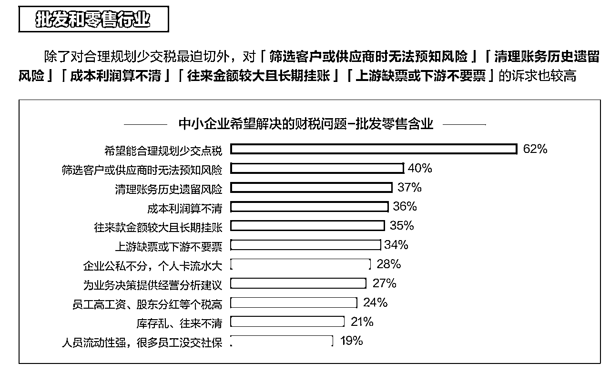
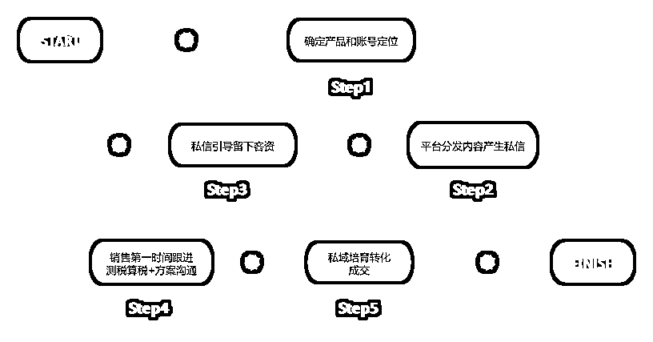
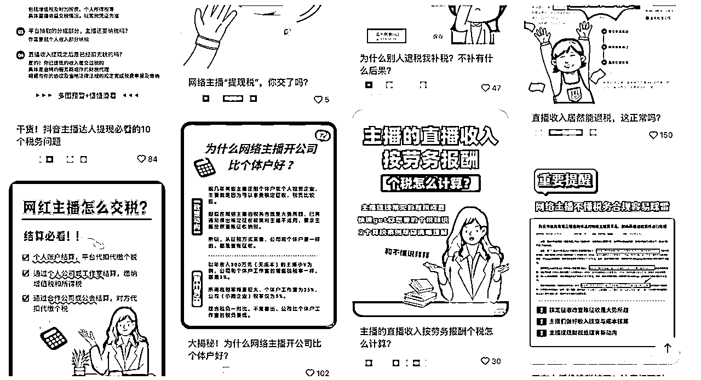
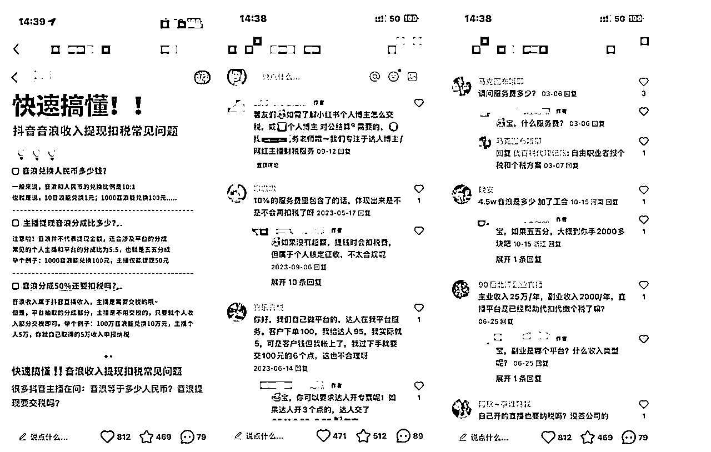
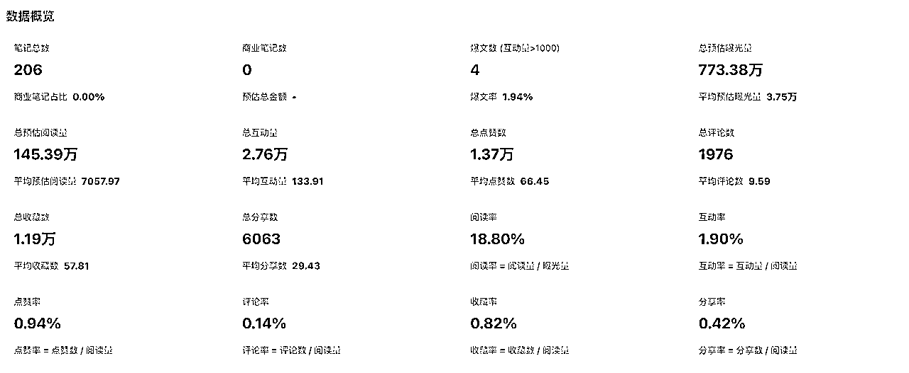
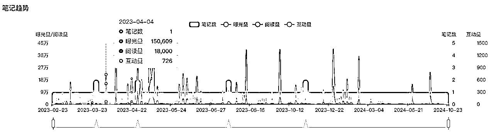

一个税务服务团队另辟蹊径的实操复盘：放弃“全做”，只吃透一个细分人群，单月200条客户线索

前阵子看到一个很值得借鉴的实操案例：杭州一家税务服务商，不在基础记账代办上继续血拼，而是瞄准“直播达人”这个细分人群，提供专项税收筹划服务，仅靠一个图文社区平台，单月稳定获得约200条客户信息，单笔报价上探到两三万，利润空间超过四成。

如今不少同行都在抱怨生意难做，其实不是没有机会，而是玩法变了。过去，大量税务代理机构的主要收入来自代办记账和执照注册，门槛低、同质化严重，价格战打到最后都赚不到钱。但伴随金税工程进入第四阶段，征管逻辑发生了根本性转变：不再依赖发票管税，而是依靠数据治税。电子发票普及、办税平台全国一套系统、企业数据跨部门连通，让资金与收入轨迹一目了然。原先游离在征管边缘的个体工商户，也逐渐被纳入更严密的监控。经营者们对“什么叫真正的合规”空前在意。

基础记账服务日益标准化，客户感受不到独特价值，价格不断下探。而另一端，针对合规的深度需求却鲜有人满足。这就是一条隐形的机会线。

案例主角没有试图服务所有企业，而是先做减法。

第一步，明确只做高价值产品。与其什么业务都接，不如做一款客单价三到五万的量身定制税收合规产品。第二步，筛选行业。他们内部有几条硬标准：自己手上有没有该领域的既有客户资源？后端团队能不能稳稳落地？这个领域的痛点是不是普遍且没被满足？拿这几条标准放到餐饮、制造业、培训、金融、商务服务、电商等六个板块里逐一评估，最后把目光锁定在电商。第三步，继续缩小人群。电商板块中，网络直播红人的涉税疑问最多、付费意愿也强，且当时专门服务这个群体的专业机构极少，于是最终圈定了这个方向。

为何锁定这个人群？因为他们的涉税难题实在太典型。这里通过行业调研，整理出一组高频问题：

- 大多数顾客是个人，消费后不要发票，导致不少收入没被计入申报；
- 有的达人少算甚至不算某些收入，补税风险长期高悬；
- 采购端进项票很难拿足，有时加点钱也拿不到；
- 毛利率高，平台投流费用巨大，进销项不匹配，流转税负担很重；
- 公司账户与私人账户混用，资金流向混乱；
- 员工薪资、社保、个税申报不够规范，一旦遭举报很容易爆雷。

痛点清楚了，产品定位也顺理成章：面向年收入50万到500万以上的直播达人，提供量身定制的税收合规解决方案，帮他们在合法不碰红线的框架内做好规划。报价设在三到五万，属于典型的高利润、高门槛产品。

有了产品，最难的就是获客。他们选择的获客阵地，是一个以年轻女性用户为主的种草社区。为何选这里？因为直播达人大多在20到35岁之间，同样以女性为主，集中在一线城市，消费力强，爱看美妆、穿搭、生活方式，也吃“种草”这一套。目标用户与平台用户高度重叠。

账号定位非常聚焦：专门回答直播达人在经营中遇到的税收疑难。变现路径也很清晰——靠内容吸引有需求的人，引导对方私信询问，再留下联系方式。

所以团队完全不执念于粉丝量，只看私信数和线索数。

围绕选题，团队做了不少细活。先向内部顾问、记账会计征集客户常见疑问，得到230多个；再用数据工具观察热门内容，提炼出150多个关键词；合并同类项后梳理出180个选题；最后按主播人群痛点排序，沉淀出150个高频选题库。

笔记制作上，团队反复打磨标题和首图。标题要有场景感、有临场感，少堆术语，最好具体到某个细节，同时埋下能被搜索到的长尾词。封面则经历了几个阶段：一开始没有固定风格，主要测打开率； 后来改成简洁清晰的版式； 最后沉淀出一套统一模板。 好的首图通常主题突出、画面干净、配色和谐、字号统一，比例多为3:4竖屏或1:1方形。

内容钩子很简单：为有需求的达人提供一次不收费的纳税试算，再附上专属优化建议的说明。这足以让真实客户主动留言。

引流路径上，账号主页展示联系电话和微信号，笔记正文与评论区也会给出暗示，让感兴趣的人私信。后续开通平台商业化投流工具后，再采用官方账号加小号的组合，通过艾特、私信发图、转发笔记等方式引导留资。

数据成果也很直观。到2024年10月，账号矩阵累计发布约200条内容。

从2023年2月底开始更新，大约做了一两个月，就陆续出现第一批小爆款，说明精准匹配的内容确实有穿透力。 200多条内容中，阅读量破万的有40余条，基本围绕直播达人的涉税问题，点赞、收藏、评论表现都不错。

线索量方面，从2023年8月开始，不花一分钱投放也能每月带来约170条线索；到了12月以后，稳定维持在200条上下。更难得的是，平台搜索入口基本被他们占领：达人搜索相关关键词时，前排结果大多是他们的内容，咨询自然源源不断。

拿到线索只是开始，转化动作同样紧凑。运营人员会在第一时间把线索登进内部表格，并同步到销售群。

随后要求10分钟内电话响应。第一次通话不做强行推销，而是确认基本情况，同时送出“不收费纳税试算”的福利，引导客户添加微信。加微后，顾问先帮客户完成一次免费试算，再根据现状匹配初步方案。本地客户约到公司当面聊，便于展示专业实力；异地则以远程沟通为主。

若客户迟迟未决，顾问不会逼单，而是通过微信动态持续输出专业形象：每天发布税收知识、隐去关键信息的服务案例、成交反馈和对行业生态的观察，慢慢把信任感养起来。

2023年，每月170条线索，签单均价约3万，平均成交比例在15%左右，高峰时可达20%；扣除服务成本后，利润空间不低于40%。而且这套产品采用年度订阅制，只要首年客户体验好，第二年续约不是问题。

到了2024年，因为看到机会的人越来越多，平台出现抄袭内容、截流、砍价等乱象，签单均价降到约2万，但线索量反而更大了，与传统代理相比，利润依然要厚道得多。

当然，这个项目并非没有门槛。税收服务本身就有专业门槛，不是整理几张表格就能交付；内容团队需要持续产出切中痛点的选题，背后是大量行业调研和客户访谈；一旦某个细分赛道被验证，模仿者就会蜂拥而至，价格和差异化都会被稀释。金税第四阶段让企业经营数据日益透明，这对专业服务者来说既是机会也是挑战——只有真正帮客户解决问题的机构，才能走得更远。

这个案例最大的启发，或许不是让你也去做主播生意，而是：在存量竞争时代，与其在红海里拼价格，不如找一个足够窄的切入口，把专业功夫做深，服务好一群画像清晰的人。

随着数电票数据预填等新规不断铺开，企业从注册第一天起就要把财税布局想清楚。传统代理记账在低价竞争里越走越窄，从业者不得不重新思考：怎么才能在这个历史关口找到新活法？

对财税服务商来说，这行本质是To B生意，但八成机构还靠着工商代办、资质申请、记账报税这些基础业务过活。真正针对垂直行业的税务合规做深度探索，也就是这两三年的事。眼下其实是一波难得的机会窗口——政策在逼着行业往前走，数字化和合规需求正在合流。无论是财税公司，还是做财税的超级个体，都应该抓住“数字化+财税合规”这股东风，加快转型。而且，不要再只盯着存量客户升级套餐，转向“垂类客群+平台”的精准获客，想象空间要大得多。

什么样的人能做？

如果你是财税公司，基础业务做到利润见底，想往高端服务走；

如果你是财税行业的超级个体，想做高利润单，却愁客户从哪来——这篇文章或许能给你一点线索。

什么样的人别碰？

如果你的财税功底不够硬、学习意愿也不强，对电商行业的客户画像和合规方案没概念，或者身边没有能落地的专业交付团队，那建议先别冲动。

可能给你什么启发？

财税公司想从小红书、抖音、视频号里“偷”流量，先想清楚自己的差异化立足点。无论是经营管理账还是财税合规产品，贪大求全往往不如深耕一个细分领域，做深做透，机会反而更大。

如果你刚好是电商卖家、超级个体或网红博主，那财税合规这根弦一定要绷紧，提前规避风险，路才能走远。

以上能给你一点启发，最好；如果觉得没意思，就当看个热闹吧。

——下面再补充一点行业背景——

经济增速放缓，财税行业进入血拼模式。2022年底全面放开后，经济缓慢爬坡，但2023到2024年，民间投资依然疲软，民营老板的信心还没完全回来。中小企业活得越来越难，成本高、融资难、资金紧，代账机构为了抢客户，拼价格、拼服务、拼技术，全方位内卷。以前靠规模扩张就能赚钱的路子走不通了，现在拼的是内部机制和效率，客户满意才有利润。

金税四期来了，合规意识被彻底点燃。数电票推广、电子税务局全国统一、企业信息联网、纳税服务简化，这些变化正在重塑整个行业。

趋势一：接下来两三年，代账作业会高度数字化、标准化。银行电子回单、流水等源头数据已经在快速数字化，企业的业务数据系统也在完善，AI智能记账开始冒头。好处是税务数据处理能力变强，查账征收会从企业扩展到个体户，行业客户盘子变大；坏处是普通记账服务越来越同质化，用户觉得不值钱，价格还会继续往下掉。

趋势二：金税四期之后，合规的空间反而更大，只有合规才有未来。税收征管走向“三流归集”和“双动体系”，最终实现以数治税。所谓三流归集，就是通过数电票掌握业务流，通过金融监管掌握资金流，通过个税社保改革掌握人力数据流。再加上动态风险监控和信用管理，整个征管闭环会越来越严密。

补充一个体感很强的例子：从2019年起，国家税务总局上线了个税APP，每年3-6月我们都要做综合所得汇算清缴。你会发现，工资、劳务报酬、经营所得、股息分红，房贷记录、家庭成员信息，都从人社、税务端口逐步打通，变得越来越透明。

照这个趋势走下去，企业对财税合规的重视只会越来越强，也越来越清楚：不合规就没有未来。它们需要的，不再只是基础的代理记账，而是更专业、更定制化的财税解决方案。这个时候，财税公司真正要比拼的，是你能不能提供别人给不了的服务。

最后，我老东家税友集团财税代理事业部发布过一份《2024中小企业财税需求分析白皮书》，中小微企业、工作室、超级个体都可以拿去做参考。