# 避坑指南！老板和设计师千万别踩字体、图片侵权的雷

大家好，我是米斗，一名懂营销的品牌设计师，专注品牌视觉与个人IP全案设计。

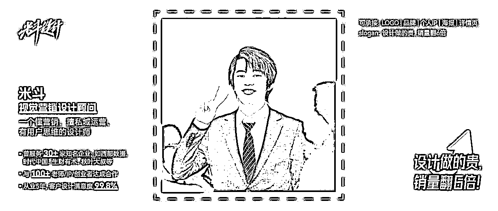

很多朋友以为，字体没版权？错了！虽然汉字本身不在著作权法保护的作品类型里，但设计师按汉字规则创作出的独特字形，只要具有独创性和审美价值，就能作为“美术作品”受保护。也就是说，你随手用的某个字体，背后可能藏着版权方。

法律上，《著作权法》第三条明确列出了受保护的作品类型，其中就包括美术作品；第二十条也提到，作品原件的转移不等于著作权转移，展览权归原件所有人等。这些条文都在告诉我们：字体设计不是无主物。

再来看个真实案例。向佳红在2013年申请了“向佳红毛笔行书字体”著作权登记。后来电影《九层妖塔》里的道具《鬼族史》和《华夏日报》未经授权用了“鬼、族、史、华、夏、日、报”7个字。对比后，字形结构、偏旁比例、笔画长短粗细都没啥区别。法院一审判决赔偿14万元，二审维持原判。看，一字万金真不是开玩笑。中国裁判文书网上，字体侵权相关文书有37篇。

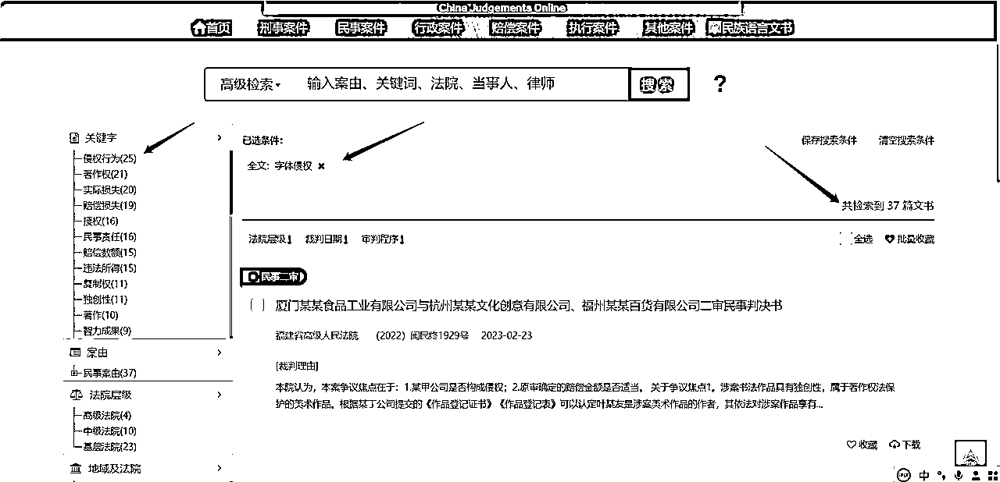

版权意识薄弱，很多人选字体只凭喜好，完全没想过要不要授权，结果作品埋下侵权隐患。

图片的坑也不小。先说判定标准：只要用了图片里特色的标志或图案，哪怕只调了颜色和色调，也算侵权；未经许可擅自发表、使用、署名、篡改、剽窃等，都属于侵权。另外，外观设计专利的图片保护范围，以申请时提交的图片或照片中显示的内容为准，主视图尤其重要。

《著作权法》第四十七条列了一堆侵权行为，比如未经许可发表作品、歪曲篡改、剽窃等等，都要承担停止侵害、赔礼道歉、赔偿损失等责任。要是情节严重，还可能触犯《刑法》中的侵犯著作权罪——违法所得较大或情节严重，处三年以下有期徒刑或拘役，并处罚金；数额巨大或特别严重，处三年以上七年以下有期徒刑，并处罚金。裁判文书网上图片侵权相关文书多达2520篇。

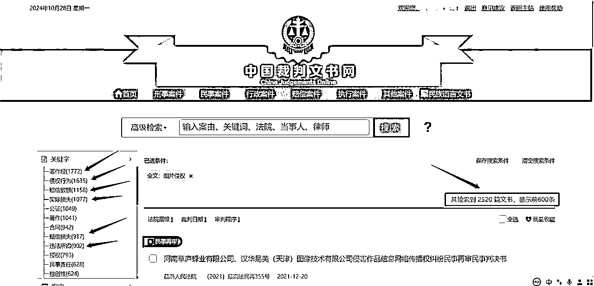

既然风险这么大，怎么避雷？查字体版权，推荐“360查字体版权”网站（https://fonts.safe.360.cn/）。打开后它会自动扫描你电脑里的字体，把字体分成“免费可商用”和“商用需授权”两类，也可以手动搜索某个字体的版权信息，比如思源黑体。

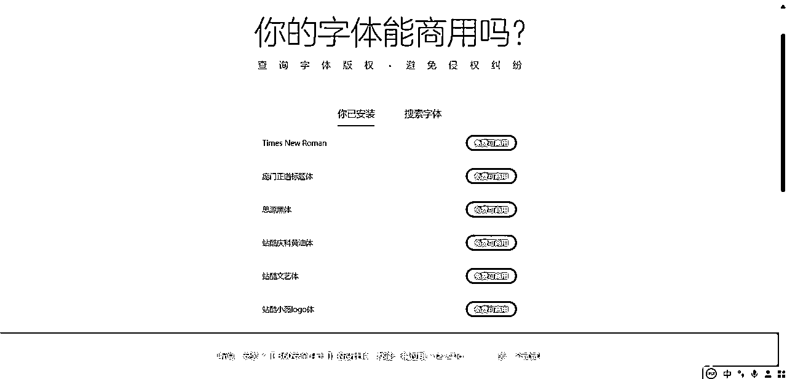

如果360查不到，就拿字体名称去其他网站搜，比如求字体（https://www.qiuziti.com/）。

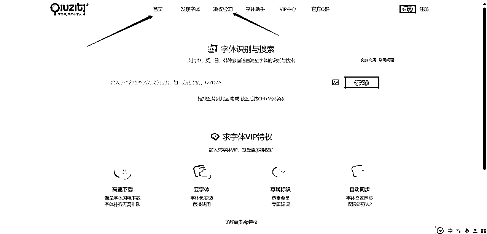

特别提醒：方正字库和汉仪字库的字体，能不用就别用，除非你买过版权。能选免费商用字体，就尽量用免费版；实在不行就付费购买授权。还有，重点中的重点：微软雅黑是版权字体，不能随便拿来商用！

举个错误案例：像这种明显是方正字库的字体，商业用途直接拿来用是万万不行的。（仅作展示学习，未商用）

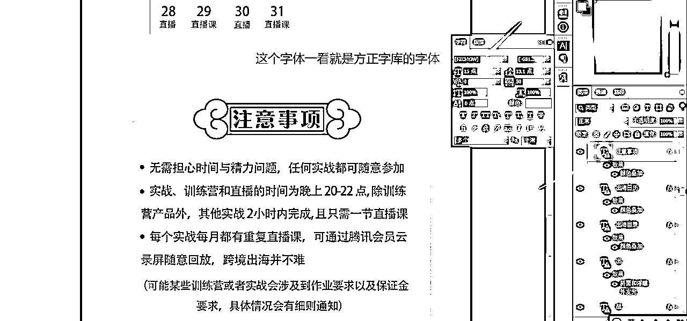

那免费商用字体去哪找？强烈推荐猫啃网（https://www.maoken.com/），这个网站专门搜集免费商用字体，已经有600多款中文字体了。

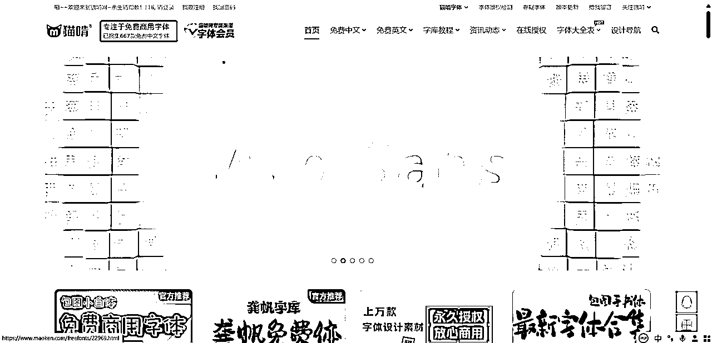

其他字体资源网站还有：求字体、字由、字魂、字体传奇，链接给大家列一下：求字体 https://www.qiuziti.com/；字由 https://www.hellofont.cn/；字魂 https://izihun.com/；字体传奇 https://hao.ziticq.com/。

图片资源同样要小心。没买版权的话，视觉中国的图千万别碰！如果已经买了授权，那可以放心用。推荐几个无版权图片摄影网站：Pixabay（https://pixabay.com/）、Pexels（https://www.pexels.com/zh-cn/）、500px（https://500px.com.cn/）。

最后教大家一个实战技巧：怎么在花瓣网精准找到合适的素材？（仅作学习演示）

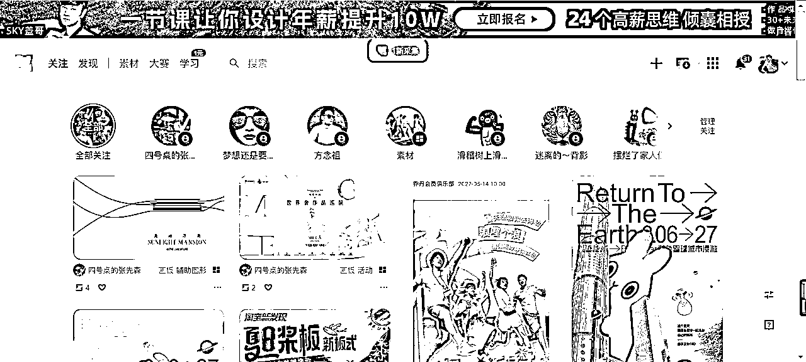

第一步：打开浏览器，输入花瓣网的网址，进入页面。

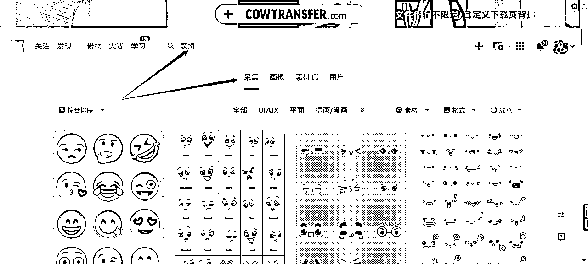

第二步：在搜索框输入关键词，比如“表情”。

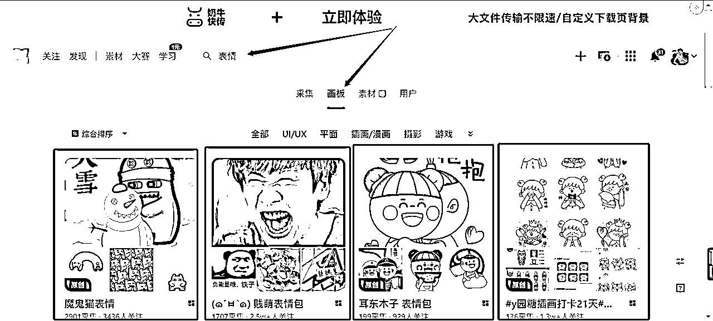

第三步：默认显示的是采集页面，注意要切换到【画板】标签，结果会完全不一样。

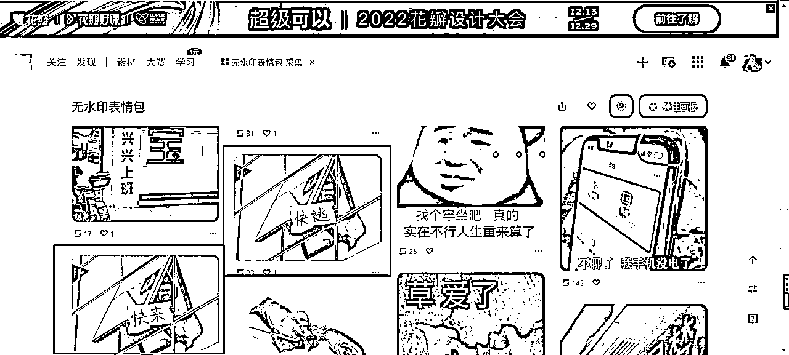

第四步：点进一个合心意的画板，往下翻，你会发现里面的图全都符合你的需求，又全又准。

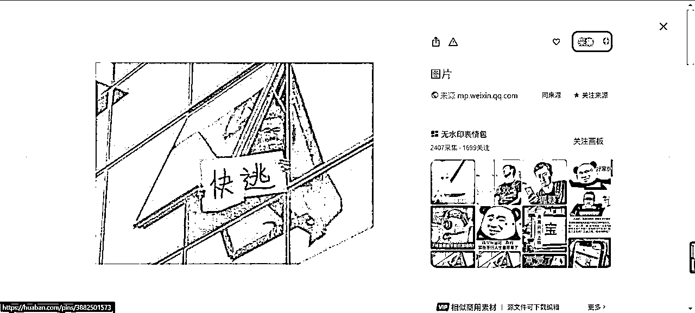

第五步：点开图片查看大图，下载保存，然后直接拖进PPT或PS里就能用了。

So easy！掌握这些避坑技巧，老板再也不用担心我们侵权啦！这节课就到这里，下课。记住：知识不值钱，改变才值钱。都看到这里了，有启发就点个赞吧！感恩~
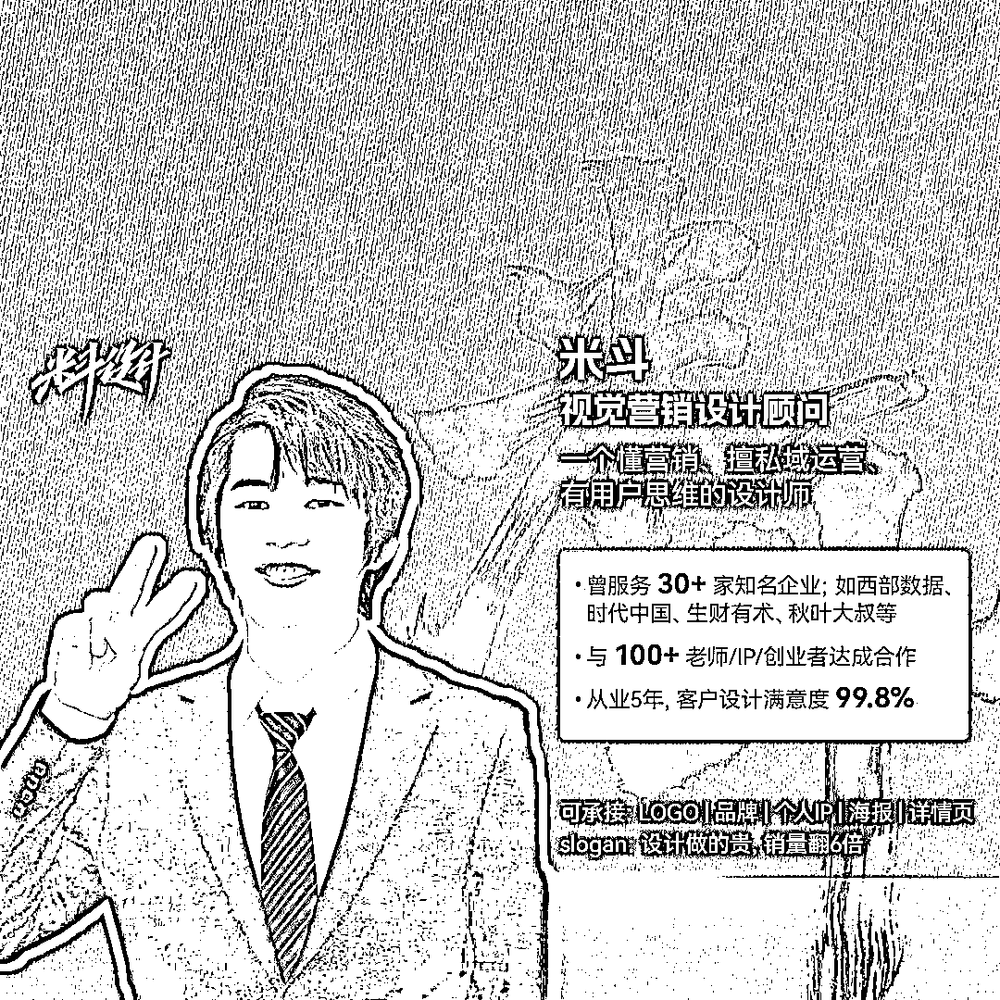