这几天，义乌就像被度假的流量砸中——央视来拍过，热搜也常年有名字，粉丝几百万的博主们扎着堆往那边跑。可真在那边住下来的人，讲出来的东西往往比镜头里的更实在，也更扎心。

这份材料来自一个叫阿甜的姑娘。她和丈夫豪哥原本都是深圳打工人，一个做课程策划，一个是写代码的，跟线上卖货八竿子打不着。夫妻俩一咬牙跑到浙江，埋头做起了网店生意，一干就是18个月，加起来年薪五十万，情绪上却经历了一整轮的起伏：开始很亢奋，慢慢变平淡，随后陷入内耗和自我怀疑，最后又重新站起来。阿甜说自己算是身边人眼里出名的乐观派，可那段时间还是觉得格外难熬。要是你也有自己干的打算，请记住：这些波折再常见不过，别急着否定自己。

这篇文字里藏着不少避坑经验，看到就等于省钱。视频看不看随你，关键结论都已经写在后面了。

内容大概包括：刚抵达时的心情变化；操作文具类网店时踩过的坑；做年货项目时吃过的亏；如何重新规划方向；怎样带着目的去考察；本地常见的赚钱路径；以及市场实用信息。先放几个她本人的账号在这里，免得你回家就忘了自己买的是什么：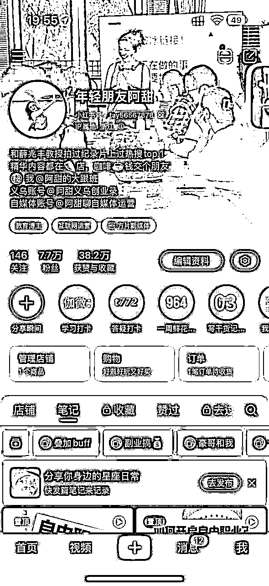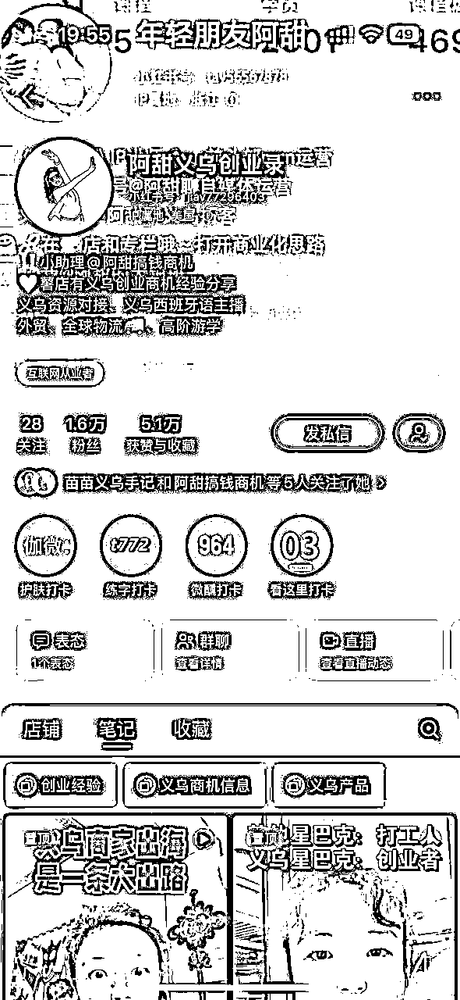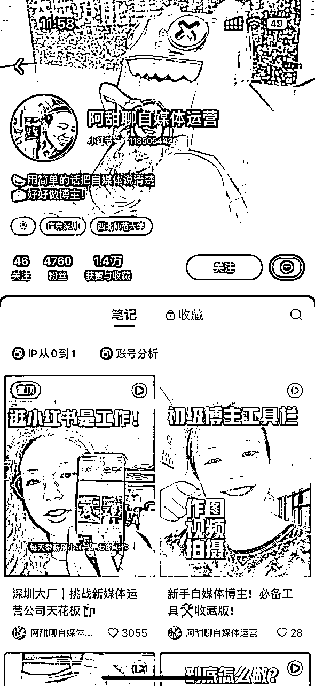

关于“要不要来”，阿甜也专门拍过一条视频，里面说得很直接：

这份东西适合谁？比如：想开网店但不知道从哪下手的；在外地想低成本试水的；手里钱不多、想走轻投入路线的；一心想来考察却没有方向的；已经在这边住着但还没找到机会的；除了开店想不到其他出路的；甚至单纯好奇想看看的。都可以翻一翻。左侧栏还有补充内容：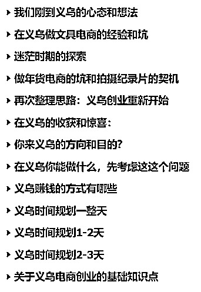

出发之前，最好先问自己一句：我去那儿到底图什么？哪怕目的只是旅行，也该带着“能看见什么、哪样东西对我有用”的心态去。

先说说找货。要是你本身就有产品线，事情好办得多，直接去同类货集中的区域找店家聊就行；也可以先在网上查好单价和厂家实力，再约时间去实地看。但要是你完全没有根基，只是听说卖货赚钱就脑子一热来挑品，那真得冷静一下。这行有句话：货挑得好不好，基本决定成败。没有工具，没有长期积累，想在市场里转几圈就挖出爆款，跟沙堆里找金粒差不多。不少人逛了几天，只会说“真好看”“真便宜”，一问拿什么、拿几件、卖给谁，全是懵的。所以，千万别冲动，千万别冲动，千万别冲动。

要是你想摸清楚这座城市适不适合自己，可以从内外两个维度去盘。对内：存款够不够撑六个月生活？过去积累的本事能不能独立撑起一块业务？自己有没有学习能力？愿不愿意跟陌生人打交道？能不能嗅到赚钱机会，并且说完就干？前几个月没动静，你扛不扛得住？对外：附近自己干的人多不多，都是些什么人？当地政府对小生意有没有扶持？分享活动多不多，参会门槛高不高？这座城市的调性是偏精致还是偏务实，跟你的风格合不合？产业配套是否成熟，能不能快速拿到货？

如果只是随便逛逛，也不错。这里也有点实用的生活情报。公共交通方面，地铁和公交都有，但公交班次很少，阿甜在这边待了那么久，也只搭过一回公交。轻轨能到金华和横店，不过市区内的主要用途是去市场，而且等一趟要10分钟。所以大家出门更爱打车，住的地方到核心区，基本二十分钟内都能到。

租房有个独特方法：别只盯着线上平台，去网商扎堆的村子看楼下的信息板。紫金、五爱、北下朱这些片区，告示板上贴满了房源和招工消息。预算一千到六千都有，村里单间大约一千五。挑房子最好白天晚上各看一遍：白天观察周围环境和人流，入夜后再留意噪音和照明情况。女生尤其要避开灯光稀疏的区域，那种地方人少，不安定。更具体的经验可以看这条：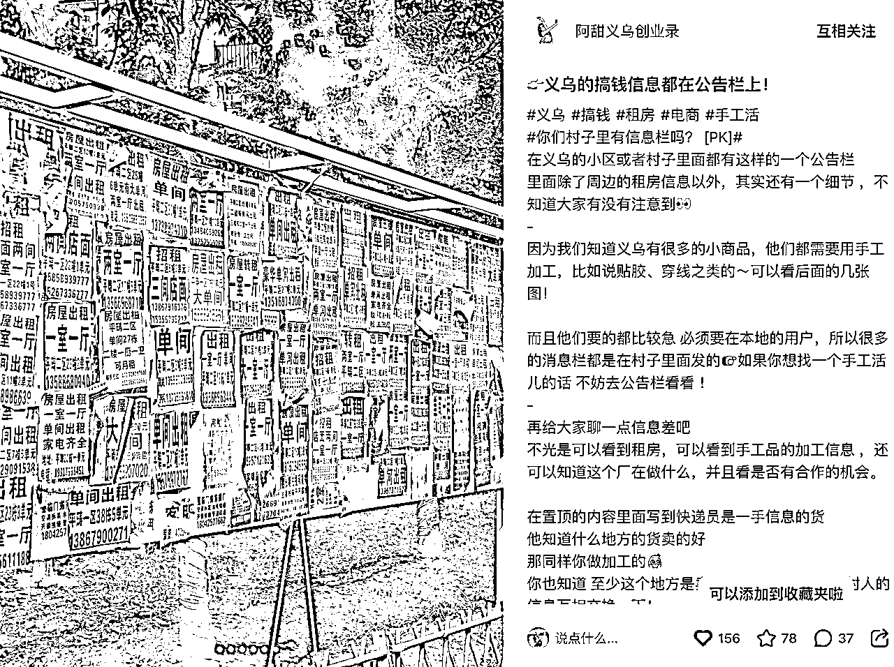

手头的钱，建议至少够你活六个月。不然一旦紧张，很容易随便打个工填饱肚子，半年下来既没存下钱，也没摸清门路。要是手头有六个月到一年的闲钱，你就能用轻成本的方式去试各种路子。另外，以前干过哪行也非常关键，你过去的职业和副业，会在很大程度上影响下一步往哪走。阿甜说他们夫妻俩属于真正的零基础，绕的弯路比别人多得多，直到最近才慢慢找到既喜欢又擅长的事。

那么，在当地到底靠什么赚钱？这里梳理几种常见的：

第一种，倒爷。这名字听起来老派，放到线上就是所谓的“无货源”。原理很简单：在批发网站上找货，搬到零售平台卖，赚差价。比如珠子十块钱一斤收，二十块卖；伴手礼二十块一个收，三十块卖，中间就是利润。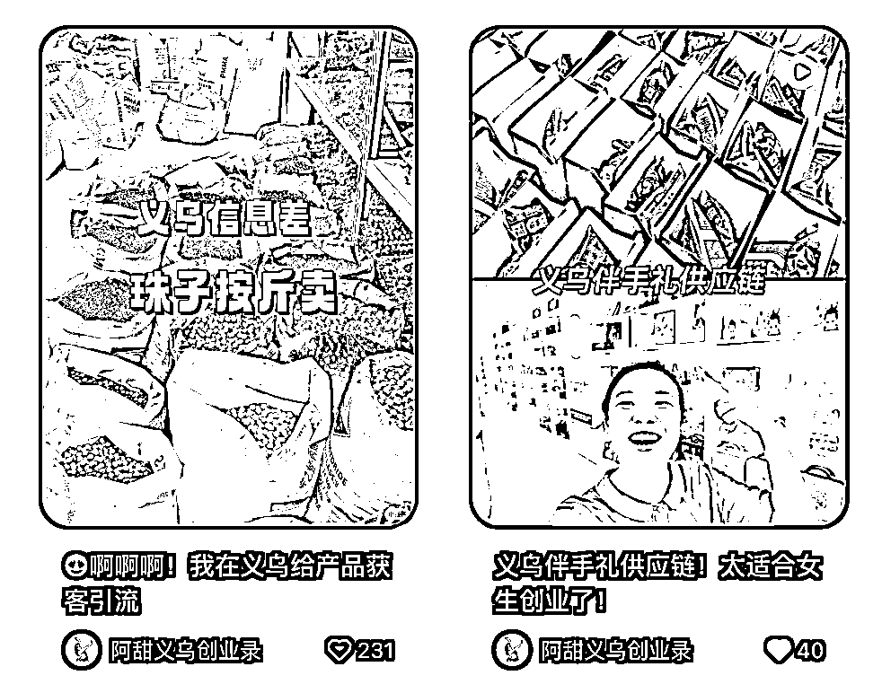

想找适合倒卖的货，不必真在城里跑断腿。去市场里边走边录，随手拍下见到的货品，让全网知道你能找货，有需求的人自然会过来；或者多翻翻小红书的留言区，看大家正在求什么货，你就去拍那一类东西。记住，刚起步时的个人直觉往往不可靠，先弄明白你的买家是谁、在哪个渠道卖、怎么定价，比闷头逛有用得多。

第二种，走播。在市场的第一到第三展区，尤其是一号展区东侧那片饰品区，找一家店跟老板商量，直接在他门口开播卖货。一般来说需要交押金，两千块对应一个折扣档，一万块对应更高折扣，相当于变成了商家的小批量客户。要是你自带流量或熟客，店家也可能愿意帮你代发。不过走播真不是轻松活儿：开播本身就极其耗神，还要边走边说话、盯互动；从零攒账号也难，自然流量常常要熬三十天以上，不少人就是熬不住才放弃。这也是阿甜反复强调要有六个月存款的原因——心里不慌，才能熬到转弯。她对走播专门聊过一期，可以看看：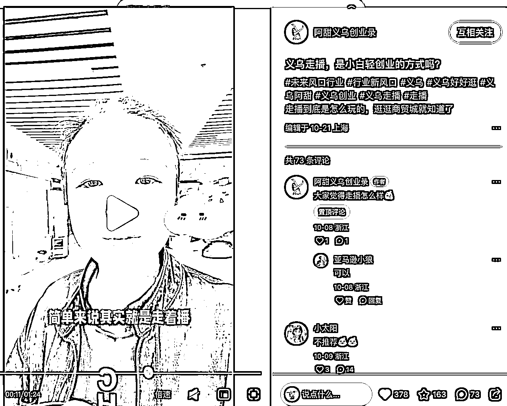

第三种，做主播。要是本钱不多、外形条件好，女生可以考虑直接做主播。这行确实卷，但当地底薪普遍一万上下，杭州能到一万五往上，还有提成。零基础可以先当副播，至于能走多远，得看天赋和状态。主播非常吃状态，全程绷着精神、管理表情，累是真的累，但也能借机把带货间的后台设置和运营方式摸透。外语主播同样有需求，英语、西语、阿语都不缺岗位。英语竞争最激烈，想绕开拥挤赛道，可以往小语种转。不过外语主播通常要在深夜开播，等于过国外时差的生活。相关培训视频在这里：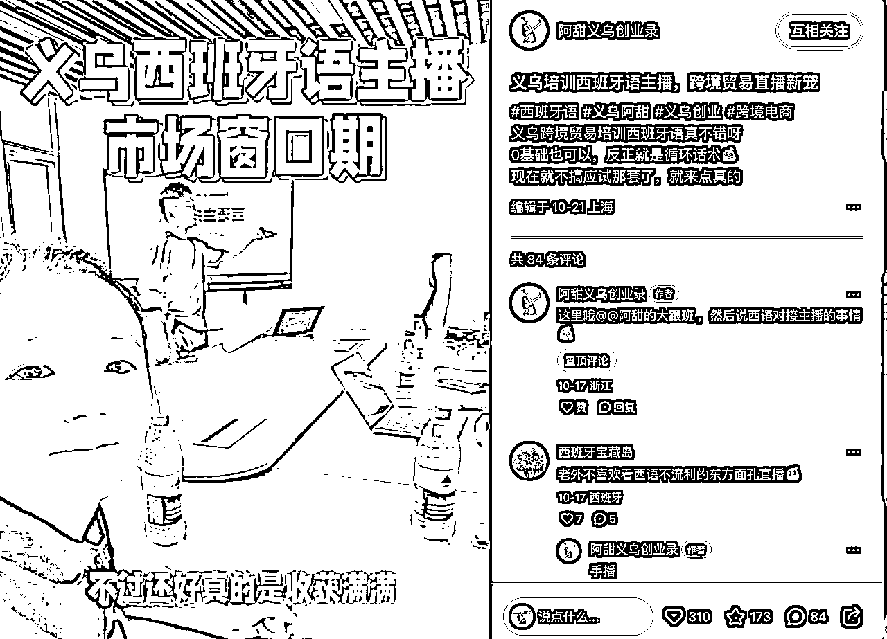

第四种，外贸跟单。这跟零售完全是两码事，主要是把国内货品卖给海外的批发端。有些岗位要亲自跑客户，去Facebook、Ins、TikTok上找需求方，发短视频介绍产品、聊订单；有些则只需要跟进流程，靠成交分提成。做居中撮合的人，有四点要记住：先把货研究明白，别总拿细碎问题麻烦供应商；弄清各地物流和关税成本，防止倒贴；碰上非标准产品，规格、色号、质检都要反复核对；订单金额越大，对方越谨慎，你必须耐得住。

第五种，平台运营。当地做线上生意的公司很多，淘宝、TikTok、1688等平台都需要运营。日常工作包括设置标题、搜索词、封面、详情页，并持续优化点击率，目的是提高曝光和转化。没经验的人可以先当学徒，边就业边积累手艺。

第六种，内容运营。眼下各类商家都挤在抖音、小红书上做声量，不少公司设了专门岗位，也有的外包给团队做。想入行，最好先亲手经营一个账号，攒几个能拿得出手的案例。这里放两个参考：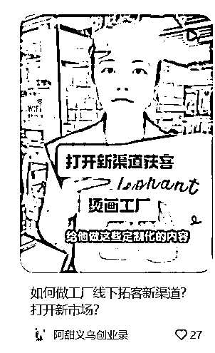

第七种，做快递分拣、跑腿送餐。别小看这些基础工作，在当地的网商社区里，快递员最清楚谁家爆单、哪些品类走得快。也有人去跑货拉拉，天天待在一线收集情报。送餐同样能让你快速摸清哪个片区热闹、什么货在动。关键是别真把自己当成纯体力工，要把这些信息变成资源。比如拍一个“跑腿小哥眼中的本地商机”，说不定就能打开局面。

第八种，手工活。计件付费，比如给发夹上胶、串珠子。阿甜楼下美发店的店主，闲着就扎蝴蝶结，五毛一个，一天几百件。这里的门道是：别只盯着手工费，给你活儿的人手里一定有产品，你完全可以顺便卖他的货。这些活计在批发村里的告示板和小车间里都不难找。

再聊聊市场本身。那里分成五大展区，大到什么程度？哪怕每家只待一小会儿，全部走遍也要两年。一号展区和它的东侧都是饰品，也是人气最旺的区域，想要感受人流，去那片转一圈就足够。不过五个展区之间有通道相连。想高效找货，必须有方向，否则很容易晕。现场布局可以参考这几张图：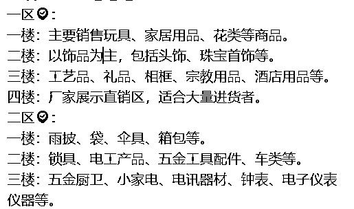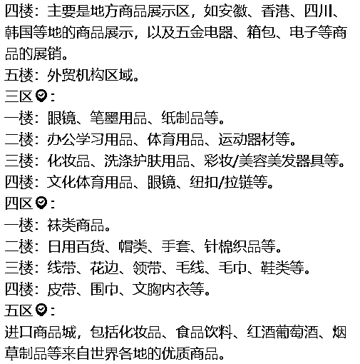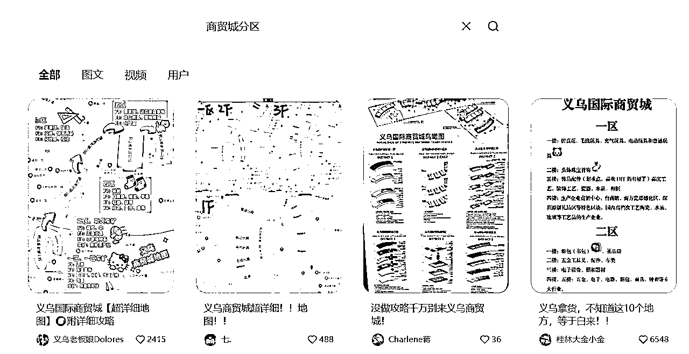

阿甜也讲过一次关键转向。做完年货项目后，她和豪哥决定不再碰高投入的模式，也不再亲自装箱发货。原因有三个：做这一行多年的熟人被投产比压得喘不过气，辛苦却没什么生活；她判断线上零售迟早要转向海外，早做准备总没错；她本人更享受学习、反思、对接人脉的过程，不喜欢一直待在仓库和车间。有类似处境的朋友，完全可以直接复制这套“从重到轻”的思路。

最后再说回那个问题：你来这座城市，究竟想得到什么？哪怕只是随便走一圈，也该带着“这里有什么能用得上”的念头。别再做只懂逛吃逛吃的观光客了。作为一个想做点事的人，至少要问自己：我能不能在这个地方扎下根来？我能在这个地方做成什么？阿甜反复讲，城市本身不是关键，关键还是在人。这篇长文，是她写给过去那些日子的复盘，也是给所有野心勃勃又心存犹豫的人的一份地图。带上问题出发吧。这座城市不会替你做决定，但答案就藏在你走过的每一条街、问过的每一个老板、堆过的每一箱货里。

逛义乌国际商贸城时，会发现部分商品可以零买，更多的是批发为主。即便如此，若是真心喜欢，主动开口询问也通常能得到回应。遇到心仪的门店或产品想要留存信息，可以先征得同意再拍照记录，提前沟通好能避免误会。

关于如何记录名片和商品信息，可以参考这条笔记：
73 【逛义乌商贸城？完全忘了产品和名片怎么办？ - 阿甜义乌创业录 | 小红书 - 你的生活指南】 😆 yLj6KGrFmc6NPF4 😆 https://www.xiaohongshu.com/discovery/item/663eef21000000001e03196a?source=webshare&xhsshare=pc_web&xsec_token=ABm_50ko-_y2D151RnNWSQvw8a4xhiP-nHbSwLWtWey_Y=&xsec_source=pc_share

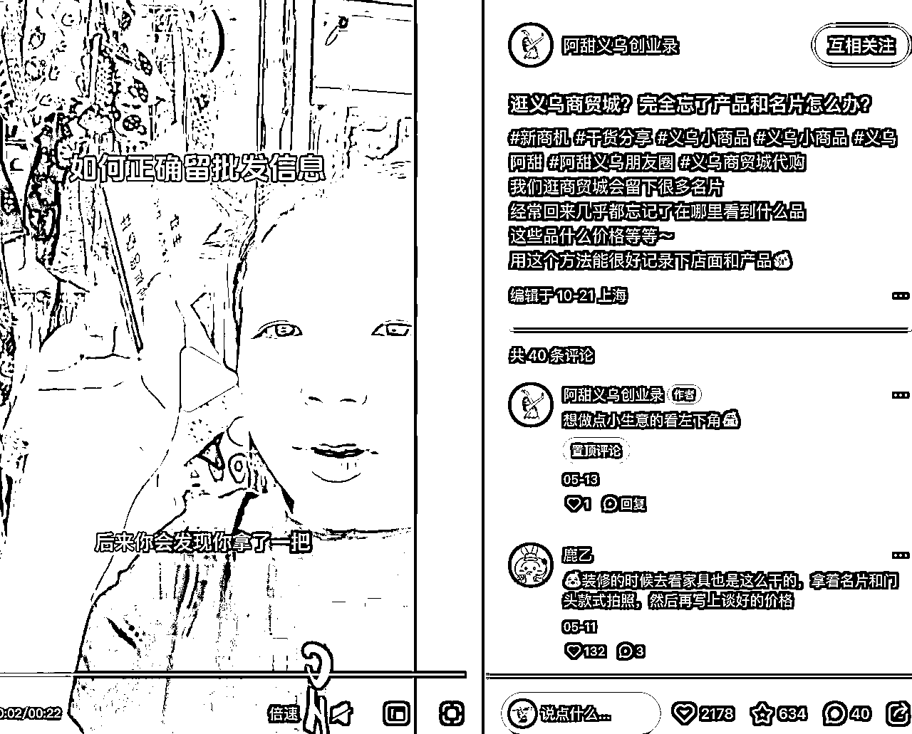

商贸城外临近的新光汇里，有一家名为苏坦的土耳其餐馆，在本地排位靠前。带着“来都来了”的心态去打卡体验也挺有意思，店内常年可见不少外国面孔，很有异域感。若不想吃异国菜，负一层聚集了不少连锁餐饮品牌，也能快速解决用餐。

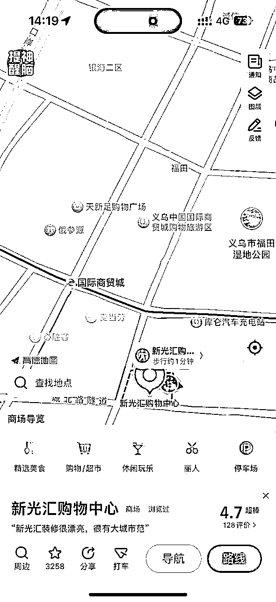

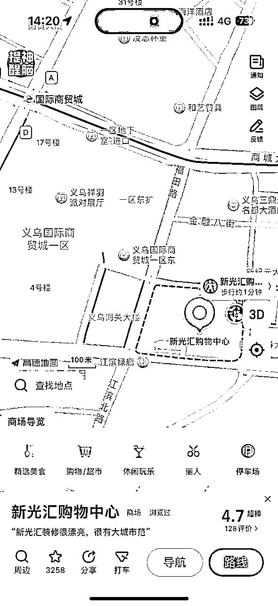

用餐后可以打车前往【银海小区】，尤其是十月之后，这里逐渐变成义乌年货的集中批发区。该区域的商铺基本只在十月起营业，一年大概只开三个月，租金却非常高，以前听说过有店铺年租30万，老板们都觉得能回本。基本不做散客零售，去看看全国年货将如何备货，本身就是一种有趣的观察。

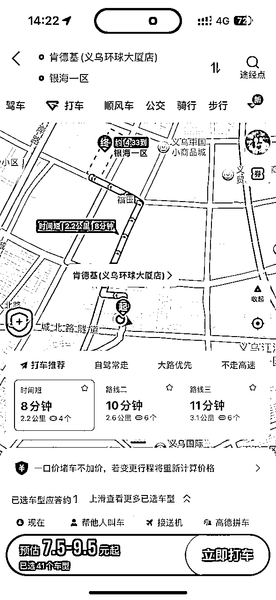

若来义乌的时间并非十月后，下午可以去看看五爱库存街。所谓库存街，就是处理积压货物的地方，价格低到出乎意料——皮筋按斤计价，发夹论斤卖，耳环也是按重量算。朋友圈里一位做库存的老板曾一次性发运过一吨皮筋，走大卡车运到外地。库存也常销往海外，部分欠发达地区会把这些货物再转售。国内产能处于过剩阶段，所以库存量一直很大。

这里同样存在信息差：品质与款式都不错的库存，通常不会流到街面上，一般会留在仓库里优先供给熟客。我们之前做文具电商时也接触过库存，才明白“能出现在库存街是有原因的”——整体上在品质、款式、品牌层面都不算突出，除了价格便宜之外，其余都要让步。

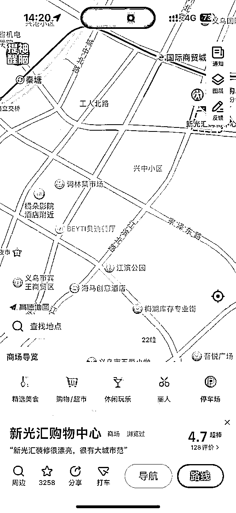

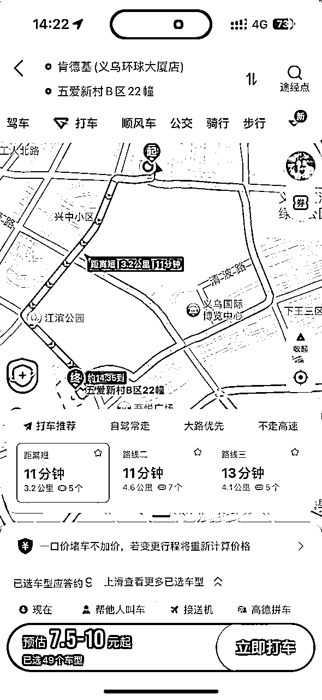

傍晚若有空，建议去宾王夜市逛逛，地图上标记【🌟】的位置，打车很方便。

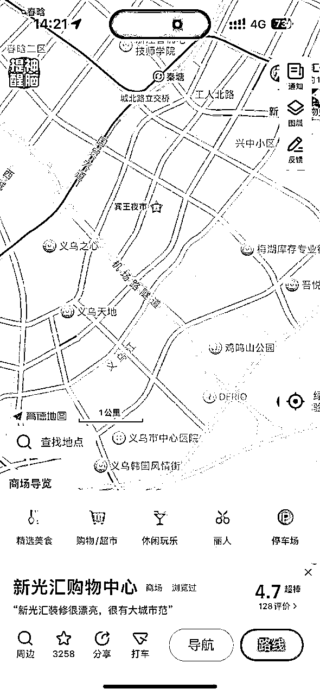

79 【义乌夜市，价格震惊！简直是线下拼xx！ - 阿甜义乌创业录 | 小红书 - 你的生活指南】 😆 7vOWdpOGOUXQdRR 😆 https://www.xiaohongshu.com/discovery/item/66cb2882000000001d03b950?source=webshare&xhsshare=pc_web&xsec_token=ABLcOYC1hJyyNU750LB42htUkrnvAp4-OpRs8a8lkMTxk=&xsec_source=pc_share

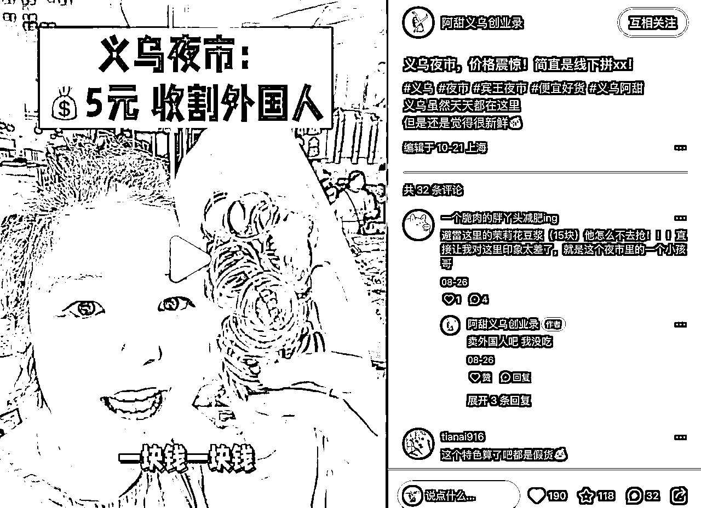

宾王夜市的玩法建议：别等到晚上再去，下午六点左右到达更合适，因为摊位约六点半才正式开张。六点能看到街道从空旷到被货架占满的过程，分成三条街，也被称作【三挺路】夜市。网络上对这里的描述大多集中在：便宜、像线下版拼多多、外国人多、美食一般化。见仁见智，国内外国人密度较高的夜市之一，去体验一下还是很新奇。下雨天基本没人，不建议前往。

1-2天行程可以这样安排：国际商贸城、10月后至年前银海小区、五爱库存街、宾王夜市，再加上通过1688联系工厂探访。若时间是两天，可把工厂探访加入计划。

怎么联系工厂？在1688上搜索义乌本地工厂，优先选距离近的，询问是否方便看货。此时身份很重要，不要以素人身份沟通，可用两种身份切入：一是自媒体从业者，想做内容采访和货源对接；二是老家有实体生意，来义乌寻货。如此更容易获得接待。

要提醒的是，找到工厂并不等于拿到最低价。很多工厂不做全品类，可能只生产零部件。初期合作或拿货量小，议价空间有限。更不要盲目追求低价，低价往往伴随低质，新人凭什么拿到更低价格也不合常理。低价也不是健康生意模式，拼多多对商家的卷动大家都有目共睹。核心仍是销售渠道，奔驰保时捷和奥拓海马都能卖，找到合适的客群更关键。

若停留2-3天，建议提前关注当地的沙龙、博览会或展会信息，纯逛逛很难有收获。参与活动能更直观感受到义乌的商业生态和创业者正在做什么。

展会一般是认识义乌创业者的好时机，参会者基本都在本地创业或参展。可以多交换联系方式，了解当地展会动态。认识更多同行后就可以组局交流、参加沙龙，这是创业里很重要的一环。如今单打独斗很难存活，各种社群、会员群的抱团交流就是证明。不过交朋友的前提是双向信息交换，而不是单方面索取输出。若每次见面都只有你听别人讲，关系会逐渐疏远。

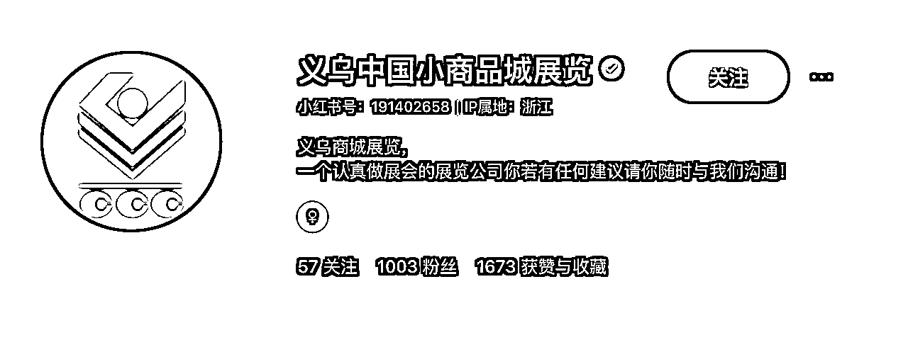

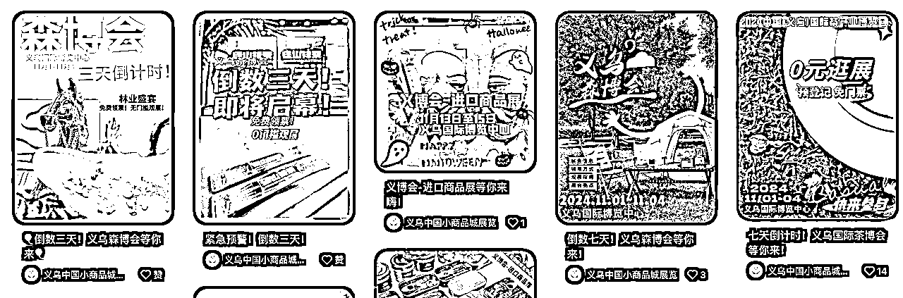

我们初到义乌时没有任何攻略，也没看小红书和抖音。当时的出发点很简单：想做自己的生意，义乌有商贸城值得看看；2017年曾在当地卖衣服赚了几万，对这里有滤镜；还有一个大专朋友一直建议过来取经。

朋友虽在当地，但也不想一来就依赖，至少要能提供价值。所以先想清楚思路，再去摸清义乌的整体框架。那段时间住在商贸城旁边的酒店，周围全是外国人，含早餐，感觉很新奇，消费也比深圳低不少，当时带着云游心态，觉得能在这里多待一会。

我和老公豪哥是2023年6月抵达义乌，第一站和大多数人一样，先去国际商贸城。这里共五大区，最常去的一区主要是饰品配件，也是小红书上出现的频率最高的片区。其他汽配、新能源、宠物等区域也逛了，感觉很茫然。女生对饰品毫无抵抗力，我看到就走不动，忍不住买了两百块的耳环，想着就算不转卖自己戴或送人都不亏——成本一块五，市场价十几块。

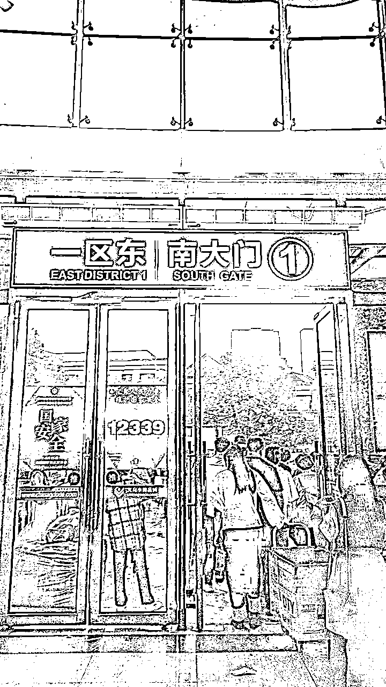

刚逛商贸城时还跟自己说：两百块在义乌就能当老板。事实也差不多，这里称呼几乎都是“老板”“老板娘”，没有帅哥美女的说法。若想做小生意，摆摊是最直接的方式，面对面沟通、面对面成交，一切即时完成。没有包装、发货、售后、压货、库存、客服，全部浓缩在一个人身上。只要有货、有人卖、有人买，三端就通了。自媒体和电商的本质也是促成并放大这种交易。

后来复盘发现，初次逛商贸城和现在再去的心态完全不同。起初是兴奋、激动，觉得东西多、想拥有、想卖掉赚钱。后来带朋友去多次，虽然每次都能发现新店、加上老板微信、拍不少素材，但已不再冲动下单，也没那么亢奋。因为这里本质是个庞大的供应链，货再多不是你的，便宜也白搭卖不出去，反而会觉得守着金矿却无力变现很可惜。现在商贸城对我而言更多是拍视频的背景，是游学必去的点位，加下老板微信，以后有需求就是资源。

23年6月逛完商贸城后拍的视频：
https://www.bilibili.com/video/BV1cu411e7Tq/?vd_source=cd57d3a123a254526b23c45b10a3970f

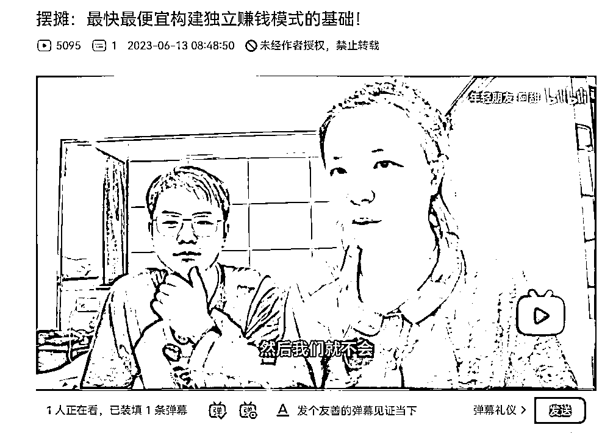

商贸城的老板娘一眼就能分辨是拿货还是看热闹。回想起来，两个第一次见这么大饰品区的人，眼睛肯定到处乱飘。老板娘知道你拿不了多少货，态度自然会冷淡。这也是小红书上常说商贸城老板不友好的原因——店铺租金动辄几百万，走批发路线，小单零售看不上。他们眼光很毒，拿货量、外贸还是内贸，心里都有数。说到底人家是老板，能租下百万门面的人，没空搭理散客也很正常。

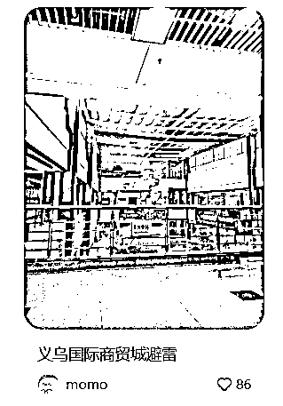

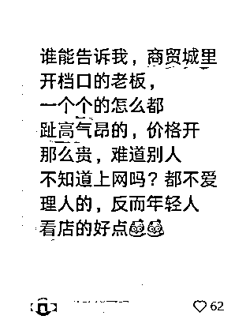

后来我还想过去宾王夜市摆摊。宾王夜市即三挺路夜市，由三条街组成，被称为线下拼多多。攻略多建议18:30后再去，但我更推荐18:00到，能看到街道瞬间被货架占据的过程，也能看到一人摊位、情侣或夫妻搭档开摊的热闹场面，很有烟火气。提醒一句：不建议在夜市吃东西。

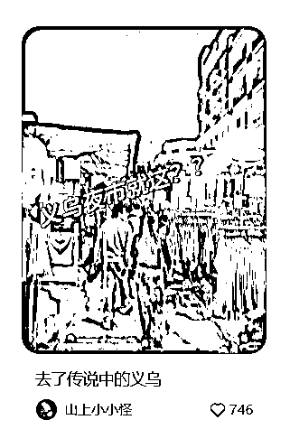

那段时间我非常迷茫，对电商完全不懂，什么货架电商、兴趣电商，在深圳的职场里从未接触过。淘宝、拼多多、小红书、抖音、快手，到底怎么做？不过正如前面所说，最快的方式是摆摊，面对面交流，还能积累不少微信。我给自己定的定位是“硕士毕业去夜市摆摊”，对做内容有帮助，而且2017年我就在宾王夜市摆过摊，有经验也有话题。但最后没有执行，因为把想法告诉朋友后，他觉得这对高学历群体不是正向信号，会引发退学念头或对考研动摇。想想也有道理。现在市场出现硕士摆摊、轻创业等讨论，但我并不认为读研无用，那是段无忧的时光。如今创业圈的思路很活，一年多学到的东西比职场和校园多很多。

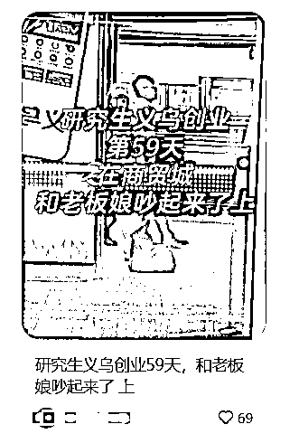

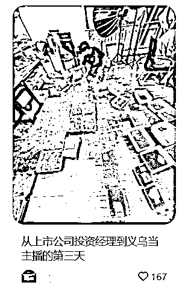

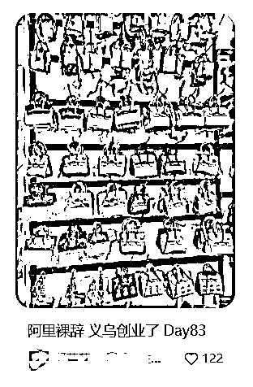

探厂这个词以前没听过，过去只会说去工厂看看。仓库、车间、打包发货，对我都是新奇的体验。若想探厂看产品，有相对简单的方式，具体在三天规划里会提到。

https://www.bilibili.com/video/BV1uh4y1E7L7/?vd_source=cd57d3a123a254526b23c45b10a3970f

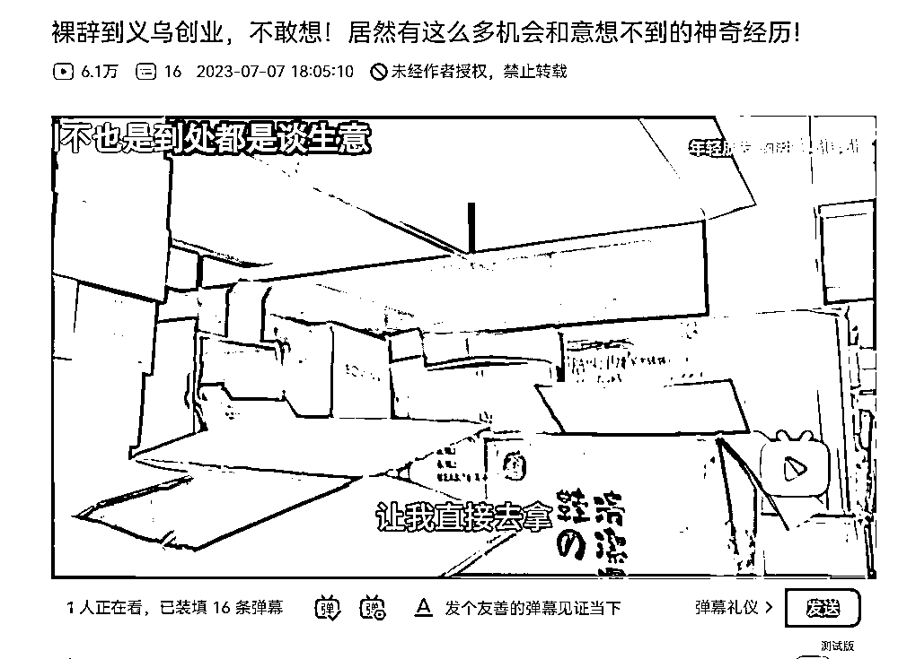

再聊聊我们在义乌做文具电商的经历和坑。那段时间基本都在到处补信息差。2023年7月，朋友提议一起做文具盘子，他出钱出场地，我们出力，当作学习还能分红。最终亏本了，但收获很大，是电商的起点，很难得的开端。当时临近开学，朋友又是文具工厂的，正好很流行仓播，就是在仓库直播，核心是让观众感受到货多价优。我们最初的设想是，买文具的多是宝妈，后期可转做百货客群。后来很多直播间都模仿仓播，但周围其实是空箱子。

结论是：想起那段直播经历都是泪，太累了。由衷佩服那些能在镜头前高声演绎的主播。慢性咽炎就是那时留下的后遗症。现在基本不可能再当主播，偶尔看数据聊天还可以，喊不动了。

人员配置方面，加上我和豪哥共五人。我负责学话术，豪哥负责上架运营和中控。其他角色包括：总投资人负责组局；操盘手负责选品、上新、切换品并培训我；运营负责教学和复盘。创业前要想清楚人手、资金和各自能力。电商期是五人，后来变成两人。

主播学习资料请依次打开：https://vow6kdbiak.feishu.cn/drive/folder/KOKbfXw2Yl3jO5dLhoScRNMXnfg?from=from_copylink

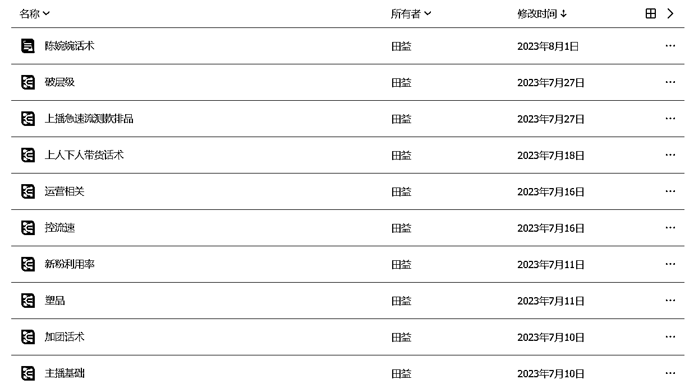

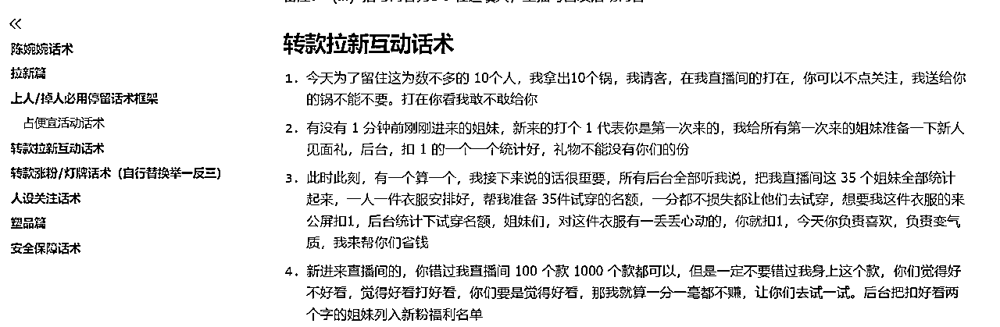

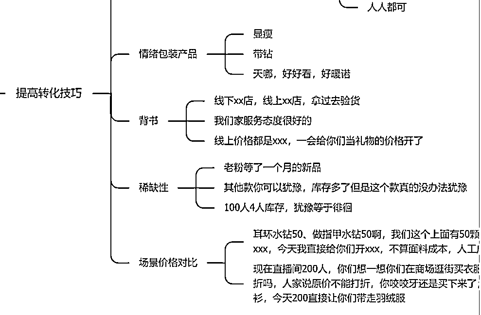

关于主播培训难度，给个参考价格：我学的那套线下课程三天一万多，且要求已有经验，属于进阶班。市场常说“只筛选不教育”。从零到一培养主播，很多公司都不愿意做，难度大且成才率低。所以想做主播通常要从助播做起，主播并非易事。就像人人会写字，但书法需要千锤百炼；人人会说话，但用途不同。门槛看似低的反而更高，主播就是典型。主播状态直接决定当日ROI和销售额，运营和主播都感受得到，老板只看GMV。ROI即投产比，例如投入10回20，约1:2保本。GMV是成交总额，未扣除成本。还有个信息差：很多主播觉得月提成两万很牛，想单干，却不知道老板投流花了多少钱。

当时我怎么被训练话术的？我属于朋友中比较外向、表达有感染力的类型，自己拍视频讲课也算能说。但直播节奏、话术、表达方式都是空白。先看了基础课，朋友写好话术框架梳理逻辑后让我练习。最难的是对着手机自拍模式说话，旁边实时纠正表达、动作、语音重音。那几天尴尬到极点，我这种外向的人被盯着也放不开。原因有三：一怕拖慢项目进度；二看朋友纠正时又无奈又累；三真的太难，每个字词都要调整。尽管机会难得，那段日子很难熬。后来朋友确认可行后，又请其他人继续把关，直到能上播。结果还算不错，后期转品、话术、塑品都勉强可用。

文具期拍摄的视频我做了排序，里面能看到一些学习电商的心得。核心内容放在前面，视频本身是当下状态，看与不看都可以。

### 参观供应链

那段在义乌的日子，日常任务很固定：天天蹲供应链，说白了就是后来大家口中的探厂。

但这次段位高了不少，因为是熟人带着走，后台数据和直播间都能直接看。

那也是我第一次亲眼目睹百万GMV在一个直播间里当场滚动，大脑受到的震撼不小。

也是那次才意识到，他们单场投流的成本就是几十万，再加上仓库、人工，账面上看着热闹，实际利润远没想象中那么肥。

GMV是GMV，它不是落袋的钱。

如果你打算去义乌或者别的地方闯一闯，有机会的话，一定要先研究当地人在卖什么、怎么卖。

义乌虽然行政级别只是县级市，但豪车密度在全国县级市里数一数二。

楼下停宾利的那位老板，在电商领域卖进口锅碗，整层仓库都是他的货，光那一层就值两个亿。

老板穿着极其随意，一件普通短袖，聊起货品来也很实在。

他说：“老板也是人，不会吃人，就算脸色不好又怎样？大不了不跟他合作。”

义乌老板普遍格局不小，尤其白手起家做到大生意的，态度相当好。他们欢迎直播团队来谈合作，通常模式是：我们出人和账号，他们供货，然后按利润分成。

这也算一条低门槛创业路子，但前提是你得有真本事，账号已经有流量和销量才行。

他们没时间陪零基础的小白慢慢成长，还是那句话【只筛选】

https://www.bilibili.com/video/BV1iV4y1q7DC/?vd_source=cd57d3a123a254526b23c45b10a3970f

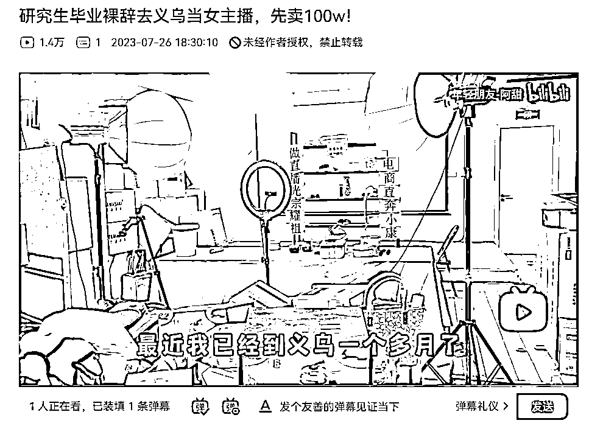

### 电商实操初体验

之前练的那些主播话术，这回终于轮到真人上阵了。

现场除了我们四个合伙人，连仓库和工厂的管理人员也在看。

说实话，我那会儿脸皮算厚的，也照样紧张得不行。

好在他们都是常年直播的老手，看到问题会直接指出，告诉我怎么调整表达。

能碰到同频的创业搭子，真的是运气，比一个人蒙头摸索省太多力气了。

仓库面积太大，根本没有装空调，整个空间热得像蒸笼。

义乌那段时间气温直逼40度，我们在里头打包、直播、复盘、上架，一天下来衣服湿透好几回。

体力上的消耗倒不算什么，问题在于身边的人都说我适合做主播，说我爱说话、会聊天。

可主播和聊天真的不是一回事，主播的工作核心是每五分钟重复一遍同样的说辞。

我最后没选择做主播，主要原因是我这种做内容的人需要新鲜感，同一套话术反反复复、产品也就那么几个、复盘方式也一成不变，对我来说完全是种消耗。

别拿“为了赚钱啥都能干”来说服自己，还是得找【擅长】和【喜欢】的交集，不然坚持不了多久。

流量就像过山车：

我们经历过一小时一个人都不进，也经历过一分钟涌入3000人。

每天心情跟着数据上上下下，对我们这些刚起步的创业者来说，真是考验心态。

我们一天的节奏：

第一次体会到了电商人的“生物钟”。

晚上8点左右开播，播到12点收摊。

下播之后先复盘，再回家，洗完澡躺下，差不多就是凌晨两点了。

早上8点闹钟响起，要先回抖店的客服消息，因为超过30秒没回就要扣分，处理完再交还给朋友那边的同事帮忙盯。

中午吃过饭，收拾收拾就去仓库打包。

下午5点左右打包收尾，具体看单量，万一单子多就得提早过去，快递5点来收货，错过了只能等明天，超时未发出还得吃物流分的亏。

傍晚正常吃口饭，然后和朋友碰头，一块儿奔仓库准备晚上的直播。

https://www.bilibili.com/video/BV1mN411b7bk/?vd_source=cd57d3a123a254526b23c45b10a3970f

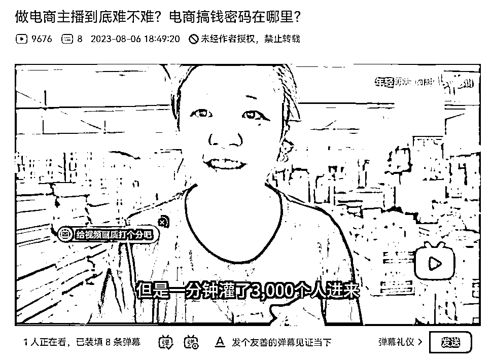

### 仓库打包日常

聊到卖的东西，还真是五花八门。

水笔、彩铅、铅笔、钢笔、电子笔、颜值高的胶带、快递小刀、本子、书包……只要是文具相关的，统统都有。

后来也拓展了些日用百货的品类。

顺嘴提一句，日用百货在这里有个简称叫“日百”，算是义乌的大品类之一。

我们那时的模式是直接拿货代发，出资方是我的朋友，我们只出力不出钱。

虽说不用掏成本，但心里压力一点不少，毕竟朋友花钱带我们，总希望人家能赚到钱。

每回去进货、结快递费的时候，心里都在打鼓，因为当时的状态就是“发一单赔一单”。

我们采用的是“亏品起号”的打法。

https://www.bilibili.com/video/BV1814y1B7KH/?vd_source=cd57d3a123a254526b23c45b10a3970f

### 单量不小，利润全负

前面说到“亏品起号”，那到底是什么意思？

我们主攻的平台是【抖音】，但当时自然流量红利早就没了，流量全靠花钱买。带我们的那位朋友，每天硬砸一大笔钱投流。

抖音的推荐机制是自动给你推下一条，只要钱花得到位，下一条大概率还是你的广告。

它的标签体系非常细致，想看什么人群都能框选：性别、年龄段、手机档次、所在城市、购买力水平，都能精准定向。

于是我们按【亏品起号】来操作：

先用超低价把用户吸引来下单，前面狠狠亏，后期再靠涨价找补回来。

这条路最终没走通，具体原因后面细说。

如果你正考虑模仿这套打法，手里没充足的投流预算，那千万别碰。

我们“亏品”期间的价格有多离谱？

在外面正常一支水笔的价钱，我们卖一元十支，是真的能写字的那种笔，不是笔芯。算上邮费怎么都是亏的。

还有24色丙烯彩色笔，个位数就出，质量还说得过去。但包装特别麻烦，要加泡沫、上纸箱，磕坏了就得赔钱。

24寸的行李箱，只卖50元，甚至不直接卖，拿来当福袋抽奖，评论区互动就送。

（现在回头看真是疯了，那些冲着免费来的人，关注完转头就会取关。）

不是没考虑过把客单价拉高来止损，问题是只要一提价，人不来了，东西也卖不动。

而且系统算法会根据已购用户打标签，来了一堆专挑便宜货的人，系统就会不断给你推同类型的人。这些用户面对高客单价根本不会掏钱。

羊毛党的疯狂程度超乎想象，有个买家用了三个月之后，居然还跑来申请退款！！！而且商品压根不是我们的。

事情是这样的：文具生意结束好几个月了，我突然收到一条抖店客服消息，发了张几张紫色破损笔的图，要我退款。

几块钱的东西，我们一般不会扯皮，就当送了。

但那个款式的笔全是我亲自打包的，也只有蓝色和黄色，我还拍过视频为证，压根没有紫色的。

我直接回复说这不是我们家的货，别来碰瓷。然后对方就没再理我了。

关于抖音羊毛党

抖音上这群人还有个名字叫“彩虹党”，因为昵称里常带彩虹表情。

他们有组织有纪律，集中在群里，甚至有人把这当副业在搞。

只要看到哪家店在亏本起号，或者哪家是新店，就立刻把链接甩到群里招呼姐妹来薅。

所以很多店铺宁可不定一两块的低价，不是亏不起，而是怕招来这一帮人。

顺便提一些兼职副业的灰产路子：

有的所谓培训课，主打找商家漏洞。要么钻广告法空子，要么找拼多多或淘宝的平台漏洞。

比如平台规定不可以虚假上架，有的商家交了大额保证金，这些人就盯着找违规的账号，发现一个就一拥而上，因为只要商家违规，平台会把保证金退给买家。

还有的做假货生意，卖一千多的商品，直接投诉索赔三倍。

### 为啥卖一单亏一单

https://www.bilibili.com/video/BV1mV411g7Bv/?vd_source=cd57d3a123a254526b23c45b10a3970f

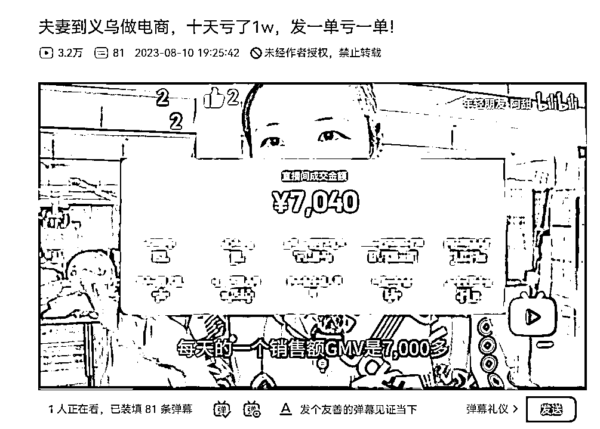

### 文具电商踩坑记录

1. 用蚂蚁搬家这类工具搬运上架的商品，务必检查物流模版，偏远地区别设包邮，去商品管理里看运费模板。我们当时没弄好新疆、西藏也包邮，一单又多亏好几块。

1. 同一客户拍下多个订单时，要合并打包成一个快递面单，不然一个买家分几个包裹发出去，白白多付几份快递费。我们的货种类很杂，大的小的全混在一起，一天一百多单，我跟搭档一刻不停地装，也得耗三个小时。那些非标品——本子、尺子、橡皮——款式还各不相同，想请专职打包工都不知道从何下手。

1. 临时链接编号容易忘，1-1和1-3对应什么货，一定要写在本子上记牢，不然报价都报不准。有几次走批发节奏，要快速走货、简单讲品，就挂【临时链接】用数字1、2、3、4替代。万一客户拍的哪一档忘了，还得去翻直播回放，实属麻烦。最好的办法就是上链接前先背熟。

1. 开播前备的那些福利品，价格必须先背下来。因为开播后要人工逐个调价，不能让人跑去店铺直接下单薅走。福利品也叫钩子品，本身不赚钱，存在的意义是冲成交数据，让系统认定这个直播间能卖货、从而给更多流量。下播后第一件事就是改回原价或者直接下架，不然店铺里会被低价单淹没。

1. 商品规格属性别只设置颜色却不给买家选择，不然打包时根本没法对应配货。我们有彩色尺子、彩色小刀、彩色橡皮，SKU相当多，但仓库打包区并没有按颜色分类。一旦前端把颜色拆开，打包环节就要多做很多工序。

1. 快递面单打出来之后，24小时内必须做揽收，否则扣店铺分。义乌这边快递一般下午5点前上门，偶尔后台漏了【揽收】操作，就得赶紧让快递员先做揽收，货晚点发都行，义乌货量实在太大。

1. 抖音客服考核时段是8点到11点，这期间的消息要秒回。超过30秒机器人介入就要扣分，物流分也算进考核。所以我们哪怕下播到凌晨一两点，第二天还是要定个8点前的闹钟先回一波消息再补觉。

1. 每天下播后先打单子、配好货，顺便盘点还缺什么。我们那位操盘手也是配货负责人，他会在下午4点左右把货提回来，提前配好的单子先放一边。我们的模式是卖多少拿多少，不怎么压货。

1. 打单时要设商品简称，不然备注内容太长显示不全，打包的人看不清到底要装几件。

1. 开播前一定要挂车，否则就是违规！！！我们真吃过一次违规的亏！

1. 不能碰极限词，“最”“绝对”这类词一律不许说，不然也违规。

1. 上链接的时候，如果主播口播的价格比成本还低，必须马上通知主播确认，看是改价再上，还是先不弹讲解。我们每天上新品、设新SKU，很多价格都是随口定的，我有时报低了，操盘手一看不对就会来提示。

1. 上车之后要让讲解弹得勤一点，哪怕在讲其他品，也可以偶尔把福利品的链接弹出来，用来拉用户停留和数据。

1. 直播收尾前盯一眼后台流量黄线是否翘头，翘头之后再下播，对下场的推流有帮助。翘头就是趋势往上走。前期起号阶段，通常会把人数养起来就立刻下播，第二天开场极速流量会好不少。所谓急速流，就是开播前5分钟会进一大波泛流量，再从里面筛出愿意留下来的精准人。

1. 用短视频刷粉有可能把号刷废。后来发现搜索流量占比高，但推荐流量完全推不动。

1. 如果连续几次下播，推荐流占比都能到90%以上，那说明账号有望起量。

1. 单价2.9元的笔，试过赠送10支，依然没人要，最后干脆改标1元做测试，等直播中途再调价。

1. 没设置每件限购，结果被人一口气薅走10单，里面有7单是笔、3单是尺子。

1. 要装的货规格繁杂，快递袋就要备很多尺寸，有些还得用透明胶缠紧，个别易碎的必须要纸箱。

1. 不同快递公司合作政策不一样，要是换发货地，比如原来用中通的要换成极兔，就得在后台重新设置。老板们都很现实，你收我1.3我就用你，你涨价我立马换你的竞争对手。生意场上只有利益，没什么人情。

1. 大批量发快递要先预充值，类似会员储值卡，一般一次性冲500单的钱。有超重的件，月底另算账单。

1. 店管家后台可以把主店铺和子店铺授权关联，这样已经购买的快递单号两边都能用。

* * *

# 文具项目结束后的摸索期

9月开学季过完，文具这波算是翻篇了，我们又开始找新的品。

经历了一番临场直播、短视频、朋友圈的洗礼，现在面对镜头完全不怵了，没人看也不慌。

反正互联网忘性大，以前那些直播翻车也好，“硕士做直播”的标签也罢，根本没人记得。

结束一个项目就得找下一块市场。朋友自己有稳定的基本盘，所以他并不焦虑。

我们手里也有些零散小业务，但待在义乌总觉得离不开对货的嗅觉。朋友就陆续介绍了些周边的项目给我们去考察。

觉得合适就一起做，收入按谈好的比例分。

那阵子接触了不少看着挺冷门、实际上非常赚钱的行当和商品。

## 看乌龟苗

义乌这个圈子其实很小，大家之间早就形成了默契——朋友之间不碰彼此的赛道，各自在不同的战线上。

有朋友的朋友在做乌龟苗生意，就引荐我们过去看。

一听“乌龟苗”三个字，当时就愣了，还真就是活的那种乌龟。

到了直播现场，大概因为没接触过活体生意，打心底不太适应。那边就是个商铺兼仓库，阵阵味道直冲过来。

看了一圈发现乌龟苗的品种多得很，便宜的五块一只，贵的几十块，但全是幼龟。

这种生意有意思的地方在于前期不赚什么钱，那后端的钱从哪来？

靠私域运营。

真正喜欢乌龟的人会把它们当宠物养，水槽、水草、氧气设备、造景布置，越买越多，高端一点的甚至有几千上万的精品货。

他们的利润都在后面这些周边消费上。乌龟养大了、年份久了，身价也翻倍涨。

而且养高价龟的老板，经济条件一般都不差。

但乌龟苗在运输途中太容易出问题——缺氧、环境差、温度不适宜，说没就没，看着挺心疼的。

所以活体这块，我们放弃了。

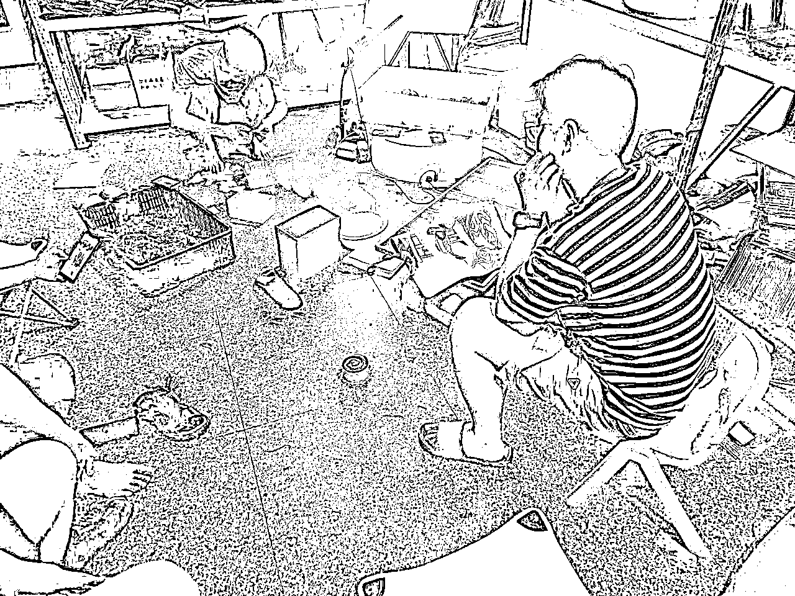

## 看看库存毛衣

再说说库存货：

之前做文具的时候，朋友就是去库存街拿的货。表面看着挺好，用起来才知道问题一茬接一茬。

售后率高、毛病多。之前卖品牌空气炸锅，一个才50块钱，原价可是299。

真是一分价一分货，而且库存货之所以出现在库存街，本身就有它的道理。

后来跟一些品牌厂家聊过才知道，真正的尾货好货早就内部消化给熟人了，根本不会放到库存街来流通。

所以我们在库存街淘到的，最终也只能卖给收库存的。库存再来回收转手，通常就流向更偏的乡镇或者小县城。

顺带说一句，如果是亲自出镜卖的东西，质量一定不能含糊。客户冲的是对你的信任才下单。

选品的重点永远是品质和售后服务，价格反而是最不需要纠结的部分。

下面说的是库存毛衣，几块钱一件的进价，质量却相当能打，主要流向了乡村县城的集市。

散户和商贩拿去可以卖到一百块三件。门口每天都有卡车在装货。

当时那家库存毛衣仓库门口，每天都是好几拨拍短视频的人，刷抖音随便就能刷到。

他们的套路都差不多：这件5块、那件3块，核心就是让大家直观感受到便宜。

义乌真的是个很奇妙的地方，外面的人都说义乌是自己的仓库，但真正的大老板反而不出现在镜头里。我们这些去拍货的，本质上都是在给老板义务带货。

老板们只顾接电话、发物流，看到来拍视频的二道贩子——也就是他们口中的【倒爷】——反而特别欢迎，毕竟等于免费打广告。

https://www.bilibili.com/video/BV13u4y1r7PH/?vd_source=cd57d3a123a254526b23c45b10a3970f

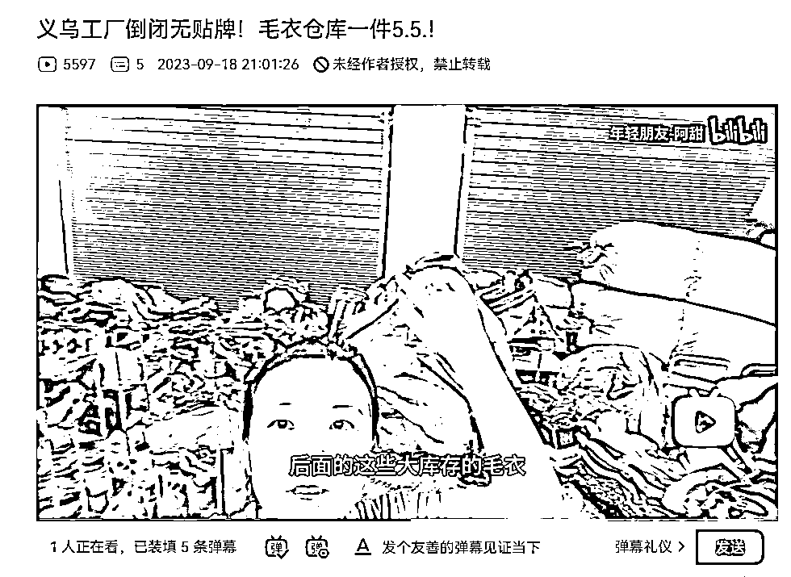

## 对接伴手礼供应链

那阵子正好盘算着回家办婚礼，天天在看衣服、试衣服，顺手想着伴手礼也可以直接在这边拿货。

跑了好几个规模挺大的供应链。供应链的特点就是什么品类都有。

一般的工厂只会做单一类型的产品，除非是那种超级大厂。

比如做“全红婵乌龟”的工厂，它就只产树脂类的摆件，不太可能去做毛绒玩具。

因为这俩是完全不同的产业，从生产线到工具都不是一回事。

这也就是供应链和工厂之间的本质区别。

伴手礼供应链的品类非常丰富，因为礼盒里装的东西本来就各种各类：糖果、香皂、香水、化妆品、毛巾、蜂蜜……只有你想不到，没有那里找不到的。

但换个角度想也不难理解，他们干的主要是【组装礼盒】的活儿，所以单价自然压不到多低。

在伴手礼供应链那边摸到的信息差：

1、伴手礼供应链本质就是做资源整合，那儿有两千多个SKU，既能单个卖，也能组合成礼盒出。

2、他们不搞单件散货，想做的话通常得先缴大几千的会员费，之后才能拿到更低的供货价。

3、缴了会员费之后还能做“分销模式”，把货转卖给其他有需求的人，因为伴手礼本来就是大批量走的。

4、供应链内部也开放直播和短视频拍摄，他们还挺欢迎有人来对接。

5、那边的销冠，公司直接奖励了一辆奔驰，他们的销售主要靠小红书引流，收到钱就完事。

6、后来仔细想了想，这其实不算一门好生意，压货太重了，不过这些老板不缺钱，人家无所谓。

https://www.bilibili.com/video/BV1z84y117Be/?vd_source=cd57d3a123a254526b23c45b10a3970f

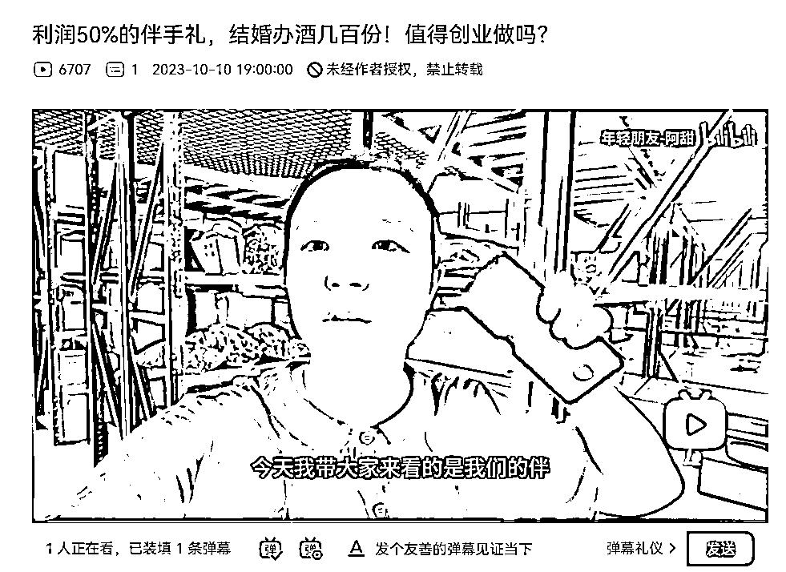

## 接了个直播运营的活

那段时间我的状态就是个自由职业者，主业围绕小红书和直播运营展开。

刚好有前同事找来，说要给一位教授搭建直播间，顺便做中控运营，这也算是我兼职探索的一部分。

这个副业有它的优势和它的天花板：

优势在于能接触到很多平时根本遇不到的大佬。听他们聊行业、谈事情，观察他们的言行举止，本身就是一种学习。

而且他们出手大方，给我们订五星级酒店，跟着拍视频、体验好东西。

但这活没法长久干。如果教授后面直播频率上来了，他们大可以请一个专门的运营团队，我们自然而然就被替代了。

https://www.bilibili.com/video/BV1Fu4y1C797/?share_source=copy_web&vd_source=17ec0460f8a49d17a4544a91f7b5ba99

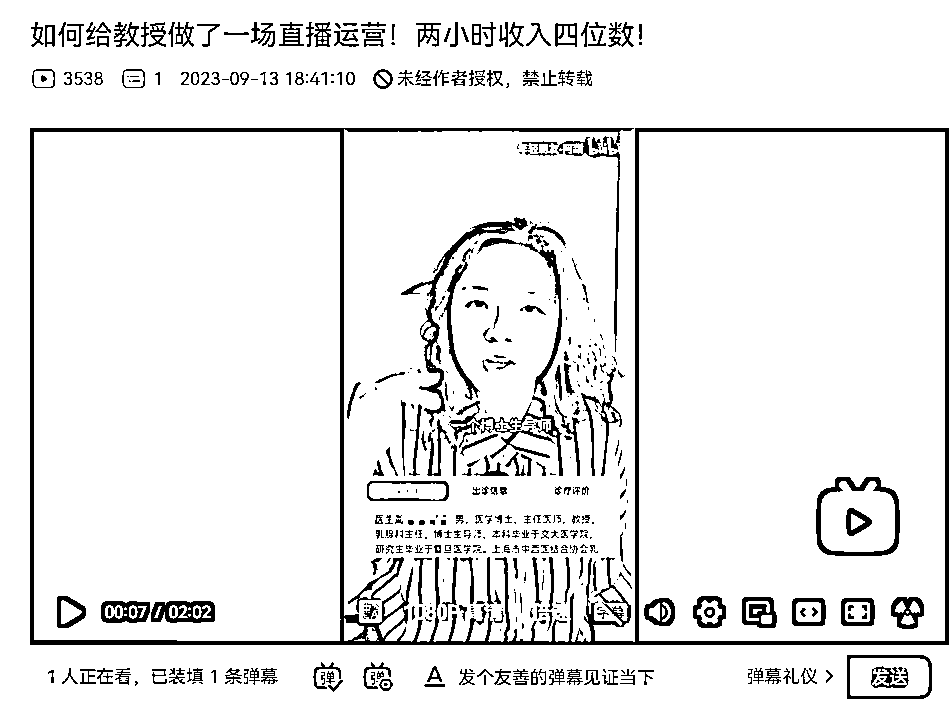

## 对接珠子厂家

这个品是在我家楼下发现的。那家店的珠子特别好看，后来我就成了常客。

解释一下：“品”就是“选品”的那个“品”，它可以是任何东西。在义乌说“看看品”，意思就是看看你的货。

我自己本来就爱串珠子，就想说帮老板在小红书上打个广告。

于是开始在小红书同步做【珠子】相关的图文，拉了二十多个朋友一起跑我整理的那套sop，结果效果超乎预期。

后来我把这套sop发到了“生财有术”社群，拿了一枚龙珠精华帖，价值一万多。

我的星球里也放了内容，但那是另一套框架，跟这篇关联不大，就不多赘述了。

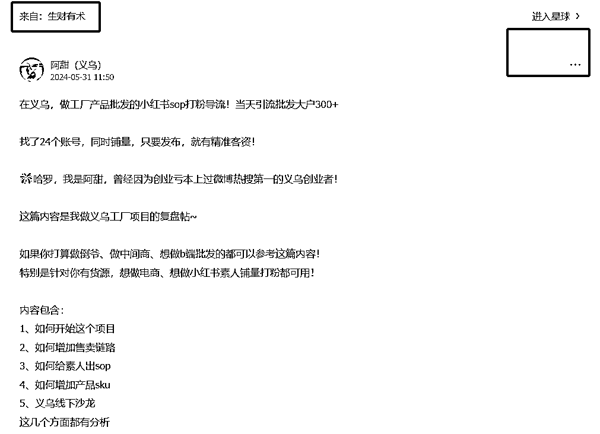

当时除了对接B端的客户，我也试着做了些C端的尝试，具体几个路子：

1、老板给报价，我们倒手赚差价。

2、有大客户一拿就是上万块，我们把需求对接给老板，再等老板给返点，被动得很。

3、C端的用户一次拿不了几千块，我们就想到把珠子按颜色分好，做成DIY串珠的形式，让她们可以直接买单品。

4、我把串珠的作品带到【迪士尼】拍了不少出圈的照片，让大家回来照着拍就能自己引流。

后来：

现在基本不碰这个业务了。很多时候根本掌握不了用户有没有下单，复购也跟我们没半点关系。说到底是因为货不在自己手里，什么优势都没有——数量、颜色、邮费全是糊的，自己就像个传声筒。

那这个问题有没有解法？

其实是有的。这家店规模不大，没有自己的聚水潭面单和代发体系，所以只能靠之前攒下的客户群来对接。

很多人可能不知道，如今做电商起步的门槛真的低了不少。你去问十家供货商，基本都能给你一件代发，后台的库存、颜色、尺寸、销量数据全都一清二楚，连快递面单都帮你打好，你只管专心搞流量、搞转化就够了。

https://www.bilibili.com/video/BV17h4y1B7tc/?vd_source=cd57d3a123a254526b23c45b10a3970f

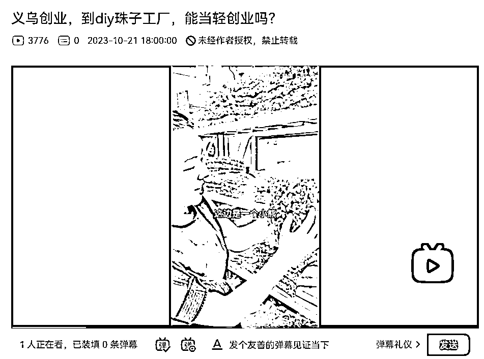

* * *

# 年货电商从零起步：那些踩过的坑，和意外撞上的纪录片机会

十月一到，年货季就算悄悄拉开帷幕了。刚好身边有朋友在做这一行，我们就从他那儿进货。他主营的是桃木挂件，单价不算低。我们匀了一批样品回来布置直播间，那阵仗豪哥和我算是真正意义上的“自己起盘”——没有外援，全靠自己跑完全程。

回想当初做文具那会儿，团队满打满算五个人，有人负责投资、有人管渠道、有人做运营指导、连仓库和快递都安排得明明白白。而这次，一切要自己来。

如果你也想走同一条路，那以下这些环节一个都躲不掉：

1. 选品——卖什么、有没有竞争力、货源方不方便拿或代发；
2. 直播间——货品决定你需要多大的场地、什么样的氛围；
3. 电商基本功——上下架、改价、做详情页、研究运营逻辑；
4. 直播逻辑——什么是浅层数据、什么是成交数据，什么节点上什么品；
5. 主播话术——拉流量、憋单、逼单、放单、卡库存，一样不能少；
6. 快递谈判——不是越便宜越好，要综合时效和取货便利度；
7. 打包物料——胶带、泡沫、包装袋、打印机，零零碎碎都要备齐。

后来我把我们当时整合的一些学习资料也放出来了，有需要的朋友可以直接拿。

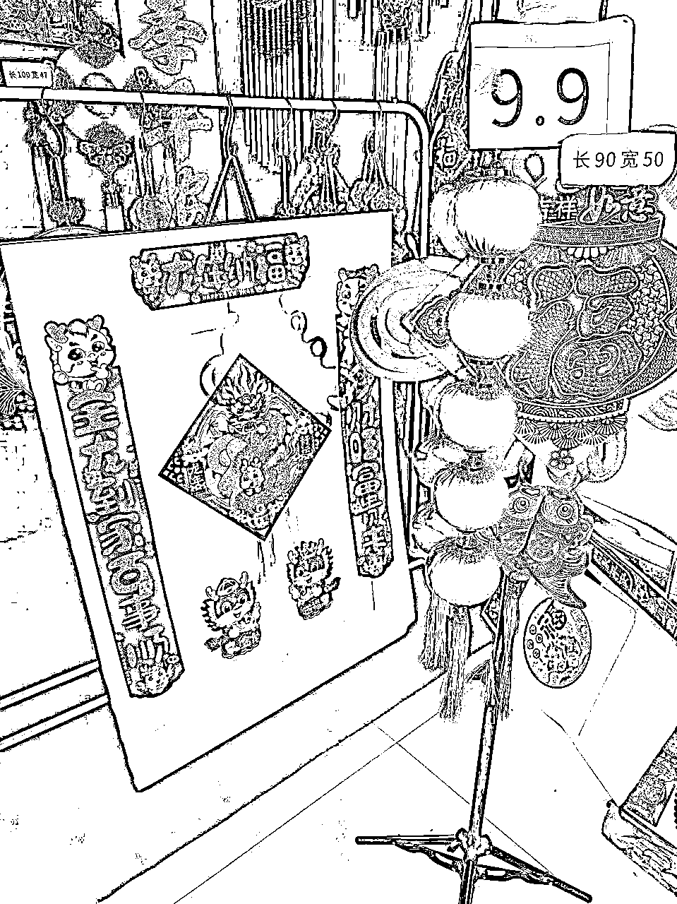

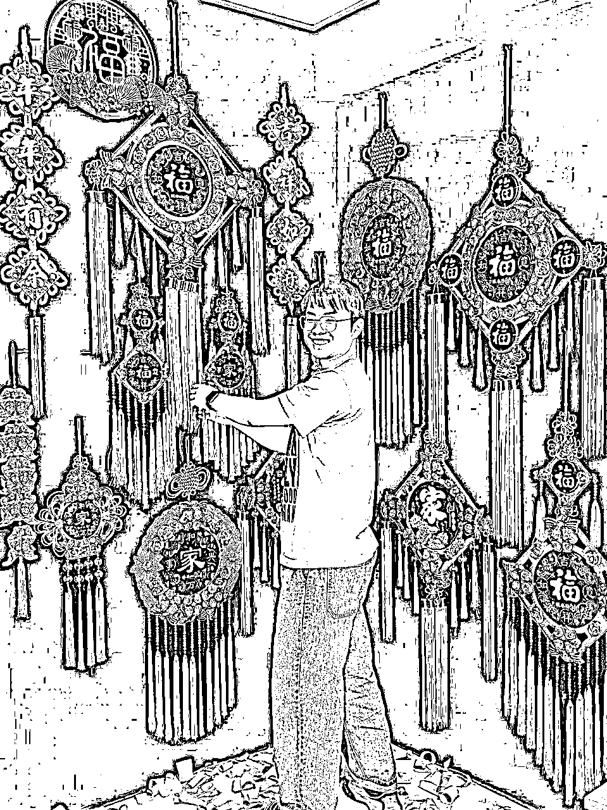

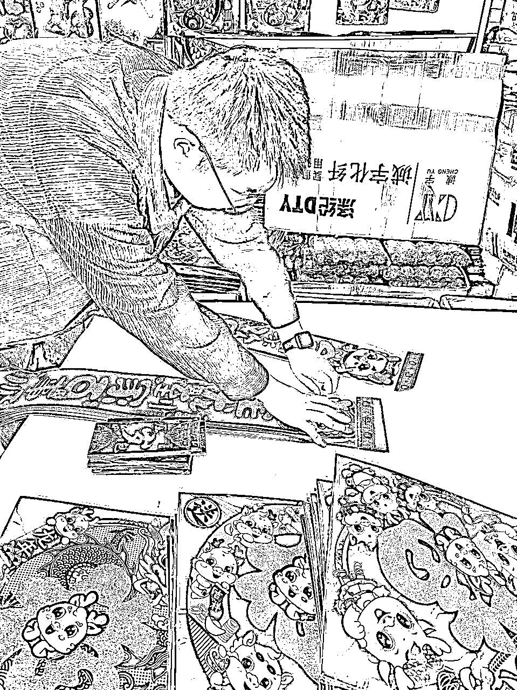

## 跑了一趟义乌商贸城，差点被年货区淹没

老远看见商贸城年货区的那一刻，整个人是真的激动到不行，品类多到根本看不过来。

如果你十月到十二月期间人在义乌，非常推荐去银海小区转转，特别是想摸一摸市场风向的，那里基本都是答案。（后面游学地图里也会提到）

我们之前做直播对标的时候，已经眼熟了市场上几款爆品。结果到线下问价，好家伙，价格比直播间卖得还贵出不少，翻倍的都有。

但我们还是挑了一批：一部分是爆款跟卖，一部分是没人做但我们觉得有潜力的款，还有些是老板手里压着的去年存货，折价处理的。

拿货这个动作，是真的会让人上头。因为那时候在老板眼里，你已经不是闲逛的路人，而是会问批发价、谈数量、确认现货的小老板了——对方给你开单、帮你送货、约到货时间，那种感觉和偷偷拿手机拍照完全两个世界。

有些货是现货，当时就能拖走；有些要等工厂发，其实很多档口也是中间商，直接喊货拉拉从厂里拉过来。

在档口还遇见了许多外地来的老板，背包里全是账单和样品清单，下单后就在谈物流是到付还是现结。

说实话，生意场上的信任，有时候真的就是靠这种“先全款、后收货”的旧规矩撑着。当然也有骗子混在里面。货不对版怎么办？有瑕疵找谁？全靠缘分。

但要让我现在给一句实在话：千万别脑子一热就自己囤货。哪怕挂别人产品都能出单，你一旦压了货，卖不掉就是砸手里，除非你本来就在做线下实体。

义乌这边的优势也在于此。不止一家档口跟我们说：“1688挂什么价我们都清楚，但你在义乌本地，直接过来拿，价格肯定更香。”这也是这座城市让我好感倍增的理由。

拍那系列视频的时候，是从拿货、布置直播间一直到生意有了起色，全程记录。结果没过多久，我们就在一月把年货电商项目彻底停掉了。

https://www.bilibili.com/video/BV1Sc411U7FM/?vd_source=cd57d3a123a254526b23c45b10a3970f

## 布置直播间、写话术：每天忙到嗓子报废

那年货期间的节奏，我按从0到1的顺序说，因为比文具那次要忙太多了。

素材拍了一堆，根本剪不动。直播时长拉得比以前长很多，嗓子也经常干到发不出声。口播视频那段时间也很少更新，因为全链路都是第一次亲自跑：拿货、拍图、谈快递、买包装、打包、发货、客服、售后、搭直播间、上下架商品，每个环节都像在补课。

我们捡了个低成本的法子，在住房楼下租了个十几平的小房间。先在瓷砖墙上仔细规划好年货摆放的位置，再做标记，铺上黑色吸光布当背景，后面大家看到的展示图就是这么来的。那块黑绒布还藏着个信息差——朋友直播间一直在用，说是效果很好。但用过才知道，它好用是真的，粘墙也是真的，退租那天我们是一小块一小块抠下来的。

在这提醒一句：租房搞这种胶贴背景墙，一定要想清楚退租时的残留问题，不然押金可能就没了。

https://www.bilibili.com/video/BV1PN4y1a7jv/?vd_source=cd57d3a123a254526b23c45b10a3970f

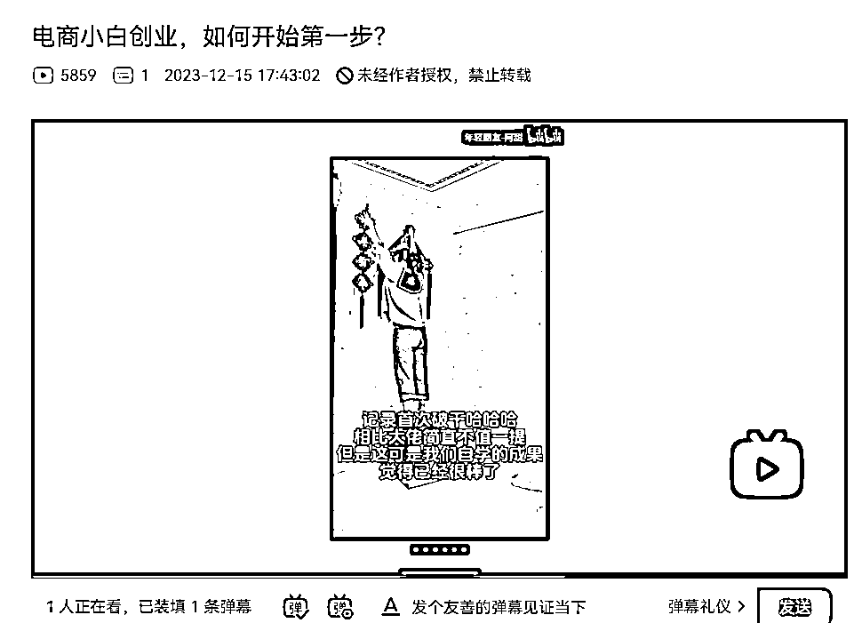

## 直播间搭建实战：从灯到支架都有讲究

直播间怎么搭，核心就两个词：产品、预算。

常见的有四种类型：

- **仓库直播间**：场地大，核心是“豪”，让人觉得你家底厚、货够多；
- **大直播间**：真人要站进画面，适合卖衣服、鞋子、箱包类；
- **中小直播间**：人坐着不动，靠聊天带节奏，吃播、知识、职场类都可以，重点是脸和表达；
- **手播直播间**：只要露手，适合首饰、盲盒这种精致小件，空间不用大，但氛围感必须拉满。

朋友直播间那套灯具下来要六千多，而我们的预算只有五十块。贵的灯确实不一样——脸不假白、不过曝，出来的画面干净。我们款主要是纯照明，就没奢侈一把了。

手机支架也没啥讲究，但一定要结实，因为你得挂着充电宝、手机，天热了还得上散热器。真上了直播才知道，这种多头支架太实用了，能同时架好几台手机，搞多平台直播或小号盯评论都不耽误。还有那种一拖三的插头设计：充电线、收音麦克风、散热器，全插一个手机上。

想深入研究的可以直接搜“直播间搭建”，会出来一堆针对不同品类与场景的方案。

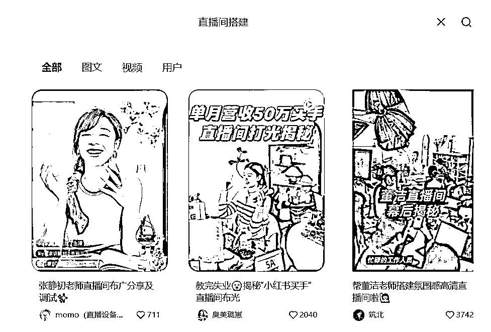

https://www.bilibili.com/video/BV1Wc41117rk/?vd_source=cd57d3a123a254526b23c45b10a3970f

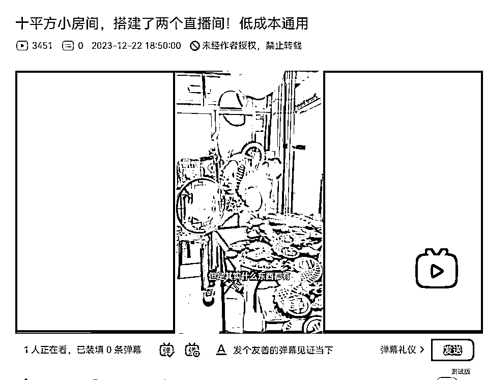

2023年那会儿做自媒体，还不像今天这么包容。评论里总有人说我在浪费时间，质疑声挺多的。我也想起刚来义乌那会儿，有人说我去摆摊不够“正能量”。

好在如今风向完全变了：硕士毕业摆摊、大厂裸辞做小生意、赚人生第一块钱……这些标题都被大家乐于接受。似乎越来越多的人变得勇敢了。没钱不去行动，还等着天上掉吗？大家越来越务实，这是个好信号。

## 打包对联：看似简单，累到手软

https://www.bilibili.com/video/BV1Qc411d7RA/?vd_source=cd57d3a123a254526b23c45b10a3970f

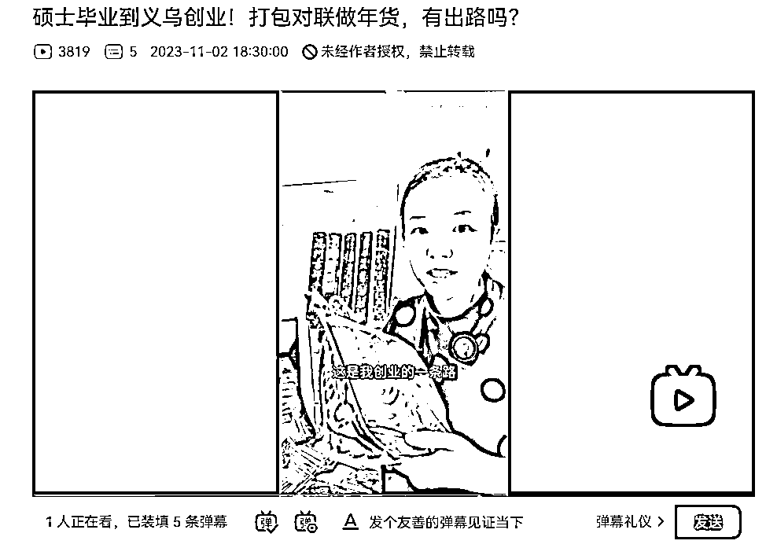

## 给年货店做宣传：十月卖年货，谁信？

十月份开始卖年货，不干这行的人根本理解不了，开口就是“这也太早了吧”。但他们不知道，九月份同行们就已经开播了，而且每天都还有新直播间冒出来。

我们白天研究别人的直播间布置、学话术、拆解产品结构，再回来调整自己的打法。做直播运营这活儿，真不是谁都能顶得住的。

因为货品客单价不一样，给不同人群推不同品，转款的时候也得想下一个品怎么接。可能因为我们是多品类的夫妻店直播间，节奏特别明显，反而让很多成熟同行看不出门道来。

后来我们慢慢摸出了规律：什么品能拉人，什么价格能促单，都在这段运营过程中一点一点被验证和细化了。当时产品线分两档：9.9到19.9的引流款，和更高客单价的，最贵到69，桃木件和带灯的款式比较贵。对联那个108件套，9.9还包邮，说实话我都替他亏——毕竟一年才贴一次的东西，便宜到这种程度确实让人没抵抗力。

做着做着又发现一个新市场：专门贴县城、农村大门的对联，客单价二十几，反而卖得格外好。桃木挂件也很多人买单，运气好的时候还能撞上一两个大户，拿啥卖啥。

正当我们觉得已经找到“流量密码”的时候，第二天流量的数据和GMV直接来了个对半斩。

https://www.bilibili.com/video/BV1tN4y1k76q/?vd_source=cd57d3a123a254526b23c45b10a3970f

## 突然被媒体围住：纪录片找上门了

做年货期间，媒体采访一波接一波。第一次收到邀约，整个人兴奋得不行，聊了一个多小时。像《一条》《财经》这种级别的也来过。可后来采访越来越多，我嗓子又难受，整个人疲惫到不行，就婉拒了当时几乎所有的采访。

那后来怎么又会跟薛兆丰教授那边合作呢？说起来也很巧——他们的导演联系我们的时候，没有在电话里聊太多，确认了一下情况之后，人直接开车到了我楼下。

我当时想着可能是随口一说，也没当真。结果电话再响，人已经到楼下了。就觉得这一趟，值得去见。更何况是薛兆丰教授，经济学家哎，站在更高的维度来看我们的现象，说不定能给出一些完全不一样灵感。

再忙也得去。至少想看看高段位的人怎么看、怎么想、怎么说。和薛老师的视频我放在后面了。现在回头看，还真的要感谢那个阶段的自己，成长是真的可以肉眼看见的。

https://www.bilibili.com/video/BV14N411u7rh/?vd_source=cd57d3a123a254526b23c45b10a3970f

## 顺手试了试拼多多

现在电商主流就是两条路子：

- **货架电商**：像超市货架，你想买就买，不太讲究平台大小，典型代表是拼多多、淘宝、京东；
- **兴趣电商**：本来没打算买，但看到喜欢的博主在推，突然就心动了，小红书、抖音就是典型。

我们当时抖音和视频号都做，重点压在了视频号。想着拼多多这种货架平台也开个店试试，于是很快就把店开起来、也出了一些单。结论是：没赚到钱，坑倒是踩了不少。具体如下：

https://www.bilibili.com/video/BV19C4y1C7z7/?vd_source=cd57d3a123a254526b23c45b10a3970f

## 拼多多关店全记录：退款的冲击力

开店之后就很快出单了，当时还觉得，拼多多是真不需要什么运营技巧啊，大家都这么说：平台让你报活动你就报呗，反正他们会把利润算到骨头里，生怕你多赚一分。

我们当时的利润结构是：一个商品客单价10块、净利1块。什么概念？只要来一个仅退款，等于前面十单白干。然后，我们就真遇到了能把人逼疯的“神奇客户”。

说几个印象特别深刻的：

1. 客户说对联有个角折了，要求仅退款。我们说买了运费险可以退货，说什么都不肯。平台最后直接介入，退款到账，那一刻我真觉得拼多多是强盗逻辑。
2. 我们那时为了冲量，按千单起的批发价在挂，就为了让权重快点起来。结果半夜凌晨两点多，来了一单，一个地址，把我们库存全买走了。一算：一单利润三毛钱，邮费75。整单合并发货，硬亏。后来有朋友说可以发空包让他退款的，我们才拍大腿，亏大了！
3. 9.9元108件套的对联，被说少了一个福字，要求仅退款。你说这退多少合适？关键还不确定是不是真少件。
4. 另一位客户，买了6件产品差不多3kg重，我亲手打包的。他说少了一个，我们懒得多想，直接退了。后来去楼下朋友那边玩，看到他回复客服消息，竟然发现同一个人也在跟他说少了一个。不用说，这人纯属惯犯。回头一查后台物流，更加铁板钉钉。

那阵子我和豪哥的心态真的快崩了。明明用的都是最贵的珍珠打包袋，怎么还会出问题？出了问题为什么不能退货退款，非要仅退款？说实话那段时间是真不想干了，太消耗人了。

https://www.bilibili.com/video/BV1Hp4y1d743/?vd_source=cd57d3a123a254526b23c45b10a3970f

## 复盘亏本真相：年货电商这步棋错在哪里

后面每次复盘这两次电商尝试，有几点感受特别深刻：

1. 看到别人赚钱，眼里就只有电商两个字了。没有思路、没有优势，纯靠一股冲劲。有句话怎么说来着？手里拿着锤子，看什么都是钉子。在一个行业待久了，思维真的会被框住。周围的人都干这行，你大概率也会照着走；要跳出来做别的，一切又从零开始，太难了，特别是没存款、没外援的时候。
2. 因为没有经验，每一步都是摸黑前进。确实学到了很多，但也真的浪费时间。当时没付费意识，全靠朋友带。像“群响”“生财有术”这类圈子，我后来才知道，却舍不得进。回想起来，要是当时花点钱去问有经验的人，可能能少走很多弯路。现在学聪明了，遇到不懂的，对方正好又需要我们的经验，那就做价值交换。
3. 没做市场调研，没找到自己的擅长点。看到别人做什么就跟风做什么，道听途说，没有根据地做判断。被媒体上年销千万的数字晃花了眼，却忽略了背后的成本、人力、库存、流程。做电商，真不是盯住一个GMV数字那么简单。
4. 贪心。明明挂个链接赚佣金差价也能做得走，嫌赚得少，非要自己拿货，最后全压在手里。这本是个能赚钱的项目——年货正常出单着呢，硬是被库存拖成了亏损。后来一细算，赔的全是产品和包装的钱。说不后悔是假的，但这条路的试错成本也让我们彻底明白：现在挂车这么方便，真没必要自己囤货！
5. 进货的时候，完全没有考虑打包的问题。只想着价格、款式能不能卖，忽略了包装的复杂程度。包装袋分大、中、小号这都正常，有些产品还得定制规格——比小的要大，比大的要小，不然客户体验不好。包装袋一般500个起拿，那段时间我们的洗手间全被包装材料占领了，单个成本有的高达1.5元。碰上易碎的还要泡沫、纸箱，这笔开销也不小。

https://www.bilibili.com/video/BV12D421J7v8/?vd_source=cd57d3a123a254526b23c45b10a3970f

## 决定放弃年货电商的那一天

我们是什么时候下的决心？有两个画面至今记得特别清楚：

1. 临近春节，竞争越来越惨烈。视频号的小二还来给我们打气，说马上要上量了。但我们的数据却一路往下掉，粉丝画像也越来越不精准。后来甚至喊出“互动就送”，也没人理。那天晚上一单没出，平均一分钟才进来一个人。我和豪哥隔空对视了一下眉毛，异口同声说：要不就算了吧。我点了点头，点了下播。
2. 某天深夜凌晨一点多，我们录复盘语音的时候，手机正好随机播到张信哲的《就懂了》。那天我们决定，从这一天起不再播了。坦白讲，有段时间我已经疲惫到看着时间表不想下楼开播，只想对着电脑发呆，哪怕就发几分钟呆都好。

https://www.bilibili.com/video/BV1xc41187ok/?vd_source=cd57d3a123a254526b23c45b10a3970f

其实还有好多年货电商的细节，属于“没苦硬吃”系列，再也不想回去经历一遍：

1. 我们从穿短袖播到穿棉袄。我怕冷，买了一张超大的发热垫，结果也只有脚底热；直播间穿棉衣不好上镜，所以就套着一件红色背心，我们还给它取了个外号叫【战袍】。可每次举品时人都在发抖，后来开了空调，又把头吹得发晕，经常没到下播就开始打呵欠，嗓子又疼——放弃的念头在心里闪过无数次。
2. 从年货季开始到11月张信哲演唱会，我们没出过门，每天就在二楼的直播间和六楼的家里两点一线。演唱会那天也没有停播，因为下午要出门，早上七点我们就开播了，嗓子基本是哑着硬撑下来的。那时候不会正确的发声法，嗓子后来彻底被累坏了。
3. 除了上播时要说话、要笑，其他时间我们几乎零交流。说每个字都费劲，表情、眼神、声音都像消耗品，只有保持“待机”才能维持能量。

https://www.bilibili.com/video/BV1eg4y1D7o/?vd_source=cd57d3a123a254526b23c45b10a3970f

* * *

# 调整方向，重新出发

年货电商停掉之后，回了趟老家、去旅行、参加婚礼，也接了一些杂七杂八的业务。

没有一件跟电商有关。有朋友来问我们做电商的建议，我也不会直接说他该不该做，只说我的经历。听完之后，大部分人自己就退缩了——其实不是我劝退的，而是他们身上，正在重演我当年的问题：没有想清楚自己的优势是什么，只看到别人赚了钱，却忽略别人起步的时机、本钱和积累的资源。

小白的失败往往源于冲动：拿自己一腔热血，去对比别人十年的功力。

那时候我跟豪哥心里只有一条准则：**绝对不做重资产电商，绝对不囤货。**
这个观点一直到今天我们都坚持。做电商的方式太多了，真没必要死磕在拿货囤货这条路上。

## 复盘电商：亏了钱，但未必是失败

很多人习惯用赚没赚钱来定义成败，我反而觉得那太片面了。

雷军不是说嘛，没干成的事，就别到处说了，就当没发生过。所以没赚到钱太正常了，真想干一件成一件还能赚钱的，那属于极少数。不然，大家怎么都那么爱看别人赚百万的案例呢。

但在那段经历里，我赚到的是大概率别人体会不到的东西——那些细节，是哪怕花几万块别人都不一定会告诉你的，是人生非常难得的一笔体验资产。

https://www.bilibili.com/video/BV14i421o7F4/?vd_source=cd57d3a123a254526b23c45b10a3970f

## 在家办了一场线下沙龙

那阵子我发现自己已经很久没和外界产生真实的交流了。回想此前的电商创业模式，基本是闭门造车。俩人既没时间，也不知道市面上有什么活动。与其继续沉默下去，不如自己组织一场分享。

我当时脑海里浮现的模式很简单：一手抓创业者，一手抓供应链，而我，当一个可信赖的平台站中间。

创业者需要供应链和好货；供应链需要找分销、找人卖。这不就是天然的一拍即合吗？

# 从义乌到出海，这一年我踩过的坑和看见的新大陆

先聊聊一件没做成的事。培训最后被我停掉了，因为每次学员交钱时，我都能感觉到那笔钱背后的重量——对方几乎是孤注一掷地把我当成了浮木。我不想要这种生意，因为这不是货物搬运，而是一个个活生生的人把信任和期待都交到我手里。说到底，不管做什么，最终服务的是人。再加上我本身就做过培训，太清楚“重交付”三个字有多磨人。后来复盘，我发现问题出在自己的飞轮没有转起来，收费模式也没设计好。其实完全可以换种玩法，比如押金打卡、卖完了再退部分款。单纯的收费模式已经被市场玩烂了，大家的第一反应就是“割韭菜”，哪怕你掏心掏肺地给信息差、给认知、给干货都没用。对刚起步的小白来说，他们需要的不是课程，而是真正赚到钱。这跟做企业家培训完全是两码事。

https://www.bilibili.com/video/BV1pT421X7h7/?vd_source=cd57d3a123a254526b23c45b10a3970f 

退出电商之后，我发现世界突然变大了。开始更新视频，认识新朋友，聊新机会，眼光也比以前远了很多。从2月到11月，我前前后后跟人交流了一百多次，平均每次四小时，大型的小型的聚会都算在内。现在如果不是自己特别想见的人，或是确实有合作可能，我基本不再出门了，因为说话实在太耗神。这段时间我最大的领悟是：我们的目的明明是赚钱，不是电商。过去思维太僵，总觉得做电商等于赚钱，现在看完全是自己把自己框住了。走出来跟人一聊才发现，搞钱的门路多到超乎想象。我的知识星球几乎每天都在发各种商机，我甚至觉得眼睛一闭都能看到钱。但星友们普遍说这些机会很难发现，那以后我们可以约着一起打卡，专门看风向标和潜力项目。

https://www.bilibili.com/video/BV1c1421r7Gg/?vd_source=cd57d3a123a254526b23c45b10a3970f 

数字人业务的起点是2024年1月，年货节结束之后。豪哥是程序员，又对这个方向特别来电，所以我们很顺地切进了AI数字人。他克隆了我的脸和声音，我妈听完都震惊，说简直一模一样。正好赶上AI这波热度，我们借着这个项目上了一些节目。这也让我明白一个道理：不是你想被采访就会被采访，而是看你手上正在做的事值不值得。你恰好做了热门的事，又恰好是自己喜欢的，两边才能皆大欢喜。后来因为数字人，我们登上了义乌电视台和浙江卫视，甚至反过来给他们做数字人克隆。现在豪哥还在帮美团服务商做数字人直播，至少已经顺利走到了B端。

https://www.bilibili.com/video/BV1qx4y1t7ov/?vd_source=cd57d3a123a254526b23c45b10a3970f 

之前到处参加活动，认识了不少义乌工厂老板，陆陆续续合作了几件事。一是厂二代IP出海，把人物IP克隆以后分发到海外平台，做产品对接和批发；二是给义乌产品做小红书引流，接手过一家车企，玩的是低粉高变现；三是教义乌厂家做小红书，帮他们引B端客户，顺便卖生产机器。这些都是电商之后一点点摸索出来的。小红书、抖音IP、对接工厂，这个方向的市场其实非常大，而且小红书和义乌官方都在推义乌电商。听着挺有搞头，为什么还是没做？我总结了几个原因：第一，义乌老板对小红书还没建立信任，他们是从抖音起来的，觉得小红书盘子小、看不上；投流的时候也很挑，不像抖音那么直接。第二，小红书靠内容说话，和义乌那套硬核直给的生态完全是反着来的。第三，我找不到理由再组一个小红书团队去卖同样的产品，投产比太不确定。第四，很多老板天然把运营、代运营和割韭菜画等号，我连解释都懒得解释。第五，真正愿意付费的人太少了，都想免费拿思路和全案，做起来真的没奔头。

https://www.bilibili.com/video/BV16W42197MB/?vd_source=cd57d3a123a254526b23c45b10a3970f 

到了7月，前同事自己创业做海外市场，主攻内容出海，找我来做交付。从那时起，我的基本盘慢慢稳下来了。核心业务变成了小红书海外代运营和定位全案。一方面我是“三节课”的IP讲师，另一方面在前公司的时候，我是唯一一个做小红书的人，所以这块业务顺理成章交到了我手里。跟他们频繁聊下来，我才一步步了解了大陆以外的营销玩法、产品视角和出海市场。

https://www.bilibili.com/video/BV14E4m1d7jb/?vd_source=cd57d3a123a254526b23c45b10a3970f 

后来我下载了TikTok，天天看直播、研究带货、挂车和价格，这才发现原来还有一片我完全没接触过的市场。我知道背后摆着广告、仓储、快递各种成本，但看着卖家直接把人民币换成美金，还是忍不住心动。只是我依然不想碰C端，更想做外贸B端，义乌圈子里大家也是这个说法。

https://www.bilibili.com/video/BV1GbxFe5ENY/?vd_source=cd57d3a123a254526b23c45b10a3970f 

还有一件事是因为12月TikTok传来开通西班牙区的消息，我们顺势合作了西班牙语主播培训。这个业务接下来还可以做TK培训引流，也能算一门不错的生意。但做下来发现一个bug：一个既会西班牙语又学过主播技能的人，怎么会愿意给别人打工呢？几乎都想自己单干。所以这条路注定难走。不过值得庆幸的是，我们至少亲自走了一趟，拿到了最真实的用户反馈。

48 【义乌西班牙语🇪🇸主播，我们先冲 - 阿甜义乌创业录 | 小红书 - 你的生活指南】 😆 vEkXjS0x64Ef8zN 😆 https://www.xiaohongshu.com/discovery/item/6727086f000000001b01383e?source=webshare&xhsshare=pc_web&xsec_token=ABOtwuDG28TysRC_xsg1VTzUAHmXRGJtr7xTcMRXAroKA=&xsec_source=pc_share 

再说说这一年在义乌的收获。最惊喜的是有机会跟薛兆丰教授共创了纪录片《万物经济学》。节目链接放在这里：
https://v.youku.com/v_show/id_XNjM4MjQ0ODc5Ng==.html?spm=a2h0c.8166622.PhoneSokuProgram_1.dselectbutton_20&showid=ddaf097541a14ab69c15   

还有一次是微博热搜，突然冲到了榜一，但我们自己完全不知道，还是一个老同学跑来告诉我的。我清楚热搜背后需要话题、水军、互动才能炒起来，但我没有特意去接这波流量，因为它对我的意义不大。不过这件事可以拿出来聊，毕竟都是真实的素材记录。

https://www.bilibili.com/video/BV1Tw4m127WC/?vd_source=cd57d3a123a254526b23c45b10a3970f 

之后浙江卫视也来采访过。  义乌电视台也做了采访。     财经媒体同样很给面子，澎湃新闻、一条、第一财经都聊过。    

因为一直在发小红书电商、义乌创业相关的内容，我还收到了小红书官方账号的录制邀请。

9 【听劝点进来👉瓜分商家千亿流量曝光扶持～ - 好生意薯 | 小红书 - 你的生活指南】 😆 9MH0UJuK4ORXvRB 😆 https://www.xiaohongshu.com/discovery/item/66d6f2f70000000012010d3a?source=webshare&xhsshare=pc_web&xsec_token=ABOJ4Qiva4qQDw8TMyE1eLVZDM9x5R3_0ABK80MqgSNpk=&xsec_source=pc_share 

在线下，我也组过“生财有术”义乌场的局。这个圈子是我们进的副业创业社群，线下聚来的成员质量很高。当时我答应大家把精华帖认真拆一遍，于是把颗粒度缩到特别小。 

义乌的女性创业圈子同样给了我不错的机会。这是一种很高效的链接人的方式，不管你在义乌还是别的地方，现在这类活动都不少。我从最初的观众，变成分享者，再变成组局人，这三个身份全是在义乌完成的。我的感受是：真想创业，最后一定要成为组局的那个人。  

另外还受邀做了义乌线下创业市集的分享嘉宾。  

关于义乌电商创业的基础知识点，我把几个关键视频也放出来：

找货方法和电商基础：https://www.bilibili.com/video/BV1P8411d7Py/?vd_source=cd57d3a123a254526b23c45b10a3970f 

如何做一个运营型主播：https://www.bilibili.com/video/BV1Hp4y1E71M/?vd_source=cd57d3a123a254526b23c45b10a3970f 

电商直播的自然流和付费流：https://www.bilibili.com/video/BV1dh4y1T7jd/?vd_source=cd57d3a123a254526b23c45b10a3970f 

下面这些坑，都是我实打实验出来的。先说中控。用蚂蚁搬家这类工具铺货时，物流模板要特别盯一下，偏远地区默认不包邮，后台商品管理里可以筛选运费模板来核对。放福利品前，务必设置限购，不然会被同一个人拍掉好几单。自由商品链接要记牢1-1、1-3对应什么货，打包的时候才不会搞错。直播前把福利品价格全部背下来，开播后要手动调价或者清空库存，否则用户会在小店里直接买到直播福利价。福利品的规格最好统一写颜色不选、款式不挑，库存本身就不全，挑款根本没法打包。快递打单后24小时内必须揽收，否则影响店铺评分。每天下播后要盘点库存，不够了第二天一早就要补货，不然开播就断货。打单时设好商品简称，否则备注太长，快递单显示不全，打包员不清楚有几件。上链接时如果主播报价比成本低，要立刻同步主播，要么改价再上车，要么就不弹讲解。上车以后讲解要弹得勤，重新塑品的时候也把引流款链接多弹几次，能留住人、增加点击，同时补足成交密度。已经上车的链接，通过商品搜索会出来多个关联款，比如本子，但它不是过滤好的，需要挨个查找下一个。最惨的一次是没设每件限购一单，被人薅了十单，里面七单笔、三单尺子。巨量百应后台可以直接设置置顶商品，省得每次都改1号链接。如果真要上福利品，比如空气炸锅20元卖，库存就放一单，并且别弹讲解；一弹讲解，用户看到只有一单就开始刷屏骂；可以提前设屏蔽词，也看到别的直播间设地区限购，比如只开放新疆，用户下单时才发现买不了，中控再顺手把库存清零，就变成了“抢完”。类目千万别乱放，被系统检测到错放，第一时间去改标题和主图。

物流方面也说几句。每个店铺对应的快递公司不一样，真要从“中通”换到“极兔”，记得先到店管家后台改配置。单号额度要提前充值，额度用光，不仅打不出单子，货物也发不出去。快递上门揽收的节奏一般是中午12点或下午五六点，各家政策不同。

运营上的经验也不少。抖音开播前一定要挂小黄车，不然直接上架喊价就是违规，我们真吃过一张罚单。下播前要观察直播大屏流量分析里的黄线，翘头再下播能推下一次直播。短视频刷粉有可能把号刷废，典型表现是搜索流量占比很高，推荐流量却上不来。如果每场下播推荐流量都超过90%，这号就有起量希望。起号初期流速极慢，10支笔定价2块9都送不出去，后来改成1块钱才勉强拉动。福袋不是必需品，它既能拉停留拉互动，也会招来一批只等福袋不买东西的羊毛党，要不要发取决于账号状态。店铺分到70分才有资格挂精选联盟，想发福袋得先到72分。货盘比选品更能定生死，不是选到好品就行，还要看货源稳不稳、价格有没有优势。直播间千万别让成交订单归零，一旦有成交，系统才会持续给你推人；塑利润品耗时长，一定要用低价商品补成交密度。推荐流量占比尽量往90%以上冲，千次曝光数据也得高，才有机会在第二天开播时拿到极速流。人均观看时长尽量超过40秒。起号阶段为了做数据，很多人会用低价品拉人气和互动，但千次数据很难看；可以靠精选联盟来拉千次，只要每天保持递增，就是好趋势。利润品卖光了不用慌，立刻用福利品补齐成交量，免得数据掉下去，下一个五分钟没有推荐流量。

主播也有几个雷区：不能说“最”“绝对”这种极限词，否则违规；状态不好会让GMV非常差，还影响全天氛围；介绍新款过款的时候，很容易报错价格。

客服同样不能马虎。平台考核客服响应的时间段是8点到23点，这个窗口里客户发消息，必须马上回。小额打款默认打到用户零钱，先确认对方开通没有，没开通就让他发微信收款码。如果打单之后用户退款，快递还没揽收，就赶紧回收单号；已经发出去的，立刻联系快递客服拦截；正在派送中的，通知用户直接拒收。快递也偶尔会漏揽收，要主动联系客服补上。客服有多个小号在线时，消息会同步给小号，主号可能会收不到，最后导致回复超时。

打包方面，不同的货需要不同规格的快递袋，透明胶和纸箱也都要备齐。打单时要先核对单号与实物是一组，再动手包装。店管家可以授权主店铺和子店铺，共用一个快递单号。气泡垫真的能救很多货，特别是带塑料壳的商品，一定要用气泡垫包好，防止暴力运输。两个大件没法合包时，宁可重新打单单独发，比如行李箱和空气炸锅分两单，虽然多花一单运费，但能避免合包后互相挤压造成货损。

最后是选品。精选联盟里大部分商品性价比不高，有些店铺会给大V做专用链接，价格更低，素人完全没有优势。素人基本只能跟品，想自己推爆一个品非常难。

这就是我在义乌看到的生态。许多人觉得这里很割裂：一边是放货的地下室，一边是漂亮的高楼和满街外国人。     但也正因为这样，义乌每天都有新鲜素材。这里人人都在做生意；商贸城都开始做零售了；每次去都有新东西可以拍；酒店大堂、星巴克、肯德基随处都能开拍；地下仓库、库存街、批发、打包、跨境，到处是故事。   

## 近期义乌市场的一些新面貌：

聊聊我最近在义乌观察到的变化：

过去外界常说义乌是【低学历、低成本】起步创业，如今的面孔变成了【大厂离职潮】【留学归来的二代创业者】。

照这个趋势发展下去，义乌的竞争场会越来越激烈，大家不再拼学历。

真正拼的是【打法和运营】

早年开拓义乌市场的那批老板，靠的更多是【闯劲】【运气】。而现在的人在义乌开始用【思维导图梳理】【办线下沙龙】【做市场复盘】【培养外语主播】来提前布局。

学历并不是创业的核心关键，核心是学习能力和学习方法！

是创业的魄力，以及你能捕捉到的信息量！

* * *

# 末尾碎碎念：

只要在义乌走出去一趟，我就能收集到新话题。

在深圳那会儿，我的愿景是进写字楼、当白领、到手月入过万。

目标达成后，感觉向上突破很艰难，再加上我本身不爱管人，更倾向自己干。

来到义乌后才发现，这里人人都能做自己的老板，我可以把前端到后端全盘操盘并且做好。

我真的很着迷这里！

这里的经商气息、一起创业的伙伴、琳琅满目的全球小商品、街头随处可见的外国面孔。

这是一座谈生意不伤感情的城。

我从以前羞于谈钱、穿着长衫的拘谨，到现在能淡定签合同、谈分成，成熟了许多。

按豪哥【我老公】的话说，他在义乌一年半的收获，远超之前在深圳五年的总和。我老公从一个典型的i人程序员，直播时还要用产品挡脸、害羞不敢出镜，到现在能连播三小时不觉得累、还能主动组局做生意，气场完全不一样了！这难道不是一种蜕变吗？

写到这里已经三万多字了，感觉把我们这在义乌的一年半整合成了一份回顾。

可是我却有一种人生才刚刚开始冲刺的兴奋感！

你看我的这些经历，听起来跌宕起伏，这不就是在体验人生吗？

愿你能从我的这些故事里带走一点启发，也祝愿未来的你，前程似锦、财源广进！