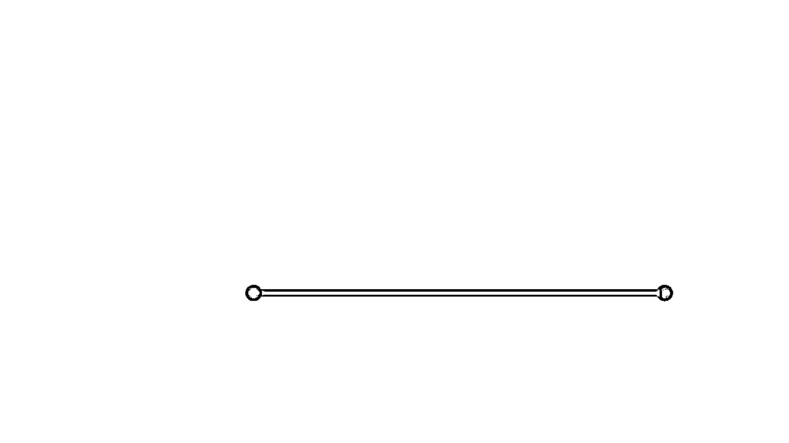

# 【生财技能】想做长期事业的咨询师，必须拥有自己的课程

> 来源：[https://oee5lr7gsk.feishu.cn/docx/EF35dXHumoJvf3xk0socqODynze](https://oee5lr7gsk.feishu.cn/docx/EF35dXHumoJvf3xk0socqODynze)

圈里的朋友们好，我是根源

在职场里，我做过带团队、做培训、做销售，现在也兼任了12年的心理咨询师。

咨询这件事，并不是我当时的主要收入来源，但它对我个人成长的影响极大，是我知识体系的核心，也是能把其他所有学科串起来的东西。

今天第一次在生财聊这个话题。

在做咨询的路上，我先后走了三条路，也是在不断试错中，才摸清楚了一套可落地的服务转化闭环。

这篇的分享，如果你也在咨询赛道，或是想建立自己的长期服务体系，或许能有点参考价值。

* * *

# 先说清楚：我眼中的咨询师是什么

我有12年咨询经历，涉猎面很宽。心理咨询、副业咨询、商业咨询、人生咨询，我都做过。所以我不会把自己框死在只做心理。

简单说，咨询师就是：

### 用自己的经验，或是借鉴他人经验去为别人解惑，

### 帮咨询者把当下卡住的问题拆开，并陪他跨过去。

在我看来，咨询的边界非常大，任何领域都能诞生优秀的咨询师。

* * *

# 咨询的痛点：一次咨询后，客户就很难再回来

刚开始接案时，我总觉得自己的咨询还不错。

结果时间一长，失落感出现了。因为被我服务过的客户，复购率极低。一聊完，可能一个月两个月就再也没下文了。

我当时会想，如果真的帮到人了，应该会隔一段时间主动回来才对。

后来复盘，发现两大原因。

第一，我的咨询功力还不够。第二，更关键的是，咨询收尾时我没有给到落地的下一步。

咨询本质是：了解问题 -> 拆解问题 -> 给出行动计划。

但早期我往往卡在最后一步。经验不够，也没有习惯性地在结束前给客户一个明确的执行清单。

比如接下来要开始地面推广，每天发100张传单；或者开始手写情绪记录；或者每周读一本书提升认知。

这些都是马上能上手的小动作。

后来我改了，一定会在尾声给行动建议。一开始我的建议很外放：去看哪类书、报哪类课、做哪类尝试。

但效果还是很差。100个客户里，可能只有5个会隔段时间回来。

为什么？因为我给的方案跟我没有关系。客户买本书就能自学，或者去报别的平台的课，跟我依然是割裂的。这就让二次连接的概率大幅下降。

* * *

# 真正的改变，需要什么？

想让客户愿意回来，或是有个机制能持续保持联系，这是每个咨询师都必须面对的问题。

在此之前，先聊聊『咨询师如何真正促成咨询者的改变』。

我把咨询师的能力分为三层，这也是收费能力和服务价值的递进。

## 第一层：帮客户梳理问题，给一个点子

把咨询者想象成一张白纸。

『全白』代表他对要解决的事完全没思路，找不到抓手，所以来找你。

这时咨询师像一支笔，在纸上点一个点。

这个点可能是个解法、一个思维、一个灵感。

在整张白纸上，这个点微不足道。但在当下，客户的获得感和爽感会非常强。

以前我的咨询多停留在这里。客户常说：今天太值了，我这辈子都没这么有收获。

可几天后，人又回到了原点。过段时间再来，问的还是同类问题。

我当时很不解：上次不是讲过了吗？怎么又来了？

## 第二层：给出行动方案，从点到线

做了12多年咨询，最困惑的就是：人明明在变老，应该更有智慧了，怎么还是会在同一个坑里反复摔。

后来我明白，问题不在客户，在我。

一个有能力的咨询师，应该能帮客户真正跨过去。

中期我开始改变，除了给『点』，我还给了一条『线』。

我告诉客户怎么一步步走，从点进化成线。

这已经是大多数咨询师的上限了。我当时也觉得很牛了，终于能给出一套执行路径。

但没多久发现，人还是回到了原点。

当下他说我一定会做，可几周后毫无变化。

我开始怀疑自己到底缺了什么。

## 第三层：创造改变的环境，从线到面

到第三阶段，我彻底改了打法。从线进化成面，也就是网状结构。

我不仅给行动方案，还给了一个能让方案被执行的环境。

这个环境是我搭建的，让客户在里面按计划推进。在这个过程中，我会持续追踪他的行动轨迹是否偏离，每个小周期3天、一周或一个月，都给他一点点反馈和提醒。

从点到线再到面，我才算真正给到了改变的条件。

为什么客户总是重复犯错？因为旧习惯在拉扯。你给的行动，做两天就放弃了。

就像健身，教练告诉你引体向上要收紧核心，你听进去了，教练在旁边时能做到。教练一走，就松了。

如果旁边一直有个陪练，每次拉之前都提醒一句收紧核心，持续一个月，新习惯就养成了。

这张白纸象征的是咨询者原有的习惯模式。只有用更有效的方式给他一个养成新习惯的环境，咨询才不是无效的消耗。

* * *

# 结论：咨询师必须要有自己的课

经历过第三阶段后，我得出一个结论：咨询师一定要给客户一个能养成习惯的环境。

这个环境，最现实的做法，就是你自己的课。

可以是心理类的，可以是赚钱类的，可以是沟通类爱的……形式不重要，关键是你得有。

咨询的目的是让人发生变化，而变化一定是有人先带一段路，习惯养成后，才能独立前行。

现在我在咨询收尾时，会给出选项式的行动方案，通常给三种，对应点线面，也对应预算。

1. 第一种是低成本的：推荐一本书、一个播客、一个公众号。基本不花钱，买本书也就百元以内。
2. 第二种是平台型的：比如生财有术、涛哥的星球这类星球社群。费用几百到几千不等。
3. 第三种是我自己的俱乐部。因为是自己交付，我能直接掌控客户的改变节奏。

给三种选项的原因，除了预算差异，更重要的是避免抵触。

如果你只推自己的产品，很容易让人产生『你就是想卖我东西』的防卫心。

但当你给出选择权，客户的情绪会从防御转为『我要选哪个』，这是完全不同的状态。

最后我一定会解释这三种方案的区别。如果客户问我哪个更好，我会开玩笑说当然是我的俱乐部，笑完再说：

选择还是要看你自己。改变是长期投入，不同人的价值观不同，找到你信任的人，比找到一门好课更重要。每个人学习路径不一样，我也见过只看书就能成长的人。

作为咨询师，我要做的是帮他选到更合适的解法，而不是高喊我是最好的你来买我。

所以，

### 任何一对一咨询，本质上都是一场高定价的精准转化场景，也是双向筛选的场景。

### 没有自己的产品，咨询结束人就消失了。

等他下次遇到问题，可能回来，也可能去找别人。

只有当咨询师有了自己的课程和完整路径，后续才会被串联起来。否则就是单点交付。

从商业角度看，如果只靠一对一咨询吃饭，这条路只会越来越窄，越来越累，客户也会越来越少。

真正的持续收入，来自多人课程的规模化交付，以及长期相处建立的信任，让客户愿意为更高阶的产品买单。

总结一句话：

咨询师一定要有自己的课！

* * *

# 最后的自我介绍

我是根源，也是生财第四期圈友。

一个拥有2w+实战案例的心理咨询师，有12年线下销售和团队管理经验。

2022年开始转向线上做知识付费。

如果你一路看到这里，说明你对这个话题有共鸣，欢迎一起交流。