# 把 YouTube Shorts 打造成可复制的自动化产线
作者：龙哥


各位好，我是龙哥。受龙哥的超级标点醒，最近一段周期我一直在琢磨 Shorts 的 AI 化运营。摸索下来，整套作业链路已被我逐步跑通并固化为一套自动流水线。起初觉得这块的技术门槛不高，也还没跑出亮眼的成绩，一直不好意思分享。直到两天前和@土豆君聊天聊到此事，得他鼓劲后才决定把当下的做法整理出来，供同样在探索这条赛道的人参考。

本文主要讲我如何借助 Cursor 与大模型把 Shorts 的运营效率拉满。目前除画面与成片的挑选仍需人工过目一遍外，从素材抓取、对标复刻、创意产出，到图生图、图生视频、剪辑打包，再到多号矩阵分发，基本都已进入无人化运行。早期我也尝试过彻底零人工，但成品品质不达标，后来在画面生成和动态生成这两个环节加入逆向筛选的人工节点，采用先饱和生成再人工挑优的策略，效果明显回升。

单条内容的成本视图生模型而定，大致在数分到数角之间。成本还能再压，但品质会同步下滑。现阶段在这个质量水位下，投入我是可以接受的。

当前在用的工具组合：

提示词还原：midjourney describe 与 gpt4o-mini
画面合成：flux+comfy / midjourney
动态合成：即梦 / 可灵 / 海螺

先交代背景。这篇记录是我在自建号期间顺手搭建的一套内容中枢与投放中台。全部实现都由 Cursor 参与完成，受篇幅所限，历史的完整 Prompt 不可能全部罗列，而且眼下模型能力已很强，不需要花里胡哨的“封神提示技巧”，把需求说清楚就能搭出产品，上手门槛其实不高。

文中我会把部分需要多轮调试才能稳定跑通的功能核心代码贴出来，例如场景切分、批量视频生成、Discord 或即梦无水印下载的油猴脚本等。其余部分更多靠自己动手试、调。

另外涉及的细节碎片很多，受限于篇幅讲不全，阅读时可能会觉得脉络跳跃、抽象。但如果你已把基础链路跑通，现在卡在规模化放大上，这份梳理应该能提供一些参考。不足之处也很多，欢迎在星球里交流碰撞。

接下来讲整体落地路径。

## 对标素材的拆解与复刻自动化

先从对标作品的逐帧拆解和自动复刻说起。

一套完整的复刻链路大致是：视频获取 → 场景划分 → 提示词逆推 → 新画面生成 → 动态生成 → 编辑拼接 → 加背景音乐 → 导出发布

这条链路理论上都能自动化，但为保品质，我在画面生成和动态生成这两个关键点保留了人工筛选，其余环节全部交给机器。我能投入到 YouTube 的时间有限，所以最初的设计目标就是：丢一个对标链接进去，系统自动生成复刻分镜的片段，我只需点鼠标筛选，其它的切分、重绘、剪辑、上传、数据统计全自动跑。

要实现这个目标，第一步是先搭自己的素材中心，用来创建草稿项目、管理视频、管理代理信息和矩阵账号等。

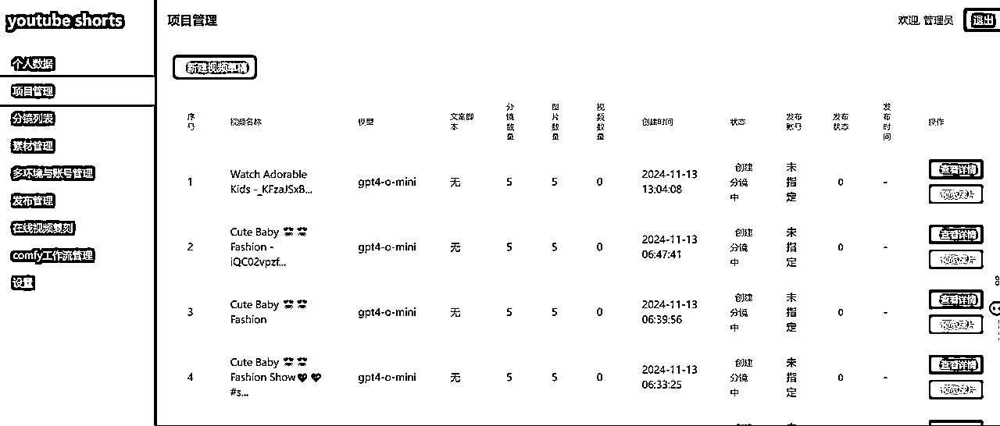

这个模块用 Cursor 生成后再微调即可。首版草稿大致如此。只要项目与素材中心搭起来，后续复刻草稿就有存储与管理的入口。因为年代久远，原始 Prompt 已没保存，但大致逻辑是这样，我后来又重写了一版初始项目 Prompt，测试后也能跑，大家可按需调整：

请帮我做一个 youtube shorts 的素材管理、视频草稿与剪辑和自动发布系统。左侧菜单栏包括：视频草稿管理、分镜列表、素材管理、多环境与账号管理、在线视频复刻、设置、comfy工作流管理、个人数据。技术栈使用 python fastapi + jinja，请首先完成项目框架的搭建。

请帮我完成草稿管理列表页；上面一个新建视频草稿按钮，新建的时候弹出框选择，模型、脚本、分镜数量、发布账号、工作流（选择框）。

列表页字段有：序号、模型、脚本、图片数量、视频数量、创建时间、发布账号、发布状态、发布时间。操作栏有查看详情和预览成片。

请帮我新建分镜列表页，上面有筛选项：项目名称（单选）。操作按钮有：新增分镜（点击后弹窗可以填写列表中的字段外加一个排序）；一键重新生成关键词、一键生成图片、一键生成视频、一键合成成片、导出剪映草稿箱、发布油管；列表页字段有序号、分镜内容、图片提示词、图片提示词英文、视频提示词、视频提示词英文、字幕、字幕英文、图片、视频；操作列按钮有：保存、重新生成图片提示词、重新生成视频提示词；另外我希望图片提示词、视频提示词、字幕都可以直接在表格中双击修改，这样修改之后方便我点击直接保存：注意图片和视频字段中的值是多条本地的图片和视频地址，如：J:\ai\output\ComfyUI_00167_.png，注意要把视频和图片直接在表格中渲染出来，方便我查看分镜的详情。我要求你写几条示例数据，方便我测试

注意上面只是前端界面的开发，后端我们在实现过程中不断用自然语言指挥cursor 就行了。

搭建好中枢后，第一项具体工作就是对标视频的自动拆解与复刻。

### 视频获取

复刻的第一步当然是拿到源片。我们不可能每次都去浏览器打开油管下载站点，手动复制链接、下载正片和音乐，再边播边拖动截场景图，这种手工链路既长也不适合自动化，即便用 RPA 粘合也提升有限。所以我自己写了一个 YouTube 视频与 BGM 的下载小工具，这是全链路的起点。

难度不大，把截图丢给 Cursor，十来分钟就能成型。跑通后效果如下：

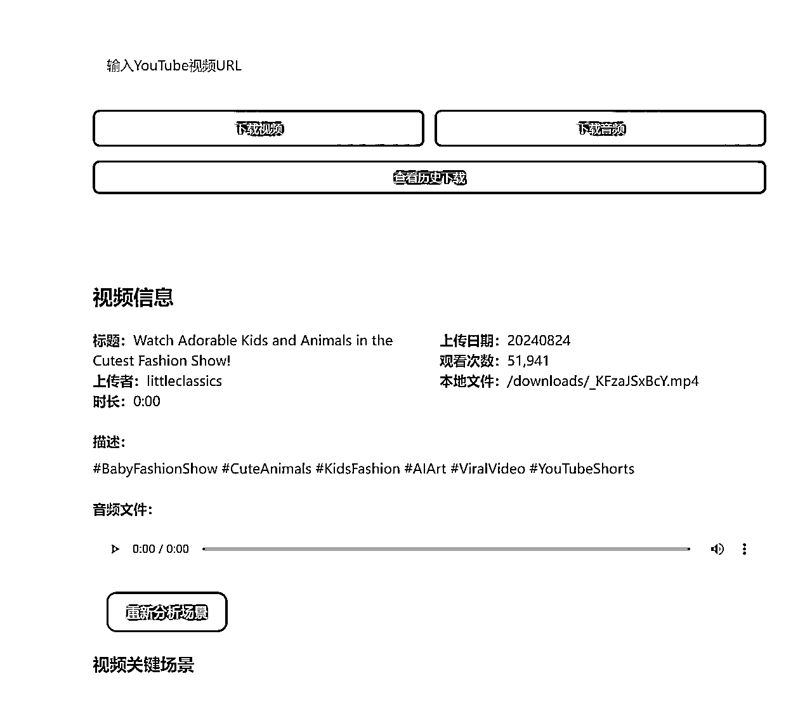

复刻思路很直接，我在网页端找一个在线下载站点，比如就用这个：


直接用 Cursor 的 Composer 调起，输入需求即可：


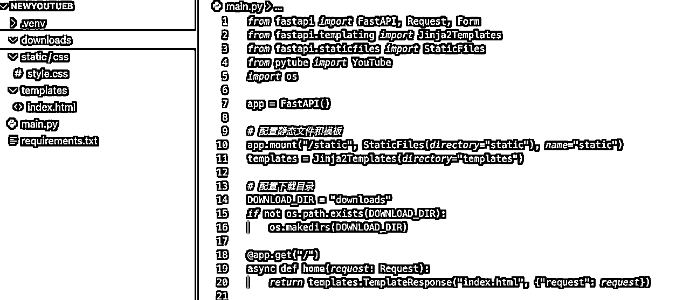

装好依赖后启动，按自己实际需求微调配置即可，Claude 的执行力完全够用。

为了后续可追溯与做状态管理，我后来把下载结果都写入了自己的数据库。

随便丢一个链接进去，点击下载，背景音乐和正片就都落库了。

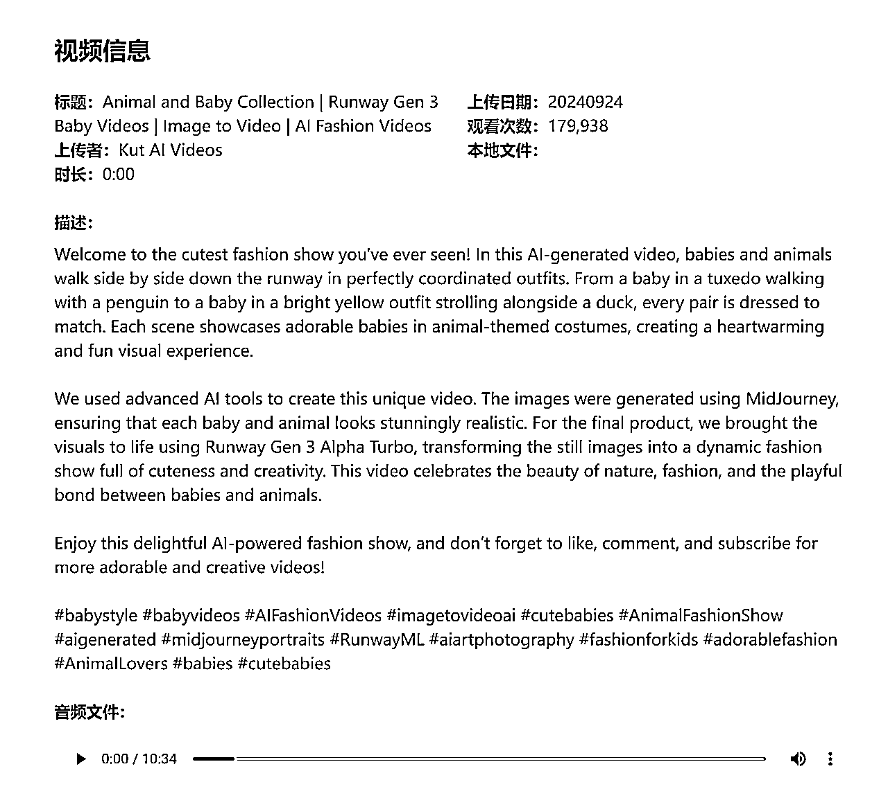

例如把这个对标片 https://www.youtube.com/watch?v=_KFzaJSxBcY 丢进我的在线下载服务，一键完成。

视频到手后，下一步是做场景提取。我们要把视频里所有场景精准切出来，这里我用的是 OpenCV。

思路是逐帧分析，基于最小场景时长，结合结构相似度与色彩相似度来判定分界，最后把每个场景切片出来。剪辑里常有转场，所以切点不能直接取变化首帧，而是往前后各找约 30 帧范围内同场景下最清晰的那张图作为代表。核心实现并不复杂，关键代码如下：

```
import cv2
import numpy as np
from pathlib import Path
import os
import time

def create_output_dir(output_dir):
    """创建输出目录"""
    os.makedirs(output_dir, exist_ok=True)
    return output_dir

def calculate_frame_clarity(frame):
    """计算帧的清晰度"""
    gray = cv2.cvtColor(frame, cv2.COLOR_BGR2GRAY)
    return cv2.Laplacian(gray, cv2.CV_64F).var()

def detect_scene_change(prev_frame, curr_frame, min_threshold=0.15, max_threshold=0.60):
    """
    检测场景变化
    :param prev_frame: 前一帧
    :param curr_frame: 当前帧
    :param min_threshold: 最小变化阈值
    :param max_threshold: 最大变化阈值
    :return: (是否是新场景, 变化程度)
    """
    # 转换为灰度图
    prev_gray = cv2.cvtColor(prev_frame, cv2.COLOR_BGR2GRAY)
    curr_gray = cv2.cvtColor(curr_frame, cv2.COLOR_BGR2GRAY)

    # 计算帧差
    diff = cv2.absdiff(prev_gray, curr_gray)

    # 应用高斯模糊减少噪声
    diff = cv2.GaussianBlur(diff, (5, 5), 0)

    # 应用阈值
    _, thresh = cv2.threshold(diff, 25, 255, cv2.THRESH_BINARY)

    # 计算变化像素的比例
    change_ratio = np.count_nonzero(thresh) / thresh.size

    # 判断是否是新场景
    is_new_scene = min_threshold < change_ratio < max_threshold

    return is_new_scene, change_ratio

def split_video_scenes(video_path, output_dir, min_threshold=0.15, max_threshold=0.60, 
                      min_scene_duration=15):
    """
    分割视频场景
    :param video_path: 视频文件路径
    :param output_dir: 输出目录
    :param min_threshold: 最小变化阈值
    :param max_threshold: 最大变化阈值
    :param min_scene_duration: 最小场景持续帧数
    :return: 场景图片路径列表
    """
    print(f"开始处理视频: {video_path}")
    start_time = time.time()

    # 创建输出目录
    output_dir = create_output_dir(output_dir)

    # 打开视频文件
    cap = cv2.VideoCapture(video_path)
    if not cap.isOpened():
        raise ValueError("无法打开视频文件")

    # 获取视频信息
    total_frames = int(cap.get(cv2.CAP_PROP_FRAME_COUNT))
    fps = int(cap.get(cv2.CAP_PROP_FPS))
    print(f"视频信息: {total_frames} 帧, {fps} FPS")

    scene_images = []
    scene_count = 0
    frame_count = 0
    frames_since_last_scene = 0

    prev_frame = None
    current_scene_frames = []

    while cap.isOpened():
        ret, frame = cap.read()
        if not ret:
            break

        # 显示进度
        if frame_count % 100 == 0:
            progress = (frame_count / total_frames) * 100
            print(f"处理进度: {progress:.1f}%")

        # 第一帧处理
        if prev_frame is None:
            prev_frame = frame
            current_scene_frames.append((frame, calculate_frame_clarity(frame)))
            frame_count += 1
            continue

        # 检测场景变化
        is_new_scene, change_ratio = detect_scene_change(
            prev_frame, frame, min_threshold, max_threshold
        )

        # 将当前帧添加到当前场景
        current_scene_frames.append((frame, calculate_frame_clarity(frame)))
        frames_since_last_scene += 1

        # 如果检测到新场景且已经过了最小场景持续时间
        if is_new_scene and frames_since_last_scene >= min_scene_duration:
            # 从当前场景帧中选择最清晰的帧
            clearest_frame, _ = max(current_scene_frames, key=lambda x: x[1])

            # 保存场景图片
            scene_path = os.path.join(output_dir, f'scene_{scene_count:03d}.jpg')
            cv2.imwrite(scene_path, clearest_frame)
            scene_images.append(str(Path(scene_path).absolute()))

            print(f"检测到新场景 {scene_count}, 在帧 {frame_count}, 变化程度: {change_ratio:.3f}")

            # 重置计数器和缓存
            scene_count += 1
            frames_since_last_scene = 0
            current_scene_frames = [(frame, calculate_frame_clarity(frame))]

        prev_frame = frame
        frame_count += 1

    # 保存最后一个场景
    if current_scene_frames:
        clearest_frame, _ = max(current_scene_frames, key=lambda x: x[1])
        scene_path = os.path.join(output_dir, f'scene_{scene_count:03d}.jpg')
        cv2.imwrite(scene_path, clearest_frame)
        scene_images.append(str(Path(scene_path).absolute()))

    # 释放资源
    cap.release()

    # 打印统计信息
    end_time = time.time()
    processing_time = end_time - start_time
    print(f"\n处理完成:")
    print(f"总共检测到 {scene_count + 1} 个场景")
    print(f"处理时间: {processing_time:.2f} 秒")
    print(f"平均每秒处理 {frame_count/processing_time:.1f} 帧")

    return scene_images

def main():
    # 配置参数
    video_path = "downloads/video_309622719539707911.mp4"  # 替换为你的视频文件路径
    output_dir = "output_scenes"  # 输出目录

    try:
        scene_paths = split_video_scenes(
            video_path=video_path,
            output_dir=output_dir,
            min_threshold=0.15,    # 最小变化阈值
            max_threshold=0.60,    # 最大变化阈值
            min_scene_duration=15  # 最小场景持续帧数
        )

        print("\n场景图片路径：")
        for path in scene_paths:
            print(path)

    except Exception as e:
        print(f"处理视频时出错: {str(e)}")

if __name__ == "__main__":
    main()

```

你有没有想过，把一条视频丢给工具，然后坐等它把画面拆好、音乐备好、提示词生成好，是一种什么体验？

现在这个流程完全跑通了。操作很简单：你只需要把目标视频的链接粘贴进去，系统就会自动抓取视频文件和背景音乐，并且同步完成画面的场景切分。整个过程大概一分钟左右，你就能拿到一个完整的“素材包”——视频有了、BGM有了、分镜图也齐了。如果某一次切分的场景不够理想，或者你想换个角度再切一次，直接点一下“重新分析”按钮，就能重新来一遍。

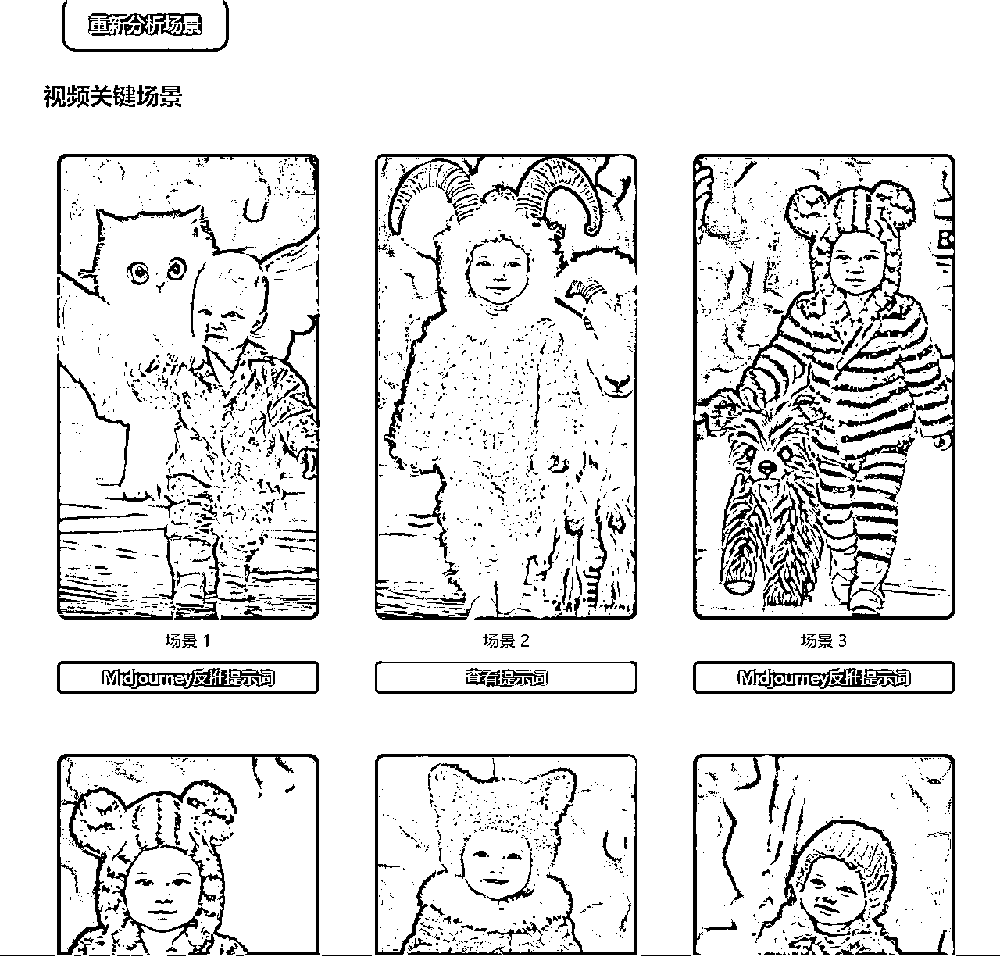

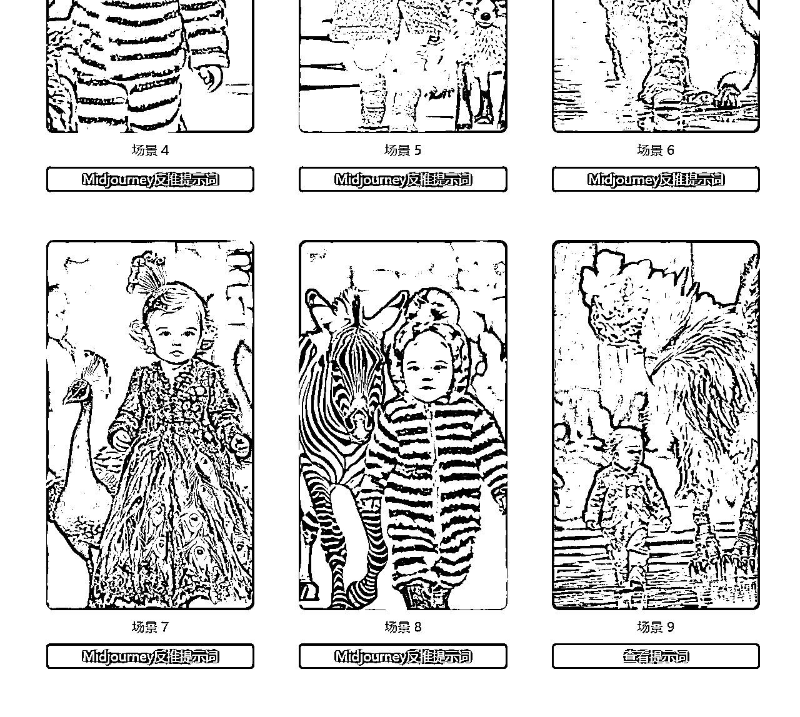

后续我们又把体验优化了一轮。现在每一张切出来的分镜图都可以直接在页面上预览，要是觉得哪张不好看、不想要了，手动删掉就行，一点都不麻烦。

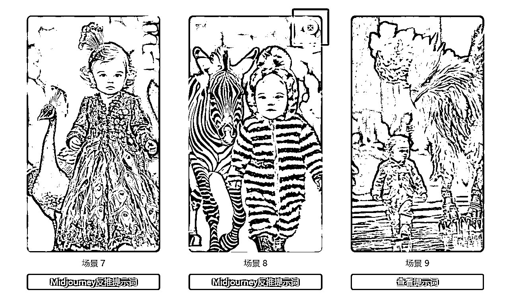

从输入链接开始，到视频和BGM下载完毕，再到场景切片自动拆解，整个流程不到一分钟就能走完。所以你可以提前把那些数据表现不错的视频批量收集起来，放到后台让它自动处理。甚至开点并发，一个晚上轻松切出一两千个视频，第二天醒来，你只需要坐在电脑前，手动筛一筛图片就够了。

当然，切完图不是终点，下一步我们要做的，是从这些分镜图里把提示词反向推导出来。

### 图片反推

拿到各个场景的图片之后，最关键的一步就来了：怎么把这些画面变成真正能用的提示词？总不能手动一张张传到 Midjourney 或者 GPT 里，让人家描述一遍，再手动复制回来吧？那太低效了。我的做法直接一点：在每个图片下面加两个按钮，一个用来反推 Midjourney 提示词，一个用来反推 GPT4 提示词。点一下，画面提示词就自动生成了。

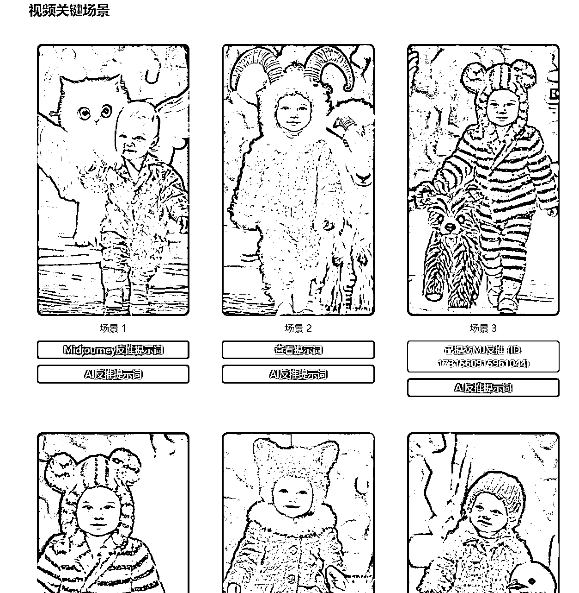

生成完成后，点击按钮就会弹出对应的提示词内容。如果你自己在 Discord 里订阅了 MJ，也可以走逆向通道，没必要自己从零造轮子，用下面这些开源项目改一改就能跑：

https://github.com/yokonsan/midjourney-api

https://github.com/erictik/midjourney-api

https://github.com/novicezk/midjourney-proxy

当然，如果你觉得搞逆向太折腾，直接用第三方的按量付费 API 也完全没问题，效果是一样的。第三方做提示词反推的话，大概六分钱一张；用 4o 来做，差不多几厘钱一张，这基本等于白送了。具体选哪种，看你自己实际情况就行。

MJ 这边，我用的是一家中转站的 API。为了避免广告嫌疑，就不放具体地址了。你在谷歌上搜一下“midjourney api”，或者找一个聚合类的 API 转发站点，这种中转接口太多了，自己对比一下，挑个便宜的用就行。

有了 MJ 或 GPT 反推之后，拿到图片提示词就非常流畅了。我后来又加了一个按钮，可以一键把提示词添加到视频草稿里。这里还埋伏了一个小逻辑：以“当前视频标题 + title”作为唯一键来创建新草稿。这样后续所有视频的提示词都会自动汇总到同一个草稿里，方便后续统一调整和导出。

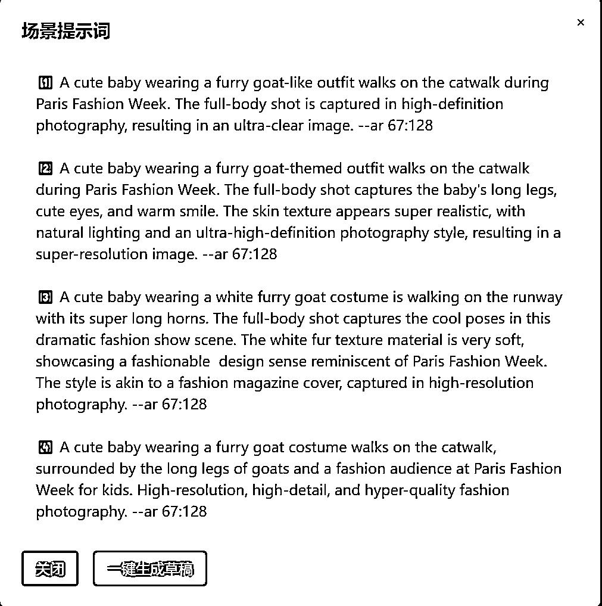

## 创意微调

当所有不同场景的提示词都导入到视频草稿的分镜列表后，反推出来的词条难免有想改一改的地方。我把列表渲染的交互改成了双击直接输入修改，这样你可以手动微调；也可以借助 AI 的想象力，把同类型提示词做一轮扩展。原本我是想再写一套方法，统一多生成几个创意试试的，但转念一想，现在现成的插件那么多，比如 Monica、Sider AI 等等，直接在 Monica 里设置一个快捷提示词，然后选中当前提示词，再点一下扩展同类创意，就完事了，没必要自己重复造轮子。

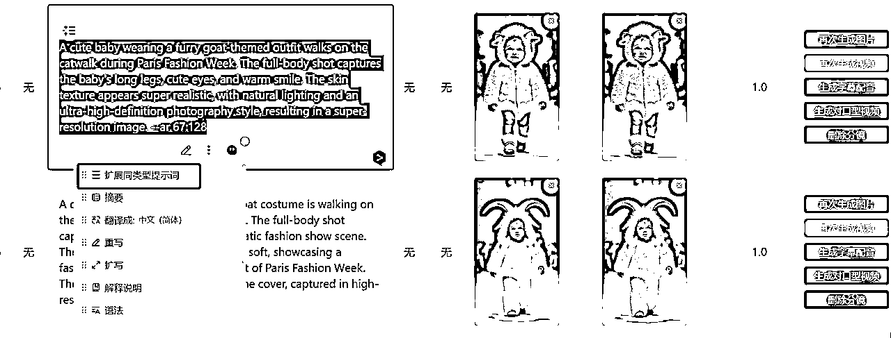

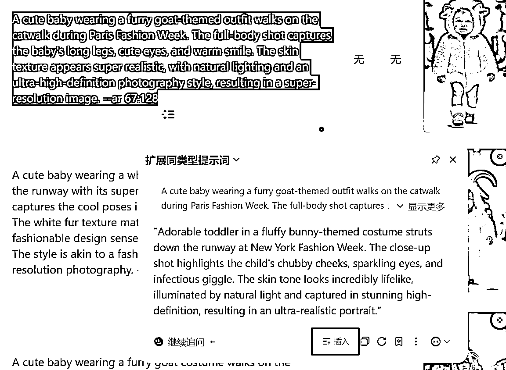

扩展出来的提示词，如果看着满意，直接点击“插入”就会自动保存。

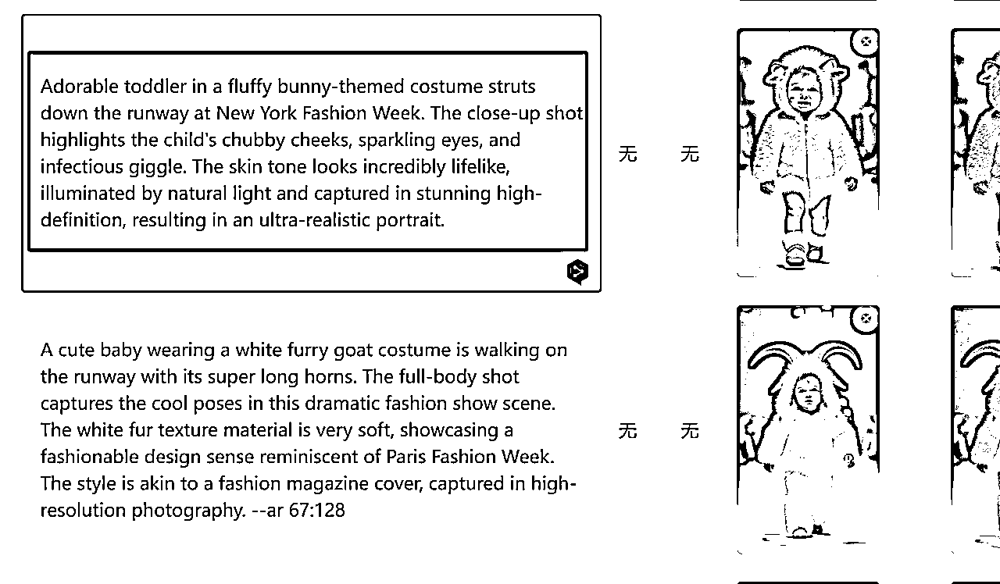

当然，这个方法有个小毛病——没法批量生成。不过也容易解决，写个后台脚本，让脚本基于当前提示词一次性生成十条相似或者扩展创意就行。但我个人觉得暂时没这个必要，目前的功能已经够用了。

点击提示词反推之后，过一会儿就能看到 MJ 生成的提示词了，默认是四条。我们再加一个“一键生成图片视频草稿”的按钮。点一下，系统会以当前视频的 videoid 作为标题，自动创建一个新项目，并且把四条提示词拆分开。这时候你会发现页面已经跳转到了分镜页面。图片生成这边，我用的本地的 flux，主要就是图它便宜——核心原则是：能省的钱一分都不想多花。（提示词反推其实纯本地也能做，只是效果可能会差一些。）等图片自动生成完毕，因为用的是 MJ 反推，所以目前还没有视频提示词。这咋办？那就只能再加一个功能了：获取反推提示词之后，自动生成对应的视频提示词。

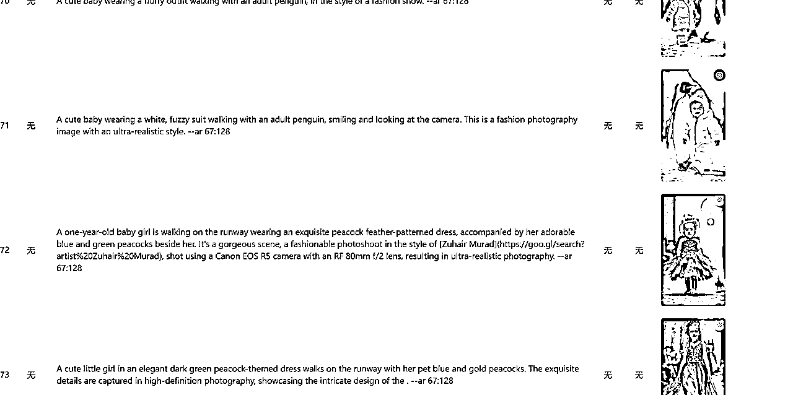

## Flux Comfy 工作流图片生成

如果要大批量生成图片，用 MJ 的话成本确实有点扛不住。所以我这边直接改成本地 flux + comfy，就算一次性生成几千张，也不会花一分钱，效果大概能达到 MJ 的八成。

我最初的需求其实是：根据不同的剧情和赛道，用不同的工作流来生成图片。所以我在草稿选项里集成了自己做的几个 Comfy 工作流，每一个工作流里的 lora 和工作流配置都不一样。这样一来，不同赛道就能用不同的工作流，甚至可以对同一个视频做风格微调。

要做到这一点，前提是自己搭一个工作流管理中心，并且把它和图片生成流程串联起来。这是我当时写 Comfy 工作流时用的 Cursor Prompt，思路很简单：创建了一个 Comfy 管理中心，方便复刻不同赛道的视频和风格。在页面上查看工作流、验证流程也都变得非常直观。

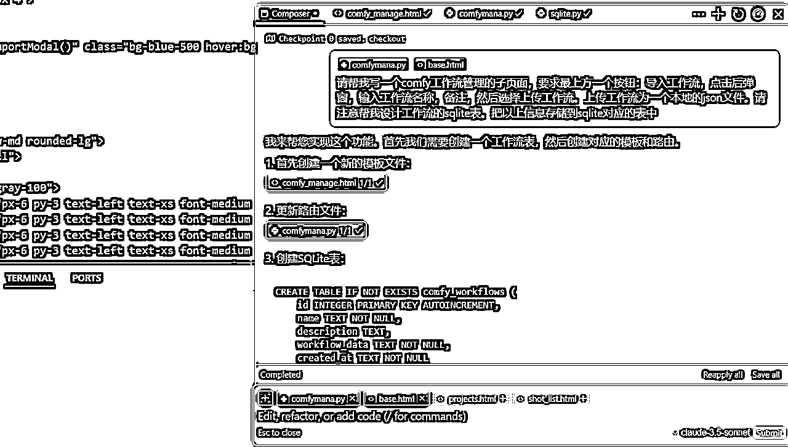

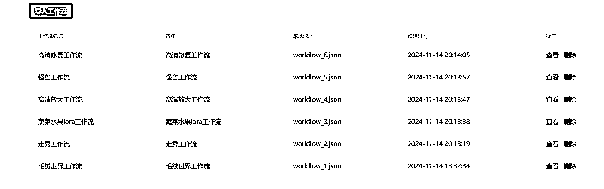

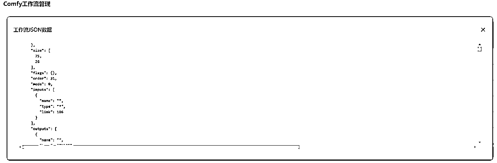

工作流管理做完之后，还得把它导入到我们自己的系统里。打开 ComfyUI，直接点击“保存 API”，把这个工作流保存成 JSON 文件。后面就可以把它导入到我们自己的工作流库中，方便在各个节点里直接调用了。

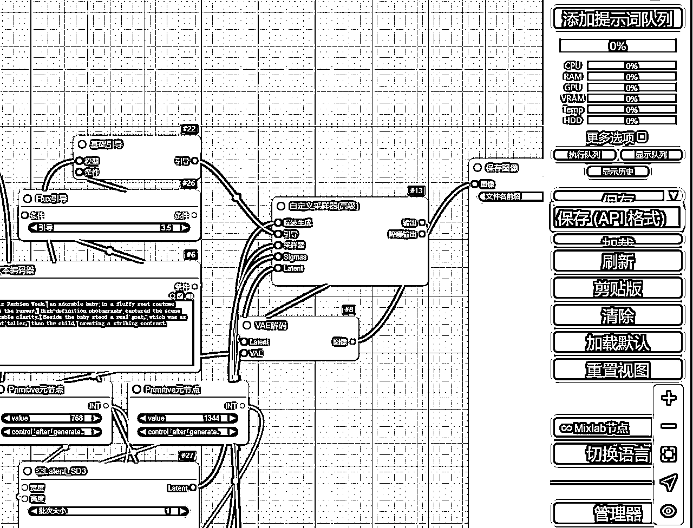

如果你对 Comfy 还不太熟，也有另一条路：去 Liblib 上根据需求挑一个高赞工作流，下载下来直接导入也可以。

https://www.liblib.art/

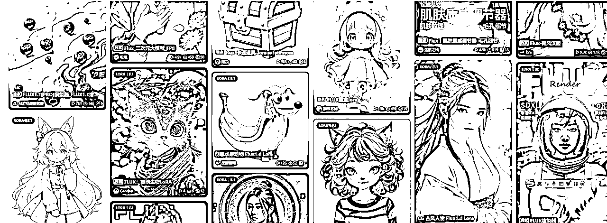

导入自己的 Comfy 工作流之后，新建视频草稿时就能自由选择风格了。这样在复刻视频的时候，就能走不同的工作流；工作流的自定义能力很强，很多 MJ 做不到的事情，在这里都能完成。

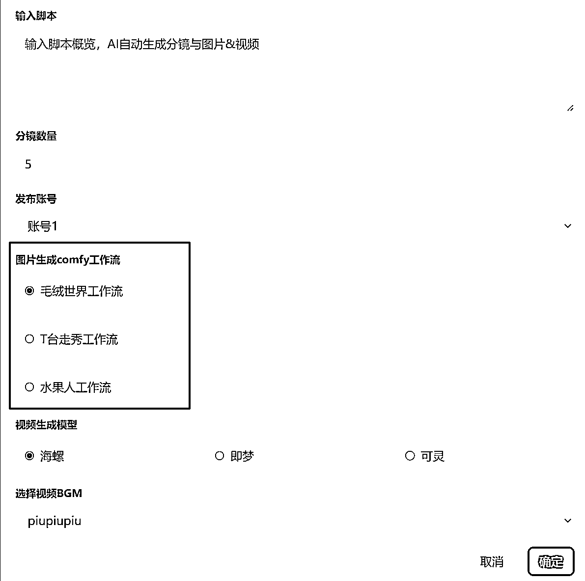

## MJ 图片生成

在不断生成图片的过程中，能明显感受到 Comfy 工作流的定制能力更强，但 flux + comfy 的门槛确实有点高，大部分人不一定搞得定。再加上很多时候 MJ 生成的图片审美确实更在线，所以我们也可以用 MJ 来生成原始素材。

MJ 当然也可以走全自动路线，比如逆向，或者购买第三方 API——这个前面提过了。但这类方案技术门槛稍微高一点，也有点麻烦。我这里讲一个我最初验证 SOP 时写的半自动小脚本。

大概思路是这样：我在 Discord 页面里注入了一个叫“素材收集”的按钮。点击之后，系统会自动把生成的图片保存到我的视频分镜图里，并且直接进入视频生成环节。这样我就不用先从 Discord 下载到本地了，所有素材都能统一在素材中心里管理。

第一版的时候，我在 Discord 生成的每张图片上都加了一个“收集”按钮。只要点一下，图片就会自动进入素材库，然后直接流转到视频生成环节。

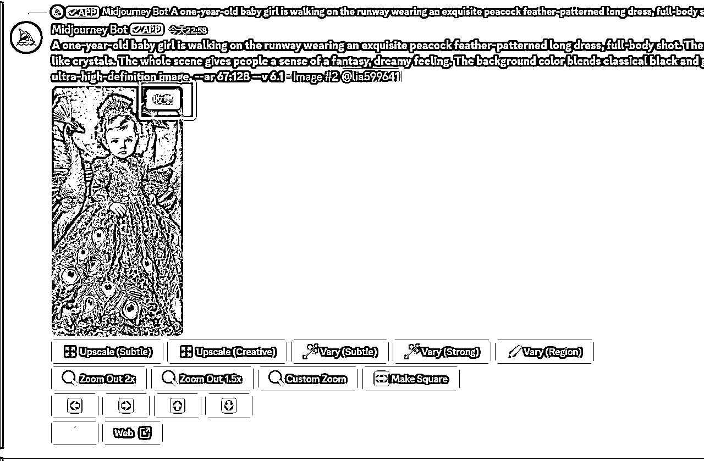

最近在折腾 Midjourney 素材自动化，想把生成的图片和提示词一键收进素材库，省去手动搬运的麻烦。整个流程走下来确实没什么门槛，分享一下。

素材中心的后台接口挂在 8081 端口，接口逻辑直接交给 Claude 去生成即可，难度几乎为零。来看代码：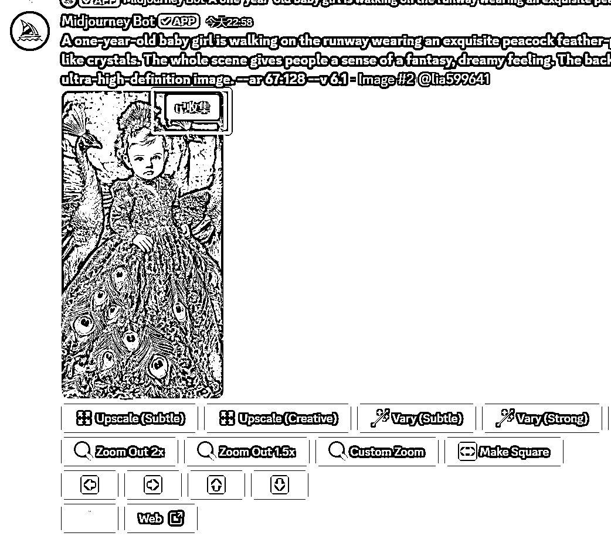 代码如下：```
// ==UserScript==
// @name         Discord Image Collector
// @namespace    http://tampermonkey.net/
// @version      0.2
// @description  Add collect button to Discord images
// @author       Your name
// @match        https://discord.com/*
// @grant        GM_addStyle
// @grant        GM_xmlhttpRequest
// ==/UserScript==

(function() {
    'use strict';

    // 添加按钮样式
    GM_addStyle(`
        .collect-btn {
            position: absolute;
            top: 5px;
            right: 5px;
            background-color: #7289da;
            color: white;
            border: none;
            border-radius: 4px;
            padding: 5px 10px;
            cursor: pointer;
            z-index: 9999;
            opacity: 0.8;
        }
        .collect-btn:hover {
            opacity: 1;
        }
    `);

    // 监听DOM变化
    const observer = new MutationObserver((mutations) => {
        mutations.forEach((mutation) => {
            mutation.addedNodes.forEach((node) => {
                if (node.nodeType === 1) {
                    processImages(node);
                }
            });
        });
    });

    // 处理图片
    function processImages(container) {
        // 查找所有图片容器
        const imageContainers = container.querySelectorAll('.imageContainer_cf58b5:not([data-collector-added])');

        imageContainers.forEach(container => {
            // 标记容器已处理
            container.setAttribute('data-collector-added', 'true');

            // 查找原始链接
            const originalLink = container.querySelector('.originalLink_d4597d');
            if (!originalLink) return;

            // 获取完整的图片URL（包括查询参数）
            const imageUrl = originalLink.href;
            if (!imageUrl) return;

            // 创建收集按钮
            const collectBtn = document.createElement('button');
            collectBtn.className = 'collect-btn';
            collectBtn.textContent = '收集';

            // 添加点击事件
            collectBtn.addEventListener('click', (e) => {
                e.preventDefault();
                e.stopPropagation();

                // 发送完整URL到本地服务器
                GM_xmlhttpRequest({
                    method: 'POST',
                    url: 'http://localhost:8001/material/collect',
                    headers: {
                        'Content-Type': 'application/json'
                    },
                    data: JSON.stringify({ url: imageUrl }),
                    onload: function(response) {
                        if (response.status === 200) {
                            collectBtn.textContent = '已收集';
                            collectBtn.style.backgroundColor = '#43b581';
                            setTimeout(() => {
                                collectBtn.textContent = '收集';
                                collectBtn.style.backgroundColor = '#7289da';
                            }, 2000);
                        } else {
                            collectBtn.textContent = '失败';
                            collectBtn.style.backgroundColor = '#f04747';
                            setTimeout(() => {
                                collectBtn.textContent = '收集';
                                collectBtn.style.backgroundColor = '#7289da';
                            }, 2000);
                        }
                    },
                    onerror: function() {
                        collectBtn.textContent = '错误';
                        collectBtn.style.backgroundColor = '#f04747';
                        setTimeout(() => {
                            collectBtn.textContent = '收集';
                            collectBtn.style.backgroundColor = '#7289da';
                        }, 2000);
                    }
                });
            });

            // 找到图片包装器并添加按钮
            const imageWrapper = container.querySelector('.loadingOverlay_d4597d');
            if (imageWrapper) {
                imageWrapper.appendChild(collectBtn);
            }
        });
    }

    // 启动观察器
    observer.observe(document.body, {
        childList: true,
        subtree: true
    });

    // 初始处理已存在的图片
    processImages(document.body);
})();
```

一开始用的方案只把图片存了下来，提示词没有被一起保存，这显然不够。于是我把 prompt 调整成了这一版：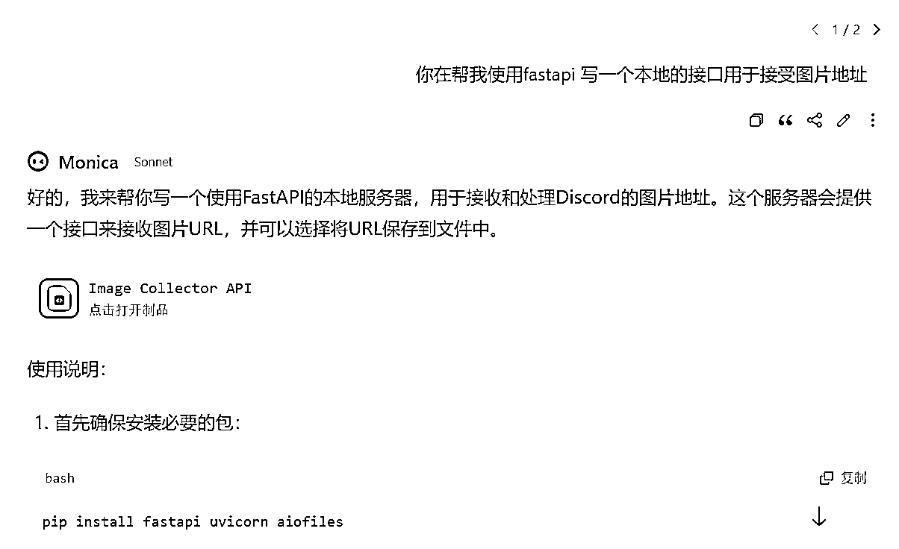

需求是：在 Discord 的 Midjourney 频道里，给图片生成元素框加一个名为“添加到素材库”的按钮，定位到指定容器，按钮样式也按需要适配，整体用油猴脚本实现。

改完之后，图片下方会自动出现“添加到素材库”的按钮。点一下，对应的图片素材和原始提示词就会进入最新视频草稿的分镜页面。

打开视频草稿的分镜页面，就能看到刚才 MJ 生成的素材和 prompt 已经自动进草稿箱了。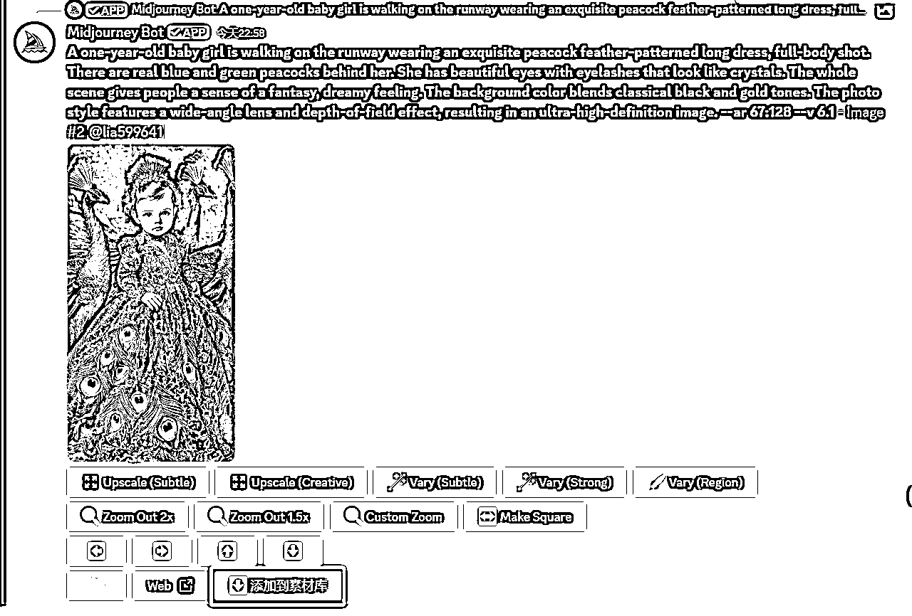

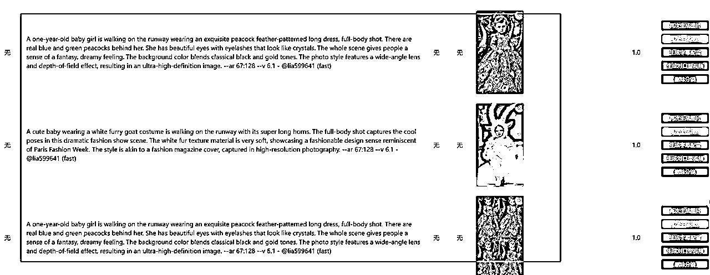

## 视频生成与剪辑

OK，到这儿就轮到视频生成了。这个阶段，最先出局的是各种影刀方案。影刀这东西又笨又重，想让它在 24 小时全天候跑，它还时不时卡一下、停一下，必须有人盯着。我可不想在这种事上浪费时间，索性直接用 Python 原生实现。

先是即梦的自动化。

### 即梦

即梦的自动化不绕弯，核心逻辑全在这段代码里。

```
import asyncio
import logging
import sys
import re
import traceback
from typing import Optional, List
from playwright.async_api import Page, async_playwright
from bit_api import BitBrowser

class JiMengClient:
    """即梦视频生成客户端"""
    def __init__(self):
        self.logger = logging.getLogger(__name__)
        self.page: Optional[Page] = None 
        self.playwright = None
        self.browser = None

    async def initialize(self, browser_ws: str) -> None:
        """初始化Playwright浏览器"""
        try:
            self.logger.info(f"初始化 Playwright, ws地址: {browser_ws}")
            self.playwright = await async_playwright().start()

            self.browser = await self.playwright.chromium.connect_over_cdp(
                browser_ws,
                timeout=30000
            )

            default_context = self.browser.contexts[0]
            self.page = await default_context.new_page()
            self.logger.info("初始化完成")

        except Exception as e:
            error_msg = f"初始化失败: {str(e)}\n{traceback.format_exc()}"
            self.logger.error(error_msg)
            raise Exception(error_msg)

    async def close(self) -> None:
        """关闭浏览器资源"""
        try:
            if self.page:
                await self.page.close()
            if self.browser:
                await self.browser.close()
            if self.playwright:
                await self.playwright.stop()
        except Exception as e:
            self.logger.error(f"关闭资源时出错: {e}")
async def generate_video(ws_address: str, prompt: str, image_path: str) -> Optional[str]:
    """生成视频并返回视频ID"""
    client = None
    video_id = None

    try:
        client = JiMengClient()
        await client.initialize(ws_address)

        await client.page.goto("https://jimeng.jianying.com/ai-tool/video/generate", timeout=36000)
        await asyncio.sleep(2)

        if image_path:
            file_input = await client.page.wait_for_selector(
                'input[type="file"][accept="image/jpeg,image/jpg,image/png,image/bmp,image/webp,.jpeg,.jpg,.png,.bmp,.webp"]',
                state='attached'
            )
            await file_input.set_input_files(image_path)
            await asyncio.sleep(5)

        # 填写提示词
        textarea = await client.page.wait_for_selector('textarea.lv-textarea[class*="input-"]')
        await textarea.fill(prompt)
        await asyncio.sleep(2)

        # 等待生成接口响应
        response_future = client.page.wait_for_response(
            lambda response: "mweb/v1/generate_video" in response.url
        )

        # 点击生成按钮
        generate_button = await client.page.wait_for_selector('div.mweb-button-default[class*="mwebButton-"][class*="generateButton-"]')
        await generate_button.click()

        # 等待响应
        response = await response_future
        response_data = await response.json()

        if response_data.get('data', {}).get('aigc_data'):
            flow = response_data['data']['aigc_data']['task']['process_flows'][0]
            video_id = flow.get("history_id", "")
            logging.info(f"获取视频ID: {video_id}")

        return video_id

    except Exception as e:
        logging.error(f"生成视频时出错: {e}")
        return None
    finally:
        if client:
            await client.close()

async def create_video(image_path: str, video_prompt: str) -> Optional[str]:
    """创建视频主函数"""
    ws = "brwoser_socket_url"

    try:
        if sys.platform == 'win32':
            loop = asyncio.ProactorEventLoop()
            asyncio.set_event_loop(loop)
        return await generate_video(ws, video_prompt, image_path)
    except Exception as e:
        logging.error(f"创建视频失败: {e}")
        return None

if __name__ == '__main__':
    logging.basicConfig(level=logging.INFO)
    image_path = r"F:\shortvideos\images\comfyui\2024-11-13\ComfyUI_00537_.png"
    prompt = "move forward"
    asyncio.run(create_video(image_path, prompt))

```

在操作即梦时，有个细节不能忽略：必须先拿到对应的 video_id，后续才能把本地分镜和视频关联起来，也才能顺利下载视频文件。当我们点下“生成视频”按钮后，需要实时盯住这个接口：

https://jimeng.jianying.com/mweb/v1/generate_video

等它提示提交成功，再去取 data.get('aigc_data',{}).get('task',{}).get('process_flows',{}).get('history_id',{})。这个 history_id 就是之后和本地素材绑定的唯一凭证，拿着它既能获取无水印视频的下载地址，也能把视频和本地分镜图片接在一起。

顺便说一下，即梦的生成速度真的很让人惊喜。免费版做一条视频，大概十几秒就能完成，比起可灵免费版要厚道不少。而且直接从源地址扒视频，速度又快，免费版也一样没有水印。关于这一点，我后面会单独写一个即梦无水印下载的油猴脚本分享出来。

接下来只需要用 cursor 做一套数据映射：一边记录指纹浏览器和即梦账号的对应关系，另一边存好图文提示词和即梦账号的对应关系。有了这套映射，多账号自动调度就能跑起来了。

我当时直接开了 5 个指纹浏览器，配了 5 个账号同步生成视频，一天靠着免费积分就能刷出 80 次左右的生成次数。以我目前的需求来说完全够用，毕竟手上的油管号本来就不多。如果你能搞到更多账号，开 100 个也没问题，只要按刚才说的调度思路去执行就行。

举个例子：假设你有 50 个即梦账号，可以每轮同时开 10 个账号，每个账号提交 5 个视频任务；等到第五轮全部提交完，再回头顺序下载之前所有视频的信息。这样的话，大约一小时就能跑出 10×5×5=250 条视频。每个账号一天有 88 免费积分，大约能生成 17 条视频；走 3 个批次，用不到 3 小时就能攒下 250×3=750 条视频素材。剩下零头再单独走一轮，就能把 17×50=850 条生成额度全部榨干。如果按“10 条视频素材合成 1 条短视频”的方式抽卡，那也能稳定做出 85 条成片。

这样一来，视频生成、下载和分镜关联就全部自动化了。图片素材选好以后，过一会儿再看分镜列表，每张图都已经自动对应好了视频。

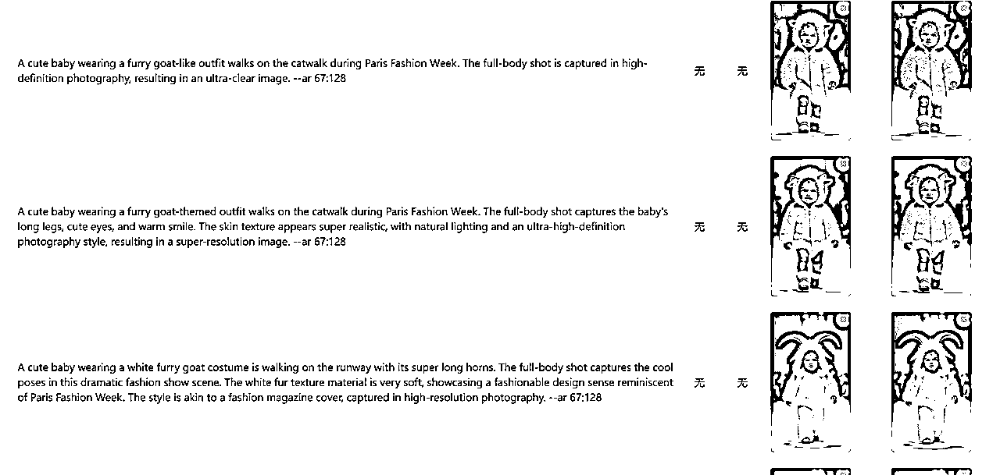

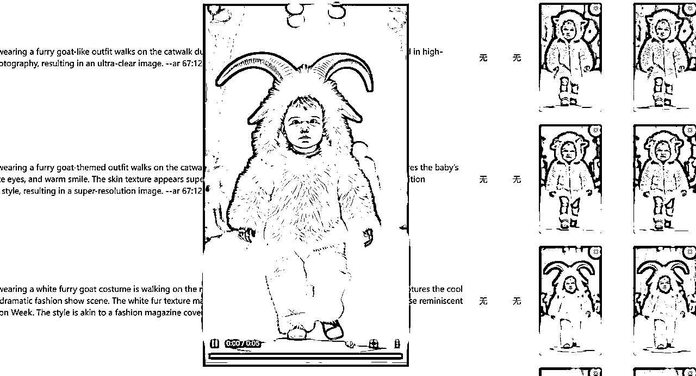

再分享一个即梦无水印下载的方法。免费版即梦本来就支持无水印下载，我把它封装成了油猴脚本，会在视频左上角自动多出一个“无水印下载”按钮，点击之后就能直接把无水印视频保存下来：

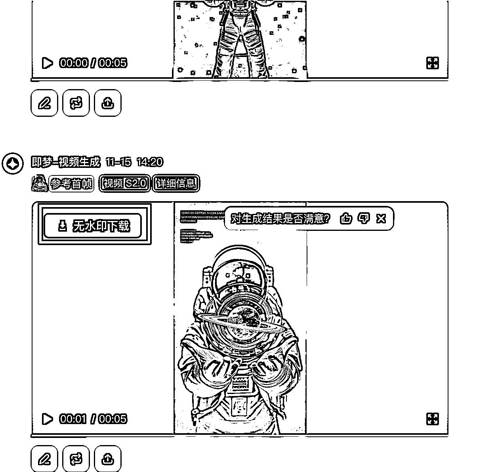

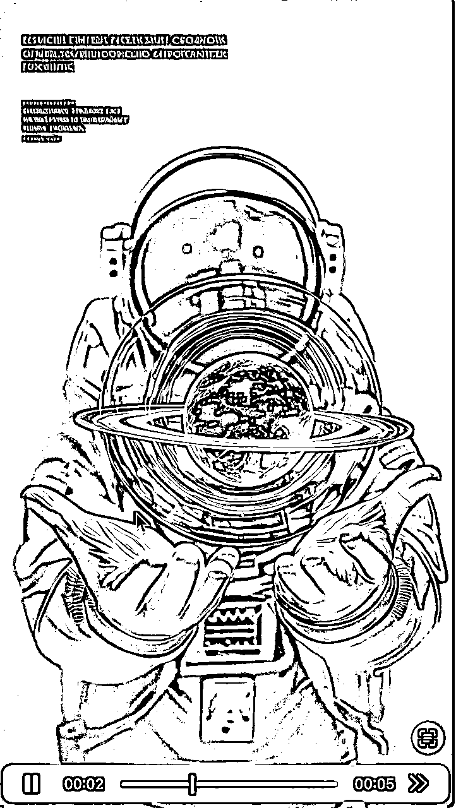

脚本如下：

```
// ==UserScript==
// @name         即梦无水印下载
// @namespace    http://tampermonkey.net/
// @version      2024-11-15
// @description  try to take over the world!
// @author       You
// @match        https://*.jianying.com/*
// @match        https://jimeng.jianying.com/*
// @icon         https://www.google.com/s2/favicons?sz=64&domain=jianying.com
// @grant        none
// ==/UserScript==

(function() {
    'use strict';

    // 添加下载按钮的样式
    const style = document.createElement('style');
    style.textContent = `
        .custom-download-btn-wrapper {
            position: absolute;
            top: 15px;
            left: 15px;
            z-index: 999999;
            pointer-events: auto;
        }
        .custom-download-btn {
            background: rgba(0, 0, 0, 0.75);
            color: white;
            border: none;
            padding: 8px 16px;
            border-radius: 6px;
            cursor: pointer;
            font-size: 14px;
            font-weight: 500;
            pointer-events: auto;
            display: flex;
            align-items: center;
            gap: 6px;
            transition: all 0.2s ease;
            backdrop-filter: blur(5px);
            box-shadow: 0 2px 8px rgba(0, 0, 0, 0.2);
        }
        .custom-download-btn:hover {
            background: rgba(0, 0, 0, 0.85);
            transform: translateY(-1px);
            box-shadow: 0 4px 12px rgba(0, 0, 0, 0.3);
        }
        .custom-download-btn:active {
            transform: translateY(0);
        }
        .custom-download-btn.downloading {
            background: rgba(0, 0, 0, 0.6);
            cursor: not-allowed;
        }
        .custom-download-btn svg {
            width: 16px;
            height: 16px;
            fill: currentColor;
        }
        @keyframes spin {
            to { transform: rotate(360deg); }
        }
        .loading-spinner {
            animation: spin 1s linear infinite;
        }
    `;
    document.head.appendChild(style);

    // 下载图标 SVG
    const downloadIcon = `

    `;

    // 加载中图标 SVG
    const loadingIcon = `

    `;

    function addDownloadButton() {
        const videoContainers = document.querySelectorAll('.videoWrapper-yY21WT');

        videoContainers.forEach(container => {
            if (container.querySelector('.custom-download-btn-wrapper')) return;

            const video = container.querySelector('video');
            if (!video) return;

            const wrapper = document.createElement('div');
            wrapper.className = 'custom-download-btn-wrapper';

            const downloadBtn = document.createElement('button');
            downloadBtn.className = 'custom-download-btn';
            downloadBtn.innerHTML = `${downloadIcon}无水印下载`;

            downloadBtn.onclick = async function(e) {
                e.preventDefault();
                e.stopPropagation();
                e.stopImmediatePropagation();

                const videoUrl = video.src;
                if (!videoUrl) {
                    alert('无法获取视频地址');
                    return;
                }

                try {
                    downloadBtn.classList.add('downloading');
                    downloadBtn.innerHTML = `${loadingIcon}下载中...`;
                    downloadBtn.disabled = true;

                    const response = await fetch(videoUrl);
                    const blob = await response.blob();

                    const url = window.URL.createObjectURL(blob);
                    const a = document.createElement('a');
                    a.href = url;
                    a.download = `video_${Date.now()}.mp4`;
                    document.body.appendChild(a);
                    a.click();

                    window.URL.revokeObjectURL(url);
                    document.body.removeChild(a);
                } catch (error) {
                    console.error('下载失败:', error);
                    alert('下载失败，请重试');
                } finally {
                    downloadBtn.classList.remove('downloading');
                    downloadBtn.innerHTML = `${downloadIcon}无水印下载`;
                    downloadBtn.disabled = false;
                }

                return false;
            };

            wrapper.appendChild(downloadBtn);

            const controlsContainer = container.querySelector('.videoCustomControlSlotWrapper-uFXNzG') || container;
            controlsContainer.appendChild(wrapper);
        });
    }

    function checkAndAddButton() {
        addDownloadButton();
        setTimeout(checkAndAddButton, 2000);
    }

    setTimeout(() => {
        checkAndAddButton();
    }, 1500);

    const observer = new MutationObserver(() => {
        addDownloadButton();
    });

    observer.observe(document.body, {
        childList: true,
        subtree: true
    });
})();

```

### 海螺自动化

接下来聊聊海螺。说实话，它跟即梦走的是同一条路子，功能上大差不差。但海螺有个特别吸引人的地方——注册当天居然不限量生成，这一点真的让人美滋滋。

我当时为了测试效果，特地在闲鱼上租了个VIP号来体验。几轮用下来，直观感受是视频生成的质量确实比即梦稍微能打一点，画面细腻度和稳定性都有提升。不过好归好，价格也同步在线。作为一个暂时还没在油管上赚到真金白银的人，我还是很务实的——体验会员一到期，续费这事儿就得先放一放了。

下面附上海螺自动化的核心代码：

```python
# 海螺自动化核心代码
# 此处为示意代码，实际请参考官方文档
import time

def haihuo_automation(video_count: int = 1):
    for i in range(video_count):
        print(f"正在生成第 {i+1} 条视频...")
        # 调用海螺API或模拟操作
        time.sleep(2)
        print("视频生成完成，开始下载...")
        # 下载视频文件
        print("下载成功，保存到本地。")

if __name__ == "__main__":
    haihuo_automation(3)
```

```
import asyncio
import logging
import traceback
from typing import Optional
from playwright.async_api import Page, async_playwright, Browser, Playwright

# 常量配置
CONFIG = {
    'BASE_URL': "https://hailuoai.video/",
    'TIMEOUTS': {
        'VIDEO': 300,
        'PAGE': 36000,
        'NETWORK': 30000
    },
    'WAITS': {
        'INTERVAL': 2,
        'IMAGE_UPLOAD': 15
    }
}

class HailuoClient:
    """海螺视频客户端"""

    def __init__(self):
        self.logger = logging.getLogger(__name__)
        self.page = self.browser = self.playwright = None
        self.video_id = None
        self.video_generated_event = asyncio.Event()

    async def initialize(self, browser_ws: str) -> None:
        """初始化浏览器连接"""
        try:
            self.playwright = await async_playwright().start()
            self.browser = await self.playwright.chromium.connect_over_cdp(
                browser_ws,
                timeout=CONFIG['TIMEOUTS']['NETWORK']
            )
            self.page = await self.browser.contexts[0].new_page()
            await self._setup_network_listener()
        except Exception as e:
            await self.close()
            raise Exception(f"初始化失败: {str(e)}")

    async def _setup_network_listener(self):
        """设置网络监听"""
        async def on_response(response):
            try:
                if "generate/video" in response.url:
                    data = await response.json()
                    if video_id := data.get('data', {}).get('id'):
                        self.video_id = video_id
                        self.video_generated_event.set()
            except Exception:
                pass
        self.page.on("response", on_response)

    async def check_queue_status(self) -> bool:
        """检查队列状态"""
        for selector in ['//*[contains(text(), "jobs in queue")]', 'text=/jobs in queue/']:
            try:
                if element := await self.page.wait_for_selector(selector, timeout=5000):
                    if text := await element.text_content():
                        return not any(int(n) >= 5 for n in text.split() if n.isdigit())
            except Exception:
                continue
        return True

    async def generate_video(self, prompt: str, image_path: Optional[str] = None) -> None:
        """生成视频"""
        await self.page.goto(CONFIG['BASE_URL'], timeout=CONFIG['TIMEOUTS']['PAGE'])
        await asyncio.sleep(CONFIG['WAITS']['INTERVAL'])

        # 切换到Mine标签
        await (await self.page.wait_for_selector('div[role="tab"][aria-controls="rc-tabs-0-panel-mine"]')).click()

        if prompt == 'NO_PROMPT':
            return

        if not await self.check_queue_status():
            return

        # 输入提示词和上传图片
        await (await self.page.wait_for_selector('textarea.ant-input.css-o72qen')).fill(prompt)

        if image_path:
            await self._upload_image(image_path)

        await (await self.page.wait_for_selector('div.create-btn-container div.create-btn')).click()

        try:
            await asyncio.wait_for(
                self.video_generated_event.wait(), 
                timeout=CONFIG['TIMEOUTS']['VIDEO']
            )
        except asyncio.TimeoutError:
            self.logger.error("视频生成超时")

    async def _upload_image(self, image_path: str) -> None:
        """上传图片"""
        await (await self.page.wait_for_selector('div.relative.cursor-pointer.group')).click()
        await asyncio.sleep(CONFIG['WAITS']['INTERVAL'])

        upload_btn = await self.page.wait_for_selector('div.ant-upload.ant-upload-select')
        async with self.page.expect_file_chooser() as fc:
            await upload_btn.click()
            await (await fc.value).set_files(image_path)
        await asyncio.sleep(CONFIG['WAITS']['IMAGE_UPLOAD'])

    async def close(self) -> None:
        """关闭资源"""
        for resource in [self.page, self.browser, self.playwright]:
            if resource:
                try:
                    await resource.close()
                except Exception:
                    pass
        self.page = self.browser = self.playwright = None

async def process_video(ws_address: str, prompt: str, image_path: Optional[str] = None) -> Optional[str]:
    """处理视频生成流程"""
    client = HailuoClient()
    try:
        await client.initialize(ws_address)
        await client.generate_video(prompt, image_path)
        return client.video_id
    except Exception as e:
        logging.error(f"处理失败: {e}")
        return None
    finally:
        await client.close()

if __name__ == '__main__':
    disable_resource_warnings()
    asyncio.run(hailuo_video(r"F:\shortvideos\images\comfyui\2024-11-10\1725888666.jpg","a colourful furry animal"))

```

到这一步，全部素材的视频已经跑完生成了。为了方便后续自动化剪辑时的播放顺序，我额外加了一层排序规则，直接把顺序锁死。

说实话，剪辑这块我绕了挺大一圈。像萌宠唱歌、跳舞、走秀这类内容，本质上就是纯画面堆砌，根本没什么叙事逻辑，也不需要字幕、转场这些花活。可我第一反应还是上了剪映自动化这条路。

剪映本身操作链条就很长，影刀的自动化方案基本带不动。好在当时还是剪映6.0之前的版本，还能直接动 draft_content.json 和 draft_mate_info.json 两个配置文件。一个管素材库的调用，一个管时间线的排布。只要把这两个JSON写好，就能批量生成初稿，最后再靠 uiautomation 去一键导出成片。

做到后面我才反应过来，这套打法有点过度设计了。现在的阶段我只是做对标复刻，连剧情都没加，完全用不上这么重的基础设施。于是直接换思路，用 Python 自己撸了一个轻量级的合成脚本。需求被我砍得很干净：把筛选好的多段视频自动拼接起来，给一段固定的BGM，加上淡入淡出的音量控制，最后裁剪导出即可。

剪映我先放一边，等以后要做剧情号或者更复杂的剪辑需求再拿出来用。现在这套自动剪辑的核心逻辑，就是读取前面整理好的视频路径，再按草案指定的背景音乐，自动完成合成导出。最终呈现的效果就是下图所示那样。

```
from dataclasses import dataclass
from typing import List, Optional
from pathlib import Path
import logging
from contextlib import contextmanager
from moviepy.editor import VideoFileClip, concatenate_videoclips, AudioFileClip, concatenate_audioclips

# 配置日志
logging.basicConfig(
    level=logging.INFO,
    format='%(asctime)s - %(levelname)s - %(message)s'
)
logger = logging.getLogger(__name__)

class VideoProcessingError(Exception):
    """视频处理相关的自定义异常"""
    pass

@dataclass
class VideoConfig:
    """视频处理配置类"""
    video_codec: str = 'libx264'
    audio_codec: str = 'aac'
    temp_audio: str = 'temp-audio.m4a'
    bgm_volume: float = 0.3

class VideoProcessor:
    """视频处理器类"""

    def __init__(self, config: Optional[VideoConfig] = None):
        self.config = config or VideoConfig()
        self._clips = []

    @contextmanager
    def _manage_resources(self):
        """资源管理器，确保所有clip都被正确关闭"""
        try:
            yield
        finally:
            for clip in self._clips:
                try:
                    clip.close()
                except Exception as e:
                    logger.warning(f"关闭clip时出错: {e}")
            self._clips.clear()

    def _load_video_clips(self, video_paths: List[Path]) -> List[VideoFileClip]:
        """加载视频片段"""
        clips = []
        for path in video_paths:
            try:
                clip = VideoFileClip(str(path))
                clips.append(clip)
                self._clips.append(clip)
            except Exception as e:
                logger.error(f"加载视频 {path} 时出错: {e}")

        if not clips:
            raise VideoProcessingError("没有有效的视频片段可以合并")
        return clips

    def _process_bgm(self, bgm_path: Path, video_duration: float) -> Optional[AudioFileClip]:
        """处理背景音乐"""
        if not bgm_path.exists():
            logger.warning(f"背景音乐文件不存在: {bgm_path}")
            return None

        try:
            bgm = AudioFileClip(str(bgm_path))
            self._clips.append(bgm)

            if video_duration > bgm.duration:
                repeats = int(video_duration / bgm.duration) + 1
                extended_bgm = concatenate_audioclips([bgm] * repeats)
                bgm = extended_bgm.subclip(0, video_duration)
            else:
                bgm = bgm.subclip(0, video_duration)

            return bgm.volumex(self.config.bgm_volume)
        except Exception as e:
            logger.error(f"处理背景音乐时出错: {e}")
            return None

    def merge_videos(self, 
                    video_paths: List[str], 
                    bgm_path: Optional[str], 
                    output_path: str) -> bool:
        """
        合并多个视频并添加背景音乐

        Args:
            video_paths: 视频文件路径列表
            bgm_path: 背景音乐文件路径
            output_path: 输出文件路径

        Returns:
            bool: 处理是否成功
        """
        try:
            with self._manage_resources():
                # 转换路径
                video_paths = [Path(p) for p in video_paths]
                bgm_path = Path(bgm_path) if bgm_path else None
                output_path = Path(output_path)

                # 加载并合并视频
                clips = self._load_video_clips(video_paths)
                final_clip = concatenate_videoclips(clips)
                self._clips.append(final_clip)

                # 处理背景音乐
                if bgm_path:
                    bgm = self._process_bgm(bgm_path, final_clip.duration)
                    if bgm:
                        final_clip = final_clip.set_audio(bgm)

                # 导出视频
                final_clip.write_videofile(
                    str(output_path),
                    codec=self.config.video_codec,
                    audio_codec=self.config.audio_codec,
                    temp_audiofile=self.config.temp_audio,
                    remove_temp=True
                )

                logger.info("视频合并成功")
                return True

        except VideoProcessingError as e:
            logger.error(f"视频处理错误: {e}")
        except Exception as e:
            logger.error(f"未预期的错误: {e}", exc_info=True)

        return False

def test_main():
    """主函数"""
    # 示例配置
    config = VideoConfig(
        video_codec='libx264',
        audio_codec='aac',
        temp_audio='temp-audio.m4a',
        bgm_volume=0.3
    )

    # 视频处理器
    processor = VideoProcessor(config)

    # 视频文件路径
    videos = [
        "C:\\Users\\pc\\Downloads\\19\\311590906934300676 (1).mp4",
        "C:\\Users\\pc\\Downloads\\19\\311590906934300676.mp4"
    ]

    # 背景音乐路径
    bgm = ""

    # 输出文件路径
    output = "output.mp4"

    # 执行合并
    success = processor.merge_videos(videos, bgm, output)
    if success:
        logger.info("视频合并完成！")
    else:
        logger.error("视频合并失败！")

if __name__ == "__main__":
    main()

```

视频渲染完毕，紧接着就是发布这一步了。我在建项目时已经提前绑定好了账号，每个浏览器对应一个谷歌号，理论上账号数量几乎没有上限——只要预算撑得住IP成本，挂上一千个号也不是什么难事。实际测试下来，上传一条视频再加数据统计，前后也就一两分钟，同时跑10个窗口轻轻松松；这么算下来，一两千个账号花一个小时左右就能全部发完。

当然，API发布也是一个选项，但还得去申请KEY，而且我吃不准API发的内容会不会影响推荐权重。干脆就用代码去实现，全程以人工操作的方式执行，把所有潜在变量都排除掉。将来账号要是真起不来，也方便做对照排查。

再说回剧情号复刻这块。大框架其实已经跑通了，但我目前精力主要还是放在AI生成对标视频上，剧情这块还没怎么深入。如果哪天真能跑出一个号、成功开通YPP，那我应该就会重点去搞自动化生成、让剧情里的人物保持一致性的方向了。

另外，剧情类的视频剪起来往往得加字幕、做特效，这些正好可以交给前面讲的剪映自动化来处理。技术上倒是不复杂，真正的难点还是创意本身。

本来还打算把采集和矩阵发布的全流程都写出来，但写到这儿发现篇幅已经不小了。如果大家觉得有收获，我之后再接着聊采集、发布和数据统计的具体实现。比如：

- 上百个账号怎么统一管理；
- 多账号怎么集中汇总数据；
- 怎么查看所有历史视频的观看量日志、做审计和趋势分析；
- 我之前分享过那个“一万个AI视频账号”的名单，现在能不能做到小时级甚至分钟级监控重点对标账号的动静；
- 能不能做到对标账号一更新，后台马上自动抓取素材、拆解内容、生成新视频；
- 怎么批量复刻别人的视频，同时微调自己的风格；
- 之前采集一万条对标账号的方法，应对更大规模的视频监控和热点分析其实效率还不够高，那怎么用一台普通机器，实现每天百万级甚至千万级视频的采集和数据更新？

这些玩法借助Cursor都很容易落地。如果大家感兴趣，后面我们一个一个慢慢拆。