# 用低单价内容撬动私域增长，这套小报童玩法值得拆解

圈内朋友们好。

我叫饭饭，目前主攻AI撰写与电商方向。

当下在小报童平台上，主打AI写作的专栏订阅量已突破7600人。

刚入圈时，我的愿景是突破瓶颈，达成年入50万以上。现已实现。借助AI写作专栏的发行，我个人交付的付费学员接近400人，旗下在运营5家天猫店铺，闲鱼矩阵号超过50个，龙哥盟航海家身份，曾用赚钱赚回50倍门票，如今团队靠AI写作年产值约500万。

下面这段实操笔记，讲的是如何以低价引流、高价变现为核心，利用小报童实现关注度与订阅量的爆发。觉得有用请点赞交流，框架如下：

# 1. 实战历程

我走的是跌撞前行、持续深耕的路线。

此前实体门店并未盈利，出现亏损后转线上电商，后聚焦AI写作电商，完成单点突破。

我接触AI的时间不算最早，但投入的精力很大。得益于赚钱里靠谱前辈的引荐，我进入赚钱，结识众多同路人，也是在那里留意到GPT的动向，很早就开始拥抱并持续放大项目。

举个时间点：2024年2月18日至3月18日，团队单月营收突破20万；4月通过AI写作单月突破30万，随后一路提速。其中发行的AI写作专栏，订阅规模也超过7000份。

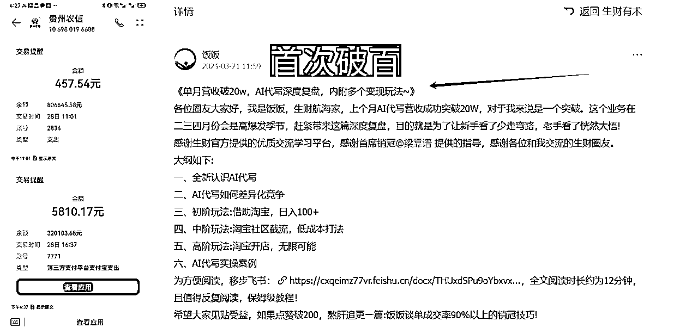

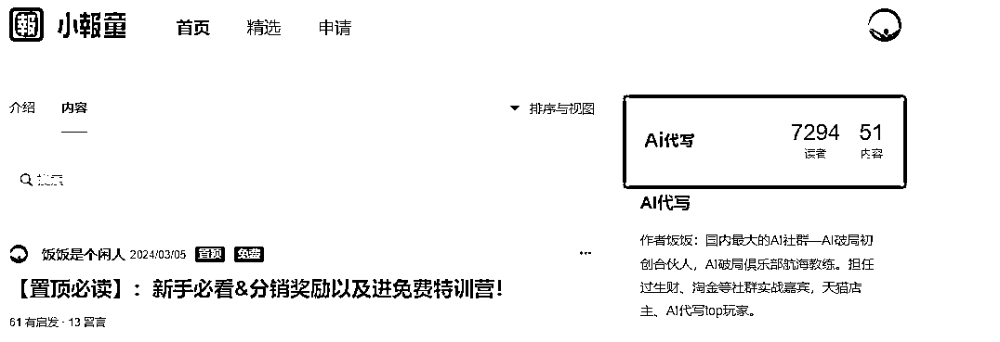

接下来重点复盘，我是如何借助该平台实现低价引流到高价转化的。这套路径学会后，你也能掌握用低门槛产品完成高效转化的闭环。

# 2. 平台机制与流量杠杆

## 1）平台是什么？

小报童本质是付费内容分发渠道，在圈子里常被用来做冷启动与低门槛获客，和知识星球、墨问便签、陪伴群等工具类似，原理相近。

该平台提供两种收费形态：

订阅制，适合做长期陪伴与持续关系维护；

一次性买断，适合做一次性的知识扩散。

不少创作者会用它来撬动个人IP杠杆，短时间内获取首批付费用户，建立影响力后完成破圈。

可以把产品看作一次试探。核心思路是用低门槛吸客，再逐步抬升价值。比如推出一份定价十元左右的AI写作变现手册，用户几乎无压力就能体验服务与课程体系，进而成为进入你体系的入口，把经验转化为用户认可、口碑与流量。

## 2）打磨拳头内容

先想清楚：内容质量决定留存，爆款内容才促成裂变。

创作时切忌敷衍。即使定价不高，品质必须过硬，否则直接影响购买意愿与复购。当前不少创作者用AI直接生成，缺乏实操，导致号召力不足。

优质的专栏应具备独特性、可用性与可执行性，让人感受到真实收益，才有动力为你付费。如今用户很敏锐，能分辨是否用心。拳头内容既是留存根基，也是让用户主动传播的关键，好的内容最容易带来增量。

## 3）定价与定位

记住原则：轻量、实用、高价值。

举例：我选择做AI写作专栏，是因为当时赛道空缺，且我本身深耕此道。其他创作者尚未覆盖细分领域，我能给出独特视角与方法，比如提示词构建、实操工具用法、高效接单手段等。

社群里也积累了大量新手常见问题。结合写作赛道的旺淡季，我选择旺季上线，借需求高峰实现爆发。

好专栏需要清晰定位，常见做法有：

专业思考型：产品设计、跨境电商、投资、AI写作、公文写作、影视等；

个人成长型：职场成长、心理成长、创业复盘等；

信息精选型：读书摘录、播客精华、文章推荐等。

掌握方法后，结合自身背景设计产品与转化链路。

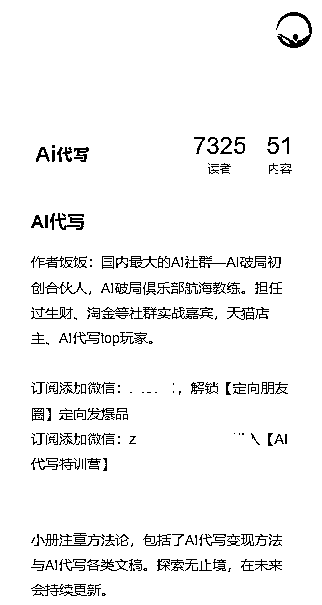

## 4）低价为何能高转？

从心理层面看，小额支出能大幅降低决策阻力，人们更愿意花一点钱先试试。低价高质是建立信任的前置动作，也是给用户“先赚到”的体感。我的理解是，该产品是获取首批付费用户的引流载体，单靠小册很难盈利。起初定价10元，后抬至29.9元，册子本身不赚钱，但借助它沉淀了大量私域，后端高客单变现累计超60万。

初期内测价10元，相当于一杯饮品的成本，即便犹豫也不会觉得亏；内容若好，会产生惊喜，促使用户持续跟进。早期不少用户经分销KOL朋友圈购买，未加微信，后续在内容更新中主动添加。价格弹性高的品类，低价策略越吃香。如今市面上大多数专栏定价10元，因这是平台最低指导价。十元虽低，也要做到物超所值。内容千篇一律，质量才是核心。

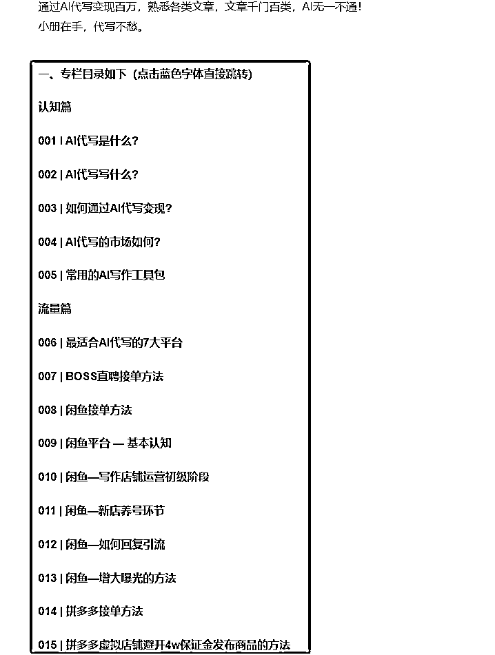

低价只是第一步，真正留住人的仍是内容质量。我做每个专栏都亲力编写，从工具解析到实操技巧，从模板到获客交付，每个环节都精雕细琢。内容为王，提供真正有价值的干货，让用户有“赚到”的体感。

# 3. 产品发行四步法

### 1）精准定位，找准需求

想大卖，先要清楚用户在找什么、缺什么。需求明确，痛点清晰，转化才会高。

定位最好结合专业或业务经验、兴趣，找到市场缺口并解决。我选AI写作，因自身业务实现爆发。有句话说“未来已来，只是分布不均”，AI写作让我一年内实现百万营收，掌握赛道方法。

在实操变现的同时，也帮朋友分享技巧，我认为AI能充当万能文字助手，几乎所有文字需求都能被替代。

该手册内容全面，有望成为千订爆品。当时有洋哥与破局合伙人的加持，信息更充分。我把定位定为给出流量获取方法论与写作实操路径，符合营销逻辑：不是“我很棒”，而是“我懂你的困境，这是解决方案”。我确实给出了AI写作领域的落地方案。

### 2）价值必须超出预期

专栏要开门见山、有用、有思考，让订阅者产生超值感。不要空谈，信息差易被打破。实操手册、保姆级教程满网都是，用户已信息过载，精力有限。即便十元，用户买的也不是便宜，而是效率。

### 3）附加权益，激发传播

过去常见做法是“订阅送交流群”，起初有效，后期群常成死群，难运营。流量可一次性获取，私域却需长期经营。

后来我把附加权益升级为5天轻量特训营，参考破局合伙人水龙大佬的发行打法。此类短训营核心是陪伴。很多人买知识付费要的不只是资料，而是有人一起做、有人答疑、有圈子氛围。短频快训练营激活了老用户，也带来200+自发推荐增长。

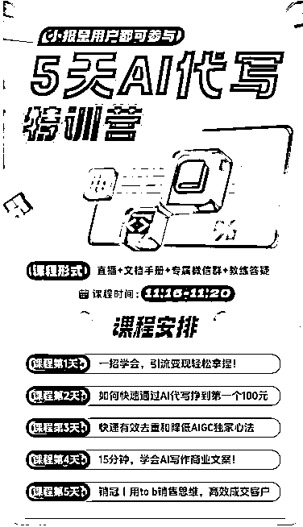

用户体验到超预期交付后，会自发推荐给身边人。知识付费遵循社会认同，人更信任他人的选择，这也是私域大佬持续做裂变的原因。先拿下第一批用户，给出超出预期的交付，就能迎来第二、第三波。口碑一旦启动，订阅量如滚雪球般增长。

### 4）物料准备

提前备好分销权益、文案、海报、奖励红包、说明、目录导图等。发行启动后大量用户涌入，若准备不足会浪费种子用户与裂变机会。

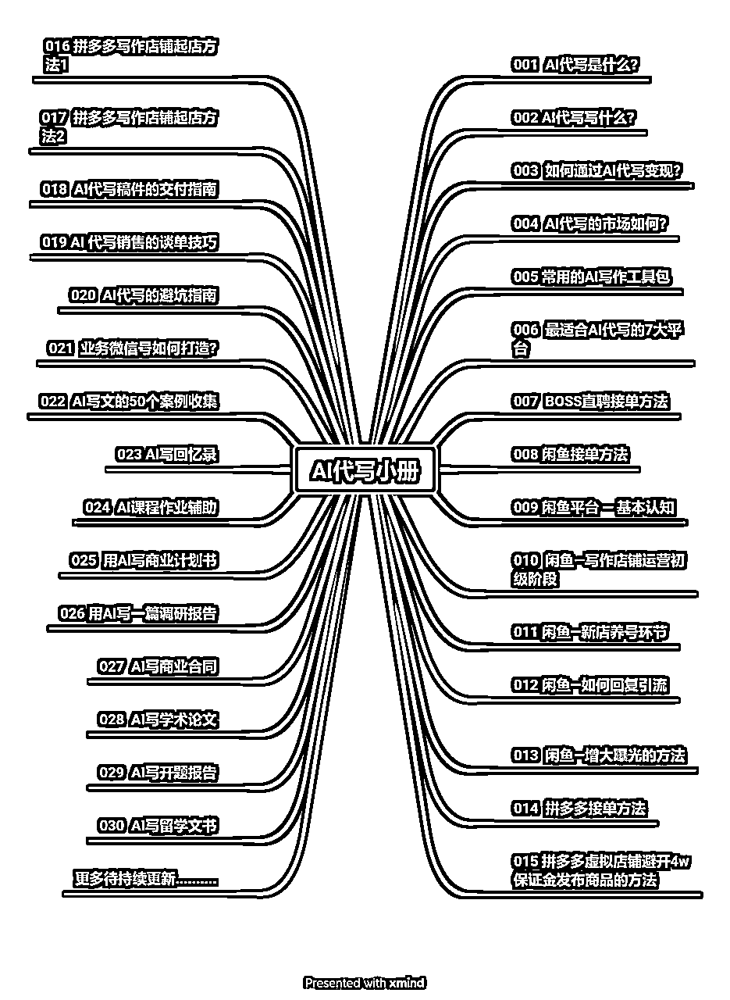

# 3. 精益准备，蓄势待发

准备就绪后开始邀约KOL，梳理可参与分销的好友，提前沟通，给足尊重与时间，大佬才愿带你玩。

### 1）确定分销权益

机制很关键，现金加虚拟权益组合效果好，如课程、社群福利、书籍或名片曝光。很多人对曝光感兴趣，若自身流量不足，可联合几位朋友做联合曝光，让参与者觉得有利可图，传播效果倍增。

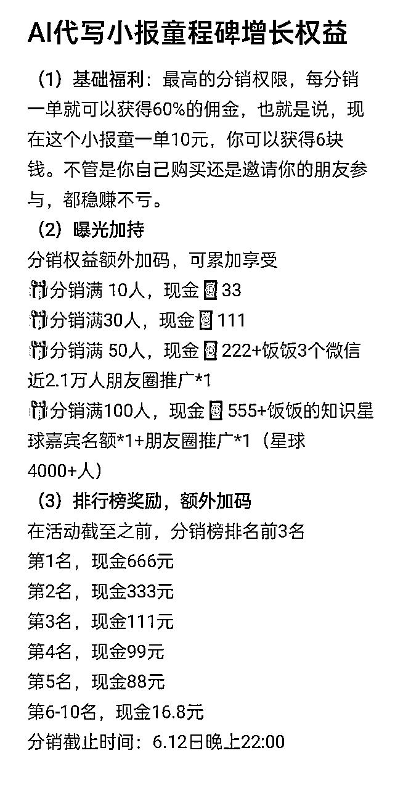

### 2）定向邀约KOL

此环节极重要，提前锁定有影响力的头部。首发第一波很关键，目标单日破千订，更易冲击高订阅，遵循二八原则，80%的首批订阅靠20%的关键人带动。

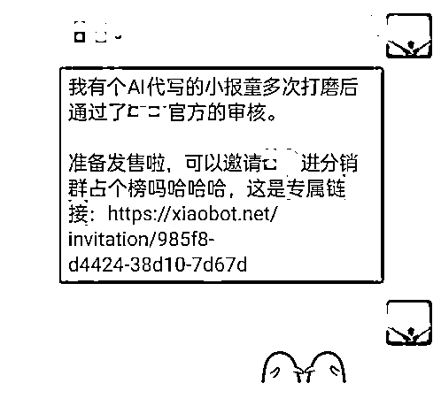

### 3）集中发售，形成声量

邀约到位后，快速在朋友圈、公众号、星球等渠道同步发声，形成刷屏效应，多发多造势，邀请更多人加入分销，形成势能。围观者会觉得项目势头强，更愿参与支持。

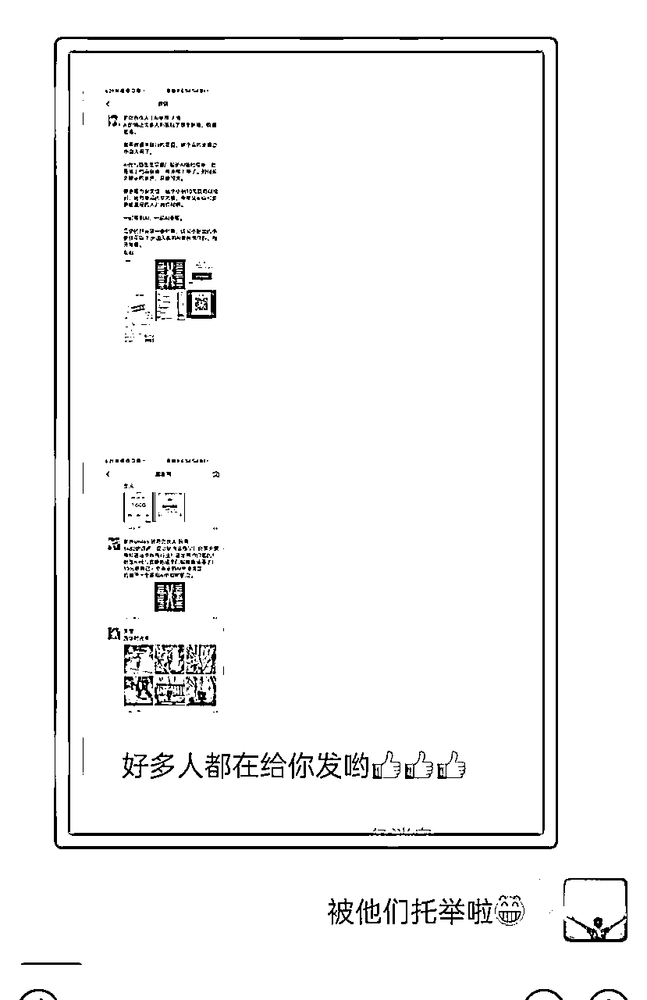

### 4）做好承接

发售后会有大量加好友请求。身边人常用RPA工具自动同意好友与拉群，大幅提升效率。我曾因人工同意、打标签耗费大量时间。建议提前准备承接微信号，单号每日被动添加约180人，按预估流量准备，并调整权限设置。

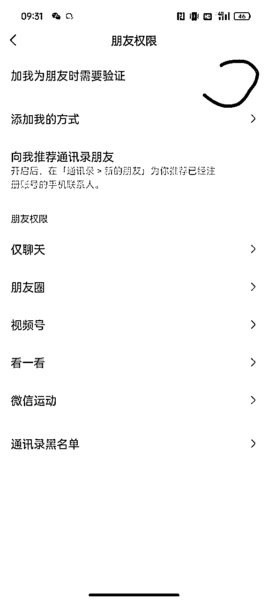

### 5）顺势裂变

若内容质量过关，订阅用户中不少人愿加入分销。在添加时顺势引导，留下钩子，邀请分销。

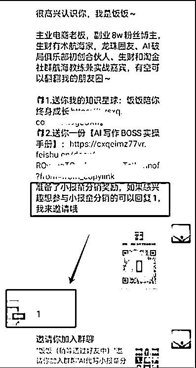

### 6）分销群保持活跃

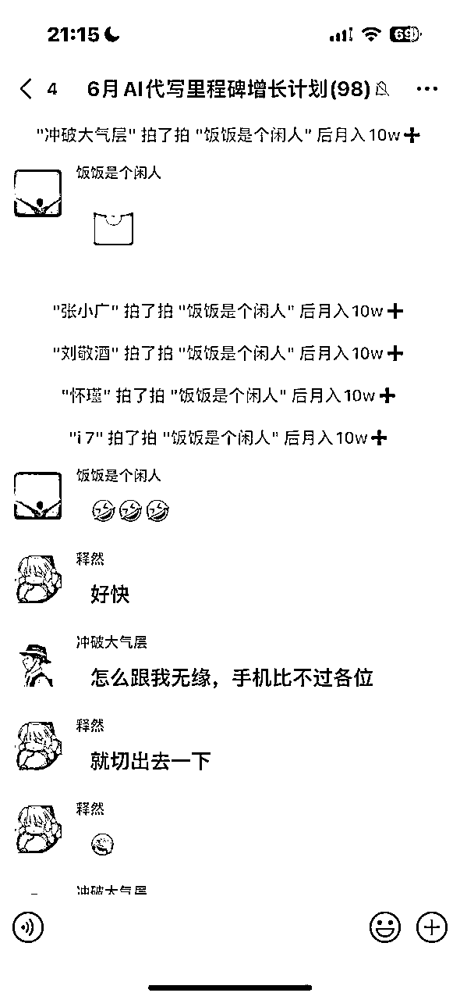

### 7）榜单前三保持悬念

不同参与者的圈层与影响力不同，分销数据自然差异大。若普通人一直被大V压制，会失去参与兴趣。可给头部额外奖励不占榜，或像我一样隐藏榜单，保留悬念，让素人也有冲上百单的机会。

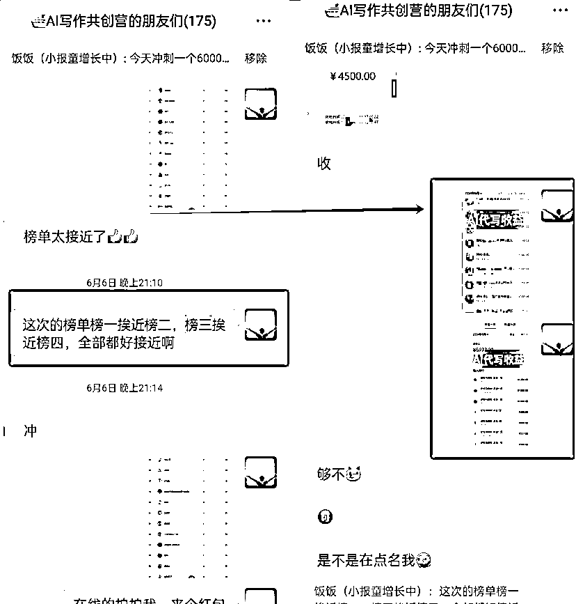

### 8）及时更新榜单

保持每日更新节奏，结合分销奖励引导伙伴在群内报喜、分享出单经历。每日榜单刷新能持续调动氛围，让大家感觉都在冲刺。

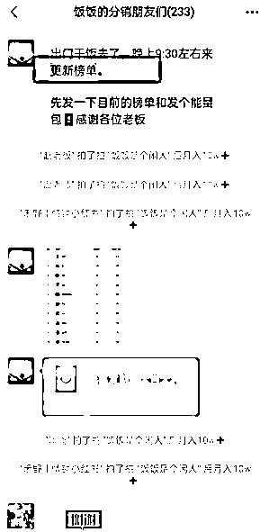

# 4. 流量闭环：从引流到高价转化

承接与转化是关键，要想留存必须持续给价值。

设计钩子让用户进入私域，如微信、社群、星球，再做分层产品阶梯，从试水到深度转化。

例如：首层十元入门专栏，后续根据交付能力设计进阶产品。我个人路径为专栏→共创营→私教，对应10元→980元→4980元。实操后发现阶梯不宜过多，两层更顺滑。

### 1）海报引流

订阅不是终点，而是起点。很多人订阅后不会主动添加。把微信号留在介绍海报上，并附带领取资料包福利，操作简单直接。经多次测试，两种方式效果好：进交流群、解锁定向朋友圈。

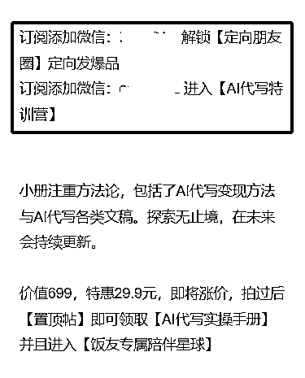

### 2）软文植入需求

在每篇文章结尾自然引导，如“若你在AI写作中遇到XX问题，可交流，或加入知识星球讨论”，附上公众号链接与软文介绍。信任建立在持续价值输出上。

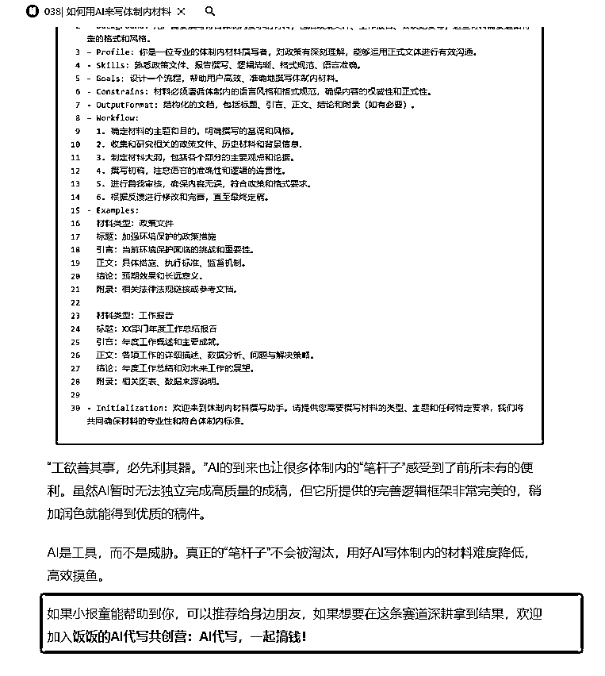

### 3）发售裂变

准备发售群，进入产品发行流程。保证品质与超预期交付，邀请用户入群，实现基数扩张与裂变。尽可能把订阅用户都纳入社群，形成交流氛围。

专栏短期可能看不到明显利润，但其价值在于以低价搭建用户池，为后续高价产品提供强劲后备军。

以上流程跑通后，便形成完整闭环：准备→发行→沉淀基础流量。希望对你有启发，持续涨粉，变现通畅。

以上经验分享，欢迎交流。