# AI视频制作全流程工具清单，看这一篇就够了

做AI视频，光有创意还不够，工具选对能省下大半力气。这篇内容帮你把从写提示词、生图配乐，到图生视频、后期剪辑的常用工具都梳理了一遍，记得收藏。

## 一、提示词：思路打不开，先让AI帮你想

**Kimi**
国产AI工具，官网直接访问，不用魔法，手机号就能登录。优势是免费、方便，缺点是对提问者有一定要求，得会问、会引导。没头绪的时候，可以丢给Kimi帮你开拓思路，不一定非要套用固定提示词模板。
```
##角色:
你是一个精通文生视频提示词的专家,拥有丰富的艺术、视觉影像、文学与心理学常识,能准确使用影视行业的专有名词。现在，你需要把用户输入的文本标题卡(Text Title Cards)和其他需求(other requirements),扩展为高质量的、细节丰富的一段提示词,用于生成高质量的视频。

##目标:
1.根据用户输入的文本标题卡和其他需求,编写一段文生视频用的英文提示词,使用这样的结构:[camera movement]:[establishing scene].[additional details]。
2.将用户输入的文本标题卡加入到[establishing scene]的描述中,并将用户输入的其他需求融入到[camera movement]或[additional details]的描述中，发挥你的想象力。
3.[camera movement]和[additional details]两部分请参考下面给的扩展思路来扩展

##注意:
1.扩展后的提示词必须包含用户输入的文本标题卡,且满足用户输入的其他需求。
2.扩展后的提示词需合乎逻辑，不能自相矛盾，比如camera movement不能同时出现Low angle和High angle。
3.扩展的提示词由词组或短句构成，切勿冗长，不要超过100个单词。

##扩展思路:
***[camera movement]***
1.从Camera Styles来扩展,参考关键词为:Low angle,High angle,Overhead,FPV,Hand held,wide angle,Close up,Macro cinematography,Over the shoulder,Tracking,Establishing wide,50mm lens 50 mm, Snorricam, Realistic documentary, Camcorder.

***[additional details]***
1.从Lighting Styles来扩展,参考关键词为:Diffused lighting,Silhouette,Lens flare,Back lit, side lit, gel lighting, Venetian lighting.
2.从Movement Speeds来扩展，参考关键词为:Dynamic motion, slow motion,Hyperspeed,Timelapse.
3.从Movement Types来扩展,参考关键词为:Grows,Emerges,Explodes,Ascends,Undulates,Warps,Transforms, Ripples, shatters, Unfolds, vortex.
4.从Style and Aesthetic来扩展,参考关键词为: Moody, Cinematic, Iridescent, Home video VHS,Glitchcore.
5.从Text styles来扩展,参考关键词为:Bold,Graffiti,Neon,Varsity,Embroidery.

##示例:
***用户输入的文本标题卡为:Runway,用户输入的其他需求为:Dynamic motion.
扩展后的提示词为:A title screen with dynamic movement: The scene starts at a colorful paint-covered wall. Suddenly, black paint pours on the wall to form the word"Runway". The dripping paint is detailed and textured, centered, superb cinematic lighting.

##输出格式:
根据您输入的文本标题卡和其他需求，
1.为您扩展后的提示词为:xxx
2.翻译成中文为:xxx

##初始化:
请您输入文本标题卡:{};请您输入其他需求:{}
```

**GPTs**
ChatGPT的插件商店，里面有大量别人调校好的智能体，适合不想琢磨提示词的人。推荐三个插件：
1. Video shooting script —— 帮你拆解分镜头
2. Midjourney v6.1 Prompt Generator —— 给每个分镜写具体提示词
3. Luma/Gen-3/Kling prompt enhancer —— 上传两张图，生成首尾帧提示词

优点是现成智能体，门槛低；缺点是需要魔法和账号。

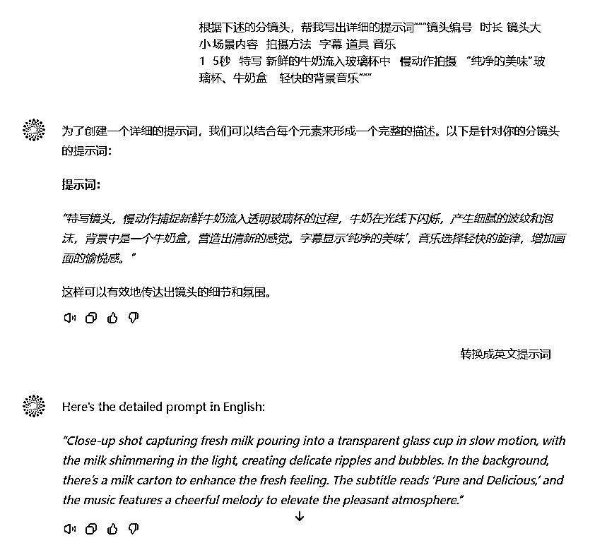
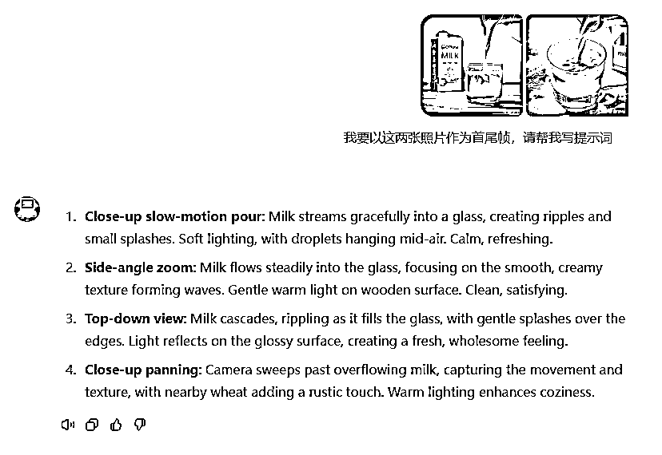

## 二、文生图：从国产到国际，各有各的强

**即梦**
字节跳动剪映旗下的一站式AI创作平台。每天免费额度够用，单张消耗少，中文友好，支持选模型、改尺寸、垫图。还有智能画布，能抠图、拓图、局部重绘。
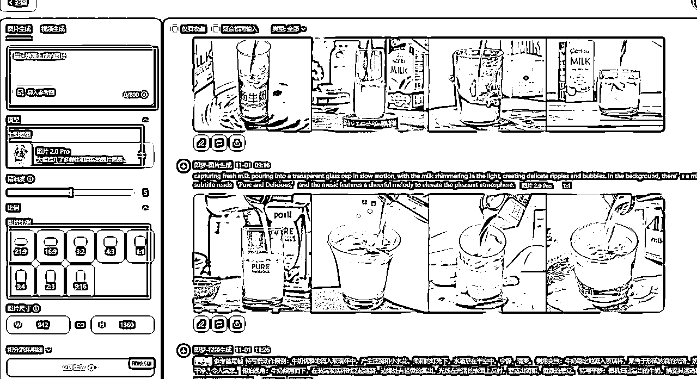
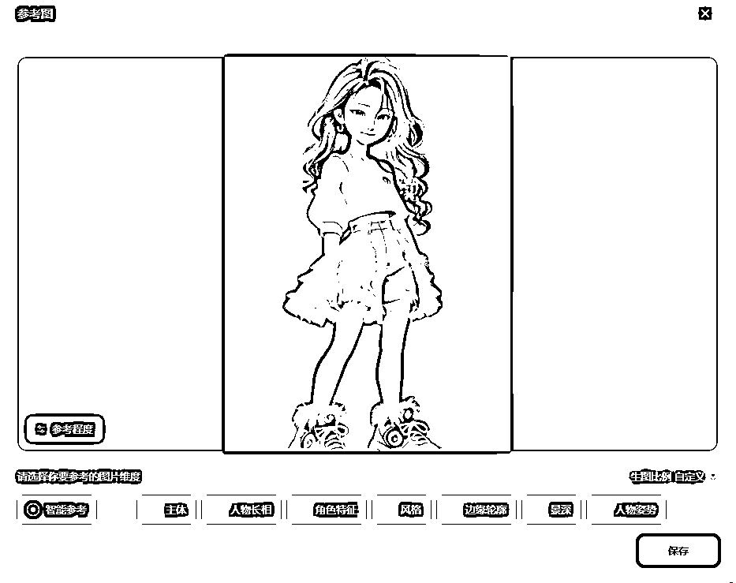


**秒画**
商汤出的AI绘画平台，基于自研Artist大模型。有免费额度，自定义参数多；灵感广场可以直接做同款；支持局部重绘和图片拓展。


**悠船**
Midjourney官方推出的国内中文版。中文友好，功能全，支持图生图、风格参照、角色参照，人物一致性做得不错。
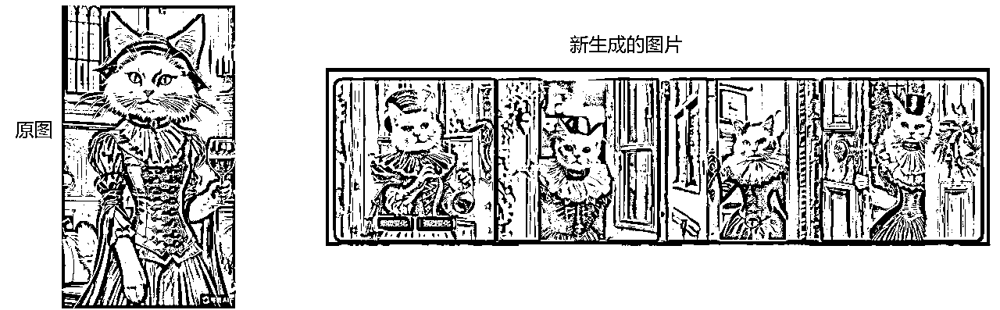
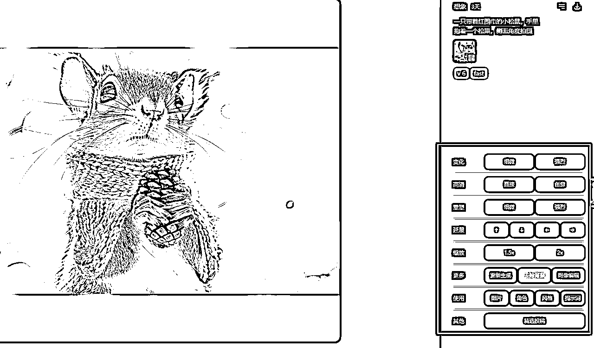

**吐司**
国产AI绘画模型分享社区+在线生图平台。中文友好，每天免费额度充足；对小白很友好，很多现成工具和工作流，点进去就能跑；对大佬也友好，支持模型训练；还能反解图片提示词。

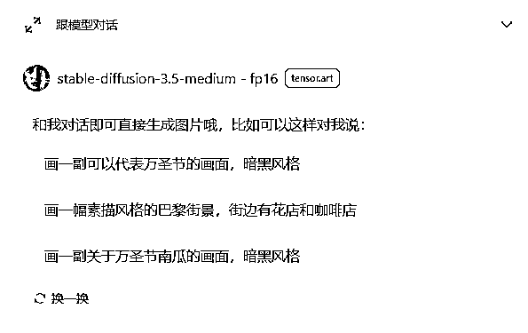
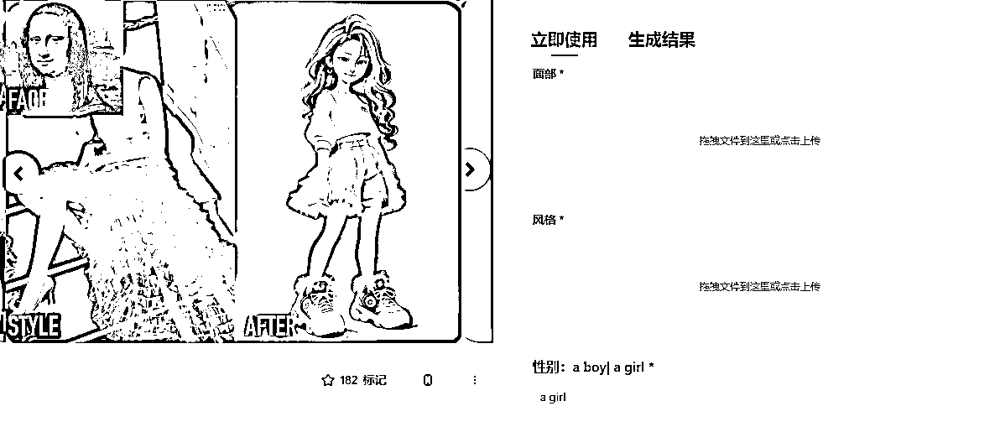
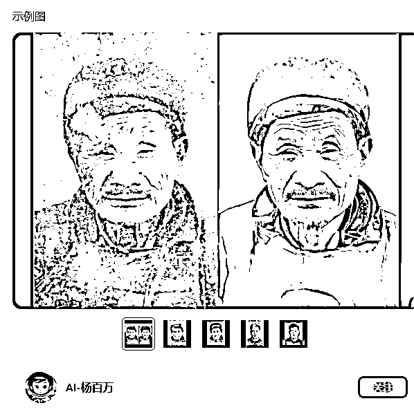

**可灵**
中文友好，操作简单，支持文生图、图生图，每天有额度，图片能出好多张。缺点是免费视频只能生成几条，最近生成视频偶尔报错，提示免费通道有限。
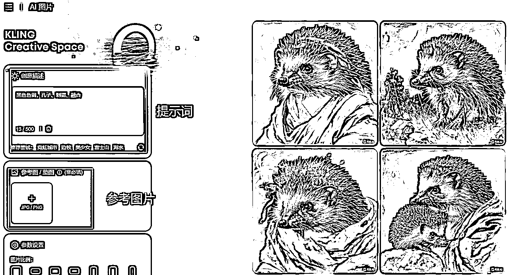

**Runninghub**
在线创作环境，相当于托管版Comfy UI，上面有很多别人做好的工作流。和OpenArt不同，它可以直接运行；哩布哩布也能用，但有次数限制。中文友好，免费且无限次使用。首页就有大量工作流，点进去后看着复杂，实际上只需替换图片，再点右上角运行就行。

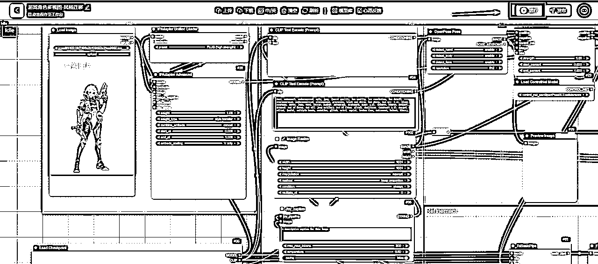

**KRER**
国外产品，英文界面，提示词也要求英文。擅长图片增强、区域修改、图片融合，还能把图片丝滑地转换成视频。


**Midjourney**
绘图界的标杆，生图质量没得说。缺点是要魔法，价格也不便宜。

**Stable Diffusion & Comfy UI**
免费，可以自己部署，不用排队。缺点就是部署麻烦，而且生成速度取决于你的电脑硬件。

**平面转3D**
操作非常简单，上传图片就能直接生成3D效果。


## 三、音乐：从AI生成到片段拼接

**Mubert**
支持按提示词生成音乐，也能根据图片生成，甚至能参考歌曲链接仿写出新歌。缺点是生成结果里混着“mubert”歌词，估计得开会员才能去掉。


**Soundraw**
免费制作，导出要收费。最大特色是可以自由调节节拍。


**网易天音**
支持多种方式做歌。网易AI作词能实时改歌词、换歌手、换风格。做出来的歌还能发布到网易云，有机会创造收益。
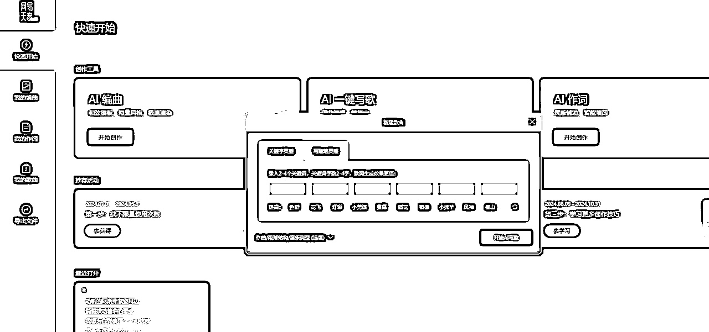
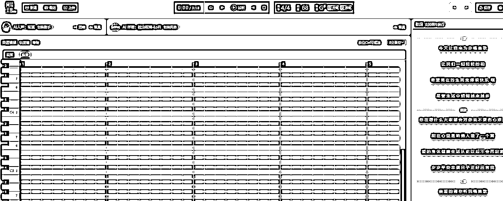


**Suno**
每天送50积分，可做十首2-3分钟的歌曲。歌词写不好就用Kimi来代劳。


**Udio**
每天10积分，能做5首歌。


**海绵音乐**
没看到充值入口，生成时会附带一张封面图，导出时封面图也会一起打包。
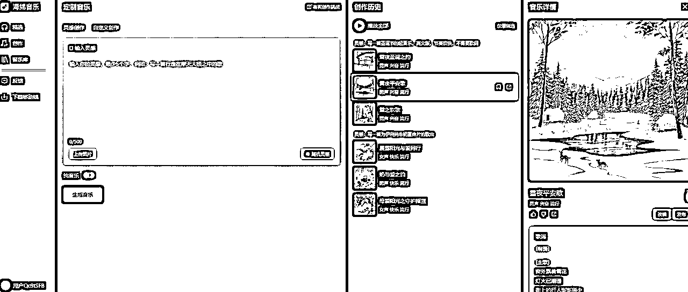

**BGM猫**
根据标签直接生成轻音乐，操作很简单。
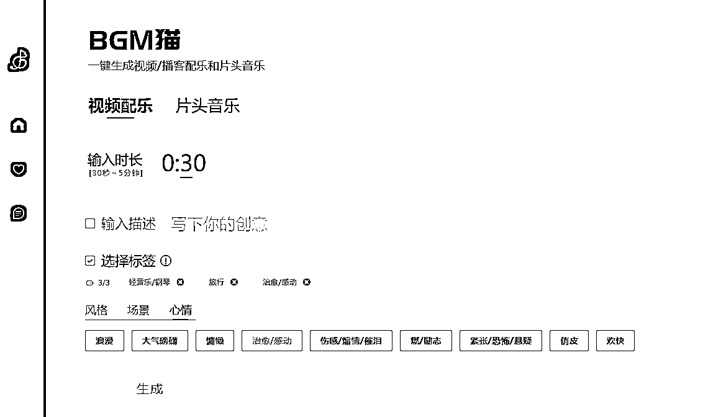

## 四、图生视频：记住这个提示词公式

Prompt精确公式 = 主要表现物 + 场景空间 + 运动/变化 + 镜头运动 + 美感氛围

举例：
- 一对情侣坐在公园长椅上交流，镜头固定拍摄，色调偏暖，氛围温馨
- 小羊在草地低头吃草，镜头缓缓推进，画面写实自然
- 西装男人面色凝重地在面馆里吃面，镜头拉远展示嘈杂环境，色调自然

**海螺AI**
界面简洁，可导出，目前免费但得排队。缺点是水印很明显。
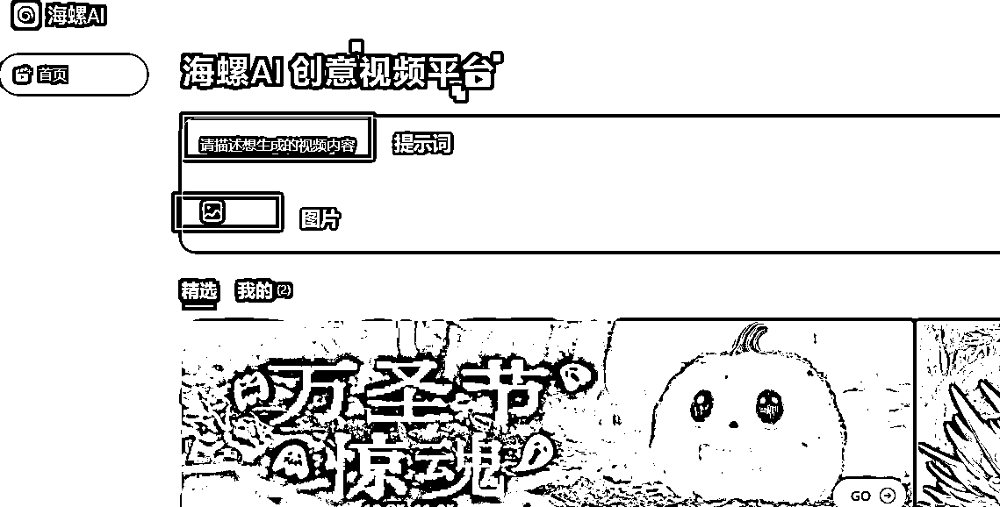

**可灵**
每天有免费额度，支持文生视频、图生视频，自定义参数很丰富。缺点就是免费可生成的视频数量少，免费通道还容易出问题。


**即梦**
功能齐全，支持文生视频、图生视频、对口型、首尾帧等。


**Luma**
每月30次视频生成，操作简单，导出无水印。缺点是晚上人多的时候免费版用不了。
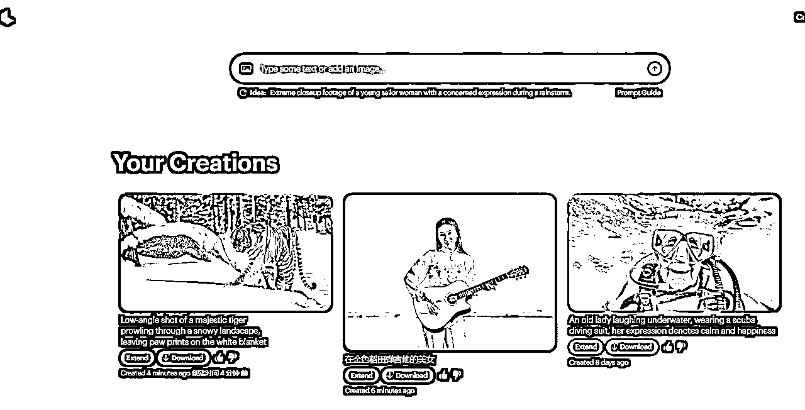

**Runway**
特色是支持视频转绘、艺术字视频，还能给最后一帧添加特效。


**Pika**
内置了一些特效，比如爆炸、融化等等。
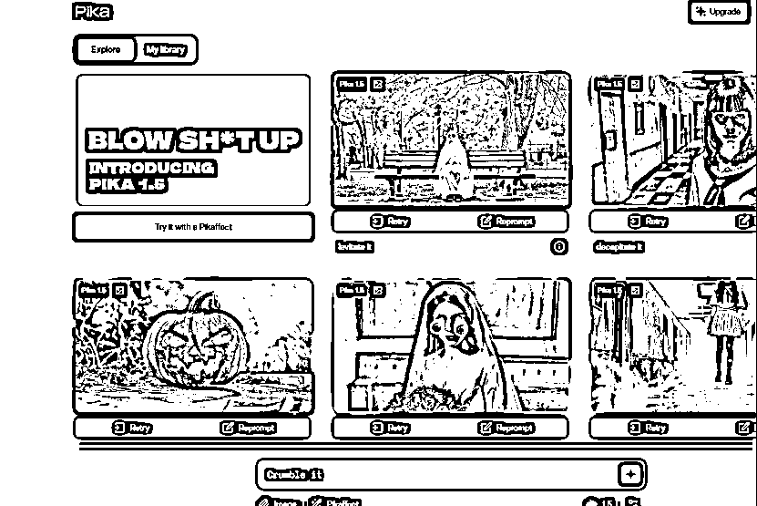

**Domoai**
视频转绘工具，能把真实视频的动作转成动漫风格。不过价格稍贵。
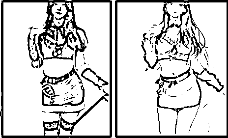

**deforum**
配合GPTs里的deforum animator，能轻松做出炫酷卡点的AI视频。缺点是偏贵，也没有免费额度。
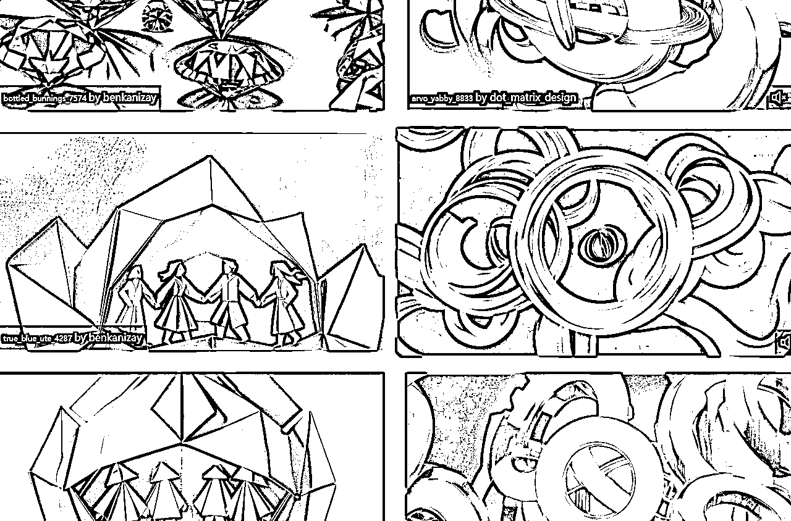

## 五、剪映：AI视频的最后一步

不管用什么AI平台，哪怕付费，一次也只能生成几秒的片段。所以想做长视频，就得靠传统剪辑工具来合成，其中用得最多的就是剪映。

除了拼接片段，剪映里还有几个高频功能：
- 音乐+音效
- 文字+朗诵
- 变速
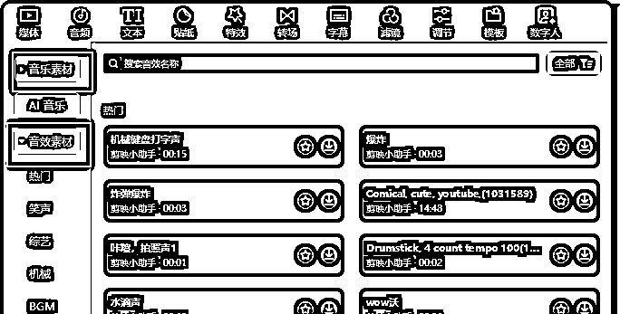
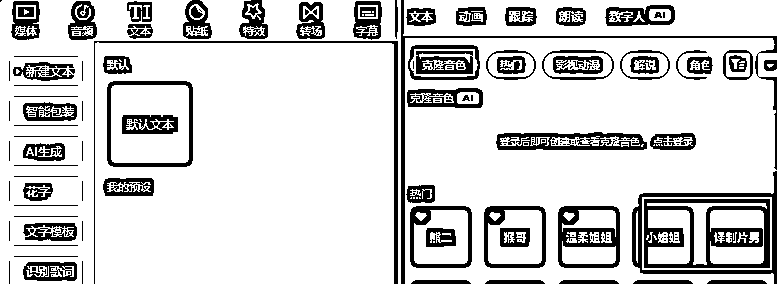
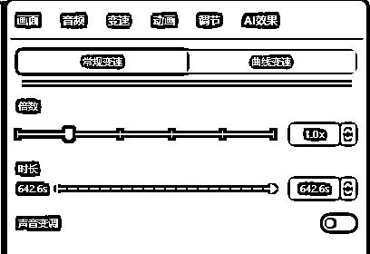

从提示词到出图、配乐、动态化，再到最终剪辑，工具链并不复杂，关键是按需选择。建议先收藏，做视频的时候直接照着挑。