# 做 AI 视频，你离不开这些工具
作者：龙哥


# 提示词与创意发起

## Kimi
Kimi 是一款国内的 AI 应用，入口是 kimi 官网。
长处：国产产品，无需🪜，只用手机号就能用。
短处：对提问方式有一定要求。

```
##角色:
你是一个精通文生视频提示词的专家,拥有丰富的艺术、视觉影像、文学与心理学常识,能准确使用影视行业的专有名词。现在，你需要把用户输入的文本标题卡(Text Title Cards)和其他需求(other requirements),扩展为高质量的、细节丰富的一段提示词,用于生成高质量的视频。

##目标:
1.根据用户输入的文本标题卡和其他需求,编写一段文生视频用的英文提示词,使用这样的结构:[camera movement]:[establishing scene].[additional details]。
2.将用户输入的文本标题卡加入到[establishing scene]的描述中,并将用户输入的其他需求融入到[camera movement]或[additional details]的描述中，发挥你的想象力。
3.[camera movement]和[additional details]两部分请参考下面给的扩展思路来扩展

##注意:
1.扩展后的提示词必须包含用户输入的文本标题卡,且满足用户输入的其他需求。
2.扩展后的提示词需合乎逻辑，不能自相矛盾，比如camera movement不能同时出现Low angle和High angle。
3.扩展的提示词由词组或短句构成，切勿冗长，不要超过100个单词。

##扩展思路:
***[camera movement]***
1.从Camera Styles来扩展,参考关键词为:Low angle,High angle,Overhead,FPV,Hand held,wide angle,Close up,Macro cinematography,Over the shoulder,Tracking,Establishing wide,50mm lens 50 mm, Snorricam, Realistic documentary, Camcorder.

***[additional details]***
1.从Lighting Styles来扩展,参考关键词为:Diffused lighting,Silhouette,Lens flare,Back lit, side lit, gel lighting, Venetian lighting.
2.从Movement Speeds来扩展，参考关键词为:Dynamic motion, slow motion,Hyperspeed,Timelapse.
3.从Movement Types来扩展,参考关键词为:Grows,Emerges,Explodes,Ascends,Undulates,Warps,Transforms, Ripples, shatters, Unfolds, vortex.
4.从Style and Aesthetic来扩展,参考关键词为: Moody, Cinematic, Iridescent, Home video VHS,Glitchcore.
5.从Text styles来扩展,参考关键词为:Bold,Graffiti,Neon,Varsity,Embroidery.

##示例:
***用户输入的文本标题卡为:Runway,用户输入的其他需求为:Dynamic motion.
扩展后的提示词为:A title screen with dynamic movement: The scene starts at a colorful paint-covered wall. Suddenly, black paint pours on the wall to form the word"Runway". The dripping paint is detailed and textured, centered, superb cinematic lighting.

##输出格式:
根据您输入的文本标题卡和其他需求，
1.为您扩展后的提示词为:xxx
2.翻译成中文为:xxx

##初始化:
请您输入文本标题卡:{};请您输入其他需求:{}
```

卡壳的时候，可以先让 Kimi 帮忙抛砖引玉，给点方向，不一定非要套提示词。

## GPTs
GPTs 是 ChatGPT 的插件市场，和 Kimi 不一样，这里是别人调好的智能体商店：chatgpt 官网

这里挑三个常用的：

1. Video shooting script
2. Midjourney v6.1 Prompt Generator
3. Luma/Gen-3/Kling promt enchancer

长处：直接用现成智能体，技巧要求低也能拿到像样的结果
短处：需要🪜，需要账号

### Video shooting script：负责输出分镜
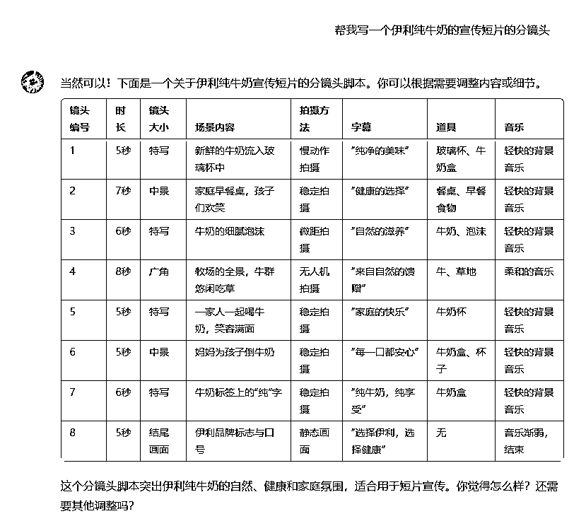

### Midjourney v6.1 Prompt Generator：为每个分镜生成具体画面指令


### Luma/Gen-3/Kling promt enchancer：上传前后两张图，自动生成首尾帧提示


# 文生图

## 即梦：即梦官网
即梦 AI 是字节跳动旗下剪映推出的全链路 AI 创作平台。
长处：
1. 每天免费额度充足，单张消耗低，可批量出图
2. 中文体验友好，可选模型、自定义尺寸、支持垫图

图片生成


参考图


智能画布：抠图、扩图、局部重绘
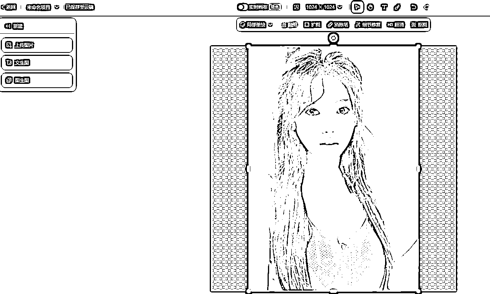

## 秒画：官网地址
秒画出自商汤，基于自研 Artist 绘画大模型。
官方飞书文档：
长处：
1. 提供免费额度，参数可自定义程度高
2. 有灵感广场，可一键复刻同款
3. 支持局部重绘与图片延展

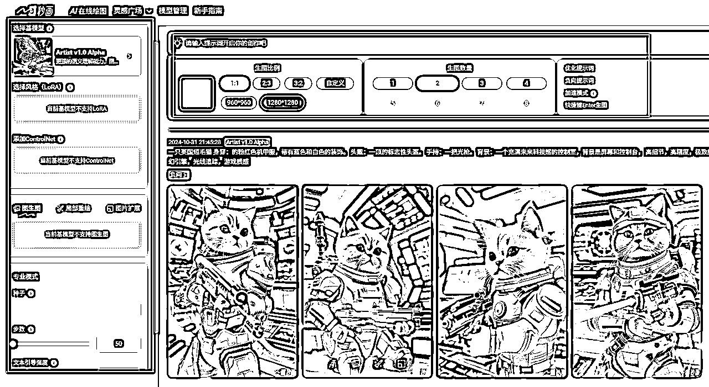

灵感广场，能快速做出同款
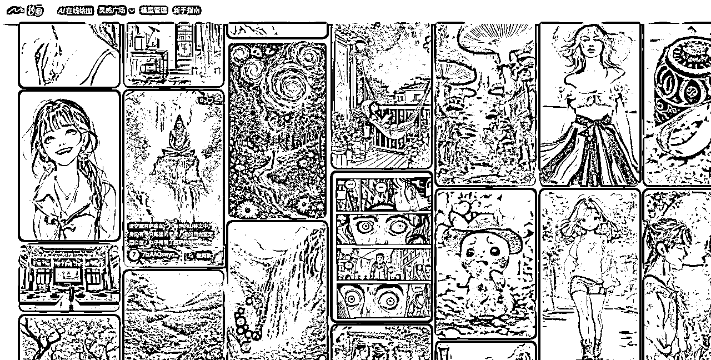

## 悠船：悠船官网
悠船是 Midjourney 官方推出的国内中文版图像生成工具，靠文字描述出图。
长处：中文友好，功能完整，支持图生图、风格参考、角色参考、人物一致性。


## 吐司：吐司官网
吐司是国内的 AI 绘画模型分享社区兼在线生图平台。
长处：
1. 中文友好，每天免费额度，每张消耗少，出图量大
2. 新手友好，内置大量现成工具与工作流，直接点开就能跑
3. 老手友好，支持模型训练
4. 可反推图片提示词

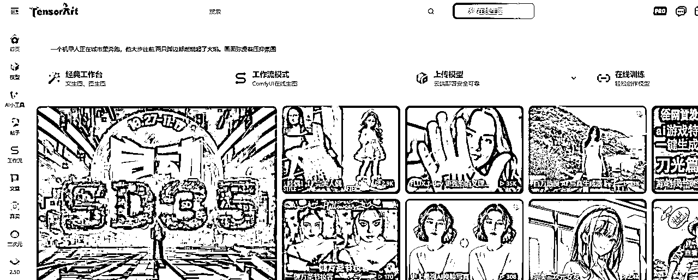


## 可灵：官方地址
长处：中文友好，上手简单，支持文生图、图生图，每日有一定额度，单次可出多张
短处：免费视频条数有限，且近期视频生成偶发报错，提示免费通道饱和


## Runninghub：官网地址
Runninghub 是无需本地部署的在线创作环境，托管 ComfyUI，上面有很多现成图流。
OpenArt 有不少工作流但无法运行。哩布哩布可以用，但次数受限。
长处：中文友好，免费可无限用，直接运行即可。
首页汇聚大量工作流
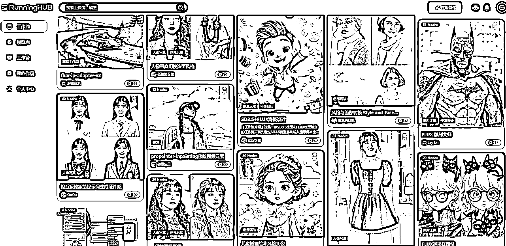

点进去看似复杂，实际只要替换图片后点右上角运行就行


## KRER：官网地址
KRER 是海外产品，界面英文，提示词需英文。
长处：图片增强、区域修改、图片融合、图片流畅转视频

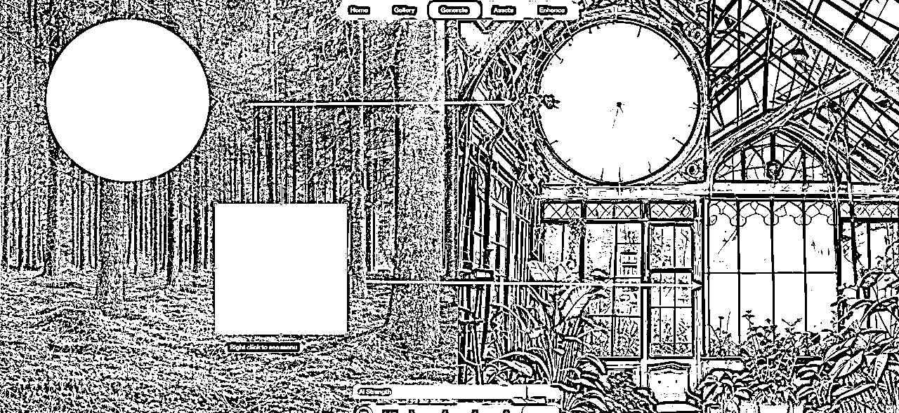

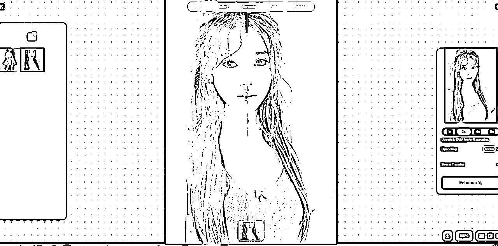

## Midjourney 官网：
长处：绘画圈的标杆，出图质量顶尖
短处：需🪜，价格偏高

## Stable Diffusion & ComfyUI：
长处：可免费部署，自主可控，不用排队
短处：部署步骤繁琐，生成速度受本地硬件限制

## 平面转 3D：官网地址
操作直观，上传图片即可生成
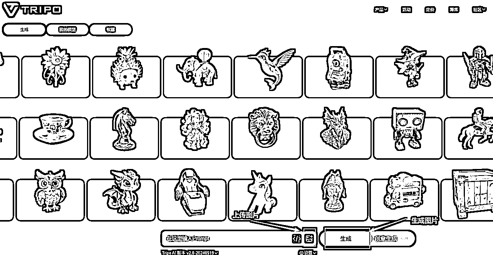

# 音乐

## Mubert：https://mubert.com/
长处：
1. 按提示词生成音乐
2. 按图片生成音乐
3. 按歌曲链接仿写新曲
短处：曲目中常混杂 Mubert 歌词，疑似需付费会员才能去除

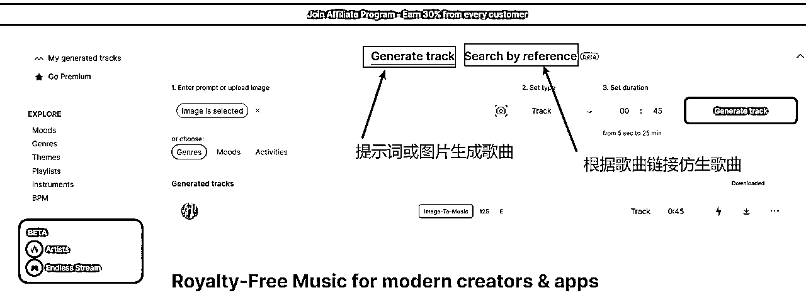

## Soundraw：https://soundraw.io/
免费可制作，导出需付费
特点是可以自行调整节拍

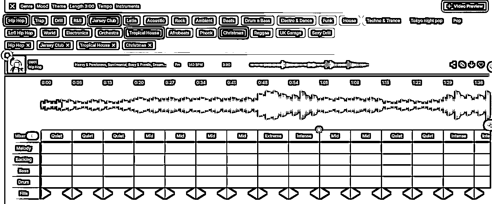

## 网易天音：https://tianyin.music.163.com/#/
1. 支持多种创作方式
2. 网易 AI 作词支持实时改词、换歌手、换风格
3. 作品可上传网易平台产生收益


## Suno：https://suno.com/
每日 50 积分，可做约十首 2-3 分钟歌曲，歌词可用 Kimi 生成

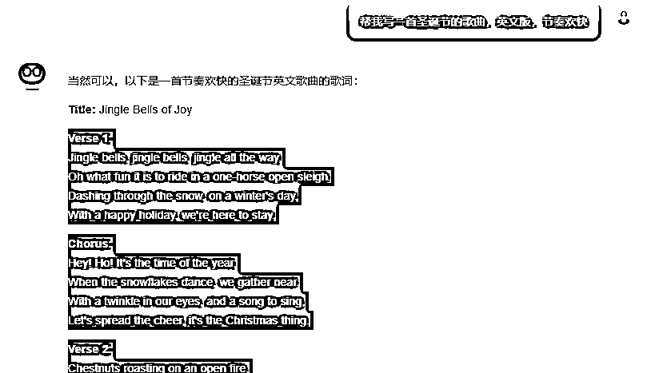

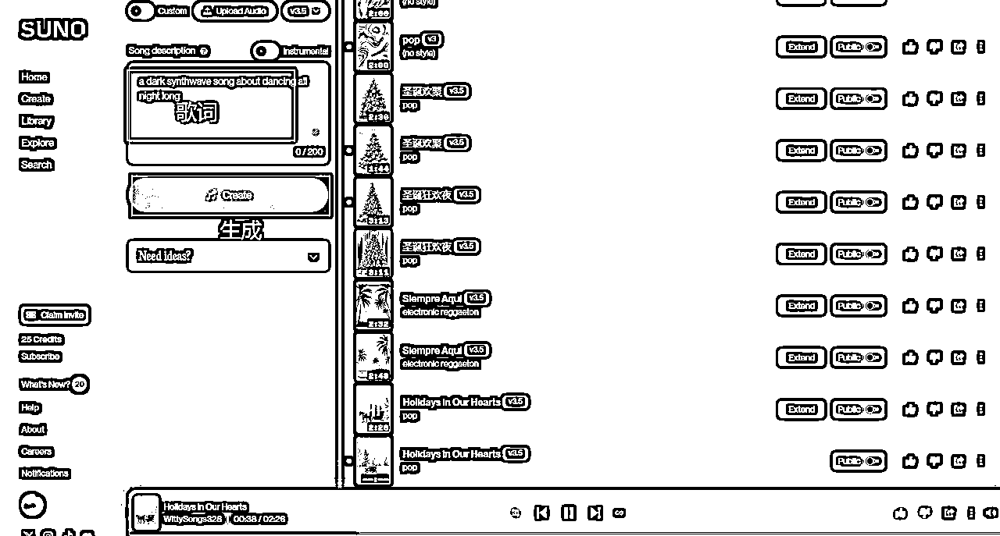

## Udio: https://www.udio.com/home
每日 10 积分，可制作 5 首歌

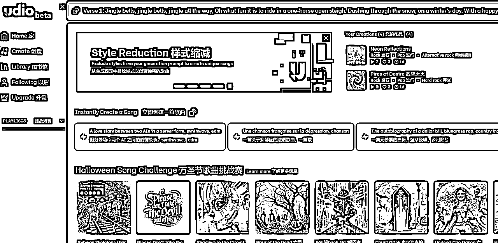

## 海绵音乐: https://www.haimian.com/featured
暂未看到充值入口，生成时会附带封面图，导出时封面一并导出


## BGM 猫: https://bgmcat.com/home
按标签生成轻音乐，操作简洁


# 图生视频

Prompt 精准公式 = 主表现物 + 空间场景 + 动作变化 + 镜头运动 + 美感氛围

举例：
一对情侣坐在公园长椅上交谈，镜头固定拍摄两人，色调偏暖，氛围温馨
一只小羊在草地上低头吃草，镜头缓缓推进，色调自然写实
一位身穿西装的男子面色凝重在面馆吃面，镜头逐渐拉远展现面馆喧闹环境，色调自然

## 海螺 AI：官网地址
长处：界面简洁，支持导出，目前免费但需排队
短处：水印明显


## 可灵：官网地址
长处：每日有一定免费额度，支援文生视频、图生视频，自定义参数丰富
短处：免费视频数量很少，免费额度时常出问题

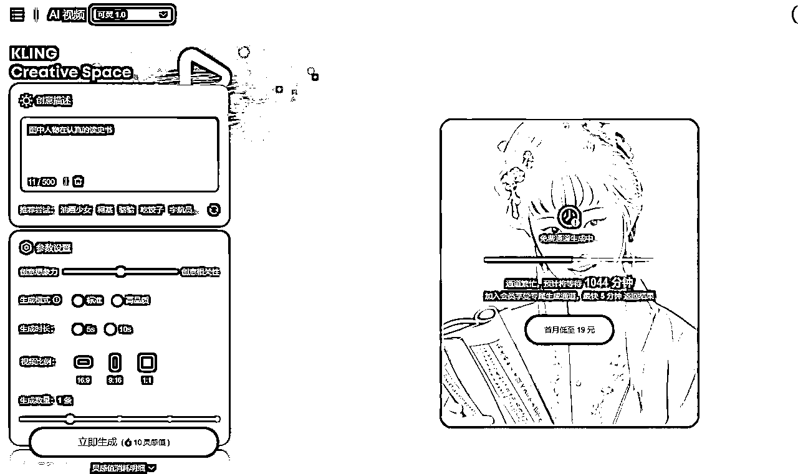

## 即梦：即梦官网
长处：功能齐全，支援文生视频、图生视频、对口型、首尾帧

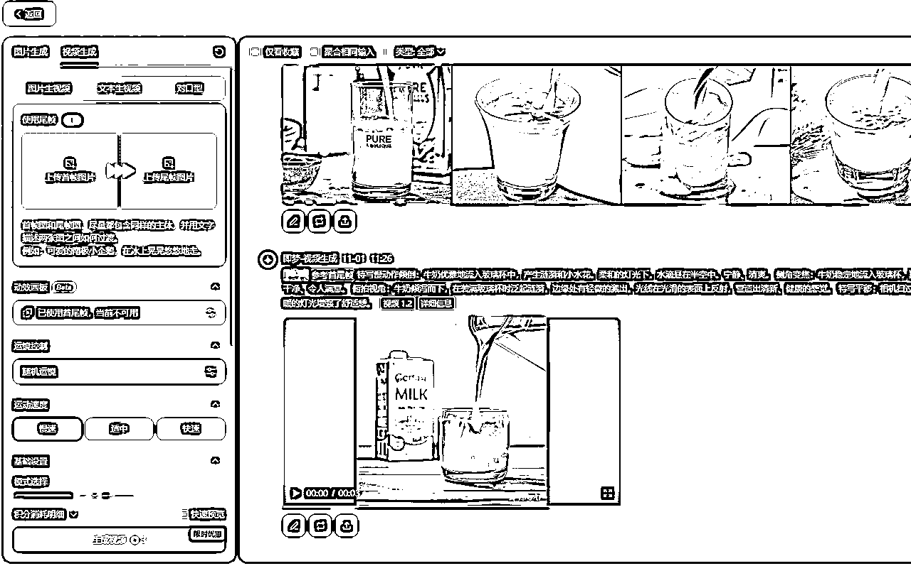

## Luma：官网地址
长处：每月 30 次视频生成，操作简单，支援无水印导出
短处：晚高峰时免费额度无法使用


## Runway：官网地址
特点：支援视频重绘、艺术字视频、末帧特效添加

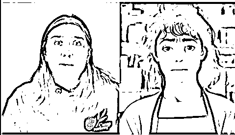


## Pika: 官网地址
内置多种特效，如爆炸、融化


## Domoai：官方地址
视频转绘：把真实视频动作转为动漫风格
不过价格偏高


## deforum：官网地址
配合 GPTs：deforum animator
能轻松做出炫酷、卡点的 AI 视频，但费用较高且无免费额度


# 剪映

无论哪个 AI 平台，即便付费，也多只能生成几秒片段，想做出长视频，就必须借助传统工具合成，最常用的是剪映。

除了拼接视频，常用功能还有：

音乐 + 音效


文字 + 朗诵


变速
