# 从垫底到亚军，我在同城夜校线下航海的实操复盘

> 来源：[https://cx05zf1grzt.feishu.cn/docx/FbygdLggFoQoXQSmvcgf7wnOd](https://cx05zf1grzt.feishu.cn/docx/FbygdLggFoQoXQSmvcgf7wnOd)

大家好，我是阿钦。现在我正跟着天盈教练做同城夜校项目，同期合伙人有奶油、咪咪和小埋。

开局阶段，我们小组是全场最晚开单、最让人不看好的那一队。后来通过不断磨合打磨，最终做到了稳定出单。私域累计破2k+，一个月内成交100+单，总GMV突破5w+，最终总业绩排名第二🥈。

航海收官时，天盈教练感叹，“厦门这次真给了我一个惊喜。”

我们不靠天赋，靠的就是笨鸟先飞的执行力。所以把这次经历梳理成案例，希望能给后来者一些参考。

项目具体情况如下：

## 一、流量起不来时，怎么做出能爆的小红书

厦门夜校项目初期，小红书笔记的数据非常难看，基本都在个位数。核心卡点有两个：

1、小红书在双十一期间把流量大量导向电商，其他垂类内容被挤压；
2、同类笔记太多，内容高度雷同，用户审美疲劳。

在这种情况下，我用两个号把小红书引流群从0做到了900多人，关键就两点：抄作业和换位思考。

### 1、冷启动用热帖激活权重

新号前期可以先发一些高互动的热门话题来抬权。

电影、书籍、剧集这类大众话题就是很好的互动型内容。

当账号数据低迷时，适当发这类笔记能起到激活作用。

我的理解是平台判定内容有潜力后，会给账号额外分配曝光。连续发几篇互动向，系统会自动给你推同类人群，一天3更，很快就能起号。

（有天醒来看到99+，真的太爽了）

### 2、坚持日更3篇

记住这句话，“不管风雨，日行5公里”，多念几遍就记住了。

香菜老师第一天就说过，先别管数据，先养成日更3篇的习惯。

### 3、笔记精细化打磨

我把内容拆成三类来做：

（1）简版课表

打开同行笔记，把配图扒下来去水印，再用WPS改名字即可。

操作：导入图片→插入→截屏→取同色覆盖。

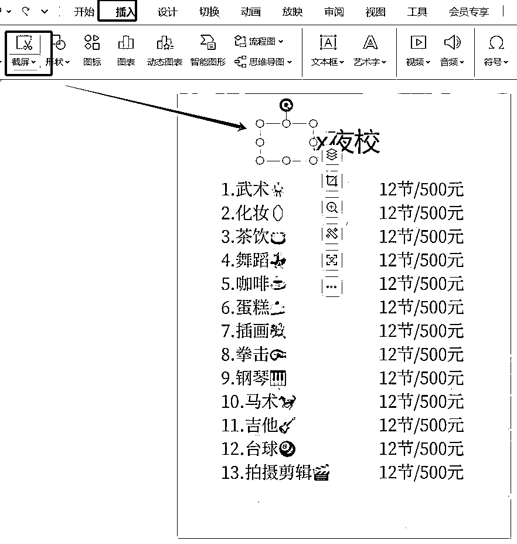

影响打开率的细节很多：

背景饱和度、字体美观度、字号大小，都需要反复测试。

用户刷到小红书，第一眼看的是封面，封面不够吸引就直接滑走，点赞评论收藏自然就没了，进而影响推流。

（2）详细课表：带上地点、价格、时间

本地有课的，就按教练给的排期做表；暂时没课的城市可以先占位写上，后续加人再解释说近期会开，先把人截住再说。

（3）上课实拍拼图

这种图不容易爆，但必须发。换位想一下，用户对“夜校”这个词很陌生，也会怀疑价格是否靠谱。看到主页一排又一排的上课实拍，会潜意识觉得这项目是真实在跑的。

### 4、高效引流闭环

（1）评论区口令建群

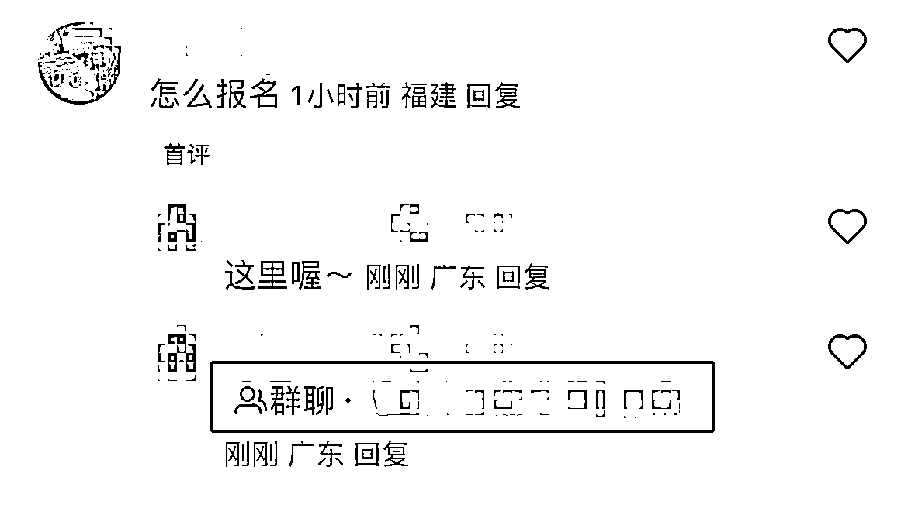

设置好欢迎语→引导看置顶→小号发引流视频

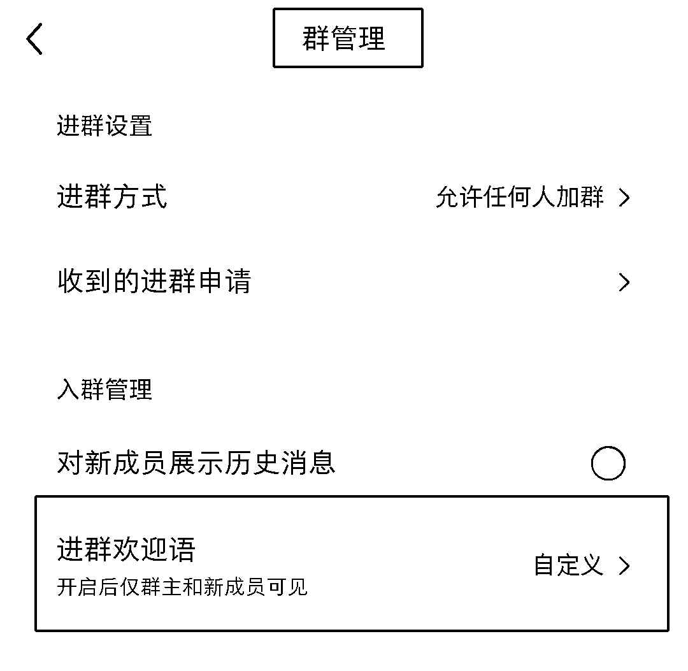

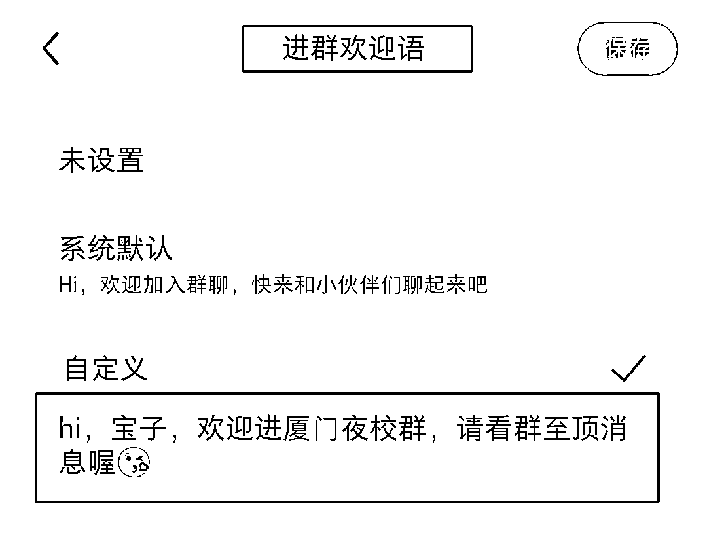

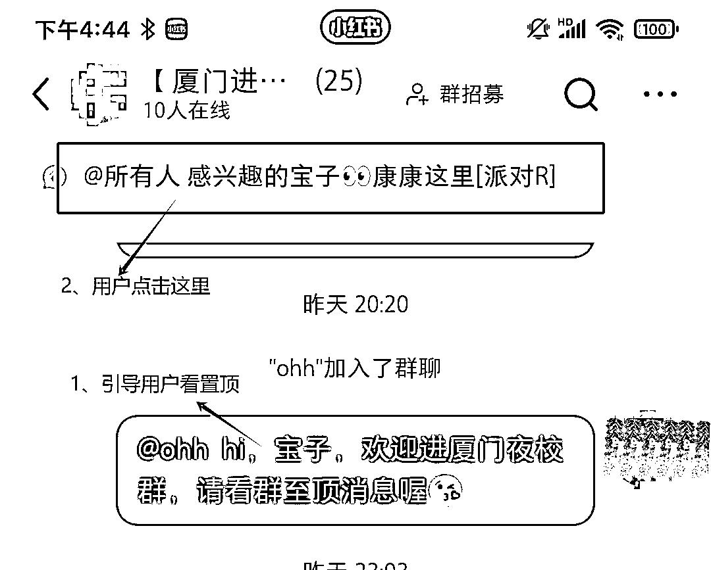

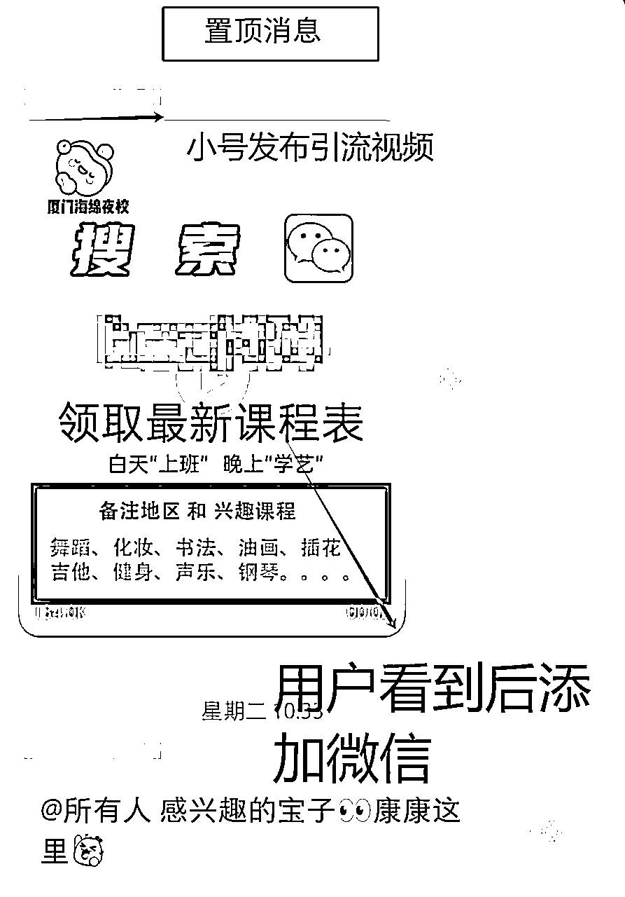

（2）群话题留微信

在【群话题】里留下一个固定的微信入口。

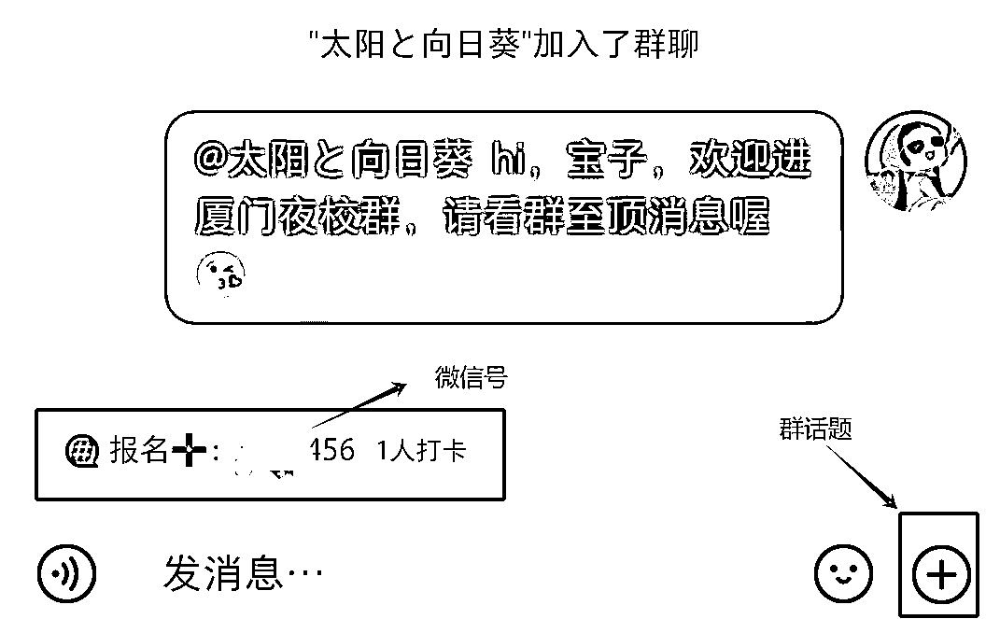

（3）私信发群

可以直接发引流视频，为了降低封号风险，我一般直接发“分享群聊”。

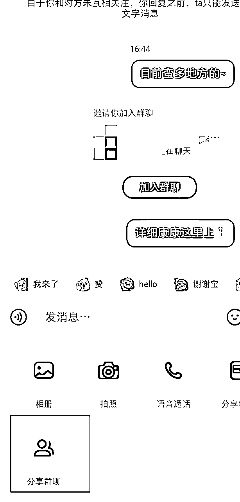

（4）主页打卡引流

这个方法来自圈友佳佳。

同城夜校的同行不多，用户也不会轻易举报，引流动作相对安全。

## 二、用温度成交，让付款更自然

香菜老师开船第一天就强调过：“我们要做有温度的营销。”

新加进来的用户对课程不熟悉，信任感也低，不可能立刻成交。我的爆发期集中在航海最后几天，还连续两天拿到天盈教练的单日出单奖励，连续两天排名NO 2。

### 1、价值先给

起初我只会干巴巴介绍课程，或者直接丢小程序，用户看完就不回了。

客户问起某个课程，要重点讲这个课的亮点优势，配上往期学员的好评截图或老师的宣传视频，让用户先看到效果再心动。

我很少直接说，“宝子要不要报一个？”

这句话很容易让客户觉得你在要钱。

要通过讲清楚课程的好处和价值，引导客户自己说，“我想报名，怎么报？”

这时再把链接给过去，下单就很顺滑。

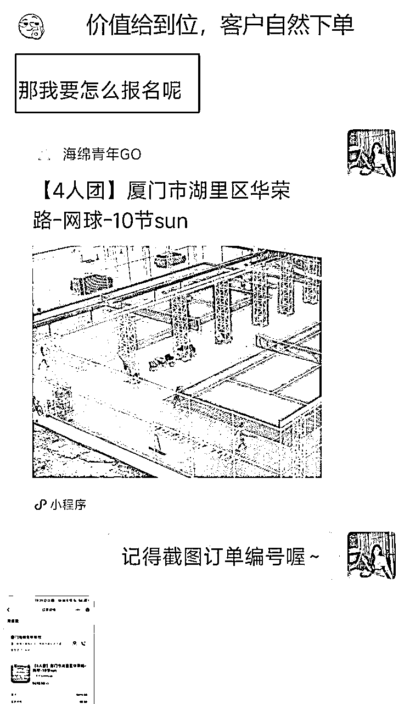

生活里也有类似场景。

有次跟朋友吃饭，我问他要不要汤，他说不要。等汤上桌是玉米萝卜汤，他觉得不错，自己跑去盛了。

对用户来说，课程不是刚需，是消磨时间、体验新鲜、朋友圈装X的需要。让他看到上完课后的样子，下单就水到渠成。

### 2、群里持续触达

我大部分转化都靠群，桔子哥的方法。

跟客户聊几句没话题了，就直接发群链接邀请进群。

大部分人加你后不会立刻买单，别指望两三句就成交，大家都在观望。群的作用就是证明我们是真实运营的，每天有人在活跃，学员出来现身说法，比自己吹一百遍都管用。

群运营小技巧

（1）课程宣传：视频/图片+小程序+文案置底

用户基本都屏蔽群消息，想让他们点开，就要用标题党的方式把文案放在最后，勾起好奇心。

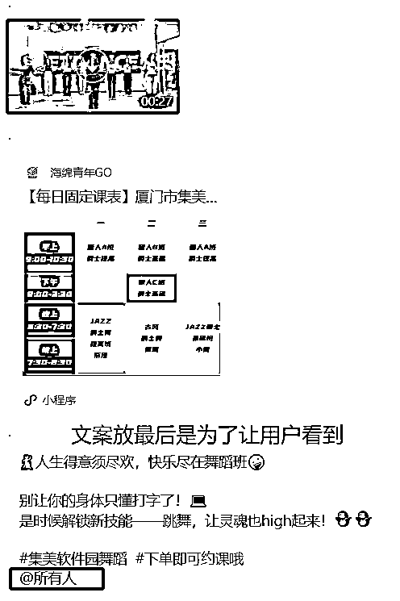

（2）倒计时提醒

有些人喜欢等别人先报，看到“余X位”才会行动。

用剩余名额制造紧迫感，促使用户早点下单。

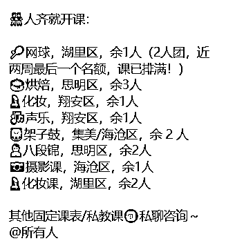

（3）学员好评截流

看到学员晒照或私聊好评，先发10元红包让她多说两句，我们再截图宣传。

几乎每次发料，都会炸出几个人来私聊下单，这套组合拳非常好用。

（4）控制群规模

一个群超过200人就开新群，避免大群被封，或被广告党带跑。

### 3、朋友圈的人设打造

把每条朋友圈都当成一篇小红书笔记来做，展示越精致，用户越想咨询。

在群运营内容的基础上，可以再加生活美图、感悟笔记，让朋友圈不枯燥，用户不愿意屏蔽。

大致分为：

1. 生活美照，人设感
2. 新课上线通知
3. 拼团信息，XX课余XX人
4. 现场实拍，增强信任

被朋友圈和社群双重触达的用户来下单，那种感觉真的太爽了，甚至有客户直接甩付款截图。

## 三、组队打法，我们如何拿下厦门

起初厦门流量很差，我们一度是最慢出单的小组。

直到奶油拿下第一单，全组都炸了，差点想喊：告诉俺娘，厦门不是孬种！

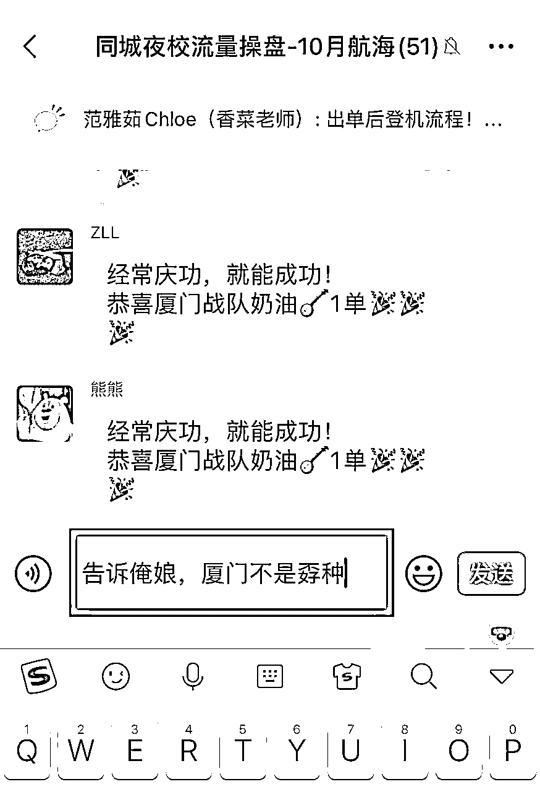

四人协作的方法：

### 1、素材互换

大家把收集到的视频打包到共用群里混剪，还建了爆款笔记共享群，看到好的就丢进去。

### 2、分工明确

听K哥建议，按擅长分工：我做小红书运营，奶油负责成交转化，咪咪负责群组搭建，小埋负责视频剪辑。我一天就把四人的笔记整出来。

第二天数据就变了，我和咪咪的号双双爆了，泼天富贵来了！

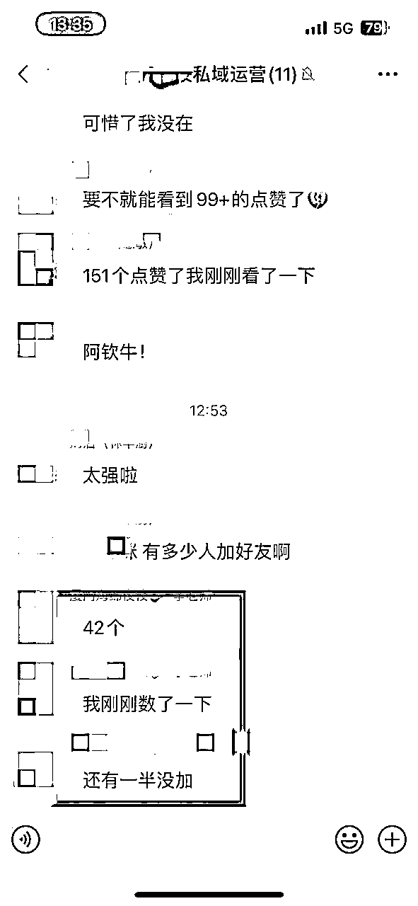

### 3、合力养群

流量大的可以单飞，我们前期流量小，就一起养一个群，集中触达更高效，一次能推几百人。

### 4、话术共创

发现有效的话术立刻在群里同步，全体复用。

### 5、商家谈判

这个很关键。

起初网球课只有6节，用户觉得贵但咨询很多。后来有机构主动找我们谈合作，我们谈下来改成8节室内课，不怕晒。上线两天卖了13单，老师都忙不过来。

因为在一线面对用户，我们更懂学员心理，每次谈合作都会建议商家多加两节课。只要比别的机构多两节，转化率明显提升，甚至有学员跨区过来上。

## 四、对同城夜校未来的一些观察

刚开始也抱怨回款慢，等流量起来、用户多了，就能切身体会私域的价值。

同城夜校私域的“三高”：

高留存：同城粉粘性强，不容易退群删人

高裂变：亲友团报名很常见，我有单是一次报3单4人团

高复购：兴趣会变，今天架子鼓明天拳击，后天吉他，复购自然来

后期变现方向很多：同城相亲、旅游、霸王餐、知识付费、低价引流高价转化、商家入驻收服务费……玩法远不止课程。

## 五、先上车再修路

第一次参加线下航海，真切感受到了线下协作的执行力。

线上做事容易摸鱼，线下看到战友都在拼，你也不好意思划水。从早上9点干到晚上11点，已经成为常态。有时候我们互相开玩笑，“你这辈子为谁拼过命吗？”

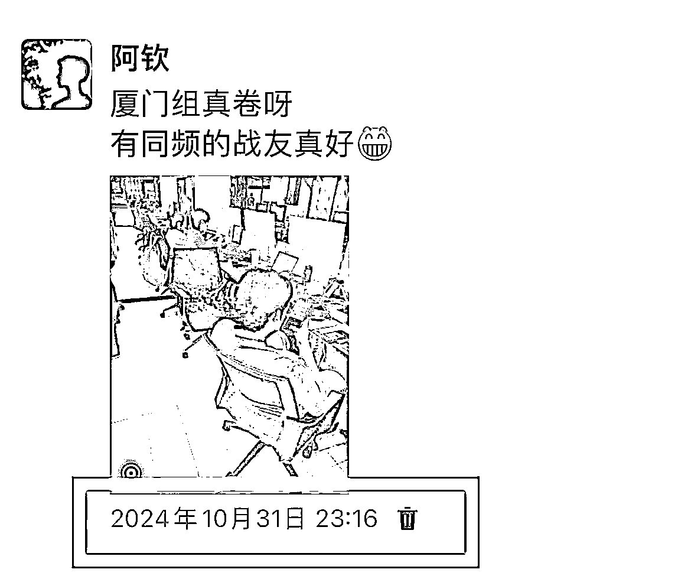

天盈教练第一天说的那句话我印象很深：“先破破烂烂地上路，再缝缝补补地完善。”

就是这个道理。

从拎着行李到白云，到驻扎在海绵青年总部；从寥寥几节课到不断拓展商家；从零单到每天稳定出单，全部是在一个月里不断迭代完善的结果。

我非常推荐大家来一次线下航海，体验“一群人一条心干一件事”，成长速度会快很多！

PS：厦门小组航海结束后全体留在广州，继续跟天盈教练深耕，计划12月把私域做到1w+，4个月内实现100w营收！

最后感谢生财有术开设线下航海，

感谢天盈教练、香菜老师、K哥的带领，

感谢各位圈友无私分享，

感谢三位合伙人的包容与支持，

下期同城夜校项目再见！