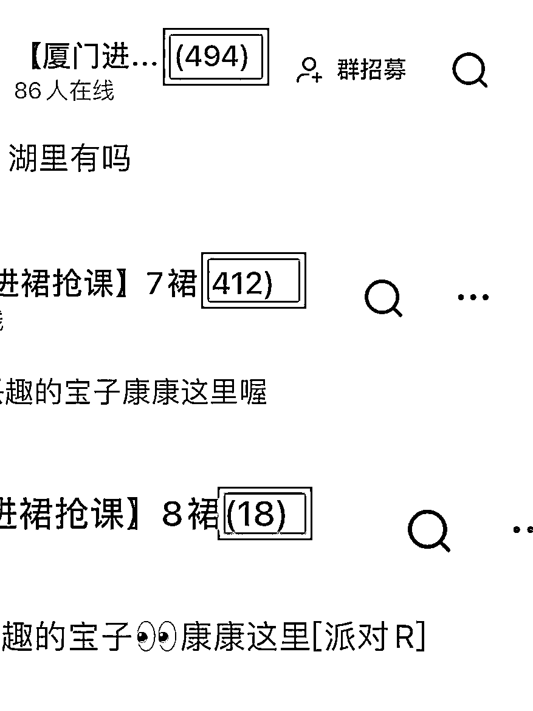
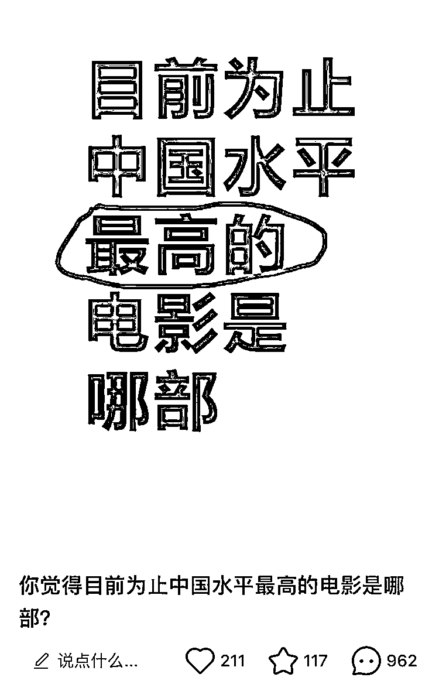
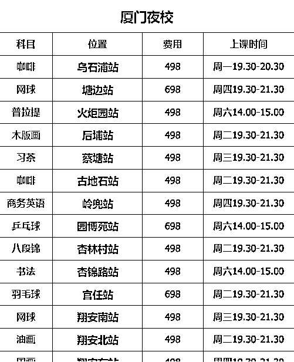
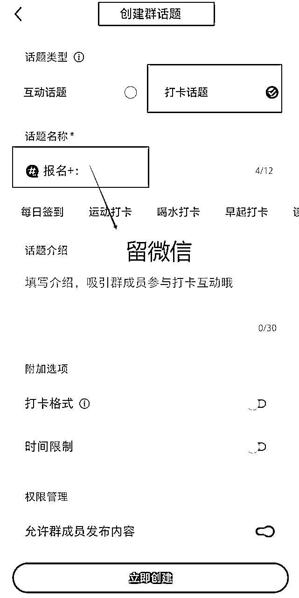
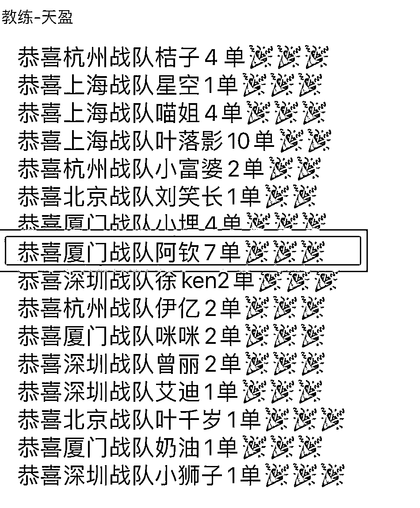
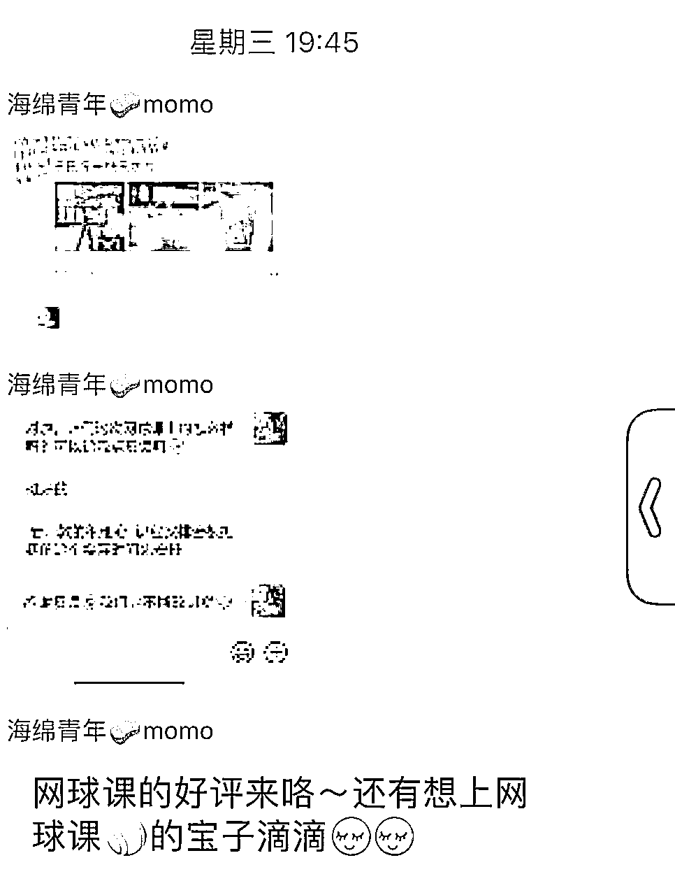
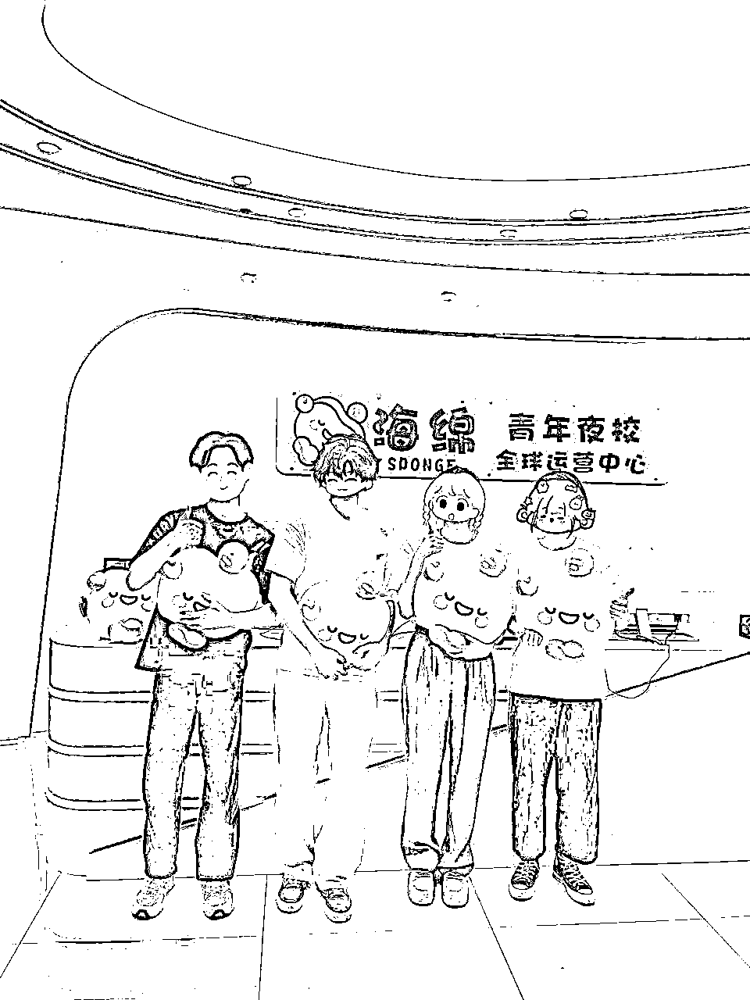

# 从垫底出单到业绩第二，厦门同城夜校线下航海实操复盘

大家好，我是阿钦。这次我跟着天盈教练一起做同城夜校项目，组里还有三位合伙人奶油、咪咪和小埋。

开局我们是组里最慢出单、名声最差的那个。但经过反复打磨，我们摸到了节奏，私域粉丝稳定破2k+，一个月下来成交100+单，GMV破5w，最终总业绩拿下亚军🥈。

航海收官时，天盈教练说，“厦门这波确实给我惊喜了。”

我们没什么天赋加成，就是一群靠勤奋硬扛的人。所以把这段经历整理出来，给后来人一个可复制的参考。

## 一、流量起不来时，小红书爆款是怎么打出来的

厦门夜校项目前期笔记很惨，基本都是个位数浏览，卡点就两个：

1、双十一大促期，小红书把流量大量导给电商，其他垂类被限流。
2、内容太同质化，用户刷到就划走，根本没记忆点。

在这种环境下，我用两个号把小红书社群从0拉到900多人，靠的就两件事：抄爆款逻辑，站在用户角度想。

### 1、冷启动先养号

新号别急着硬推，先发点高互动的热门话题贴，比如电影、书籍、剧集之类的。账号被判定有潜力后，系统会给更多试错权。

账号冷的时候，就去发这类内容唤醒一下。我的理解是平台会先测试互动率，再决定要不要给推。连续一天发3条互动贴，很快就有动静。

（有天早上起来看到99+，那个爽）

### 2、坚持日更

香菜老师第一天就讲明白了：先别管数据，先把日更3篇养成肌肉记忆。刮风下雨都更，习惯比灵感重要。

### 3、把笔记做精

我把内容分成三类打：

（1）简版课表
直接看同行笔记，截图去水印，用WPS改个名字就能用。做法是导入图片→插入→截屏→取色覆盖。

影响点击的关键点一直在测：背景是否够艳、字体是否好看、字号是否够大。用户在首页就是靠封面做决策，封面抓不住人，后面再好也不点。

（2）详细课表：带地点、价格、时间
有课的城市就按教练给的模板做，没课的城市可以先占位，留住人再解释后续会补课。

（3）上课实拍图：四宫格拼图
这类型不一定爆，但必须发。用户对“夜校”大多是怀疑的，看主页全是上课实拍，才会觉得靠谱。

### 4、引流要顺滑

（1）评论区留群口令

设置好欢迎语→引导看置顶→小号发引流视频

（2）群话题置微信：进【群话题】→【话题名称】留联系方式

（3）私信投递：能发视频就发视频，为了避嫌我基本直接甩“分享群聊”。

（4）主页打卡位：这个套路来自圈友佳佳

夜校同行少，用户也不爱举报，操作空间比别的赛道大很多。

## 二、做温度营销，成交自然就顺了

香菜老师第一天就强调：我们要做有温度的营销。

刚加进来的用户对课程认知很低，信任感也不够，所以转化很难一步到位。我的很多单子都集中在航海最后几天爆发，还连续两天拿到天盈教练的单日出单奖励。

### 1、先给价值再谈单

以前我是上来就介绍课程或者丢小程序，用户看完就消失了。

现在一问到某门课，我会重点讲这门课的差异化和体验点，发些往期学员好评或老师宣传片，等用户感受到效果再心动。

我很少直接问“要不要报一个”，这会让用户觉得你在要钱。一定要让用户自己说“怎么报名”，这时候再把链接推过去，成交很自然。

说白了就是生活里的道理：我问朋友要不要喝汤，他说不要。等汤端上来是玉米萝卜，他自己就去盛了。

课程对很多人不是刚需，是打发时间、体验新鲜感、朋友圈装一下。当他看到上完课之后的样子，买单就很快。

### 2、用社群做二次触达

大部分转化其实是群在干活，源自桔子哥的思路。

跟客户聊两句没下文，我就直接把他拉群。用户加过来基本不会立刻买，大家都在看。群里每天有运营、有学员现身说法，信任感是自夸的百倍。

群运营小技巧

（1）内容前置：视频/图片+小程序+文案。把文案放最后当标题党，逼用户点进去看。

（2）余位提醒：有人等着捡漏最后一个名额。发“余X位”能刺激观望的人尽快决策。

（3）学员好评：看到学员晒照或聊天，先发10块红包让她多说两句好话，再截图当宣传素材。

每次发一次群公告，总能炸出一波私聊下单，效果稳定。

（4）控制群规模：一个群超过200人就开新群。太大的群容易被封或被广告带走。

### 3、把朋友圈当成笔记在做

每条朋友圈都要有质量，用户才不会屏蔽你。可以发群运营的内容，也可以发生活美图、人设感悟，让朋友圈有意思。

大概分四类：人设生活照、上新课通知、拼团余位信息、现场实拍。被朋友圈和社群双重触达的用户，下单率很高，甚至直接甩付款截图。

## 三、四个人的合力，如何拿下厦门

一开始厦门流量极差，我们是出了名的慢。后来奶油首单出了，我们差点喊出：告诉老娘，厦门不是孬种！

我们的配合方式

### 1、素材互通
视频素材一起收一起剪，小红书爆款笔记建了共享群，看到就丢进去。

### 2、分工明确
按K哥建议分工：我负责小红书运营，奶油负责转化，咪咪负责建群，小埋负责剪辑。第二天我的号和咪咪的号就爆了。

### 3、合力养群
流量小的时候不单打独斗，合并建群一起发广播，覆盖面更大，效率更高。

### 4、话术共创
谁的话术有效就立刻同步，团队一起迭代。

### 5、跟商家谈判
网球课最开始只有6节，价格高不好卖。后来有机构主动找上门，我们谈到8节室内课，不怕晒。两天卖了13单，老师都忙不过来。

因为我们在一线，能清楚知道学员想要什么，每次都能建议商家多加2节课，性价比一上去，跨区报名的人都有。

## 四、对同城夜校未来的判断

刚开始抱怨回款慢，后来流量起来就发现私域的价值。

同城私域有“三高”：留存高，基本不会退群；裂变高，经常是一次性带家人一起报；复购高，今天打架子鼓，明天可能想拳击、吉他。

后期延伸空间很大：同城相亲、本地游、霸王餐、知识付费、低客单转高客单、商家入驻收佣……变现点很多。

## 五、先上路再修路

线下航海最直观的感受就是执行力。线上容易拖延，线下大家都在干，你就不会偷懒。

从早上9点干到晚上11点是常态，战友之间会互相开玩笑：“你这辈子为谁拼过命吗？”

天盈教练第一天说过，“先破破烂烂地上路，再缝缝补补地完善。”

从拎着行李来白云，到扎根海绵青年总部；从几节课到不断谈商家扩充课程；从0单到日销稳定，全是一个月不断迭代的结果。

我强烈建议圈友至少来一次线下航海，体验“一群人一条心做一件事”的速度。

PS：航海结束后我们厦门小组都留在了广州，继续跟天盈教练深耕，目标12月私域破1w+，4个月内冲100w营收！

最后感谢龙哥盟举办线下航海，感谢天盈教练、香菜老师、K哥的带队，感谢圈友无私分享，感谢三位合伙人的包容和陪伴。下期同城夜校再见！