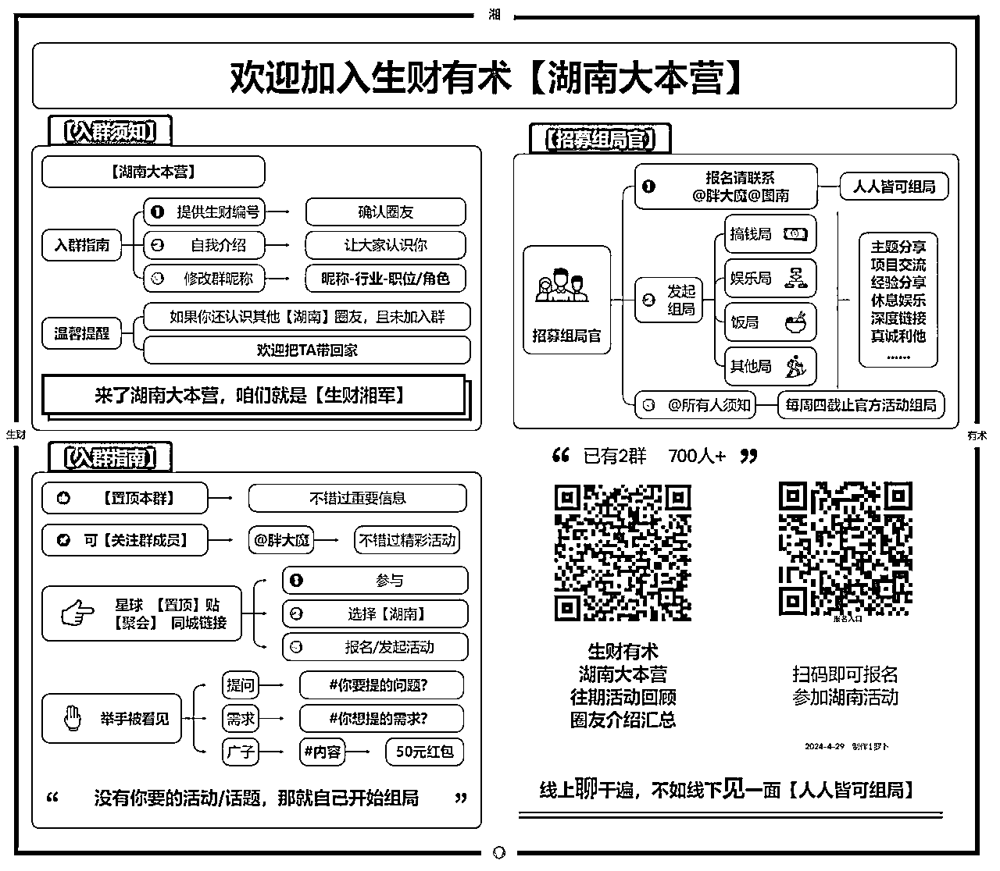

你大概也遇到过这种情况：刚进一个氛围不错的新圈子，急着想让别人记住自己，上来就把课程海报、名片二维码、公众号链接一股脑甩进去，结果连个水花都没有，反而被管理员默默请走。

说到底，混社群和交朋友没什么两样——先搞清楚边界在哪里，后面才有可能谈得上链接与信任。

一个好的社群，说到底是给同频的人提供交换信息、对接资源、共同进化的场域。你要把它当成自家广告位随便发，方向从一开始就跑偏了。

我曾看过某位资深运营的总结，他提到一个很扎心的现象：群主和管理员真正想维护的，是一个能持续输出、深度交流的环境，而不是谁都能来吆喝两声的推销大厅。可现实中，总有人把讨论区当展销会，刷屏式地扔商品链接，看得人直皱眉。

有判断力的人，看重的不是谁的动静大，而是谁的发言有干货、是否真的在理解和回应别人。我见过不少人的朋友圈清一色产品广告，我连聊天的欲望都没有，更别说合作。你觉得自己在努力经营，在别人眼里却只是个行走的广告位，印象分早就扣光了。

微信加好友这件事，体面与否全在细节。主动加人的时候，把姓名、行业、为什么找对方、想要对接什么资源，一次性说清楚，对方一眼就能判断要不要通过，整件事也会顺畅很多。反过来，别人加你的时候，也先问清楚来意再决定，省得以后被各种无关信息打扰。朋友圈是最直观的缩影：有人长期分享自己的思考和感悟，说明他在持续输入、有自己独立判断；有人满屏都是优惠和硬广，那大概率就是把人当流量，并不想认真地和你产生什么深度连接。如果一个人连朋友圈都不愿意展示，你也要琢磨一下，连最基本的坦诚都做不到，后续合作能不能顺畅，确实要打个问号。

还有一条最招人烦、也最容易踩雷的就是——不加任何说明就往群里群发广告。你既不介绍自己，也不看内容是不是对得上群的方向，上来就是一串链接，那不是推广，是骚扰。真想请人帮忙，起码的姿势是：先真诚道谢，说明自己是谁、目前在做什么，再清晰地抛出需要了解什么、有什么资源可以对接。如果还能发个小红包表达诚意，那效果更是完全不同——诉求让别人一眼看懂，机会自然也会向你倾斜。

成熟的圈子，规矩往往定得很细：新人进来先按格式改昵称；想对接资源先做自我介绍讲清来意；广告要经过允许才能发；私下乱加人、辱骂斗嘴的，一经查实直接清退。有人觉得规矩多、门槛高，但恰恰是这些边界，过滤掉了噪音，也让真正想学习、想合作的人有了安心对话的空间。没有规则的群，最后只会变成广告混战和口水井。

换个角度看，当你的分享能给别人带来启发，你给到的帮助被群友记在心里，资源和机会反而会主动来找你。信任这种东西没法明码标价，它需要时间和持续的价值输出一点点积累。这比你在群里喊一百遍“快来找我”都顶用。

所以，别再拿社群当菜市场了。尊重规则，也是在尊重别人的注意力，更是尊重自己的时间。你是什么样的人，发言里有答案；你能提供多大价值，就能吸引来什么样的资源和伙伴。

趁这个机会也顺便同步一下星球的最新情况：从成立到现在已经整整四个年头了，真心感谢每一位老朋友的信任与陪伴。这一次，为了回馈大家，续期费用直接调整到了历史低点，之前价格的一半就能解锁一整年，这也可能是咱们圈子最划算的一波了。如果你续费时遇到任何问题，随时添加微6，我会把专属续费入口发给你。星球内目前已经开放了十几门精选课程，后续还会不断补充新内容；每个月有2-3场不同主题的实操挑战，每周也会分享各行业的资源大礼包——爆款标题写法、封面设计模板、引流实战资料，全部整理好供你随时取用。

另外，社群也在持续纳新与升级之中。如果你在某个领域有资源、有心得，欢迎大家主动报名成为组局官或分享嘉宾，一起把链接做得更深、更有温度。

最后，借用一位老朋友的话：无论是做生意还是交朋友，走到最后靠的都是频率相合、价值观一致。同频的人，兜兜转转总会遇见；不同频的，也不必强求。能一起走一段，就是值得感恩的事。

谢谢每一位信任我们、陪伴我们的人。前路还长，咱继续同行。

欢迎加入本群！
为了让大家在这里更高效地交流、更安全地连接、更安心地成长，请大家在入群后第一时间按要求完成昵称修改，并共同遵守以下社群公约。

【入群须知】
1. 昵称格式统一为：公司-职位-昵称 或 昵称-所在城市-业务标签
   例如：刘大猫-上海-电商 / 字节-产品经理-阿Q
   未按格式修改者，将在24小时/6月20日前清退，逾期自动移出。

2. 群内定位
本群为【专注话题/行业交流】的定向社群，核心价值是干货分享、资源对接、经验共创。非相关内容一律清理。

3. 禁止行为
🈲 各类广告、软广、链接海报、群发名片、引流推广，一经发现直接踢出
🈲 随意私加群友。任何通过群聊私加的好友均非官方账号，请勿通过、勿转账
🈲 讨论敏感人名、政治议题、敏感话题
🈲 人身攻击、言语侮辱、低质刷屏、机器自动回复、钓鱼引流

4. 鼓励发布
✅ 【招聘】 【找供应商】 【寻合作】 【项目对接】
✅ 话题性讨论、案例分享、经验复盘、有效提问
群主保留对低质量、无关内容的清理权。

5. 隐私与安全
请保护好个人隐私，私加、交易、先联系群主担保再进行。被骗风险自负。

6. 运营提醒
群内不闲聊、不发无关链接、视频、图片。会议通知、活动信息、重要资料会另行置顶。请将本群置顶，避免错过关键消息。

我们希望打造一个专业、干净、高效、有温度的交流空间。感谢理解与配合，让我们一起遵守规则，共同成长。