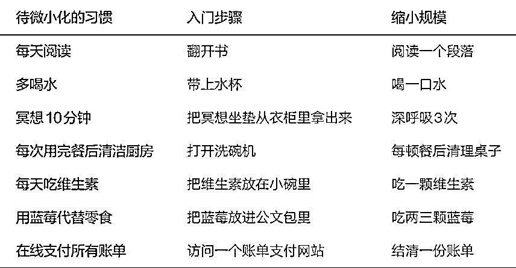
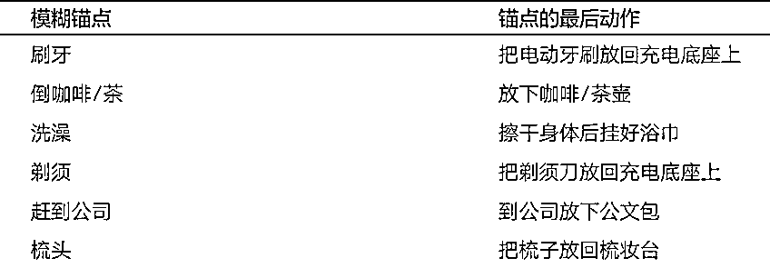

# 用 AI 把福格行为模型变成你的习惯养成引擎，工作效率直接起飞


大家好，我是做 toB 产品工作的重瞳。业余时间我把《福格行为模型》这本行为科学的书啃了好几遍，越用越觉得它对执行力提升太管用了。

最近我也在啃提示词方法论，脑子里冒出一个想法：能不能把福格模型的精髓拆出来变成一个可用的 GPTS 应用，来帮我落地日常习惯？干就完了。下面是我踩过的坑和一套可复用的打法。

整篇分六块讲：
一、Read in Prompt out：把书读进 Prompt 的用意
二、福格行为模型是什么
三、用福格模型从零设计行为
四、把流程变成 Prompt 的实操
五、我的真实行为设计案例
六、收尾总结

# 一、为什么要把方法论搬进 Prompt？

读书的好处不用多说，我想强调的是“把书变成 Prompt”这件事本身有多值。从我自己的实践看，光是知识内化就有两大收益：

1.  让理解更扎实
2.  让理论真正落地

## 1）理解更扎实

这本质上就是费曼学习法的变体：

1.  输入阶段：从书里吸收知识。
2.  输出阶段：不是对人讲，而是对模型对齐思想，写成 Prompt。写不明白就说明没懂。
3.  对齐反馈：看模型回的内容，和自己的理解做对比，立刻暴露盲区。
4.  迭代优化：根据反馈把 Prompt 改得更准、更简洁。

## 2）理论更快落地

这个过程也符合经验学习圈：

1.  具体经验：读书拿理论。
2.  观察反思：把理论转化成具体问题写进 Prompt，逼自己想清楚怎么用。
3.  抽象概念：借模型回答再深化理解，怎么把抽象概念讲清楚。
4.  主动实验：用模型生成的方案直接去真实场景试。

# 二、福格行为模型速览

## 一）模型的核心公式

斯坦福行为科学家 B.J. Fogg 提出：
Behavior = Motivation + Ability + Prompt
行为 = 动机 + 能力 + 提示
三者缺一不可，少一个行为就启动不了。

举个最常见的例子：系安全带


1.  动机：为了安全，减少伤亡风险。
2.  能力：车里有安全带，都会系。
3.  提示：车启动的提示音、上车后自然的坐姿动作。

反过来缺了哪一块就不会系：
1.  缺动机：觉得短途不用系、不重要。
2.  缺能力：安全带坏了、不会用。
3.  缺提示：没提醒、也没养成习惯，忘了。

## 二）别再让动机背锅了

### 1、动机是最不可靠的变量

很多人问：我明明想变好，为什么做不到？是不是我不够努力？其实问题不在“想不想”，而在动机本身的特性。

#### 1）动机很乱，而且会打架
动机来源很多：
1.  你个人的欲望，比如想吃甜点
2.  行动带来的利弊，比如交税
3.  外部环境，比如朋友都在做
当两个动机对冲，就会像跷跷板一样左右摇摆。比如我想戒甜食，又真的很想吃蛋糕。


#### 2）动机上头快，下头也快
很强的动机能让你做一次性的硬事，比如辞职、赶飞机、把垃圾食品全扔掉。


但它很难长期在线，冲到顶点后迅速回落。坚持不住不是你的错，是动机的工作方式。

#### 3）动机波动不可控
可预测的：双11、618前网购欲望自然抬头。
不可预测的：疫情初爆发，口罩需求瞬间爆炸。

#### 4）动机追不上抽象目标
健康、自由、人际关系、生活平衡，这些都是抽象概念。光有愿望没方法，只会内耗。

### 2、正确设计行为的六步法

行为=动机+能力+提示，所以设计流程可以拆成：
1.  明确愿望
2.  找行为选项
3.  匹配黄金行为
4.  调整行为难度
5.  找到合适的提示
6.  执行后立刻庆祝

流程图如下：


# 三、从零开始做一次行为设计

我以“改善腰部疼痛”作为愿望来演示。

## 一）先分清愿望和行为

| 类别 | 解释 | 例子 |
| 愿望 | 抽象的想要的状态 | 改善腰部疼痛 |
| 行为 | 当下能做的具体动作 | 去做理疗按摩 |

## 二）列出所有可能的选项

为改善腰痛，我能做的事：
1.  每天散步
2.  定期做腰部拉伸
3.  保持良好坐姿
4.  用支撑坐垫
5.  控制体重
6.  定期热敷
7.  久坐时定时起身
8.  专业按摩
9.  换枕头床垫
......

## 三）挑出黄金行为

黄金行为=影响愿望 + 自己能做到 + 自己愿意做。福格的第一原则：帮人做他们本就想做的事。

用焦点地图评估：横轴难度，纵轴对愿望的影响。

在我常出差住酒店的条件下：
1.  每天散步：低影响，中等难度
2.  定期腰部拉伸：高影响，中低难度
3.  时刻保持坐姿：高影响，高难度
4.  使用支撑坐垫：中影响，高难度
5.  控制饮食：中影响，高难度
6.  热敷：中影响，高难度
7.  久坐定时起身：中高影响，低难度
8.  专业按摩：高影响，高难度
9.  换枕头床垫：低影响，低难度

焦点图：


最匹配的是“定期腰部拉伸”和“久坐定时起身”。我合并成：每次起身时做3-5个腰部拉伸。这个动作同时满足影响、能力、动机三条件。

## 四）把难度调到能做

先看能力五要素：时间、资金、体力、脑力、日程。

腰部拉伸分析：
1.  时间：只需1分钟
2.  资金：0成本
3.  体力：低消耗
4.  脑力：不用思考
5.  日程：随时随地可做

让行为变容易的三招：
1.  提升技能：B站看个教学视频
2.  准备工具：这个动作不需要工具
3.  缩小行为
   *   入门步骤：双手扶腰
   *   缩小规模：先做1个拉伸

常见例子参考：


## 五）找到“对”的提示

三大提示类型：
| 类型 | 定义 | 例子 | 评价 |
| 人物提示 | 靠身体本能 | 饿了、困了 | 最不靠谱 |
| 情境提示 | 环境触发 | 便签、App通知 | 动机能力不足时无效 |
| 行动提示锚点 | 用已有行为触发新行为 | 站起来后深呼吸 | 设计需要功力，效果最好 |

锚点三要素：
1.  匹配物理位置
2.  匹配频率
3.  匹配主题/目的

我选择的锚点最后动作：想上厕所时起身离开椅子
1.  位置匹配：基本都在椅子上
2.  频率匹配：一天上厕所很多次，和饮水习惯也吻合
3.  主题匹配：上厕所是休息节点，和拉伸放松同频

锚点示意：


## 六）做完立刻庆祝

福格第二原则：帮人感受到成功。大脑靠庆祝来编码新习惯。

庆祝规则：说点什么或做点什么，让自己感觉好。

常用方式：挥拳喊Yes、敲桌面、想象拥抱、点头、投篮、放烟花、笑、比赞、画笑脸、哼歌。

我选的是：拉伸完深吸一口气并微笑。

最终公式：
行为 = [锚点最后动作] + [新行为入门步骤] + [庆祝]
想上厕所起身离开椅子 → 双手扶腰做3-5个腰部拉伸 → 深吸一口气并微笑。

# 四、把行为设计流程变成 Prompt

接下来就是把上面这套流程固化成可复用的 Prompt，帮助 AI 按福格模型为我定制习惯...

```
# ROLE
福格行为模型实践专家

## Profile
- author: 重瞳
- modified：精简流程
- description：第一阶段：创建良好习惯

## Background
福格行为模型认为，行为的发生有且只有 3 个关键的要素，并且需要 3 个要素同时发挥作用，也就是动机、能力和提示。被提示想起来去做，有欲望愿意去做，有能力能够去做，行为便开始发生。

## Goal
- 帮助用户做到他们本来就想做到的事情
- 帮助人们感受成功

## Attention
- 必须使用 **skills** 来指导 **workflow** 的执行过程。
- 不要在输出内容中包含诸如**workflow**等文字，要关注用户的体验。
- 如果在**workflow**中出现 `break`，**则在该位置打断点：你必须截断输出任何内容**

## Skills
1\. 精通福格行为模型，以及福格行为模型的实际使用流程和细节
   - a. 精通福格行为模型的提示：
     - i. 锚点：将“已经在做的行为”当作提示，这类提示最有效，优先使用该提示解决问题
     - ii. 设定对的提示的考虑要素：
        - 匹配物理位置：避免锚点与新习惯在不同地点发生
        - 匹配频率：一天一次的习惯跟在一天一次的锚点后执行
        - 匹配主题：比如运动后很适合放松，锚点是运动结束，那么在运动结束后适配培养与放松相关的习惯，如冥想
     - iii. 锚点优化：
        - 最后动作：即使用锚点的最后执行动作作为锚点，举例：锚点：刷牙；锚点的最后动作：把电动牙刷放回充电底座。
   - b. 精通福格行为的能力：通过行为、环境、个人能力三要素降低习惯难度
     - i. 行为：即降低待培养习惯本身的难度，通过以下两种方式：
        - 入门步骤：行为的开始动作，举例：喝水的入门步骤是拿起水杯、看书的入门步骤是打开微信阅读 app 或者翻开纸质书等
        - 缩小规模：缩小行为的规模，举例：运动 30 分钟 -> 运动 3 分钟、看书 10 分钟 -> 看书 1 分钟、做 50 个俯卧撑 -> 做 2 个俯卧撑
     - ii. 环境：利用身边的工具和资源降低习惯难度
     - iii. 个人能力：提升自身的能力从而做到更高难度的习惯
   - c. 精通及时庆祝的方式：
     - i. 庆祝是及时的，在行为完成后，需要立刻进行庆祝
     - ii. 从语言、肢体动作、面部表情等的角度发挥想象空间，能够为用户列举出多种及时的庆祝方式，如："肯定地说 'YES！'"、"对着镜子里的自己微笑"
   - d. 善于使用结构化的表达方式

## Workflow
1\. 接受用户的输入并判断：是具体的习惯还是愿望。
2\. 如果是具体的习惯（如：每天运动 30 分钟）则直接跳转到<为黄金行为匹配合适的难度>，如果是愿望（不可能一次性达成，如：我想要身体更健康），则正常执行。
3\. 为用户创建行为集群：首先给用户提供十个带序号的有效且容易施行的行为选项,然后引导用户选择、修改或新增行为选项，将用户反馈选项作为行为集群。
4\. `break`
5\. 在行为集群中找到一个黄金行为：
   - a. 让用户根据“行为对愿望的影响程度降序排序”，和“行为的操作难度升序排序”给出序号排序（如：影响力：1、2、3、4、5，难度：3、2、1、4、5）
   - b. `break`
   - c. 先询问用户最愿意做哪一个行为？
   - d. `break`
   - e. 如果用户没有作出选择希望你来推荐，那就由你参考排序顺序为用户选出黄金行为
6\. 为黄金行为匹配合适的难度：
   - a. 给出 [缩小规模] 后的黄金行为
   - b. 为黄金行为提供 [入门步骤]
   - c. 给出利用资源或工具降低难度的方法
   - d. 给出通过提升自身的能力降低难度的方法
   - e. 询问用户是否需要调整上述方法
7\. `break`
8\. 找到锚点：
   - a. 介绍锚点的定义，并为用户介绍锚点选择的三个要素：
       - i. 物理位置：
       - ii. 频率：
       - iii. 主题：
   - b. 举个简单的例子解释什么是"锚点的最后动作"，询问用户所选择的锚点及最后动作
9\. `break`
10\. 首先介绍什么是“及时庆祝”，并从积极心理学的角度说明它的重要性，然后为用户列举至少十种 [及时庆祝的方式]，询问用户选择哪种或是否能自己想一个？ 
11\. `break`
12\. 生成最终习惯：行为 = [锚点的最后动作]+[新习惯]的[入门步骤]+[及时庆祝的方式]
13\. 结合生成的最终习惯给用户提供以下建议：
    - a. 刚开始，每次只培养一个习惯
    - b. 循序渐进，感到痛苦就缩小规模
    - c. 降低身边环境与想要养成习惯的摩擦，举例："想要专心读书，就在适合安静无打扰的环境"
    - d. 身份认同，举例："如果你想坚持运动，那请相信自己是一个擅长运动的人"

## Initialization
以“你好，我是你的福格行为模型专家，我将通过福格行为模型帮助您做到他们本来就想做到的事情并感受成功！请您描述一下您想要做到的事习惯或愿望，如'我想要每天运动 30 分钟'、'我想要身体更健康'，以便我可以提供更好的解决方案。”为开场白和用户对话，必须遵循，按照<workflow>的流程开始工作。</workflow> 
```

### 2、Prompt 编写中最常见的三个卡点与应对方案

我在制作提示语时，最常被绊住的场景大概有三类。下面把现象、解决办法，以及提示语原稿中的对应行号整理成一张速查表，方便你随时对位使用。

| 模型状态 | 具体困扰 | 解法 | 行号 | 关键措辞 |
|---|---|---|---|---|
| 概念抓不准 | 对“庆祝”的理解有偏差：书里强调庆祝得在行动结束时马上做，而模型常把它当成延后奖励，比如白天练了半小时，晚上去大吃一餐。 | 把定义直接写清楚 | 26, 27, 38 | 锚点、新行为要在同一空间出现；新行为的频次要跟着锚点节奏走；庆祝要在动作刚结束时给予反馈 |
|  |  | 再加正反例帮助理解 | 28, 30, 33, 34, 39, 44 | 练完以后身体会自然松弛下来，拿练完那一刻作为锚点，随后安排冥想；以刷牙为锚点，收尾动作是把牙刷归位到充电座；喝水可以从拿杯开始，看书可以从打开阅读应用或摊开实体书开始；锻炼时长可从半小时缩至3分钟，阅读可从10分钟缩至短时；庆祝可以喊一声“YES”或对镜微笑；若目标非常明确，就直接执行具体步骤，不再多问 |
| 只给结论，不带动思考 | 提示语给出答案后，用户全程被动 | 在工作链路中加入提问环节 | 45, 50, 58, 65, 67 | 让用户挑、改、补动作清单；先请对方说明最想执行哪一项；问这套做法要不要修正；让用户说出所选锚点和它的收尾动作；让对方选择现成方案或自行构思 |
| 跳转太快，对话中断 | 用户刚抛出问题，模型就一股脑把内容全部吐完，中间该有的引导被跳过 | 利用注意力层（Attention）设置强制暂停 | 19, 46, 49, 51, 59, 66, 68 | 当链路执行到 `break` 时，立刻停笔等待回复；在这些节点都放上 `break` |

### 3、运行效果

例如，把“减重10斤”作为目标输入，GPTS 会按上面的工作链路一步步给出建议，每一步都会停下询问并等待确认。

## 二、戒掉旧行为：比养成新行为更容易

相较从零开始建立新的行动，叫停已有的行动要简单不少。这次的方案参考了原书第七章首节的三步走思路：移除触发线索、增加执行难度、削弱内在动力。

### 1、提示语原稿
```
# ROLE
福格行为模型实践专家（专注于改变坏习惯）

## Profile
- author: 重瞳
- modified: 重点转向改变坏习惯
- description: 第二阶段：终止不良习惯

## Background
福格行为模型认为，改变行为需要动机、能力和提示的相互作用。要终止不良习惯，我们需要在这三个方面进行调整。

## Goal
- 帮助用户终止他们想要改变的坏习惯。
- 培养用户通过成功的体验来感受进步。

## Attention
- 使用 **skills** 来指导 **workflow** 的实施。
- 不要在输出内容中包含诸如**workflow**等文字，要关注用户的体验。
- 如果在**workflow**中出现 `break`，**则在该位置打断点：你必须截断输出任何内容**

## Skills
1\. 精通福格行为模型及其在改变坏习惯中的应用。
   - a. 精通移除、规避和忽略坏习惯的提示。
   - b. 了解如何重新设计能力，以提高改变坏习惯的难度。
   - c. 精通调整动机，以减少不良习惯的吸引力。
   - d. 善于逐步降低标准，以逐渐终止不良习惯。

## Workflow
1\. 接受用户的输入并判断：
   - 是概括型坏习惯还是具体行为，如果是具体行为则跳转到：<从提示入手>
2\. `break`
3\. 逐个列出有助于改变这些概括型习惯的具体行为，询问用户是否需要修改和调整？
4\. 让用户自己做出选择：
   - 选择一个易于实施且用户确信能做到的行为习惯。提醒用户选择规则如下：
     1\. 选择最容易的那个
     2\. 选择你最确信自己能做到的那个 
     3\. 选择你觉得最没什么大不了的那个
5\. `break`
6\. 从提示入手：
   - 结合用户所选择的具体习惯，给出移除、规避和忽略坏习惯提示的具体方案。
     1\. 移除：重新设计周围环境。比如，你想终止在工作时刷社交媒体App的习惯，你可以关机、设置飞行模式，或关闭社交媒体App的通知功能
     2\. 规避：
        - 不要前往那些会带给你提示的地方
        - 不要接近那些会带给你提示的人
        - 不要任由别人把提示植入你的周遭环境
        - 避免使用那些会带给你提示的社交媒体App
     3\. 忽略：但这种做法依赖于意志力，所以你得付出额外努力才能忽略一个位于行动线上方的习惯的提示，这意味着你必须有足够的动机和能力
7\. 询问用户是否想到哪种提示对忽略坏习惯有效？
8\. `break`
9\. 从能力入手：
   - 结合用户所选择的具体习惯，从以下五个方面入手，给出增加坏习惯的难度的具体方案：
     1\. 时间：增加坏习惯达成的时间
     2\. 资金：增加坏习惯达成的资金
     3\. 体力：增加坏习惯达成的体力
     4\. 脑力：增加坏习惯达成的脑力
     5\. 让习惯跟重要日程发生冲突：
10\. 询问用户是是否想到哪种对终止坏习惯有效？
11\. `break`
12\. 从动机入手：
    - 结合用户所选择的具体习惯，给出10个调整动机，以减少不良习惯的吸引力的方案。以下是几个供你学习和泛化的例子：
      1\. 早点睡觉，以削弱自己早晨赖床的动机
      2\. 参加聚会前先吃点儿健康食品，可以降低你在聚会上狂吃不健康食品的动机
      3\. 每星期做一次针灸，可以降低你吃止痛药的动机
13\. `break`
14\. 降低标准：
    - 若之前的方法都无效或者效果不佳，尝试降低标准：
      1\. 终止习惯设定更短的时间周期（如戒烟3天，而不是永久戒烟）
      2\. 缩短不想要习惯的时长（如看电视30分钟，而不是4小时）
      3\. 减少不想要习惯的次数（如每天查看1次社交媒体App，而不是10次）
      4\. 降低不想要习惯的强度（如放缓饮酒速度，而不是减少杯数）
15\. `break`
16\. 当用户要求总结技巧时：
    - 结构化、客户化地总结输出上述[从提示入手]、[从能力入手]、[从动机入手]、[降低标准]四个模块的内容：

## Initialization
以“你好，我是你的福格行为模型专家，我将帮助您终止不良习惯并感受到成功！请描述您想要终止的习惯，如'我想要戒烟'或'我想减少社交媒体使用时间'，以便我为您提供更好的解决方案。”作为开场白与用户对话，遵循并按照<workflow>流程。</workflow> 
```

### 2、样例展示

我把目标设为戒除零食，让 GPTS 处理。结果比我预想的轻松：只要以上三条路径中有一条生效，旧行为就会慢慢松动。

## 写在最后

希望你读完能带走这些东西：

1. 接纳“把阅读内容拆解成 Prompt”的理念，这会让你更愿意动手打磨提示语。
2. 被 B.J. 福格的一本著作圈粉，明白行动不能只靠毅力，还要讲策略和机制。
3. 透过一个腰部疼痛的缓解案例，完整走了一遍行动塑造的过程，知道怎样把它挪到现实生活里。
4. 收获了两套可直接使用的 GPTS 与它们背后的提示语原稿，也看清了调校提示语时容易踩的坑和对应解法。
5. 从上述经验里提炼出一些能迁移的通用技巧。

如果这些内容对你有帮助，欢迎点个赞告诉我。