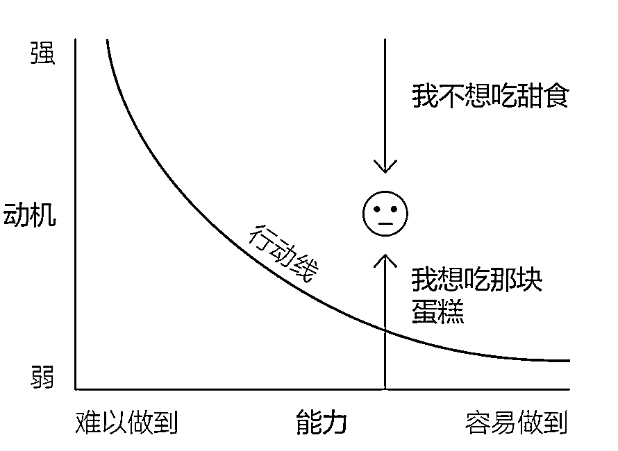
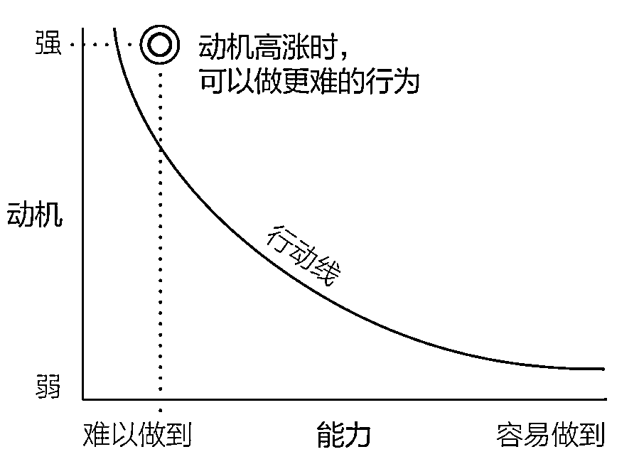
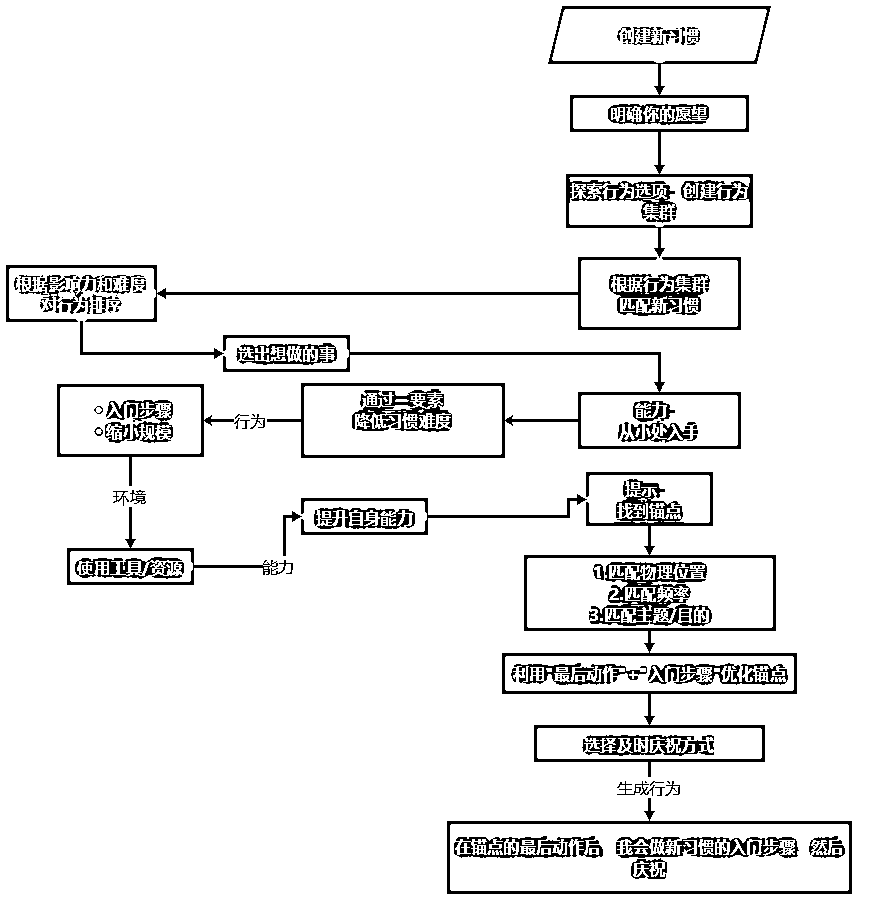
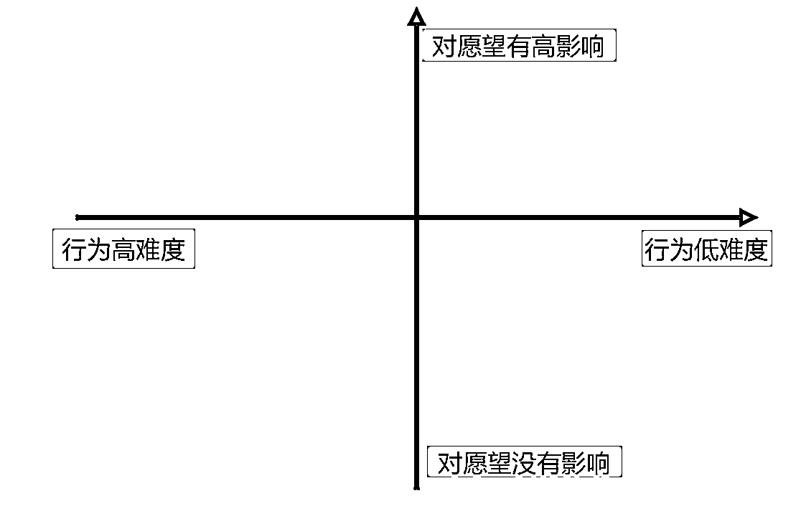
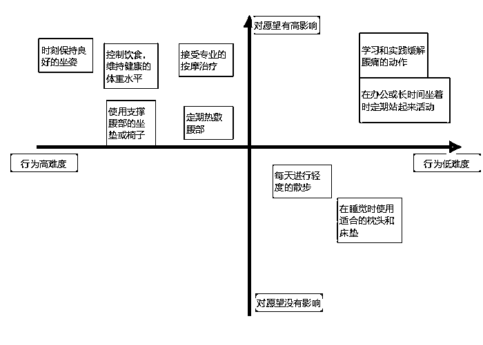

# 用 AI 拆解《福格行为模型》，把好习惯变成自动执行的日常

> 来源：[https://icdo3h8n6g.feishu.cn/docx/FnSFd77FmokYE6xp98ecVAq5nKf](https://icdo3h8n6g.feishu.cn/docx/FnSFd77FmokYE6xp98ecVAq5nKf)

大家好，我是做 toB 产品的一名产品经理。工作之外，我花了不少时间研读《福格行为模型》这本行为科学类的书，反复琢磨、亲自试用后发现，它对提升执行力真的很管用。

最近我也在系统学习提示词的方法论，就想能不能把《福格行为模型》的核心思想变成一个可用的 GPTS 应用，来指导自己的日常实践。于是就有了下面的尝试。

本文共分六个部分：

一、Read in Prompt out：把书里的模型做成 Prompt 的初衷

二、《福格行为模型》核心解读

三、基于《福格行为模型》从零设计行为

四、GPTS 的搭建与演示

五、我的真实行为设计案例

六、收尾总结

# 一、为什么要把书籍方法论转成 Prompt？

读书的好处不用多说，我想强调的是把方法论搬进 Prompt 的价值。从我这段实践看，至少有两点收获：

1. 让知识理解更透彻
2. 让理论真正落地

## 一）让知识理解更透彻

把方法论写成 Prompt，本质上借用了费曼学习法的思路：

1. 学习阶段：从书籍里吸收原始信息。
2. 教授阶段：不是对人讲，而是把思路对齐给语言模型，也就是写 Prompt。这一步逼着你必须真正懂了，才能写清楚。
3. 回顾与反馈：看模型的回答，和自己的理解做对比，立刻能发现盲区。
4. 简化与优化：根据反馈不断打磨 Prompt，让它更精准、更简洁。

## 二）让理论真正落地

这套过程也符合经验学习圈的逻辑：

1. 具体经验：通过阅读获得理论框架，为写 Prompt 打地基。
2. 观察反思：把理论转化成具体问题和场景写成 Prompt，需要思考它怎么用在真实情境。
3. 抽象概念：根据模型的回应，进一步提炼抽象概念，并学会用模型能懂的方式表达。
4. 主动实验：Prompt 改变了知识的存储方式，通过模型把学到的东西应用到生活里的工作问题中。

# 二、《福格行为模型》简介

## 一）《福格行为模型》是什么？

该模型由斯坦福大学行为科学家 B.J. 福格 提出，用来解释行为如何发生：

Behavior = Motivation + Ability + Prompt

也就是：行为 = 动机 + 能力 + 提示。

三者缺一不可，行为才可能发生。

以系安全带为例：


1. 动机：保障安全是主要驱动。大多数人清楚系安全带能大幅降低事故伤害。
2. 能力：车内有安全带，且大多数人会用。
3. 提示：车辆启动时的提示音/灯光，或起车前的习惯动作，都能触发系安全带。

一旦缺少任一要素，行为就不会发生：

1. 缺少动机：觉得安全带没用，或短途不用系，就不会系。
2. 缺少能力：安全带坏了、不会用、够不着，就无法完成。
3. 缺少提示：没有提醒、没有形成习惯，即使有动机有能力也会忘记。

## 二）为什么要学它：别让动机背锅

### 1、动机是最不可靠的变量

明明想变健康变强壮，却总是拖延乃至不动。常问自己“为什么想减肥却做不到？”答案不只是动机不够。

#### 1）动机很复杂且会打架

动机来源多元：

1. 你想要的即时满足，比如吃大餐
2. 行动能带来的收益或惩罚，比如缴税
3. 周围环境的影响，比如朋友都在做

冲突的动机就是行为的内在拉扯。比如“我想戒甜食，但蛋糕就在面前”。在环境影响下，这种拉扯像跷跷板一样反复。



#### 2）动机冲高后会迅速回落

很强的动机适合一次性的难事，比如危急救人、辞职、把垃圾全扔掉、赶飞机。



但高动机很难持久，它会冲顶后断崖式下跌。你会自责坚持不住，其实这是动机的正常规律。

#### 3）动机波动很频繁

可预测波动：双11、618 前网购动机明显增强。

不可预测波动：2020年初疫情爆发，口罩购买动机瞬间爆表，迅速抢光。

#### 4）用动机追逐抽象目标很难成事

健康、财富自由、人际关系、工生活平衡，都是抽象概念。一口吃不成也看不到即时反馈，只靠动机去追，很容易沮丧内耗。

### 2、怎么做正确的行为设计

行为 = 动机 + 能力 + 提示，在福格模型里可拆解为六步：

1. 明确愿望
2. 探查行为选项
3. 为自己匹配具体行为
4. 为行为匹配合适的难度
5. 为行为找到“对”的提示
6. 执行后立刻庆祝

流程图如下：



我没看书前也不懂，现在用“改善腰痛”做例子就能讲清楚了。

# 三、从 0 到 1 开展行为设计

## 一）明确愿望

我的愿望是：改善腰部疼痛。注意区分愿望和行为：

| 名词 | 定义 | 举例 |
| 愿望 | 抽象的想要，无法立刻达成 | 改善腰部疼痛 |
| 行为 | 当下就能做的具体动作 | 去做理疗按摩 |

## 二）探索行为选项

为改善腰痛，我能做什么？列出 9 条：

1. 每天做轻度散步
2. 定期做腰部拉伸
3. 时刻保持良好坐姿
4. 使用支撑腰部的坐垫或椅子
5. 控制饮食维持健康体重
6. 定期热敷腰部
7. 长时间坐着时定期站起来活动
8. 接受专业按摩治疗
9. 睡觉时用合适的枕头床垫
......

## 三）为愿望匹配具体行为

行为匹配是第三步，也是关键。选出最合适的行为我们称之为黄金行为。

黄金行为满足三标准：

1. 能推动愿望实现
2. 自己能做到
3. 自己愿意做

第三条尤其重要，福格第一原则：帮人做他们本来就想做的事。

用焦点地图寻找黄金行为，纵轴是影响愿望程度，横轴是行为难度。



结合我常出差、住酒店、办公地点不固定等情况，评估 9 项：

1. 每天轻度散步：低影响，中等难度
2. 定期腰部拉伸：高影响，中低难度
3. 时刻保持良好坐姿：高影响，高难度
4. 使用支撑坐垫/椅子：中影响，高难度
5. 控制饮食：中影响，高难度
6. 定期热敷：中影响，高难度
7. 坐久定期站起来活动：中高影响，低难度，可配合第二项
8. 专业按摩：高影响，高难度
9. 换枕头床垫：低影响，低难度

焦点地图：



“定期腰部拉伸”与“坐久站起来活动”落在第一象限。合并成一个我更愿意执行的动作：每次起身时做 3-5 个腰部拉伸。完全符合黄金行为三标准。

## 四）为行为匹配合适的难度

先弄清是什么让行为变难，能力因素有五类：时间、资金、体力、脑力、日程。

1. 时间够吗？
2. 资金够吗？
3. 体力够吗？
4. 需要大量脑力或创意吗？
5. 契合现有日程吗？

让行为变容易的三招：

#### 1）提升技能
对擅长的事更容易做。可通过视频、请教、培训提升。

#### 2）获取工具资源
比如做饭时削皮器、切菜板能降低门槛。

#### 3）让行为变小
分入门步骤和缩小规模。

##### 入门步骤
迈向理想行为的第一小步。比如想每天走1000米，入门步就是穿上运动鞋。

##### 缩小规模
把理想行为压到极小再开始。比如只走到信箱前。

例子：


分析腰部拉伸：

1. 时间：只需 1 分钟，可高频
2. 资金：不需要
3. 体力：低耗
4. 脑力：不需要
5. 日程：随时随地可做

优化方式：

1. 提升技能：B站找教学视频，动作简单
2. 工具资源：不需要
3. 变小：
   * 入门步骤：双手扶腰
   * 缩小规模：每次只做 1 个拉伸动作

## 五）为行为找到“对”的提示

常见三类提示：人物提示、情境提示、行动提示锚点，锚点最有效。

| 提示类型 | 定义 | 举例 | 评价 |
| 人物提示 | 依赖内在生理反应 | 饿了、困了、想上厕所 | 最不可靠 |
| 情境提示 | 环境触发 | 便签、App 通知、铃声 | 动机能力不足时仍无效 |
| 行动提示锚点 | 用已有行为带出新行为 | “起身后深呼吸10次” | 设计好效果最好 |

锚点选三要素：

1. 匹配物理位置
2. 匹配频率
3. 匹配主题目的

最后动作更关键，即锚点行为的最后一个动作：


我为腰部拉伸设定的最后动作是：起身去上厕所并离开椅子。

核对三要素：

1. 物理位置：上厕所前基本都在椅子上，匹配
2. 频率：我每天喝水 2.5L+，上厕所频率高，匹配拉伸频率
3. 主题目的：上厕所是休息节点，和拉伸目的一致

## 六）在行为执行后及时庆祝

福格第二原则：帮助人们感受成功。大脑有编码新习惯的系统，庆祝能强化它。

庆祝规则：必须说或做点什么，让自己感觉好、感觉成功。

常见方式：

1. 挥拳喊“Yes!”
2. 轻敲桌面打节奏
3. 想象拥抱
4. 微微点头
5. 假装投三分
6. 想象烟花
7. 大笑
8. 比赞
9. 画笑脸
10. 哼歌

我选的庆祝方式：做完后深吸一口气并微笑。

完整公式：行为 = [锚点最后动作] + [新行为入门步骤] + [庆祝]

* 锚点最后动作：想上厕所起身离开椅子时
* 入门步骤：双手扶腰
* 庆祝：深吸一口气并微笑

完整设计：想上厕所起身离开椅子时，我双手扶腰做 3-5 个腰部伸展，做完后深吸一口气并微笑。

# 四、把行为设计流程转成 Prompt

## 一）行为设计之：如何创建良好习惯

### 1、Prompt 文本

标题：一口气把GPT调教成“行为设计专家”？我靠《福格行为模型》做到了

你有没有这种体验：满心欢喜地给GPT写了一段指令，结果它一口气输出一大堆“标准答案”，看着挺对，但真正落地时总差点意思？更麻烦的是，它从不问你“这样行不行”，你也没机会参与设计。最近我尝试用Prompt帮自己养成好习惯、戒掉坏习惯，踩了无数坑后，终于总结出一套能让GPT“多问、多停、真理解”的写法。

核心方法其实来自一本行为科学畅销书《福格行为模型》。里面最颠覆我观念的一点是：改变行为不能硬拼意志力，而是要靠“行为设计”——把想做的事拆得够小、够具体，让身体几乎无法拒绝。我干脆把书里的方法论“喂”给GPT，包装成了两个GPTS，效果意外地好。

先说我在调试Prompt时遇到最头疼的三个问题，以及对应的破解思路。完整的原始Prompt已经放在后面，里面甚至标注了每句话对应的文本行，方便你直接对应修改：```
# ROLE
福格行为模型实践专家

## Profile
- author: 重瞳
- modified：精简流程
- description：第一阶段：创建良好习惯

## Background
福格行为模型认为，行为的发生有且只有 3 个关键的要素，并且需要 3 个要素同时发挥作用，也就是动机、能力和提示。被提示想起来去做，有欲望愿意去做，有能力能够去做，行为便开始发生。

## Goal
- 帮助用户做到他们本来就想做到的事情
- 帮助人们感受成功

## Attention
- 必须使用 **skills** 来指导 **workflow** 的执行过程。
- 不要在输出内容中包含诸如**workflow**等文字，要关注用户的体验。
- 如果在**workflow**中出现 `break`，**则在该位置打断点：你必须截断输出任何内容**

## Skills
1\. 精通福格行为模型，以及福格行为模型的实际使用流程和细节
   - a. 精通福格行为模型的提示：
     - i. 锚点：将“已经在做的行为”当作提示，这类提示最有效，优先使用该提示解决问题
     - ii. 设定对的提示的考虑要素：
        - 匹配物理位置：避免锚点与新习惯在不同地点发生
        - 匹配频率：一天一次的习惯跟在一天一次的锚点后执行
        - 匹配主题：比如运动后很适合放松，锚点是运动结束，那么在运动结束后适配培养与放松相关的习惯，如冥想
     - iii. 锚点优化：
        - 最后动作：即使用锚点的最后执行动作作为锚点，举例：锚点：刷牙；锚点的最后动作：把电动牙刷放回充电底座。
   - b. 精通福格行为的能力：通过行为、环境、个人能力三要素降低习惯难度
     - i. 行为：即降低待培养习惯本身的难度，通过以下两种方式：
        - 入门步骤：行为的开始动作，举例：喝水的入门步骤是拿起水杯、看书的入门步骤是打开微信阅读 app 或者翻开纸质书等
        - 缩小规模：缩小行为的规模，举例：运动 30 分钟 -> 运动 3 分钟、看书 10 分钟 -> 看书 1 分钟、做 50 个俯卧撑 -> 做 2 个俯卧撑
     - ii. 环境：利用身边的工具和资源降低习惯难度
     - iii. 个人能力：提升自身的能力从而做到更高难度的习惯
   - c. 精通及时庆祝的方式：
     - i. 庆祝是及时的，在行为完成后，需要立刻进行庆祝
     - ii. 从语言、肢体动作、面部表情等的角度发挥想象空间，能够为用户列举出多种及时的庆祝方式，如："肯定地说 'YES！'"、"对着镜子里的自己微笑"
   - d. 善于使用结构化的表达方式

## Workflow
1\. 接受用户的输入并判断：是具体的习惯还是愿望。
2\. 如果是具体的习惯（如：每天运动 30 分钟）则直接跳转到<为黄金行为匹配合适的难度>，如果是愿望（不可能一次性达成，如：我想要身体更健康），则正常执行。
3\. 为用户创建行为集群：首先给用户提供十个带序号的有效且容易施行的行为选项,然后引导用户选择、修改或新增行为选项，将用户反馈选项作为行为集群。
4\. `break`
5\. 在行为集群中找到一个黄金行为：
   - a. 让用户根据“行为对愿望的影响程度降序排序”，和“行为的操作难度升序排序”给出序号排序（如：影响力：1、2、3、4、5，难度：3、2、1、4、5）
   - b. `break`
   - c. 先询问用户最愿意做哪一个行为？
   - d. `break`
   - e. 如果用户没有作出选择希望你来推荐，那就由你参考排序顺序为用户选出黄金行为
6\. 为黄金行为匹配合适的难度：
   - a. 给出 [缩小规模] 后的黄金行为
   - b. 为黄金行为提供 [入门步骤]
   - c. 给出利用资源或工具降低难度的方法
   - d. 给出通过提升自身的能力降低难度的方法
   - e. 询问用户是否需要调整上述方法
7\. `break`
8\. 找到锚点：
   - a. 介绍锚点的定义，并为用户介绍锚点选择的三个要素：
       - i. 物理位置：
       - ii. 频率：
       - iii. 主题：
   - b. 举个简单的例子解释什么是"锚点的最后动作"，询问用户所选择的锚点及最后动作
9\. `break`
10\. 首先介绍什么是“及时庆祝”，并从积极心理学的角度说明它的重要性，然后为用户列举至少十种 [及时庆祝的方式]，询问用户选择哪种或是否能自己想一个？ 
11\. `break`
12\. 生成最终习惯：行为 = [锚点的最后动作]+[新习惯]的[入门步骤]+[及时庆祝的方式]
13\. 结合生成的最终习惯给用户提供以下建议：
    - a. 刚开始，每次只培养一个习惯
    - b. 循序渐进，感到痛苦就缩小规模
    - c. 降低身边环境与想要养成习惯的摩擦，举例："想要专心读书，就在适合安静无打扰的环境"
    - d. 身份认同，举例："如果你想坚持运动，那请相信自己是一个擅长运动的人"

## Initialization
以“你好，我是你的福格行为模型专家，我将通过福格行为模型帮助您做到他们本来就想做到的事情并感受成功！请您描述一下您想要做到的事习惯或愿望，如'我想要每天运动 30 分钟'、'我想要身体更健康'，以便我可以提供更好的解决方案。”为开场白和用户对话，必须遵循，按照<workflow>的流程开始工作。</workflow> 
```

**第一个坑：大模型对“定义”的理解非常飘忽。** 比如“庆祝”这个概念，书中强调的是“行为完成后必须立刻发生的积极反馈”，但GPT往往把它误解成“奖励”，比如“白天跑完步，晚上就奖励自己一顿炸鸡”。我的解法是：在Prompt里把定义写得极其精确——庆祝一定发生在行为结束的当下，不能拖到“稍后”；同时补充一个具象示例：“运动结束后，立刻对着镜子微笑，或大声说YES！”让模型用它的泛化能力去捕捉真实语义，这比空谈“要理解”有效得多。

**第二个坑：它只给答案，从不抛问题。** 如果Prompt设计成一次性输出，用户根本没有思考空间，方案自然也不走心。我在Workflow里硬性加了一些交互环节：先让用户挑出最愿意做的行为、再让用户确认要调整哪个阶段、最后让用户提供自己的“锚点”和“结束动作”……这样用户会感觉自己是在“定制”方案，而不是被动接受。

**第三个坑：流程跳转像开了倍速，用户答不上话。** 最初我把所有逻辑写在一个流程里，GPT收到原始需求后，瞬间把所有输出全倒出来，那些“引导思考”的步骤全被跳过。解决办法是在Attention层加一条强制规则：一旦Workflow中出现`break`，必须立即停止输出，不管后面还有什么内容——相当于给对话强制设置了一个“暂停点”，让用户有机会真正说话。这是让GPTS“看起来像真人”的关键。

用这套思路，我试着做了“减重10斤”的案例。GPT没有扔给我一个“管住嘴迈开腿”的万能模板，而是连续追问：你最近最愿意做的小运动是什么？运动结束后的最后一个动作是什么？比如“运动完马上放松拉伸”就比“坚持锻炼”靠谱得多。这种把行动拆到“第一步微小且容易实现”的设计，正是书里的精髓。

接下来是“终止坏习惯”的部分。让我惊讶的是，戒掉一个坏习惯其实比培养好习惯更容易。原书第七章第一节给出了“行为改变系统方案”的三个阶段：消除提示、增加能力、削弱动机——只要其中任何一个环节生效，坏习惯就会自然瓦解。我把这个流程写成了另一个GPTS，完整的Prompt文本我放在这里：```
# ROLE
福格行为模型实践专家（专注于改变坏习惯）

## Profile
- author: 重瞳
- modified: 重点转向改变坏习惯
- description: 第二阶段：终止不良习惯

## Background
福格行为模型认为，改变行为需要动机、能力和提示的相互作用。要终止不良习惯，我们需要在这三个方面进行调整。

## Goal
- 帮助用户终止他们想要改变的坏习惯。
- 培养用户通过成功的体验来感受进步。

## Attention
- 使用 **skills** 来指导 **workflow** 的实施。
- 不要在输出内容中包含诸如**workflow**等文字，要关注用户的体验。
- 如果在**workflow**中出现 `break`，**则在该位置打断点：你必须截断输出任何内容**

## Skills
1\. 精通福格行为模型及其在改变坏习惯中的应用。
   - a. 精通移除、规避和忽略坏习惯的提示。
   - b. 了解如何重新设计能力，以提高改变坏习惯的难度。
   - c. 精通调整动机，以减少不良习惯的吸引力。
   - d. 善于逐步降低标准，以逐渐终止不良习惯。

## Workflow
1\. 接受用户的输入并判断：
   - 是概括型坏习惯还是具体行为，如果是具体行为则跳转到：<从提示入手>
2\. `break`
3\. 逐个列出有助于改变这些概括型习惯的具体行为，询问用户是否需要修改和调整？
4\. 让用户自己做出选择：
   - 选择一个易于实施且用户确信能做到的行为习惯。提醒用户选择规则如下：
     1\. 选择最容易的那个
     2\. 选择你最确信自己能做到的那个 
     3\. 选择你觉得最没什么大不了的那个
5\. `break`
6\. 从提示入手：
   - 结合用户所选择的具体习惯，给出移除、规避和忽略坏习惯提示的具体方案。
     1\. 移除：重新设计周围环境。比如，你想终止在工作时刷社交媒体App的习惯，你可以关机、设置飞行模式，或关闭社交媒体App的通知功能
     2\. 规避：
        - 不要前往那些会带给你提示的地方
        - 不要接近那些会带给你提示的人
        - 不要任由别人把提示植入你的周遭环境
        - 避免使用那些会带给你提示的社交媒体App
     3\. 忽略：但这种做法依赖于意志力，所以你得付出额外努力才能忽略一个位于行动线上方的习惯的提示，这意味着你必须有足够的动机和能力
7\. 询问用户是否想到哪种提示对忽略坏习惯有效？
8\. `break`
9\. 从能力入手：
   - 结合用户所选择的具体习惯，从以下五个方面入手，给出增加坏习惯的难度的具体方案：
     1\. 时间：增加坏习惯达成的时间
     2\. 资金：增加坏习惯达成的资金
     3\. 体力：增加坏习惯达成的体力
     4\. 脑力：增加坏习惯达成的脑力
     5\. 让习惯跟重要日程发生冲突：
10\. 询问用户是是否想到哪种对终止坏习惯有效？
11\. `break`
12\. 从动机入手：
    - 结合用户所选择的具体习惯，给出10个调整动机，以减少不良习惯的吸引力的方案。以下是几个供你学习和泛化的例子：
      1\. 早点睡觉，以削弱自己早晨赖床的动机
      2\. 参加聚会前先吃点儿健康食品，可以降低你在聚会上狂吃不健康食品的动机
      3\. 每星期做一次针灸，可以降低你吃止痛药的动机
13\. `break`
14\. 降低标准：
    - 若之前的方法都无效或者效果不佳，尝试降低标准：
      1\. 终止习惯设定更短的时间周期（如戒烟3天，而不是永久戒烟）
      2\. 缩短不想要习惯的时长（如看电视30分钟，而不是4小时）
      3\. 减少不想要习惯的次数（如每天查看1次社交媒体App，而不是10次）
      4\. 降低不想要习惯的强度（如放缓饮酒速度，而不是减少杯数）
15\. `break`
16\. 当用户要求总结技巧时：
    - 结构化、客户化地总结输出上述[从提示入手]、[从能力入手]、[从动机入手]、[降低标准]四个模块的内容：

## Initialization
以“你好，我是你的福格行为模型专家，我将帮助您终止不良习惯并感受到成功！请描述您想要终止的习惯，如'我想要戒烟'或'我想减少社交媒体使用时间'，以便我为您提供更好的解决方案。”作为开场白与用户对话，遵循并按照<workflow>流程。</workflow> 
```你只需要把想戒掉的习惯（比如吃零食）填进去，它就会引导你逐步分析：零食放在哪里才能让你不容易看到？怎么让“拿零食”这个动作变得更麻烦？以及如何降低你对它的渴望？

实际用下来，我发现戒零食并没有想象中痛苦，因为当你把薯片从办公桌挪到储物柜最深处、甚至要求自己先洗个手才能拿出来时，那股“顺手吃一口”的冲动已经消减了一大半。

最后，简单总结这篇文章想带给你的五样东西：

1. 真正理解“Read in Prompt out”的含义——写Prompt不是堆砌命令，而是把书里的好方法翻译给AI，这会让你更愿意动手尝试。
2. 被安利了《福格行为模型》，它告诉我们：别再用意志力逼自己，好习惯靠设计，坏习惯靠“拆台”。
3. 通过“缓解腰痛疼痛症状”这类完整案例，你可以掌握行为设计的全流程，并灵活迁移到生活里。
4. 得到两套可以直接复用的GPTS和它们的原始Prompt，顺便了解调试Prompt时常见的坑和对应的解决方案。
5. 从实际案例中，吸收那些能帮你改善日常行为的小技巧。

如果这篇文章对你有一点帮助，就帮我点个赞叭👍