# 用AI工作流写一篇文章，单日变现4722元，写作已经进入新阶段

> 来源：[https://aiawaken.feishu.cn/docx/JZJxdXMGUoTAYIxhf1Lci71lnpe](https://aiawaken.feishu.cn/docx/JZJxdXMGUoTAYIxhf1Lci71lnpe)

大家好，我是周知。

我们社群的一位签约作者，借助「觉醒派智能笔尖」完成了一篇稿件，直接刷新了团队AI写作的成绩单：

单篇阅读量突破 72 万+

当天阅读量就超过 100 万，当天收益 4722 元

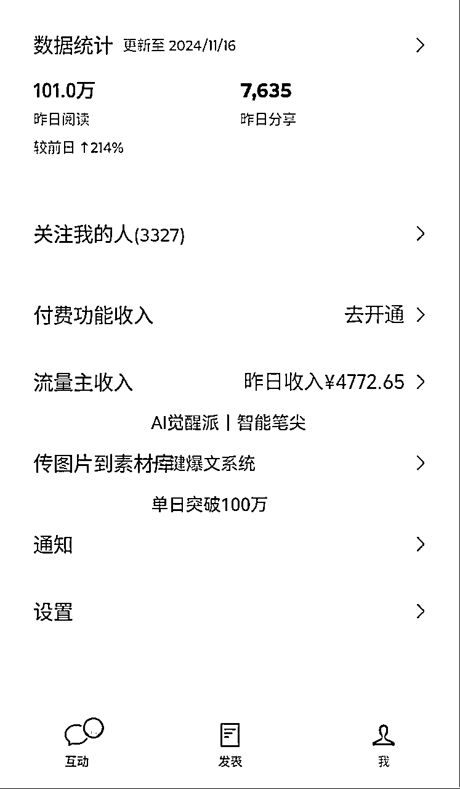

数字本身很亮眼，但更打动我的反馈是，这位与智能笔尖协同创作的AI作家，实打实拿到了难以复制的结果。

在我看来，AI的价值并不在于简单的洗稿复写，它的真正形态是：
会写的你 + 智能笔尖 = 能产生商业回报的原创内容

下面就把我常用的两种拆解思路，重新梳理给你。

* * *

# 工作流一：只靠调动AI的底层能力来完成一篇稿件

## 先说AI的底层元能力：

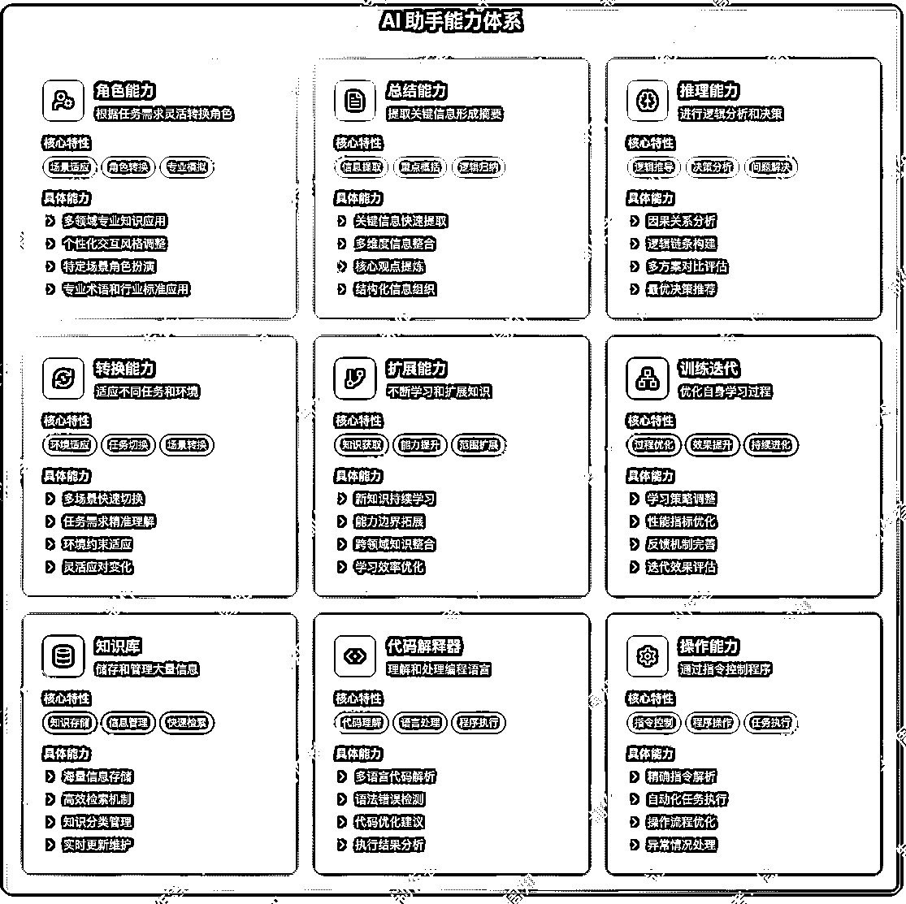

## 1. 先用知识库能力

指令：我现在有个选题任务，标题是《中年以后，和激活你的人在一起》，帮我写一篇大约400字的优质文章。

回答：

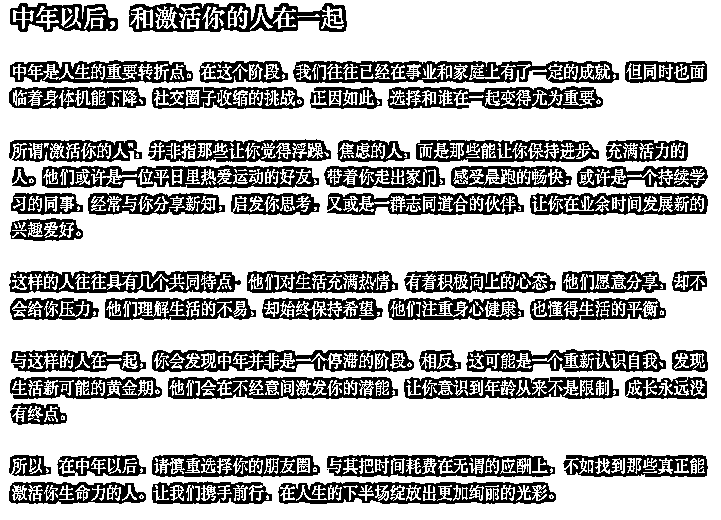

废话太多，根本读不下去

## 2. 再加上角色能力

指令：你是一位擅长公众号网感写作的作者，我现在有个选题任务，标题是《中年以后，和激活你的人在一起》，帮我写一篇大约400字的优质文章。

回答：

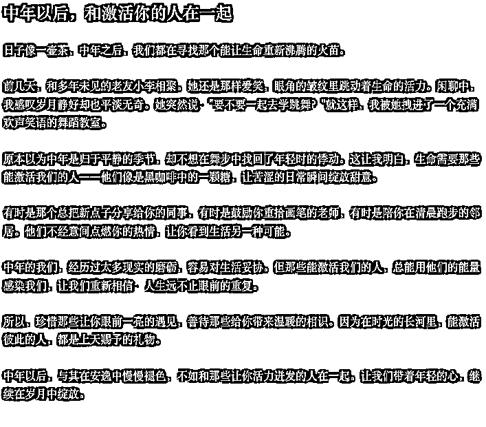

有点进步，但我还是读不完整

## 3. 再加入推理能力

指令：

你是一位擅长公众号网感写作的作者，我现在有个选题任务，标题是《中年以后，和激活你的人在一起》，

第一步：先根据这个标题拆解目标读者和文章框架
第二步：结合标题、框架、读者画像，把文章写到400字左右

回答：

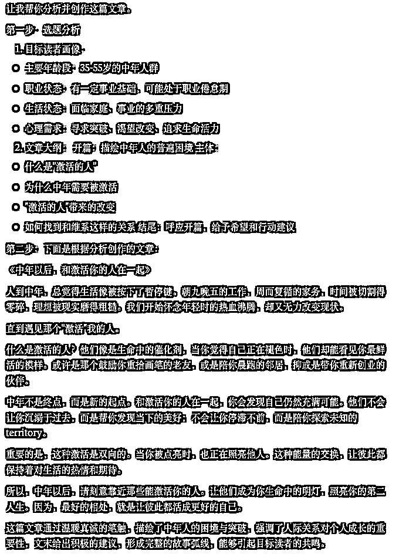

总算知道要说什么了

## 4. 再加入复盘总结能力

继续指令：把你刚才生成的文章优点和缺点总结出来，用表格给出优化建议

回答：

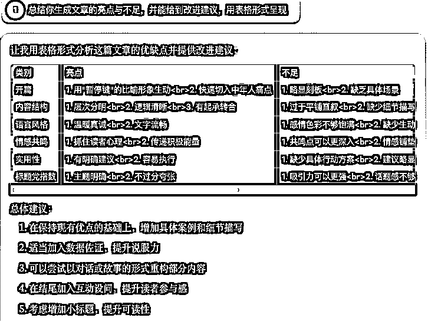

## 5. 再加入迭代训练能力

继续指令：按照你建议里的第1、3、5点，对原文进行优化

回答：

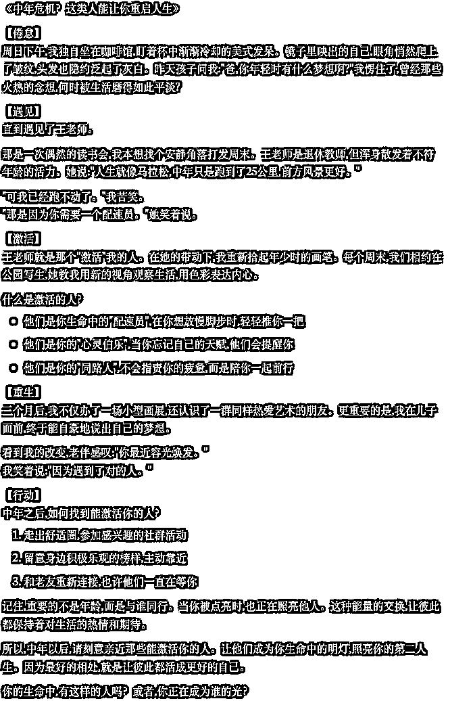

感觉又顺畅了一些，但依然缺乏击中人的力量

## 6. 最后加上转换与延展能力

最终指令：基于以上文案，换成余华的写作风格重新表达，并扩写到800字

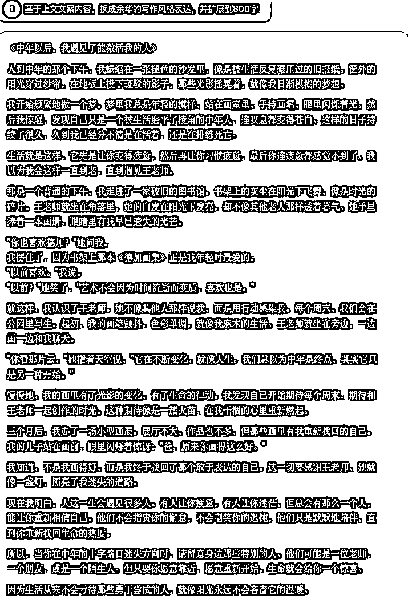

这篇AI+你共同完成的文章，是否触动到你？

说实话，我不是余华。
我只是清楚自己想表达什么。
AI掌握的是余华式的写作技巧。
这类技巧，是普通人没时间也没资源去训练的表达方式。
但每个人都有自己对世界的独特理解。

懂人生的你 + 懂写作的AI
这在我看来，就是写作未来的新形态！

* * *

# 工作流二：业务流程 + 人工判断 + AI，写一篇《中年以后，和激活你的人在一起》

## 先理清写作业务流程

问小觉醒：公众号文章的创作流程是怎样的

答：

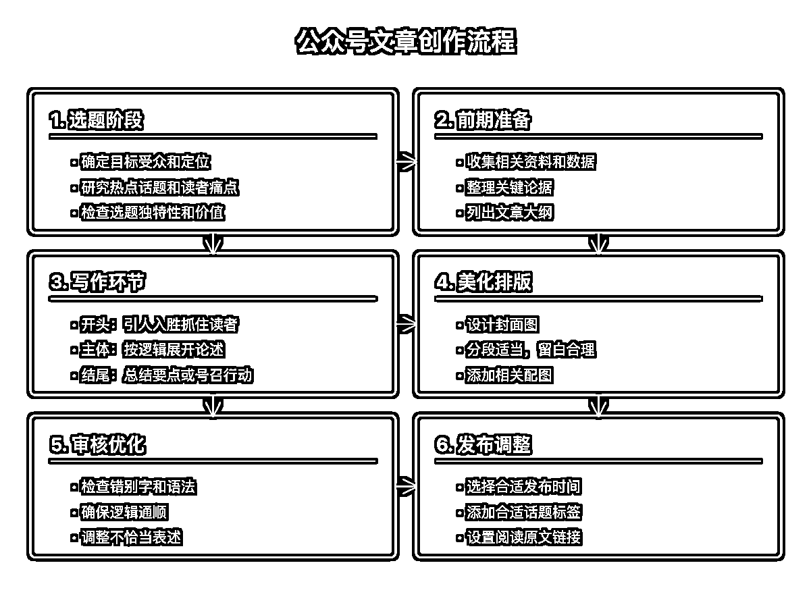

## 再划分人机分工

我的判断是，人机协作的效率配比大概是：

选题阶段：人负责 80%，AI补充 20%灵感
前期准备：人负责 60%资料收集与素材整理，AI负责 40%梳理论据与搭建大纲
写作阶段：人微调 10%，AI主笔 90%
美化排版：人决策 10%，AI执行 90%
审核优化：人决策 10%，AI执行 90%
发布环节：人 100%

核心逻辑是：
人来做：选择、判断、决策、引导
AI来做：内容生成、灵感启发、流程提效

## 明确人机协同的工作流

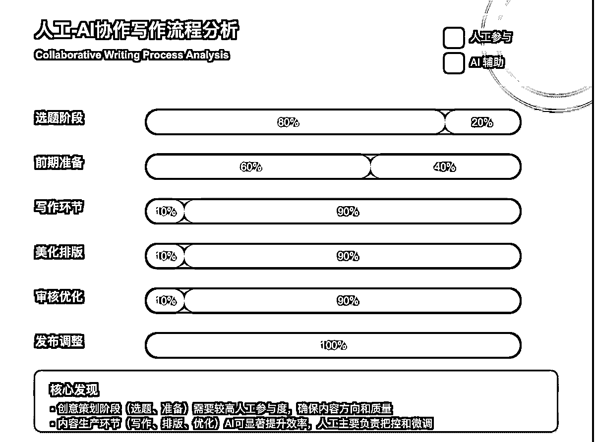

## 进入实际生成

输入：

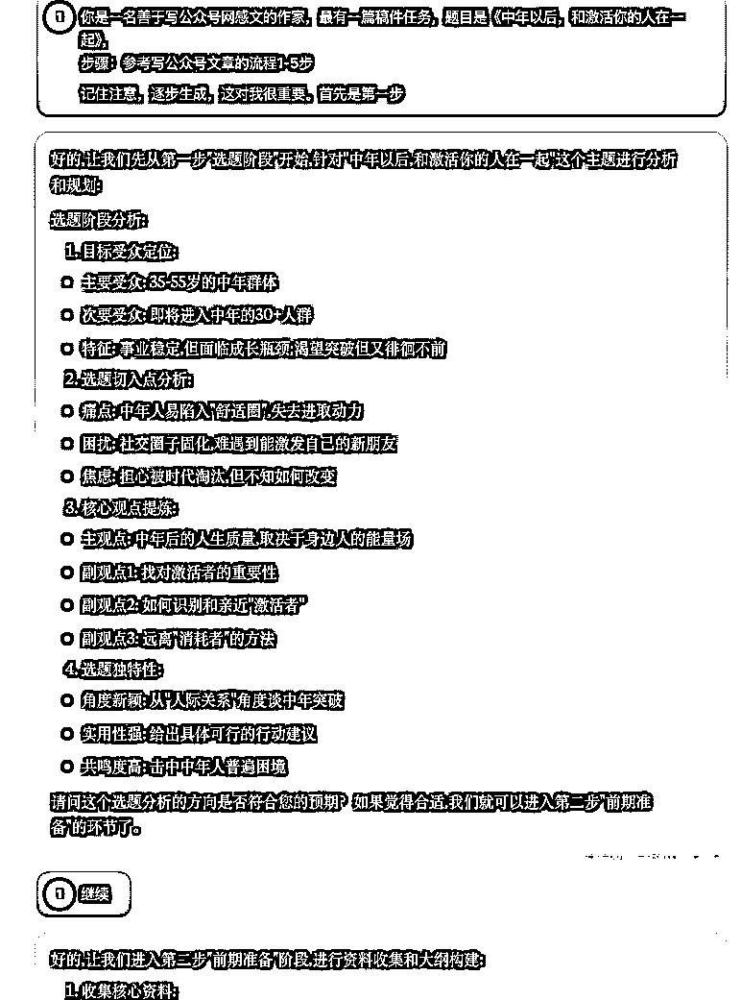

最终输出：

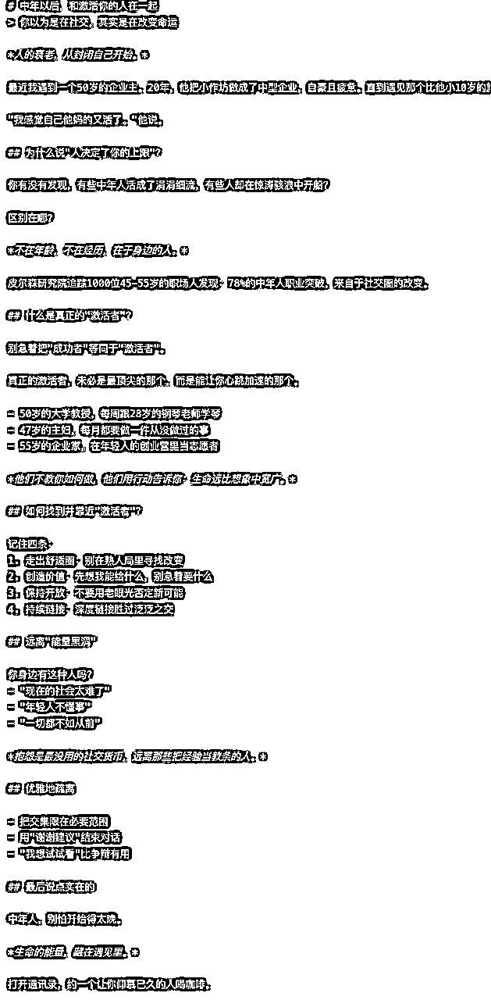

懂选题的你 + 懂写作的AI = 高效AI写作
这就是我认为的未来写作新范式！

* * *

写作是人类跨越时空传递思想与知识的最有效方式

万年前的石刻，
千年前的木简，
百年前的纸张，
当下的互联网
我们不断更换载体，只为让思想穿越时间

从石刀到刻刀
从毛笔到键盘
工具一直在升级
创作效率也在持续提升
不变的是表达的本能

AI今天的角色，不是取代创作者，而是为创作打开新的可能性

也许未来最顶尖的AI作家，就是会用好AI工具的你。

这才是写作真正的下一个范式。

* * *

# 作者简介 周知：

AI觉醒派创始人，AI工作流实战专家

AI觉醒派核心项目：
Suno音乐歌词创作专家、万物皆可歌、
超级图文大师、智能笔尖、小觉醒

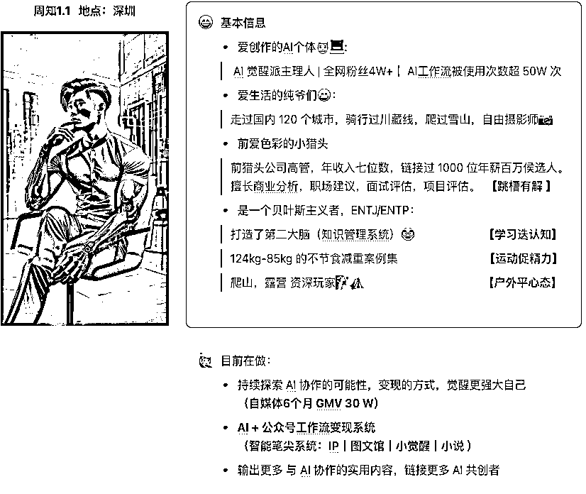