# 超级标#2 实操复盘：从零跑通 YouTube 与 Shorts 全流程

大家好，我是浮笙。这篇是超级标#2 的第二篇实操复盘，也是一份给还在观望的朋友的真实成本参考。先交代背景：十月底龙哥发布任务，我拖了十天还没动工……不过下面内容还算实在，不掺水。

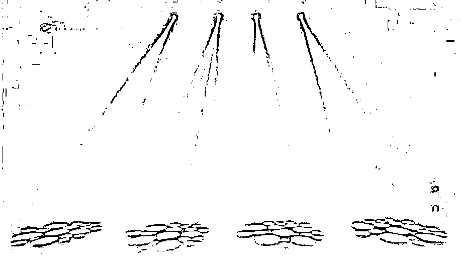
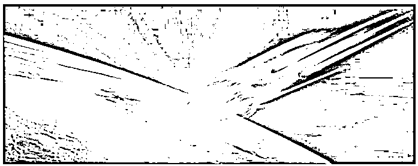

工具组合：GPT（NextChat 调 API）做文案，MJ、即梦、GPT 画图模型做图，可灵、海螺、即梦做视频。🪜问题不展开（你懂的）。

流程：写文案 → 拆镜头 → 出图 → 图生视频 → 剪辑。

## 写文案与镜头稿

有对标号就去拆，我懒，直接让 GPT 生成故事和拍摄脚本。拍摄脚本模板如下：

“你是一名短视频编导，请根据主题先写一段文案，再整理成多镜头拍摄脚本。每个镜头写清：画面风格、场景、人物设定（种族、肤色、发型、外观、服装、表情、动作），如有动物同样处理。角色前后要统一，禁止用‘不限’这类模糊词。输出格式：镜头名 + 以上各项。”

一次生成了 10 个镜头，比如主角是金毛犬+晨跑的亚裔女生，路上遇到孕妇倒地呼救。每个镜头描写都很细，从头发颜色到动作细节都有。

三个文案工具体感：GPT 偏英文叙事，豆包更贴中文，Kimi 给人物特征写“不限”，笑死。

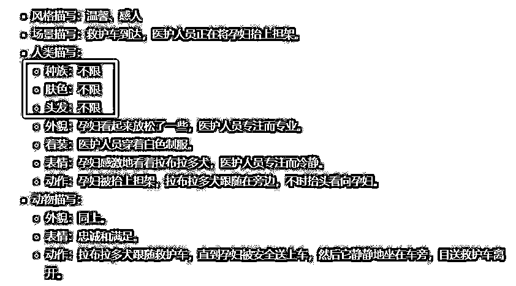

这些镜头描述能直接当绘图参数。示例：中文版喂给即梦，英文版喂给 MJ 和 GPT 画图模型。内容大概：3D 动画风格，家中客厅，一家人吃晚饭，一个短发亚洲女生（黑直发、家居服）笑容满面，旁边一只金毛犬蹭她撒娇。出图效果如下：

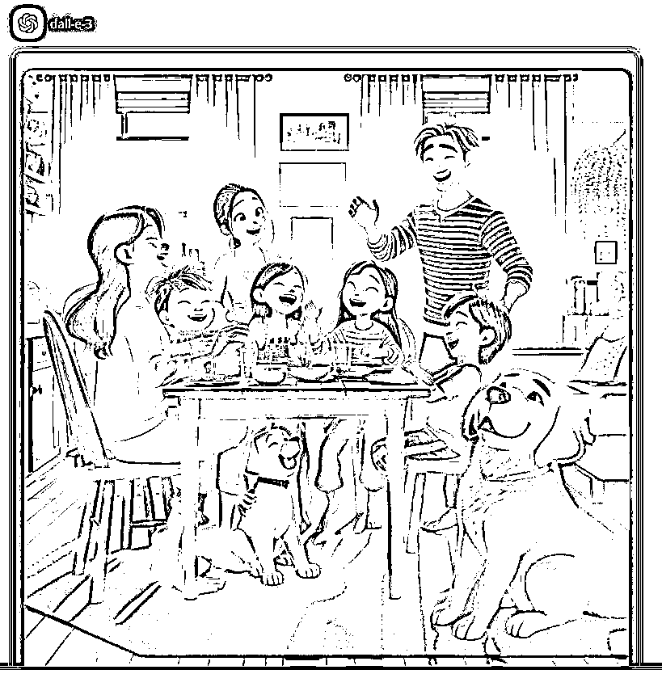
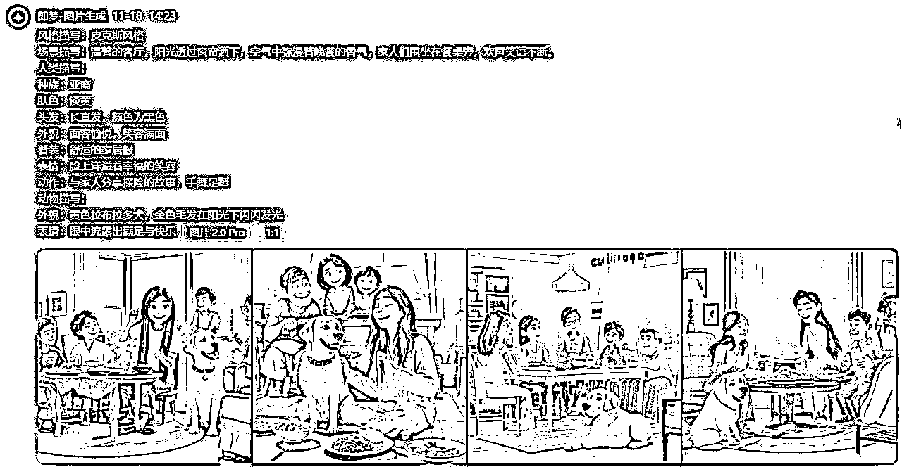
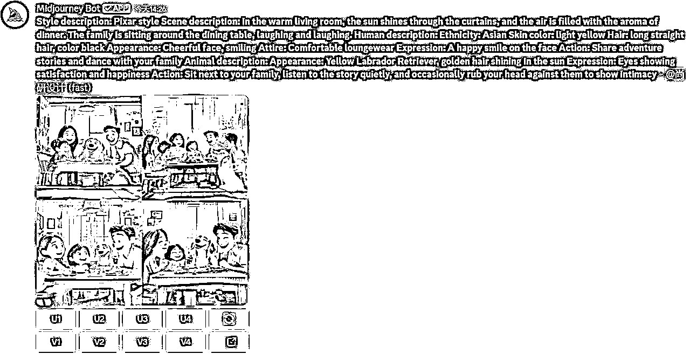

## 出图细节

- GPT 画图：先设置 NextChat（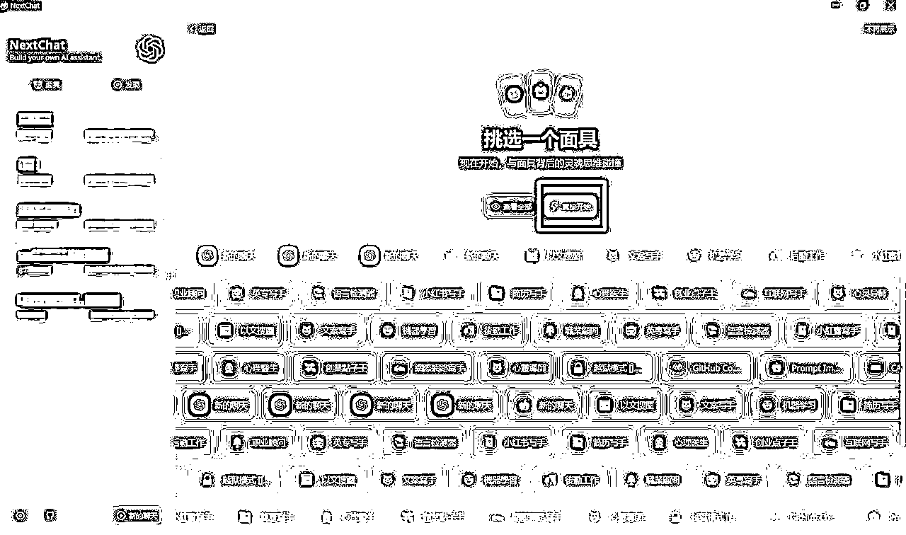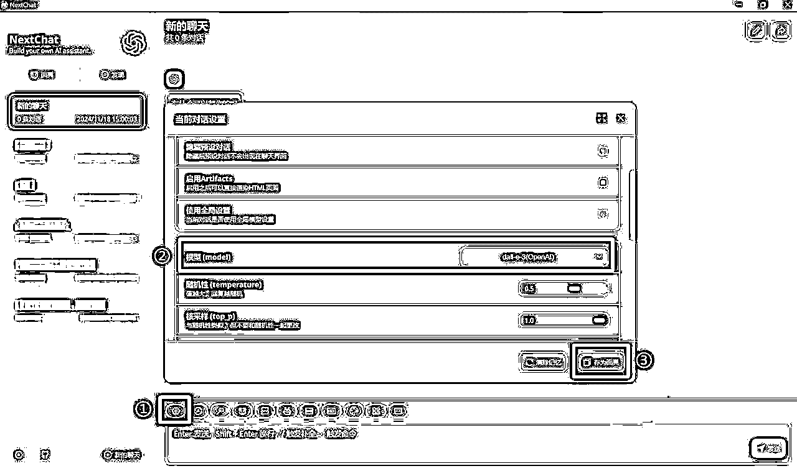），描述语句必须翻成英文，否则它会自由发挥。我用了一个浏览器翻译插件，只保留谷歌与微软两个翻译源（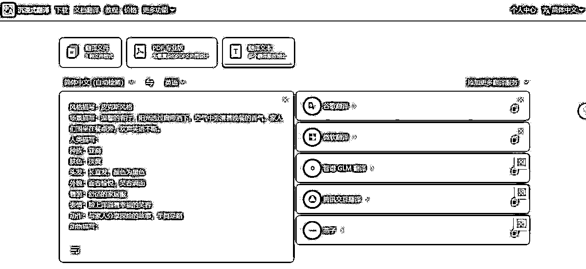）。
- MJ 和即梦：操作太简单，教程满地，不展开。

## 视频生成

直接用图喂三个平台：即梦、可灵、海螺。没有高难度操作，重点是成本。

## 避坑问答

**没有灵感怎么办？** 先给模型喂故事素材，或用对话引导优化，让情节变丰满。

**画面不达标？** 海外工具优先谷歌翻译；国产工具把描述语写细，多补场景、服装、光线等细节。

**文案工具怎么排？** GPT≈豆包>Kimi。

**画图工具怎么选？** 理解描述：GPT>即梦>MJ；画面精细：MJ>即梦>GPT；省钱：即梦>GPT>MJ。

**能白嫖吗？** 能。装一个支持多窗口的浏览器（免费版可开10个窗口），找亲友借手机号多注册几个账号，领每日积分就能用。即梦、可灵、海螺有网页版都能这么玩。

**如何保证人物统一？** 这是最大坑。两个解法：

MJ 路线：打开 B科MJ 描述词生成页，到命令区点“角色锁定”图片按钮（上传角色图后先点提交，再点对应文字按钮），然后输入描述词回车，页面会自动转成英文（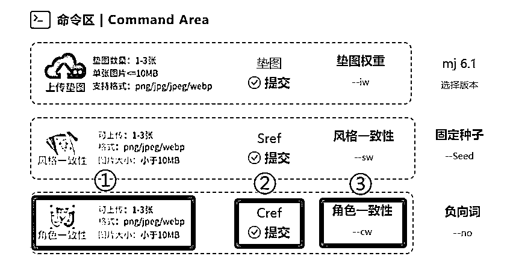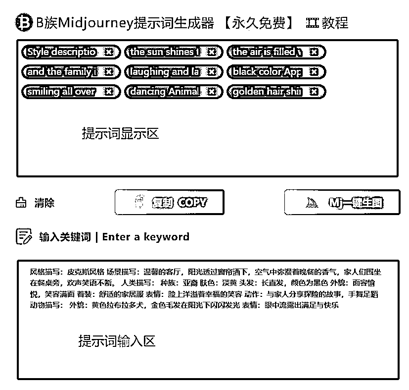）。复制时看到屏幕中央弹出成功提示才算复制好（）。风格类参数左上角有“调整权重值”，多调调能出惊喜（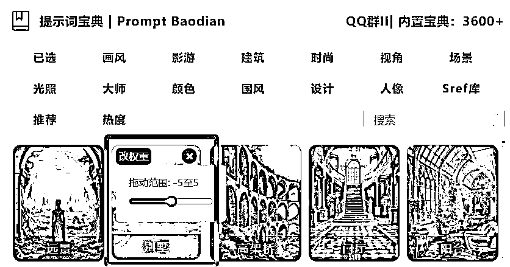）。

即梦路线：入口藏得很深（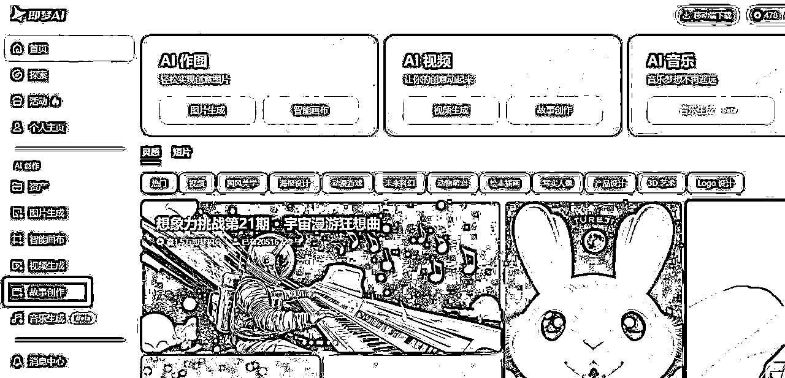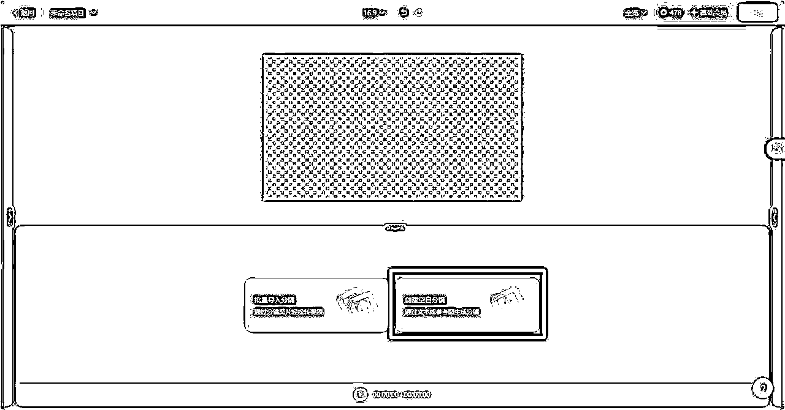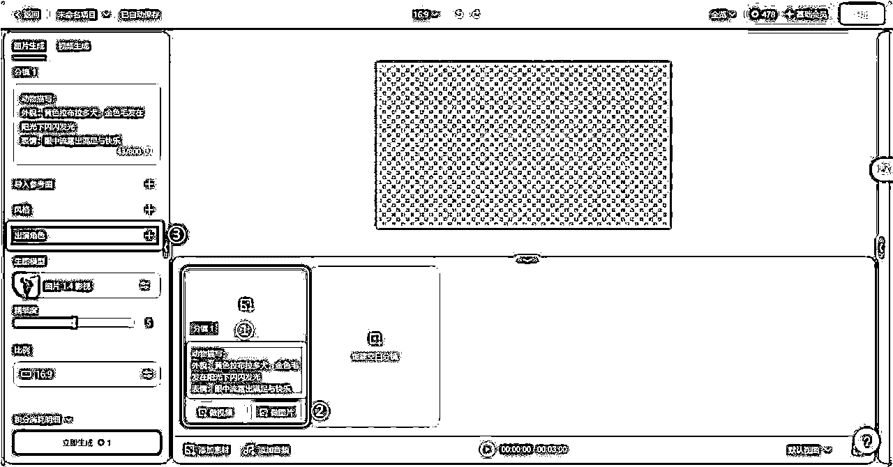），支持新建角色或直接导入正面/白底照片，保存人物后，每个镜头的空白脚本里都要记得把该人物加进当前镜头（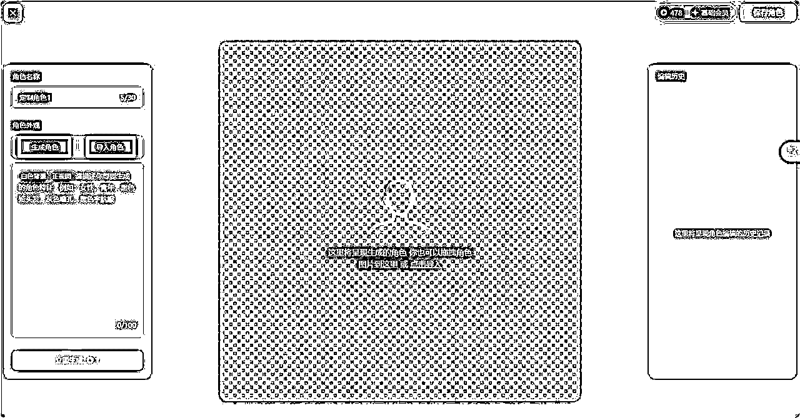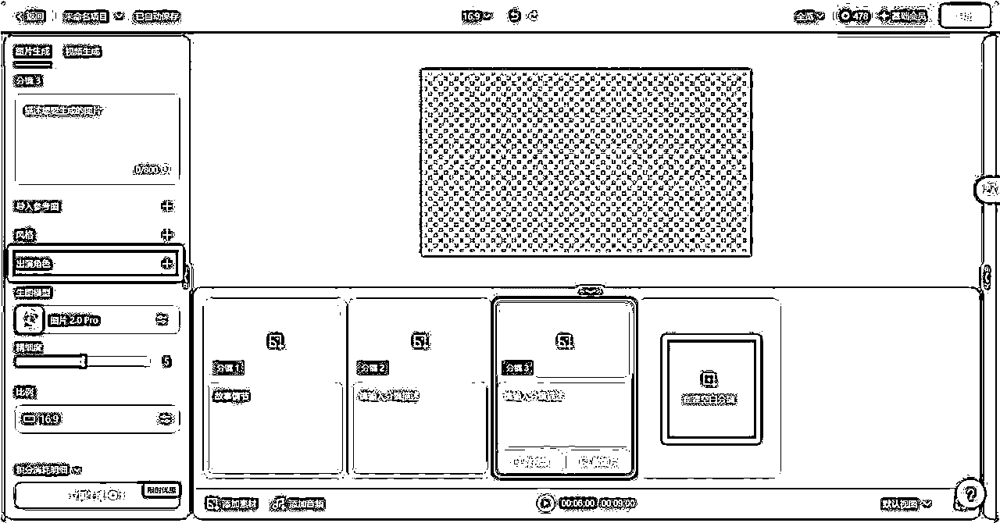）。这样全片主角就不会中途换脸。

**成本大概多少？**
- GPT 画图：没单独统计。
- 即梦出图：69元/月约能出2080张，折算约3分钱一张。
- MJ：没统计。
- 视频：海螺约2元/次，可灵约3.1元/次，即梦约2.7元/次。个人观感：海螺>可灵>即梦。

以上只是我的实测体验，具体价格以各平台实时收费为准。

这次先聊到这儿。有用的话就点个赞，我继续肝下一篇。