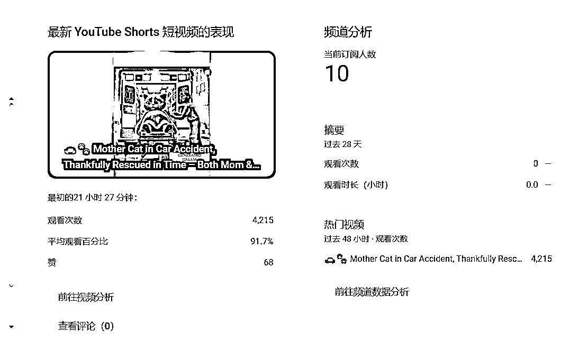
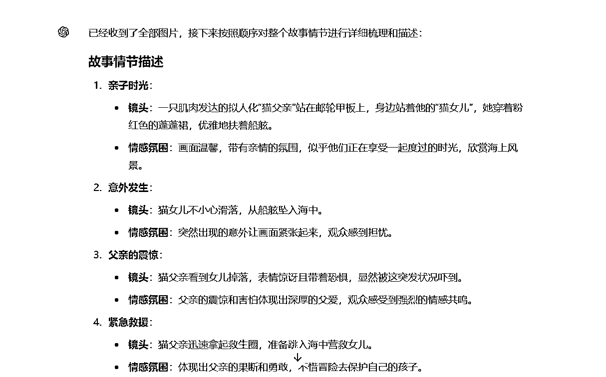
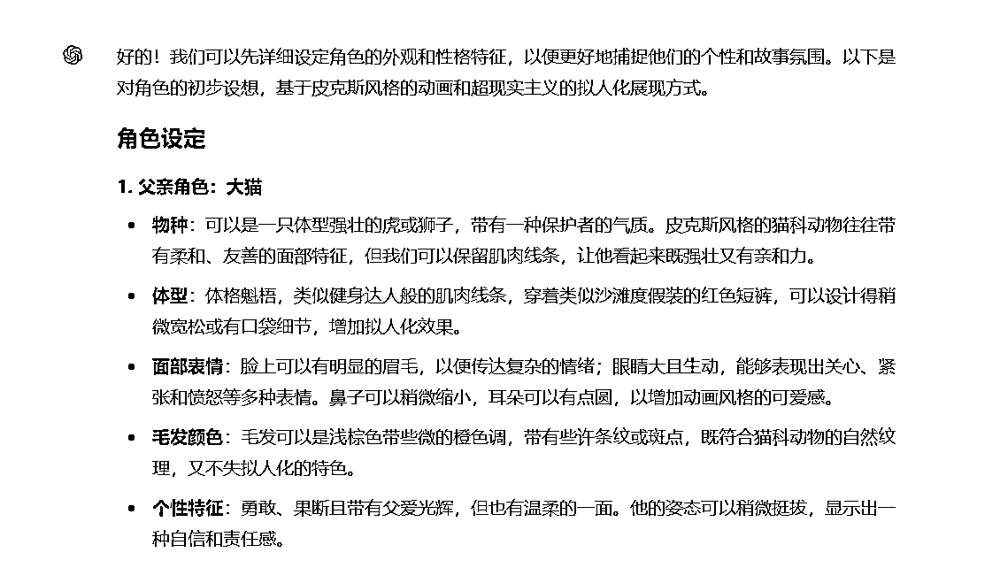
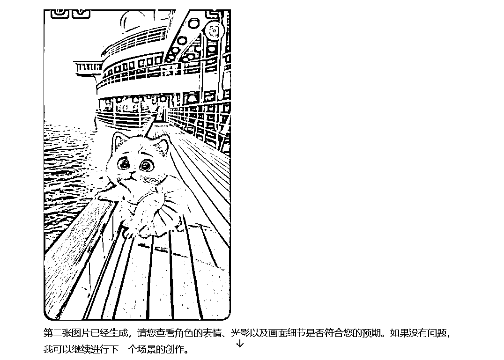
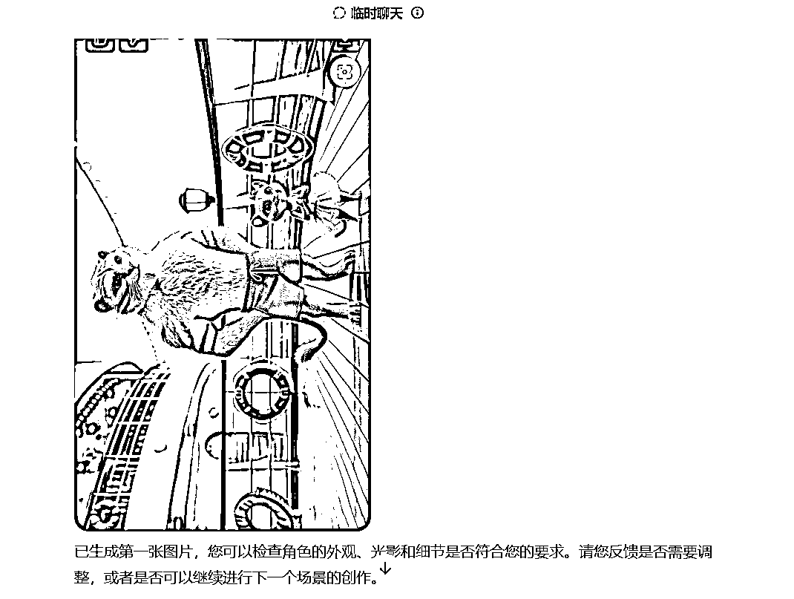
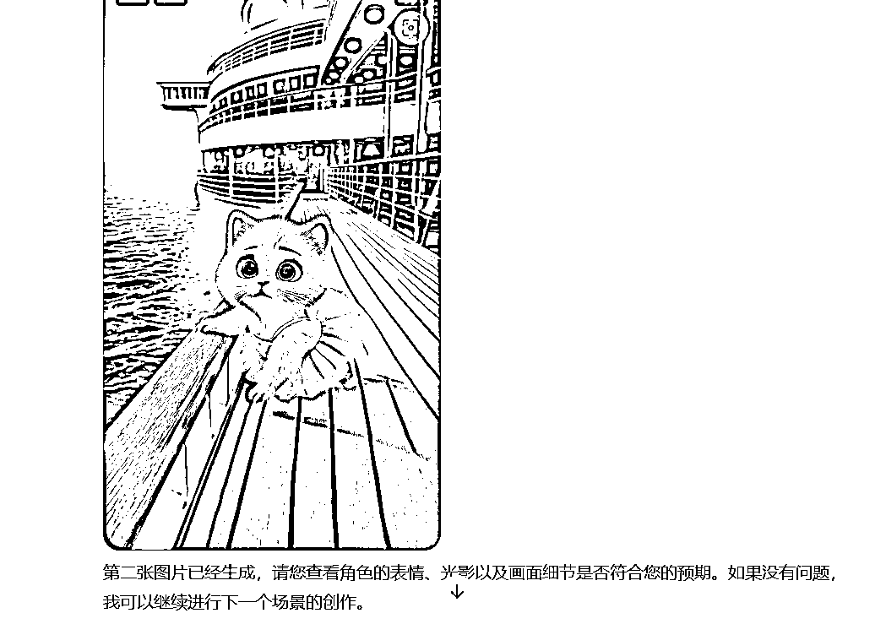

# 把前辈的经验拼起来，我照样跑通了 Shorts 项目
作者：龙哥

先说明一下身份：我是龙哥，入局不算久，属于边做边踩坑的人。这次能把视频顺利发出来，不是因为自己能力多强，而是把几位前辈公开的方法拆开重组，拼成了一条适合新人的生产链路。

成果先放前面：左边是参考原片，右边是我复刻后做出的版本。第一条片子的后台数据见下方。

## 一、先选方向，再谈内容

新手上路，第一优先级不是搞原创，而是把整个环节走通、先见到钱。我开始时纯靠手动搜索关键词，既慢又不准。后来看到钱塘江鲤整理的一份 YouTube AI Shorts 参考账号清单，才找到切入点。根据那份清单，我把关键词定成 cat，并筛出了3个模仿对象。

选这几个号的原因很简单：

- 片子套路几乎一样，但还是能持续出热门，说明受众稳定；
- 这几个号的注册时间都集中在今年，涨粉速度很快；
- 它们已经具备分成资格；
- 这套模板能横向复制，猫可以换成狗、熊、兔子，方便批量铺号。

## 二、从原片到成片的完整链路

研究完这些参考号，我发现生产逻辑挺直接：拿一段剧情脚本，按场景切分画面，再把静态画面动态化，最后剪成片。

考虑原创效率太低，我决定先走复刻路线。实际操作变成：下载原片 → 切出连续截图 → 用 GPT 改图 → 动态化 → 剪辑。

### 1. 下载原片

下载方法在之前的文章里写过，具体脚本文末统一放出来。

### 2. 切出连续截图

我写了个辅助脚本切帧，这个思路来自一篇讲快速复刻热门 AI 视频的帖子。

### 3. 用 GPT 改图

这一环我参考的是马哥那套做法。它帮我解决了两件麻烦事：低配置设备也能稳定出图；角色在不同场景里能保持同一张脸。

我平时用的是四五年前买的旧游戏本，显卡只有 1650，本地部署基本不可能。之前也试过端脑云等在线绘图平台，免费但排队久、审核慢，体验不太行。更别提我一开始就选了 ComfyUI，学习曲线太陡，折腾一周也只能勉强出图，角色完全没法统一。看到马哥的思路后，我开始照着他的路子走，又做了点减法：减少对话轮次、省略试画阶段、压缩反馈流程。最后形成下面三步。

先让模型读图：把画面切片分组发过去，请模型依次说明画面里的角色、环境与剧情；图片没传完就先等，全部发齐再做整体梳理。

接着固定角色：开画之前先敲定主角的外形设定，保证后面每张图的五官和穿搭一致。

最后重画这些画面：按照整理好的限制条件逐张生成，遇到不满意的图再单独修改。

指令模板的大致写法是：

- 读图阶段：告诉模型，这组截图属于同一段连续剧情，请依次分析角色、环境与剧情发展；分批上传，等我说结束时再做总结。
- 定角色阶段：先不急着出图，和模型确认设计方向。风格走 Pixar 式动画质感，带点夸张的童话感；动物不需要按原本习性爬行，而是像人一样直立行走。
- 重画阶段：固定角色的五官、身形、穿搭与动画画风；用暖色烘托温馨，用冷色制造紧张；加入夸张姿势和丰富道具；强调人形姿态；用 portrait orientation 锁定竖版构图；画布设为 1024×1792；完成优化后直接生成，不用先发给我确认。

这样操作下来，成图质量比较稳定，人物也能保持统一。偶尔有细节不满意，就继续让模型调。

补充：尺寸那段是可以不用的。模型默认出 1:1，剪辑时得上下加模糊，观感差一些；我想出 9:16，但它经常生成横图，加了方向描述也不一定有效。下面的图，左是没成功的案例，右是我想要的效果。如果对 1:1 没意见，删掉尺寸相关描述即可。

### 4. 动态化

动态化这步用了 Hailuo AI，新用户注册会送一日体验。操作很简单：上传图，写一句动作提示，点生成。

生成效果还行，就是费用不算低：想畅快生成得开包年；包月 68 元只有 130 次机会。按一段片子 10 个镜头来算，单条素材成本在 5 元左右。

### 5. 剪辑

最后在剪映里把动态片段依次排好，加音乐、转场，调整时长后导出，一条内容就完成了。

## 三、后续安排和待办

接下来我打算：每天发 1～3 条；持续盯同类账号，看到新热门及时跟进；抽空试一下 AI 长视频，看看对开通分成是否有帮助；继续优化指令，提高出图效率。

尚待解决的问题有三个：

1. ChatGPT Plus 还依赖合租号，练手够用，长期做项目不稳，需要换成独立账号；
2. 动态化工具的成本偏高，想找性价比更高的替代；
3. 自动化还不够，很多环节仍靠手动拼接，需要继续压缩。

## 最后

这篇不算保姆级教程，更偏个人复盘。真正细致的操作步骤都在前辈们的原帖里。我想借这次分享告诉同样底子薄的朋友：技术和经验不够不可怕，执行力能补上。把别人验证过的路径拿过来跑通，本身就算一种成功，不必执着于从零原创。

前辈们愿意把方法公开，应该也是希望更多人能真正用起来。

脚本已传到网盘，需要自取：
链接：https://pan.quark.cn/s/130d78f689eb
密码：escQ