# 别再逼自己了！决定执行力上限的，不是意志力，而是这个底层规律

大家好，我是知行。创业到现在还不到两年，去年九月底才加入赚钱，也差不多是从那时起才开始赚到钱。说实话，赚得真不多，零零散散加起来也就四万左右，中间还亏掉了一些。

前几天，我翻回赚钱刚起步时的帖子，点开了上千个圈友的个人主页，想看看那些曾经站在所谓风口上的人，如今到底赚了多少、生活变成了什么样。透过各种运营活动和作业，我隐约能看到他们现在生活的一角。有些人确实在低调发育，默默攒了不少钱；但也有很多人写着：一直在观望、始终没行动、一次次错过风口；参加过好多期航海，却没有坚持，只赚点小钱，甚至亏钱；项目看得眼花缭乱，赛道换了一个又一个，最后仍是小透明。

大家的Flag也很相似：早睡早起、减肥成功、日更写作、链接圈友、每天阅读赚钱半小时、刷完精华帖、拿第一篇文章精华、至少跑通一个项目、赚回门票钱、副业赚到第一个10万……归根结底，就是那句“成为一个有执行力的人”。

所以我突然觉得，从十年前“执行力是我的拦路虎”，到今天“我能比较顺畅地调动执行力”，这中间的规律和经验，也许能帮到一部分人。我也犹豫过：自己不是大佬，写出来会有人信吗？后来想通了：一切皆为概率，有没有用，先发出来再说。

先聊聊规律。

## 一、人性的底层规律，就是趋利避害

李录说过一句话，我特别认同：人的本性是自私的，所谓道德，本质上是对更广泛、更长远的私利的描述。

不管愿不愿意承认，事实就是如此。我们的身体，永远比嘴巴和脑袋更诚实。凡是嘴上不承认这条规律的，往往会出现拧巴、内耗、双标、知行不一，甚至“真香定律”。

这里说的“利”，主要是指钱、权、名、性、爽、物质、欲望、快乐、虚荣心等。这些事物通常被主流价值观贴上负面标签，于是我们追求它们时，常常会感到羞耻、不道德，甚至不敢摆在桌面上说。

而“害”，就是那些会损害上述利益的行为。一般来说，一个人在没有经历过真实的人性考验之前，都会对自己的道德水平有不切实际的期待。很多看似违背人类行为规律的行为，背后往往藏着没说出口的好处——这很正常。比如“加我送资料”，朋友圈里默默就把人转化了。

所以说，利他利己，最终是统一的。

## 二、收益预期越高，你愿意付出的成本上限就越高

这里的成本，不只是钱，还有时间成本、精力成本、机会成本、大脑算力成本，等等。

当一件事在你心里的收益预期足够高时，你表现出来的状态，就是大家常说的“执行力强”。

举个例子：被人打，你肯定火大；但打一次给你209万呢？……我甚至还能接受俩耳刮子。

从这个角度再看很多现象，思路就通了：

- 有人晒豪车、晒房、晒生活、晒后台数据、晒微信余额、晒案例、给员工画饼、做投资诈骗——本质上都是在抬高目标人群的收益预期，让对方愿意付出更多成本。
- 公司给高工资，并不是直接支付成本，而是提高员工愿意付出的成本上限。
- 反过来，当收益预期明显降低，人们愿意付出的成本也会骤降。这就是为什么很多搞阿米巴机制的公司，业务一滑坡，员工就没了积极性；也是为什么每次平台规则变动，总有一批玩家被清退，比如👸号今年四五月份那波。

## 三、收益预期，由三个关键因素决定

以赚钱为例，收益预期主要看三个东西。

### 第一，收益权重：你对钱的分量是怎么认知的？

一个人如果没有因为缺钱产生过强烈痛感，就很难真正把钱看得重要。有人觉得钱只占10%，爱情才是90%；但在另一些人心里，钱的重要性是90%，甚至100%。

这个因素，恰恰是赚钱环节中最重要、也最难通过外界调节的。你给他画饼、晒车、晒房，统统无效。因为我以前就做过那种“不愿与世俗同流合污的白莲花”，所以我很清楚。

对大多数没有财商教育的普通家庭来说，钱的“权重”基本和因缺钱累积的痛感呈正相关。所以随着年纪增长，人总会越来越意识到钱重要，只是早晚问题。家境不好的人在这个因素上其实有优势，钱在心里的权重大，愿意投入赚钱的时间也更早、更多。

对赚钱圈友来说，这个因素通常不是问题——2000多的门票，已经把赚钱欲望不强烈的人筛掉了。但在更大的范围内，很多打工人上班摸鱼、混一天是一天，是因为他们的成长环境很难激起强烈的赚钱欲望。我也带过两个发小创业：一个上班假装干活，晚上打游戏；另一个工作六小时就觉得累，不愿意动脑子。后来我想通了，这不是他们的错，他们没有被钱狠狠痛过。

大多数人都处在“饿也饿不死、富也富不了”的凑合状态。能产生强烈赚钱欲望的，本来就是百里挑一。大部分人的觉醒时刻，要么是女朋友跑了、彻底专心搞事业；要么是成家立业后，经历工作被辞、房贷断供、父母生病、孩子奶粉钱等一连串缺钱时刻。

### 第二，收益值：越具体，越吸引人。

如果我说“英文工具站很赚钱”，你大概听完就忘了；但如果我说“上个月我英文工具站赚了四位数美金”，你可能就想加我微信套近乎；再具体一点，“上个月赚了8420美金”，你甚至想知识付费了。

这也是公域平台一个品做爆后，立刻一堆人冲过来把利润拉平的原因。“财不外露”的本质逻辑就在这：收益越具体，越容易引注意、引竞争。所以人们更愿意讲大道理、说大概收益，本能地不说具体数字，其实也是一种避害。

### 第三，收益确信率：这个看不见摸不着，却幽灵般影响执行力。

同样的收益信息，经由不同渠道传到你这儿，你的潜意识确信度完全不同。大致规律是：造假成本越高，你越容易信。

- **展示方式**：线上晒海报、晒后台数据、晒收款截图，都比不上你线下亲眼看到对方演示操作、展示数据、拿出收入。
- **熟悉度**：陌生人晒收益，远不如熟人亲口告诉你有用。很多电信诈骗，就是利用这种潜意识里的信任，伪装成家人昵称和头像来骗钱。
- **获取方式**：被动看到别人晒，不如自己主动调研得来的结论更可信。但这点也会被利用，比如“a种b收”——你以为是自己扒评论区发现的良心推荐，其实全是设计好的套路。
- **光环效应**：名校、大厂、大佬背书、名人合影，都会让人不自觉提高确信度。但也容易被有心人利用：顶着各种光环、不做承诺，却让你不断“免费付出”，最后吃了哑巴亏还没处说理。
- **逻辑常识**：用常识和逻辑能识破很多骗局。比如闲鱼上有人卖“广告自动挂机软件，单账号日入100”“创业粉自动截流，日进100粉”。你用逻辑一推就知道：要么是骗人——如果真能日入这么多，他早自己招人复制放大了；要么就是隐瞒了成本或条件。抛开成本谈收益，就是耍流氓。

高确信度收益信息，真的能直接改变执行力。盗坤老师说，他最大动力来自两个做淘宝的朋友，一个年入百万，另一个做到七八人团队；龙哥老师说，他曾混进一个英文站长圈子，看到一个小学英语老师兼职写博客，晒出的广告收入一天几千美元，那张图后来成了他撑不下去时的“燃料”；天诺老吴身上只剩两万块时，在广州参加师兄婚礼，看到师兄结婚前一天还在打包手表发货，好奇一问，才知道人家靠百度投广告卖表，客单价1380，广告费300，一只能赚300块利润。

所以，如果你身边没有做生意或创业的同学、朋友、亲戚，能给你提供高确信率的收益信息，那就要学会创造条件：线上主动调研、挖掘数据；线下释放价值、混圈链接大佬。

### 第四，愿意付出成本，前提是你还能接受收益的上限和下限

很多高水平玩家选择不做事，不是懒，而是机会成本太高。比如有人建议龙哥老师做一场100万直播挑战，他拒绝了，因为他当下的机会成本更高。李自然老师也说过，朋友介绍过200万的生意，他同样没做。张一鸣在聊投资人的时候发现，投资人关心的不是头条短期收入和商业变现，而是今日头条最终能成为什么样的事情。

同样，很多人不敢迈出第一步，是因为没想清楚“最差的结果是什么”。一旦想明白并接受了，执行力反而自然就来了。就像我这篇文章，最差的结果无非是被大佬背地里不认可、没人点赞、感觉有点丢人……那实在不行，我就换个号重新来过嘛。

## 四、经验一：👸号爆文，我靠“算账”坚持到了爆发

去年11月，我做👸号爆文，连续五天都是个位数阅读，说实话，当时很想放弃。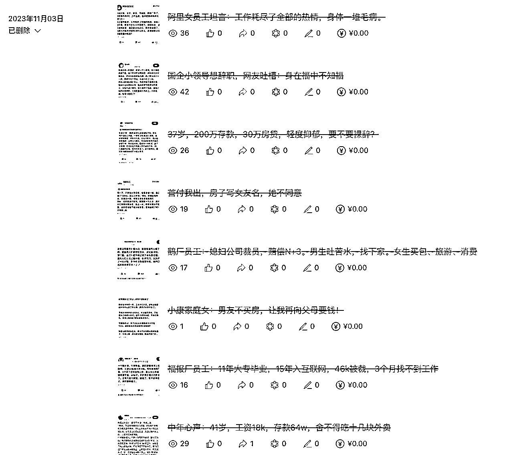

要是放在很多年前，我一定会狠狠自责：做五天就放弃，你也太没用了。但去年我换了种做法：心态上完全接纳自己，想放弃就放弃，不行动就不行动。然后我开始想，怎么用利益来引诱这具诚实的身体——我相信，身体在绝对利益面前会非常诚实。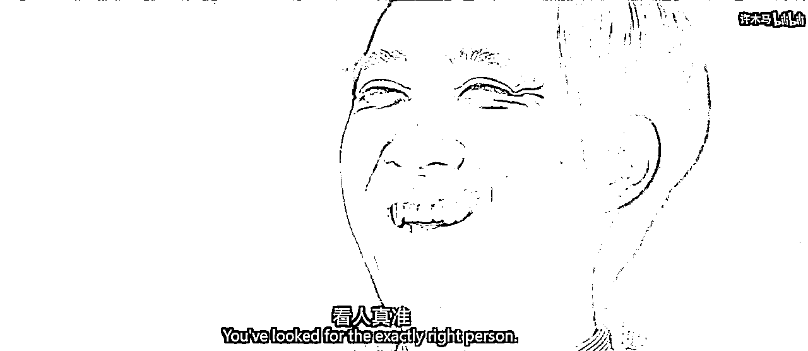

我先买了个数据工具，把100个低粉爆款账号导出来，算出平均点赞率，再倒推出准确阅读量。按当时“10万阅读≈400元收益”来算，我每写一篇文章，等于赚40块。

接着我又算出爆款率大概是1/16。按概率论，我两个账号各更新8篇，总该爆一篇；一天16篇的话，收入就能达到640块。我心动了。

当时我手上有5个账号，但内心还是忍不住怀疑：万一我的计算错了呢？万一又不爆呢？万一日更8篇被限流呢？

我没有强行压制这些疑虑，而是给自己铺了一条退路：先做出200篇，凑够5个账号、5天的量，到时候爱发不发，允许自己写200篇但先不放出去。

等我做到第140篇时，内心其实仍然没底，觉得提示词不好、文章也不够有把握。但身体已经忍不住了——它的逻辑是：数据都说16篇能爆1篇，你这都140篇了，还不赶紧发？

于是我真的发了，然后有的账号第一天就爆了，下面这个号第二天也爆了。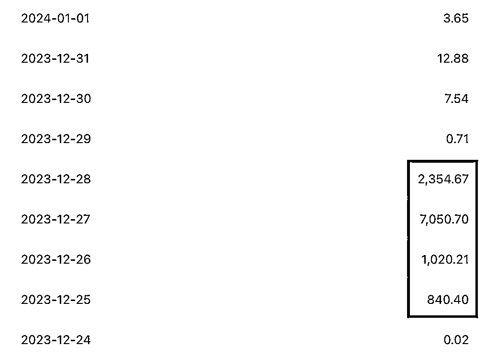

这时候我又开始担心：收益太不稳定了，之前看到教练说，爆过的账号可能一个月都没流量。要是没流量，我肯定坚持不住。那我怎么才能让自己一路坚持下去？

这里我想停下来，让大家注意我的思考方式。我从来不是硬逼自己，也不是说服自己，更不是给自己打鸡血；我想的是：如何铺设一条坚持起来很轻松的路。我不希望大家被自媒体里那种“逼自己一把”的热血话术洗脑，尤其是那些高考、考研、考公的励志短片。我高中时深受其害，很长时间都在死命拉着心里的大象往前走，可大象根本不听我的，一动不动。

所以我就想：能不能让坚持的成本降到极低？能不能躺着坚持？能不能让我每天只需要花1分钟、1小时，而不是8小时？

我想到了RPA。我并不会写代码，RPA也算不上高手，但在“足够想偷懒”这件事的驱动下，我彻底进入了心流状态。我花了5天时间各种调试、折腾，最终实现了用RPA自动GPT对话、自动上传文章、自动添加图片。同时我还把账号增加到8个——6个个体户，2个个人号。结果个体户全部没流量，个人号有流量。

中间虽然偶尔出bug，但基本每天只要花1到2小时，就能完成十几个账号、每号每天8篇文章的生成和上传。从1月1号到11号，每天都几乎没流量，但由于我把坚持的成本拉得足够低，这次我完全没遇到执行力问题。到了1月12号，终于有一个号又起了一波流量。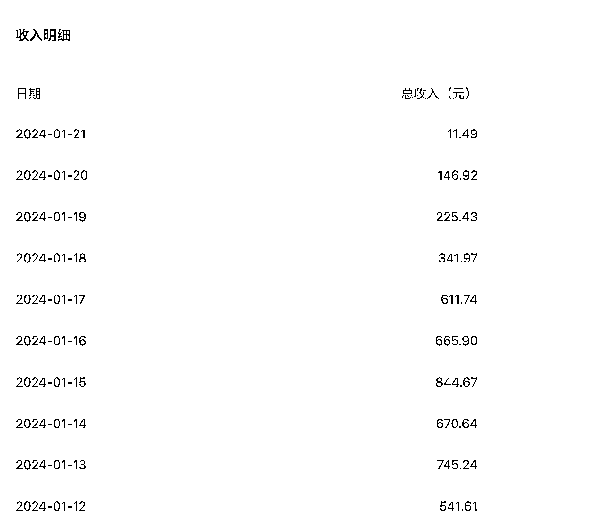

最终差不多一个半月时间，7个个人号加起来赚了2万。那为什么没继续做下去呢？因为到了2月份，GPT4的生成效率明显下降，经常冒出审核提示不洗稿；我和朋友合作让他搞账号、五五分成，可每天生成的文章越来越不够用。在我需要判断是否给5个GPT账号续费时，我选择了放弃，精力也准备转向其他项目。说到底，当预期收益的上限不再吸引人，我自然就不想继续付出了。

## 五、经验二：📕引流创业粉，日更365天

这个项目，具体打法其实有点错，也没达到理想中的预期，但它真的做到了每天稳定进3个创业粉，一年下来攒了1000个。流量先存着嘛。

我一直没变现，是因为内心觉得很多后端都是在割韭菜，也不想照着复制别人的朋友圈；加上流量不够大、没量谈不上运营，所以一直搁置。但我是怎么做到“日更365天”的，这套思路或许能给你一点启发。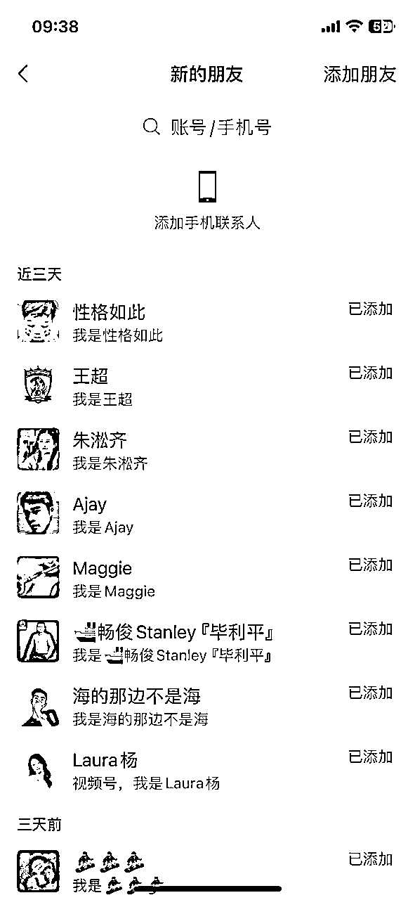

我是5月份开始准备做私域的，当时👸号做完后，也折腾过好几个项目。那些项目和👸号很像：猛一阵子收入，然后就没声了。按前面总结的规律——因为预期收益上限变低，所以我不愿意再投入成本。

我的第一步，是白嫖了灰豚一天的会员，找到差不多100个做创业粉的账号。后来我发现，其实不一定非用这类会员工具：你只要关注一个对标账号，平台就会推送类似账号，认准它推荐的，关注完再继续关注，基本就能把目前在更新的同行号都找到。几乎所有平台找对标都通用这个方法。

我大概用一天时间，就把所有要找的对标账号都关注完了。接着，把同行所有高赞、高评论的链接，全部粘贴到我的苹果Numbers表格里；同时加上所有同行的微信，看看他们是怎么变现的。

结果发现……除了赚钱，其他同行基本不是割韭菜，就是干黑灰产的。进赚钱，真的领先其他人一大截，这话一点不假。

然后我开始用“新增粉丝数/笔记数”这个指标，来判断模板好坏。数据告诉我，越有IP感的模板，粉丝涨得越多。于是我花了350块，找了位UI设计师给我设计模板。

接下来开始洗稿：把高评论的笔记文字识别，然后改写。做着做着我想：洗稿一篇这么简单，干脆把3个月的量全做了吧？后来又冒出一个更大胆的想法：要不要把一整年的素材直接一次搞定？

结果就是，我集中时间批量制作，单篇成本大大降低，坚持更新的难度也随之暴跌。按每天3篇的量，原本以为两周能做完1095篇，最后花了三个星期。我准备了37个文件夹，每个文件夹放30篇，也就是10天的量。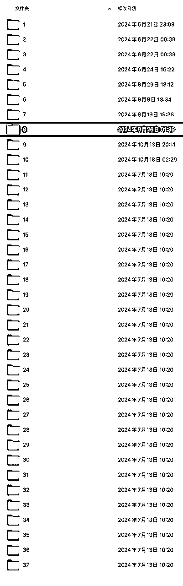

之后的日子，我每天只需要按部就班把素材发出去，根本不需要动用“坚持”这两个字。这件事再一次印证了我的核心方法：用规律代替自律，用机制代替打鸡血。

## 最后

回看我走过的这些弯路，我越来越觉得：执行力强，不是意志力超群，而是懂人性、顺人性。你要做的不是逼自己、对抗自己，而是：

- 把收益预期尽量抬起来，让身体和大脑真正馋那个结果；
- 把行动成本尽量压下去，让坚持变成一件顺手就能做的事；
- 当路子铺顺了，执行力自然就不再是拦路虎。

希望这篇分享，能让你少一点内耗，多一点把事做成。

先给朋友们提个醒：我之前觉得，只有大流量才讲时间窗口，结果最近发现，小流量同样有窗口期。这个认知差点让我白忙一场。

当时我做完一轮更新，去关注一批📕的同行，发现好多号已经没有流量了。那种感觉，真有点“49年入国军”的意味。我还不死心，又换了个手机号，用灰豚数据查“创业”“副业”这些关键词，按30天排序，过千赞的帖子居然一个都没有。可那时候已经来不及了，一年的内容都提前做好了，只能硬着头皮继续发。现在的结果就是，平均每天涨3个粉。

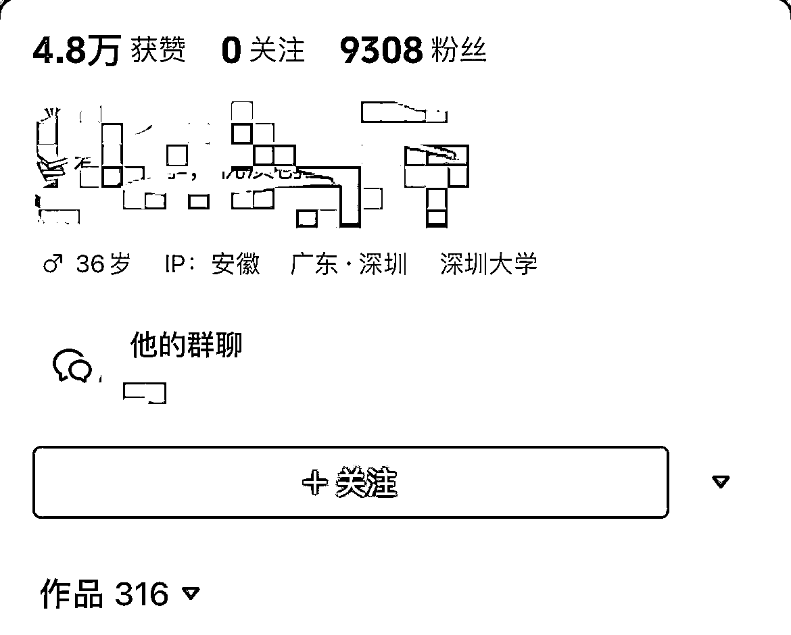

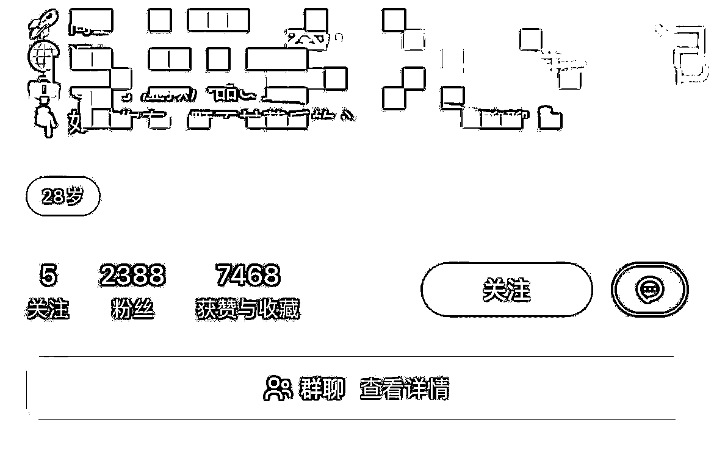

为什么现在开始写作？其实也是被利益“勾”出来的。

那阵子我天天做📕洗稿，流程很机械：截图、识别、丢给GPT改错别字。干久了特别无聊。一次偶然的念头：那些靠写作赚钱的人，到底能赚多少？每篇文章、每个字值多少钱？这也许受明白老师某篇自述的启发。于是我去知识星球找，因为那边方便看年GMV，再筛出主要靠👸号获客的星主。用去年买过的👸号爬虫会员，把所有靠👸号写作导流的星主都爬了一遍，差不多40位。

我做到后面越来越上头，甚至写了RPA，把每个人的文章导入表格统计字数，连佣金、手续费、税务、人工成本都算进去，然后算出“每个字多少钱”。算完我挺震撼：一个字这么值钱，看来写作是迟早要干的事。可惜那版表格被我误删了，连什么时候删的都不知道。好在留了个以前30多人的版本，虽然没统计字数，但平均算下来，一个阅读量大概0.4元，一篇文章值4000元。这篇文章我断断续续写了3天，这个账帮我定下了写一篇文章的成本上限。

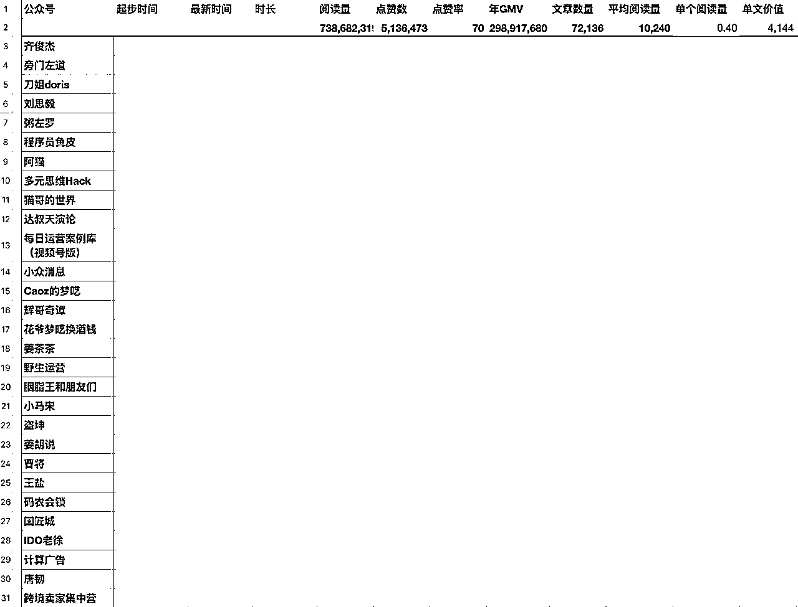

再说一个连续更新4个月的故事。

去年年初，我还没进赚钱，商业概念约等于零，但执行力和坚持力还行。当时第一个创业想法很简单：做B站UP主。想要做起来，关键是持续更新。怎么才能持续更新？我认定信息、语言、英语都重要，而且英语再过十年依然值钱。又想到李笑来说过，他关注了不少推特账号，才敢对比特币下重注，于是决定深耕英语内容。

但要坚持五年，必须有巨大利益。搬运肯定不行，那样太浪费生命。我先拉高能力上的收益，给自己定下三个条件：词汇量要涨，阅读能力要提升，听力最好也提升。然后不停看同类账号，找到一个英语有声书视频，是哈利波特，油炸叔读的那版，21年的，播放量220万。评论区有人提到字幕和单词标注，我一下想到：在音频下面配上原版中文，再把不认识的词翻译出来——开着字幕练听力，关了字幕练阅读，碰到生词查字典。完美。之后我迭代了很多版本，把细节打磨到位。

同时我给自己画了一个大饼：连续更新五年，做完《哈利波特》《冰与火之歌》，词汇量从3000涨到4万，说不定就成了下一个董宇辉。就算最差，英语词汇量也能提升，不亏。于是真开始了，结果第三天粉丝就到1000，开通了B站激励，相当于👸号流量主。我一位有两万粉的UP主朋友都震惊了，说我涨粉太快。

那段时间，每天一个30分钟的有声书，我要花3到6小时制作；有时一个视频要加300多个单词注释。我还刻意降低“不提升英语能力”的操作成本，否则很难坚持。就这样连续做了4个月，几乎天天做，整个人都是心流状态。粉丝从0到1.7万，流量主收益只有1000多，但几乎每天都有粉丝留言说有帮助，这种正反馈很上头。每隔几周我就去测词汇量，从最初3000多，到最后10000多。

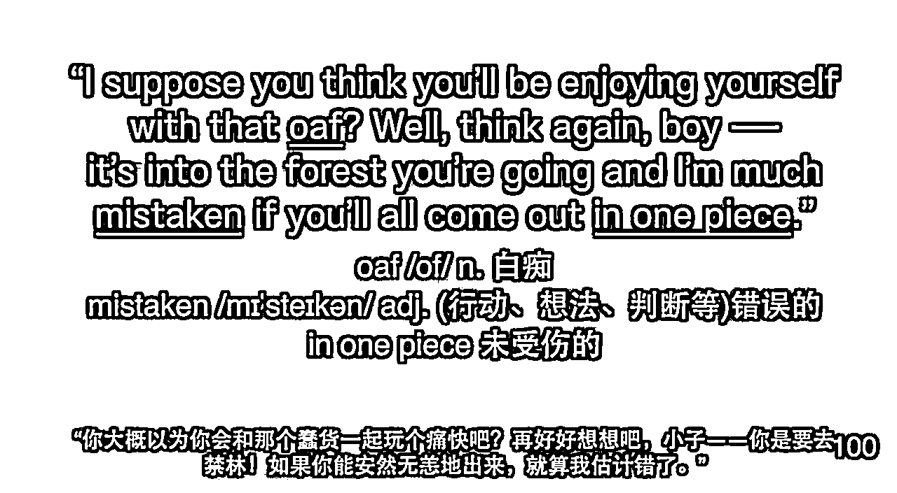

说实话，我以前很排斥背单词，觉得枯燥、呆板、没创造力。但这件事让我发现：只要你能给一件事叠加物质或精神收益，哪怕原本不太愿意干，也会变得主动、专注、有动力。想法的转变，在于我开始愿意感受自己的“私欲”，也敢大方承认它。就像赚钱的slogan，谈钱不伤感情。用最原始直接的欲望去驱动自己。

话说回来，当时我真不懂流量、转化、产品、对标账号这些东西，也没想好怎么变现，更不想接广告打断观众的沉浸体验。结果5月底和房东因为搬家闹矛盾，搬出来那天，我的视频被接二连三举报下架——音频资源来自国外网站。别人21年发都没事，我才做4个月，居然被找上门。只能认栽，也是因为那阵子的焦虑，后来才加入了赚钱。

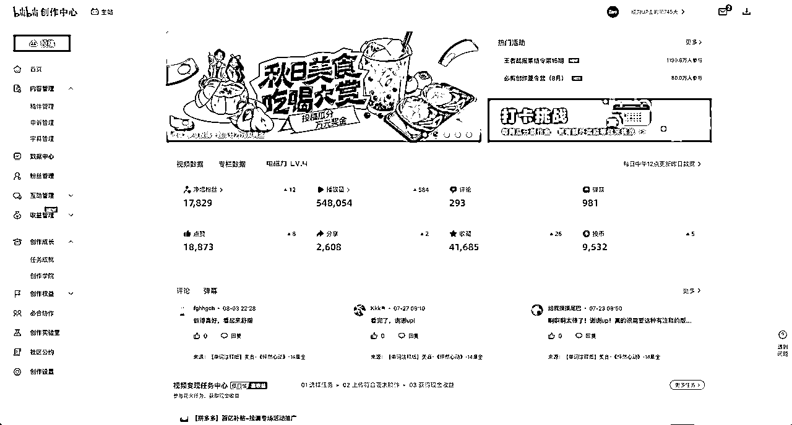

再讲一个靠“带薪学习”快速上手的经历。

2020年我尝试过短暂创业，比去年还小白，连剪辑软件都不会。看免费课又觉得枯燥犯困。我就在想：为什么不能让别人付钱，请我学剪辑？那样动力才足。于是我去上海面了好几家信息流广告公司，最后遇到一家愿意给机会的。因为是抱着带薪学习的心态，薪资待遇我完全能接受。对方要求剪一条测试片，我用剪映剪得特别认真，那也是我第一次用剪辑软件那么久。结果一天后，我被刷了。

可这机会在我眼里属于“暴利”——带薪学习啊！我马上找HR，问能不能告诉我哪里没剪好。晚上收到反馈后，我用了3天，每天睡5小时，拼命改。第3天交稿后我就去放松了，隔了一天，终于收到通过的通知。进去才发现公司用的是PR，我又花了很长时间熟悉软件和业务，中间好几次濒临被裁。但我每个月都是公司工作时长最长的，最后一个月，业绩消耗进了前三。

我想说的是：执行力是可以主动“加收益”的，加到你觉得暴利，自己就控制不住了。不要逼自己努力，要学会拿利益、拿暴利来调动自己，直到自己无法矜持。

最后一个故事是“戒游戏”。

跟前面不一样，那些是怎么让自己做事，这个是阻止自己做事。方法也很简单：增加玩游戏的成本。

2月份，我拉两个发小一起创业，说好了不开游戏局。结果某天晚上我和另一个发小没忍住，开了一把Dota2。这一开全乱了，原本在做的视频号直播、抖音无人直播全被丢到脑后，脑子只有出装和加点，真有点“先帝创业未半而中道崩殂”的味道。

3月底我痛定思痛，对自己说：“我允许你玩游戏，但要提高成本；也允许你反悔，或者找其他方式玩。”于是我把4个带皮肤的Steam账号删了。结果发现账号要1个月后才彻底删除。我又完全接纳自己：“这一个月允许玩，创业中也可以玩。”但我继续加反悔成本：改邮箱、换手机号，基本搞到登不上。

你能感受到这种处理方式吗？以前我可能会反复骂自己堕落，现在我用完全接纳、不抵抗的方式，通过不断加成本来引导行为。这有点像“Yes，and”的自我沟通——允许一切发生。

关于“怎么避免半途而废、三分钟热度”，我的答案是：先允许自己半途而废，同时持续给身体投喂高确信度的收益信息。这本质上是个调研工作，把收益算得越具体越好。你可以多翻翻赚钱的帖子，比如这个：https://t.zsxq.com/1RoaT 过程中，要么你也像我一样被诱惑，一步步开始；要么你发现项目确实不赚钱，还省下了沉没成本。

关于“怎么克服拖延”，也是一样的逻辑：先允许自己拖着，同时投喂这件事的好处。如果好处是自己的想象，就找论据支撑。你可以建一个单人聊天群，比如“健身”，把看到的有用内容丢进去。持续投喂，要么你被诱惑启动，要么你发现虽然有益，但眼下有更优先的事。