# 闲鱼虚拟从零到日单276的实战复盘

大家好，我是乐乐，今天把我新号做闲鱼虚拟爆单的过程完整复盘一下。

我从2023年11月入局闲鱼起步，先做二手书，月利润最高也就七千出头。2024年7月二手书的资质被注销了，加上成本高、竞争白热化，靠软件铺书的效果也越来越差。于是转向虚拟。起初是用卖书的老号来发虚拟，数据很拉垮，7个老号加在一起全职一天也就100多块利润。

后来我另起炉灶开新号去测，方向对了之后数据就起来了。

从10月11日新号上线，到11月11日为止，这个新号累计成交1697单。单日最高曝光达到7万，单日峰值276单，单日收益267元。主攻的是考试类虚拟资料，目前在号上累计有40多个宝贝。

下面按模块展开我的复盘思路：

目录

一、关于我自己
二、目前进展及成绩
三、拆解复盘
四、注意事项
五、项目心得
六、接下来的规划

* * *

# 一、关于我自己

2011年开始接触网赚，给淘客站改过代码，后续做过淘客群，也用易语言写过QQ加粉、网站APP私信工具。2016年转做自媒体，2020年算是拿到第一桶金。

只是因为焦虑抑郁状态持续恶化，2022年才慢慢缓过来，又去做视频号带货和圈子。2023年初视频号小店和直播都有起色，年货实景直播7天GMV最高10万，但因没算成本且精神状态差，最终没赚到。身体还爆发了狂躁症，封闭住院一个月，出院后核算总亏损约100万。

出院后还伴有精神分裂症状，会出现另一个自我跟自己对话的情况。那段时间我把所有微信群、好友、QQ群、联系方式全部删了，包括知识星球圈子里的人。后来大部分联系方式都找了回来，但也有些永久丢了。现在经济依旧紧张，但争取在年底前把所有人的费用退清。所以之前加过我圈子的朋友，可以通过鱼丸联系我。家里人之外暂时不加老友，因为每一次解释病情都是一次消耗，会加重负担...年底前能恢复的我都会恢复，并把圈子费用退回。

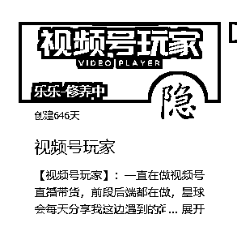

这是圈子的名字。

# 二、目前闲鱼虚拟项目进展及成绩

新号累计成交1697单以上。单日最高曝光7万，单日最高276单，单日收益267元。

现号上有45个宝贝，实际成交的有28个。并非只上了这点，表现差的5-7天就删掉。

日常上新频率是1-7个/天，大部分操作很轻：图片做MD5变换，标题介绍里加符号和日期，方便后期清理。

目前100%的成交都集中在上架15天内。也就是15天不出单基本就可以放弃了。做项目要沉得住气，至少给一个月观察期。

7个老号的收益有小幅抬升，但增长很慢，最近又有回落。

老号被封了一个，扣20分。这点代价是值得的，有挫折才有进步。

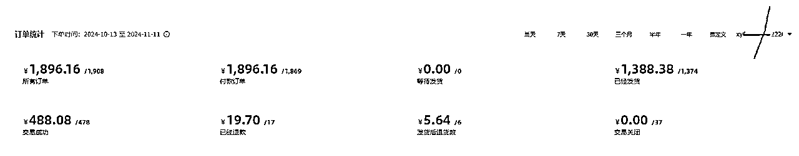

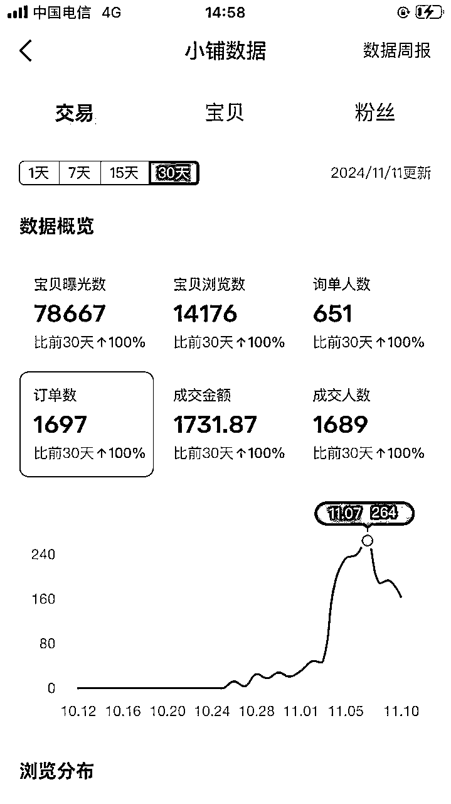

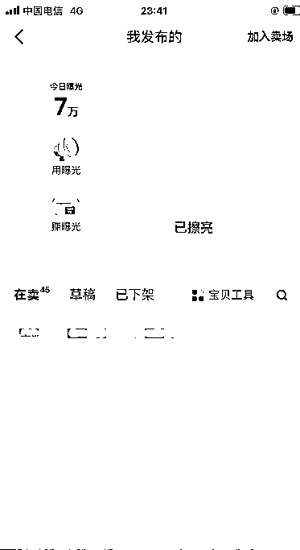

# 三、拆解复盘

## 0、起步基础

我手里原本有7个闲鱼老号，一直靠自研的影刀脚本采集上品。从5月淘金计划开始，怎么调策略收益都卡在一天100左右，很难突破。

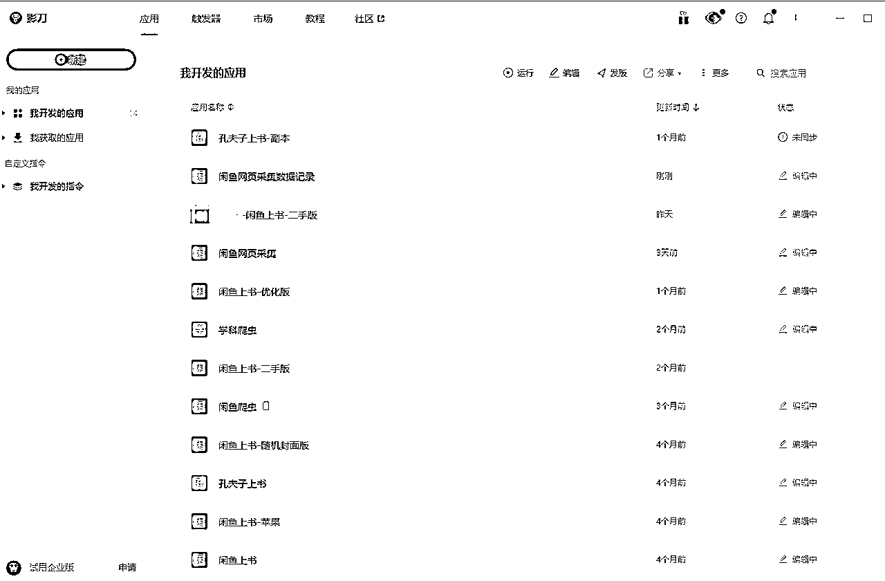

## 1、不专注的代价

新号刚开时，我主要精力还在完善软件，采集、上传功能一直在改。看到什么感觉可以就直接上，没有按1:10的筛选比例去挑品，其他动作也没做。基本没单，第一单是网课，之后好几天空白。

## 2、转折点

软件功能基本成型后，老号每天上20个也毫无起色，我才把重心放到新号。先把老号上能出单的品搬到新号，再开始刷好评。起初找别人刷，效率很低，一小时刷1-2个，后面我自己发些小黄鱼相关的引流品，主动让买家来找我，效率提升不少。

刷差不多了就把链接下架，第二天再上一般就没流量了，所以需要重新发。连续刷了三天约20单左右，第四天有一个链接突然爆发，一天卖十几单。

## 3、爆发期

就在这时我开始留意超级曝光，正式投放。订单量立刻被放大。过三四天后订单下滑，我把待评价的单全部催评，并告知好评赠送相关商品的增值资料。要到了十几个好评。第二天该品直接爆发，日单稳定在百单以上。

## 4、精细化运营

之后每个链接下方都带好评赠品说明，基本每天能收10-20个好评。

对于爆品、出单品、刚上感觉不错的品，我都会投超级曝光。如果0.5-1元没出单就立刻关掉，筛选出ROI大于2的持续追投。

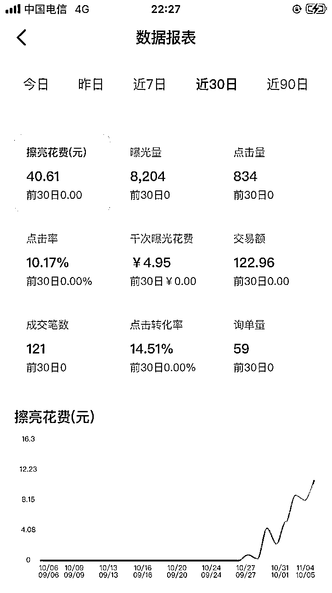

投超级曝光的数据情况

# 四、注意事项

1、虚拟有风险。尤其是公职、事业单位人员，最好用父母或其他非体制内身份注册。虽然大概率没事，但没有绝对安全，还是规避为上。

2、网课类和破解软件类前期尽量别碰，这是两个最容易出问题的品类。

3、上新初期图片标题不要大改。爆品能爆是因为原图和标题带来的流量，新手凭感觉改很容易把品做死。我自己最爆的一个品，重做了两个链接，一个主图不变，一个完全重做，信息更全但一单没出，主图不变的当天就卖了21单。

4、初期不要追求批量，先手工把效果跑通。我之前老号全靠软件批量铺，现在全部停了。目前计划手工把3个号跑顺，把细节打磨好再考虑用软件批量。

# 五、项目心得

## 1、账号

尽量用新号做。我7个老号至今没明显增长。老号如果效果本来就不错，刚上错品被封更亏。

有个体执照并绑定过支付宝的，可以拿来用，一个人能有3个支付宝对应3个闲鱼。个体下能开多个支付宝，我目前办了近10个，理论上能养很多号。

唯一不确定的是个体无对公账户能否申请企业支付宝，这是目前的疑点。

## 2、选品

选品看需求，找短期内能集中爆发的品。可以监控单账号的日单增长，增长快的账号里品重点抄。

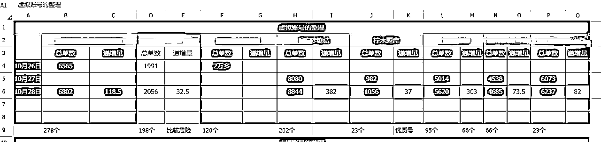

像这样用表格记录账号的递增情况，优先拿增长快的账号的品。

## 3、评价

成交后一定要催好评，能提升宝贝和店铺权重，增加爆单概率。

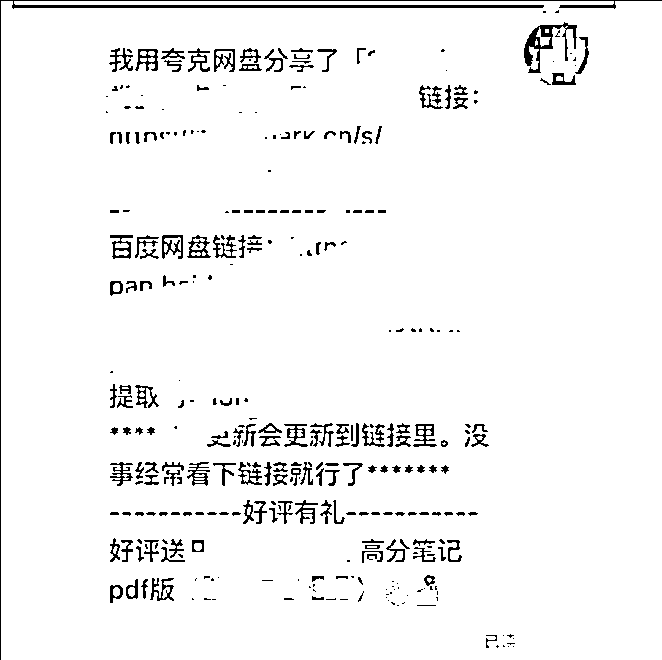

催好评的文案示例

## 4、超级曝光

出单品或需求高的品都可尝试投放超级曝光，放大爆品概率。投后隔2-3小时看数据，花费高无转化就关，避免亏损。

## 5、推广

有点效果后记得申请网盘拉新推广，既能拿拉新收益，又能免费获得会员和扩容。

## 6、资源成本

急用不急分两种。不急时可以先搜公众号，近期很多资源直接公开可拿，省去进货成本。小红书上也有很多在做网盘推广的，会免费分享夸克链接。

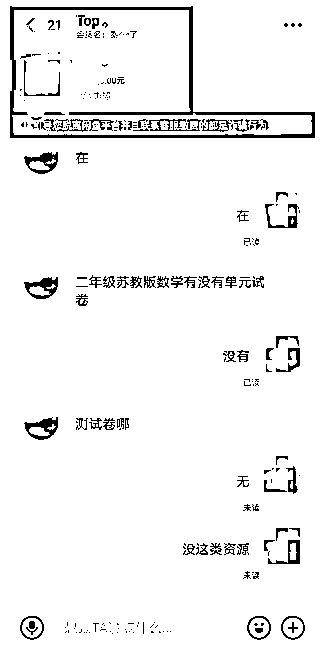

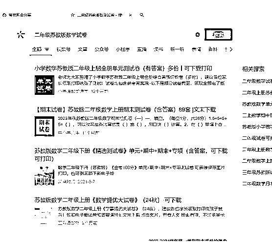

当时我直接回复没资源，一搜公众号一堆测试卷。

## 7、风险控制

对感觉有风险但想做的品，可以先收藏几家同类商品，隔段时间看链接是否还在，从而判断品类存活状况。

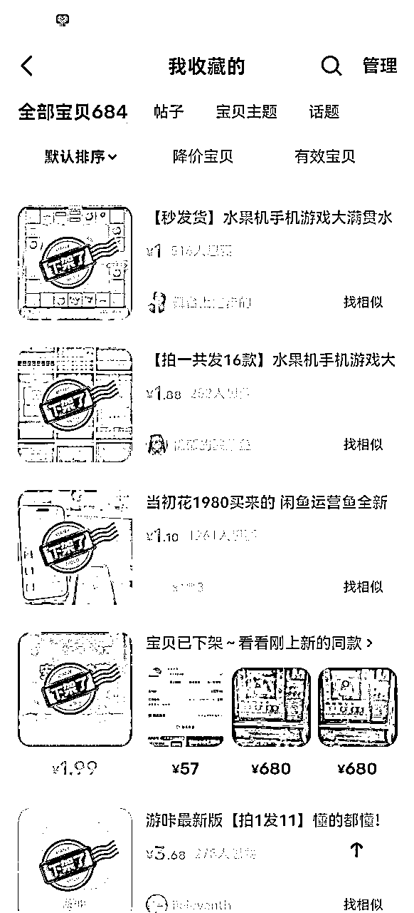

这是我之前操作的品，已经全部下架，说明该类目已不可持续。当时只是违规删除警告，于是我把同类全部清理。

除看宝贝外，还可以点进商家主页，看店铺是否还在，以此预估风险。

## 8、其他

公益宝贝和闲鱼币抵扣能开就开，有助于增加曝光。

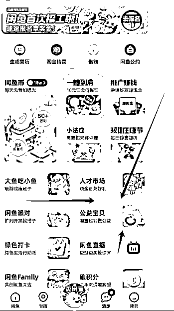

公益宝贝的位置

闲鱼币抵扣在闲鱼币入口里可以设置。

# 六、接下来的打算

现在第二个新号已经在运营，手上有三个号准备养3-5天后轮番启动，目标是把收益稳定在300-1000元/天。

软件层面我打算做一个闲鱼虚拟资料的第三方管理系统，能统计日收益、分析潜力品、采集宝贝、挖掘爆品，一步一步实现。