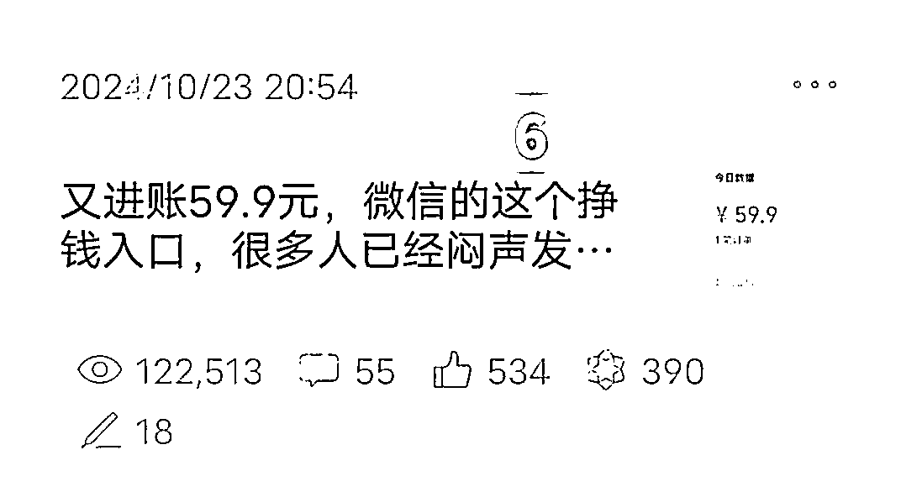
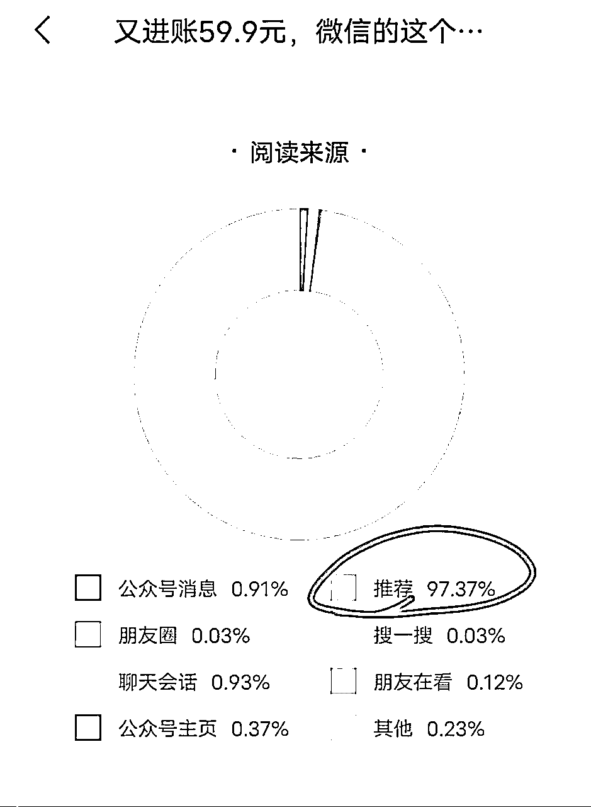
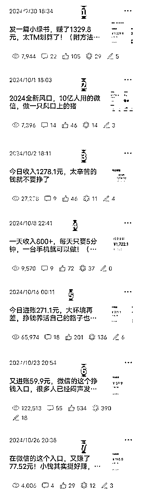
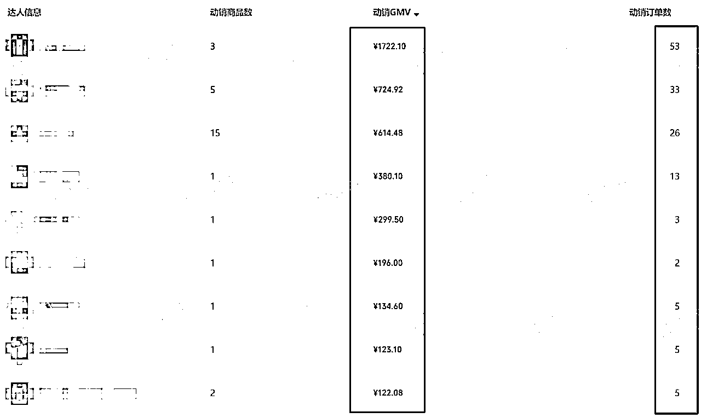
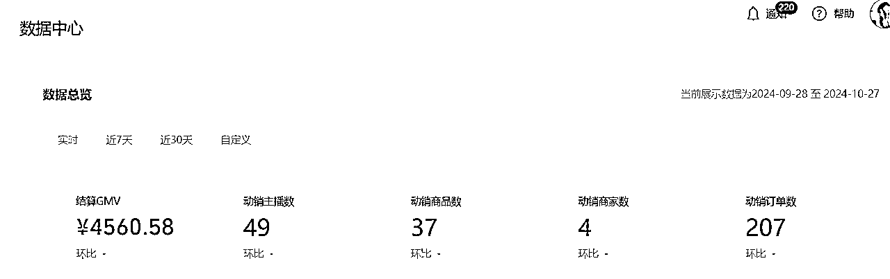
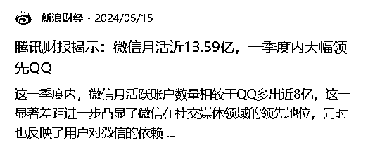
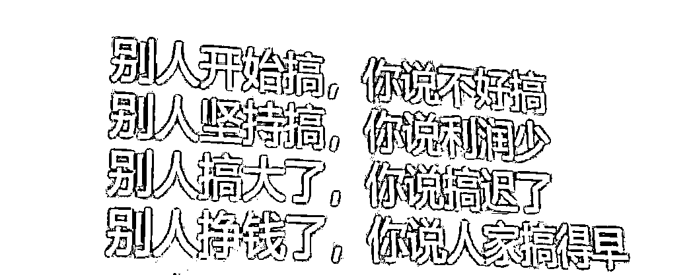
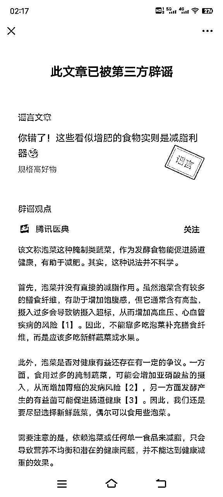
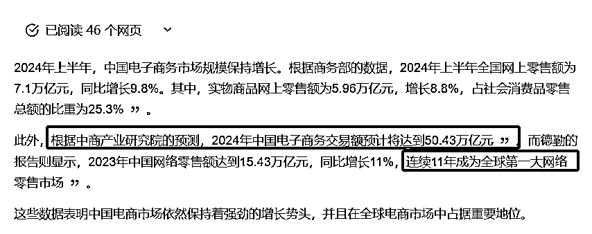
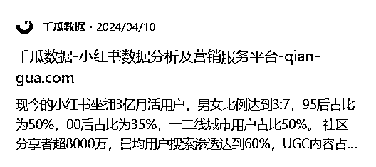

# 从0到400人小分队：一个新手如何用绿书带货在30天内跑通全流程？

> 这篇复盘出自一位毕业仅一年的女孩。她靠着AI辅助写作，在公众号赛道做到年入七位数，最近又杀进了绿书带货。她把这一个月从观望到下场的完整经历写了出来：如何用内容引流入私域，如何在几天内拉起几百人的带货队伍，以及那些真实跑出来的数据。以下用第一人称呈现。

先交代大家最关心的部分：一支几百人的队伍，二十多天究竟交出了什么答卷？直接看数字。

## 一、玩法拆解：两条腿走路

这套模式的核心就两块——前端搞定人流，后端搞定货源。我负责的是前者，伙伴@跨境压舱石凳子哥 掌控后者。

我的操作链路大致是：持续输出公众号文章做曝光，把感兴趣的读者导入私人号；然后把这些“种子选手”拉进带货小组，再筛选出执行力够硬的成员，分发到佣金优渥的专属货盘。

有一个感受比较强烈：微信官方目前对小绿书相关内容是“暗中扶持”的状态，只要你不在文章里堆满营销味，系统就愿意推。前几天我发了一篇纯科普向的干货帖，浏览直接冲到12万以上。

有趣的是，即便我在文末挂了个人二维码，系统推荐带来的流量依然占到了九成七以上。

这其实是个相当明确的信号：平台在主动给这个方向做曝光。

## 二、成绩单：不到三十天跑出的数据

9月30日，我开始在公众号上更新相关内容。一个月下来，总共发了9篇文章，其中7篇为正规长文，阅读数据从7.9k一路攀升，陆续出现2.7W、6.5W这样的数字，最高一篇是前天的，突破了12W。

凭借这些内容，20多天里攒下的积累如下：

- 公众号新增关注：超过7600人
- 私域好友：从3000多增至7500以上，净增约4000
- 带货小组：从0扩展到400多人
- 成功出单成员：约80人
- 累计出单数量：207笔（部分未纳入统计）
- 单笔最多者：53单，销售额1722.1元
- 团队总GMV：超过4500元

有一些组员带的是别的货品，所以这些单子不在登记范围内，真实总数只会更高。

## 三、这波机会是怎么抓住的？

### 1. 平台给了明确的“绿灯”

这轮最根本的助力来自平台自身。要是官方不点头，再使劲也很难在短短三周里出成果。此前微信内部的闭门大会已经放风——要做自己的电商生态。一个坐拥13.9亿月活用户的国民级App，怎么可能放过电商这块肥肉？

创作者现在免费给微信电商做传播，平台何乐而不为？这就是我们踩中的第一波惯性红利。

### 2. 圈子带来的时间差

生财有术这个社群，在国内同类型圈子里算头部，里面聚集了大量搞钱资讯、前辈和大牛。除了投资人张哥，我今年在社群里还遇到了许老师、坤汀、秀儿等好几位贵人。也要谢谢越越、孟等圈友，没有他们真心实意的信息共享，很多操作细节根本摸不到。

信息差终究会被时间磨平，但早一步知道，就是早一步动手。身边都是优秀的人，想不往前走都难。年轻时碰见好的引路人和圈层，确实可能改写路径。

### 3. 协作比单干高效得多

这套玩法独自上阵也行，但拉上伙伴，效率是几何级上升。那些做得好的博主，也多是抱团。我试过一个人扛全部：一边管内容，一边对接商家，最后把自己搞得筋疲力尽。光是商家对接就够呛——有人迟迟不通过好友申请；有的节假日直接不发货；还有的给到的佣金和选品中心差不了多少，怎么聊都不肯上调。

一个健康的闭环需要分工：有人引入流量，有人负责中间的沟通转化，有人做后端交付。光是一篇能起量的公众号文章，就要反复打磨很久；更别提后续通过好友、逐个聊天、拉群、发资料、答疑这些琐碎环节。

所以我们三人组成了一支小队：
- 我：专注内容，以文章引客入私域
- 鸡汤：主理社群运营，保证日常节奏
- 凳子：自建店铺，依靠供应链和选品优势提供高佣链接

一个人走得快，但一群人走得更远。

### 4. 找到自己的“流量开关”

生意场上，流量永远是王。9月我一度卡在流量瓶颈里相当焦虑，经朋友肖肖牵线，专门跑去山东找艾瑞克老师学无人直播，想打开新局面。但试下来发现确实没有直播天赋，每一秒都觉得不自在。

没想到9月中旬回来后，账号意外得到系统推荐。反复测试不同标题之后发现：凡是写“钱”相关的话题，阅读就高得出奇。于是我死死抓住这个方向，集中输出。绿书带货出来后，这类内容又能获得平台额外推荐，我的策略变得很清晰——盯着数据异常好的方向猛打。

结果不到一个月，就通过这些内容吸引了将近4000个精准好友进私域。

## 四、复盘：哪些做对了，哪里翻了车？

### 做得好的地方

**1）卡住了时间窗口。** 凳子的服务号赶在十一之前注册完成，平台的流量倾斜很给力，出单自然顺。十一假期里虽然很多人反应过来想跟上，但官方审核人员休假，只能等节后处理。这一卡，就卡掉了大批竞争者，也把时间红利留给了已经就位的人。

**2）执行力在状态。** 项目确定启动的那几天，张哥一天要打三四个电话催进度，团队的弦绷得很紧。凳子尤其夸张，从清晨八点忙到半夜一两点，除了吃饭睡觉基本都钉在电脑前，做素材、选品、上架、发货全程一个人盯。线上协作团队也马力全开，一个人顶两个人用。

### 不足之处：把话说得太早

我在判断这件事上有明显失误。9月27日，许老师问我知道小绿书吗？我嘴上说知道，心里却认为它充其量赚个流量主收益，甚至有点看不上——毕竟之前写公众号爆文日入四千多，最高一篇文章赚过1.2万，骨子里觉得图文的单价只有文字的三分之一。完全没料到小绿书还能玩出别的花样。

许老师善意提了一句，但我没真正听进去。真正让我改观的，是在社群里接连看到两篇绿书带货精华帖，加上张哥定调“这事必须重视”，我才重新审视这个项目。

做到一半时，已经陆陆续续有人前来加我，甚至有资本方主动打电话了解情况。那时候我彻底想明白了：当自己还没有战略判断能力时，太早给一个机会下结论，往往不是什么好事。风口经常就是这样被错过的。

### 踩过的两个坑

平台红线那边我倒没踩，但身边有圈友踩了，照片为证：

我自己的问题主要集中在两处：

**1）企业微信没提前配好。** 想靠公众号文章往私域导流的伙伴，务必用企业微信承接。个人号添加太多好友存在风险。企微可以预先备好欢迎语、自动回复等功能。偏偏前两天我的企微也爆了，但当时连欢迎语都没来得及配，许多人加上之后一句话没说，这波流量算是白白浪费了。

**2）在线文档被恶意举报。** 初始阶段我做了个在线招募文档，大家不用下载就能直接查看，体验方便。结果有人眼红，直接举报了文档。直到有组员来问我怎么打不开了，我才发现异常，估计也因此丢了不少潜在伙伴。之后的补救方案是转成PDF，毕竟这个格式被举报的难度高得多。

## 五、绿书带货的门槛，比想象中低

上手条件并不复杂：
- 视频号如果能开橱窗并绑定了公众号，零粉丝就能直接带。
- 假如两个号都是全新的，电脑端开通“联盟”商品，攒够100粉丝也能启动。

目前官方规则还不太透明，很多东西只能自己摸着石头过河，平台动态也不会主动同步。但换个角度看——越是大多数人在观望、只有少数人试水的时候，恰恰就是红利窗口打开的时候。

### 为什么值得入场？

**1. 电商盘子足够大。** 国内电商市场规模有多大？有数据可以参考：

这个市场像一块每年都在膨胀的巨型蛋糕，空间肉眼可见。

**2. 微信的流量底盘实在太厚。** 小红书这两年一直在搞图文带货，从slogan的变化就能看出端倪——“记录你的生活”改成了“你的生活指南”。指南是什么？就是帮你做消费决策、给你种草和拔草的工具。微信电商起步晚，但握着别人难以复制的王牌——几乎人人都有微信，月活接近13.9亿。这相当于把店开进了一座巨型商场，每天从门口经过的人流难以计数。

对比一下：微信月活13.9亿，小红书约3亿，前者的用户规模差不多是后者的五倍。小红书的用户画像确实更年轻、互动性更强，但微信的覆盖广度决定了：你的货品有更多机会被看见。

小红书可以不打开，但微信一天不用就难受——这就是微信电商最厚实的底气。

### 三个亲测的优点

- **无需碰货和囤货。** 线下实体要进货、交摊位费、面对面卖货。绿书带货不需要——供应商直接发货，你只管销售和推广。推广动作也不复杂，找几张好图配一段文字，10到500字足够。
- **一份时间重复变现。** 你产出的一篇文章或视频，能被许多人反复看到，持续带来回报。这跟做传统服务“一份时间换一份钱”有本质区别。
- **有流量就有单。** 只要内容能吸引人，微信的推荐机制就会持续放大曝光，出单自然水到渠成。我们这两天还遇到过一篇文章阅读只有1、却成交了2单的情况。

复盘写到这里就收尾了。如果这篇内容让你有收获，就点个赞让我知道吧，感谢你停留的这几分钟。