第一次操盘自己的产品发售，就卖出3800多份，还直接冲到设计类目第一。这件事，曦子做到了。

10月中旬，她的首场个人发售正式收官。那是她第一次以“操盘手”的身份推自己的小报童《视觉设计手册》。最终成绩单是：五位数变现、私域新增2000多人、1799元的设计私教课报名人数超过6位。回溯过去两个多月，8月产品刚开始内测，她和团队姐妹一起卖，4天靠自然裂变突破1000份；9月转入正式发售节奏；10月累计突破3800+份，拿下小报童设计类目第一。

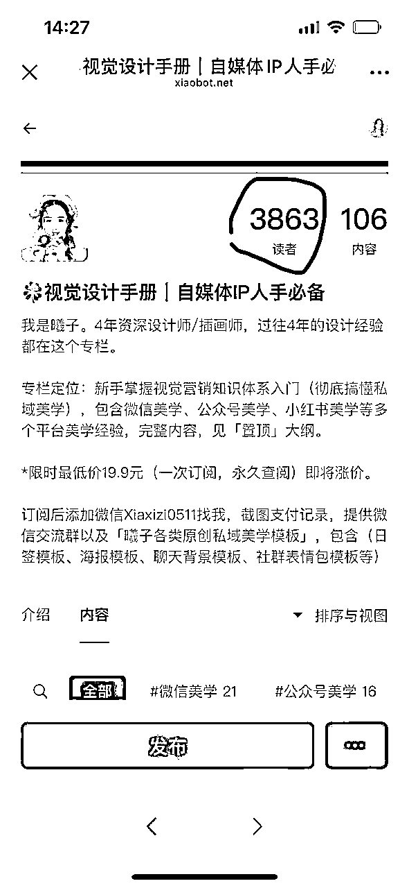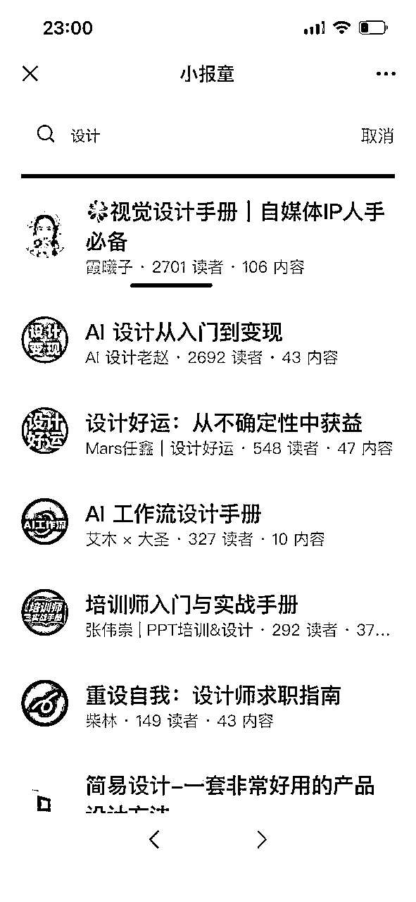

这份复盘她写得很细，我帮你把其中最值得看的重点拆了出来。

一、六个值得反复琢磨的心得

（1）先规划，再动手
她不是一开始就冲。在正式操盘前，她去各个星球翻遍了龙哥、大全等大佬的小报童复盘帖，把大家的操盘流程和关键点捋了出来，找到共性后，自己先拟了一份大纲，然后一项项往里填动作，逐条核对有没有遗漏。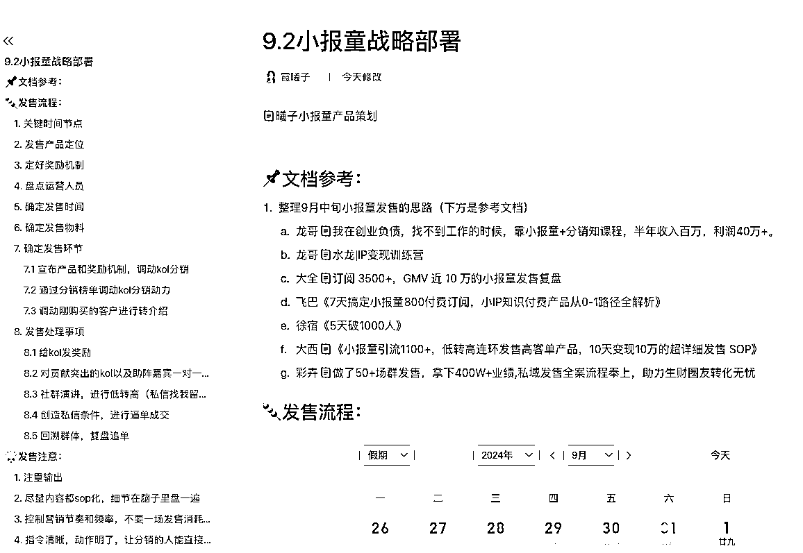整份方案成型后，她拿去给老马和龙哥把关，问后续这样做可不可行、有没有要调的地方，对方看的时候也清楚很多。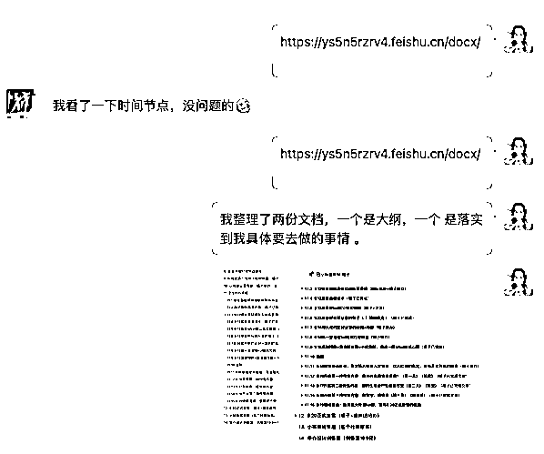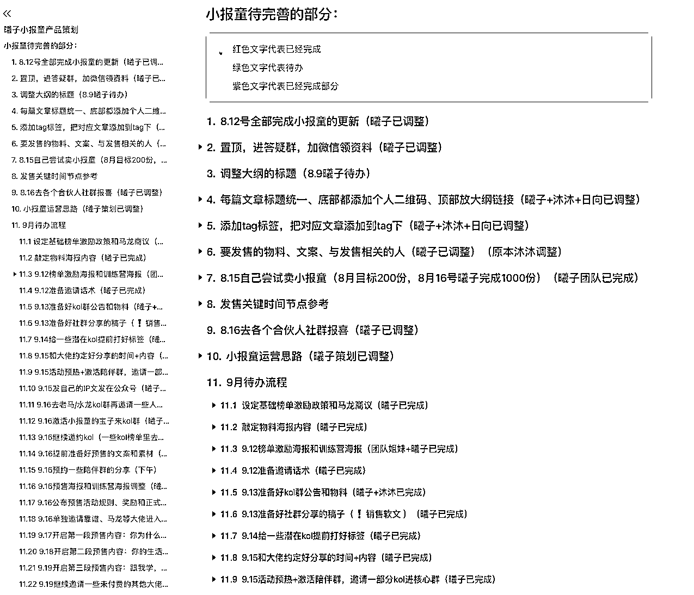

为什么要这么重视规划？好处至少四个：发售思路更清晰，后续少踩坑；对发售更有信心，成功率至少大10倍；复盘起来省力，在规划稿上稍改就能发到不同星球，一份材料多种用途；还能对抗焦虑，让发售始终有条不紊地推进。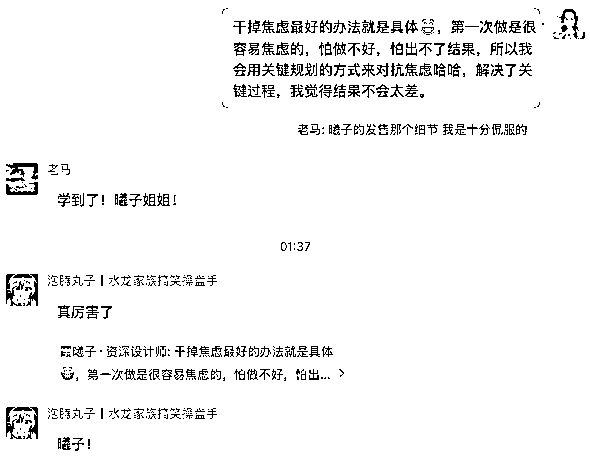她说，重要的事自己都会充分准备再做，这个习惯很值得分享。

（2）关键节点多问有经验的人
发售期的榜单激励是个难点：既要让人有冲榜欲望，又要控住成本。曦子的榜单方案，是在老马、龙哥、丸子、波波的不同建议下，改了十几版才定稿的。回过头看，比第一版好太多。她总结说，自己没有操盘经验，最有效的办法就是多请教付费过的大佬，也许对方一个建议就价值千金。别一个人闷头做，多问几个人，别人往往能指出你没想到的问题。

（3）团队分工，别亲力亲为
发售期间，她既要跟用户沟通、发奖励，还要处理杂事。忙不过来时，就拉上设计团队一起干。发售海报是团队做的，社群运营官也由她们担任，文案有人写，福利有人兑。她则把省下来的时间用在发售方向和战略思考上。她自己强调，发售最不能偷的懒，就是战略上的懒；把每个人的时间用好，成事效率才会高。

（4）以目标为导向倒推动作
她的基础目标设在2500份——一个不算高、但努力够得着的数。围绕这个目标，她把关键人和关键资源一一梳理出来，该邀的KOL就主动去邀。她说，别人帮你是情分，不帮是本分，但你自己有没有主动开口，差别很大。主动的结局无非两种：被拒或被接受。被拒没损失，被接受就多一个帮你卖的盟友。

（5）平时多积攒善缘
她记得书里有句话：贵人+超强执行力=取得成绩。她自己就是“大战略+执行”的盖洛普组合，想做的事大概率能做成，只是时间问题。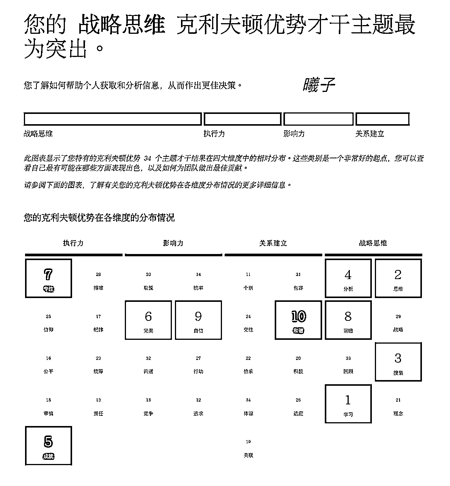但关键时刻，还需要贵人推一把。贵人是平时多付出、主动提供价值换来的。与其临时抱佛脚，不如日常多结善缘，总有人会在你需要时为你出手。

（6）特别想感谢的那群人
龙哥：她说跟着龙哥之后，人生像走在开挂的路上。第一单自媒体文化衫业务就是龙哥给的；后来龙哥打开IP文化衫市场，她也绑定了相关设计业务，赚到钱。龙哥还给她各种海报单子，鼓励她做团队、带队作战，教了她很多商业技能，学费早已好几倍赚回，那种“被认可的力量”她一直记得。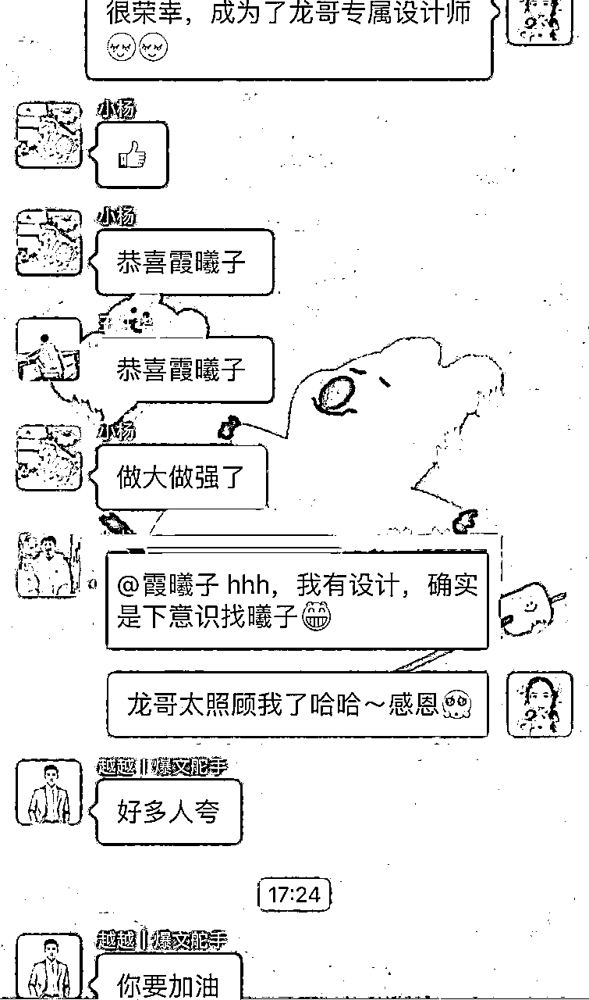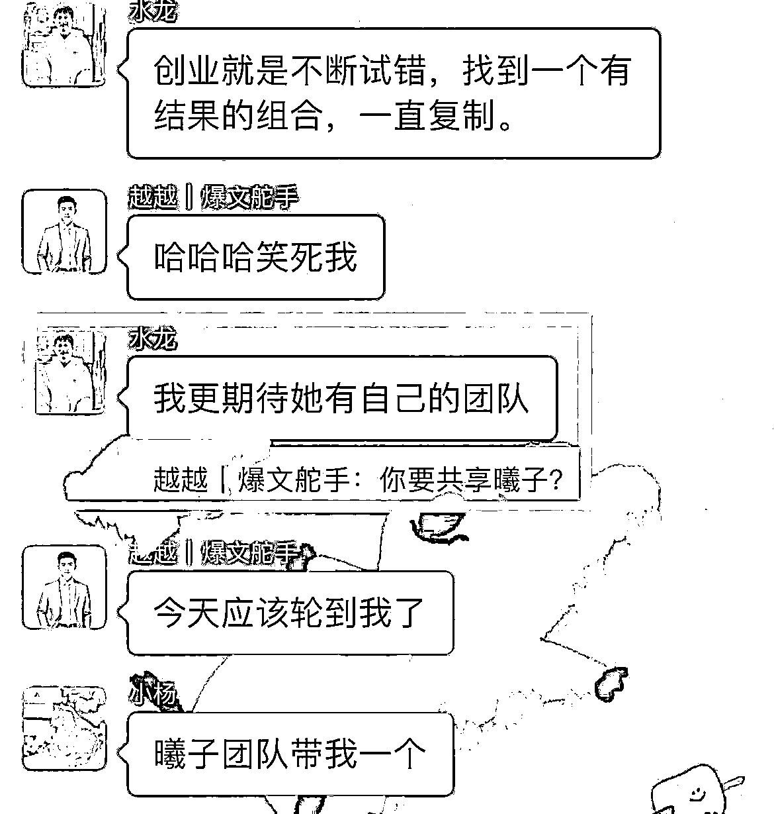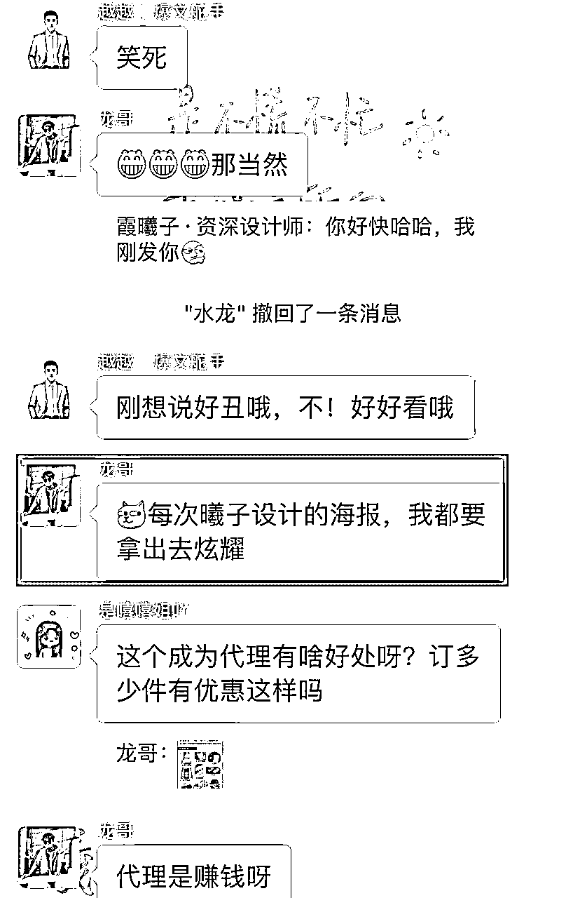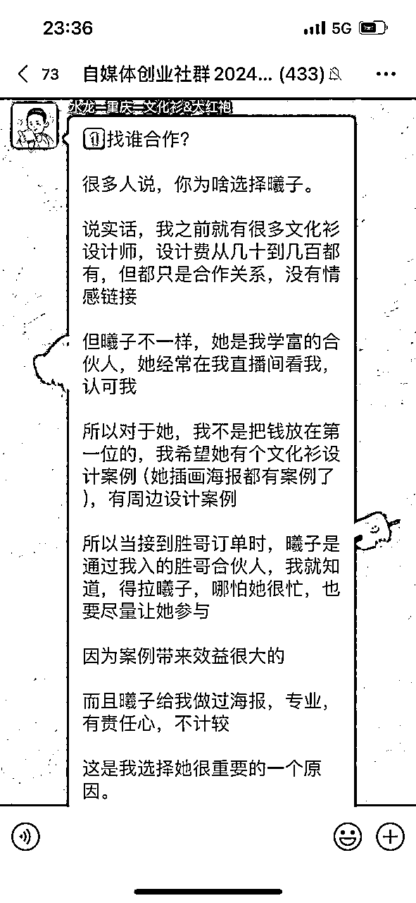这次发售，龙哥给建议、给KOL资源，她才能这么顺。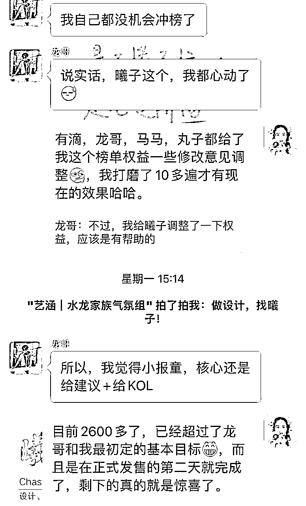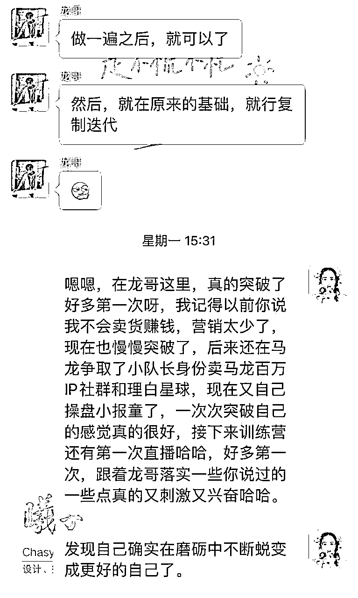

老马：带她入圈的恩师。发售时她多次找老马聊想法，老马在榜单激励上帮她做了优化，后来还发了多条朋友圈替她宣传。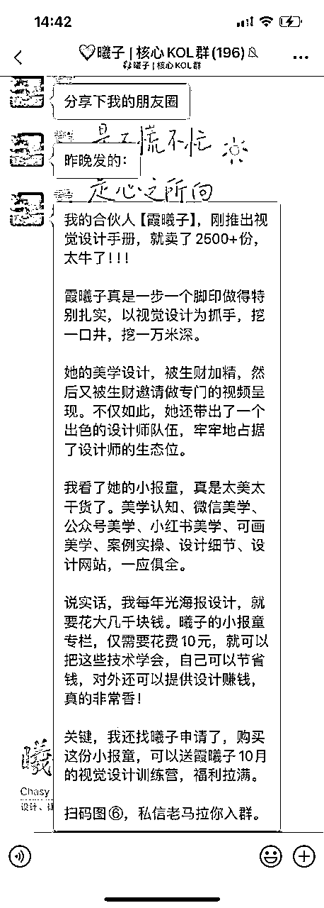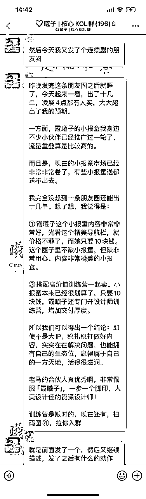

波波：幕后帮她算账的人。她自认数字不敏感，波波看到榜单激励后立刻帮她把账算清——有人冲榜时她要付出多少、对方能到手多少，在保持吸引力的同时最大化节省成本。发售期间，波波还帮她卖出了200份。

丸子：她的好朋友，前期策划时给了大量建议，让她能顺利完整地跑完发售；丸子是这次分销的销冠，单人突破400单。她线下见过丸子一次，感慨那是“见一面就会爱上”的高能量女孩。

无岸：小报童刚开始卖、还没有任何奖励时，无岸就主动帮卖了80多份；正式发售又全力卖出400份，排在总榜第二。无岸说，因为之前她也毫不犹豫地帮过他——这就是自媒体里难能可贵的互相成就吧。

篇幅原因，她没一一列完。整个发售期，有近300位朋友卖出过至少1单小报童，每单赚6元。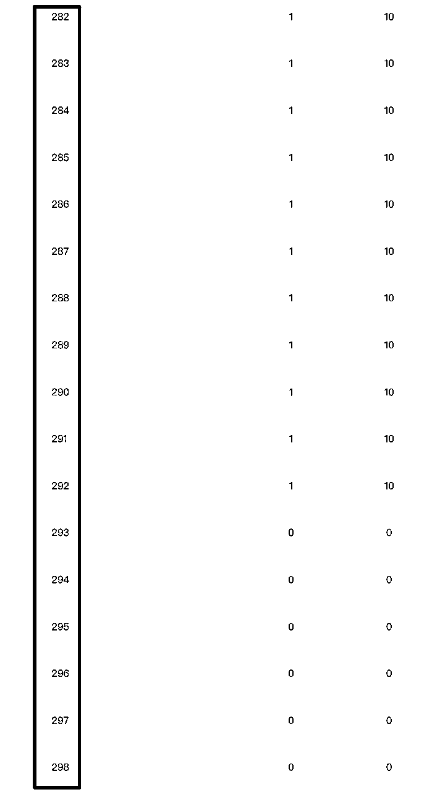每一位出过力的朋友，她说都记在心里。

二、从筹备到卖爆，完整时间线拆解

8月12日：产品内容全部更新完毕。包括置顶、建答疑群、加微信领资料；调整大纲标题；统一文章标题、底部加个人二维码、顶部放大纲链接；按大纲副标题添加tag标签。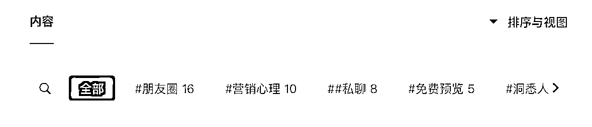

8月15日：先自己试卖。8月目标定为200份，结果第二天（8月16日）就干到1000份。

9月：正式发售筹备期。9月目标2500份，最终3800+份。主要动作按时间顺序：
- 与老马和龙哥商议基础榜单激励政策；
- 9月12日敲定物料海报，包括发售海报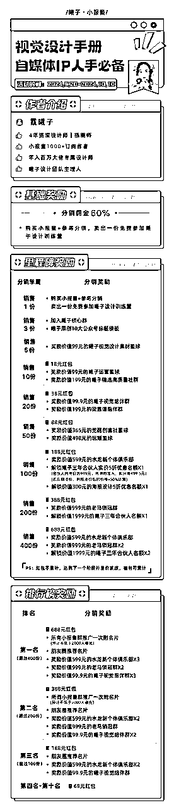、训练营海报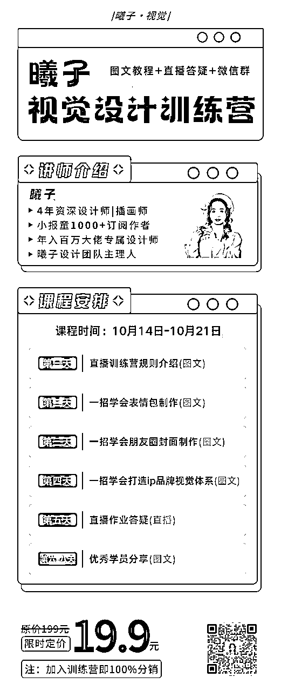、3天倒计时海报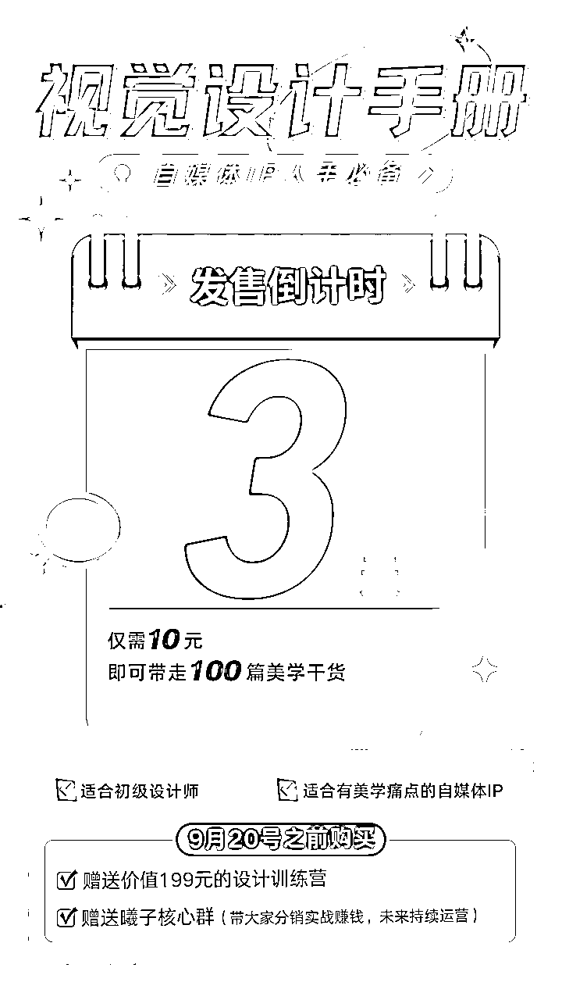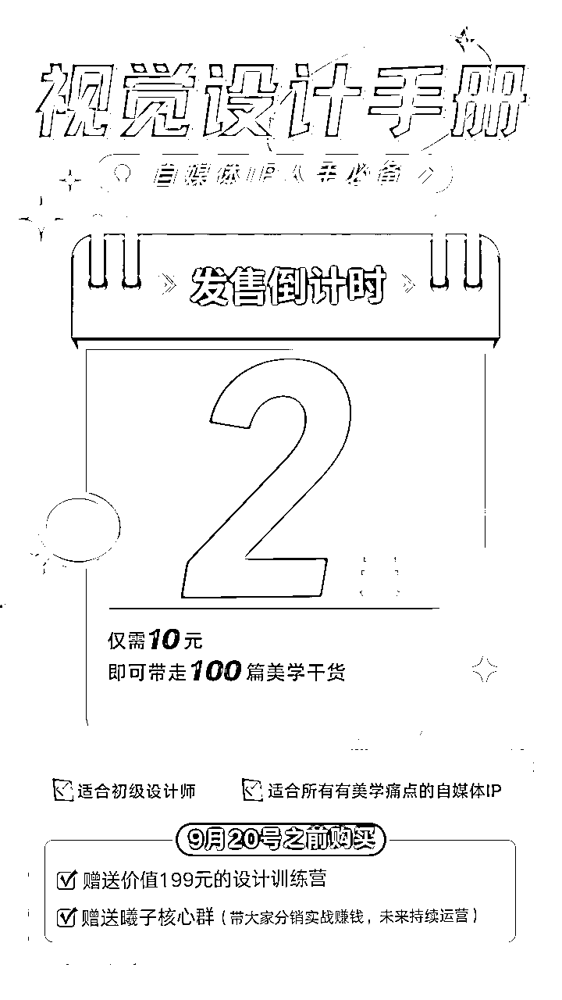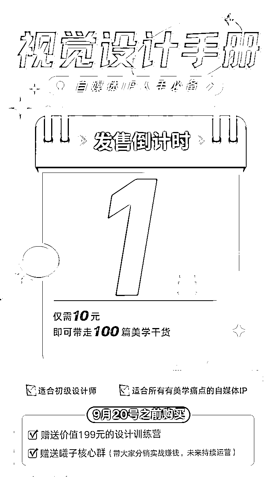、里程碑喜报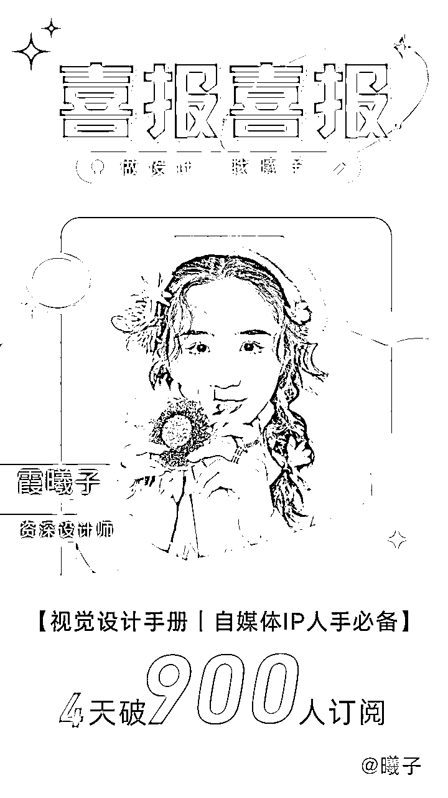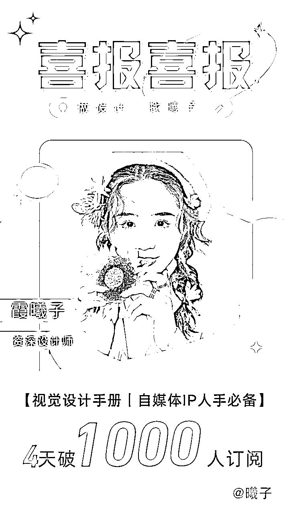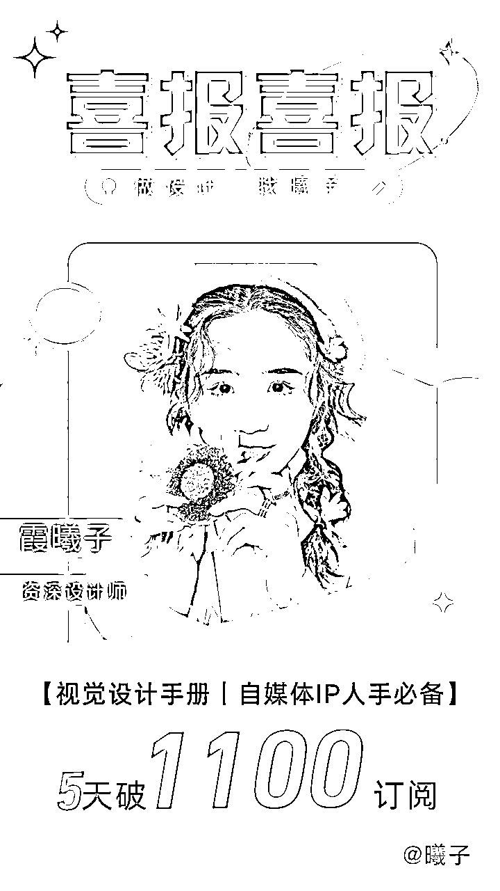；同日准备KOL邀请话术，话术里写明发售时间、前期1000+份的成绩、丰富奖励、训练营和现金激励，并透露活动后社群会保留，用来做资源对接和信息共享；对熟悉的朋友，发完这段话还会补个表情。
- 9月13日准备KOL群公告和物料：欢迎语里预告首单奖励，用受众社群表情包提升趣味，准备好运营文案刺激分销；1500、2000、2500订阅三档节点在群里发红包带动氛围；日常出单及时鼓励。同日准备好社群分享稿。
- 9月14日：给潜在KOL提前打标签。
- 9月15日：和大佬约好分享时间与内容；活动预热，激活陪伴群，邀请部分KOL进核心群；公众号发布IP文。
- 9月16日：去大佬的KOL群继续邀人。话术里会提“之前小范围卖时进过小报童官方飙升榜前三”，17-19日为预售，20日正式发售，晚上以红包形式公布规则。当天还激活小报童用户到KOL群，从榜单筛选继续邀约；下午备好预售文案和素材，预约陪伴群分享，微调预售海报和训练营海报；晚上公布预售规则、奖励和正式发售海报。造势动作里，提前三天设倒计时很关键。

预售拆成三天，每天一个核心主题：
第一天（9.17）主题：“你为什么应该在意我？”——内容上做承诺、立权威、传递价值，为第二天预热并号召行动。核心卖点是：小册收录100多篇美学干货，此前仅朋友圈卖4天就破千；正式发售前购买，送价值199元的设计训练营（直播+图文）；还能进曦子核心群，后续做资源互换和信息交流。也就是说，10元=100+干货+设计训练营+核心群。

第二天（9.18）主题：“你的生活会产生哪些改变？”——先感谢大家支持，回顾承诺，再次强调自己的专业地位，解答疑惑，为第三天预热。曦子的履历是4年设计师，累计和大IP合作商业海报超过80张，是百万IP海报专属设计师，服务过老马、水龙、涛哥、越越、朱胜、波波等。她的判断是：很多自媒体人没系统学过设计，审美和执行是共同痛点，小报童+交流群解决审美，训练营解决指导/执行。按原文表述，“8月17号之前”购买都有训练营赠送（此处大概率是笔误，结合上下文应指正式发售前）；错过就没了，所以“早就是优势”。

第三天（9.19）主题：“跟我学，慢慢来。”——表达感激和兴奋，快速回顾承诺，展示案例，回答核心问题，接着讲自己的整体规划和教学安排，最后强化稀缺性并促成行动。价格被她形容为“一杯蜜雪冰城的钱”；进群后，团队成员周一、周三、周五派送美图，周二、周四带读小报童内容；训练营有规则讲解、图文课程、星球打卡、作业点评、直播答疑和优秀学员路径分享。当时做自媒体设计类目的小报童只有她一家，还配套了干货+训练营，确实很难找到同类。9月19日是送训练营的最后一天。

9月19日：继续邀请还没进群的意向大佬，宣布9月20日正式发售。
9月20日：正式发售。她带头发朋友圈：晒分销群来的大佬、晒里程碑订单数、晒小册的价值、晒内容、晒个人IP成长经历、晒大佬的宣传；每天收集发圈素材；根据发售情况设置日榜；对出单人员多夸多鼓励。
发售结束后：在各社群报喜；随后开设计训练营；训练营结束，升出6名1799元的私教学员。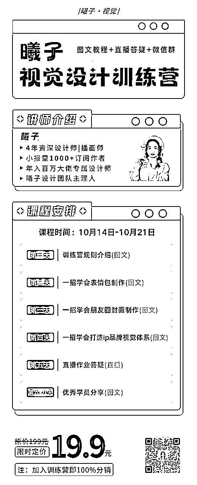

三、小报童的发售策略

原文档这一节还有更详细的拆解，这里先把标题留好。复盘的第四节是“小报童的低转高策略”，第五节是“小报童的发售小细节注意”，都值得去看原文。

写到最后：这场发售能跑出3800+份，靠的不是运气，而是清晰的规划、借力、分工、目标感和日常积累的信任资产。如果你也在做或打算做小报童，希望这份复盘能成为你的一份行动计划。祝你也卖出自己的“第一”。

很多人以为，一场漂亮的产品发售靠的是“到时候冲一把”，但真正的高手，早在开卖之前，就把整个路径在脑子里跑了很多遍。核心逻辑很简单：先定一个清晰目标，再把每个关键动作拆到可执行，最后让结果无限逼近预期，甚至狠狠超出预期。

在筹备阶段，别急着喊开始。先算一笔账：自己大概能直接卖出多少份？需要多少位外部助力者帮忙扩散？其中几位是必须具备强影响力的关键人物？把这些数字盘清楚，后续每一步才有着力点。

接下来就是“借力”的艺术。别不好意思开口，先找那些平时关系就不错的朋友，彼此交换流量，互相托一把；再去看看各个榜单上的头部玩家，主动抛出合作邀请，做一场共赢的联动；那些你已经付费加入过的社群，或者合伙人圈子，也别浪费，完全可以去约一次干货分享。这些都是真实可信的杠杆。

在正式开卖之前，一定要把势能先垫高。可以搞一轮预售，让一部分人率先发出朋友圈；把几位有分量的大佬请进自己的核心群，哪怕只是露个面、讲句话，都是一种无形的背书。真正开售的头几天，往往是士气最旺的时候，这时候多鼓励、多晒单、多发红包，让热闹感滚起来。等发售结束后，也别悄无声息地收场，搞一个像模像样的颁奖仪式，给整个过程画一个漂亮的句号。

再说说产品体系。一个健康的变现链路，从来不是靠单品打天下，而是设计一套“由低到高”的阶梯：引流品负责把人吸引进来，利润品负责创造持续收益，灯塔产品负责树立专业高度，活动品负责点燃集中消费。用不同的产品承接不同的人群，用户解决了问题，你也赚到了应有的回报。

举个大家容易上手的模型——小报童低转高。

第一种是押金训练营模式，比如曦子策划过的玩法，用押金激励完成学习转化。

第二种是从小报童群升级到陪伴群。小报童群和百元陪伴群要有明显的体验差异。小报童群主要做内容领读、美图分享，由团队助理负责运营，没有答疑环节，但大家可以自由探讨美学相关的话题；而陪伴群则是设计+自媒体的交叉领域，不仅有更丰富的内容，还额外附赠21节海报课，由主理人亲自运营，每周三次分享，并且提供自媒体和设计相关的答疑。小报童用户补上差价，就能直接升级。每周做一次分享本身就是升单的绝佳时机，尤其是那些在专栏里积极点赞、认真评论的用户，他们往往是最有升级意愿的人。再加上日更公众号，持续种草，升单就变成了一件自然而然的事。

第三种是小报童转合伙人。那些能把小报童卖得很好的人，本质上已经极度认可你，只要等一个合适的契机，就很容易完成更高客单的成交。另外，我们还可以专门针对那些有意向的用户，做一份“百问百答”专栏，把私教、合伙人、陪伴群等产品的服务案例、高频问题全都放进去。这样做有两个直接的好处：一是大大降低自己反复解释的成本，二是学员在分销的时候也有了现成的“弹药库”。

发售过程中，还有几个容易忽略却能大大提升转化率的细节。

第一，给KOL发奖励时，要把仪式感做足。那些能出单的合作者，很可能就是你未来第一批中高客单客户，值得被郑重对待。

第二，对于贡献特别突出的合作者和助阵嘉宾，一定要单独表达感谢。可以亲手挑选一些实物小礼物，比如明信片、抱枕，这种有温度的心意最能拉近距离。

第三，发售结束后，再来一场社群演讲，顺势完成低转高的收尾。话术可以设计成：“对XX产品感兴趣的朋友，私信我领一份重磅资料。”先把人引到私聊里，再完成转化。

第四，主动创造私信沟通的机会。如果用户感兴趣但还在犹豫，可以用定金逼单的方式锁定意向，比如先收100、200元定金，再用电话详细沟通，把最后的顾虑解决掉。

第五，如果这次发售没有达到预期，也别急着沮丧。可以用一场“发售复盘会”来追单：把那些想了解发售流程的人邀请进来，把整个打法从头到尾讲一遍。在不经意间，你想学的那群人，就会被你的专业和执行力打动，当场下单。

第六，一定要重视产品本身的厚度。拿曦子发售小报童来说，在此之前她已经写了100多篇内容。产品是那个“1”，营销只是后面的“0”。如果产品本身不够扎实，就算喊破嗓子，也很难激起太大的水花。

最后，所有关键环节尽量SOP化。将军不打无准备的仗，一场重要活动，如果前期不把流程捋顺，真正上场时很容易手忙脚乱，直接打乱整个发售的节奏。

以上，就是曦子第一次操盘小报童产品时的完整经验。希望这些细节，也能成为你下一次发售的底气。