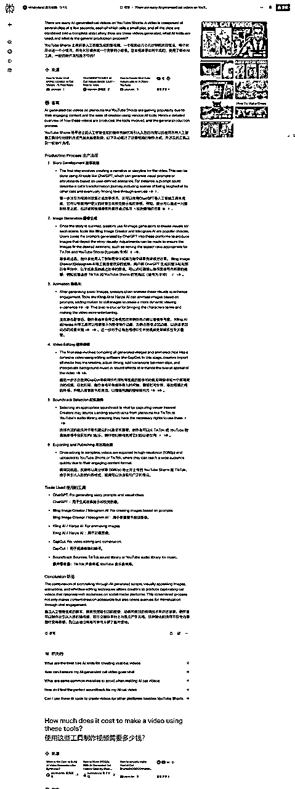
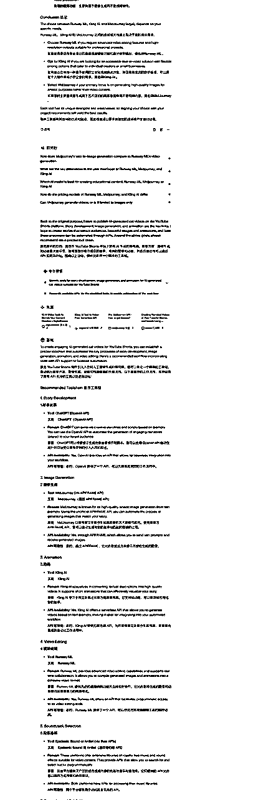
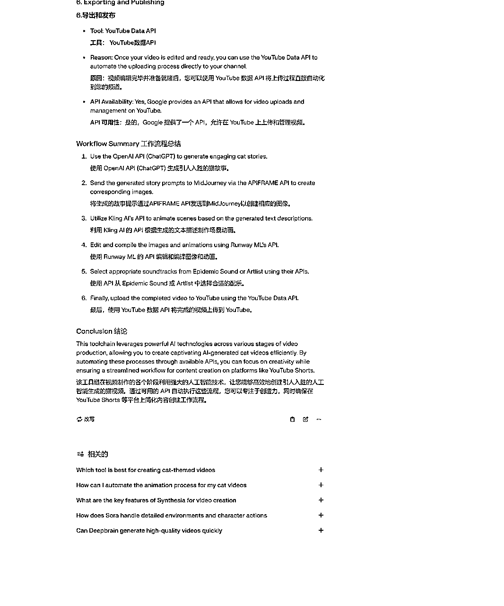
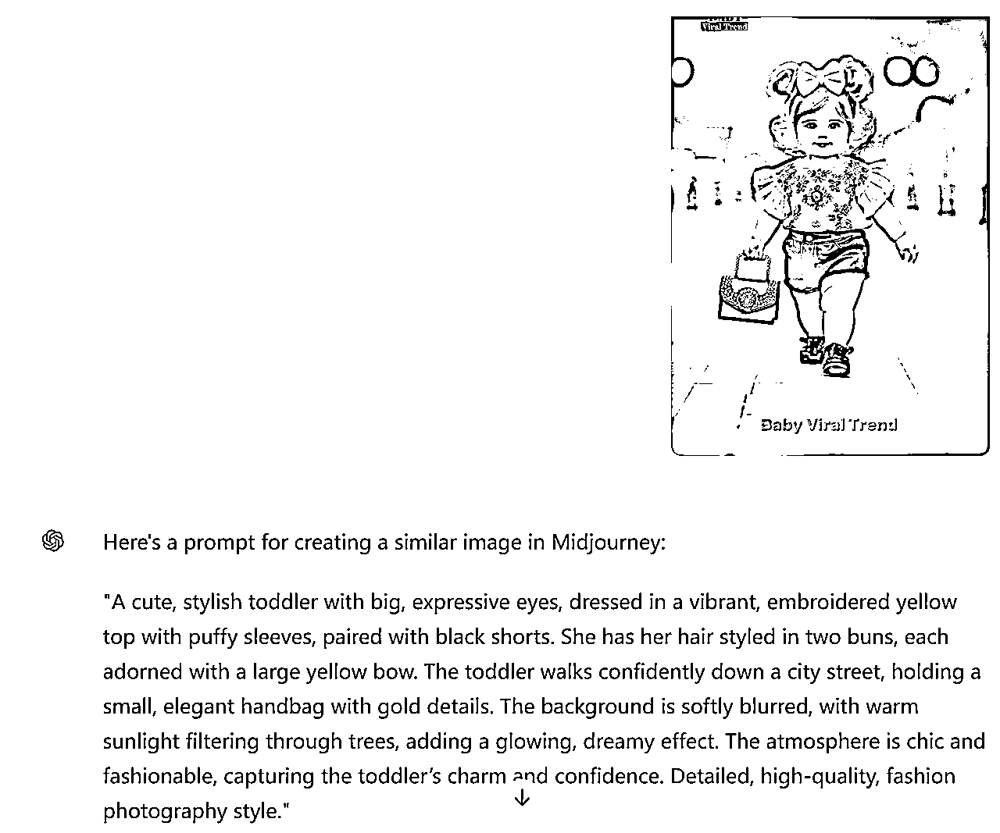
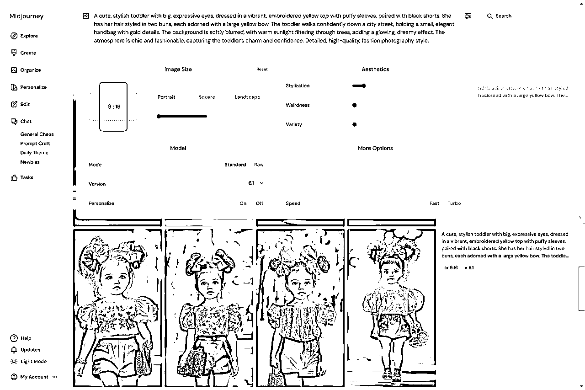
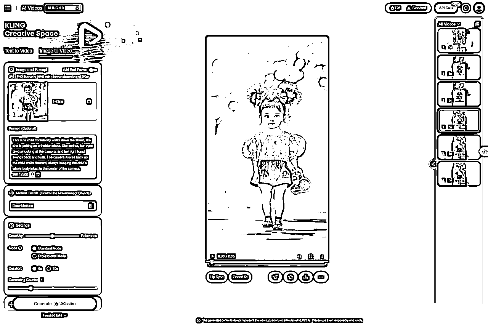
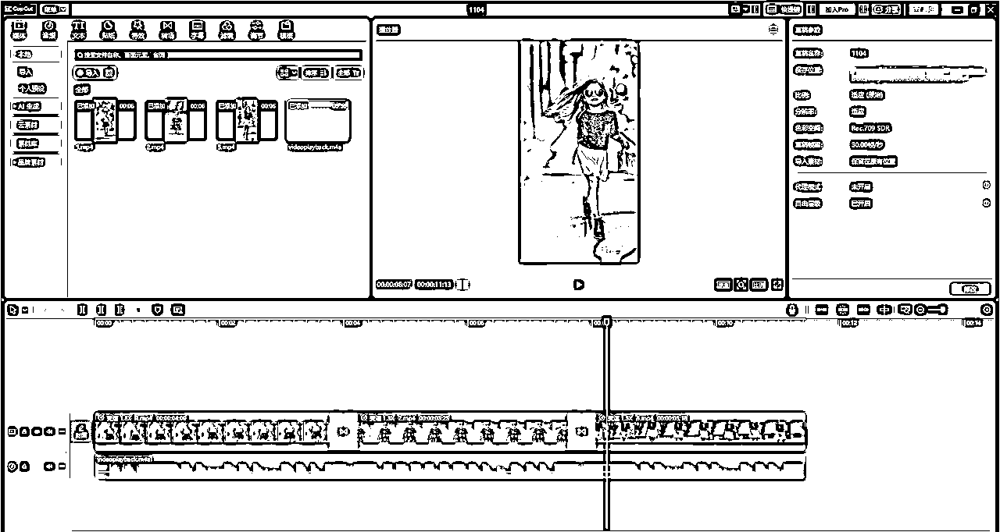

最近刷到一个很实在的YouTube Shorts项目复盘，来自一位刚加入生财圈的新人“一页书”。他把亦仁老大关于AI自媒体的几篇灯塔文章和超级标系列反复啃了几遍，然后自己动手做了一轮完整调研，从平台机制、赚钱逻辑到频道定位、对标账号分析，全链路捋了一遍。我觉得这套思路很适合刚接触Shorts的朋友，所以把核心内容重新整理出来，换个说法分享给大家。

先说结论：在他看来，YouTube Shorts + AI视频不只适合作为新手快速上手的项目，甚至值得当成长期耕耘的方向。理由很简单——平台够大够规范，收益路径清晰，AI解决制作效率，而且Shorts还在跟TikTok抢创作者，广告分成机制相对透明，门槛也不算离谱。

很多人分不清Shorts和普通YouTube长视频的赚钱差别。简单讲，传统YouTube是靠系统给视频匹配广告，然后按广告展示、点击或观看次数计费，创作者拿55%分成，但前提是视频本身要有内容深度，制作门槛高。Shorts这边，广告相当于插在短视频流之间的间隙，创作者不用管任何设置，系统根据你的播放量在一个总广告池里按比例分钱，创作者拿45%，平台拿55%。因为有个统一的收益池，所以单个视频的收入不好说死，折算下来每千次播放大约能拿0.15美元左右，比一年前的0.01到0.06明显涨了不少。

进YPP的条件也不难理解。长视频需要12个月内1000订阅+4000小时观看时长；Shorts则是90天内1000订阅+1000万次播放。两个平台的账号、粉丝、后台都是通的，算法也会互相推荐。提现方面，作者看到有人用招行卡就能正常收账，早期额度有限但够用，跨国难度没有想象中大。

真正需要花心思的是选赛道和做内容。通用的定位逻辑是：找一个细分的用户群体和刚需，既能赚钱又不讨厌做。放到Shorts上，用户画像不用抠太细，因为大家分享的是同一个广告池，你需要关心的就是做什么内容播放量大、现在做的人多不多、你能不能做得更好、烦不烦做这件事。

作者拉了一批2024年新注册的AI相关爆款频道，发现很有意思的现象：很多账号靠“AI猫咪”类内容打出了惊人播放量，比如Lute Catkin用猫咪小动画演荒诞剧情，26条视频做了2.2亿播放；GingerCatTV做猫咪讲感人故事的鸡汤内容，62条视频冲到3.1亿播放，目前还在稳定更新；还有做深海怪兽猎奇、鸭子萌系日常的也各有过亿流量。但大多数账号爆了几个月就停更，明显是审美疲劳或收益下滑。唯一保持可持续的是GingerCatTV，原因是它把故事框架整合成了固定配方：正能量价值观+精美动画+洗脑配乐，每个视频都在同一个模板里迭代。

所以作者特别提醒，看数据不能只看短期爆款，要去找能持续输出、长期有流量的频道。他自己下一步的目标是筛选那些年收入能到20万以上、播放量趋势还在涨的AI垂类号，再基于这些去拆解需求、判断自己能不能做。

整体读下来，这个项目最大的魅力就是：不需要露脸、不需要口播功底、AI工具把制作成本和效率压到很低，再加上平台分成规则简单透明，只要找到对的方向，认真执行，大概率能跑通。当然，前提是你要像作者一样，先花时间把底层逻辑和账号数据研究透，而不是上来就闷头灌视频。

如果你也对这个方向感兴趣，不妨按这套方法做一轮自己的调研：找100个对标账号，拉数据，分析需求，再挑一个自己不讨厌、能持续做下去的赛道。说不定下一个稳定增长的就是你。

最近在复盘YouTube上的AI视频赛道，发现一些很有意思的规律，整理出来和你分享。如果你正打算做海外Shorts，或者已经在做了但觉得方向模糊，这篇内容或许能帮你少走点弯路。

先说看数据的标准。我大致按注册时间分了几个档位：2024年注册的号，视频量起码要有20条，总播放量得超过2000万；2023年注册的号，视频量至少50条，总播放量要破1亿；2022年注册的号，视频量要过100条，总播放量1.5亿以上；再早的号，视频量没到150条、播放量没到2亿的话，基本不用看。另外还要看持续性：有没有断更？最近一次更新在两周内算健康；播放量是不是靠一两条爆款撑起来的？如果分布相对均匀，更说明稳定；整体趋势是保持还是下滑，也直接决定这个号值不值得研究。

把这些标准套到一堆频道上，能看出很多门道。比如猫咪类，红海中的红海。有无数频道在做，几个典型的：一个叫Mr. Majesty 2，2023年9月注册，15亿播放，725条视频，但趋势已经下降；还有个meow mow，同样是猫咪正能量，97条视频就拿到了8.9亿播放，订阅546万，但10月7日之后停更了。这种停更现象比比皆是，Pet Funny Short、MeowTube、KittenMatin都是类似情况——播放量很猛，但突然就断了。这说明什么？猫咪赛道靠AI生成图片加配乐，短期内能迅速起量，但观众审美疲劳来得也快，创作者自己可能也倦了，于是大量频道中途退场。

再看新趋势。近两个月的爆款里，有几个方向值得注意。一个是兔子加小动物温馨互助的内容，像Rabbit's Quest，单条视频冲到2800万播放；一个是漫威加搞笑的，GOLD DUCK单条播放4800万；还有儿童时尚类，littleclassics、ClassyBaby这些频道，用小动画展示萌娃穿搭，日均更新三四条，量不算大但很稳定。另外，大量配音加上简单配乐的搞笑图片内容，依然能跑出不错的播放，比如GRB world和VSL Neuz，都是日更，用印度语或英语配音，单条百万以上很常见。

把这些信息汇总一下，我做了个赛道判断。猫咪类，需求层面是心灵抚慰和搞笑娱乐，供给端已经塞满了，虽然货币化案例多，但大多数频道在走下坡路，少数还活的靠的是独特内容。要做好这个赛道，你得在内容上下功夫，还得想想形式能不能变一变，比如把猫换成熊猫、兔子、鸭子之类，也许能做出新意。萌娃时尚走秀，是今年七八月才冒出来的，频道还不多，多数尚未货币化，趋势略有下降。技术上比较简单：提取图片prompt、生成图片、生成视频、配乐、剪辑。可以做，但缺内容深度，能不能持久我持怀疑态度，得盯着头部频道的货币化进展。图片风格转绘，盈利案例不少，做法是文生图加风格转绘加转场加配乐，靠反差和意外制造笑点，同样因为缺内容，感觉难以持久。至于名人或卡通搞笑，属于技术简单但内容很吃剧本和配音能力的赛道，我不擅长搞笑剧本，暂时不做。

关于初期打法，我特别受启发的一点是：不用等到过了YPP才开始多账号操作，早期就可以小规模矩阵，选两三个赛道，每个赛道养三五个号，分散风险，也保信心。对标的收益估计怎么算？可以用ytlarge那个货币化查询工具，或者手动按公式估：这么算下来，一个10亿播放的频道，假设RPM是0.1美元，纯Shorts收入大概就是97万美元左右，记住这个数，心里就有底了。选题思路方面，一种是一比一复刻，从播放量高的里面找同款，简单粗暴；另一种是一次产出多份吃法，把同一个内容脚本换不同形式，放到多个垂直频道同时发。

最终我选的赛道是猫咪类。不是因为它最赚钱，而是因为它有成功案例，需求也有，技术我也能搞定，而且我可以做内容上的改良。流程跑通之后再回来往细分方向继续挖，机会还会有很多。

最近短视频里冒出不少AI做出来的猫猫剧场、宝宝时装秀、图像风格转换、名人恶搞动画，看得我手痒，也好奇这些账号到底怎么运作的，收益是否真实。于是我把YouTube上几个热门细分方向仔细扒了一遍，还亲自从头到尾复刻了一条热门短片。这篇把调研心得和实操细节一次性讲透。

先上调研结论。目前发展得不错的类型大致有四类：猫咪主题、宝宝走秀、图像转绘、搞笑整活。猫和宝宝这两类偏剧情、偏动画的账号，不少栽在了平台变现审核上，有的甚至因为内容雷同、疑似照搬被判出局，最后无奈停更。而图像转绘和搞笑类则是另一番光景，很多账号单条视频就能积累百万次观看，累计广告分成折算成美元能到六位数，而且基本都顺利通过了变现资格审核。当然，搞笑分区里也有个别账号因内容风格激进，至今没能开收益。

看完这些现象，我最好奇的就是制作工艺。我打开Perplexity，抛出了那个问题：

它的回答很翔实，把各个制作环节和对应工具都列得明明白白。我又追问了工具间的横向对比、授权费用、API开放情况等细节，收获了大量信息。最后请它推荐一套可直接落地的组合：

本来我只想确认前三个步骤，结果它把六个步骤全说完了。我把清单过了一遍，发现其中半数工具我都熟悉，少数没接触过的，去YouTube找几个教学视频就能明白。最终确定的流水线为：ChatGPT负责故事稿，走官方API；MidJourney负责出图，用非官方中转通道；Kling负责让画面动起来，也有官方API；剪辑交给CapCut；配乐从Epidemic Sound里挑；最后发到YouTube。顺便一提，后来我才发现Kling其实是国产的“可灵”，CapCut也就对应剪映，我还傻傻买了会员。虽然多花了钱，但看到中国AI工具被全球创作者热烈使用，还真有点自豪。

按说猫猫视频更复杂，但宝宝走秀明显更适合验证路径——几乎不用写故事，画面靠文字直接生成，视频只需让人物走路，剪辑无非是拼接加转场。所以拿它做首发实验。

模仿样本我选了该分区里数据最亮眼的频道，作品名称先不公开，大家一搜就能找到。没订阅YouTube Premium，就用shortsnoob.com把影像与音轨分别扒下来。接着在原片里截三帧画面，交给ChatGPT逆向生成Midjourney绘画指令：

拿到指令后投入Midjourney，画幅选9:16，其余参数默认。每张图有四个候选，由于人物需要迈步，我挑了腿部完整的那张：

随后把图片交到Kling手中，附上一句话的动作提示，模型选最便宜的1.0标准档，生成5秒片段，等待约5分钟。若赶时间可同时开四个任务再择优。网格参数里还有物体运动、镜头路径等高级设定，想精细控制可以慢慢研究：

三条片段全部到手后，把之前下载的BGM一起拖入CapCut。我做了几个微调：一是对片段执行变速（注意不是剪切），使走路的步伐与节拍对齐；二是修剪每段入点，让切换瞬间卡在乐句起始处；三是在段间加入“推进”转场，呼应原片风格。经过这些调整，整条短片和音乐就非常带感了。对了，第三位小模特气场特别足，很飒。

成片与原片摆在一起对比，相似度高到让我怀疑原账号就是这么生产的。这一个闭环我完全没做精细调参，基本是照猫画虎，如果认真调校、升级模型，效果还能更上一层。成本方面，熟练后基本能一次成片，单条差不多1.7元人民币，批量制作还会更低。

基于这次完整试跑，我对这个方向的信心大增。长期规划有两层：一是将选材、制片直至发布的全链路，做到95%由机器代劳，只留5%的关键决策给人；二是依靠这种半自动能力，去深耕真正热爱且擅长的内容，最终打造一个独一无二的频道。

短期则用90天来落地。第一步是达到YPP门槛：过去90天里订阅者超过1000人，Shorts公开累计观看达到1000万次；第二步是提交审核并顺利通过；第三步则是等待首笔收益入账。考虑到我此前从没做过内容运营，中间必定会有不少波折，所以直接赚到钱不太现实。我把“通过YPP审核”设为冲刺目标，把“达到YPP门槛”设为底线目标。节奏上：第一周用来定方向，参考历史数据和前辈经验；之后七周全力达成门槛，包括环境准备、账号开设和内容发布；最后四周研究审核规则、准备材料并完成申请。

最后认真道谢。这一路上众多圈友的公开分享让我少走了大量弯路，或许他们并不知情，但帮助真实不虚。特别感谢亦仁、浅笑、钱塘鲤哥、老馬大哥以及花生老师，也感谢更多未一一列出的朋友。没有你们的干货，我无法在这短短十几行文字背后，积累那么多真实经验。今后若有新动态，我再来跟各位汇报。