先自我介绍一下，我是圈友三月雨，现在还在读大四。入行网络文学创作大约两个月，同时连载的书有五本：起点一本、番茄两本、七猫一本、刺猬猫一本。七猫那本目前是千字15元，番茄和刺猬猫主要靠全勤奖励，起点那本还没上架。每个月合计收入约六千，每天花四小时，每本更新六千字，基本靠AI协作完成。

作为完全没经验的新人，第一个月就拿到了第一笔稿酬（1200或800元）。等熟练之后多开几本，流程熟悉了，收入还能再涨。

平时你会看网文吗？

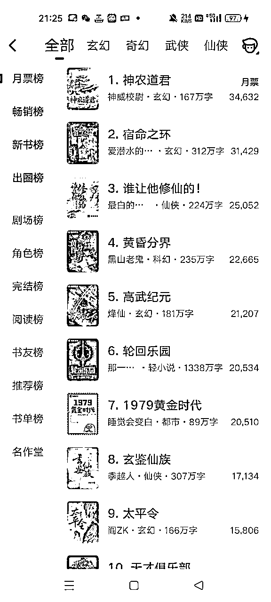
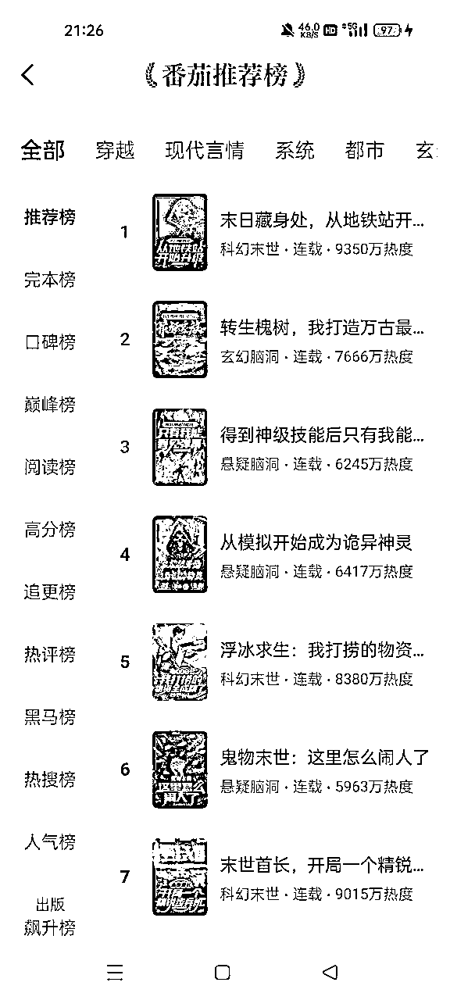

接下来进入正题。

**先弄明白网文是什么**

网文就是网络文学，如今更常说是商业小说。作者把作品发在小说的平台上，读者阅读时产生收益，平台按比例分账，作者拿到属于自己的那份，这就是网文作者的赚钱方式。

网文不需要像传统出版物或纯文学作品那样，去剖析深刻的社会议题、写出惊世之作。它的本质是替读者圆“白日梦”，在精神上填补现实生活的缺失。

举个例：现实里你可能没钱没势、被人看轻，但在小说里你是主角，靠金手指扬眉吐气、打脸反派；现实里你没法腾云驾雾，但在小说里你可以修炼成仙、御剑飞行。帮读者在虚构世界里获得心理满足，正是网文的意义。

**常见小说平台怎么分**

按收费方式：免费站靠广告赚钱，读者不用花钱；付费站靠订阅赚钱，读者需要购买章节。

按内容风格：
- 小白文为主：番茄小说、飞卢小说
- 老白文为主：起点中文网
- 二次元为主：刺猬猫、菠萝包轻小说

所谓小白文，是剧情简单直白、套路感很强的作品；老白文则是情节更有层次、套路更多变的类型；二次元题材围绕ACGN（动画、漫画、游戏、小说）展开。

上面就是主流平台分布。如果想找冷门渠道或工作室，我更常用的办法是去小红书搜“小说投稿”“作品签约”“稿费”“编辑收稿”等关键词，很多工作室/渠道号的主页会直接挂邮箱。

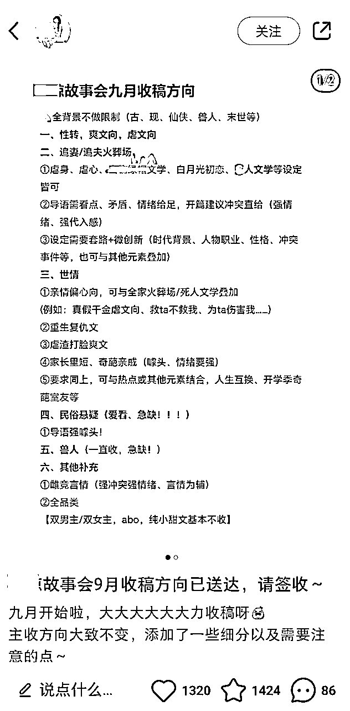
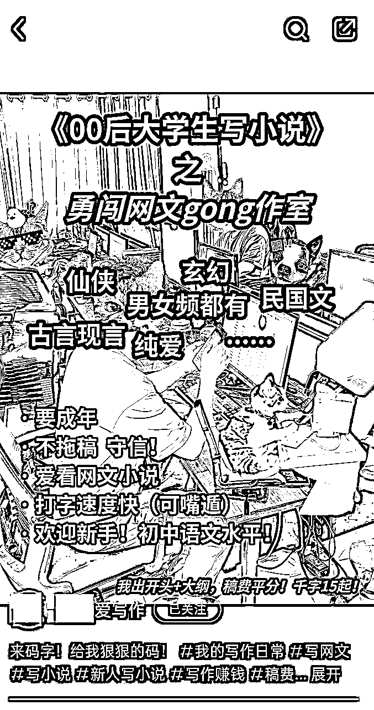
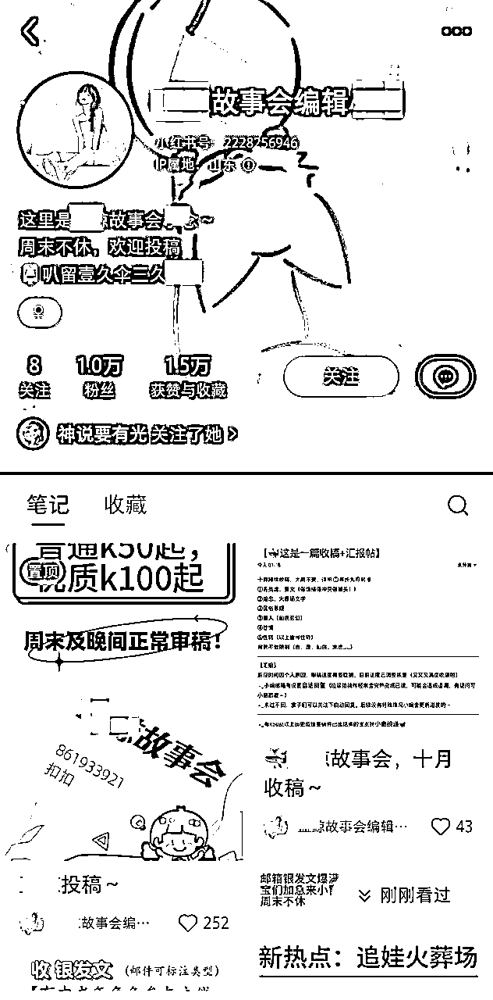
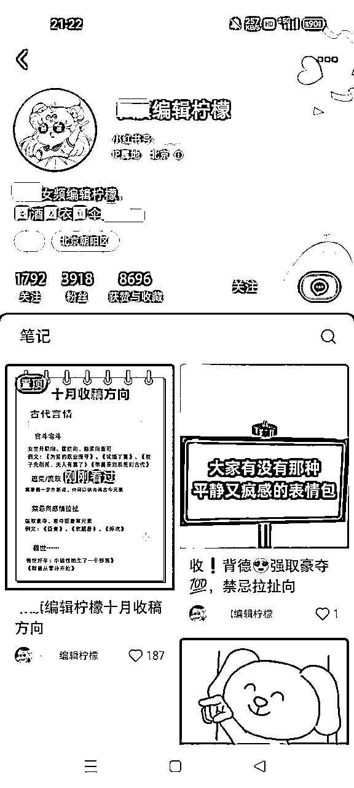

下面以番茄为例，梳理一本书从开写到完结的主要流程：

**第一步：申请签约（2万字）**
写到2万字就能申请签约，不签就没钱拿。番茄是机器审核，基本都能过。前提是日更4000字起步。

**第二步：验证期（8万字）**
8万字时进入推荐池，先跑7天验证期，平台会给一小波流量。满10万字自动进入正式推荐，保持日更即可。

**第三步：首秀（10万字）**
字数到8万字，且推荐节点前连续三天日更超4000字，就会触发首秀。平台会开始分发流量，首秀转化后流量会稳一阵。举例：新人首秀在读3万，之后几周通常维持1万到3万之间。

首秀约三周，建议日更6000，定时发，绝不能断更或大幅修改。前几天数据不好也别急，重点看完读率。正式首秀第一天一般会给量，追读高的话会加推。

**第四步：全勤（10万字，听读≥200）**
全勤要同时满足：满10万字、听读稿酬超过200、每天更新4000-6000字。金额上，日更4000是600/月，日更6000是800/月。

**第五步：书名测试（20-50万字）**
准备5个书名+5个封面，做推荐分发测试，看哪个数据好就保留哪个。

详细规则可参考官方签约指南：https://fanqienovel.com/writer/zone/help/article?rank1=10000&rank2=10110&rank3=0&from=category

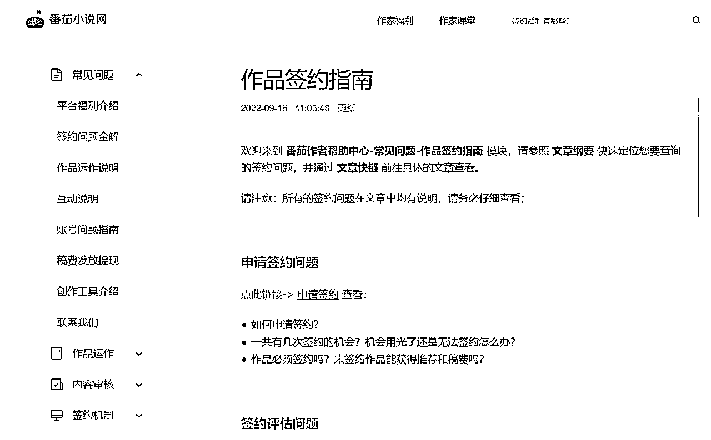

小提醒：尽量日更6000+；别换马甲，防恶意举报；首秀阶段不要断更或爆更，建议备稿到14万字；首秀数据不好别急着止损，等20万字冲书测；月初/月底开书更容易冲全勤；每章控制在2050-2300字。

**AI写网文，题材怎么选？**

理论上什么类型都能写，但AI有记忆限制，逻辑也不是特别强，所以不建议碰悬疑推理、复杂游戏设定、医生等强职业文，凡是依赖大量数据的题材都别轻易尝试。

最好选自己真正看过、有兴趣写下去的类型。网文不像公众号短文，一两个小时就能写完。一本书最少一百万字，日更6000也要写半年。这半年你都要和同一个题材打交道，还得保证逻辑不断裂，没兴趣的话会非常痛苦，AI也救不了。

喜欢剑仙就写玄幻，热衷家庭题材就写世情文，爱看废土丧尸就写末世生存，喜欢爱情就写古言或现言。

流量方面，番茄是算法推荐，各题材名额差不多。玄幻读者少但单价高，还有完本收益；都市娱乐读者多，但单价可能压得极低，几十万在读未必比得上几万在读的玄幻或古代言情。所以选你喜欢的就好。

**直签和内投有什么不同**

直签：写到平台规定的字数直接申请签约。番茄第一次申请是2万字，没过的话可以5万字再试，最后一次机会是20万字。编辑由平台随机分配，甚至可能是机器人“番番”。

内投：准备1万-2万字正文加大纲，发到编辑邮箱；有的编辑接受6000字。你可以主动选编辑，更容易找到风格契合的合作对象。内投失败也还能走直签。

**原创和同人：题材基本盘**

原创题材：
- 玄幻：灵气复苏、御兽、巫师、属性加点、开宝箱、捡属性、反派、皇帝、无敌、原始、签到、召唤、家族/宗门、种田、极道、女帝、制卡、两界穿梭、模拟器等
- 仙侠：凡人流、种田、古典仙侠、香火成神、仙葫、异兽、蜀山、西游、洪荒、封神、白蛇、聊斋
- 科幻：机甲、基因、文明战争、末世废土、异兽、虫族、暴兵、种田、领主、丧尸、硬科幻、末世召唤、御兽、末世求生、星空背景
- 都市：鉴宝、直播、荒野求生、科技、外国种田、狗粮、异兽职业、娱乐（文娱/华娱/韩娱/港娱/日娱）、重生、年代、神豪、种田（农场、山林、空间、渔场、海洋）
- 历史：秦汉魏晋唐宋元明清、民国、三国、架空、红楼、水浒、世家种田、权谋、皇帝流、领主争霸、聊天群、两界穿梭、系统历史等
- 奇幻：魔法师骑士、亡灵、神格信仰、深渊恶魔、爆兵、异兽（巨龙/兽人/异类）、巫师、领主种田
- 武侠：高武、镇魔司、东厂、六扇门、极道
- 体育：篮球、足球、跑步、拳击

同人题材：
- 诸天、聊天群、倩女幽魂、九叔、四合院、亮剑、权游、霍格沃茨、艾泽拉斯、哈利波特、战锤
- 武侠同人：金庸、古龙、温瑞安、梁羽生、黄易等（射雕、神雕、天龙、大唐双龙、小李飞刀、寻秦记、倚天、笑傲、鹿鼎记、绝代双骄、陆小凤、风云、秦时明月、综武）
- 影视/热门网文同人：小欢喜、我的体育老师、长津湖、爱情公寓、知否、余欢水、三十而已、人世间、都挺好、欢乐颂、黄飞鸿、叶问、无间道、赌神、夏洛特烦恼、大话西游、杀破狼、警察故事、西红柿首富、唐人街探案、来自星星的你、蓝色生死恋、浪漫满屋、奥特曼、假面骑士、金刚狼、超人、漫威、蜘蛛侠、无限恐怖、行尸走肉、斗罗、斗破、大主宰、吞噬星空、庆余年、将夜、星辰变、凡人修仙传、遮天、完美世界、诡秘之主、全职高手、盗墓笔记等
- 二次元同人：原神、鬼灭、死神、火影、海贼、犬夜叉、灌篮高手、龙珠、柯南、一人之下、龙族、宝可梦、游戏王、圣斗士、型月、崩坏、克苏鲁、拳皇、碧蓝航线等

**实操演示：废土求生文怎么写**

理论说不清楚，直接走一遍。首先找5本成绩不错的对标书。

不建议挑巅峰榜作品，那些要么是作者自带粉丝，要么是水准高到常人难比。推荐榜更合适。假如你觉得《求生从小木屋开始抵御寒流》好看，想写同类，就按这个方向找。

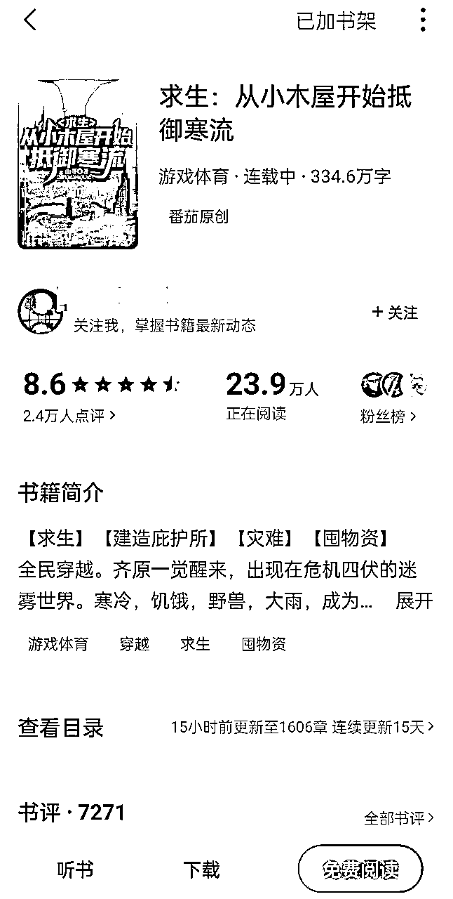

找对标的方法很朴素：多刷一会儿，算法会推相似作品；或者看书简介底部的“在读用户还喜欢”和书单，里面一般也是同类书。

我当时找到的是：
- 《迷雾求生：我能看到技能提示》
- 《求生：从茅草屋开始对抗洪水》
- 《海岛全民垂钓：我独享史诗级天赋》
- 《公路求生：开箱必定幸运》

对标后会发现套路共性：全球60亿人穿越异世界，即将经受寒潮、洪水、暴雨等天灾，大家要靠采集资源升级小木屋。主角则有金手指，能比别人更快升级，享受围观者的羡慕。

爽点也很简单：别人在冰天雪地里裹紧被子发抖时，主角已经住进温暖大房子，烤火炉、喝红酒。

顺便看下《求生从小木屋开始抵御寒流》简介：【求生】【建造庇护所】【灾难】【囤物资】全民穿越。齐原一觉醒来，出现在危机四伏的迷雾世界。寒冷，饥饿，野兽，大雨，成为所有人生活的主旋律。日出而作，日落而息成为所有人的生活状态！

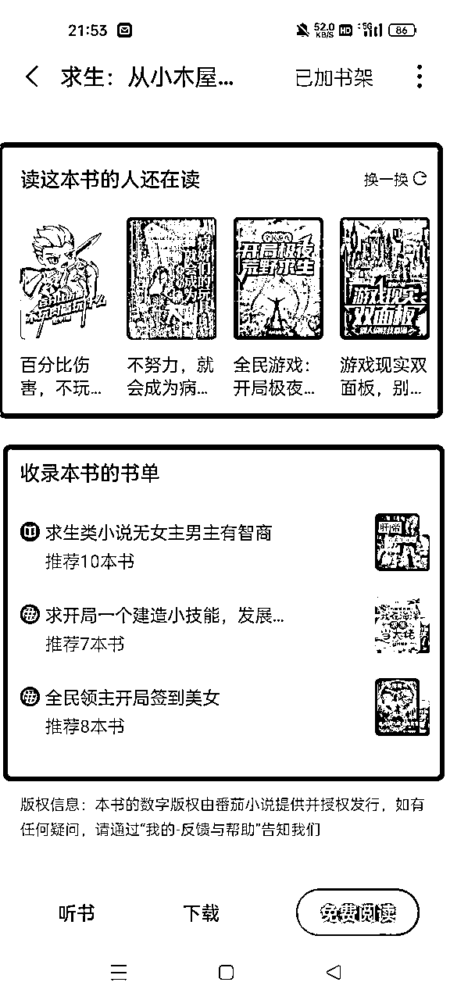

**标题怎么拟**

对标完成后再起标题就不难了。我根据那5本拟了个《黑夜求生：从小木屋开始抵御大洪水》。

另外还有四种常见起法：
1. 题材直给：突出题材类型，便于读者筛选。如《守寡后我重生了》《穿进赛博游戏后干掉BOSS成功上位》《爽文女主她不想爆红》
2. 人设先行：主打职业、人物关系或特殊形容。如《高危职业二师姐》《朕的爱妃只想吃瓜》《为夫曾是龙傲天》《回到明朝当王爷》
3. 矛盾前置：书名点出核心冲突，主线也好设计。如《女寝大逃亡》《我以为我拿的救赎剧本》《穿越到四十年后爱人变成了老头怎么办》《修真界禁止物种歧视》
4. 反套路型：用新奇的元素或反差感抓人。如《我就想蹭蹭你的气运》《我靠血条碾压修真界》《十分满分的甜》《这膝盖我收下了》

**简介怎么编**

最简单的方法：把5本对标书的书名+简介丢给ChatGPT，再附上你的书名，让它融合出一段。我试过：

我的提问：《黑夜求生：从小木屋开始抵御大洪水》是书名，下面这些是同类型简介，请帮我融合成一段。

AI给出的结果大致是：【灾难求生】+【小木屋建造】+【无种马】+【不圣母】+【杀伐果断】，然后描写外部世界突变、暴雨洪水、怪兽出没，主角方岩靠智慧勇气建立避难所，抵御天灾。稍微改改就能用。所以我强烈推荐先对标，再让AI融简介。

如果想自己写，可以按这个链条来：
1. 交代环境和人物困境
2. 强化核心矛盾
3. 给出主线目标
4. 递进展示人设/亮点
5. 安排男主出场、女主掉马、金手指揭底等
6. 用反转和反差制造记忆点

顺序可以灵活调整。加上自带流量的CP标签会更吸睛，比如【病娇+穿书+团宠+万人迷】。

示例：《我在修仙界搞内卷》的简介结构——秦姝穿书成冒牌货，被庶妹当众戳穿后逐出师门，还面临被炼成炉鼎的命运；她决定赶在庶妹入道前拼命修炼，不睡觉、不吃饭、比剑宗大师兄更卷；几年后庶妹入道，秦姝却早已成为玄天宗的焦点；大魔王谢释渊为她出头，最后还发来一句“仙子可还记得跟你花前月下的小蛇蛇？”——这套就是很标准的反转+掉马+反差萌流程。

以上是我用AI写网文的完整经验。不管是纯新人还是老手，只要题材选对、对标到位、把AI当工具用，这条路确实走得通。祝你也能早日写出自己的赚钱小说！

如果你以为网文赚钱靠的是灵感，那可能方向错了。

最近读了一份相当硬核的实操笔记，讲的不是怎么仰望星空，而是怎么脚踏实地用AI把小说从0写到签约。听起来有点像“一键生成爆款”？别急，看完再下结论。

先说一个很有意思的故事开头：八年前心软救过一条小黑蛇，结果这一辈子都被它缠上了——很多爆款短篇靠的就是这种反差感，结尾翻转让读者直拍大腿。而另一个标题更直白：《全家偷听我心声杀疯了，我负责吃奶》，主打一个“全家读心术+炮灰+团宠+大佬穿书+扮猪吃虎+爽文”的集邮式标签。女主穿成被溺毙的炮灰，家人被PUA、被灭门、被当垫脚石，结果她靠吐槽心声，一句话点醒恋爱脑亲娘，顺带治好了残疾大哥的腿。这个开局的黄金公式，你已经拿到了。

封面怎么整？其实不复杂。要么淘宝花五块钱买一张，要么用SD/MJ配合无版权字体做，记住俩原则：字体和图片都不能碰版权线。

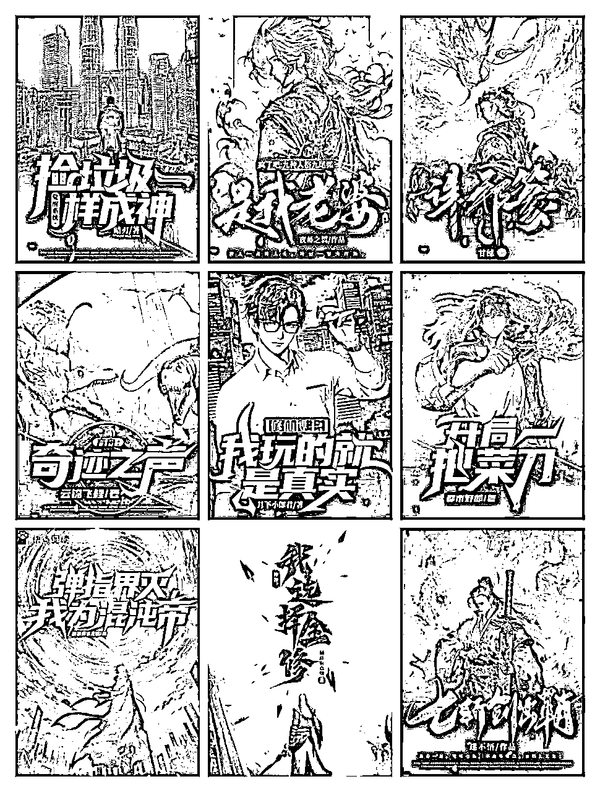

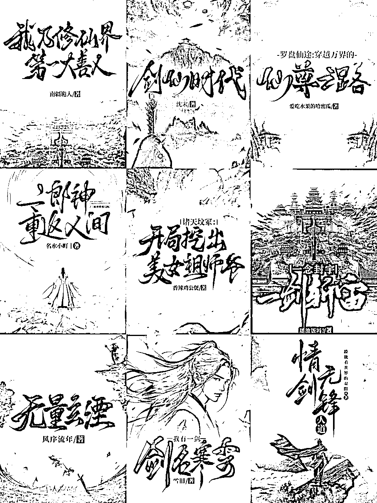

接着聊钱的事。稿费超过800块的部分，国家要抽税，按每月超出部分算20%，但因为稿费类别有7折优惠，所以实际是14%。比如你一个月到手1000块，那就是800加上200的14%。等到第二年，个人所得税APP还能申请退税，这笔钱别忘领。

真正核心的部分来了：怎么用AI从零到一写出一本能签约的小说？目标务实一点，先赚到人生第一笔1200块稿费。这个阶段的真相是：不存在某个万能prompt，输入一下，6000字哗哗输出完事。AI全自动跑长篇？顶多到五万字，剧情逻辑就开始自我放飞了。短剧30秒不好看你可以忍，但一部百万字的小说，开头就寡淡，读者两分钟都不想给你。真正长篇网络小说动不动三百万字起步，全部交给AI，只会干巴到让人翻两页就合上。不信去看看《宇宙巨校闪级生》，一百亿多字的纯AI产物，据说99.999999%的人撑不过前三章。

所以，答案很明确：人为主，AI为辅。用AI做辅助的话，我目前也在用星月写作里的GPT4o和Claude3.5，主力是Claude3.5，API价格合理。国内的话可以试试零一万物的large模型或Kimi付费版。很多工具出来的文字一股“AI味”，读一眼就出戏，得挑那种不那么呆的。

https://xingyuexiezuo.com/?inviter=347#/register

接下来是核心方法论。一部小说通常一卷8到12万字，由多卷组成，每卷得有完整的起承转合，或者直接理解成三幕式。国内说“起承转合”，老外说“三幕式”，本质都是：起是开端，承是发展，转是高能，合是收束。后边那些花哨的“英雄之旅”“救猫咪”“斯奈德节拍表”，都是从这里长出来的。

拿《黑夜求生：从小木屋开始抵御大洪水》举例。写之前要准备三样：设定、黄金三章、节奏框架。

设定先搞明白：全球60亿人被扔进一个异世界或者末世，秩序瓦解，生存成了唯一法则，飓风、暴雨、洪水、寒潮轮番轰炸。主角必有金手指——有人能看见物品信息，有人掉宝率超高，然后靠这个迅速崛起、建庇护所、对抗外敌，探索更广阔的天地。

我的试验品是方岩。他一睁眼就在小木屋里，机械音告诉他：一个月后全球大洪水，请升级木屋保命。他身边只有一本求生手册和通讯器，一个一万人的聊天频道正炸锅：“妈妈我要回家不是真的”“我出一千万谁把我带走”，方岩默默关掉频道，摸清自己的金手指——开启的宝箱物品自动升一阶，白色变绿色、绿色变蓝色、紫色变金色。这个世界没有日出，只分深夜16小时和浅夜8小时，深夜有大恐怖，所以只能在浅夜出去伐木、采石、开箱。

探险路上开出好东西，频道里一群人竞价哄抢，爽点来了；有人眼红提长矛上门偷袭，结果发现方岩已经一手火球术送他归西，爽点又来了。故事里塞满这种“打脸”和“升级”的节奏，读者就停不下来。

黄金三章，相当于短视频的三秒定生死。三章留不住人，就别指望后面百万字了。这个阶段建议先“抄”后“超”：把对标书的前三章丢给AI，让它拆框架。

第一个prompt：你现在是网文作家，请拆解我的作品结构，分段概括内容、作用，并标每段字数。

第二个prompt：按顺序总结每一章的剧情核心，每一条标【剧情+序号】。

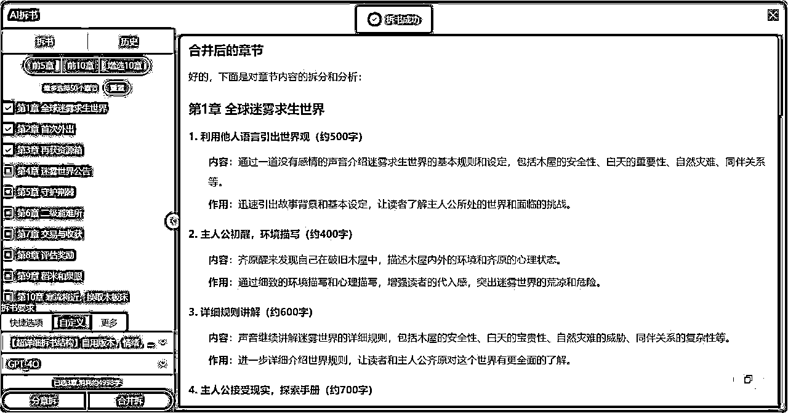

拆出来的框架大概是这种：

第一章：用系统声音引出世界观，让主角初醒、环顾破木屋、接受规则、翻手册、看世界频道、心里下定决心。

第二章：查天气、第一次砍树、频道互动、调整计划、优先解决吃喝。

第三章：意外发现青铜资源箱、再摸到石头矿区、天色突变、又捡一个木质资源箱、整理收获、复盘。

有了这个骨架，下一步是替换成自己的设定。相同框架、不同血肉：方岩的聊天频道、黑铁箱、SS级宝箱皇帝天赋——开箱自动升阶。细纲这里需要手工打磨，后面扩写才敢交给AI。

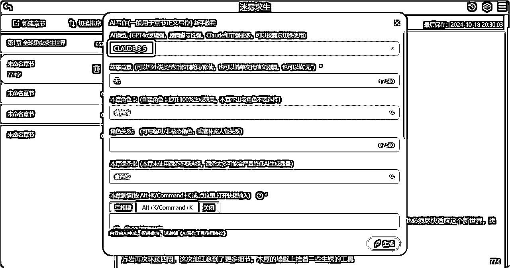

扩写的时候用Claude3.5，喂细纲进去。我的prompt大概是：你是网文作家三九音域，用他的风格扩写，要求强代入感、多用热梗热词旁白、靠动作和心理推着走、别忽略环境描写。

出来的效果是下面这种感觉：

方岩睁开眼，硬板床硌得后背疼，周围一片漆黑。这什么地方？记忆像被人抽空了。就在他发懵的当口，一个机械音响了：“欢迎来到黑夜求生世界，您和全球60亿人已被传送至此。请尽快升级小木屋，以抵御大洪水。”

方岩弹了起来，差点撞上屋顶。全球60亿？大洪水？拍电影呢？他缓了缓，看清了这间木屋：墙角蛛网密布，地板积灰，一盏油灯晃出昏黄的光，窗户封得死死的。空气里一股霉味呛得人直咳。

这时桌面上凭空冒出一本泛黄的书——《生存手册》。翻开一看，这个世界只有深夜和浅夜，深夜16小时、浅夜8小时，深夜有大恐怖，出门就是送命。天气也无常，好在还有个聊天频道能跟人说话。点开一看，一万个人正在原地崩溃：“这是哪？”“该怎么升木屋？”“深夜到底有什么？有人知道吗？”

方岩深呼吸，冷静，你不是来观光的。墙上挂着生锈的工具，角落里堆着木头和石头，升级就靠这些了。

这质量其实已经能打了。修一修，放到番茄上稳定更新，拿到一万左右在读、日收一百多是一个可以达到的现实。

最后再实操一遍：从日常文《古代小户之家奋斗史》开始，它的第一步依然是找对标。

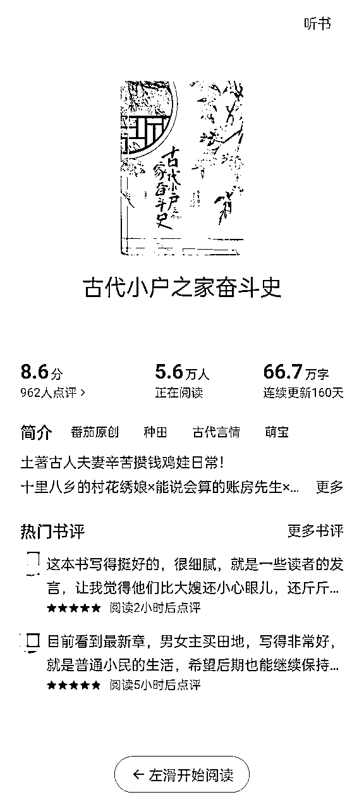

这期继续掏干货，从零开始跑一遍“古代情感日常文”。如果你平时就爱刷这类家长里短、温温吞吞的古言，也想过自己动手写，那肯定用得上。

先从找对标聊起。别自己闷头想剧情，先去看收藏夹里的书单，或者翻开一本同类作品，拉到下方的“看过这本书的人还爱看”推荐区。我就是按这个法子，扒出了四本风格很贴的参考书：《小城大户的主母日常》《糙狱卒的小娇妻》《不婚男女的古代养娃日常》《山村深处有人家》。书找好后，至少要把这几本各读一百章往上，把前二十万字的情节脉络吃透，后面才有东西可借鉴。

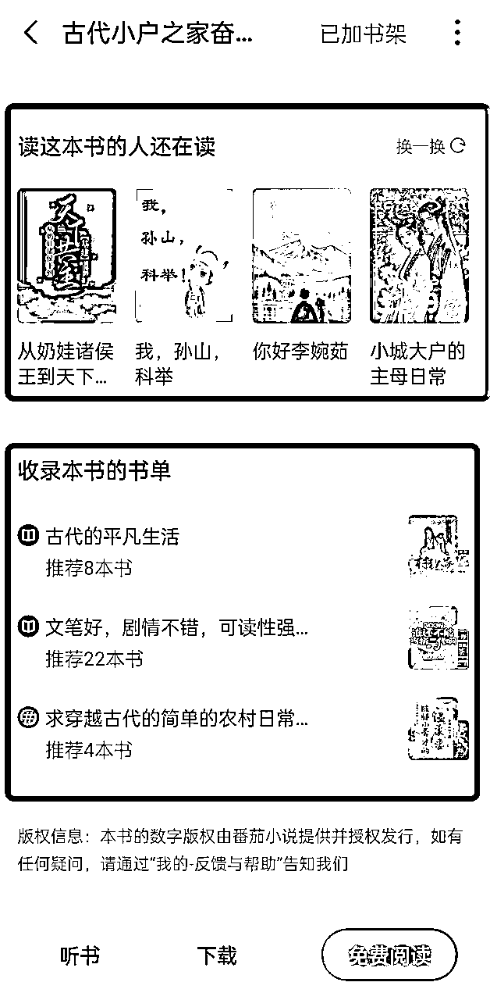

几本刷完，我决定还是写日常文。故事定在架空宋朝，女主名叫谢雨昕，一觉醒来穿成待嫁闺秀，第二天就要嫁给崤山县开药铺的苏泽阳。传闻这苏家常年在外走动，家业不太景气，可嫁过去才发现，夫妻俩好得如胶似漆，日子过得又甜又暖。

取书名时要注意，日常文不像末世废土文那样有统一命名法则，但可以照老派古言的思路来。只是千万别把名字取得太婉约，像“青山在”“凤嘲凰”“丹娘”“九重锦”这种，读者刷屏时一眼扫过去，根本猜不到故事讲的什么，很容易划走。最稳妥的办法是把核心卖点直接放进书名，比如我拟的《山有木兮：药师的宠妻日常》，一看就知道是药铺夫妻的甜蜜日常。

简介还是靠AI帮忙融合。把几本参考书的简介和我的设定一起喂给大模型，通义千问给的第一版已经挺像样，稍作修改就能用；不满意就再生成几次。

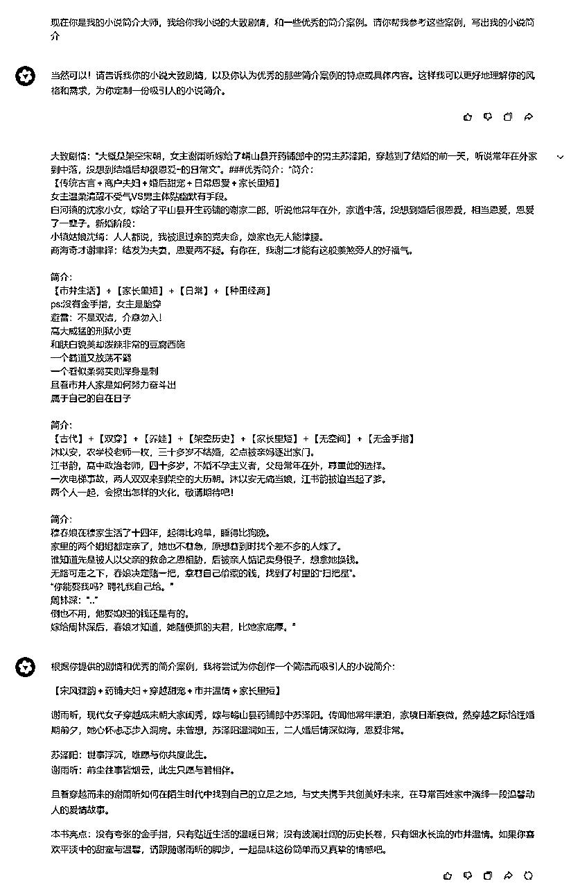

那版初稿大概是这个风格：标签按“传统古言＋市井温情＋婚后甜宠＋日常恩爱＋家长里短”排，主角是穿越成宋朝闺秀的现代女子，嫁给药铺郎中，原以为对方常年漂泊、家境衰败，婚后却发现男方温润体贴，两人感情浓到化不开。里面还配了一句男主女主互相许情的对白，结尾落在寻常人家共同经营未来的画面。我后来在原稿后面补了一笔“从陌生到相知，在柴米油盐里慢慢找到幸福”的收束，让整体更贴近日常文的温度。封面图可以上淘宝买，也可以自己动手做，但图片和字体都得选无版权的。

正文部分先别动笔，得先把对标的章节框架拆出来。你可以让AI按顺序概括每一章的主线事件，提示词就用：“直接按顺序总结每章的核心剧情，不用解释，每条剧情前面显示【剧情+序号】”。

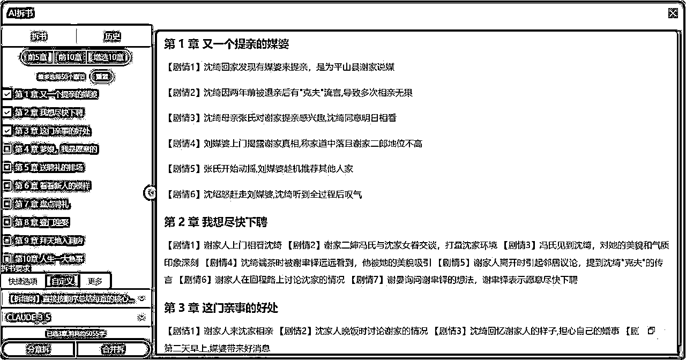

拿到拆解结果后，只借它的结构——哪里起高潮、哪里埋转折、哪里蓄情绪、哪里给爆发——具体事件全部按自己的设定重造。拿第一章举例，对标文是用“媒婆上门”来开篇立矛盾，那我也可以写一个媒人到访，但身份、对话、发展路径全都换成我自己的。总之，骨架可以像，血肉必须换。

细纲敲定后开始扩写，我推荐用Claude3.5或Gemini Pro，一次只喂一到三条剧情，让它输出一千字左右。角色设定可以这样给：“现在你是网文作家京圈太子爷，请按你的风格扩写，要求强代入感，多用网络热词热梗，常加旁白，以动作和心理描写推进剧情，适当添点环境描写。”生成出来的文字确实很有网感，人物内心戏也皮，像女主躲在屏风后听到媒婆前后两副嘴脸时的吐槽，就写得又灵动又抓人。

这里必须反复强调：千万别去洗稿。各家平台都有反抄袭比对系统，万一被查出相似度过高，稿费会全部清退，作者身份证也会被拉黑，以后所有书都签不了。工作室的行话叫“神似形不似”——内核和节奏可以沿袭，剧情和皮相必须重造。例如原书写王府庶女，你改成落难王女；原书写修仙，你给换成赛博朋克。剧情走向完全可以不同，只要框架节奏在，味儿就不会跑偏。

同时要守住题材边界。读者点开末世废土文，是想看人在极端环境里挣扎求存的劲头。你要是越写越偏，最后把丧尸升级成不化骨、将臣那种玄幻玩意，读者立马会弃书。所以脑子里要时刻绷着“读者为什么而来”这根弦。

再说几句实在话。第一，对这个项目要有合理预期：要是没有工作室，单靠一个人每天投入四五个小时，月入几千基本就是上限，头一个月可能只赚一千二。第二，选模型也有讲究。像kimi的免费版、豆包、讯飞星火，扩出来的文字太生硬、AI味明显，编辑一眼就能看出来，然后以“AI代写”为由不发稿费，咱也没话说。第三，可以借框架，但具体情节别照搬。比如对标文里收了一只宠物猫，你大可以写成开宝箱开出奴役卷轴，过十几章再遇上一个让主角头疼的猫头鹰反派，顺势把它收入麾下。要的就是“同路不同车”。第四，每天都得稳定更新，写作拼的是长跑。

——全文完，祝各位早日出爆款。

# 篇外：影视框架提取

除了从小说里拆框架，还能向影视剧借。以《繁花》为例，挑一段典型情节：

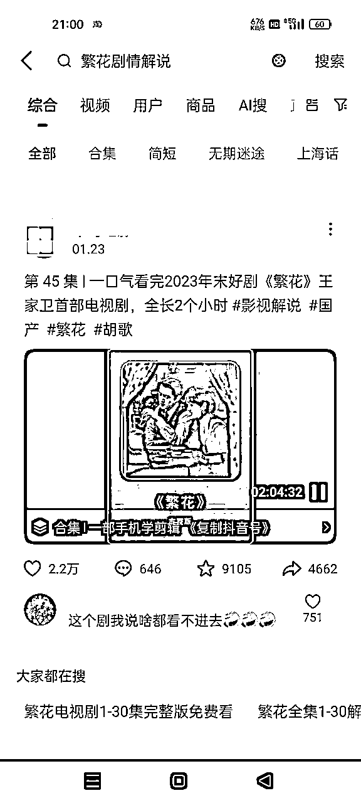

先用音频转文字工具把台词和旁白转成逐字稿，飞书妙记、通义音视频速读、剪映都能干。拿到文字稿后，交给AI按照“分步骤、分子步骤”的方式提炼剧情骨架，要求它把前因后果、事件对角色与世界观的影响，以及场景、对话、人物动作等细节都交代清楚。

开始迁移前，先把下面这些信息填好：世界观是什么，故事背景设在什么年代和地点；女主角的姓名、身份、性格、背景故事；男主的姓名、身份、性格、背景故事；主要竞争对手和次要竞争对手的姓名、职业、性格、背景故事。信息越完整，从影视剧里扒下来的框架就越容易落进你的故事里。

最后把网文圈常见的行话和类型术语过一遍，方便后续交流。成绩不好叫扑街，连载断更叫太监，草草结尾叫烂尾，均订三千以上是精品，设定崩坏叫崩，伏笔没回收叫坑；作者段位有小神、中神、大神；主角自带光环叫金手指，换场景叫换地图，没人看叫单机，意淫过度叫YY。常见的类型还有小白文、老白文、种马文、爽文（升级文、老师辅导文等）、后宫文、种田文、耽美文、无线文、系统文、高干文、轻小说、架空文、女尊文。知道这些行话，至少聊起来不怯场。赛道选定了，剩下的就是埋头写、稳住更。

混网文圈，不懂点“行话”怎么行？今天咱们一次性把女尊文流派、常见网文类型、签约术语以及主流平台投稿玩法全捋清楚，新手老手都能找到干货。

先说说女尊小说。这类型可不是只有一种写法，细究下来能分四派。第一种是“颠倒派”，最典型也最常见，男女形象彻底互换：女人高大勇武，男人温柔纤细，甚至很多设定里是男人怀孕生子。这类文你把性别一替换，就成了普通言情；反过来，普通言情把性别一换，就是它。代表作有《十年华衣》《四时花开》。

第二种是“现实派”，除了社会地位是女尊男卑，其他方面跟真实世界没什么两样，男人依然阳刚，女人依然阴柔，只是权力结构反过来了。这种也蛮常见，比如《山河赋》《淡扫娥眉》。

第三种是“幻想派”，女的天然拥有超能力，或者男人压根没有，于是女性地位碾压男性，基本都发生在科幻或奇幻背景里，相对少见些，像《魔魅》《女权天下》《姬的时代》就是这类。

第四种是“极端派”，已经不止是地位高低了，而是彻底的奴役关系——女人都是主，男人都是奴。这派最罕见，代表作有《复苏》《女国》。

除了女尊，网文里还有一堆固定标签。比如“女强文”，就是女主特别厉害、无所不能，代表作品包括天下归元的《扶摇皇后》、风弄的《孤芳不自赏》。“清水文”通常指没有H情节的干净文。“空间文”指主角自带一片随身的空间，里面往往能种田、养鱼、存东西，空间时间常常是静止的，放进去的东西不会坏，还能升级变大。“冲量文”则是网站为了凑指标发出来凑数的低价值作品，说白了就是充库存的。

“快穿文”是从穿越小说衍生的，主角因为某种原因脱离原世界，带着任务或者系统，一个世界接一个世界地穿越、完成任务。说到“凡人流”，得提忘语的《凡人修仙传》，主角天赋很差，全靠机遇和努力一步步往上爬，这种模式火起来后，就成了一大门派。“暗黑流”最初受游戏《暗黑破坏神》影响，整体风格阴暗，常带阴谋、杀戮、暴力、SM等重口味桥段。“洪荒流”以《封神演义》《山海经》《西游记》为底子，加上梦入神机《佛本是道》搭的框架，把中国神话串成一个大体系，修炼者终极目标就是成圣。

“无限流”起源于zhttty的《无限恐怖》，主角要在电影、游戏、动画等世界中不断完成任务、活下去、变强。“升级流”是男频老套路了，主角从废柴普通人做起，历尽磨难一步步走上巅峰，因为起点中文网喜欢写这个，所以常被叫“起点文”。“废柴流”则是主角本来是个人人瞧不起的废物，某天突然得了机缘，从此逆天开挂打脸，典型代表就是《斗破苍穹》。

接下来是签约网站的行话。签约就是作品达到要求后和网站签版权协议；上架也叫入V，读者要付费才能看，作者从此开始赚钱；马甲指大神开的小号换笔名；推书是在自己作品里给别人打广告。买断就是网站一次性买走作品随便用，作者不再主张著作权；分成是读者付费和打赏的收入按比例分；保底分成是先给一个保底价，再加分成。全勤是不断更奖励；月票是起点首创的打赏投票机制，每张值一百粉丝积分；内签是直接找编辑签；首订是上架第一章24小时订阅；高订是单章最高订阅；均订是平均每章订阅；内投是主动投稿给编辑；起点A签就是VIP签，签了之后作品不能投别家；裸奔是没推荐；千字稿酬按千字算钱；订阅是读者花钱看书；三江推是推荐位；裤衩推就是文字推；断更、催更都好理解；低保是成绩差时最低保障；盟主是粉丝积分最高等级，下一档有宗师、掌门、长老等等。文字推就是只有一个文字链接；分强是分类强推，强推是首页强推；大封吹就是大封面推荐；端推是手机端推荐；限免是限时免费；日销是24小时销售额；站短是站内消息；切是成绩不好直接弃书开新书；证道指成功；百万必神是说写到百万字必然成神；全渠道是所有渠道；榜单是排行榜；公众作者就是没签约的作者；PK是推荐位上几本书互相淘汰竞争。

再说几个主流小说平台。

知乎投稿在创作中心申请签约作者，手机端去盐选故事APP申请，字数不少于8000字，每月能投七次。收益有专栏收益、个人分发收益、官方分发收益三种，都是靠会员观看产生流量分成。

番茄小说要先注册、审核作者信息，然后创建书籍，书名、封面、简介都得提前准备好，满2万字签约，满3万字可以推书荒，满8万字进入验证期，验证期要求封面规范、连续三天日更四千字以上，然后开始首秀，能熬到20万字还能做书测。收益方面有全勤奖，日更4000字是600元一月，6000字是800元一月，但全勤有条件：作品满10万字，听读稿费过200，每天更新4000以上，三者缺一不可。另外，新人第一本扑街很正常，多是不熟悉规则，第二本一般会好点。完读率高但没推流的一定要坚持更新，破百万字更吃香。

咪咕文学投稿可以官网内投，也可以参加征文，有编辑推荐人记得填笔名。全勤按日更和月更来：男频日更三千月更十二万有800，日更六千月更十八万有1200；女频日更两千月更十万有700，日更四千月更十五万有1200。每月可以请假三天，积分假能加两天，但次日要补更，平台BUG也可以次日补。

晋江发文满一万字就能在后台申请签约，被驳回一周后再申请，实在不行注销账号重来。收益方面，全勤跟上月VIP收入挂钩，按日更字数拿7%到12%不等，9000字档已经取消了。读者打赏和平台五五分，订阅收入要签约后收藏量达标（言情300，耽美350）才能入V，另外还有渠道收入。

七猫跟奇妙小说网采用“保底+超保底分成”“纯分成”“超级纯分成”几种模式，保底价千字20到1000元不等。现在改成了累计分成超过保底就发分成的规则。除了纯分成和阶梯全勤外，还有渠道和版权收入，影视版权作者能拿八成，出版和广播剧收入也相当可观。

17K小说平台首发超过八千字就能一键直签，全勤保障金分S、A、B三档，上架后满足更新条件就有保障金，满10万字上架还能一次性拿500元，不过从签约起断更超过25天就取消资格了。

市面上主流的就这些。如果是新人，首推番茄小说。起点系（起点读书、潇湘、云起、QQ阅读）不太建议，因为会在10万字和20万字各查一轮AI重复率，其他网站目前还没这个操作，基本靠编辑经验判断，通过率反而更高。自己掂量着来，祝你早日证道！