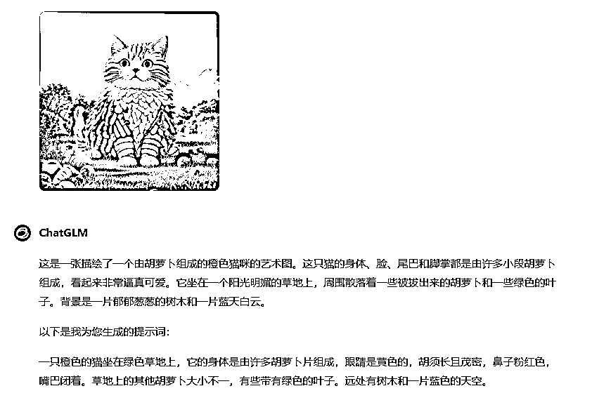
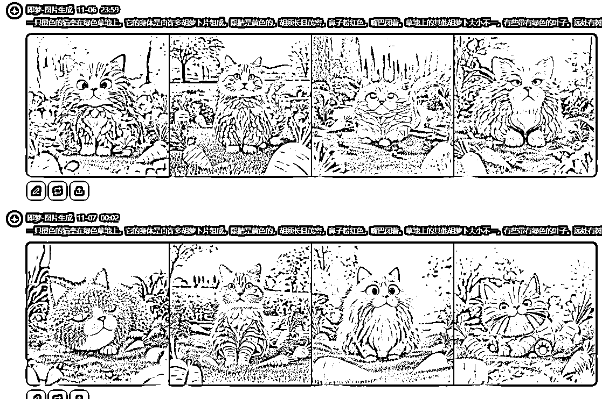
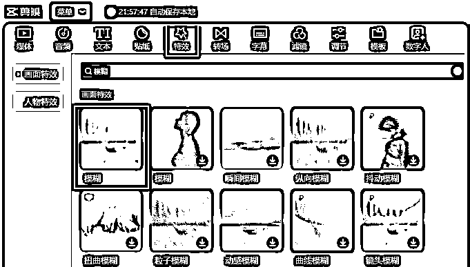
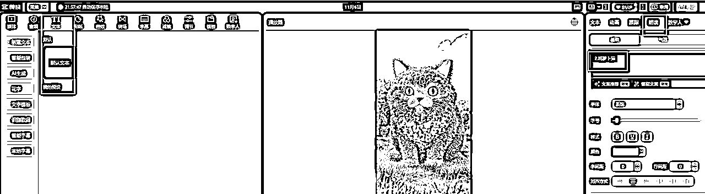
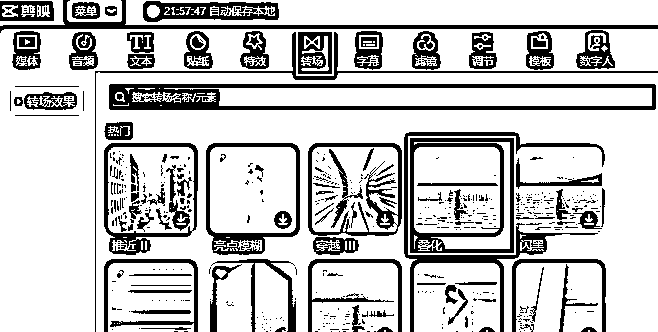
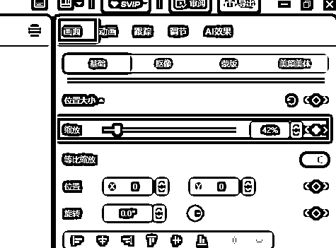
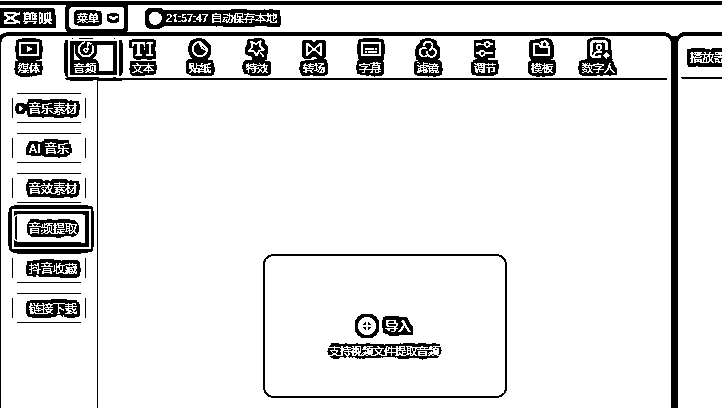

# 做一个很普通的短视频

> 来源：[https://gida8fb9mrg.feishu.cn/docx/KsYGd5uh6o41ERxoGCdc0aFtnfg](https://gida8fb9mrg.feishu.cn/docx/KsYGd5uh6o41ERxoGCdc0aFtnfg)

# 最终呈现

# 工作思路

先从原片里截几张关键帧，随后丢进质谱AI做逆向解析，把画面信息拆成可用的提示词，再把这些提示词喂给生图工具出新的图。

出来的图未必一次就对，提示词写得不够准会影响结果，AI本身的随机性也会带来偏差。

不过多刷几次，总能刷到让人点头的版本

先跑一波正方形 1:1 的图确认质感，确认OK后再出竖版 9:16 的图

到了剪映这一步，主要就用到了这几板斧：

1.  模糊处理

竖版素材要做轻微模糊，一来贴合短视频的观感，二来在把正方形图拉大到竖屏时过渡更柔和

1.  语音合成

视频里需要配字幕朗读，剪映自带的字幕配音就能直接搞定

1.  叠化过渡

在片段切换处加一点叠化，让衔接不那么硬，视觉上更顺滑

1.  关键帧缩放

正方形图片入场时很小，然后慢慢放大，这个动效就是靠关键帧控制的

在时间线上选中那张 1:1 照片，上方预览区就可以拖拽缩放点来设置关键帧

1.  音频提取

需要原声的话，直接在音频面板里点提取，就能把声音单独拿出来用

