# 从医美孵化到TikTok出海：30天4000粉拿下300万的实操复盘

加入赚钱社区时，Liza正处在转型期。她此前做的业务是孵化医美医生KOL，靠医生个人形象做前端引流，再与私立医院后端承接，最终一年营收约3000万。

2023年4月，抖音下线了医生账号的私信功能，获客链路被直接掐断。项目停止后，她用了半年时间调研新方向，最后All in把出海选为未来十年的主赛道。

自我介绍：Liza，去年已连续孵化多账号并完成变现。

成绩单：
A号：运营约一个月，粉丝规模4000左右，完成300万金额签约。
B号：峰值阶段日增粉丝约1万，七天积累至7万粉丝，带来3000万订单。

这篇拆解适合以下人群参考：
- 有制造资源，想借助短视频低成本触达海外买家的工厂；
- 做独立站、亚马逊的卖家，想找更便宜的获客方式；
- 想把国货品牌带出去做传播的国内电商团队；
- 内销疲软、OEM毛利被压缩，想通过电商转型的工厂主。

## 为什么选TikTok

一次出国旅途中，她无聊刷TikTok，感觉内容生态像几年前国内抖音。随后查了数据：TikTok月活用户约15.8亿，美国市场约1.205亿。盘子足够大，且自己在抖音验证过的方法论，有机会平移。

说做就做。出海阻力很大，若国内还有容易的活，大多数人不会去碰这么复杂的市场。但她手里有男装T恤卫衣、童装、发热服、电子类等工厂资源，便围绕这些供应链方向做海外IP孵化，目标人群锁定在国外的采购方。

打法很直接：TikTok上塑形IP把人导到私域，私域里靠销售跟进成交。

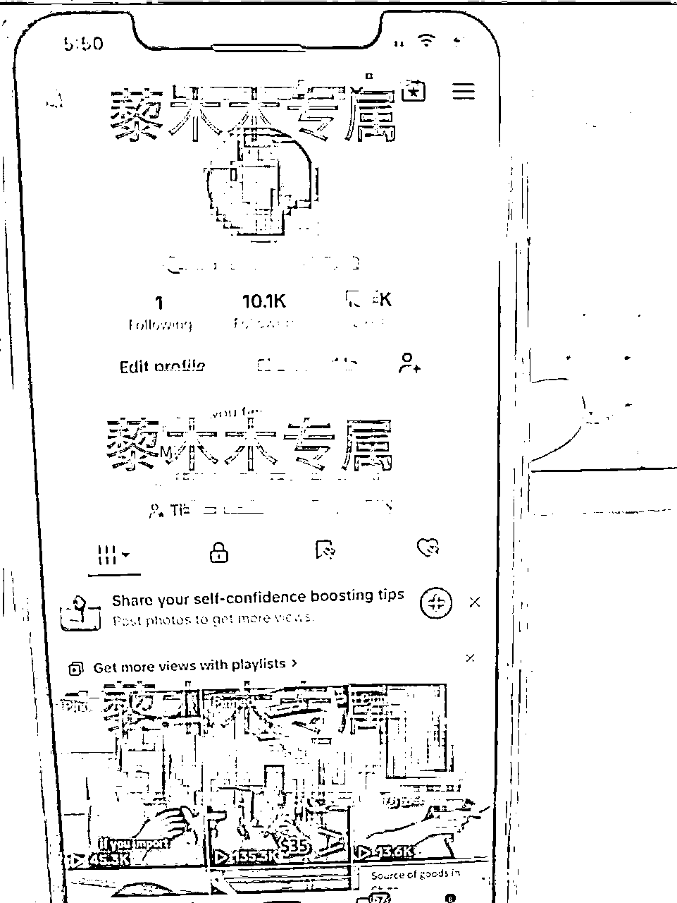

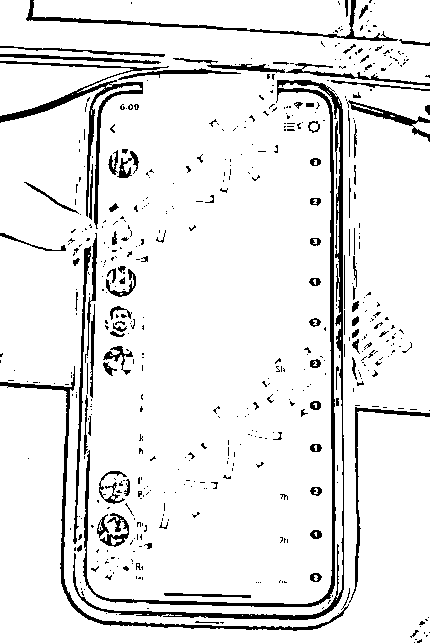

这套逻辑与之前孵化医生IP时的做法本质相同。经验在手，0到1跑通并不困难。

高客单、高毛利的产品适合走IP+私域路线，因为利润能覆盖IP塑造的时间成本以及后端的1对1服务成本。

若是走薄利多销路线，则更适合平台电商模式，借助客服快速承接大量订单。不同品类，策略必须匹配。

沉下心做一个月，粉丝涨到4000，订单已到300万。正反馈来得快，说明当时海外内容市场存在空白，有利于快速进入。

复盘下来，成交核心取决于两件事：
1. 构建让用户信赖的IP
2. 建立让用户信赖的交易过程

## 如何打造可信的IP

想要用户信赖，内容可分为三类配比：
传播向选题占50%
产品向选题占25%
人设向选题占25%

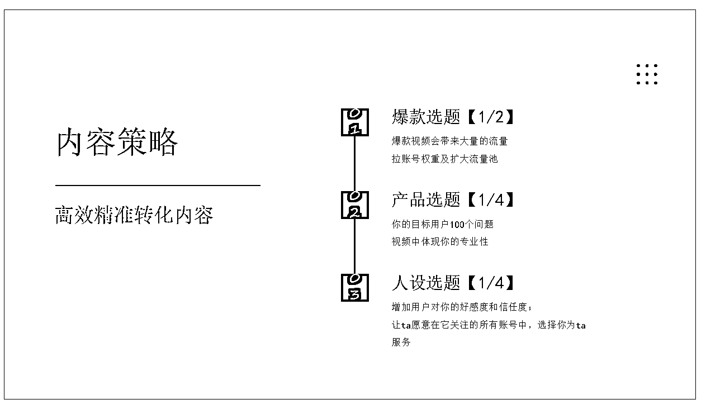

传播向选题的价值在于拉权增流。只有流量规模上来，才能筛选出真正有采购意向的用户。

例如结合“AI”热点词汇与“假如我是黑心商家”这类套路，视频更容易出圈。爆了之后系统会打上更精准的标签，后续作品的播放层级也会抬升，不会一直卡在几百播放。

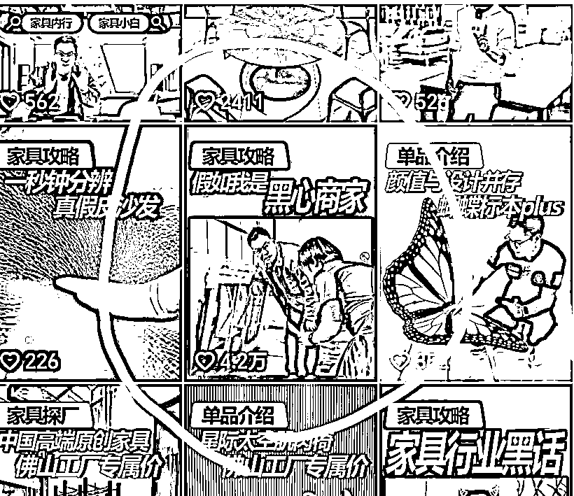

如何找传播向选题，常用三种思路：

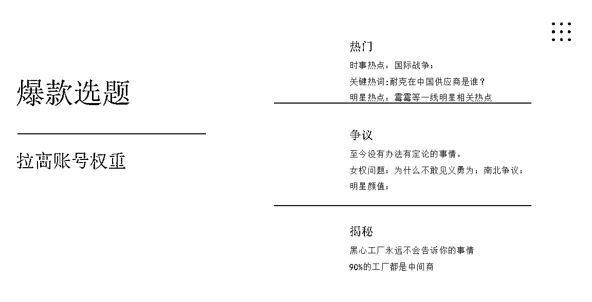

一是蹭热度。时事类热点常见，如地区冲突、美国大选。

二是争议话题。对立尚未有定论的话题容易发酵，如性别议题、宗教信仰、种族问题、明星颜值评分等。

三是揭秘向。内幕类内容对大众有天然吸引力，如“我就是黑心工厂，我不会告诉你的事”“90%的工厂其实是中间商”等角度。

传播向带来的是泛流量，因此需要穿插产品内容把人留下。

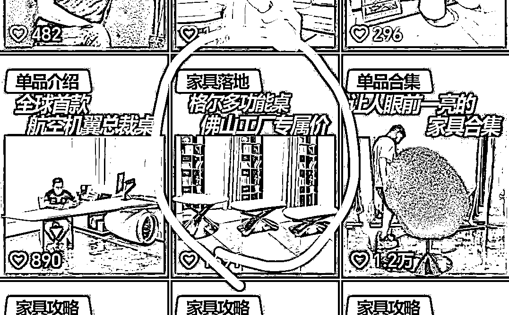

比如“格尔多功能桌”那条，即是典型的产品向选题，用真实使用案例体现差异，帮助粉丝建立心智占位。

产品向选题可从三个角度挖掘：

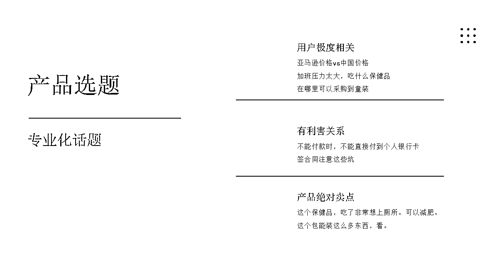

第一，强相关提问。面向B端采购，可以回答“想进童装货源要去哪三个城市”等，解决目标用户最常问的100个问题。

第二，放大损失恐惧。比如“不清楚这三点，在中国进货会亏掉100万”，用负向结果促关注。

第三，强调独特卖点。比如同类保健品的功效差异，或家具能拿到佛山工厂直供价。

产品选题之外，还需要人设选题来呈现真实的人。没有真实感，再好的干货也会被淹没。

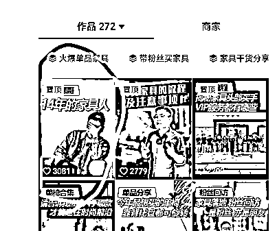

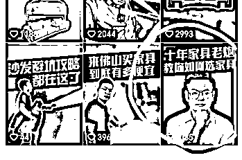

上面两例就是典型的人设内容，体现从业年限，帮助建立专业感。

制作人设选题可参考三种做法：

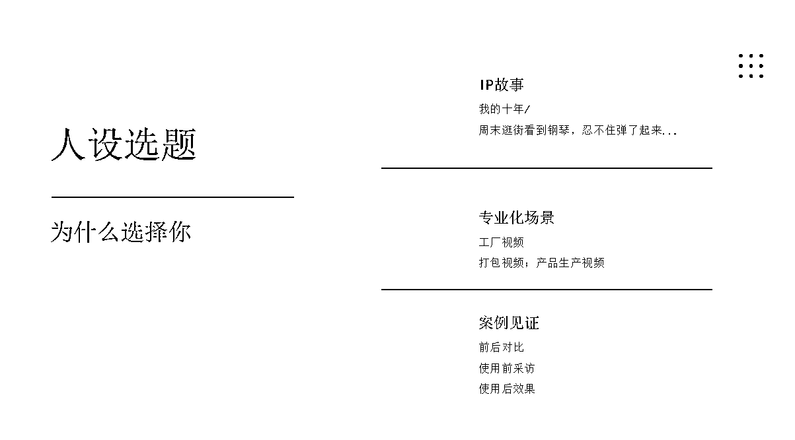

一是IP故事。像“我的十年”“14年家具人”“10年家具老炮”这类叙事。

二是环境代入。做工厂就在车间拍，做医生就在诊室拍，环境即背书。

三是真实案例。手术前后对比、中山粉丝落地案例、真实服务过程记录等，都能增强可信度。

前端IP越稳，后端成交概率越高。成熟IP基本都遵循传播+产品+人设的组合打法。

关于周期与投入：
- 节奏是每周拍一次，流程是选题会→拍摄→剪辑
- 一条IP链路基本就靠这三步闭环
- 若1-3个月无起色，建议换方向或换人
成本取决于是否团队化：
- 1名运营助理+部分运营可hold住一个账号，另计手机网费，成本可控
- 也可配齐编导+摄影+剪辑，月成本约5000-30000
适合的人：镜头表现力好，能用英语开口交流。

## 如何让用户信任并下单

大宗贸易成交=专业度+客户核心诉求匹配。

遇到的客户往往行业经验丰富，价格心里有数，已询盘4-5家供应商。这时打动他的不是话术，而是他真正想要的条件。

300万订单案例中，客户对价格极度敏感，因为他自己也是贸易商，成本压缩即利润增加。

团队给出的耳机报价为市场最低价，能做到是因为手上沉淀了180万库存，愿意以不赚钱的价格清掉后续170万生产。价格优势是对方没有的，最终签约。

签约后推进定金、交期、物流，约一个半月后客户在墨西哥收货，订单闭环。

核心在于对话中摸清客户第一优先级：价格敏感就给价，质量敏感就给质。

常见顾虑点：
- 商品质量是否达标，面料、做工等是否符合预期
- 价格是否在预算内且具备市场竞争力
- 能否在约定时间内交货，错过旺季会造成损失
- 包装是否能保护运输，外观标识是否合规
- 沟通是否顺畅，订单进展能否及时反馈

意向明确后，两天内完成逼单节奏。

## 实战中的坑

1. 供应链难找
能接触到的货源多为二三四手，即便自称工厂，也可能是组装厂，价格未必最优。合作要看靠谱度：交期是否稳定，说几天就几天。
很多工厂不催不动，可安排跟单员盯质量和进度。
2. 切勿线下直接交易
有一次特殊货源，常合作工厂无货，网上找到卖家迅速付款，结果对方无货只为收70%定金，发来的是对板烂货。为保声誉她全额赔付客户。
异地追责难，务必走担保交易，收货后付款。即使供应商不习惯，也要坚持。首次合作宁可慢，不可被骗。

## 出海机会判断

1. B2B制造出海
适合有源头厂或独特供应链的人。品质好、价格有优势，就能服务海外企业或海外开店者，赚的是信息差。 
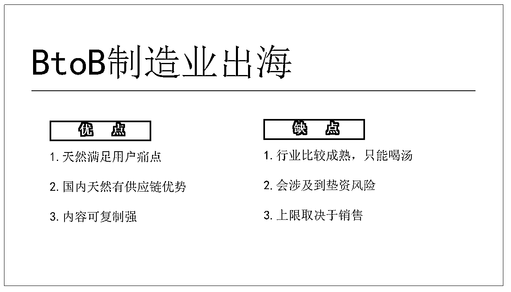
2. 跨境电商出海
Temu、Shein、TikTok、速卖通等平台仍在扩张，市场像16年淘宝。商家少，爆款即现金流。
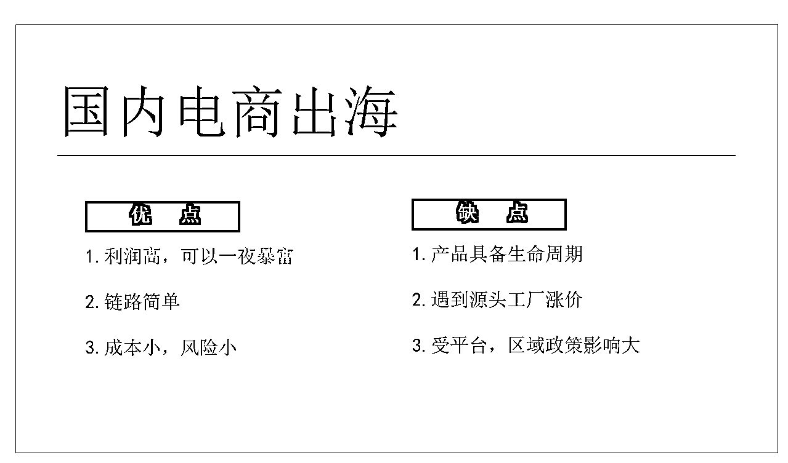
3. 自有品牌出海
国内品牌出海仍是蓝海，更适合年营收过亿的国产品牌蓄力。戴森、娃哈哈、椰树可为参考样本。
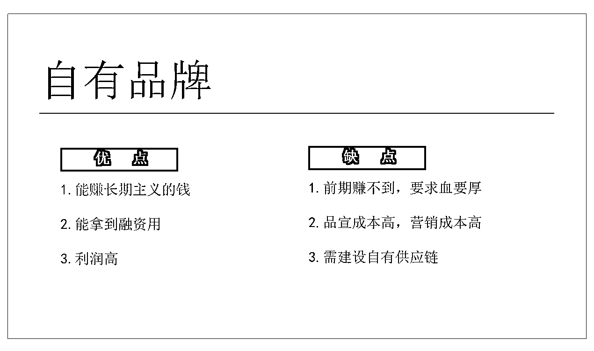
4. 出海服务商
出海生意需要物流、海外注册、店铺搭建、海外仓、TikTok运营等配套服务，信息差带来持续需求。
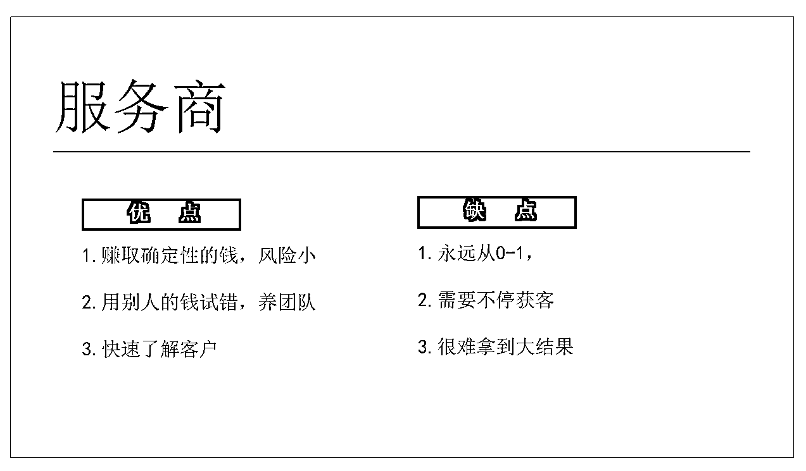

Liza表示愿意与有工厂想转外贸的老板交流，也欢迎做流量或想提升获客能力的人联系。需要资金对接投资机构、需要海外KOL投放，都可沟通。

当前可用的供应链资源包括男装T恤卫衣、童装、发热服饰，以及两家电子产品合作工厂。

总之，出海相关业务的资源、经验、踩坑，都可进一步交流。