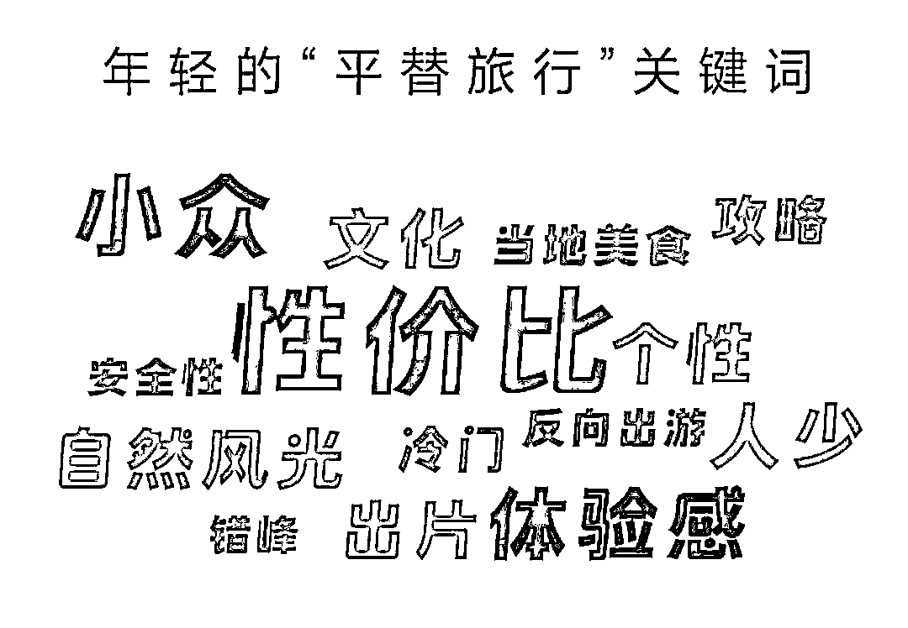
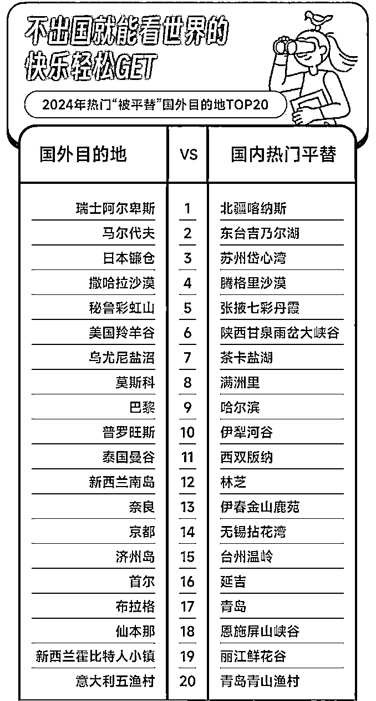
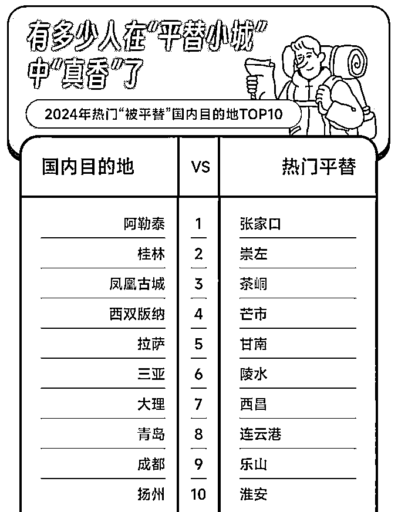
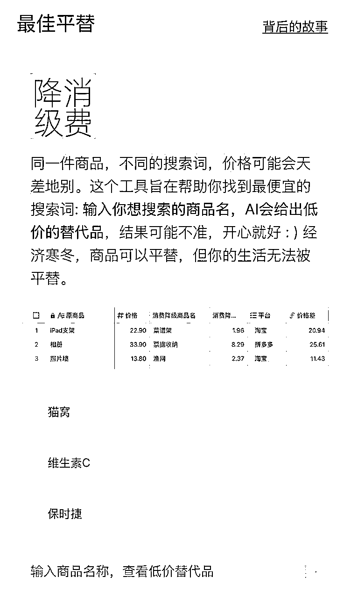

# 平替经济，我们应该关注哪些趋势

最近聊到一个特别有意思的词：平替。可能你会觉得它只是年轻人的抠门话术，但接下来五年、十年，很多机会可能都藏在这两个字里。

平替到底有多热？在小红书上搜一下“平替”，话题浏览量已经冲到6.9亿；豆瓣的“平价替代小组”有22万成员。假如你想买卫衣，组员大概率会指路青岛即墨——那里被称为中国“卫衣天花板”，是数得着的大型卫衣批发市场。

再看几个现象：军大衣频频上热搜；拼多多市值一度超过阿里巴巴；曾被吐槽“爷爷级应用”的1688，下载量一度登上苹果App Store免费榜首。表面看毫无关联，内核却是同一个词：平替。

很多人把平替等同于消费降级，我觉得只说对了一半。经济不确定性变多、就业压力不小，年轻人选择更实惠的消费，完全可以理解。但真正的平替，不是“便宜就行、凑合也行”，而是功能不能缩水，只是拒绝为品牌溢价买单。在同类东西里挑个性价比最高的，而不是为了一个Logo多付冤枉钱。

这种变化其实早有规律。日本社会学家三浦展把过去一百多年的消费趋势分成四代：第一代觉得进口的才是好的；第二代觉得大件才是好的；第三代追求个性、炫耀、差异化；到了第四代，大牌白牌无所谓，性价比才是王道。无印良品、优衣库这些“平价替代”，就是在第四消费时代成长起来的。

为什么会有这样的演进？在前三个时代，大家习惯用商品外部的标签来定义自己，买得越贵、越有名，好像人就越有价值，消费主义贩卖的正是这个东西。而到了第四时代，人和物的关系被摆正了：人本身才重要，商品的价值是人在使用中赋予的。今天的中国，正越来越像这个阶段。很多年轻人经历了“买买买”之后，开始放下消费主义的喧嚣，回到真实需求。夸克平台年度搜索关键词里有“平替”，社交平台上各种“平替攻略”长期霸榜，都是信号。

顺着这个逻辑，咱们分行业看看平替正在怎么改写市场。

知识付费是最典型的例子。早些年，大家追大佬、追课程、追平台会员，买的时候很冲动；现在很多人已经麻木了，能不买就不买。以前年入几十万的人，掏一两万买课不眨眼；如今收入预期变了，大家开始问自己：买了会看吗？真有帮助吗？加上短视频把大量免费优质内容送到眼前，谁还愿意为高溢价课程买单？

平替在知识付费里的表现非常具体：学职业技能，高价网课正在被年轻人换成B站免费教程和开源社区；学语言，付费App被短视频和AI工具分流；知识订阅、付费社群，也被公众号、视频号这些免费渠道替代。背后的原因有两个。第一，内容生产门槛降低了，工具普及、AI变强、好内容到处都能传开；第二，学习场景变了，时间碎片化，耐心越来越少，大家获取知识的方式早就被自媒体重塑了。

传统知识付费平台要稳住阵脚，得重新定义产品价值、做好内容、调定价、改服务。新入局的创作者呢，别总想着服务所有人，不如盯准一个小细分领域，做深度、收高价，哪怕客户不多，也好过硬拼流量。当然市场也有副作用：流量至上的结果可能是内容娱乐化、深度内容稀缺，用户学不到完整体系，后续服务跟不上。短期看，平替趋势还会加剧，传统付费模式可能收缩，免费+增值的玩法会兴起；长期看，专业化、精品化的服务商会活下来。想在这个赛道做下去，要么抓住某一类人的痛点，比如脱单、求职、恋爱辅导、技能提升，做精准高价值服务；要么做陪伴型知识社群，天天分享干货心得，低价走量，但很考验流量能力；要么就多开几个产品线，用数量补质量。这只是我的一点想法，不一定对。

再来看带货。直播带货这几年变化翻天覆地。过去大家迷信头部主播，只顾冲进直播间下单；现在更多人开始算账：主播真把价格打下来了吗？有人一句话说得很准：你以为花十块买到了十二块的东西，实际上它就值八块。大家也越来越认同另一句：贵可以，但不能被当冤大头。

大主播接连出问题，更加速了这种觉醒。有人靠高销量截图让粉丝误以为自己占了便宜，实际上买贵了；也有一对广州夫妇被辛巴点名，一台学习机能赚上千。短视频本来是为了建立信任、促成下单，但现在很多人已经养成习惯：在抖音看，去拼多多搜。购物决策越来越冷静，盲目跟风的人少了，大家都开始按自己的标准挑东西。直播间里的货，也从品牌型号越来越多地变成平替款。

原因不复杂：赚钱变难，钱包变紧。带货的人想长期干，不能只玩套路。扎实的专业内容是基础，真实测评才能积累信任；要找准自己的用户，用社群把关系养起来，售后得跟上，还要避免陷入恶性价格战。说到底，价格战没有尽头，产品力才是护城河，专业性和信任比流量更值钱。未来主播会变成某种意义上的“品类运营者”，靠提供真正有价值的服务走远路。另外说句题外话，电商本来就是吃力不讨好的生意，私域电商和跨境电商倒可能更有机会。我不做这行，就是随便聊聊，别当真。

然后是线下实体。看看现在，做电商的其实也很难：一边被主播分走利润，一边被平替挤压空间，忙到最后投入产出比几乎回到1:1；大主播暴雷又让消费者对平台的信任不断下降。内容电商其实正在透支大家对“电商”的好感。接下来的十年，线下实体零售和服务有可能从“被电商平替”变成“平替电商”，迎来转机。

消费习惯已经在变了。以前大家逛大商场、认品牌店，现在更愿意去社区商业和精品小店；移动支付和配送太方便，高端商圈不再有往日的吸引力，高租金高人力反而可能让它亏钱。具体来说：从高端商圈到社区商业，从品牌连锁到个性小店，从大型综合体到便利店，从单一买东西到多元生活体验。

各业态也在悄悄洗牌。餐饮方面，高端餐厅被特色主题餐厅抢生意，快餐连锁被创新品牌挑战，高档火锅也打不过平价火锅，大家现在更在意饭好不好吃，而不是装修酷不酷。零售方面，24小时连锁便利店被社区智慧门店替代，大型超市让位社区生鲜店，老百货商场在向体验式购物中心转型。休闲娱乐方面，传统KTV变成了迷你包厢，大电影院被私人影院分流，高端健身房也被24小时智能健身房取代。一句话：场景在变小，智能化在变强。

为什么会这样？租金和人工成本一直在涨，老模式扛不住；移动支付、智能设备、数字化管理、新零售技术又给了新打法；消费者的要求也变了，要便利、要性价比、要个性、要品质。实体店怎么转型？空间上优化选址、做特色场景、搞多功能复合；服务上做会员体系、体验式营销、社群运营；数字化上抓线上线下融合、会员管理、库存优化、精准推荐；成本上控制租金、提高人效、引入智能体系。反正，未来位置不再决定生死，服务体验才是核心，数字化是支撑，成本控制是活下去的基础。实体店得从一个“卖货的”转型成“生活服务提供者”，靠场景和服务创造属于自己的价值。

还有一个容易被忽略的领域：情绪价值。平替不只发生在商品功能上，也发生在人的情感满足上。过去大家靠买奢侈品获得快乐，现在很多人开始找更丰富、更便宜的替代品。比如，奢侈品晒图变成了生活方式分享，高消费打卡变成了小众兴趣探索；大牌包包不一定有吸引力，手作包袋反而更走心。娱乐上，高端会所让位给兴趣工作室，豪华旅行变成深度文化体验，奢侈品购物被DIY手工创作替代。生活方式上，名牌咖啡改成手冲咖啡，餐厅打卡变成在家做饭分享，买艺术品不如自己动手创作，养名贵宠物不如参与流浪动物救助。

这种变化背后是多重力量。社会层面，价值观更多元，生活压力大，社交媒体改变了认知，个人成长意识在觉醒；经济层面，大家更理性，消费能力和期望在找平衡，新经济形态和共享经济也在提供更多选择；心理层面，自我认知提升，情感需求更深入，社交认同方式变了，幸福感的来源不再单一。

所以，情绪价值的重估很重要。对个人来说，要弄清楚自己到底需要什么，培养能持久投入的兴趣，建立健康的社交圈，学会自己给自己提供情绪价值。消费时多关注体验，少关注占有；追求成长，而不是炫耀；重视过程，而不是结果；分享互助，而不是独占。长远看，情绪价值的来源会越来越多元，个人成长和真诚连接会是更持久的幸福源泉。我们每个人都可以不只是消费者，而是创造者，靠持续学习和分享，让情绪价值形成正循环。

最后，我们把视线转向日本。很多人问：我们的今天是日本的昨天吗？野村证券有一份报告，专门研究日本经济下滑三十年里，哪些赛道反而成为黄金赛道，这对现在的中国很有参考意义。

报告显示，1992年日本家庭支出见顶后，必需消费品仍有小幅增长，可选消费比较疲软，食品里的细分品类大多还在涨。和1992年相比，2021年人均消费额增幅最大的是乳制品、预制菜、饮料，尤其酸奶、奶酪、速冻食品、茶/咖啡/可可。可选消费里，渗透率还有提升空间的小家电、个护、化妆品，以及性价比高的低端家具、服饰、餐饮、短途旅行、住宿特化型酒店，还有户外、健身、游戏、动漫等休闲玩乐，都跑得不错。

报告把逆势增长的主线拆成几条。必需消费品方面：一是社会结构变化，女性就业率上升、家庭规模变小、老龄化加速；二是消费人群换代，“团块次代”一入社会就赶上就业冰河期，消费观很谨慎，带动了消费降级；三是产品创新破局，长期降级让人渴望“小奢侈”和非日常体验，成本上升又逼着企业靠提高附加值来消化涨价。可选消费方面：一是大家从物质满足转向精神满足；二是美容卫生和健康意识变强，因为劳动人口在1995年触顶后，老龄化问题凸显；三是产业结构升级容易孕育行业龙头，家电、家具、服装的产业链调整推动消费降级，也成就了强者。落到实践上，逆势品类可以归为两类：一类是吃到社会结构红利的产品，另一类是靠创新造出新需求的产品。连酒类都很有代表性：高端清酒、2003到2009年的芋烧酎、高低端啤酒、RTD，以及2008年之后的威士忌，都曾在各自阶段相对抗跌甚至爆发。

所以说，平替背后不只是“穷”，而是消费逻辑的一次深层进化。不管做产品还是做内容，能看懂这个变化的人，就更能在未来五年、十年接到属于自己的机会。

这两年的消费风向，悄悄拐了一个大弯。“不是买不起，而是找更值的”，成了大伙儿心照不宣的购物哲学。经济增速放缓，钱包厚度缩水，可日子还得体面地过。于是“平替”这套玩法，从省钱小技巧升级成了全民生活指南。

先聊吃。如今餐桌上的成品菜包、即烹半成品越来越多，这不是巧合。上班族的时间被通勤和加班切割得七零八落，下班回家只想尽快吃上一口热乎的。省时省力的即烹半成品，正好接住了这份需求——它谈不上惊艳，但够快、够稳、够省心。

再看穿。大牌Logo的光环正在褪色，大家更倾向于那个以基础款闻名的日本快时尚品牌所代表的路线：剪裁利落、面料舒适、价格实在。没有显眼的标识也没关系，穿着舒服比什么都重要。这股“反品牌崇拜”的潮流，甚至把这个品牌的创始人推上了日本富豪榜榜首。

恋爱这件事，也存在平替版本。亲密关系的内核在于情感连接与相互陪伴，可现代人的精力十分有限，实在难以维持高投入的恋爱。于是宠物成了情感投射的对象：给毛孩子置办衣服、零嘴、小窝，像对待伴侣一样用心。顺着这个逻辑往下推，两性玩具这类产品，也成了陪伴层面的一种替代方案。

线下零售的变化同样明显。传统大卖场逐渐被社区菜店分流，街角那些主打24小时营业的连锁小店，也在面对智能零售终端的挑战。想去逛商场的人，则多数涌向了集餐饮、展览、休闲于一体的体验式空间。零售形态不断迭代，底层逻辑始终如一：离家近、花钱少、体验好。

旅行度假的模式也在被重新定义。过去动辄十天半个月的长途行程，如今让位给了周末短途游、周边一日游，主打一个来去轻松、花费可控。出国游的热度同样在减退，大家开始把注意力转向国内那些还没被过度开发的角落。

像网友们发掘出来的那些小众目的地——去崇左看山水，常被拿来跟桂林作比较；到茶峒走一走，仿佛置身《边城》的意境；在甘南看草原与寺庙，不必担心高原反应。这些“小城平替”凭借特色美食、质朴风光和友好物价，逐渐成为出行清单上的热门选项。

当然，也有一部分所谓的“小城平替”经不起推敲，只能作为参考。

接下来聊个实际问题：去哪儿发掘平替？

刷短视频的时候，常能碰到这类博主：专门研究“换个搜法，立省一半”的诀窍。同一种商品，换一个前缀或后缀，价格立刻不同。美妆、辅食、零食等领域，都有人专注平替赛道做内容，流量相当可观。此外，也有像pingti.app这样的工具站，把各类平替入口汇总在一起，方便按图索骥。

可以说，每一条搜索技巧的背后，都是普通人在生活缝隙里攒下的省钱智慧。

总结一下，平替大致有四种玩法。

第一种是标签价差。同样是防滑运动垫，按“男士防滑垫”去搜，往往比默认结果便宜；防晒伞按“男款雨伞”去搜，价格也会往下走。背后的逻辑很直白：男生更在意实用属性，为外观设计掏额外溢价的人比较少。

第二种是场景价差。马甲搜“老人马甲”，女包搜“尾货女包”，地毯搜“办公地毯”，书桌搜“培训用桌”，椅子搜“婚宴专用椅”——场景换了，价格体系就换了。办公、教学、婚庆这些用途下，卖家默认买家不挑颜值，而颜值往往正是成本里最虚高的部分。

第三种是产地价差。袜子锁定诸暨产地的货，耳饰瞄准义乌饰品。产地直连，少了中间商赚差价，报价自然漂亮。

第四种是跨品类代偿，也是最妙的一种。看上去风马牛不相及的两样物品，功能层面却能相互顶班：想做相片展示墙，买张渔网来凑；相框可以用证件展示框顶上；面膜囤货交给食品密封盒；平板支架换成厨房里的食谱展示架；美甲用的光疗灯，找验钞用的紫光灯替补；给积木遮灰的罩子，直接拿超市货架上的展示盒代替——脑洞大开，还真能省下不少。

那平替到底意味着什么？有人把它看成是消费水准的退步，其实并不准确。平替不等于回到粗制滥造的时代，前提是功能不打折、品质不掉线，只是在品牌溢价上做减法。所以，平替之所以成立，在于“替”字——拿更划算的选择，去替换不划算的选择。说到底，划算才是买家最终的追求。

这届网友找平替，不满意的是注水的品牌溢价，但并没有放弃对品质和体验的要求。他们试图把消费的主动权握回自己手里，不再让品牌替自己做决定。在不让日子失去快乐与品质的同时，用理性、自洽的方式花钱——这正是平替得以成立的内在逻辑。

平替这个话题，还有太多值得展开的角落，也还有大量未知有待探索。但可以肯定的是，你对平替的理解每加深一层，对中国消费市场的走向就会多一分敏锐。这一点，毫不夸张。