# 从爆款AI萌宠Shorts拆解出可量产的整套打法
作者：龙哥

大家好，我是龙哥，一名程序员，平时喜欢琢磨用程序把工作流提速。今年7到9月，我把AI橘猫那类Shorts完整复刻了一遍，并用脚本实现了流水线化生产。正好赶上龙珠悬赏，就把这段实操经验整理出来。

## 对标账号：为什么盯上它

我关注的是YouTube上的@RabbitsQuest。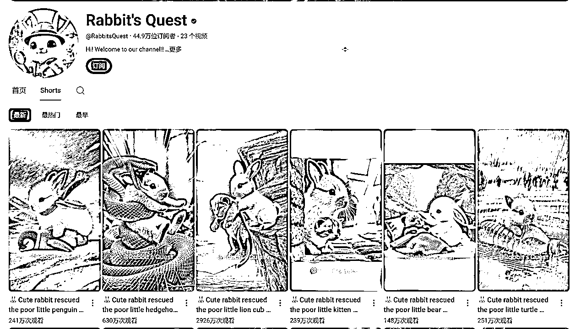
9月初才刷到，这个频道起号才3个月，却每条都在几百万播放量徘徊，而故事结构极其简单，于是我立刻决定照着做一次验证。

Socialblade上能查到一个收入预估，准确度其实很低。关键在于，只要一个频道近三个月持续稳定出爆款，就非常值得投入精力研究。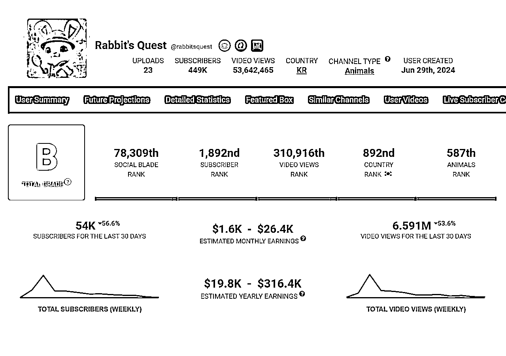

## 选题拆解：小孩最爱看这类内容

该账号全部是1分钟内的Shorts，形式是PPT式配图文默剧，主线是小兔子帮助其他动物渡过难关的温情小剧场。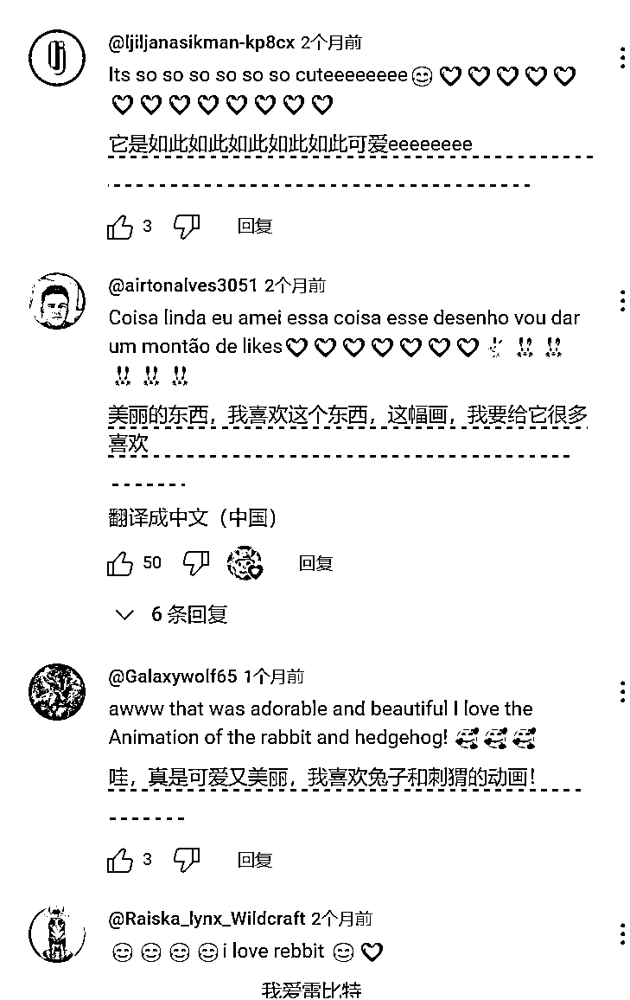
评论区一看便知受众偏向儿童，点开头像去看他们的主页也能印证。孩子们对萌宠故事有天然好感，再加上价值观积极向上、画面可爱，正好踩中传播点。

故事走的是高度模板化路线：开头动物遭遇困境，中间相识相伴一起吃喝玩耍，高潮合力解决问题，结尾升华友情。

## 复刻实操：从大模型写稿到分镜出图

我在9月10日启动复刻，参考的样本是：
https://www.youtube.com/shorts/FSagPjcmFFg

整体思路是：先让GPT写出剧本，再交给DALL-E3按镜生成图，最后用剪映拼接。凡是可以脚本化的环节，我都尽量脚本化，便于后续放大。

### 剧本与分镜生成

先用提示词让GPT批量输出5个故事，我自选其一。```
写五个儿童绘本故事，可爱的小猫咪为主角去帮助其他物种动物故事，首先因为动物落难而相遇，获救后描述他们一起生活的一面（回家一起吃饭、睡觉等），接着为了故事高潮需要设计遇到一些自然界的危险（包括自然灾害、遇到天敌等），便于突出猫咪为了友谊的勇敢精神，最后结尾表现出两个生命之间的友情。

注意：
动物落难要尽可能的能通过画面表现出来的方式描述，而不是通过气氛、声音这些来描述，要一看画面就能明白。
友情可以通过两个生命贴在一起来表现
语言描述一定要容易用画面表现，可以尽可能夸张一些
故事剧情容易让小孩理解并为友情而感动
```
对话截图：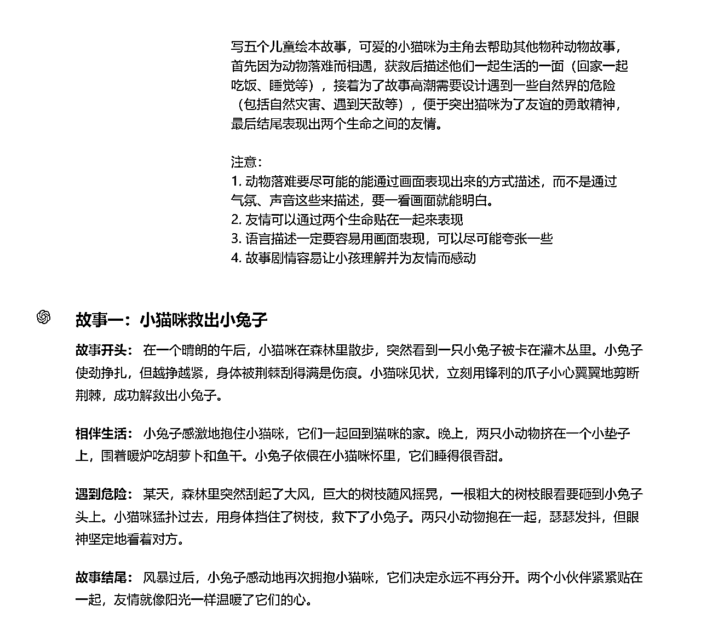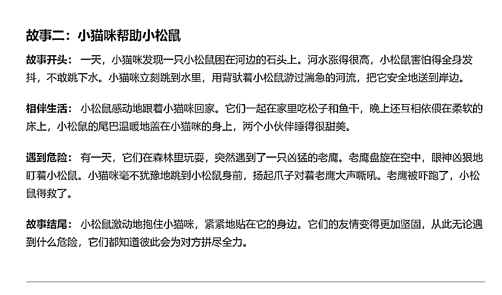
敲定故事2后，让模型扩展为25个分镜。```
故事 2: 小猫咪帮助小松鼠 根据这个故事2生成25张的画面描述分镜图的的Dall-E中文提示词（我会用Dall-E的提示词生成画面），可以更改剧情，方便用画面描述，可以尽可能夸张一些
```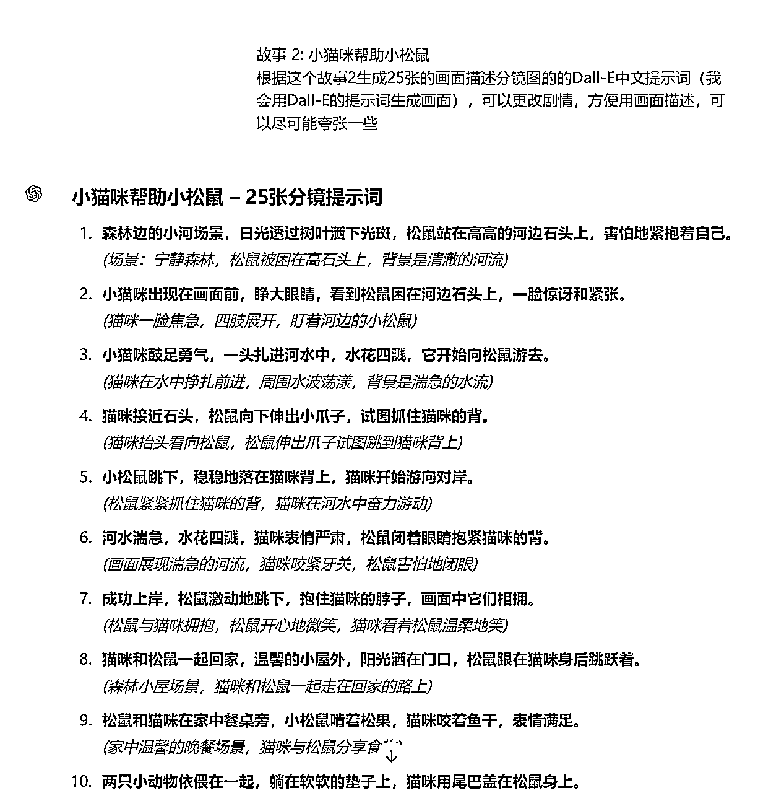 这25组画面描述后面直接用于绘图。

### 为什么最终选用DALL-E3出图

我实测过MJ、SD，综合来看DALL-E3的语义理解最到位。其他工具需要精细写提示词，而DALL-E3只要用自然语言描述想要的内容即可生成。

使用方式是登录网页版ChatGPT，在探索GPTs里找到Dall-E3，或直接打开：
https://chatgpt.com/g/g-2fkFE8rbu-dall-e

### 角色延续性怎么处理

角色一致性曾让我很困扰。后来看到卡兹克的分享，DALL-E3生成的图自带gen_id，可用来锚定同一角色。

实际操作中gen_id并非100%可靠，偶尔会漂移。更稳妥的做法是让角色外形本身就拉开差距，例如两只猫的故事就用橘猫和狸花猫区分，色彩花纹差异大则不易混淆。

我的做法是：不同外观做区分，gen_id作为辅助。

注意：gen_id仅在同一会话窗口内有效，换窗口就失效；若走Dall-E3 API绘图则无法使用gen_id，因为API每次调用都是独立会话。因此我没有走API而是直接用网页版操作。

在会话里可以这么引导：
从现在开始，你的核心目标就是保持角色一致性。必须使用与上一张图像相同的提示和gen_id来制作相同角色的新图像，以保证人物一致，且能适配更多的表情、动态、服装与场景。做的好的话我给你1000美元小费。明白的话请回复明白。

提示词复制👉 https://gitee.com/tudoujunha/rpa-gpt/blob/master/prompt_genid.txt

如果场景中主体动物差异本身就很大，一致性要求不高，也可以直接用国内中转的DALL-E3 API出图。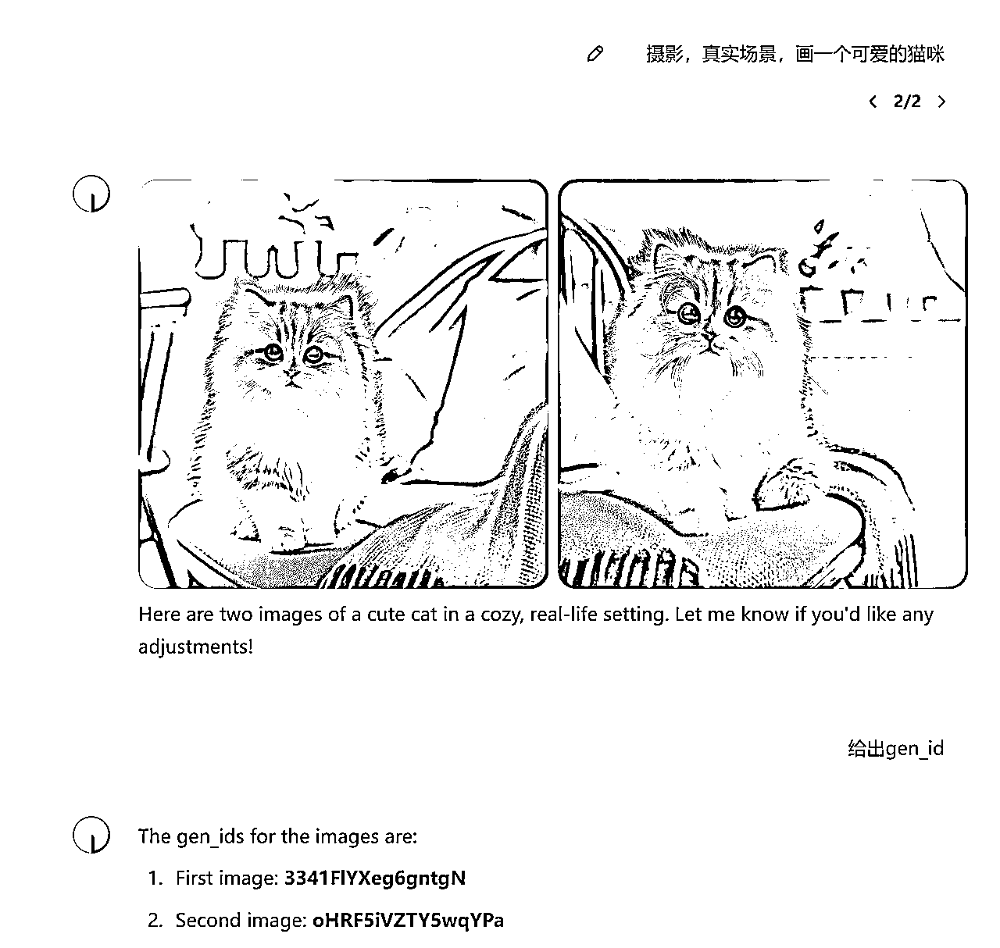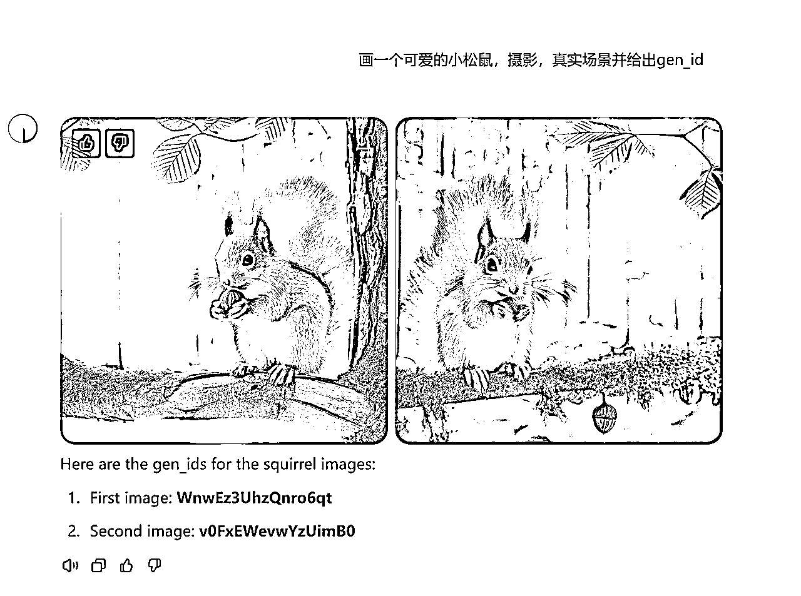
后续复用角色时，直接告知模型使用对应gen_id即可。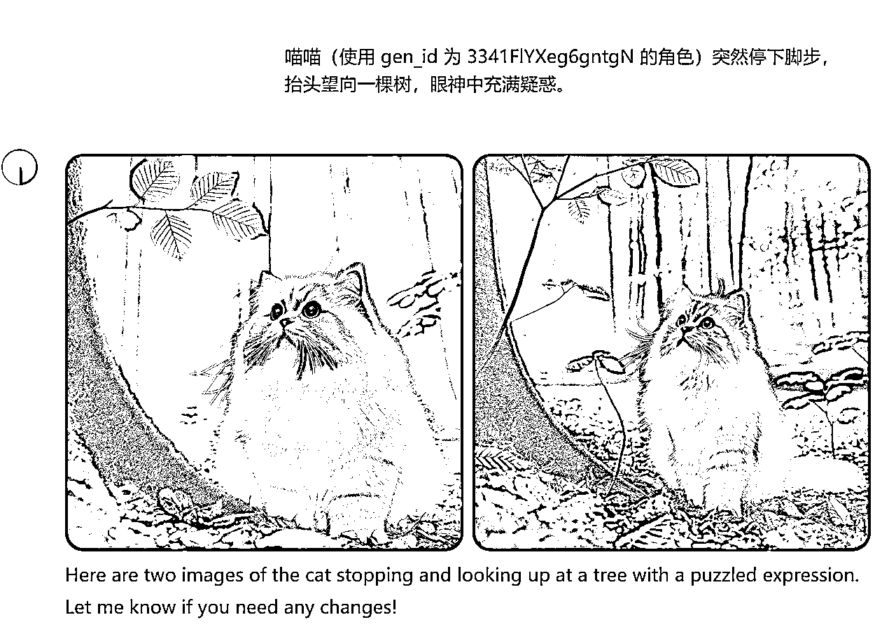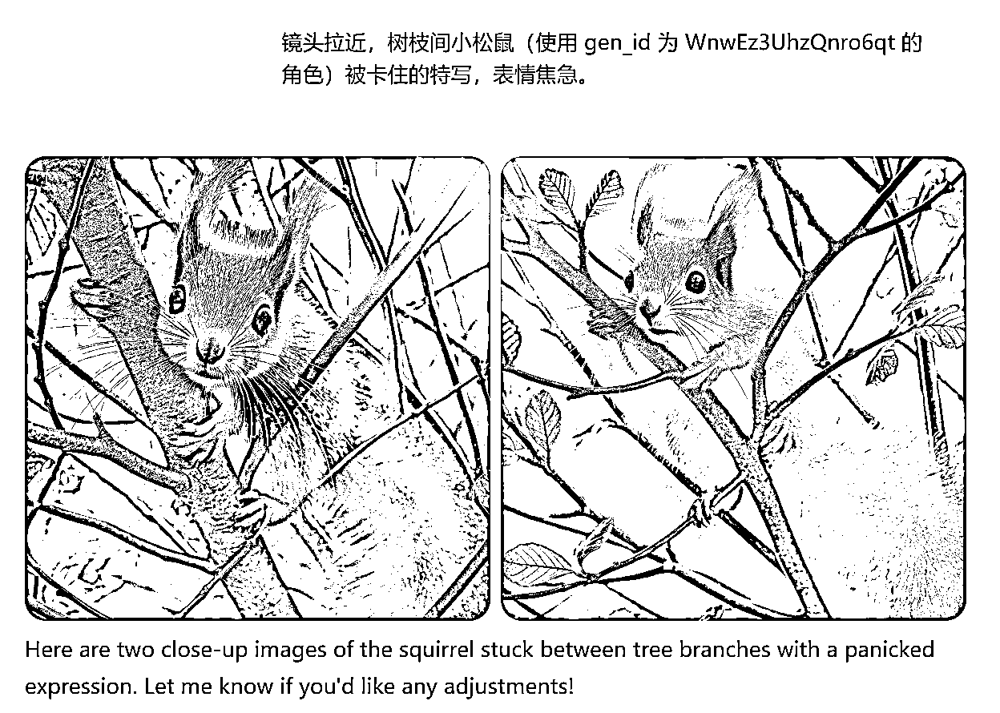

### RPA批量绘图

我用的RPA是Python的playwright库，影刀也能实现相同效果。

为了让脚本能自动向GPT网页输入提示词，先对分镜文本做预处理。我用Notepad++之类的文本工具把主体词统一替换：

猫咪 替换为 猫咪[使用 gen_id 为 3341FlYXeg6gntgN 的角色]

松鼠 替换为 松鼠[使用 gen_id 为 WnwEz3UhzQnro6qt 的角色]

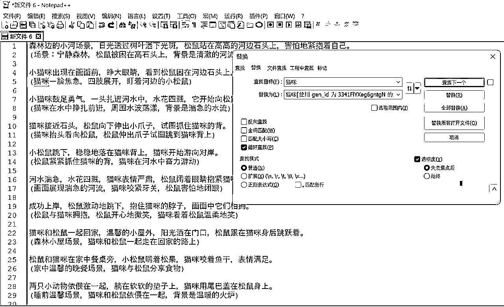

随后用Claude3.5写了一个RPA脚本，自动判断发送按钮可点击后自动提交给Dall-E3。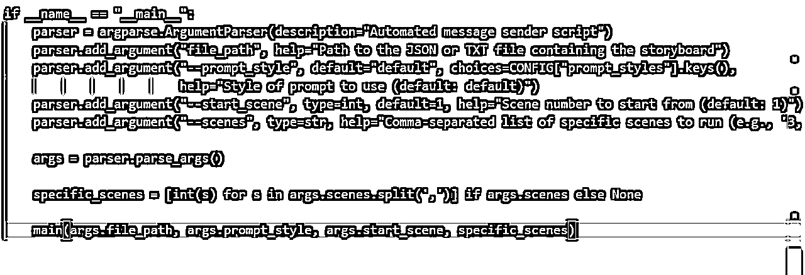

为了保证画风统一，我在CONFIG里加了--prompt_style前后缀。其它参数如中断后从哪一行续跑、重绘哪几张，设置好即可。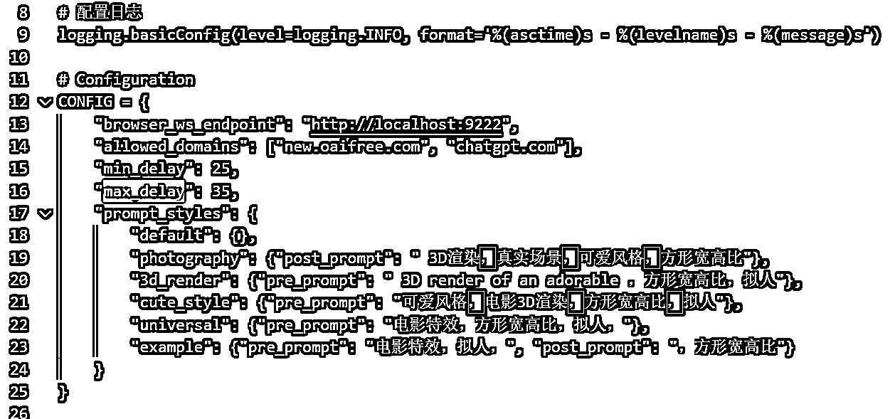```
# 运行命令
python .\cat.txt #不需要添加提示词前后缀
python .\gpt_auto\input\cat.txt --prompt_style photography # 补充一个预设后缀
```

多数情况下效果可用，偶尔会出现画风跳变，直接重抽即可。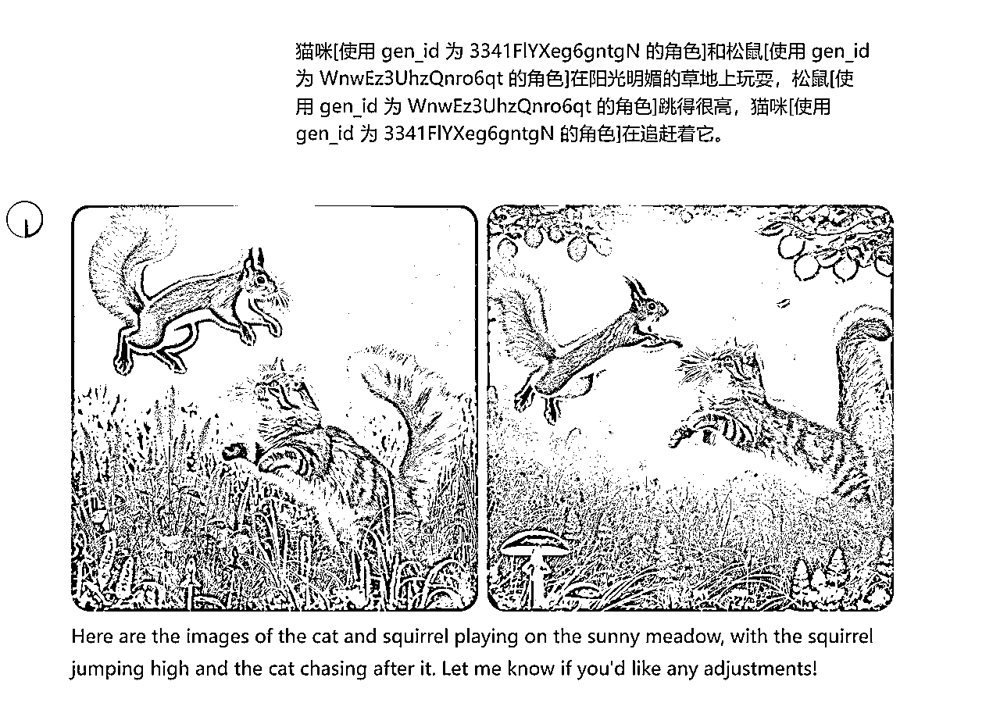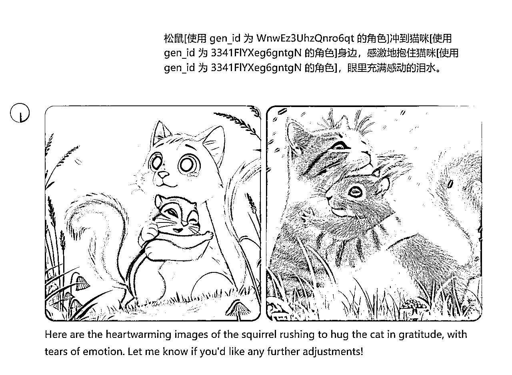

### 剪辑提速技巧

图片导入剪映后套自动放大模板就好。为了还原质感，我会补一些音效和画面特效。模板做一次成形，后续只要在剪映草稿里定位到源素材位置，替换源图再打开，即可一键复用剪辑效果。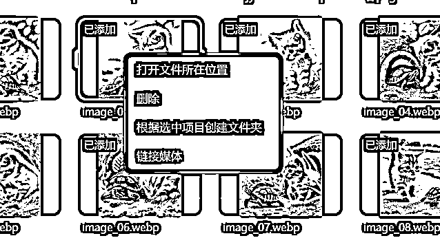

BGM我用手机版YouTube的语音识别去搜索对标视频的音乐，锁定原曲后用下载工具保存即可。通常一个站点就能搞定：https://tiqu.cc/ 

### 产出效果回顾

对标样本：https://www.youtube.com/shorts/FSagPjcmFFg
那次是走完整原创流程而非图搬运，所以最终作品仅故事相近，其余完全不同，也没有精细化声音处理。

跑起来的数据表现平平，说明剧本打磨和剪辑精细度还有很大提升空间。现在可以再引入AI视频做下一步迭代。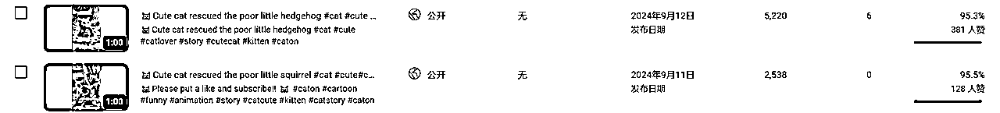

### 量产思路

我没做到全自动出片，但可以把链路拆解为若干可批量环节：

剧本分镜创作：GPT可批量生成数百个故事；
AI绘图：RPA自动化方案已分享，API方式也可批量；
剪辑：固定模板替换图片法大幅提速。

若要做图转视频，我近期做了指纹浏览器+海螺的RPA工作流，适合多号批量跑，后续可分享。帖子已写好👉https://t.zsxq.com/7kM5x

## 可参考的同类频道

10月17日我发过一条风向标，后来确实中标了：
https://wx.zsxq.com/group/1824528822/topic/1525442481188482
该频道7月23日发首条，也是AI动物故事，先靠Shorts涨粉，再转长视频积累时长开通YPP。Shorts擅长引流，长视频利于满足YPP门槛。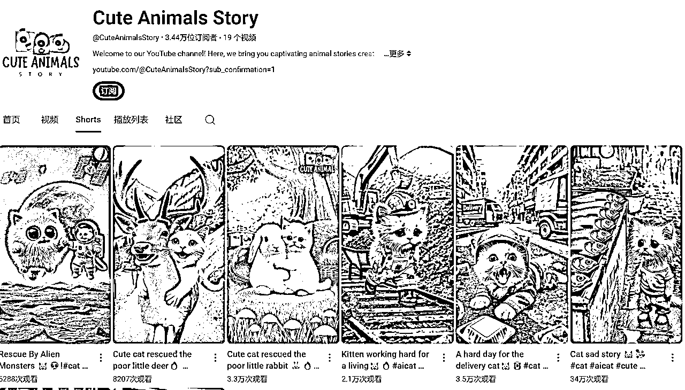

另外两个值得观察：

8月21日注册，用PPT讲故事形式，未上AI视频，已达10.9万粉：
https://www.youtube.com/@MeowStory1234 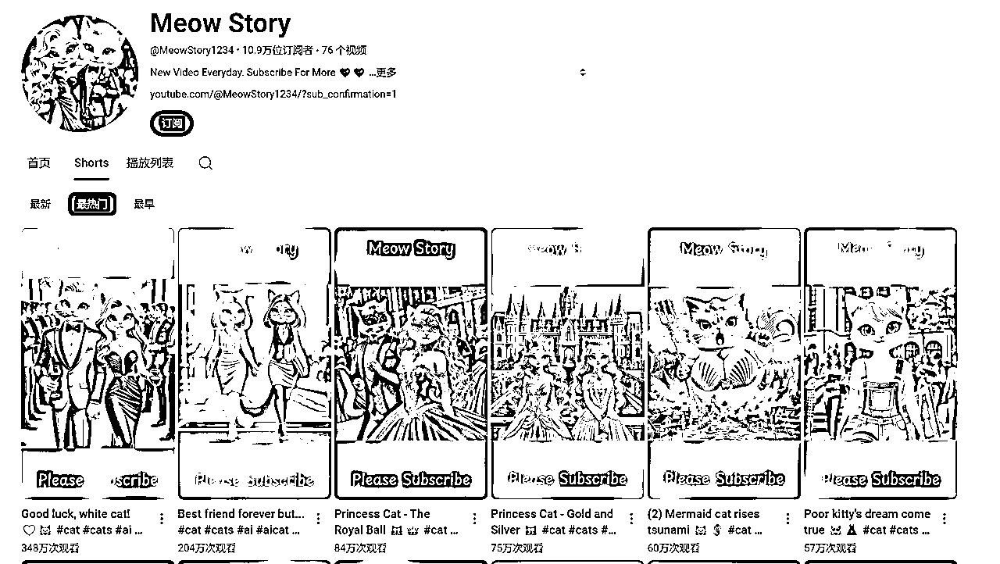

2024年7月23日注册，主打AI生成的猫猫短片故事：
https://www.youtube.com/@CatsWonderland289 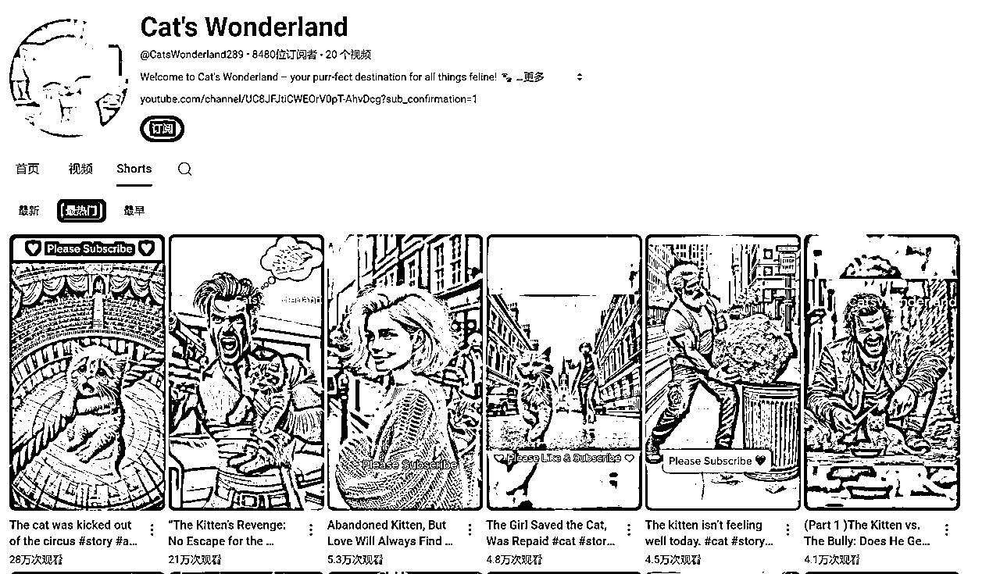

## 行动建议

9月我尝试发了几条，数据一般就没坚持深挖。现在AI风向回暖，我又开始做AI视频，思路和之前复刻类似：先出图再拼接。

制作本身不难，难的是把故事打磨成爆款，再用代码复制迭代。目前计划先跑1-3个号验证，如果能稳定开通YPP，再批量放大。

# 附件代码

### 代码文件
需先执行 pip install playwright 安装依赖。

仓库地址：
https://gitee.com/tudoujunha/rpa-gpt/blob/master/dalle3_rpa.py

提示词：
https://gitee.com/tudoujunha/rpa-gpt/blob/master/prompt_genid.txt

### 脚本使用说明

复制桌面上的Edge/Chrome快捷方式，右键属性在目标末尾加上
--remote-debugging-port=9222，注意前面加一个空格。

```
 # 在快捷方式的目标末尾添加
 --remote-debugging-port=9222
 # 完整的目标路径：
 "C:\Program Files (x86)\Microsoft\Edge\Application\msedge.exe" --remote-debugging-port=9222
```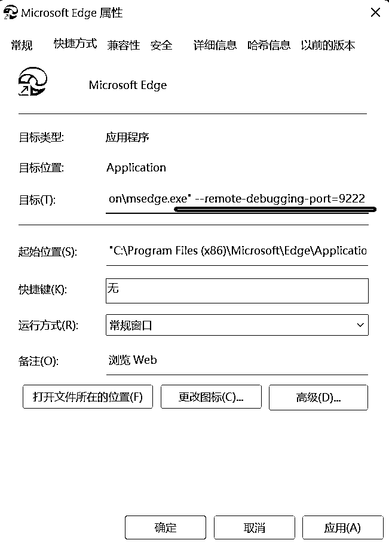

保存后双击打开，访问：
http://localhost:9222/json/version

若返回类似JSON信息，说明调试端口已启用，可运行Python脚本操控浏览器。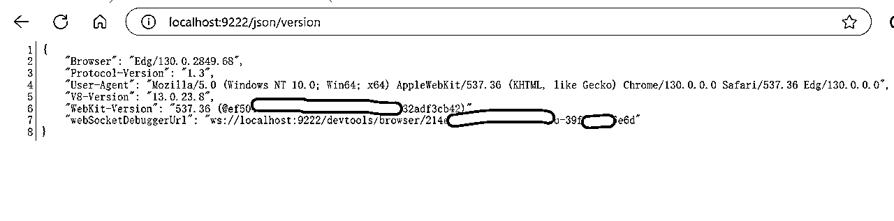

CONFIG中browser_ws_endpoint填浏览器调试端口；min_delay和max_delay为每次发送的等待时长，建议25-35秒，可自行调整。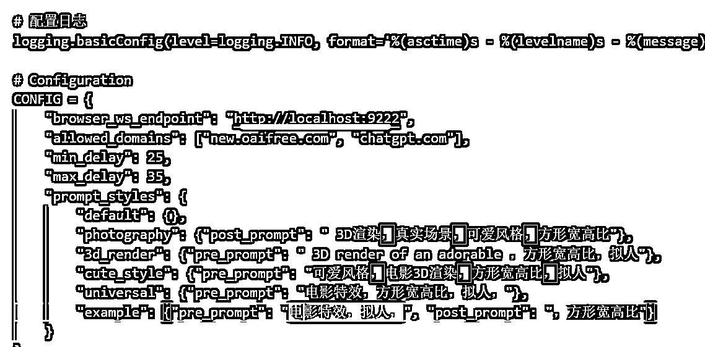

关于AI绘图、图生视频，我还用Claude 3.5 + Cursor写了不少脚本，只是暂时没找到合适的项目公开分享，有机会再整理出来。