# Youtube官方api调用以及selenium方式采集

在YouTube数据采集这件事上，很多新手会在“官方接口”和“模拟浏览器”之间犹豫。今天这篇文章，就用大白话帮你把这两条路捋清楚，顺便带你把官方API的调用流程走一遍。

先看两条路的核心差异：

**一、功能与适用场景**

- **YouTube Data API**：这是谷歌官方放出的数据交互接口，可以稳定地拿到视频的标题、描述、发布时间、播放量、点赞数、评论数、频道信息、播放列表等结构化数据。如果再接入扩展接口，甚至能实现视频上传这类深度操作。优点是一站式、规范、省心，缺点是每天有配额限制，不是无限畅用。
- **Selenium**：本质上是自动化测试工具，相当于替你把浏览器“手动操作”了一遍。它能抓取页面上几乎一切可见内容，包括HTML结构、实时推荐列表、动态加载的数据等。简单说，它就是“有点麻烦的影刀RPA”。在ChatGPT、Claude这类AI出现之前，我基本不太愿意碰它；但现在不一样了——我只要把元素定位规则梳理好，丢给Claude 3.5，再附上需求，它就能帮我搭出完整框架，甚至一步到位写完代码。

**二、灵活性与边界**

官方API的灵活性是受限的，因为它只返回官方允许定义的字段。如果你想要的是页面上动态出现的推荐视频、异步加载的实时内容，API可能给不了你。Selenium则几乎没有这种障碍，页面显示什么它就能拿什么，动态数据也能通过执行JavaScript脚本取到。所以面对需要高度自定义的采集任务时，Selenium往往更能打。

---

接下来说正题：怎么用官方API采集YouTube数据。

**第一步：配置API密钥**

要启动官方接口，先得有一把“钥匙”——YouTube Data API密钥。获取流程如下：

- 打开 Google Cloud Console（https://console.cloud.google.com/）
- 新建一个项目
- 启用 YouTube Data API v3
- 在“凭据”页面创建API密钥

操作界面参考如下：

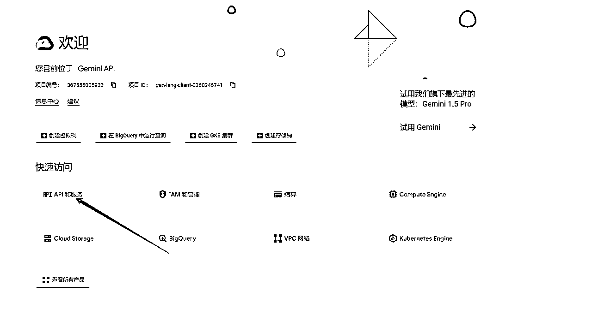
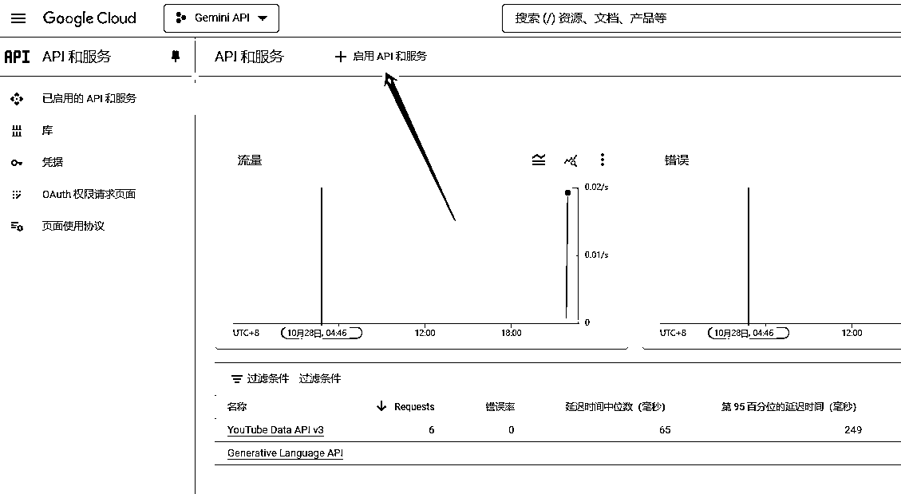
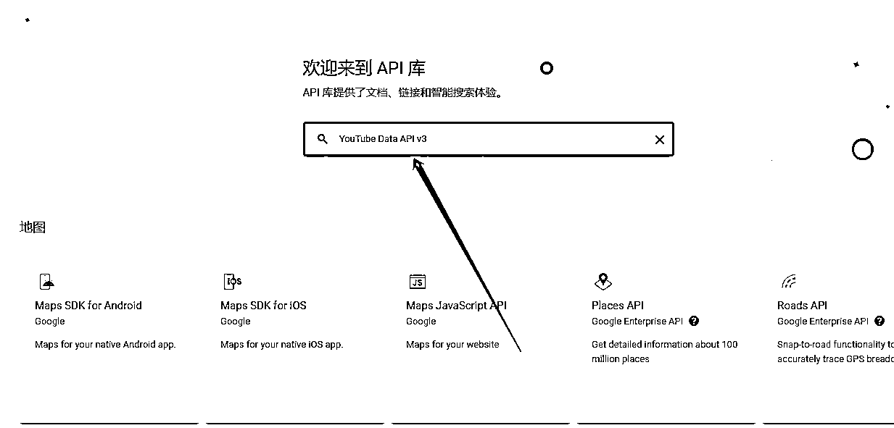

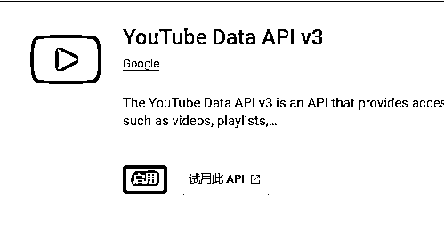
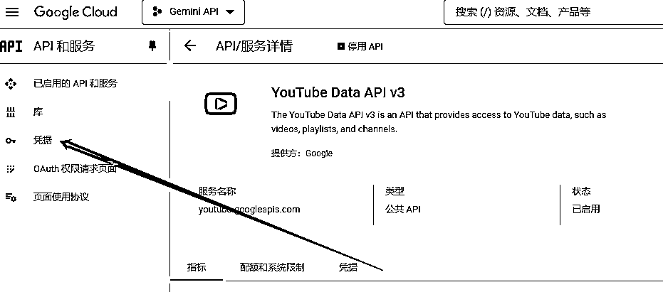
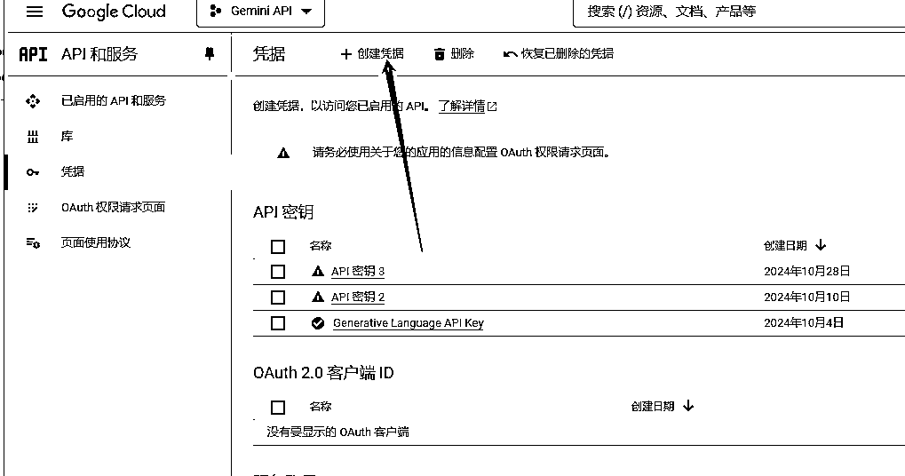
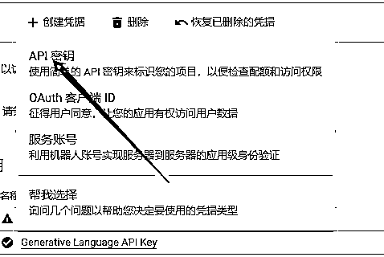
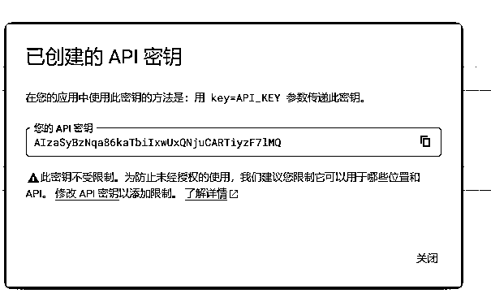

**第二步：查阅官方文档**

拿到密钥之后，接下来怎么调用，就得看官方文档了：

https://developers.google.com/youtube/v3/docs?hl=zh-cn

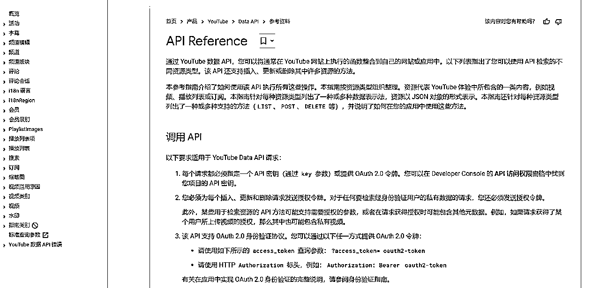

是不是一看就头大？接口太多，根本不知道哪些是自己用得上的，更不知道该从何下手。解决办法很简单——去问GPT或者Claude。把你觉得可能相关的功能说明直接复制过去，告诉它你的采集需求，让它帮你写、帮你改。你只需要反复跟AI对话，修复报错，基本不用自己动脑写代码。

**第三步：看懂一个实际调用示例**

下面的示例是一个Python脚本，用YouTube Data API获取指定频道的视频信息：

```
import os
import requests
import pandas as pd
from tkinter import Tk, filedialog
from requests.adapters import HTTPAdapter
from requests.packages.urllib3.util.retry import Retry

# 设置全局 HTTP 代理（如果需要）
os.environ['HTTP_PROXY'] = 'http://127.0.0.1:10809'
os.environ['HTTPS_PROXY'] = 'http://127.0.0.1:10809'

# 配置 API 密钥
API_KEY = ''  # 替换为您的 API Key

# 定义请求会话，增加重试机制
session = requests.Session()
retries = Retry(total=5, backoff_factor=1, status_forcelist=[500, 502, 503, 504])
session.mount('https://', HTTPAdapter(max_retries=retries))

# 定义函数：通过频道链接获取实际的频道 ID 和名称
def get_channel_info_from_link(channel_link):
    """解析频道链接并获取实际的频道 ID 和名称"""
    if '@' in channel_link:
        custom_name = channel_link.split('@')[-1]
        search_url = f"https://www.googleapis.com/youtube/v3/search?part=snippet&type=channel&q={custom_name}&key={API_KEY}"
        response = session.get(search_url)
        if response.status_code == 200:
            data = response.json()
            if 'items' in data and len(data['items']) > 0:
                channel_id = data['items'][0]['snippet']['channelId']
                channel_title = data['items'][0]['snippet']['title']
                return channel_id, channel_title
    elif 'channel/' in channel_link:
        channel_id = channel_link.split('channel/')[-1]
        return channel_id, None  # 需要通过 channels.list 获取名称
    return None, None

# 定义函数：通过频道 ID 获取上传视频播放列表 ID
def get_uploads_playlist_id(channel_id):
    """通过频道 ID 获取上传视频的播放列表 ID"""
    url = f"https://www.googleapis.com/youtube/v3/channels?part=contentDetails&id={channel_id}&key={API_KEY}"
    response = session.get(url)
    if response.status_code == 200:
        data = response.json()
        if 'items' in data and len(data['items']) > 0:
            return data['items'][0]['contentDetails']['relatedPlaylists']['uploads']
    return None

# 定义函数：通过播放列表 ID 获取视频 ID 列表
def get_video_ids_from_playlist(playlist_id):
    """获取频道上传视频播放列表中的所有视频 ID"""
    video_ids = []
    url = f"https://www.googleapis.com/youtube/v3/playlistItems?part=snippet&playlistId={playlist_id}&maxResults=50&key={API_KEY}"
    while url:
        response = session.get(url)
        if response.status_code == 200:
            data = response.json()
            for item in data['items']:
                video_ids.append(item['snippet']['resourceId']['videoId'])
            url = data.get('nextPageToken')
            if url:
                url = f"https://www.googleapis.com/youtube/v3/playlistItems?part=snippet&playlistId={playlist_id}&maxResults=50&pageToken={url}&key={API_KEY}"
            else:
                url = None
        else:
            break
    return video_ids

# 定义函数：通过视频 ID 获取视频详细信息（标题、播放量、发布时间等）
def get_video_details(video_ids):
    """通过视频 ID 获取视频的详细信息"""
    video_details = []
    for i in range(0, len(video_ids), 50):  # 分批次处理，最多50个ID一次
        ids = ','.join(video_ids[i:i+50])
        url = f"https://www.googleapis.com/youtube/v3/videos?part=snippet,statistics&id={ids}&key={API_KEY}"
        response = session.get(url)
        if response.status_code == 200:
            data = response.json()
            for video in data['items']:
                title = video['snippet']['title']
                publish_time = video['snippet']['publishedAt']
                video_id = video['id']
                video_link = f"https://www.youtube.com/watch?v={video_id}"
                views = video['statistics'].get('viewCount', '0')
                # 将发布时间转换为年-月-日格式
                publish_date = publish_time.split("T")[0]  # 获取日期部分
                video_details.append([title, publish_date, video_link, views])  # 注意这里只添加所需列
    return video_details

# 主函数：读取 Excel 表格并获取各个频道的视频信息
def main():
    # 选择 Excel 文件
    print("请选择包含频道链接的 Excel 文件：")
    Tk().withdraw()  # 隐藏 Tkinter 主窗口
    file_path = filedialog.askopenfilename(filetypes=[("Excel files", "*.xlsx")])

    if not file_path:
        print("未选择文件，程序退出。")
        return

    # 读取 Excel 文件中的频道链接
    input_df = pd.read_excel(file_path)
    channel_links = input_df.iloc[:, 0].tolist()  # 假设链接在第一列

    all_videos_data = []

    # 遍历每个频道链接
    for channel_link in channel_links:
        print(f"正在处理频道：{channel_link}")

        # 获取频道 ID 和名称
        channel_id, channel_title = get_channel_info_from_link(channel_link)
        if not channel_id:
            print(f"无法解析频道链接：{channel_link}")
            continue

        # 获取频道上传视频播放列表 ID
        uploads_playlist_id = get_uploads_playlist_id(channel_id)
        if not uploads_playlist_id:
            print(f"未找到频道（ID: {channel_id}）的上传视频播放列表。")
            continue

        # 获取所有视频 ID
        video_ids = get_video_ids_from_playlist(uploads_playlist_id)

        # 获取视频详细信息
        video_details = get_video_details(video_ids)

        # 将每个视频添加到总数据中，并附上频道名称
        for video in video_details:
            video.append(channel_title)  # 添加频道名称
            all_videos_data.append(video)

    # 将所有数据保存到新的 Excel 文件中
    output_df = pd.DataFrame(all_videos_data, columns=["标题", "发布时间", "视频链接", "播放量", "频道名称"])
    output_file_path = file_path.replace(".xlsx", "_视频详情.xlsx")
    output_df.to_excel(output_file_path, index=False)
    print(f"所有频道的视频数据已保存到：{output_file_path}")

if __name__ == "__main__":
    main()
```

拿到密钥后，就可以写核心代码了。整个过程按5个步骤走，下面拆解几个关键环节：

**3.1 设置全局代理**

因为访问YouTube需要“特殊上网方式”，我在代码里直接配置了本地HTTP代理，用的是V2rayN的节点，端口指向本地：

```python
# 设置全局 HTTP 代理（如果需要）
os.environ['HTTP_PROXY'] = 'http://127.0.0.1:10809'
os.environ['HTTPS_PROXY'] = 'http://127.0.0.1:10809'
```

**3.2 把用户名转成频道ID**

YouTube API只认频道ID，不认自定义用户名（比如 @hublotbaggins），所以要先转换：

```
search_url = f"https://www.googleapis.com/youtube/v3/search?part=snippet&type=channel&q={CUSTOM_NAME}&key={API_KEY}"
```

- 这里用到的是 search API 来搜索频道
- 接口会返回频道的ID以及基础信息

**3.3 拿到上传播放列表ID**

每个频道的“上传播放列表”都包含了它发布过的所有视频。想拿到全部视频，就得先找到这个特殊播放列表的ID：

```
channel_url = f"https://www.googleapis.com/youtube/v3/channels?part=contentDetails&id={CHANNEL_ID}&key={API_KEY}"
```

**3.4 遍历视频ID**

有了播放列表ID，接下来就顺理成章了——分页拉取列表，提取每个视频的唯一ID，再配合其他接口批量获取详情数据。这里就不贴完整代码了，思路和节奏就是这样，一步步往下走就行。

---

总结一下：官方API适合规规矩矩拿结构化数据，Selenium适合“暴力”抓取一切可见内容。至于选哪条路，看你想要什么、以及愿不愿意折腾。希望这篇拆解能给你一点启发。

```
playlist_url = f"https://www.googleapis.com/youtube/v3/playlistItems?part=snippet&playlistId={uploads_playlist_id}&maxResults=50&key={API_KEY}"
```

当 playlist ID 到手后，所有视频的 ID 就能顺利拿下了。具体做法是：调用 playlistItems 这个接口去读取目标列表中的视频记录。因为 YouTube 官方规定，单次请求最多只能返回 50 条数据，所以还要写一个循环请求的过程；每次拿到返回结果后，再通过 nextPageToken 这个参数继续请求下一页，直到数据全部抓完。

### 视频详细信息采集

```
videos_url = f"https://www.googleapis.com/youtube/v3/videos?part=snippet,statistics&id={video_ids_str}&key={API_KEY}"
```

有了视频 ID 合集，最后一步就简单了：用这些 ID 逐个请求视频的详细资料，比如名称、发布日期、播放次数。需要留意的是，一次调用能够批量查询 50 个视频，数量依然可观。

## YouTube API 代码实战攻略

### 4.1 先把依赖和运行环境装好

```
pip install requests
pip install requests pandas openpyxl
```


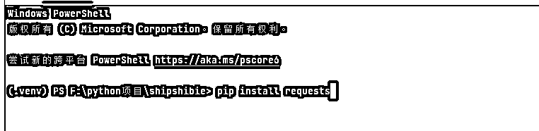

如果你身处国内，代理配置不可忽略：第一，科学上网工具必须开启；第二，确认代理端口号，一般默认是 10809；第三，如果端口不是 10809，就要把代码里的端口改成你自己的实际值。

### 4.2 申请 YouTube API 密钥

进入 Google Cloud Console（https://console.cloud.google.com/），新建一个项目，或者沿用已有项目；然后在 API 库中启用 YouTube Data API v3；接着生成一个 API 密钥；最后，把这个密钥填入代码中指定的位置：

```
API_KEY = '你的API密钥'  # 替换这里
```

### 4.3 准备频道列表的 Excel 文件

先创建好一个 Excel 文件，起名如 channels.xlsx。请把需要采集的 YouTube 频道链接放到第一列，链接支持两种写法：一种是用 @ 开头的频道名，比如 @hublotbaggins；另一种是完整的频道地址，例如 channel/UCxxxxxx。下面是一个示例表格：

频道链接
@channel1
@channel2
channel/UC123456

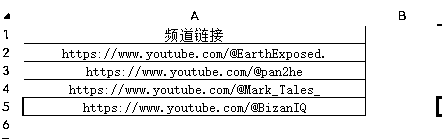

### 4.4 运行采集程序

把脚本保存为 .py 文件，双击运行后会弹出选择窗口，此时选中你准备好的 Excel。程序随后会自动执行：先读取全部频道链接，再逐个频道抓取所有视频数据，最后输出一个新的 Excel 文件。新文件的命名方式很简单，就是在原文件名后面加上“_视频详情.xlsx”后缀。每个视频的信息会包含标题、发布时间、视频链接、播放量和频道名称这五列。

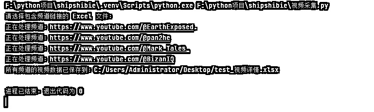

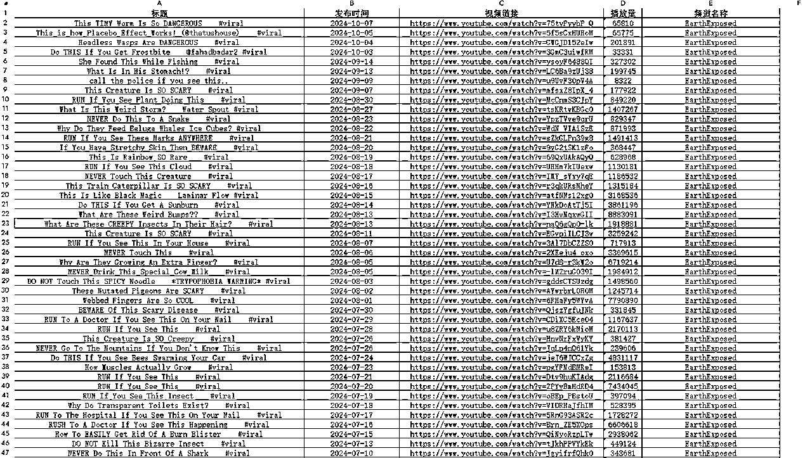

至此，YouTube API 调用的全部细节已经说明白了。

## 5. 数据清洗：让二创更轻松

我一直信奉“爆过的内容还会再爆”这个逻辑，所以在拿到原始数据后，还会做一轮清洗操作。清洗规则很直接：把播放量低于 100 万的视频过滤掉，只留下百万级别以上的作品，方便后续洗稿、二创。

### 数据清洗代码

```
import pandas as pd
from tkinter import Tk
from tkinter.filedialog import askopenfilename
import os

# 使用 tkinter 打开文件对话框选择文件
def select_excel_file():
    Tk().withdraw()  # 隐藏根窗口
    file_path = askopenfilename(title="选择 Excel 文件", filetypes=[("Excel files", "*.xlsx;*.xls")])
    return file_path

# 读取并处理 Excel 文件
def process_excel(file_path):
    # 读取 Excel 文件到 DataFrame
    df = pd.read_excel(file_path)

    # 将“播放量”转换为数字类型
    df['播放量'] = pd.to_numeric(df['播放量'], errors='coerce')

    # 将“发布时间”转换为日期类型，并去掉时间部分只保留日期
    df['发布时间'] = pd.to_datetime(df['发布时间'], errors='coerce').dt.date

    # 筛选播放量大于 1000000 的数据
    df_filtered = df[df['播放量'] > 1000000]

    # 按播放量降序排列
    df_sorted_by_views = df_filtered.sort_values(by='播放量', ascending=False)

    # 然后按发布时间从新到旧排序
    df_sorted_by_date = df_sorted_by_views.sort_values(by='发布时间', ascending=False)

    return df_sorted_by_date

# 主函数
if __name__ == "__main__":
    # 选择 Excel 文件
    file_path = select_excel_file()

    if file_path:
        # 处理并获取排序后的数据
        sorted_df = process_excel(file_path)

        # 获取原始文件的目录
        directory = os.path.dirname(file_path)

        # 设置输出文件的路径，保存在原始文件相同的目录下
        output_file = os.path.join(directory, "sorted_output.xlsx")

        # 保存排序后的数据到新的 Excel 文件
        sorted_df.to_excel(output_file, index=False)

        print(f"已将排序结果保存到 {output_file} 文件。")
    else:
        print("未选择任何文件。")
```

### selenium 模拟采集调用方式的完整代码

```
import pandas as pd
from selenium import webdriver
from selenium.webdriver.common.by import By
import time
from tkinter import Tk
from tkinter.filedialog import askopenfilename

def scroll_to_bottom(driver):
    """滚动页面直到没有更多新的视频加载"""
    last_height = driver.execute_script("return document.documentElement.scrollHeight")

    while True:
        # 向下滚动页面
        driver.execute_script("window.scrollTo(0, document.documentElement.scrollHeight);")
        time.sleep(2)  # 等待页面加载

        # 获取当前页面的新高度
        new_height = driver.execute_script("return document.documentElement.scrollHeight")

        # 如果新高度等于上次的高度，说明没有更多内容加载，停止滚动
        if new_height == last_height:
            break

        last_height = new_height

def extract_video_data(driver, channel_url):
    """提取当前页面视频的标题、播放量和链接，并添加博主频道链接"""
    video_elements = driver.find_elements(By.XPATH, "//ytd-rich-item-renderer")  # 找到所有视频元素

    video_data = []

    # 遍历每个视频元素，分别提取标题、播放量和链接
    for video in video_elements:
        try:
            title_element = video.find_element(By.XPATH, ".//h3/a")  # 相对路径找到标题
            view_count_element = video.find_element(By.XPATH, ".//span[contains(text(), '次观看')]")  # 相对路径找到播放量
            link_element = video.find_element(By.XPATH, ".//h3/a")  # 相对路径找到链接

            # 获取 href 属性
            video_url = link_element.get_attribute('href')

            # 添加到数据列表中，包括博主的频道链接
            video_data.append({
                '标题': title_element.text,
                '播放量': view_count_element.text,
                '链接': video_url,
                '频道链接': channel_url  # 新增频道链接信息
            })
        except:
            # 如果某个元素未找到，跳过该视频
            continue

    return video_data

if name == "__main__":
    # 使用Tkinter打开文件选择对话框
    Tk().withdraw()  # 隐藏主窗口
    file_path = askopenfilename(title="选择包含博主频道链接的Excel文件", filetypes=[("Excel files", "*.xlsx")])

    if not file_path:
        print("未选择任何文件，程序结束。")
        exit()

    # 读取Excel文件中的博主频道链接
    channel_df = pd.read_excel(file_path)
    channels = channel_df.iloc[:, 0]  # 假设博主的频道链接在第一列

    all_video_data = []

    # 初始化浏览器
    driver = webdriver.Chrome()

    # 循环处理每个博主的频道
    for channel_url in channels:
        print(f"正在处理博主频道：{channel_url}")

        try:
            driver.get(channel_url + "/videos")  # 打开博主的“视频”页面
            time.sleep(3)  # 等待页面加载

            # 执行滚动，直到加载完所有视频
            scroll_to_bottom(driver)

            # 采集当前博主的所有视频信息
            video_data = extract_video_data(driver, channel_url)

            # 将当前博主的视频信息添加到汇总列表
            all_video_data.extend(video_data)

        except Exception as e:
            print(f"处理 {channel_url} 时出错: {e}")
            continue

    # 关闭浏览器
    driver.quit()

    # 将所有视频信息转换为 DataFrame
    all_videos_df = pd.DataFrame(all_video_data)

    # 保存到 Excel 文件
    all_videos_df.to_excel('all_youtube_videos_with_channels.xlsx', index=False)

    print("所有博主的视频数据已保存到 all_youtube_videos_with_channels.xlsx 文件中")
```