# 被裁前，我的小红书小店月销做到了8.4万

介绍一下：我是小茗。今年6月跟着生财航海做小红书店铺，9月单月GMV做到8.4万。但只有自己知道，整个过程像坐过山车——刚爬到山顶，又紧急落回地面。

5月，因为雪姨@陈雪的播客，我关注到生财；5月21日正式加入。这是我第一次知识付费超过千元。

6月，第一次参加航海。我选了小红书店铺（百货赛道），出单是在航海期间，也因此认识了教练@V小刀。

9月中旬，店铺突然爆了，GMV达到8.4万。那是我第一次在互联网上拿到这么强烈的正反馈。

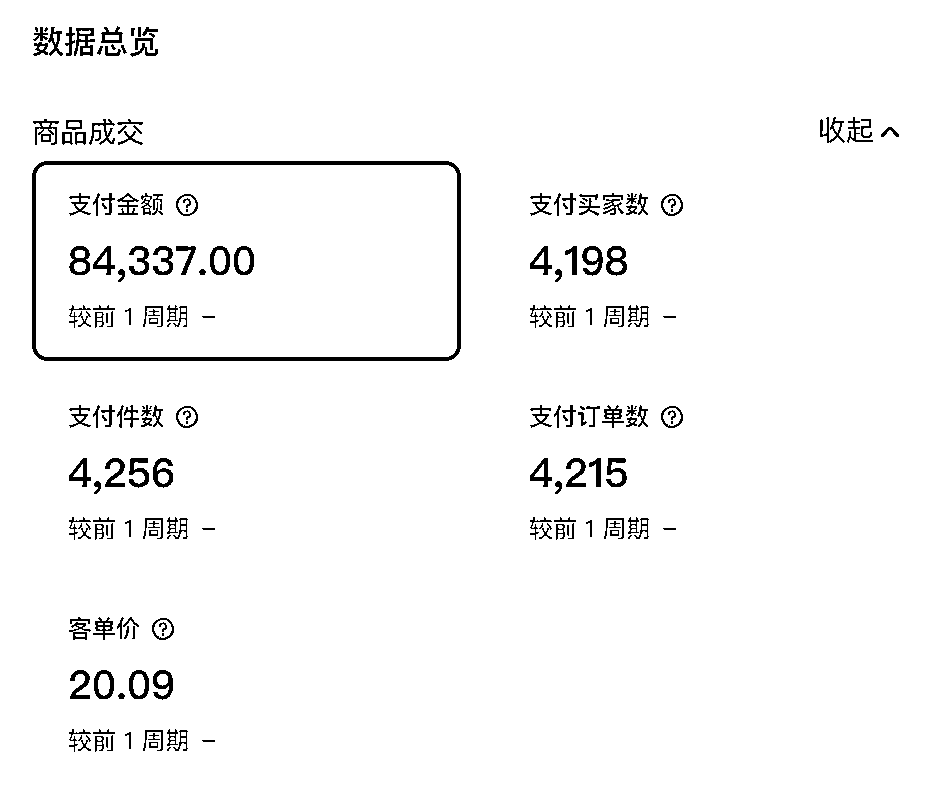

9月下旬，我还在为自己的成绩高兴，公司裁员通知突然就来了，毫无预兆。

10月，我被动开始了自由职业，一个人在小生意里摸索。

总结这5个月：一开始被大量的赚钱案例冲击，非常迷茫，非常焦虑，在项目之间反复横跳。后来定了赛道，刚尝到副业月入2万的甜头，主业就说再见了。

前一天刚在朋友圈晒收获，第二天就接到裁员通知。努力的意义，在那一刻变得格外具体。

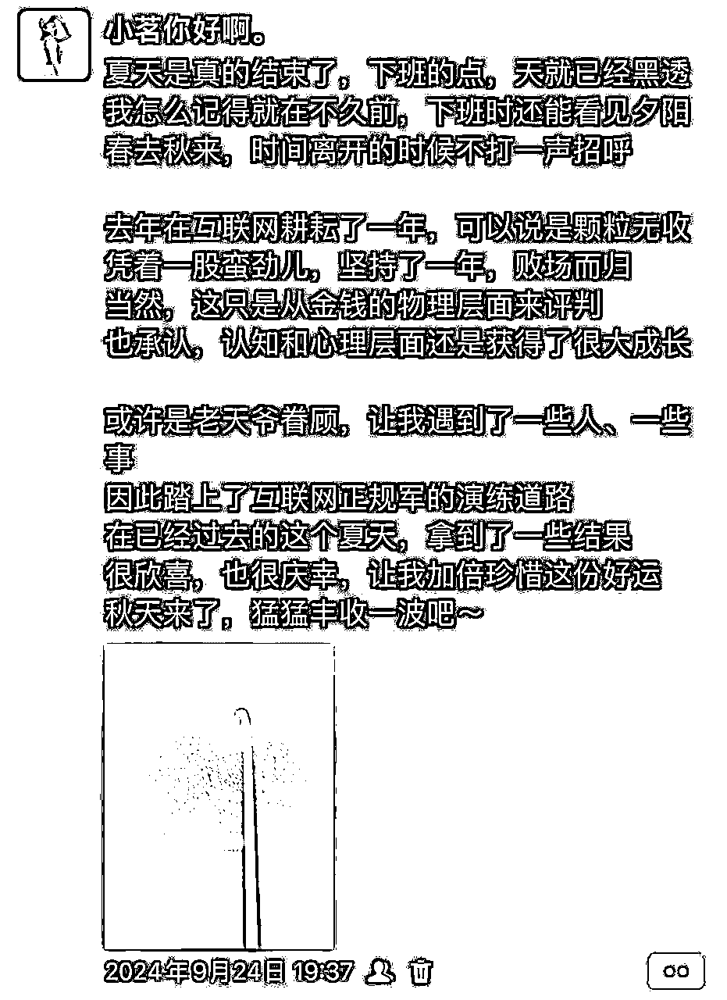

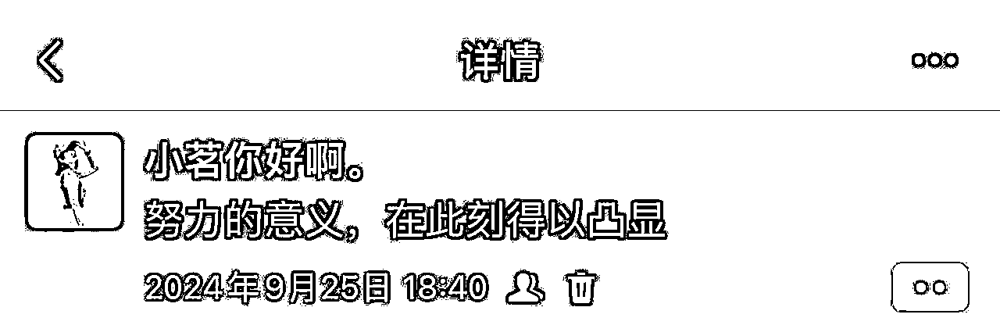

# 一、我把“失业焦虑”变成了“凡事上手试”

在地产行业的这几年，我身边的裁员潮一浪接一浪，我清楚自己迟早也会被推到边缘。幸而我保留了“凡事上手试”的习惯，大小机会都会去碰一碰。

努力和方向哪个更重要？我的答案是：努力是底线，方向才是杠杆。

去年我在小红书更新过“早起学习”类内容，操作了半年，发了161条视频，结果一条商单都没有。后来我意识到问题出在方法上，于是果断停更，换道重来。

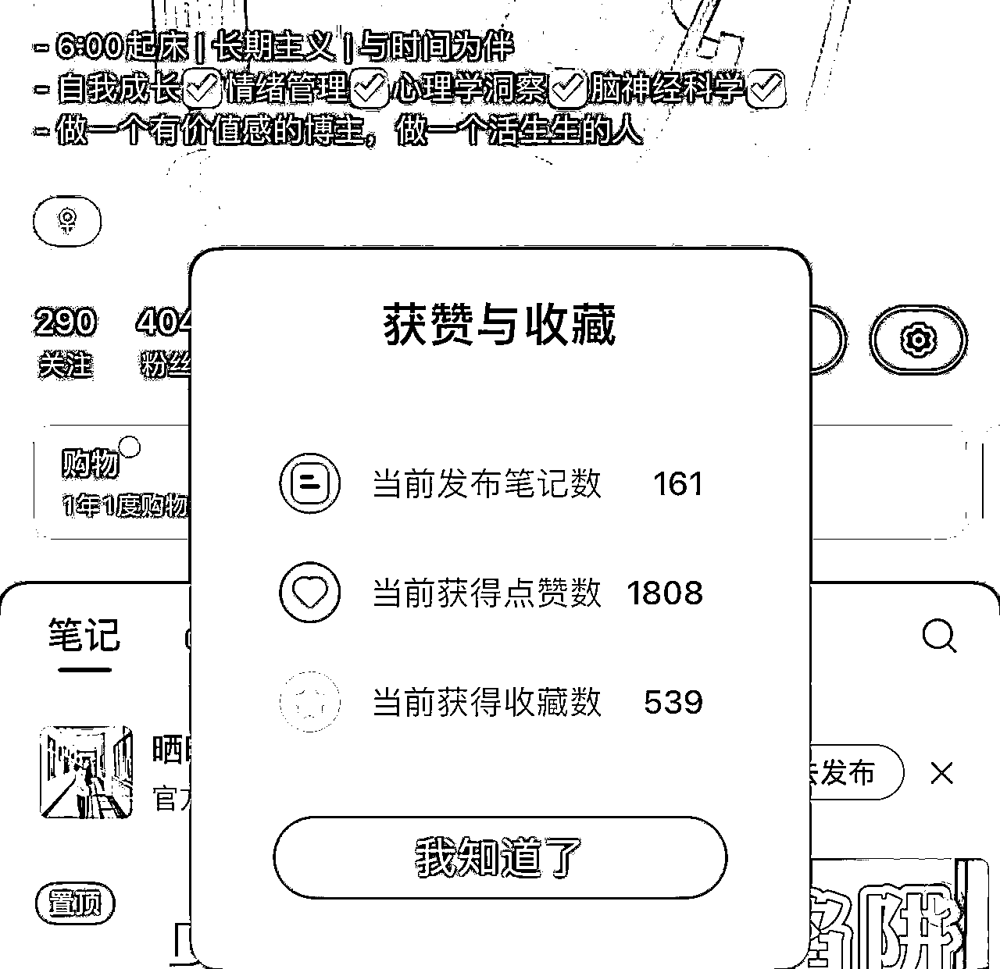

就在低谷期，我遇到了生财。跟着航海赚到第一笔小钱，才算是真正亲手把一个互联网项目的完整链路跑了一遍。

所以，我真的建议所有和我当时一样的人：别一直站在那儿想，先下场把第一笔钱赚到。哪怕赚得很少很少，它也是从0到1的分水岭。

# 二、从1单到8.4万GMV，我做了这些事

下面分成三块：开店过程、风塑梳爆单复盘，以及给新手的建议。

## 1、航海第1单，给了我“原来真能卖出去”的冲击

加入生财后，第一个航海项目就是小红书店铺。有人问我为什么没选别的？我的理由非常简单：我自己就是小红书用户，之前也做过半年博主，我对它的机制更熟悉，也比对别的平台更有好感。

在自己的主场上折腾，会轻松一点。

航海还没开始，手册已经被我完整翻了两遍，开店、剪辑这些环节也提前弄清楚了。教练的直播我全程跟了下来，笔记也写了不少。

第1单来的时候我人在外地，收到一条系统提醒，让我赶紧处理发货，不然就超时了。我当时很懵，那条视频只有四百多次曝光，居然真的有人下单？这可比以前做学习博主时追求上万播放才可能被品牌看到的节奏，快太多了。

## 2、风塑梳爆单复盘：从供需失衡到爆款封面

### （1）先用供需关系判断“值不值得做”

我的爆品“风塑梳”，最早在刀姐的星球里看到。如果你常常刷抖音创意中心，也会看到这个品，它在爆品榜停留很久，多家店铺销量都很好。

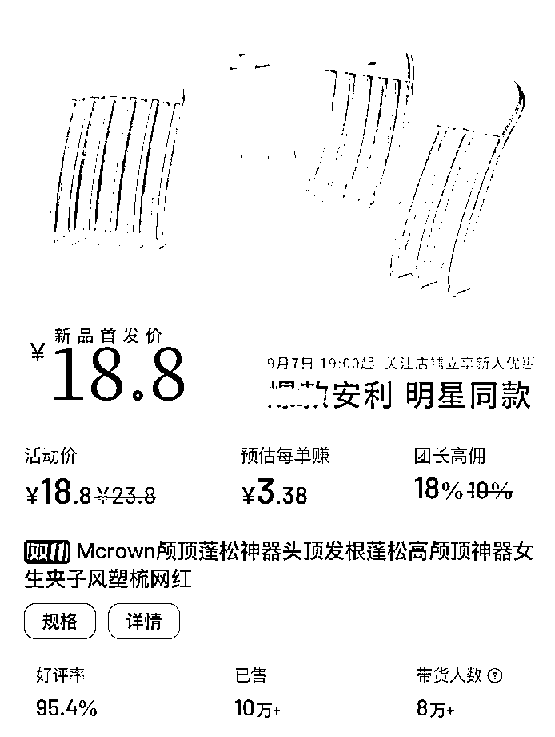

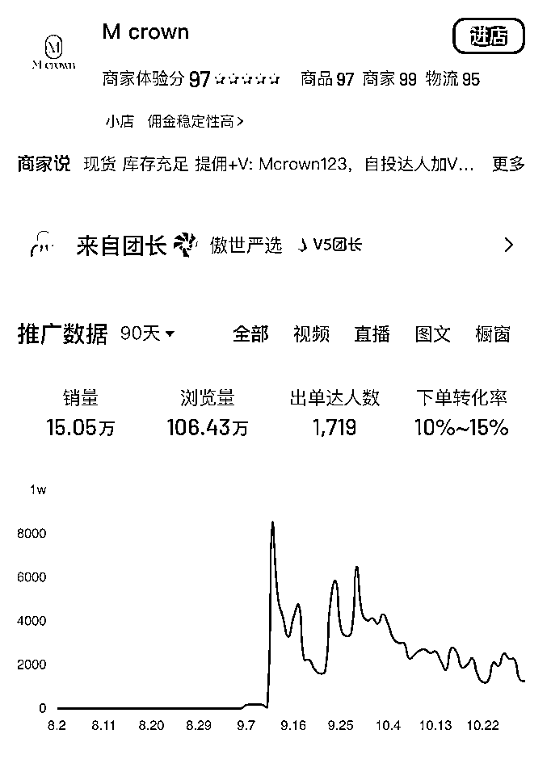

这个品从韩国火过来。一开始我没重视，但我去小红书一搜，发现所有在售都是预售，评论区全是“求代购”“求义乌生产”“等义乌把价格打下来”——需求明晃晃摆在那儿。

再到1688找厂家，对方说要排队，“产能不足”。需求在涨，产能跟不上，这不就是最简单的供需失衡？所以我决定测品。

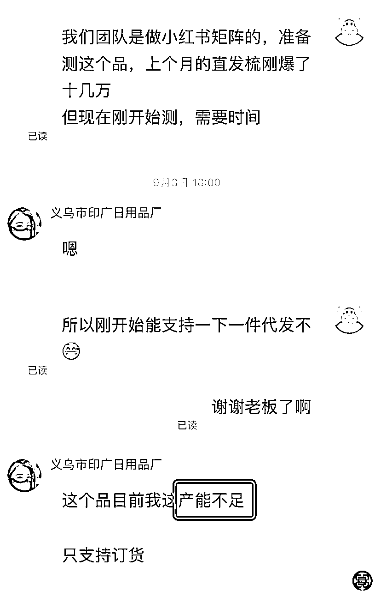

### （2）用数据调价格，先跑量再谈利润

当时我找了一个爆款脚本，很快剪了4条视频。说实话，脚本有点旧，但我觉得先发优势更重要，还是发了，打算后面有新的再换。

成本固定在16.8元的时候，我定价21.9元。笔记发了一堆，访客有，成交没有。我非常纠结，因为再降价，利润就太薄了，平台还要抽5%。

后来我想通了：前期先把量做起来。价格降到19.9元，很快就出了第一单。之后大约两周，每天都是个位数到十几单。期间供货价松动了一些，毛利率能稳在35%左右。

我还专门去看了那个卖了两万多单的同行，发现对方更新了一两个月，素材封面一直在迭代。于是我也决定长期跟这个品。

### （3）怎么从韩国大叔身上找到爆款公式

每天我都会用关键词在小红书搜索，综合排序、最新排序都看，点赞50以上的脚本全部收集起来测试。

有一天我发现，一个韩国大叔的脚本数据明显好于其他，我立刻拿过来测。但这位大叔头发偏短，头发蓬松前后对比不明显。我忽然想到：另一位头发更长的韩国大叔素材，是不是效果更好？于是我把长发大叔的素材套进爆款脚本。

结果这条最终跑成了爆款。评论区都在说：“躲过美女，躲不过大叔”“你弄个美女我可能不买，搞个大叔我倒想买了”。

封面也是同一个逻辑。当时数据较好的封面，是把产品用红线圈在短发大叔的头发上。

我想起之前爆掉的衣柜收纳盒，也是用红线把空缺区域框出来，靠“圈重点”制造视觉焦点。

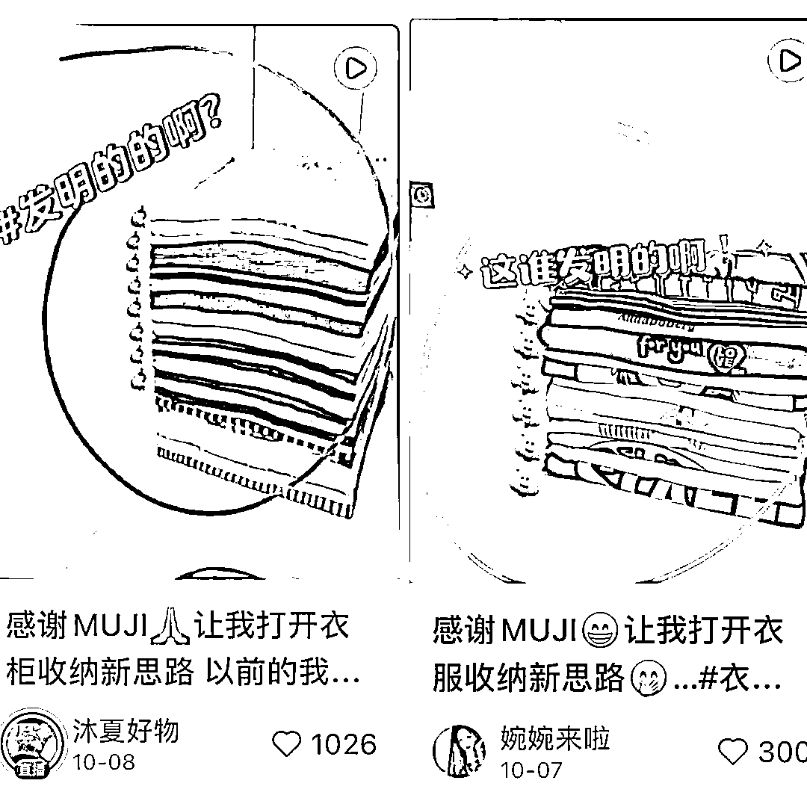

于是我把同样手法放到长发大叔素材，把风塑梳直接圈出来。这就是最后爆掉的那张封面。

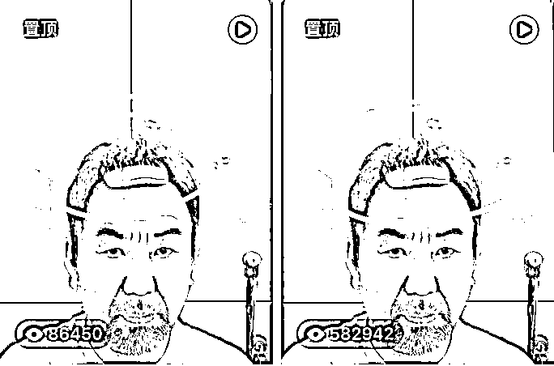

## 3、小红书开店建议：给新手的五大模块

“小红书开店”说起来只是“选品—剪辑/拍摄—发布笔记”三步，但每一步都藏着细节。航海手册对开店流程讲得很详细，我主要分享自己的方法论。

### （1）选品、测品

老话说：选品定生死。能不能爆，选品占70%。但爆款从来不是靠一开始挑出来的，是靠一轮轮试出来的。不要想着一次就选中爆品，测30-40个，能跑出2个爆款已经很不错。

分享两个常用选品渠道：

**渠道一：抖音精选联盟**

每天固定刷创意中心、爆品榜、趋势榜。重点关注智能家居、美妆、3C数码这些类目，1小时和24小时榜单都要看两次。

头两天会看得眼花，刷满三天后，你对榜单上的品已经有了肌肉记忆，这时就可以快速扫，看哪些是突然窜上来的异常值。谁先发现，谁先跟进，谁就更大概率爆。

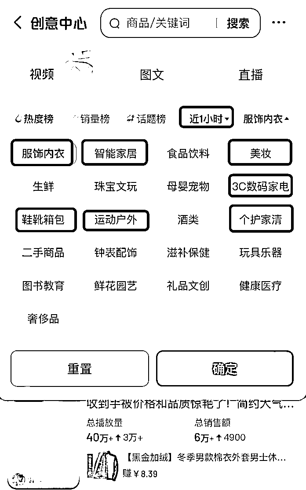

同时，从爆品下的达人视频可以估算素材储备量，判断后续剪辑难度，也可以顺手把素材和脚本存下来。再点进达人主页，看他最近在推什么、过去推爆过什么，遇到优质账号就直接关注。当你的对标账号池足够大，好品会自己来到你面前。

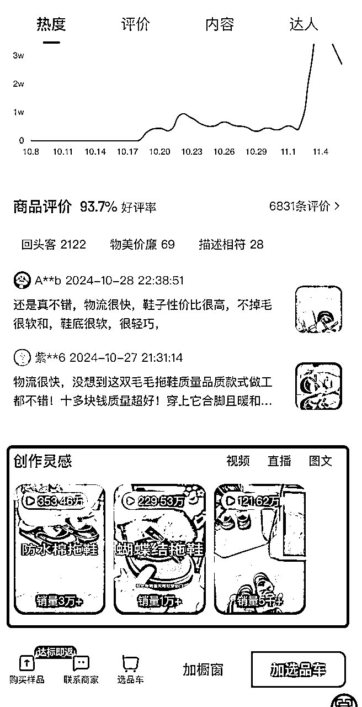

**渠道二：小红书商家榜单**

小红书开店不存在什么玄学，数据都是摊开的，相当于一场明牌考试。商家榜实时更新，昨天刚在别人账号里爆掉的笔记，今天就可能出现在榜上。

你要做的是：

- 看与自己类目相关的榜单，顺手记录封面、脚本、标题模板；
- 点进笔记，看发布时间和评论区互动，判断热度是不是还在往上走；
- 进商家主页，看他以前发过什么、最近在爆什么、发了多少条笔记才开始爆的、测试了多少封面和标题。

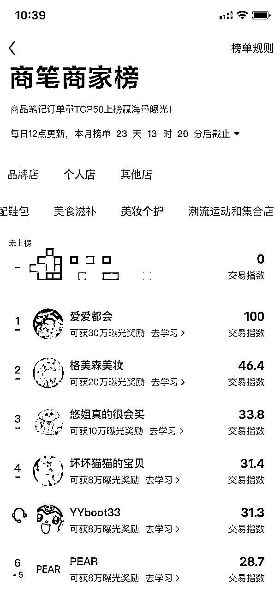

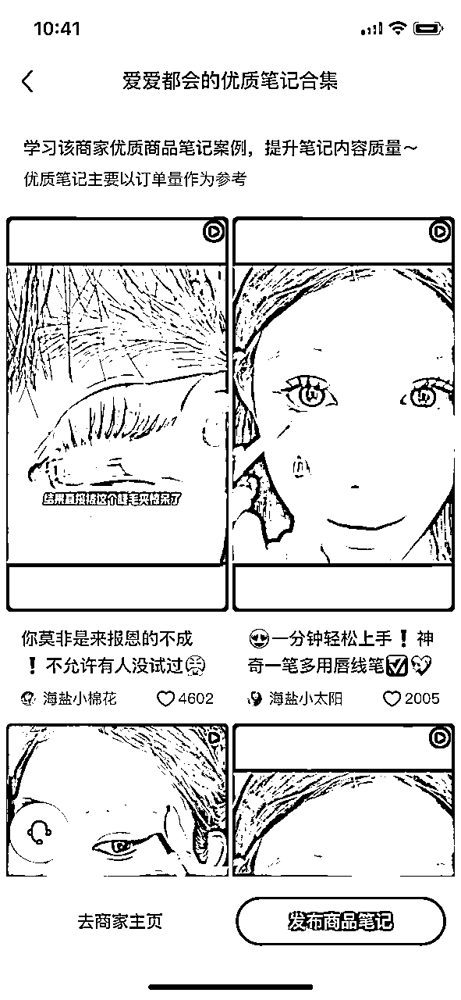

我也提醒自己：别只看到别人吃肉，看不到别人挨打。你去看那些动辄上千条笔记的商家，大部分笔记也是寥寥无几的点赞，可能就那么两条爆了。大力出奇迹，更多是用数量去博概率。不过，科学方法也能提升概率，只是一定不能保证100%。

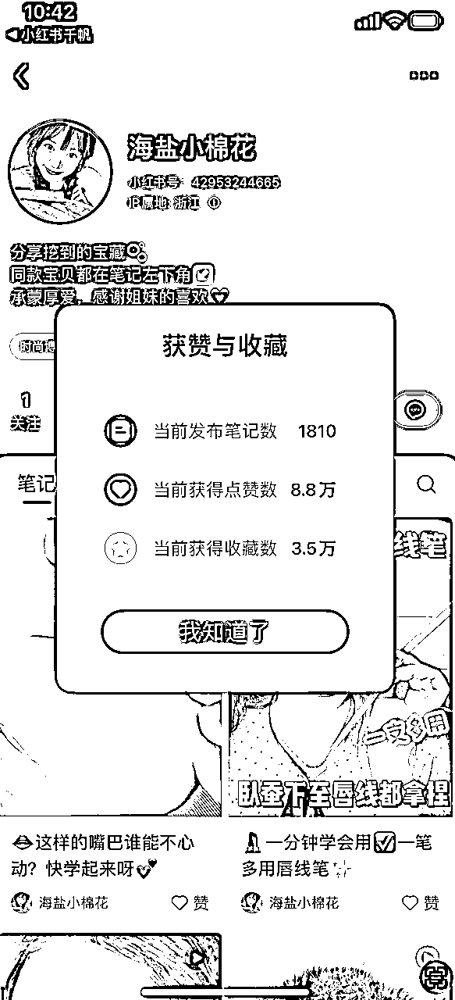

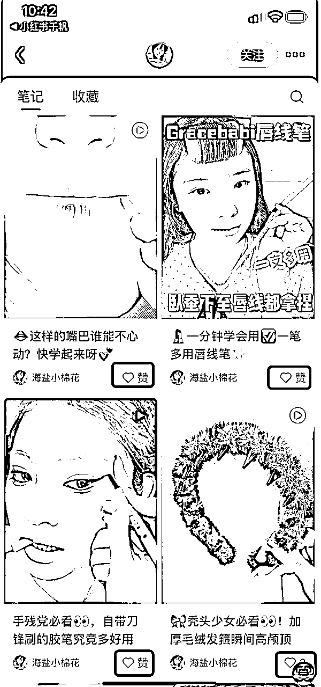

### （2）找对标账号

**按商品销量排序**

在小红书搜品名，按商品销量排行，把前几名商家主页都翻一遍。能卖出那么多，大概率有过爆款笔记，如果一直翻不到，很可能是因为违规把笔记藏了。顺便看看他店铺里其他商品，判断是否适合同步跟进。

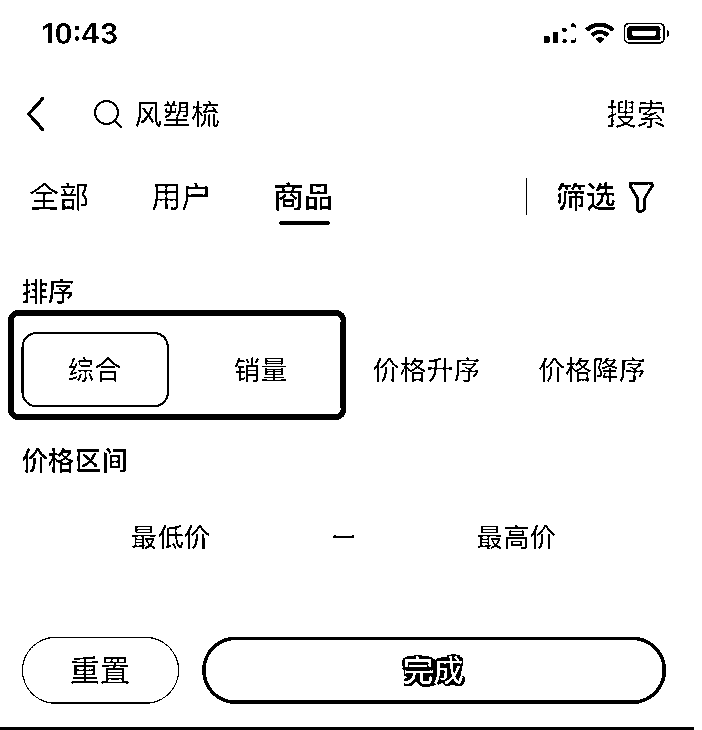

**按笔记最新、最热排序**

两个维度都要看：最新，看现在有没有刚冒出来的爆款；最热，看这个品从什么时候起爆的。发布时间和评论区也不能漏掉。

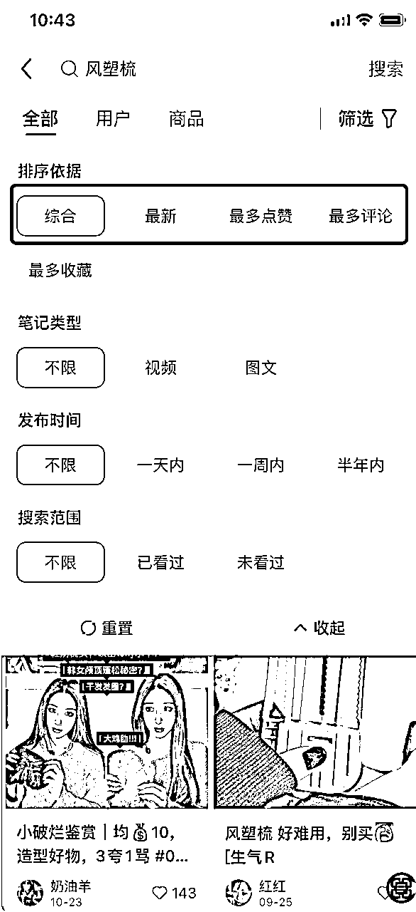

另外，如果搜索时发现同一个账号出现了非常多笔记，哪怕点赞不高，也要点进去看看。他的笔记被平台打了标签，而且连更，说明他个人很看好这个品，往往是隐隐有爆的可能，才愿意下重注。

小提示：搜索词要经常换。比如我卖“风塑梳”，还会换“高颅顶神器”“蓬松夹”“发根夹”“颅顶蓬松夹”这些关键词。而且同一个词，用不同账号搜，结果也不一样，建议多注册几个小号。

### （3）发布笔记

- 从千帆后台的“商家成长”入口去发布，满足一定的要求会有曝光奖励。

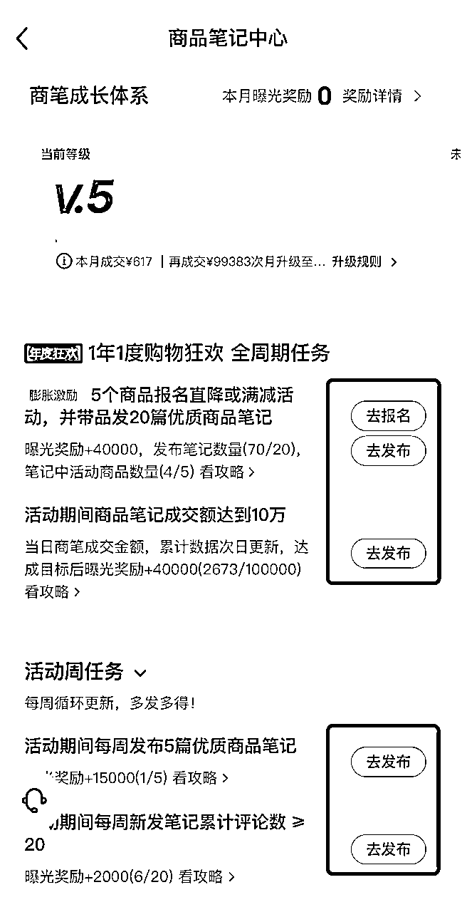

- 找与你品类相关的“社区热搜词”，点进去发笔记。热搜词意味着用户需求都在那里。

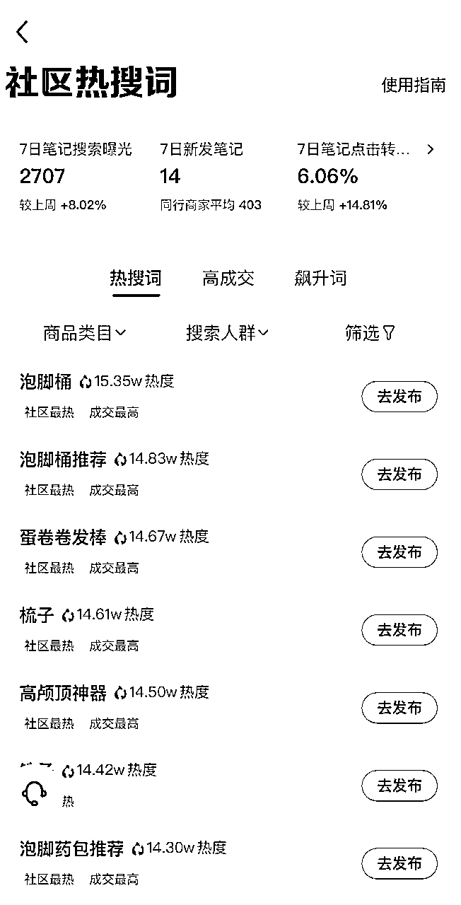

- 如果你的笔记流量很淡，可以试着设置一个低价或高价SKU，用来吸引点击。不过这样引进来的流量不够精准，转化率不会高，还有违规风险。

- 打开“购买同款”的关联评论语，相当于给消费者多一个下单入口。

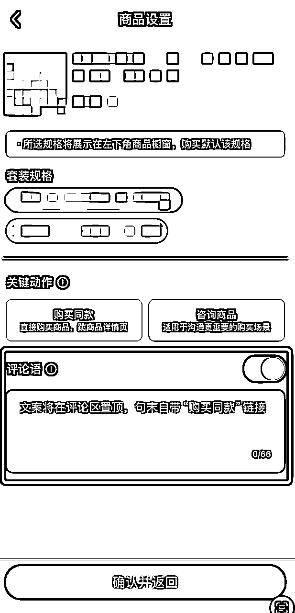

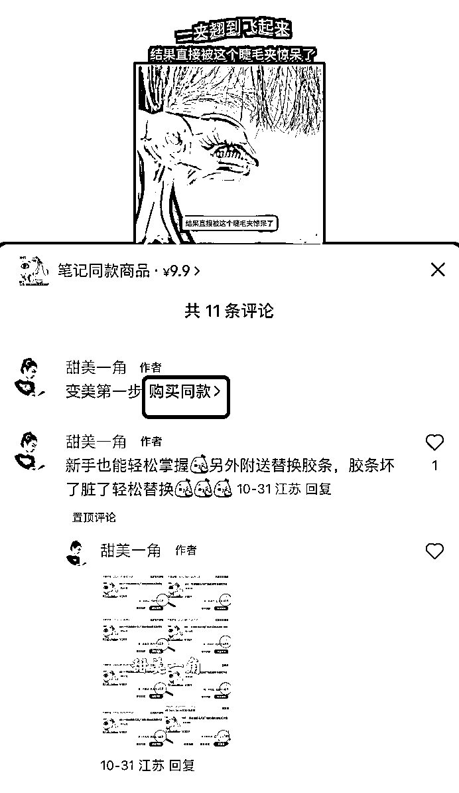

### （4）人工干预：细节决定转化率

做小红书就是无数个细节拼接成的。人工干预主要包含四件事：评论区氛围、初始销量、商品好评、晒单笔记。这四项做扎实了，转化率会有明显提升。

比如这条评论有36个赞、86条回复，光是这样就能给笔记加热。隔两天再带图补一条评论，凡是之前回复过的人都会再次看到，转化机会就来了。

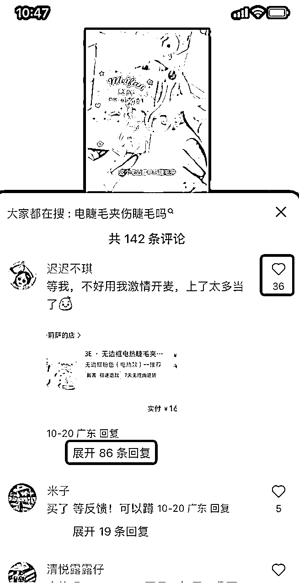

具体的小技巧：

1. 播放量到500以上，就可以用小号或朋友评论造氛围。
2. 评论内容怎么写？看对标账号的高赞评论，模仿类似风格，比如“已下单，姐妹们蹲我，不好回来开骂”。
3. 如果请多个朋友评论，一定要错开时间，不能集中在一起；自己小号也不要在同一WiFi环境里操作。
4. 用“小号找到笔记→分享给朋友”的路径来完成一次转发，大号直接分享容易显得太刻意。
5. 小号下单前不要直接付款，要先像普通用户一样逛视频、看主页、点赞收藏，让行为模型更接近真人。
6. 还可以通过搜索账号名，或者让朋友关注你之后从关注页进入笔记。
7. 想快速做出初始销量，可以让朋友拍下后把数量改成10倍，再改价成0.1元，既省成本又增加信任感。

我还顺手做了一张选品表，把所有想做的品列出来，每天更新数据，跟进状态，一眼就知道该主攻哪个。

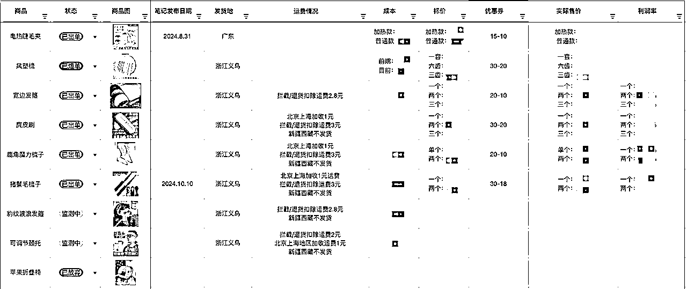

# 三、关于感谢：两个改变我的人

感谢@V小刀。她的能量感很强，第一次航海直播我就成了她的听众。她分享内容时既真诚又专业，隔着屏幕都感受得到。后来我把她在生财发过的帖子翻了个遍，“真诚才是必杀技”这句话，我是真的从她身上读懂了。

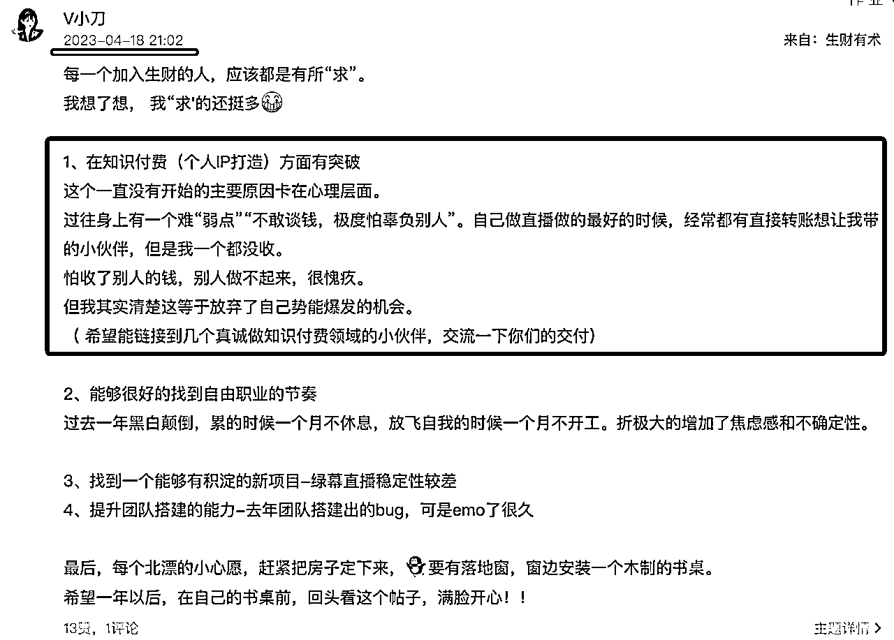

如果没有刀姐，我不可能这么快拿到互联网上的正反馈，被裁员之后心态也不会这么稳。我离开公司时能走得那么有底气，有一部分底气就是她给的。

她说过很多让我反复咀嚼的话，比如“没有哪个项目、哪个机会，是你的救命稻草，一直不断努力向上的你才是”“因上努力、果上随缘”“待到秋来九月八，我花开后百花杀”“相信大概率下公平存在”。不确定的时候，这些句子就是我的脚手架。

感谢雪姨@陈雪。她的播客把我领进了生财，让我看到原来有这么多人在互联网上认真搞钱，有信息、有方法、有实战，还有人分享和带教。航海手册这种级别的东西，以前我花再多时间也搜不到。

跟着她写作打卡5个月，我的输出量一路往上走，那段时间我的写字总量是过去最多的，而且能明显感到自己的思考方式在变。

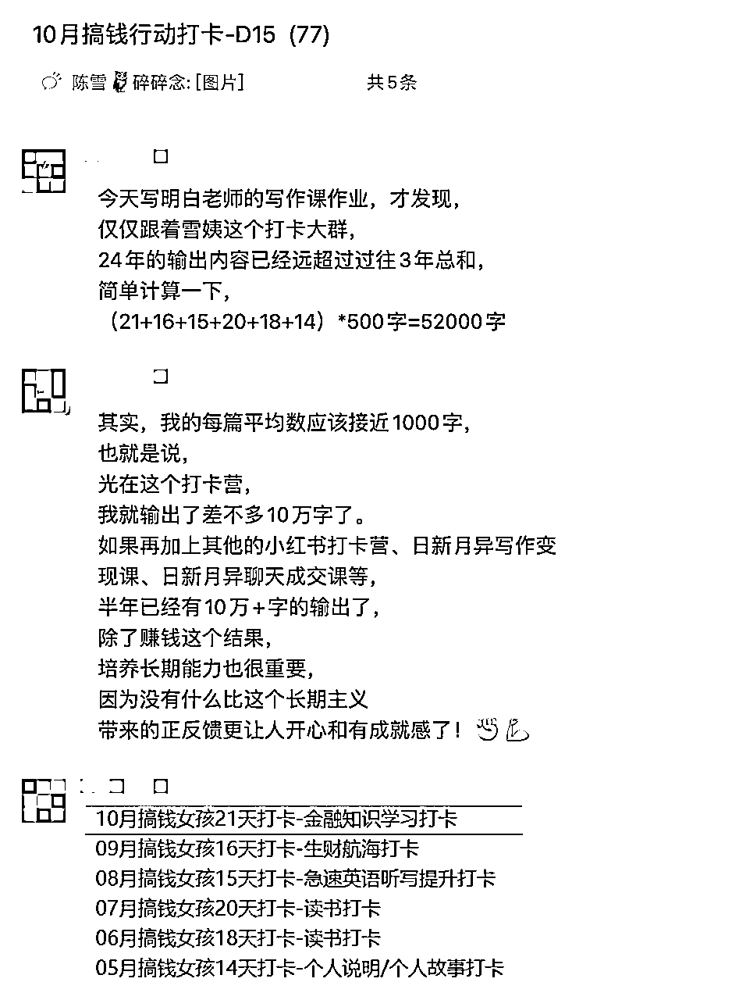

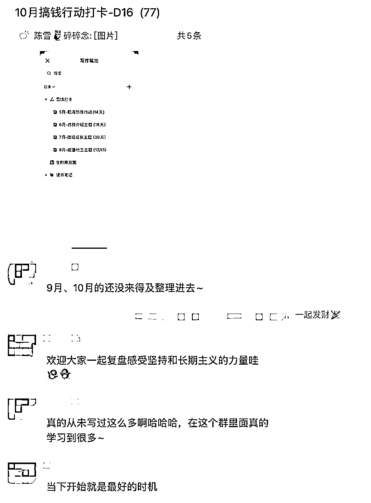

# 四、写在最后：接受不确定性

7月份我看到过一句话：“90-00后这代大多数人，35岁后可能都会面临被动创业。”当时也只当它有道理，毕竟身边失业的人太多了。没想到才两个月，它就在我身上应验了。

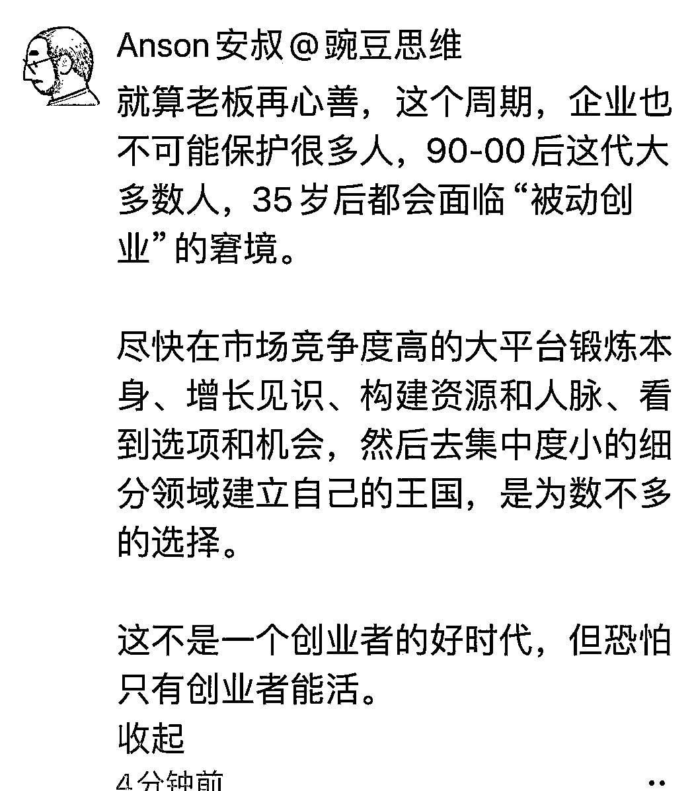

上了十年班，我彻底切换成轻创业模式。这条路的麻烦在于：没有确定性。它不像上班、上学那样有固定路线和线性生长，所有东西都得自己布局，所有结果都自己兜底。

每个阶段我们都会遇到新的问题，找答案的过程本身，就是不断刷新认知、推倒重来的过程。需要时间，也需要大量反思和自我观察。

天黑就开灯，下雨就带伞，难过就先难过。天亮以后，该复活就复活。

我希望自己能活成两种样子：发光和不发光。不发光的时候，是在为发光做准备。