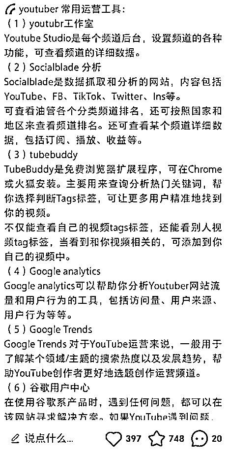
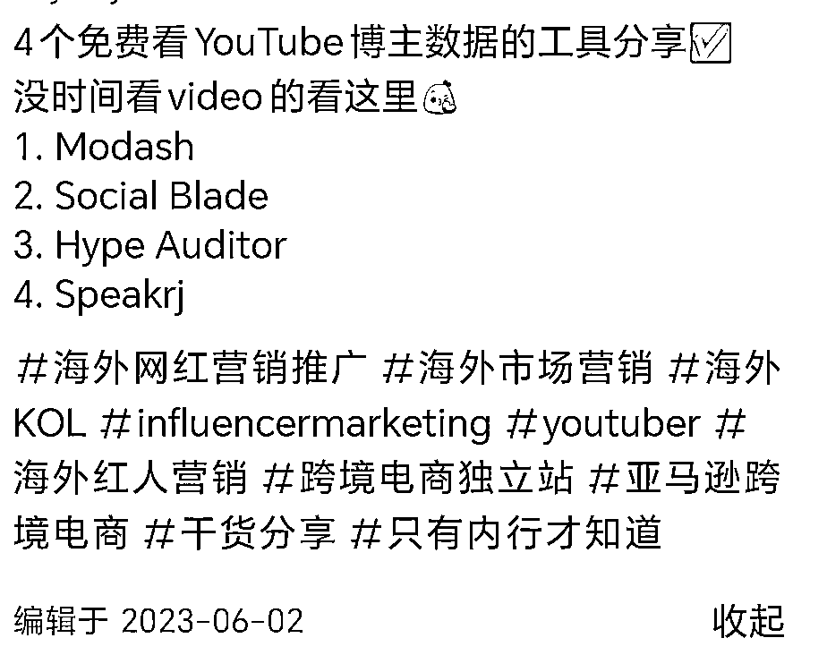
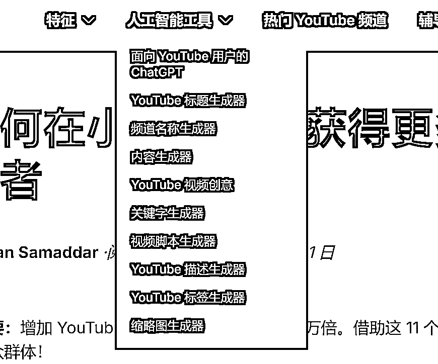
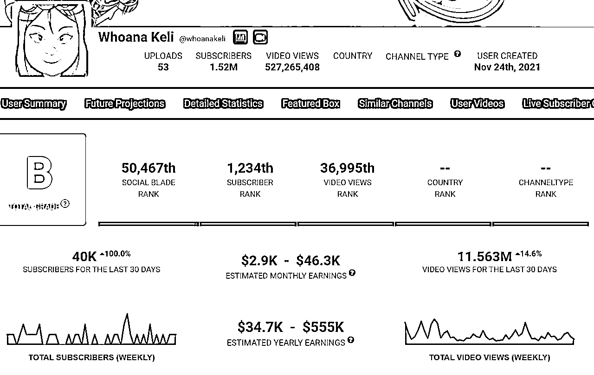
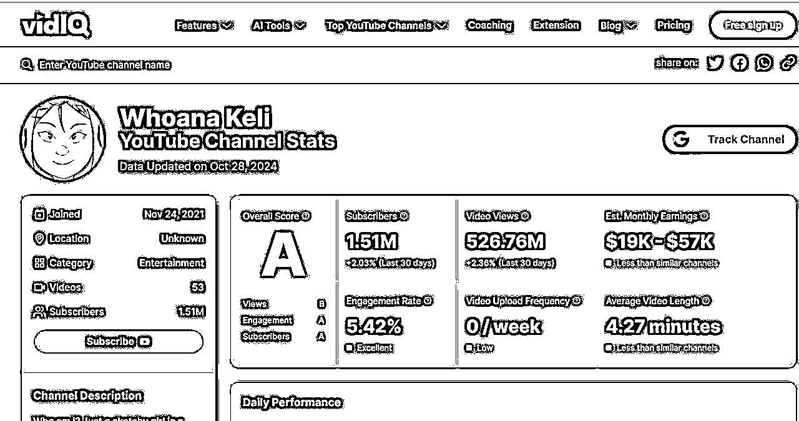
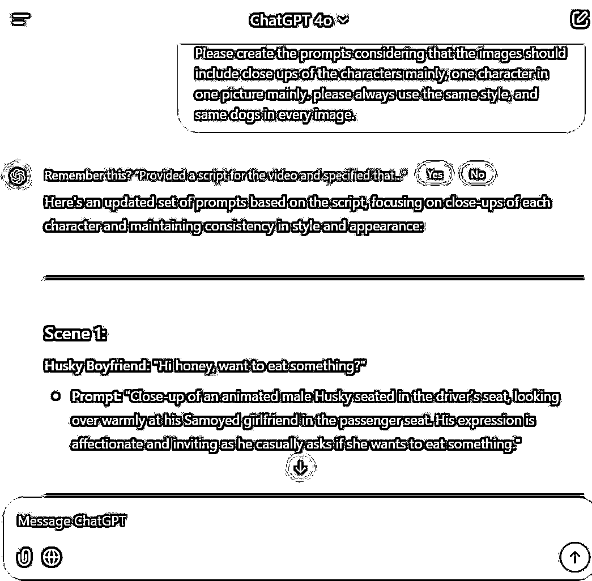

# 不碰代码、不懂海外市场，纯小白还能上车YouTube Shorts吗？

很多人问我：完全不懂技术，也从没碰过海外内容赛道，现在做YouTube Shorts是不是有点晚了？

我的答案是：能，但别一上来就埋头拍视频。我本人就是从小白一路摸过来的，这篇文章把我踩过的路、选对标、做内容、变现的完整思路整理出来，希望能给你省掉不少试错时间。

## YouTube Shorts是什么？先搞清楚再动手

简单说，这是YouTube为了跟TikTok抢地盘而推出的短视频功能，2021年9月面向全球开放后，迅速成了一块新的流量洼地，也是不少创作者做账号、攒粉丝的新选择。

至于钱怎么来，目前主流的方式有四条：

**第一，靠官方广告分成（YPP）。**

加入YouTube合作伙伴计划后，视频会自动被安排广告。硬性门槛是：近90天内订阅数达到1000，公开播放量累计达到1000万。广告收入的计算逻辑不复杂：用RPM乘以播放量换算出的千次播放数，比如“播放量÷1000再乘RPM”。

RPM怎么涨？关键看两样：观众的消费力，以及他们所在地区。一般来说，投资、金融、理财、房产、商业这些“离钱近”的内容RPM更高；美国观众对广告接受度高、购买意愿强，所以体育、名人八卦、犯罪故事这类内容在美国格外吃香，单价也常常高于其他地区。

**第二，接商业定制（业配）。**

品牌方提需求，你出内容，本质就是“恰饭”。能不能赚到钱、赚多少，很大程度取决于市场需求有没有那么大、视频里有没有清晰的广告位。如果你的受众是高价值人群，像电商、理财、创业圈层，商家才更愿意买单；这跟国内在视频里塞贴片广告是一个逻辑。

**第三，挂链接做联盟营销/带货。**

等同于国内短视频挂小黄车，但门槛更严：要成为YPP成员、订阅达到1万、目标市场必须是美国/韩国/印尼，且内容不能面向儿童。好处是每条视频可以挂最多30个商品链接，变现空间直接拉满。

**第四，卖自己的产品。**

很多创作者会用独立站在线卖货，然后在个人主页、视频评论区放上购买链接，把粉丝导到站外成交，这也是比较“硬核”的变现方式。

## 小白快速入场，我会分成四步走

### 第一步：先把变现路径想明白

别急着做内容，先问自己想靠哪条路子赚钱。我的目标很清晰：吃YPP广告分成，那我要的就不是精准粉，而是足够大的泛流量。

如果想靠定制广告或带货吃饭，情况就不一样了——视频里得留好广告位，从一开始就要想清楚自己的受众有没有消费力，否则后面接单会很难。

### 第二步：培养“网感”

做账号之前，先养出对内容的直觉。一方面要了解大众当下的情绪偏好：大家更喜欢轻松摆烂还是鸡血上进？喜欢看虐心悲剧还是治愈内容？另一方面要练出对选题的洞察力：看到某个方向，能马上判断它是不是精准踩中用户痛点。这种选题往往不需要拼标题，发出来就自带爆款相。

### 第三步：借助现成的数据工具

前人栽树，后人乘凉。我是第一次接触海外赛道，所以先去小红书这类网站翻了翻别人的经验，也直接问了GPT，果然很快就找到别人整理好的工具合集：

严格说工具不少，但好不好用得亲手试。起初我用的是TubeBuddy，总觉得哪里不对劲，又去Facebook查了下，发现它的官方账号已经一年多没更新了，团队多半处于停摆状态，索性换成了SocialBlade和VidIQ。VidIQ是专门分析YouTube的，自带不少内容制作和关键词筛选的AI功能，实用性更强，所以最后我留了它。下面这几张就是当时看的平台界面：

当然，第三方工具毕竟有局限，想要更精确的数据，最好还是上YouTube API或RPA采集，效率会高很多。但我一个没学过代码的小白，暂时只能手动来，实际做下来发现手搓也没有想象中那么慢。

### 第四步：选一条“踮脚能够到”的赛道

现阶段YouTube在重点扶持Shorts，如果你不打算靠接广、带货或自营产品赚钱，那最适合普通人的打法，就是找那种可复制性强、制作时间短、能批量生产的爆款内容类型。说白了：内容要有爆款基因，但必须是你踮踮脚就能做出来的。

像要求过高绘画水平的、专业动漫制作的、后期没法矩阵化运营的，我统统排除。按这个标准，我筛出了一批对标账号，很多AI内容号特别出乎我意料：有些号才发视频不久，粉丝只有几百，但大部分视频的播放都能突破一万，制作基本由AI承包，甚至没怎么改动Prompt。有的频道背景基本不变，只换跟动物相关的Prompt，三百多粉，却有不少上万播放的视频：

我还发现一个规律：要是那种“低粉爆文”账号，尤其值得参考。我一边用工具手动筛选，一边给候选账号做记录，重点关注三件事：

- 近期发得勤不勤：更新频繁，通常说明能赚到钱，作者才愿意持续做；
- 近三个月的流量稳不稳：别只看粉丝数，要看粉丝与播放的比值，以及最近作品的流量趋势；
- 近期有没有猛涨粉：最好从今年下半年才开始做，粉丝基数很低但翻倍增长。

这样筛出了20个潜在对标账号。按理说接下来就是照猫画虎，可当我兴致勃勃记录数据时，忽然发现有些两天前、十天前的内容流量开始断崖式下跌：原本几万播放的掉到几千，几千播放的掉到几百。这种内容务必避开——很可能是同质化太严重，观众看腻了；也可能是平台开始打压这类内容。

最典型的是“喵喵AI剧情视频”。10月之前火得一塌糊涂，可到了10月之后，有的博主浏览量直接少了近90%。说实话，那阵子集中刷下来，我一听到“Meow Meow~”的背景音就想吐；而且不少喵喵视频为了博眼球，还会安排“虐、惨、血腥”的情节，估计有一部分就是因此被限流了。我前后刷了20多个喵喵号，半个月内数据都跌得厉害。

反而那些剧情比较淡的治愈系小动物视频，以及笑点密集、贴近生活的梗类内容，数据保持得还不错。看来不管在哪个平台，内容为王这话永远不过时。

最终，我选了AI FurReal这个账号作为对标目标，专门模仿它那些有一两万播放的低粉爆款内容。如果你也想找参考，可以优先找节奏卡点强、音乐感更足的，爆的机会更大。

## 开干：第一条视频就这样来的

方向定了，剩下的就是执行。做图我用GPT-4o就够用，视频生成方面试了一圈，最顺手的是Runway。不巧那几天我人在路上，信号特别不稳定，Runway根本带不动。但我心里清楚：三天内不干，以后大概率更懒得干。所以直接用GPT-4o+剪映硬做出了一条视频。

具体做法是：先参照之前选好的对标账号，让GPT帮我写脚本，同时把配图也搞定。生成出来的图大概就是这种感觉：

之后丢进剪映配音、粗剪，再用VidIQ查了一些高频关键词，填进Tag标签里。

虽然成片比较粗糙，但我的第一条YouTube Shorts就这么上线了。对数据我当然有期待，不过心里也明白：按正常节奏，前一个月没反馈才是常态，刚发出去就有反馈，那属于幸运。

## 最后说点真心话

作为一个完完全全的小白，我以前从来没接触过海外视频赛道，但真正做下来发现：它并没有想象中那么复杂。我几乎每做一个新项目，最后都会有同样的感慨——原来比想象中简单。所谓的“我不行”，很多时候就是自己给自己设的限制。

当然，想做出更大的成绩，该学的技术和效率工具还是躲不掉。不懂代码、不会用提效工具，确实会直接影响赚钱速度，这点我也在补课中。

顺手分享两篇在VidIQ上看到的文章，一篇讲YouTube上47个适合做的细分市场，一篇讲小频道如何涨订阅，放到现在依然很有参考价值：

- 《根据观众评价，YouTube上47个最佳细分市场》：https://vidiq.com/blog/post/best-youtube-niches/
- 《如何在小型频道上获得更多 YouTube 订阅者》：https://vidiq.com/blog/post/get-more-youtube-subscribers-small-channel/?_gl=1*1o0ghow*_gcl_au*NDc3MDcyNDQwLjE3MzAzNzAyNTA.*_ga*MTE5MzM5NDY1Mi4xNzMwMzcwMjU1*_ga_EVDXLQBZQW*MTczMDQ1Nzk2NC42LjEuMTczMDQ1Nzk3MS41My4wLjgyOTU4MzcwMQ..