# 得物变现2.0：从零起步到稳定接单的全流程实操指南

> 参考来源：得物好物变现项目2.0分享

各位朋友好，我是龙哥，一名95后自由职业者，日常工作重心在📕赛道。算起来，距离上次聊得物已经有整整一年。中间没更新，主要有两个原因。

一来，得物只是我的副业，属于顺手收获，并非主力战场。我的核心业务在📕，平时把笔记同步过去，能产生额外收益就很满意了。二来，说实话，之前那篇内容被不少人改头换面做成了付费课程，这让我挺无语的。写得太细，容易被盗用；写得太泛，又怕对大家没帮助，还会被误会成引流。纠结之下，索性就没再动笔。

那为什么现在又愿意分享了？因为我想通了一个道理：不能因为个别人的行为，就放弃帮助真正需要的人。过去一年，陆续有朋友告诉我，照着第一版内容操作确实有了收入，这让我觉得自己的分享是有价值的。所以这次抽空把得物2.0的最新玩法重新梳理了一遍，全程无广，放心食用。

## 一、先认识得物这个平台

得物的前身是"毒"，最初以球鞋鉴定和交易为核心，后来逐步扩展至服饰、数码、配饰等多个类目。

目前平台的月活跃用户已经突破1亿，定位是综合性潮流电商。需要注意，它和抖音、📕这类纯内容平台有本质区别——得物本身具备交易属性，因此平台非常鼓励创作者挂载商品、承接广告，这为变现提供了天然土壤。

目前商单需求量较大的品类包括：

*   男女装
*   美妆个护
*   3C数码
*   配饰
*   箱包
*   腕表
*   鞋类
*   家居
*   食品饮料

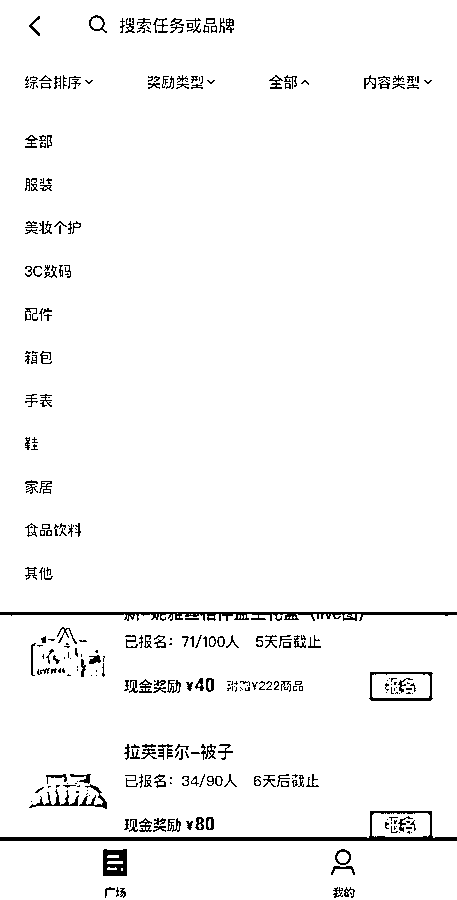

上述品类分布会随平台策略调整而变化。如果你想通过广告合作变现，可以选定一个品类深耕，也可以组合操作，比如"服饰+腕表"这类搭配。

## 二、为什么值得做得物？五个理由逐一拆解

### 1. 竞争压力较小
虽然去年分享之后涌入了一批玩家，但整体来看，得物的创作者规模依然不大，很多大V还没注意到这个平台。更关键的是，变现门槛低得惊人：零粉丝就能开始尝试，接商单也只需100粉即可。

### 2. 变现链路短而直接
得物本身是电商平台，允许创作者植入广告或商品链接，这一点比📕的规则宽松不少。另外，平台内商品客单价普遍偏高，商家有足够利润空间，投放意愿也就更强。而且变现方式比📕丰富太多，后面会详细讲。

### 3. 流量分配较慷慨
得物的创作者基数小，同时平台正在往"社区电商"方向转型，所以会给内容分发相对充足的流量。不过算法还在不断调整中，新账号早期可能遇到流量不高的情况，需要保持更新节奏。

### 4. 时间自由、拍摄门槛低
下班后在家就能完成拍摄，对场景没有硬性要求，一张书桌、一块背景布就能搞定。不少产品在户外也能直接拍。如果走视频路线，甚至可以完全不用出镜，只做剪辑就行。

### 5. 免单活动等于白拿产品
零粉丝就能参加免单活动，报名审核通过后，按规则发布笔记，产品就是你的。活动要求并不高，4张图加100字左右的文案即可。

0元购的具体流程如下：

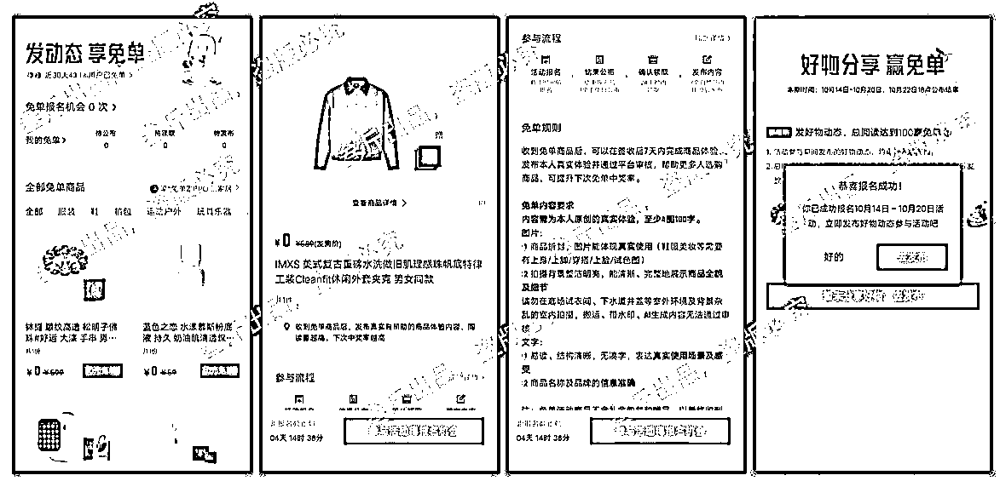

1.  在活动页面挑选感兴趣的商品并报名
2.  审核通过后获得免单资格
3.  坐等收货
4.  体验产品后按要求发布内容

再放几张收益截图刺激一下大家：

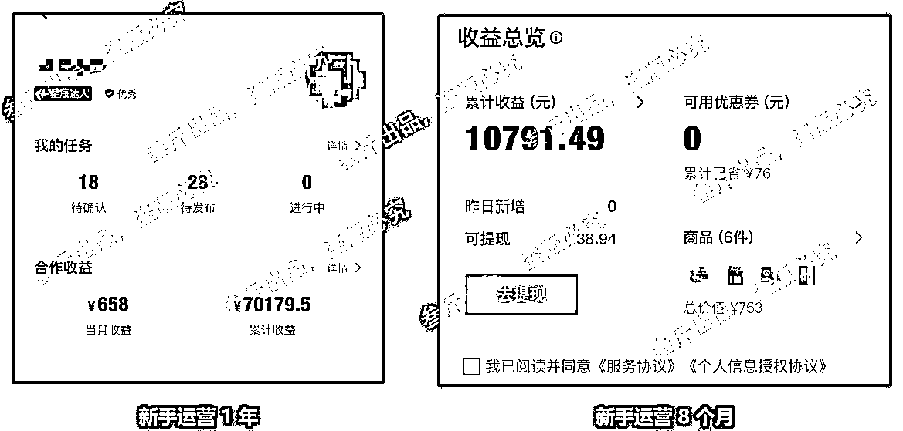

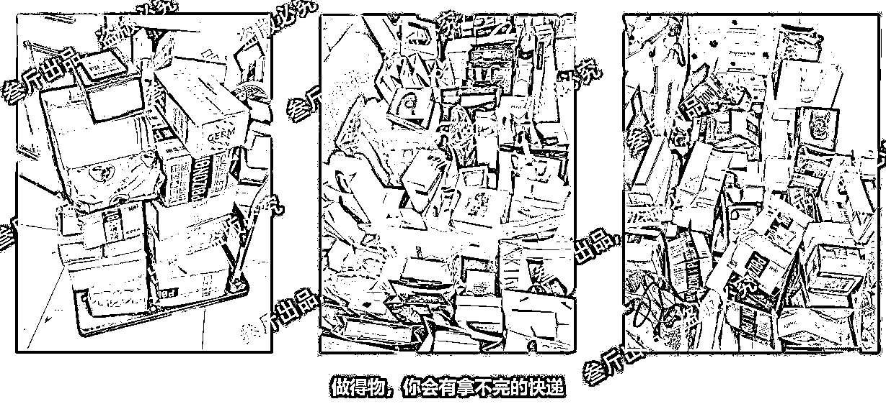

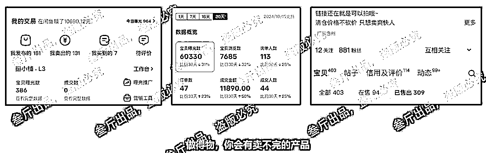

## 三、得物的主要变现方式有哪些？

### 品牌合作
📕的蒲公英平台要1000粉才能开通，而得物只需要100粉就能解锁好物分享官权限，直接通过引力平台接单。合作模式分两种：一是投稿合作，主动报名商家发布的推广任务；二是定向合作，达到专业达人等级后，商家会主动来邀约。

### 种草赏金
完全没有粉丝门槛，零粉即可开通。发布笔记时挂上商品链接，只要有人通过链接购买，你就能获得佣金分成。操作路径非常短，属于"发内容即有机会赚钱"的模式。

### 视频激励
零粉就能发布视频，达到一定条件后可以申请开通视频号。审核通过后，之后再发布视频就能获得平台给予的额外收益奖励。

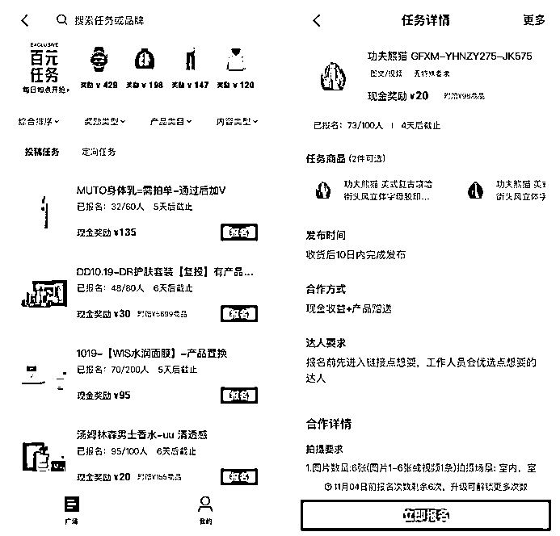

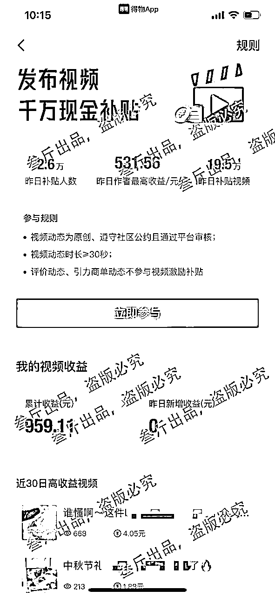

## 四、哪些人适合做这个项目？

做得好不好，看基础条件。以下几点是必须的：

1.  具备基础的审美能力。你得知道什么是好看的画面，也要清楚得物用户偏爱什么样的内容风格。虽然得物用户和📕重叠度较高，但两个平台的调性还是有差异，需要花时间去研究。
2.  掌握基本的拍摄或剪辑技能。最稳定的变现路径几乎都绕不开实拍，无论是拍产品图还是录视频，构图和光线的基本功要过关。想做视频收益的话，至少得会简单的剪辑操作。
3.  有充足的时间和持续的耐心。每天至少要留出2小时用于拍摄、修图和发布。得物新号的起步阶段会比较难熬，这也是一个筛选过程。我上一篇文章全网累计阅读过万，但真正坚持到现在的人不到100个。
4.  从产品供给来看，女生相对更有优势。平台上的美妆、护肤、包袋等品类机会更多，男生相关的品类会少一些。当然，潮男也有自己的空间，服饰、腕表、鞋类同样有不错的商单。

## 五、账号搭建全流程，一步步来

### 提前准备
*   一部拍摄清晰的手机。iPhone X或以上型号更好，同时要确保运行得物App流畅不卡顿，因为有些付费报名活动需要准点抢名额。
*   完成实名认证。所有变现方式都要实名，提现时必须保证账号和收款人一致。如果想做矩阵，务必提前跟身份证持有人沟通清楚。
*   布置一个拍摄角落。有自然光就行，窗台、书桌一角都OK。我自己当年的拍摄环境也很一般：

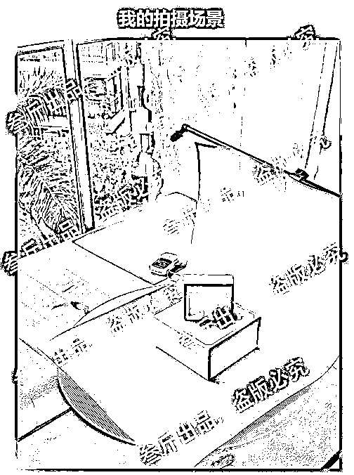

### 账号定位怎么做？
得物对定位的要求不高，抓住两个核心点即可：

1.  选择自己有兴趣或擅长的赛道——服装、3C电子、配饰等，挑喜欢的就行。
2.  选择离变现更近的方向——比如好物种草、开箱测评这类内容，天然适配带货场景。

### 头像怎么设置？
建议优先使用真人照片，不想露脸可以用AI生成的真人风格画像。信任度排序：真人头像优于AI画像，AI画像优于网络图。同时要确保头像风格与账号内容调性一致，别搞得太跳脱。

### 昵称怎么起？
*   跟定位挂钩，格式可以是"昵称+身份"，比如"搭配师小张"。避开生僻字，方便搜索和记忆。
*   降低传播成本，让人一眼知道你是干嘛的。比如你希望粉丝叫你X哥，昵称可以设成"X哥带你挑好物"这类。
*   直接在昵称中体现账号价值，比如"叁斤的穿搭日记"。

### 简介怎么写？
*   简明扼要地写出你的身份、领域和专业度。
*   做穿搭、好物分享、美食这类账号，可以适当幽默一下。比如"干啥啥不行，干饭第一名""著名奶茶品鉴专家"等。
*   如果专业度还不够，走成长型路线也很讨喜。比如"接受自己的普通，一起慢慢变美变自信"。

### 选题和内容怎么定？
最省力的方式就是从📕找灵感。你做什么赛道，就搜索该赛道的爆款内容，然后对标拍摄，一比一模仿构图和形式。

### 标题怎么取？
别凭感觉写。搜索同领域的爆款笔记，收集5到10个标题放进表格做拆解。

举个具体案例——想写连帽卫衣，先搜集这些标题：

1.  快看！！这可是今年很🔥的白灰色卫衣！
2.  这件卫衣我简直爱了！上身太绝了～
3.  好喜欢美式复古bm穿搭！复古又可爱～
4.  秋冬的衣柜一定要有的连帽卫衣！
5.  54💰冲下这件燕麦色刺绣连帽卫衣平替‼️

然后逐个拆解可复用的关键词：

*   第1个可以拆出"快看""今年很🔥"，这两个词能直接迁移到其他标题，把具体产品词换掉就行。
*   第2个能拆出"我简直爱了""上身太绝了"，同样可以复用，但"上身太绝了"最好搭配上身穿搭图。
*   第3个的"好喜欢""美式复古""bm穿搭"都是可迁移的大词，但整体标题偏平，选择性模仿。
*   第4个的"秋冬的衣柜""一定要有""连帽卫衣"是连成句的，不太好拆分，参考价值有限。
*   第5个的核心是"xx💰""冲下xx""平替"，适合低价款产品，把产品词换成自己的即可。

拆完之后，重写出几个新标题，比如：

1.  快看！xx💰冲下今年很🔥的xx卫衣
2.  今年很🔥的bm穿搭！上身太绝了！
3.  美式复古卫衣我简直爱了！
4.  好喜欢xx卫衣！秋冬衣柜一定要有！
5.  秋冬衣柜一定要有的xx卫衣！

起完标题从里面挑一个用。如果数据不理想，可以直接在原笔记基础上换标题再发一次。

### 封面建议

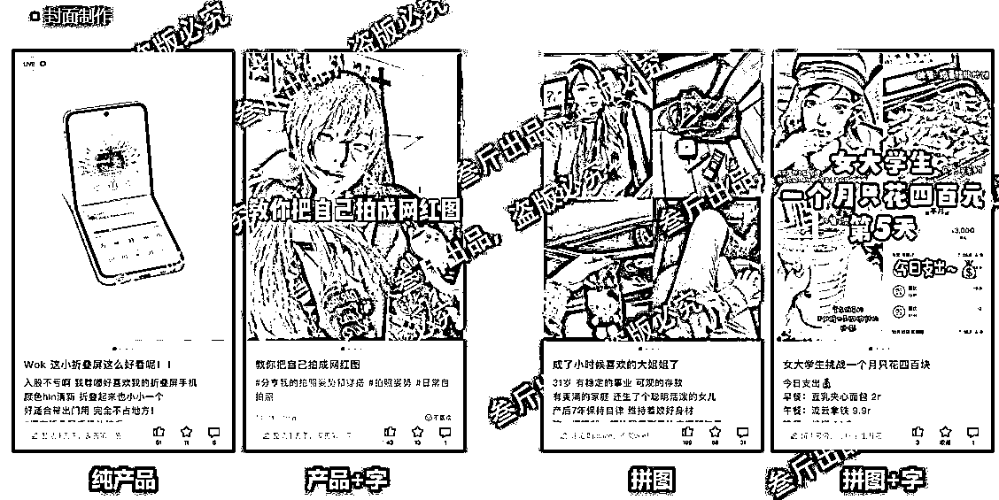

关于内容的深度运营，可以参考📕的做法，两边的内容制作逻辑高度类似。

## 六、怎么做一个能持续赚钱的得物账号？

### 品牌合作的两种解锁姿势

**投稿合作**：100粉开通好物分享官，在接单广场看到合适的任务主动报名，商家审核通过后即可开始合作。

**定向合作**：500粉且等级达到LV3以上可开通专业达人，自己设置图文和视频报价，等商家来报名。

投稿合作界面示意：

定向合作和百元任务界面：

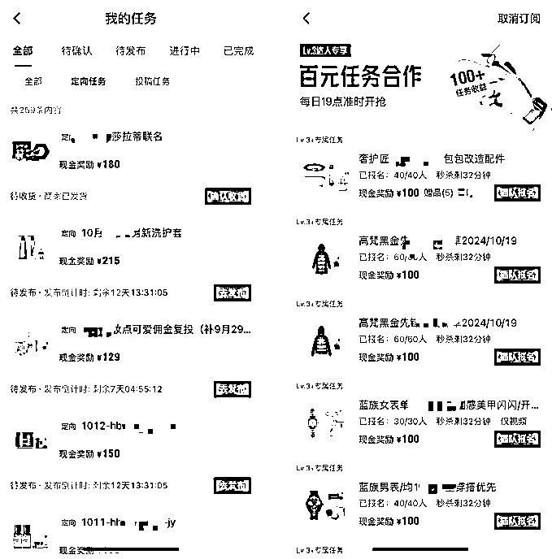

百元任务是LV3达人的专属福利，每天早上7点准时开放报名，通过率相对可观。

**提升报名通过率的技巧**：报名后别干等，主动添加商家的联系方式，把自己的主页发过去。多加一些商家，有些品牌方有达人群，会在群里直接内定合作人选。

**如何快速突破100粉**？以下内容类型更新勤快一些，涨粉速度会快不少：

*   小号互粉（不推荐，风险偏高）
*   多产品合集：一篇笔记里展示多个产品，信息量更足
*   明星同款：左边放明星图，右边放同款穿搭
*   娱乐营销号内容
*   影视盘点类内容

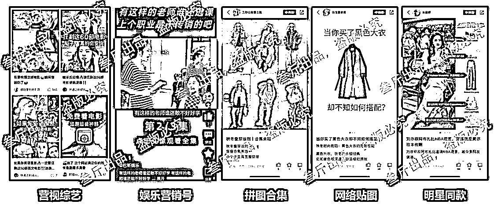

### 种草赏金怎么赚？

发笔记时挂上商品链接，引导用户下单购买，成交后就能拿到分佣。但有几个硬性要求得注意：

1.  商品必须在得物平台内售卖，站外链接无效
2.  内容必须带商品卡
3.  引力平台的商单和种草赏金不可兼得
4.  搬运、洗稿、直接用官方截图的内容，拿不到赏金
5.  图文建议4图+100字，视频建议30秒以上，更有利于获得赏金

### 视频收益怎么赚？

发布原创视频，满足条件后申请开通视频号，审核通过后，后续发布的视频就能获得平台奖励。

具体要求如下：

1.  至少发布5条20秒以上的视频，且这些视频的总阅读量要超过1000
2.  平台更偏向鞋靴、美食、家居、游戏、影视综艺等相关品类
3.  评价类内容和引力商单不参与视频激励

### 怎么突破收入上限？

说句实话，得物之所以不是我的核心项目，是因为收入天花板确实有限。受实名认证数量限制，我没办法大规模铺矩阵（比如同时运营5个以上账号），单个账号的月收入通常也就小几千。

我自己摸索了两个提升上限的方向，目前看效果还行：

一是**闲鱼转卖多余产品**。得物的好处是能领到不少大牌正品，有些自己用不上，挂到闲鱼卖掉就是纯额外收入。有时候单单这一项，一个月就能多出小一万。

二是**内容同步到📕**。做完图文笔记后，顺手同步过去就行。不用纠结流量好坏，内容做了不浪费，多一个平台多一份曝光。

## 总结

得物这个项目，最难熬的就是起步阶段。只要粉丝数上去了，拍摄水平不拖后腿，商单基本不用发愁。跟📕相比，得物的接单门槛确实低了不少。

希望这次更新能帮到你，祝变现顺利。