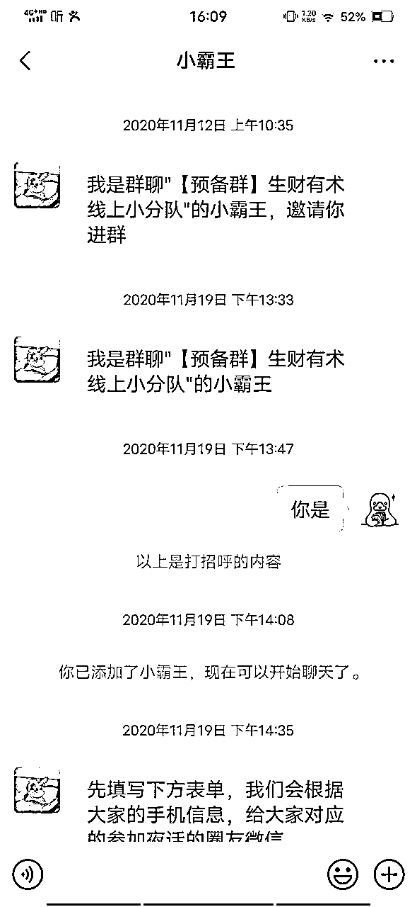
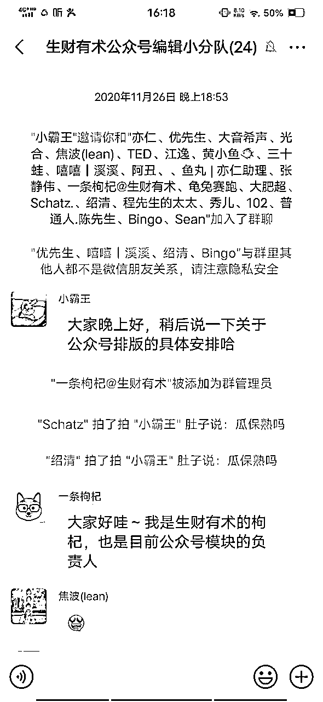
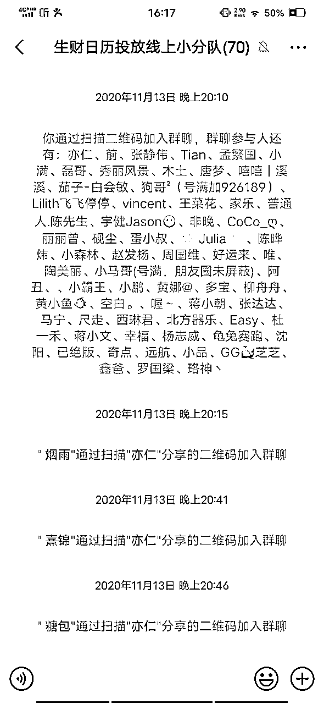
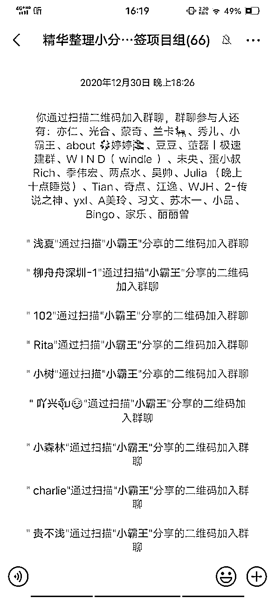
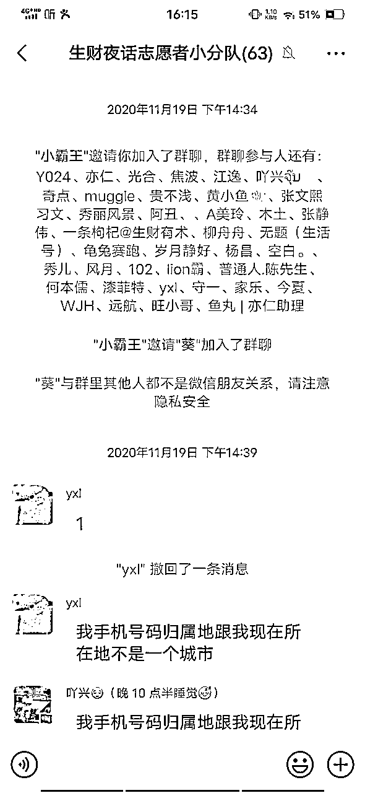
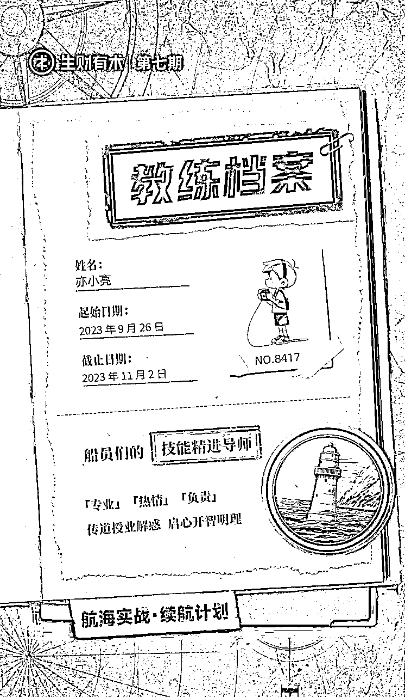
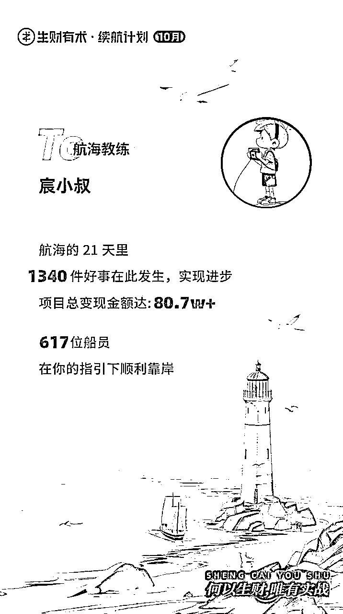
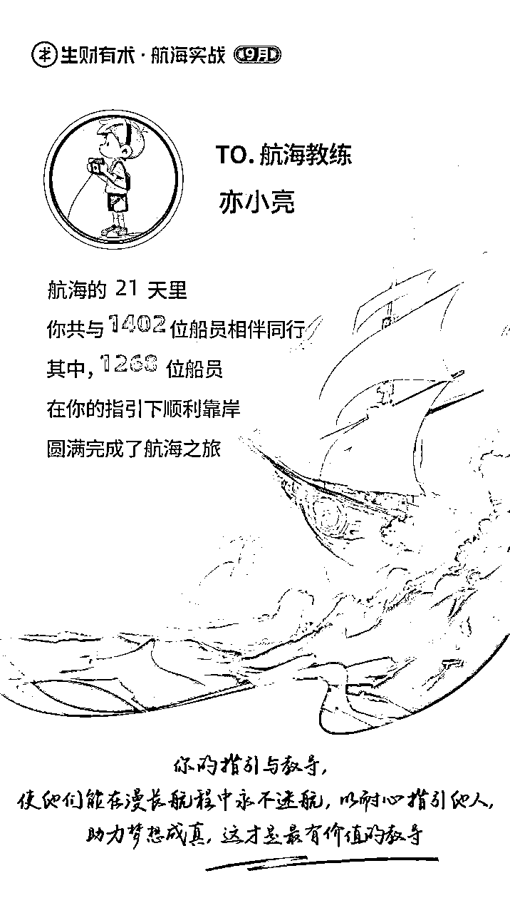

# 同一条航线，根本不是同一份作业
作者：龙哥

在赚钱动态里翻东西时，偶然看到@澄哥发的帖子
#航海好事# @澄歌

一下子把记忆拉回了过去，我做赚钱志愿者的那些年头，画面感特别强。

从认识这个人开始，我这几年的志愿经历几乎都和他交织在一起。

后来的人可能只记得航海志愿者这一个身份，其实只占冰山一角，你们有听说过这些吗？

我算得上是赚钱志愿组的早期成员。当初加入的动机很单纯，想在自己做项目之余，拆解赚钱的运转方式，顺带学学社群运营的内功。

随后就进入了大航海，也就是视频号大航海，之后是21天机制、续航计划，以及Mini航海。参与的志愿岗位越来越多，借着不同视角去看别人做事，对我自己的项目也是很好的补足。

从一开始做7、8次普通志愿者，到后来连着两次担任领队，评分都在A以上，就被邀请去👸号爆款写作船担任教练。累计下来已带了6期教练志愿，收获很大。

说到赚钱志愿者的成长路径，有意思的是早期并没有成体系，我恰好赶上了窗口期。从志愿者到领队，再到教练，这两次跃迁本身就是一次清晰的成长。

聊完和航海的交集，还是要说说做教练时观察到的一个现象，给即将上船的船员提个醒。

我现在带的是👸号爆款这个航次，所以就以这个项目为例讲清楚：

对一个项目到底懂不懂，关键看你落地的执行动作分成了哪几种。

第一种人追求门槛最低，直接洗稿搬运。

第二种人一上来就选最硬的路子，钻AI提示词。为啥说硬？因为不少人对AI其实一窍不通，看似在做👸号流量主，实则已经跑偏到另一个赛道了：写提示词、调提示词、做IP隔离。

第三种人选最省心的路子，让别人供稿，自己只负责一键发布。

细品一下，这明明是三个不同的项目，虽然表面都挂着靠流量主赚钱的招牌，玩法、难度、体感完全不一样。

这三种做法投入的时间、最终的产出也天差地别。

第一种看起来省时省力，实则后期很难通过平台审核。当然也有人会拿别人的稿子喂给AI，生成似是而非的新稿来提升原创度。听起来好像能行，但把周期拉长你就看明白了，长期用这种产出方式，系统会给你的账号打上重复垃圾的标签。

所以这条路慢慢在萎缩，但依然有人放不下，因为前期可能洗一两篇就爆了10W+，这种投入产出比太诱人，让人上头。和赌博一个道理。

第二种做法因人而异，差异极大。你以为调通一个提示词就等于通关，其实问题才刚开始。很多提示词不合格，或者说更准确的说，是写给系统看的不是写给读者看的。AI文章最致命的短板是缺人性语言，读者看多了，系统识别多了，同样会被贴标签。这时你又得回去反复调试提示词，最后发现你做的根本不是👸号项目，而是提示词调试项目。

我见过真正做成的案例，都是先吃透项目逻辑才动手，而不是上来就开号、矩阵化、自动化。很多人第一个号有点水花，就急着说自己做到了0到1，实际上这点收益多半来自新号红利、热点加持、关键词踩中，和真正跑通没有关系。

这类人占比最高，等他们铺开矩阵、搞自动化，再去跟别人讲“这项目就是拼概率，号越多钱越多”。新手就信了，开始找亲戚朋友开号，自己瞎做或者外包出去。自己做的人对项目逻辑完全不懂，不可能做好；外包出去的人，除了偶尔的金钱回报，并没有学到任何东西。当然有人会说我就是冲钱来的，我不争论，事实是把时间线拉长，几十个号能真正入池的可能就两三个，收益集中在这两三个上。

跑二三十个号的收入，往往还不如踏踏实实经营三四个号。

他们还会强调自己的时间利用率多高，一篇10秒、5秒就出稿。这时候你们做的已经不是同一个项目了，这点一定要清醒。

第三种做法，本质是把闲置账号和忙碌的人最大化利用。核心是找对人，必须找经验足够丰富、跑通过多个账号的人来操盘。交给只跑通一两个号的人，大概率账号会废掉，回头他会用概率来解释一切。

反正号是亲戚朋友的，也没什么损失，于是继续找号继续试。

这个项目确实有概率成分，但概率不能解释所有问题。

说这么多，那亮哥你到底怎么做的？

我选的是最笨的办法，先上手手搓，把项目的底层逻辑、爆款逻辑摸透，运营一段时间，再结合AI提示词，最后两个都不用了。

为什么这么说？

这点我在航海里讲过至少20遍了，每次日志点评我都会强调，先在某个领域把100篇文章写出来。比如我做娱乐号，我就写了100个明星，大部分是我特别喜欢的，剩下的是我特别讨厌的，这两种情绪都能提供持续动力。之后我就不用再造轮子了。

娱乐圈一旦有新瓜，只要是写过的明星，我就把旧稿稍作改动，通常前面部分不动，10分钟就能发出。明星的新剧也是同理。

你可能会问，万一这100个明星在短期内没有瓜、没有新剧怎么办？

很简单，你当初收集的素材不可能一次全齐，后来偶尔看到一段不为人知的小故事，都可以补进旧稿再发一次。你算算，一篇文章一年发三遍其实也不算频繁。

每个领域积累100篇的方法不一样，有的是按人物故事，有的是按事件类型，有的是按关键词切不同角度。比如一个关键词写10篇，那这个领域找10个关键词就够了。

以民生细分里的交通事故为例，关键词可以是女司机、大货车、油罐车、鬼探头、自动驾驶、货车盲区、追尾、失控等等。

还有一类是跳河跳桥，关键词就有跳河、跳桥、轻生、见义勇为、游泳等，这里就不展开了。

到这里你再看，这三种做法，哪一种花费时间最多、效果最差？

很多事，只要把时间线拉长，答案自然就出来了。

AI最大的幻觉就是让你以为可以偷懒。

最后补充一句，这些年我加入的星球不超过3个，龙哥盟每年都在续费。这几年对赚钱的认知一直在提升，感谢龙哥盟，感谢龙哥。

