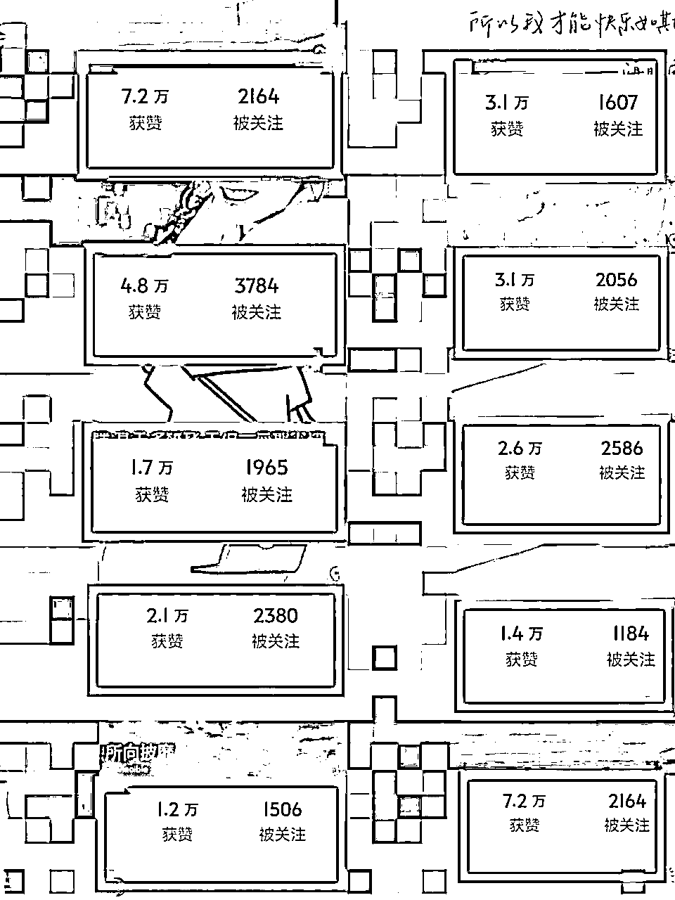
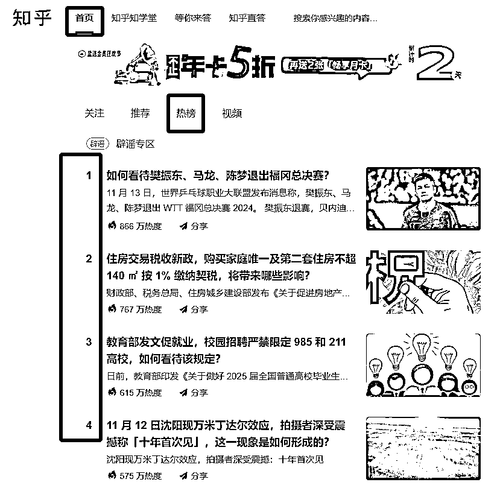
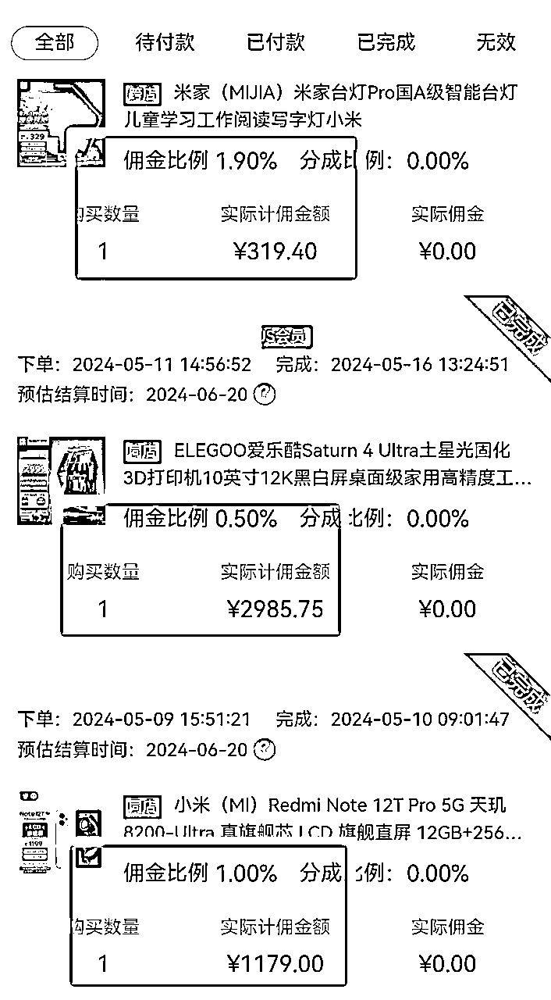
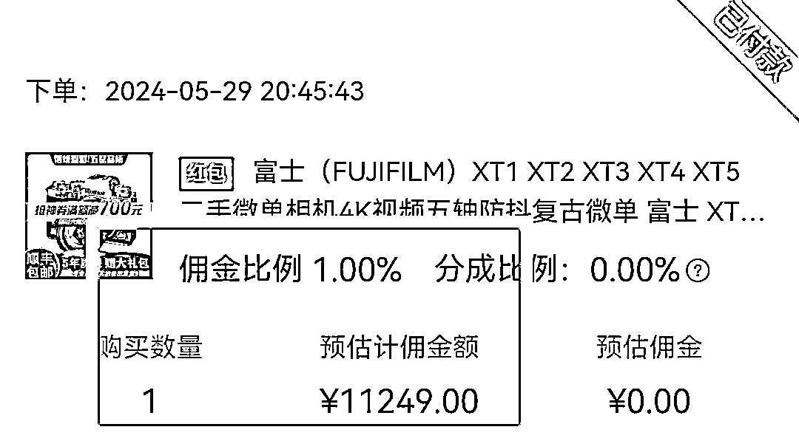
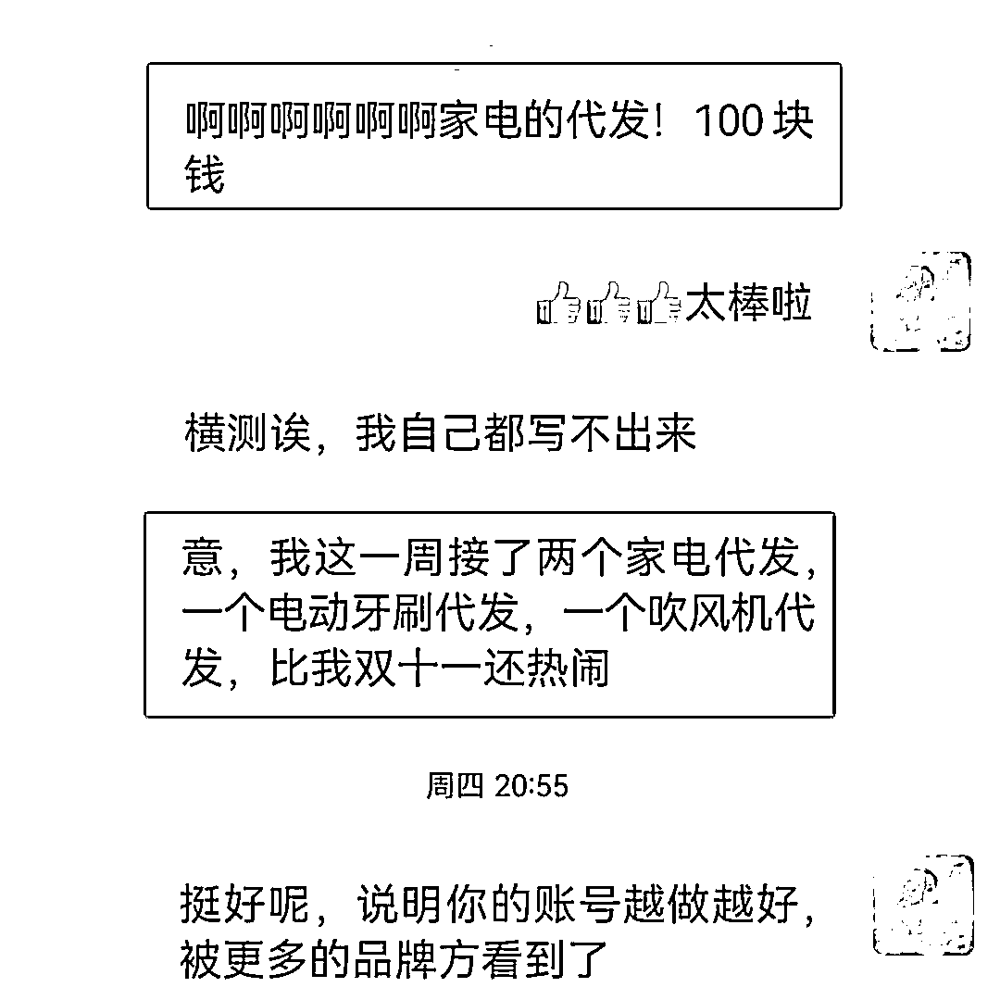
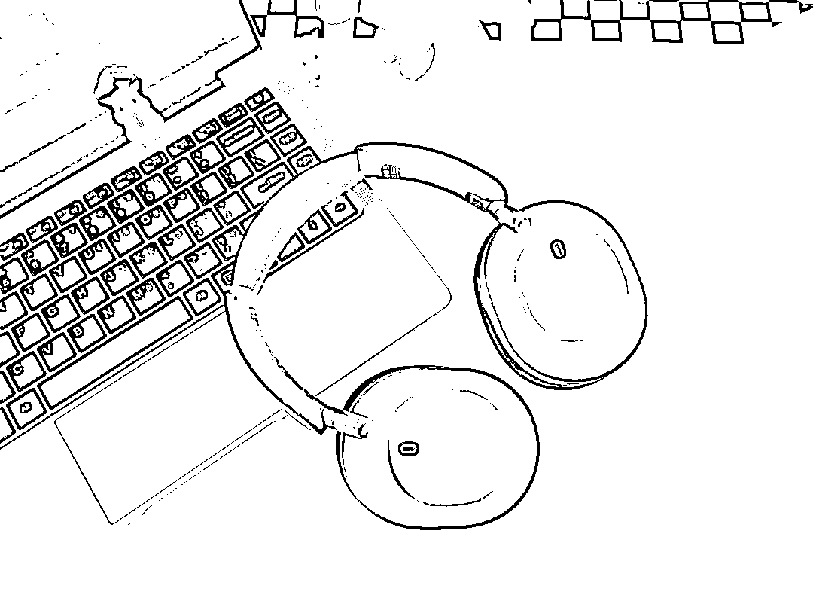
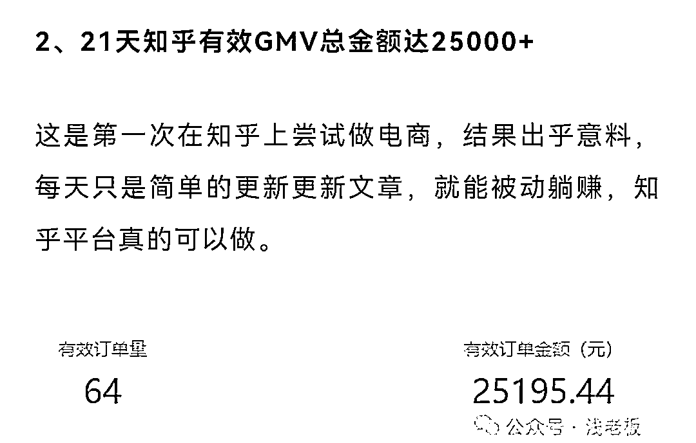
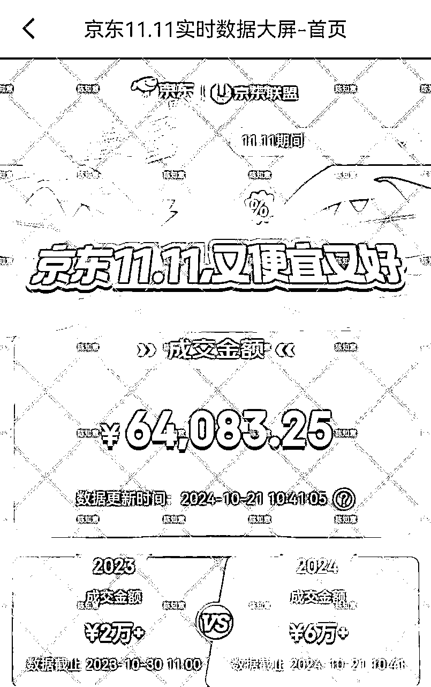

# 双11在知乎卖出23万，提成3000+：适合普通用户的内容变现实战

哈喽，我是龙哥，一名在全网累积了12万关注者的内容创作者，目前重点在知乎、🛰️订阅号和红书App更新。

我从2022年9月开始在知乎做内容，次年带着一些朋友尝试平台变现。一开始做的是门槛很低的平台活动，算是白拿福利。那阵子我做了个小培训，报名费百元上下，70%的人把投入赚了回来，做得勤快的几位甚至有2000多元进账。

知乎这类基础任务收益不大，一次几元到几十元不等，有些还能换来实体赠品。我带的伙伴里，有人拿过宫斗剧周边、智能手环，还有平台的大礼盒。

后来有朋友问我能不能教更深度的运营方法，想尝试做测评方向。于是我又办了进阶培训。到现在，我带过的知乎作者累计超过100人，其中30多位参加过进阶培训，里面已经走出十几个千粉账户。

我那组知乎账户加起来有3万粉丝，稿费加上实物回报超过几十万。今天的分享分成4块：

1. 双11在知乎卖出23万的关键操作
2. 一篇好用的商品软文怎么写
3. 提升知乎关注度的三招
4. 阶段总结

# 一、双11成交230000+

双11落下帷幕，我盘了一下后台：知意今年在知乎的成交额破了23万，提成加上激励金共3000多。

这是主力账户的数据。另外，我的小号有8000多粉，平时懒得打理，只写过3到4篇回答，京东渠道卖了1.2万，提成200多。

淘宝那边没有详细数字，因为绑的是我妈的身份信息，我一直看不到后台。等春节回家再翻吧，全是惊喜。

对比去年10万，今年算是有提升，不过离开我的预期还差一截。

下面是我回顾的几个关键动作，想在知乎卖货的可以先收藏。

## 1. 发布越早，位置越靠前

这次有两篇数据很好的回答，靠的就是一个“早”字。

国庆放假前，我就提醒大家可以把双11的内容写起来，提前占好位置。

我自己也在假期里赶完了稿。当时同题内容很少，回答有机会挤到搜索前面。

能出稿快，是因为推荐的产品都是我平时实测过的。我只需要把之前的测评浓缩到几百字，放进推荐区域。

这样既省时间，也能把数据战报发给商家，争取更多的合作。

## 2. 选那些大盘大的问题作答

在知乎上想看的人多，选对问题就赢了一半。我常用的工具是知乎官方的选题推荐，下面这个  就是入口。

这个页面会展示近期关注度高、但还没多少人答的问题。

另一个关键是盯热搜。双11、618、双12、年货节这类节点，热搜里会冒出很多相关问题。平时每隔一会儿刷一下，遇到能答的立刻写，就能吃到免费曝光。

不过热搜题的时效就这么长，手慢就没肉了。这是热搜栏目的样子：

所以大促稿最好提前囤好。这样热搜一出现就能秒发，不耽误上班，也不打乱生活节奏。

## 3. 用红包留住下单的人

我为什么让大家重视双11、双12？因为这种节点有红包玩法。

在回答里插入【红包】，用户领了之后去付款，哪怕他买的不是我写的商品，只要用了我的红包，我就能拿到提成。

这个功能需要账户开通知乎5级推广才能用。

# 二、商品软文怎么写

先看实际效果吧：

看下图：知乎上商品卡片的样式长这样：

有人下单后，我后台的提成记录如下：

想在知乎挂商品，先要满足条件。知乎平台的推广分为3级和5级。3级只能带知乎自家商品，选择少，不容易成交。5级的范围就宽很多，像京东、淘宝这些主流电商的产品都能带，出单也容易。

开通5级推广需要同时满足4个条件：

期间千万不要违规，否则会推迟开通时间。

想要顺畅通过，下面的提醒要收好：

权限到手后，把知乎账户与京东联盟App、阿里妈妈App绑定，就可以在回答里挂商品卡片了。

我去年写的文章，今年还在自动出单。只要文章不删，迟早会被人翻到，一旦有人买，钱就进来了。

这就叫持续收入。比如618的时候，我后台卖出一台一万多的相机，提成拿了100多。

完全没费劲。平时每个月靠商品推荐能赚几百块，到了大促月就是上千。

对普通用户来说，副业能有几百上千的进账，已经很棒了。

5级权限还有一个好处：接单。不少商家会主动找上门。

比如我谈过一个冷雾风扇，对方给我“产品+稿费”。商家提需求，我写稿，审核通过后我发布到我的账户上，并挂上对应的商品卡。

还有朋友接过代发稿，商家写好文案，他直接贴到自己账户上。千粉账户一篇100元，接两篇就当零花钱了。

所有这些都先要拿5级。

## 写商品软文的三个心法

一是摸透产品。先想清楚它卖给谁，有什么卖点，能替用户解决什么问题。卖东西总得让人明白这玩意儿好在哪。

二是放进真实场景。不要只夸参数，要写自己和它相处的细节。

比如一副耳机，我买它就是因为颜值高，戴出门拍照特别“上镜”。这么写出来，比空喊“好看”有用得多。

真的把自己代入进去，看的人才有感觉。

最近合作的一款耳机，我特别喜欢。做了知乎之后，我算是实现了小电器自由，快乐！

下面这些电子小物件，都是知乎带来的：

三是多写。新手想靠两三篇文章就爆单，不太现实。除非赶上618这种时机，再配合一些方法。

像我搭档浅浅，拿了我给内部学员的涨粉技巧，不但关注者自动变多，还写出一篇几十万阅读的内容，21天卖了2.5万多。

没有技巧就靠量。但多写不等于灌水，每一篇都要有真实体验感。

按我说的方法，先写个一百来篇，大概率能出单。如果写到一百篇还没有效果，可以来让我免费给你看看号。

权限有了，商品卡怎么挂？千万不要把推广卡片直接贴进回答里，那样容易被人举报。

正确做法是：电脑端打开后台，找到“钱包”按钮，搜索要带的商品，点一下添加。

之后会出现这个页面：

把卡片嵌进文章，后续有人下单你就能获得提成。等于多了一条自动赚钱的路子，挺香的。

# 三、让知乎账户获得更多关注的三个方法

知乎的回报其实不低，做到千粉就能对接基础合作，万粉之后选择更多。

增加关注者这件小事，拆到底不外乎三个逻辑：实用价值、情感共鸣、长期分享。

分享三种容易上手的方式：

## 1. 回答人生体验类的问题

这类问题常年在关注榜上，阅读量很大。

可以去别的平台收集一些生活感悟，整理后作为回答发上去，文末注明：内容来源公开渠道，如侵删，联系作者立即删除。

平时我也会备一些名人、作家的金句，找对口的题目整合上去。

一旦出现高赞，一天多几百上千关注者很常见。

注意：如果用AI写作，记得在文末标明由“AI 生成”，平台会查的。

## 2. 追热搜：明星与时事

在电脑端打开创作者后台，会有“近期热门”“潜在高分”两个栏目，去里面找能答的题。热搜的有效期很有限，看准了就得马上动手。

写回答时记得立人设，每条末尾都放一段个人介绍，更容易吸引关注。

除了后台，知乎站内的搜索栏也会滚动推一些有潜力的新题，这种题曝光通常不错。

表达观点时尽量不要情绪化，否则容易招惹骂声。知乎上的用户整体讲理，但还是克制一点更好。

这种内容提供的是情感共鸣，自然阅读量都很高。

## 3. 整理搬运

从知乎或红书找现成的好句子，整理到同一个回答里，也会有不错的效果。注意声明“内容来源于网络，如侵删”。

找那种“句子”“文案”类的问题，把整理好的句子贴进去就行。

比如很多人爱看的“发疯文学”，在哪一个平台数据都好。

这背后的逻辑还是情感共鸣。延伸到抖音、快手、🧣、红书，都一样有效。前两年有人靠这个在短视频平台吸粉几十万上百万。

我最近也在实验别的路子，效果还行。方法很多，找到匹配自己节奏的，坚持下来就能看到反馈。

# 四、阶段回顾

有兴趣的话现在就动手，我给的这些内容全是能直接落地的步骤。

之前有朋友跟着我在订阅号里写的方法，去玩知乎的有奖活动，已经开始收到平台积分了。看到真的帮到大家，我也很开心。

别嫌几元钱少，大家都是这样从1块到100块，再到1000块、10000块的。

最终卖货效果，和关注数、账户权重有很大关系。两个账户关注者差不多，权重更高的那个，在同一个问题下排名更靠前，曝光自然更大。

所以提升权重也是正经事。想在知乎多卖货，先认真养关注度。

想系统提升知乎关注数的朋友，可以联系我，我这边有整理好的资料免费送。

今年双11的销量比去年好，但我自己在两件事上不太满意：一是京东的业绩没有预期高；二是提成比例偏低。

先从第一点说。双11开始后的7天里，我的京东销售额就已经破6万。

但这次正好赶上“杨笠”话题发酵，后续退单不少，趋势没有继续往上走。到双11当天结束时，京东销售额停在13万多。

淘宝那边开始得晚，红包发得晚，但在更短的时间内也做到了10万，增速比京东更快。

这是外部因素，我左右不了，也就不纠结了。

第二点是提成比例。这次带的产品，很多提成只有0.1%、1%，所以23万成交额换算下来，到手三千多。

平时卖一个小电器，提成起码十几块；商家给特别提成的话，30到40元甚至100元都常见。

所以下一步我要把重心放到提成高的小电器上。同样是卖1000块，抽50块总比抽20块划算。

比如下面这个合作品，提成比例20%，卖一台能拿150以上。

总体来说，这次是有进步的，中间试了一些新做法，带来好几万额外成交。敢试错，也是我一直往前走的原因。

留点遗憾是常事，知道问题出在哪，调一调方向就行了。

我也想对看文章的人说：改变的关键是先动起来。

不必等万事俱备，先把第一步踩出去，哪怕坑坑洼洼，也胜过反复设想。

一个不完美的开头，远好过一场没完没了的准备。慢慢来，只要在前进就好。

想继续搞内容创作，欢迎来和我聊天，一起玩。