如果你正想在自媒体里找一个“投入产出比”还不错的方向，那知乎确实值得你认真看一眼。我是陈知意，全职做自媒体，全网差不多12W粉丝，主要在公众号、知乎和小红书上分享实操经验。今天想跟你聊聊，为什么我这么建议普通人从知乎入手。

我是2022年9月正式做知乎的，第二年就开始带学员一起变现。最早我们玩的是知乎那些门槛很低的活动，基本属于“顺手薅羊毛”，简单好上手。当时做了个百元左右的入门课，结果70%的学员都把学费赚回去了，有几个执行力强的同学，甚至通过这类小活动变现了两千多块。

别小看这种入门级活动，虽然单次收益通常几块钱到几十块钱，但运气好的时候还能拿到知乎官方周边。我的学员里，有人收到过甄嬛传的周边、荣耀手环，还有各种知乎礼盒，算是意外的快乐。

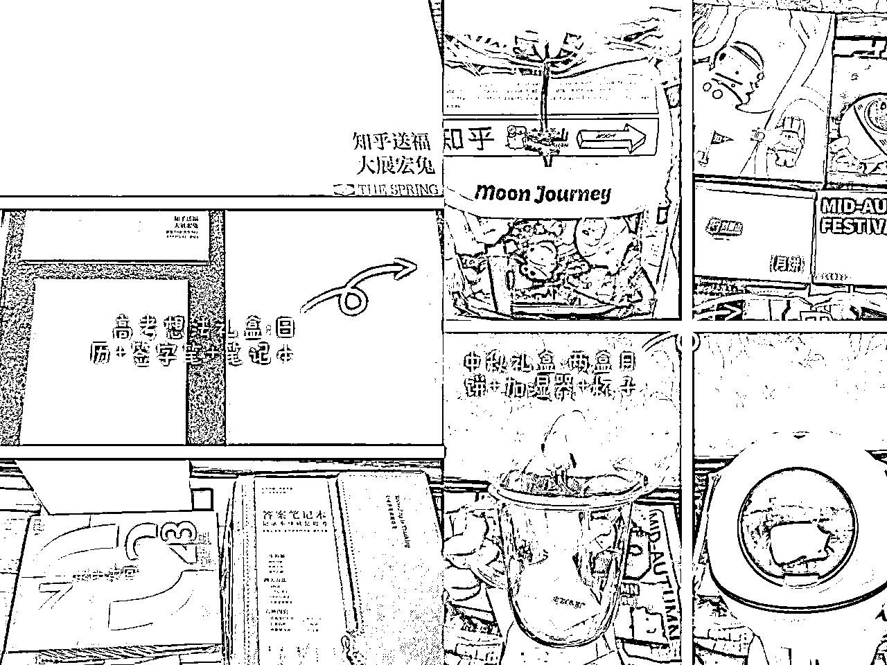

后来有学员问我能不能带他们认真深耕知乎，想做测评博主。于是我又开了知乎高阶变现营。到现在，我带过的知乎学员加起来已经有100多位，其中30多人在高阶变现营里学习，目前已经培养出了十来个千粉博主。

我自己现在知乎矩阵有3W多粉丝，靠稿费和产品价值赚到了六位数。基于我自己的实操经验，今天重点分享四个部分：一、双十一带货GMV23万，我做对了什么；二、一篇好物带货文章怎么写；三、知乎涨粉的三个方法；四、复盘总结。

全文5000多字，读完大概需要8分钟。

# 一、知乎双十一带货GMV230000+

双十一刚结束，我算了一下，今年知乎带货卖了23万多，佣金加奖励到手3000块。

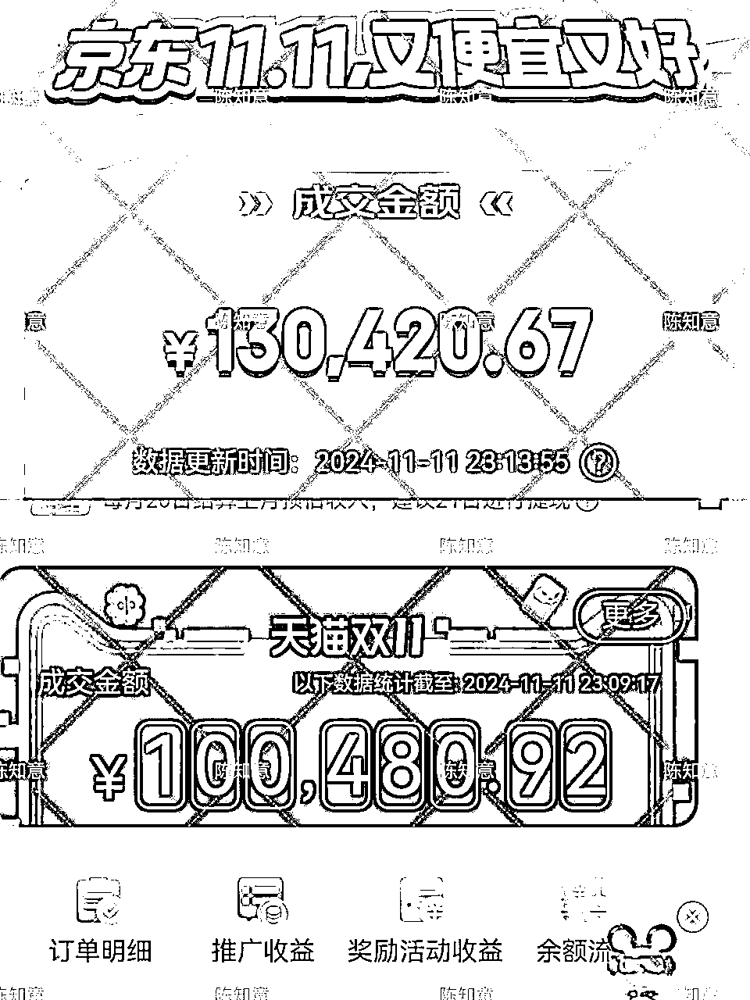

这只是一个账号的数据。我还有一个8000多粉丝的知乎号，说实话那个号我有点懒，心思没怎么放上去，就写了三四篇回答。结果京东那边还是带了12000的货，佣金200多。

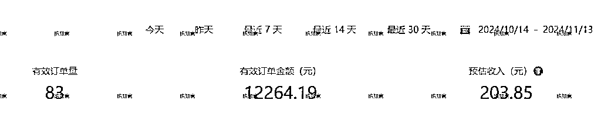

至于那个号的淘宝带货数据，我自己也看不到，因为当时是用我妈的身份信息开通的。她不太会操作，所以只能等过年回家再看了。哈哈，反正都是惊喜。

比起去年的10万GMV，今年算是有进步，但还有继续提升的空间。

今天这篇文章就是复盘和总结经验。想在知乎带货的朋友，建议先收藏再慢慢看，算是压箱底的东西了。

## 双十一带货我做对了什么？

## 1、文章发得早

这次双十一，我有两篇数据不错的内容，核心原因就是发布得早，抢占了先机。

国庆假期快结束的时候，我就跟学员们说，可以开始准备双十一的文章了，提前布局。

我自己也趁着国庆假期把双十一相关的内容发了出来。那时候写这类文章的人还不多，所以很容易拿到搜索排名的靠前位置。

能写得这么快，是因为我推荐的产品基本都是平时合作过、自己实测过的。我只需要把过往写过的一些测评内容，精炼成几百字，放在文章的商品推荐部分就行。

这样既省时间，又方便出单。万一产品在大促期间卖得好，还能及时跟品牌方同步成绩，以后合作机会也会更多。

## 2、选流量大的题目

在知乎想获得更多流量，会选题特别重要。一定要选那些热度高、流量大的问题去答。

第一，可以利用知乎官方的选题工具——吐司。

吐司网址 https://tools.zhihu.com/questionselection/recommend

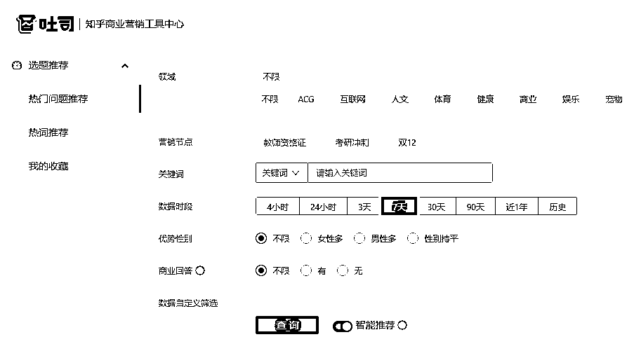

可以去上面找近期比较热门、但回答人数还不太多的问题，尽快去写。

第二，要多盯热榜。

像双11、618、双十二、年货节这类大促节点，知乎热榜经常会出现相关问题。平时多留意热榜，看到高流量的问题马上作答，就能蹭到一波自然流量。

这里提醒一下：热榜问题是有时间窗口的，热度不会一直持续。所以看到题目以后，一定要趁快写。

这就是知乎首页的“热榜”入口

所以提前准备稿件很重要。像双11、双十二这种固定节点，能提前备好稿就提前备好。这样热榜一出现，你就能快速抓住机会，也不用耽误正常上班和生活安排。

## 3、发红包锁单

我为什么一直建议大家抓住双11、双十二这种大促机会？

因为大促期间带货有一个很明显的优势：可以通过发红包来“锁单”。

也就是说，在回答或文章里插入【红包】。用户哪怕最后没买你推荐的东西，只要他领了你的红包，之后在淘宝、京东下单时用了这个红包，你依然能拿到佣金。

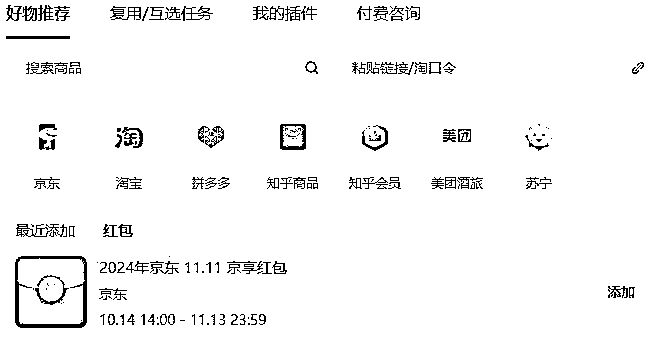

当然，发红包的权利也是有前提的——你得先满足知乎账号开通5级好物的条件。

接着说大家最关心的：

# 二、一篇好物带货文章怎么写？

先看两个截图：

这是知乎上挂商品链接的卡片

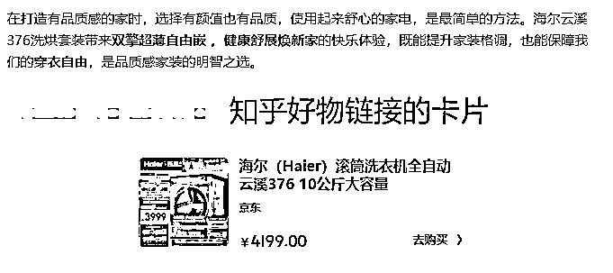

这是别人下单后我这边获得佣金的记录

在知乎要拥有挂商品链接的资格，是有门槛的。知乎好物分为“三级好物”和“五级好物”。

三级好物能带的产品很有限，基本只能带知乎自营内部的商品，选择少，出单也难。

五级好物就不一样了，可选范围广很多。像我们日常常用的京东、淘宝、拼多多上的大部分商品都能挂，相对容易出单。

想开通5级好物，需要同时满足下面4个条件：

这里提醒大家，一定要避免违规，否则会耽误开通好物权限的时间。

## 避免违规，才能顺利开通5级好物

重点注意这几个细节：

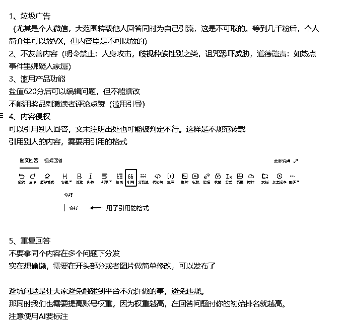

拿到权限之后，把知乎账号绑定【京粉】和【淘宝联盟】APP，就可以在文章或回答里挂上自己的专属商品链接了。

我去年写的文章，到现在偶尔还会出单。

也就是说，只要你不删掉文章，它就一直有曝光机会。有人在浏览时看到你的推荐并下单，你就能一直拿佣金。

我之前聊过主动收入和被动收入的概念。知乎好物带货，就是很典型的被动收入渠道。

比如今年618期间，我后台出现了一个大单——有人买了一万多的相机，我的佣金是100多块。

几乎没怎么费力就赚到了，还是挺爽的。

平时知乎好物带给我的佣金每月大概几百块；而遇到618、双11、双十二这种大促，收益能到上千块。

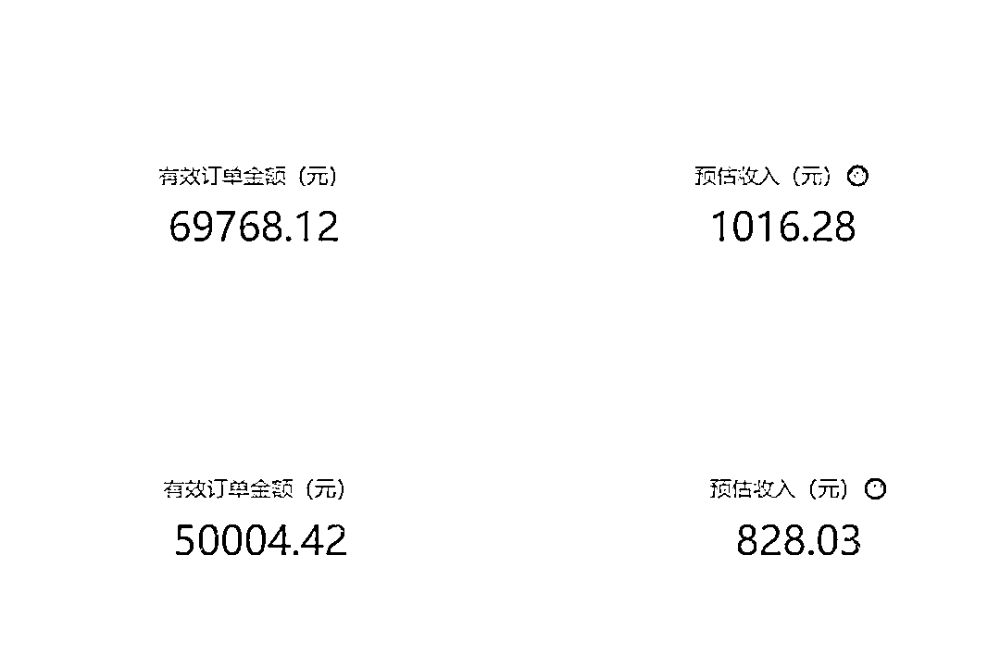

对咱们普通人来说，副业被动收入能稳定有个几百上千块，真的挺不错了。

而且开通五级好物权限之后，除了自己写文章带货，还有机会接品牌商单。

很多品牌方要在知乎做推广，就会找人合作。

比如我之前接过一个冰雾扇的项目，合作方式是“产品+稿费”。

品牌方提出合作要求，我来写稿，审核通过后发布到我的知乎账号上，就可以了。

要注意，发布时一定要挂好物链接，而且是合作的这款商品的链接。

再比如我有学员最近接了代发合作，那种更简单。品牌方直接把文案发过来，学员复制粘贴发到自己账号就行。

千粉一篇100元，接了两篇，赚点零花钱真的不难。

所有这些机会的前提，都是先开通知乎五级好物权限。

## 一篇好物推荐文怎么写？

第一步：了解产品详情。

搞清楚这个产品是卖给谁的、有什么特点、主打卖点是什么。

想把产品卖出去，你总得先讲清楚它的功能，能帮用户解决什么问题。

第二步：代入真实场景。

结合自己的生活场景去写，才会更真实。

打个比方，如果写一副耳机，我不会只说“这个耳机颜值高”。我会写“我太喜欢它的颜值了，出门拍照经常戴着它，特别出片”。

这样的内容才有画面感，比干巴巴的夸赞更容易打动人。

真实使用场景的代入，会让读者更容易产生购买欲望。

ps：这是我最近合作的一款耳机，我真的超喜欢。自从做了知乎，基本实现了小家电数码产品自由，太幸福了。

下面这些，都是做知乎给我带来的数码小家电：

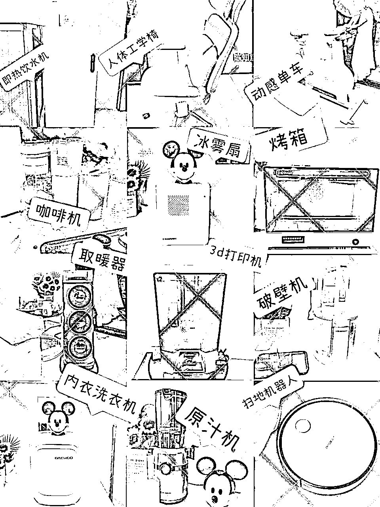

第三步：多写。

新手想通过一两篇文章就在知乎开单，说实话很难。

当然，如果方法对，再赶上类似618这种大促节点，也是有机会的。

比如我的合伙人浅浅，用了我分享给私教学员的私密涨粉方法，不但实现了被动涨粉，还写出了几十万浏览量的爆款。其中一篇文章在21天内做到带货GMV25000+！

但如果你没有特殊方法，就是老老实实写，那一定要多写。

多写不等于“水”文，同样要用心。推销产品要真实代入自己的使用场景——重要的事情说三遍。这样更容易出单。

如果你不想专门报课学习写作方法，那就按我说的方法先去写，写个百八十篇，大概率会有机会。

万一你按我的方法写了百八十篇还没出单，欢迎来找我，我免费帮你看号一次。

好，开通知乎好物权限之后，怎么插入链接呢？很简单：

## 插入链接的方法

有人跟我说，他之前直接把商品链接复制粘贴到知乎上，结果被举报，账号违规了。这样操作确实不行。

正确方法看这张图。这是电脑版页面，找到【钱袋子】，搜索你要带货的商品，点“添加”就行。

然后会出现下面这个页面：

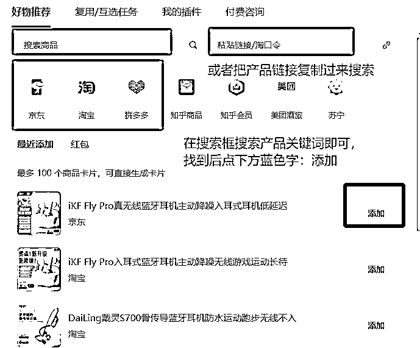

把产品链接添加进自己写的好物文章里。之后有人通过你的文章购买了产品，你就能获得带货佣金了！

学会知乎好物的玩法，等于给自己开辟了一个被动收入渠道，真的挺香的。

# 三、做知乎博主涨粉的三个方法

知乎平台的整体回报率其实挺高的。做到千粉之后，就有机会接基础合作；如果到了万粉，接触大牌产品的机会会更多。

知乎涨粉的方法很多，但本质上各平台都逃不过三个逻辑：干货价值、情绪价值、时间价值。

这里举三个例子：

### 1、分享人生经验和哲理

比如这类人生道理的问题，关注度非常高，浏览量动辄很高。

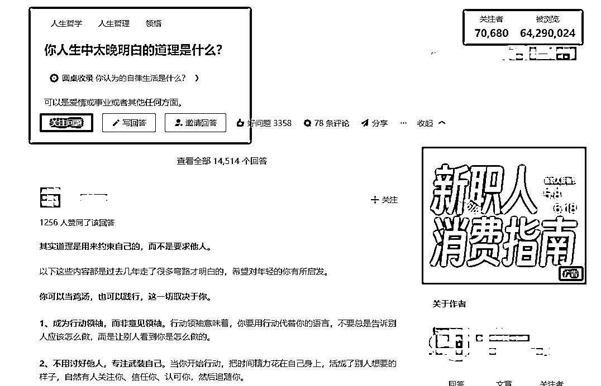

你可以去其他平台整理一些好的人生哲理内容，来回答这种问题。记得文末注明“侵删致歉”。

或者平时多收集罗翔老师、人民日报等来源的金句，整合以后来回答这类题目。

一旦出高赞，你就能体会到一天涨粉大几百甚至上千的感觉了。

切记：如果用AI创作，一定要注明是AI生成的，系统真的查得出来。

### 2、追热榜，写娱乐明星或时事

以电脑端为例，打开【创作中心】—【近期热点】和【潜力问题】，找自己能回答的话题。关键是要快，热榜热度有时候转瞬即逝，看到就得赶紧写，这样才能拿到更多流量。

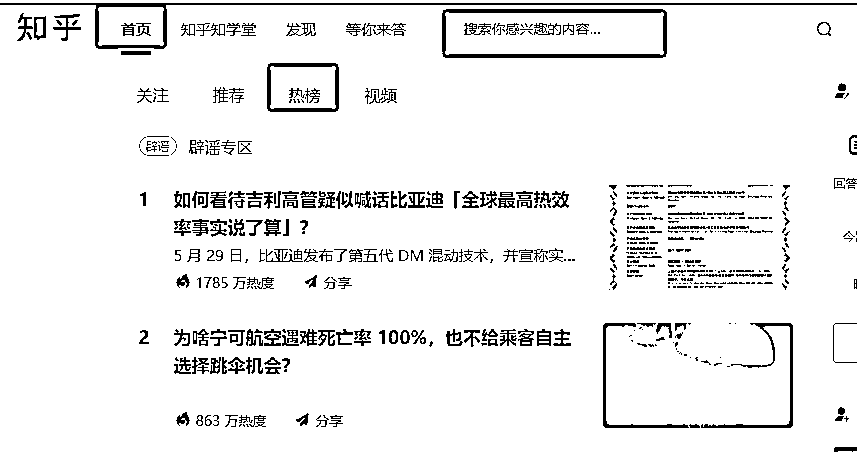

写的时候要做好人设塑造，每篇回答都带上个人特点，更容易吸粉。

除了热榜，搜索框里也有热度。具体方法是：打开知乎电脑端，首页会滚动一些潜力问题，这些也值得写。它们更容易获得曝光和流量。

需要提醒的是，写这类内容不要太带个人情绪，免得被网友骂。不是说不可以表达观点，而是要克制。毕竟知乎整体用户素质挺高，但网络环境还是要注意。

娱乐明星和时事类内容，在知乎的自然流量天然很大。

这个涨粉方法的底层逻辑，就是提供情绪价值。

### 3、非原创方法

说白了就是整理分享。在知乎上找切题的内容，整理后发布，也能获得流量。但一定要标注“图文源自网络，侵删”，避免侵权问题。

具体做法：在知乎或小红书上，找一些句子、文案类的题目，把你整理的内容发上去，同样能蹭到流量。记得一定要备注来源和侵权声明。

这个方法在很多平台都通用。回想一下，你在小红书上是不是经常看到各种“发疯语录”？流量普遍都特别好。

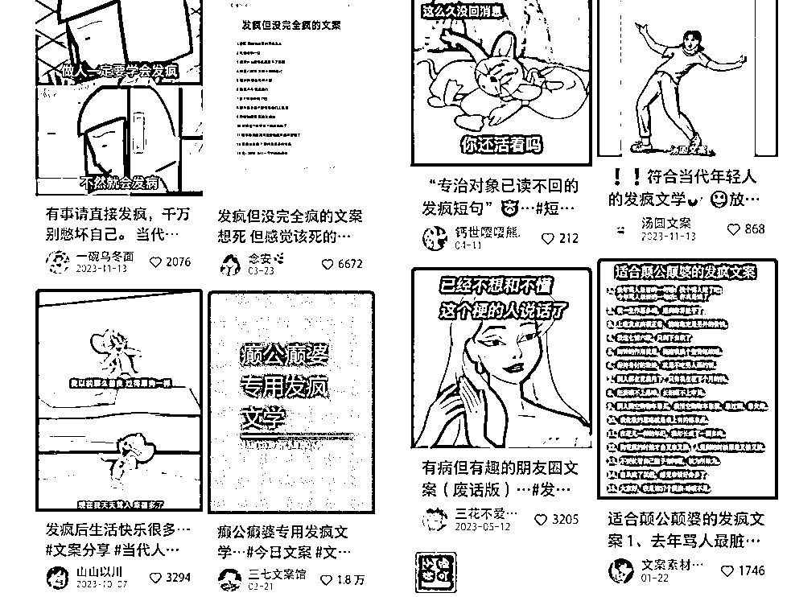

这个方法的本质，也是提供情绪价值。

无论哪个平台，语录和文案都是自带流量的内容方向。再发散一下，小红书、抖音、快手、微博都能用。前两年，很多人就靠这类内容在抖音快手吸了几十万甚至上百万粉丝。

最近我也在研究知乎的其他涨粉方式，自己也试验了几个，效果还不错。涨粉方法其实很多，关键是找到适合自己的，坚持深耕下去，总会有成绩。

最重要的一点是：坚持。

# 四、复盘总结

感兴趣的朋友真的可以去试试。我分享的实操内容都比较接地气，落地性很强。

之前就有小伙伴跟我说，她通过我在公众号分享的知乎有奖活动玩法，已经开始收到盐粒奖励了。看到大家有收获，我真的特别开心。

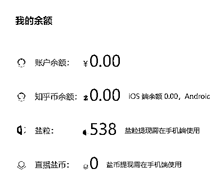

别小看几块钱，谁都是先从一块钱赚到一百块，再赚到一千块、一万块、十万块的。

回到正题。最后带货效果怎么样，跟账号粉丝量和权重有密切关系。

同样粉丝量的两个账号，权重更高的那个，在同一个问题下排名往往更靠前，曝光也更大。

所以提高账号权重非常关键。想做知乎带货，一定要同步提升自己的粉丝量。

想给自己的知乎账号涨粉的朋友，欢迎来找我免费领取一份知乎涨粉秘籍。

今年双十一带货比去年有进步，但我觉得还有两个地方可以更好：一是京东带货没达到预期，二是整体佣金比例不够高。

一个一个说。

其实双十一开始后的7天内，我的京东带货数据就超过了6万。

但这次赶上了京东“杨笠”事件，很多退单发生，后续趋势没提上来。

到11月11日晚上，京东带货总数据是13万多，比我的预期低一些。

对比之下，淘宝那边活动开始得晚一些，我发红包也发得晚，但短时间内淘宝带货到了10万。这样看，淘宝的增长速度其实比京东要快。

不过这是客观原因，我也控制不了，就不多纠结了。

另一个问题是佣金比例。

这次带的产品，很多佣金比例都偏低。0.1%、1%的情况不少。所以23万多的GMV，最终佣金收益只有3000多。

要知道平时带货一个小家电，佣金至少十几块。如果是合作产品，还可能有定向佣金，能达到三四十甚至一百多。

所以后续在账号布局上，我会花更多心思去写佣金比例高的小家电产品。

同样是卖1000块的东西，50块佣金就比20块佣金划算太多了。

比如下面这个合作产品，佣金比例20%，卖出一台就有150+佣金，真的很香。

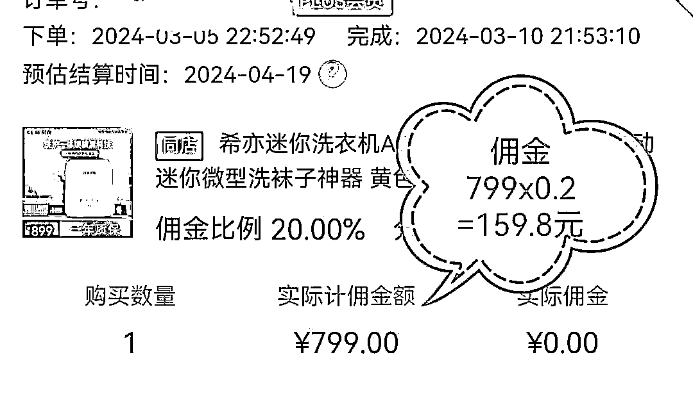

总的来说，这次带货对比去年是进步了。我也尝试了一些新方法，带来了几个W的GMV。不断试错、不断尝试，是我能持续进步的法宝。

不完美很正常。我们都是在一次次复盘中调整方向、不断成长的。

所以我不会太苛责自己，知道哪里还有进步空间，往对的方向去改进，慢慢完善就好。

这句话也送给屏幕前的你：

尝试改变，最重要的是先开始。

先完成，再完美。哪怕是一个不完美的开始，也胜过一百次审慎的纸上谈兵。

一个粗糙的开始，就是最好的开始。不要等一切都准备好了再行动。

做得慢，总比什么都不做要好得多。共勉。

一起在自媒体这条路上继续探索吧，欢迎和我交朋友。