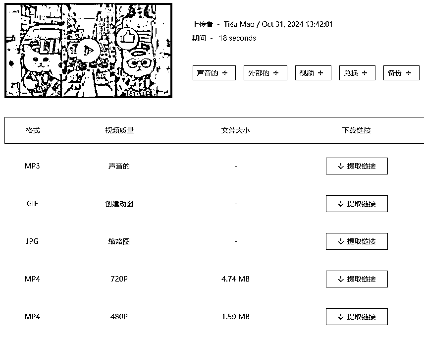
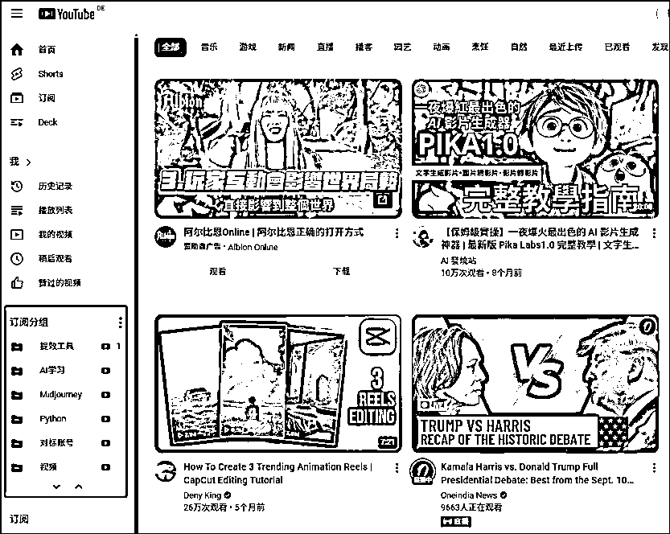
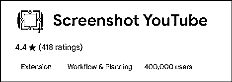
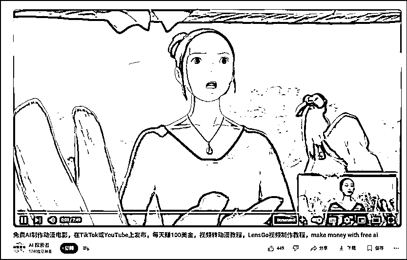
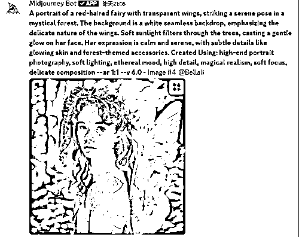
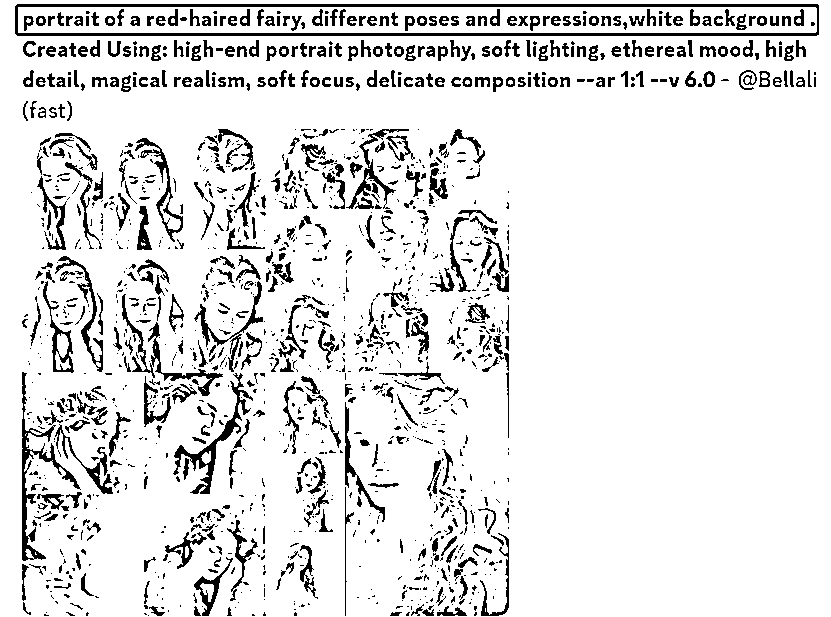
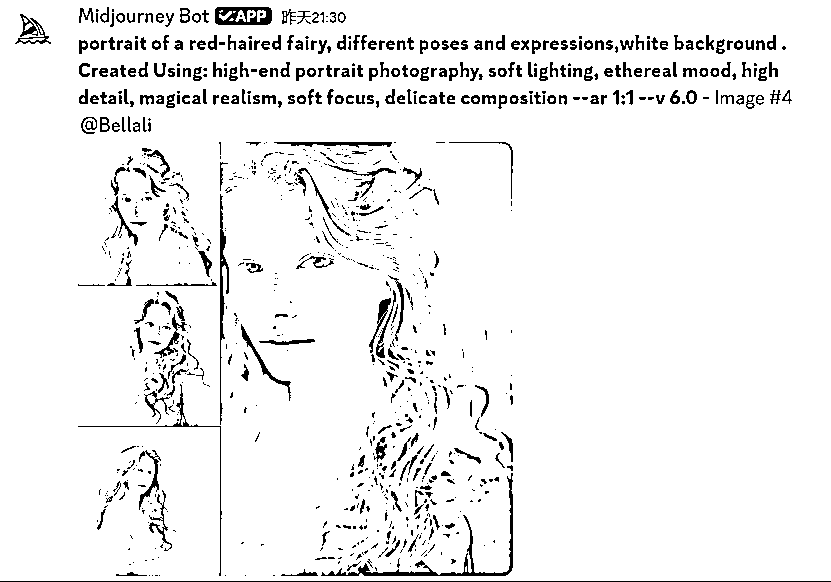
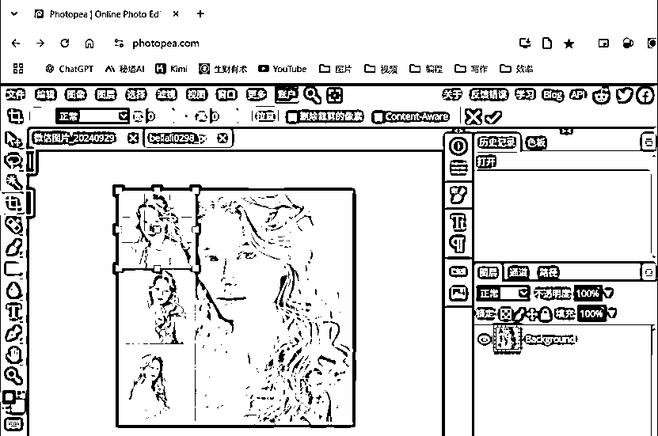

# YouTube 效率小窍门合集

在做视频拆解与二创的工作流里，我踩了不少坑，也攒下几条真正能省时间的实操手法。整理出来供同行参考，希望能让大家少走弯路。

**【一、极简下载路径】**

想把公开视频存本地时，我用过最顺手的办法是改网址：把地址里的 “www.” 后面插入 “9x”，回车后就会打开一个聚合下载页。里面能看到音频 MP3、多种清晰度的 MP4，以及动态图格式，无弹窗干扰，一次选好即可。

**【二、用插件给订阅频道做分类】**

关注量一大，首页就很乱。给 Chrome 装上 PocketTube 之后，YouTube 主页会新增一个频道归类面板。可以按项目或学习方向把目标频道拎出来单独收纳，对标对象一目了然，检索效率明显提升。

**【三、快速截取高清画面】**

做案例分析时经常需要抓帧。安装 Screenshot YouTube 后，播放界面底部会出现截图按键，按下就能把当前画面保存到本地，分辨率与当前播放画质保持一致。实测在 Shorts 短内容上暂时不支持。

**【四、Midjourney 保持人物造型稳定的一套流程】**

做叙事向内容时，最头疼的就是主角在不同分镜里“变脸”。靠 cref 也偶尔失控。后来换成先建素材库再出图的思路，前期投入多，后期非常稳。

操作大致分为五步：

**第一步：先把基准造型固定下来**

**第二步：用第一步图片的链接作为参考，让模型生成该人物的多角度与多表情版本。参考用语可写：portrait，different poses and expressions，white background**

**第三步：从结果里挑出一组满意的进行放大**

**第四步：用 Photopea 的裁剪或套索功能把背景去掉，把人物单独抠出来保存成若干小图**

**第五步：把这几张小图的链接一起带入后续分镜的生成指令，作为人物保持的视觉锚点。**

这样后续出图时，造型一致性会稳定很多，很少出现漂移。

---

**文中用到的工具：**

PocketTube - YouTube订阅管理器
https://chromewebstore.google.com/detail/pockettube-youtube-subscr/kdmnjgijlmjgmimahnillepgcgeemffb?hl=en

Screenshot YouTube 截图插件
https://chromewebstore.google.com/detail/screenshot-youtube/gjoijpfmdhbjkkgnmahganhoinjjpohk?hl=en

Photopea 在线修图工具
https://www.photopea.com/

目前我正在用 Cursor 自学 Python，希望能看到更多大佬们的妙招，早点摆脱纯手工操作 /(ㄒoㄒ)/~~

大家加油！