有没有人像你一样：打开某个AI写程序工具，憋了半天，只扔出一句“给我弄个网站”，最后屏幕上冒出来个能点来点去但没有灵魂的页面？这锅不该全甩给AI，更大的问题恐怕出在咱们自己身上——对话方式欠妥。

很多人拿着Cursor顶多拼出些迷你网页、demo级小玩意，能靠它倒腾出功能像样的正经项目，少之又少。更别提市面上连份手把手的零基础完整指南都找不着。

所以这篇就来解决一个朴素的问题：你只需要会敲字、会挪鼠标，再给硬盘留出20G以上空地（别笑，真见过有人只剩4G），就能让Cursor帮你把整套活儿干完。要是按这篇走通了，记得在评论区交个作业。

---

### 先搞明白：你在团队里扮演谁？

复杂项目听着唬人，本质就是几十上百个小模块叠在一起。以前正经公司做项目，得有需求负责人把要做的功能一条条列出来、画个原型、再走一遍流程示意，开发再照着清单，一条一条把功能做出来。现在把Cursor想象成那位开发工程师，鼠标前坐着提需求的你，天然就是需求负责人。

然而向开发抛需求时，对方可能出现四种反应：

- 质疑需求本身，劝你把方案改掉；
- 明知离谱，懒得争论，硬着头皮做出来一个奇葩功能；
- 完全分不清好坏，你说啥他做啥，结果自然歪得没边；
- 心里骂着需求，手上却把功能做得既符合原意又不难看。

没人不想碰上第一或第四种，可遗憾得很，Cursor的真实属性是第二类和第三类——它从不还嘴，你说“页面底色要黑得像深渊、又闪着七彩霓虹”，它能照单全收，给你编出一个辣眼睛的页面。


AI最大的毛病，就是不会追问。有个老段子：让老公去买番茄，他问“去哪买、多大个、什么颜色、几斤重”。真人开发会这样反复确认需求，AI却只会闷头执行。既然它不反问，那咱们自己就得学会把需求打磨得不跑偏。

但小白哪知道什么叫“跑偏”呢？我只懂打字啊。

那就换个思路——既然Cursor可以扮演开发，为什么不能先让它扮演产品？


别急着动手，先让它陪着把脑子里的轮廓聊明白。你抛出一个歪点子，让它从专业角度提建议；采纳了建议，再让它迅速落地一版；看到结果觉得别扭，又回头展开新一轮敲打……这来回来去的循环，就是小白把“模糊想法”熬成“正经方案”的唯一路径。

纸上谈兵到此为止，下方是动真格的实操。

---

### 实操从装软件开始

先到官网（cursor.com 或 trae.ai）抓一份安装程序下来。


双击那个刚下载的exe文件，开始安装。


安装向导里有一处“Language for AI”的字段，意思是以后跟AI对话用什么语言，我们把中文填进去，再点“Continue”。


随后界面会问要不要从VS Code导入扩展插件，反正咱们也没装过VS Code，这时候选哪个都不重要，挑顺眼的点就行。


然后照常点“继续”。

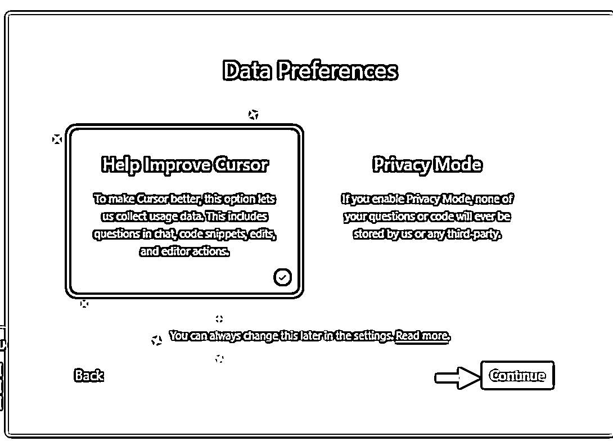

软件提示你没有账号，那就在界面上选“Sign Up”注册一个。

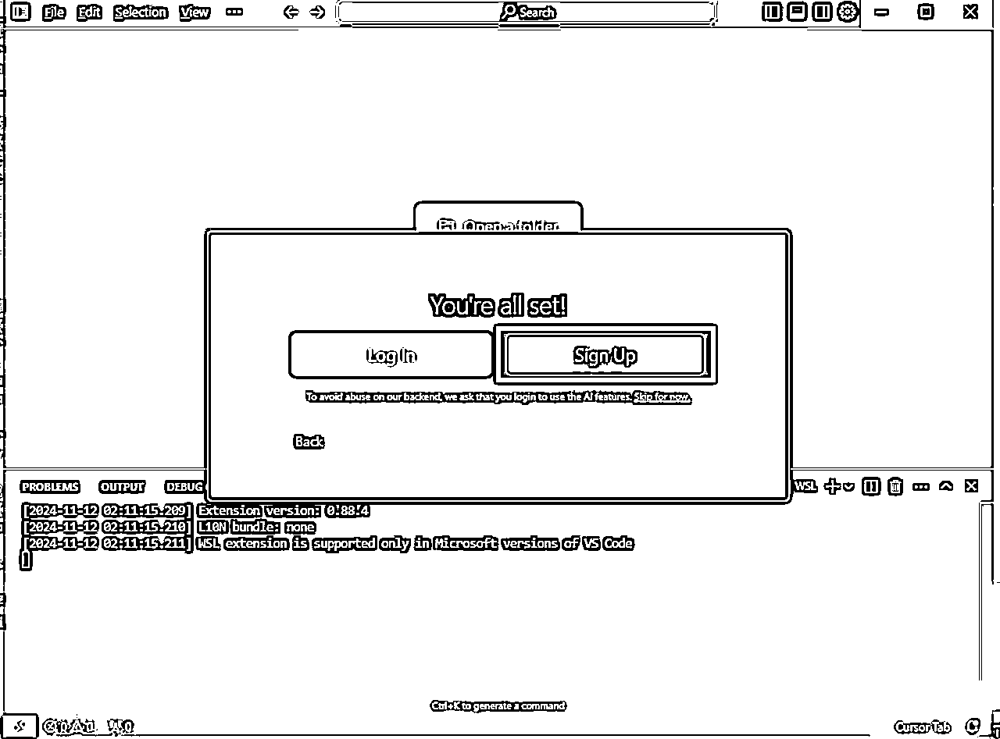

网页窗口里会自动弹出注册页面，点击“Sign up”按钮，正式进入信息填写环节。


把你的姓、名、常用邮箱填进去，其实用哪个邮箱都能收到确认信，哪怕是网易、新浪也照样行。

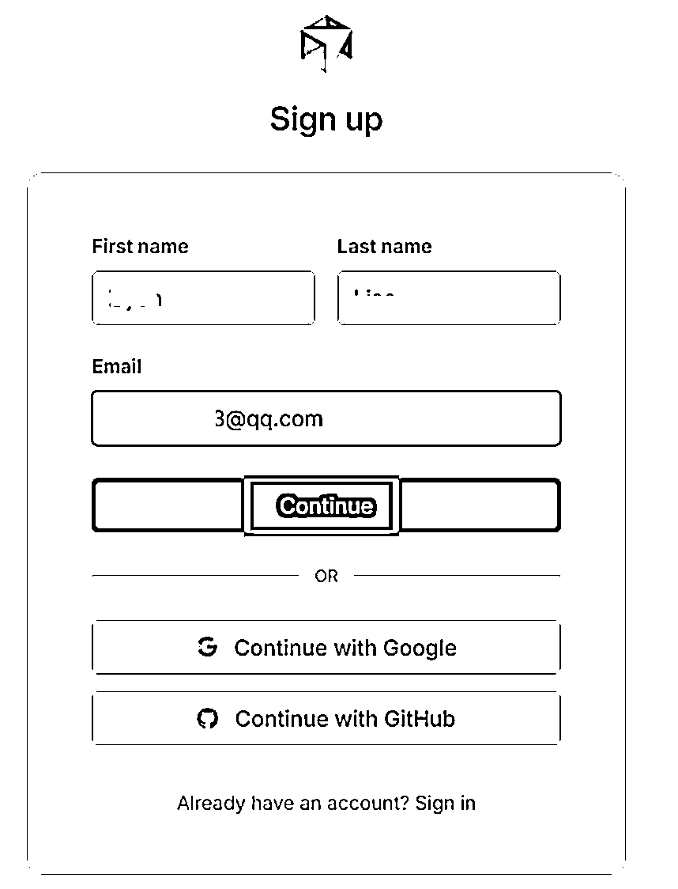

再设一下登录密码。

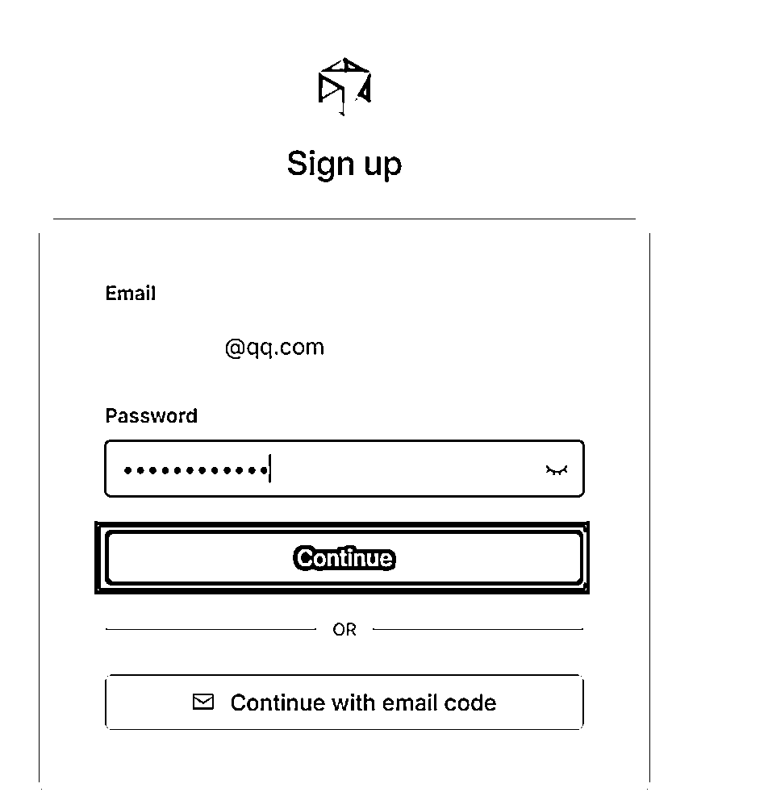

接着去邮箱收信，把邮件里那串数字填进去。


验证通过会跳回主页，此时选择登录桌面版。

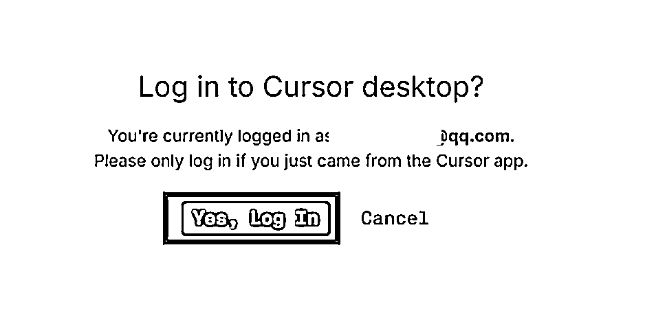

至此所有跟网页有关的步骤都结束了，后面只需盯着桌面软件看。

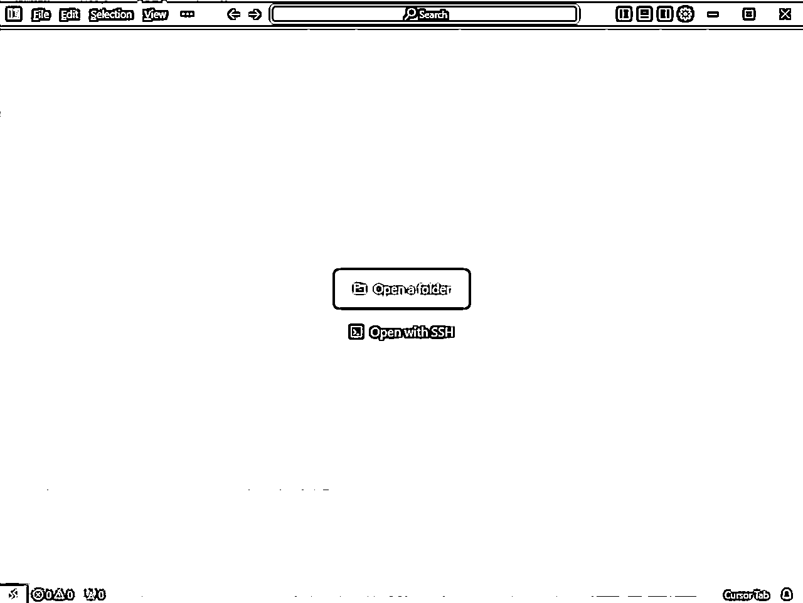

软件界面默认是英文，怪吓人的，咱们花十秒钟给它装上中文皮肤：点窗口的右上方一带展开侧边栏，找到四个小图标中偏下的那个，这是插件商店。


在搜索框敲“Chinese”，挑“中文简体”语言包，点“Install”开始安装。

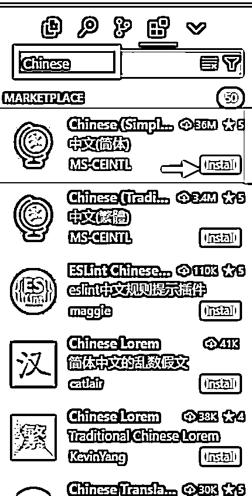

装完后界面会提示你“Change Language and Restart”，点它重启软件；没提示的话自己退出重开一次也行。


重启完，满眼都是亲切的中文了。

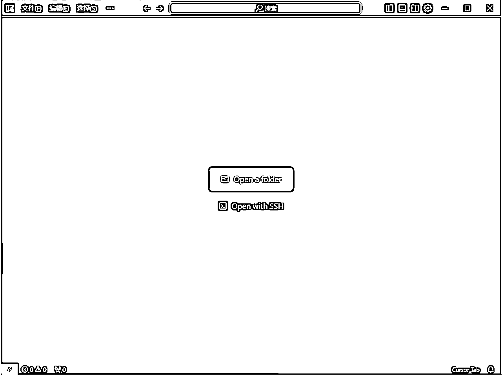

### 拿一条会吃豆豆的小蛇来练手

尽管这篇的目标是复杂项目，但咱这种新手还是先从小玩具热身比较好。

从主界面右上方附近找到那个展开图标的按钮，点开对话框。


对话框的右上部排着四个小按钮，分别对应：新开对话、查历史记录、全屏、关闭。


#### 先定技术路线

喂给它的第一句话，记得一定是商量语气：

“我打算搞一个在网页里跑的蛇类小demo，你觉得哪套技术方案最合适？把你最看好的方案和配套的起步模板说给我听听。”

设想一下：程序将来是在网页端访问，还是下载到电脑上双击使用，或是手机上装个App？把运行场景交代清楚，Cursor的推荐范围会迅速收缩，替咱们省掉好多弯路。就算它给的答案看不懂也没关系，只要它挑出的东西符合“用的人多、资料好查、坑也比较少”三条，咱们照单全收就行。

然后接着补一句：

“我完全是零基础，机器上除了这个编辑软件，连开发环境都没配过。请你拆成非常小的步骤，我每做完一步就回来向你汇报，你确认没问题再说后面的指令。代码我想放在D盘下那个叫projects的地方。”

这样做有两个妙处：一是拆碎步骤，咱基本不用动脑；二是每走一步都能即时校准，不至于闷头跑偏。


它给的那份技术方案截图咱们可以略过，继续让Cursor按“保姆教程”标准带路。


它会先让我们去Node的官方网站拿个LTS版，那就去下，认准标着“长期支持”的那个文件。

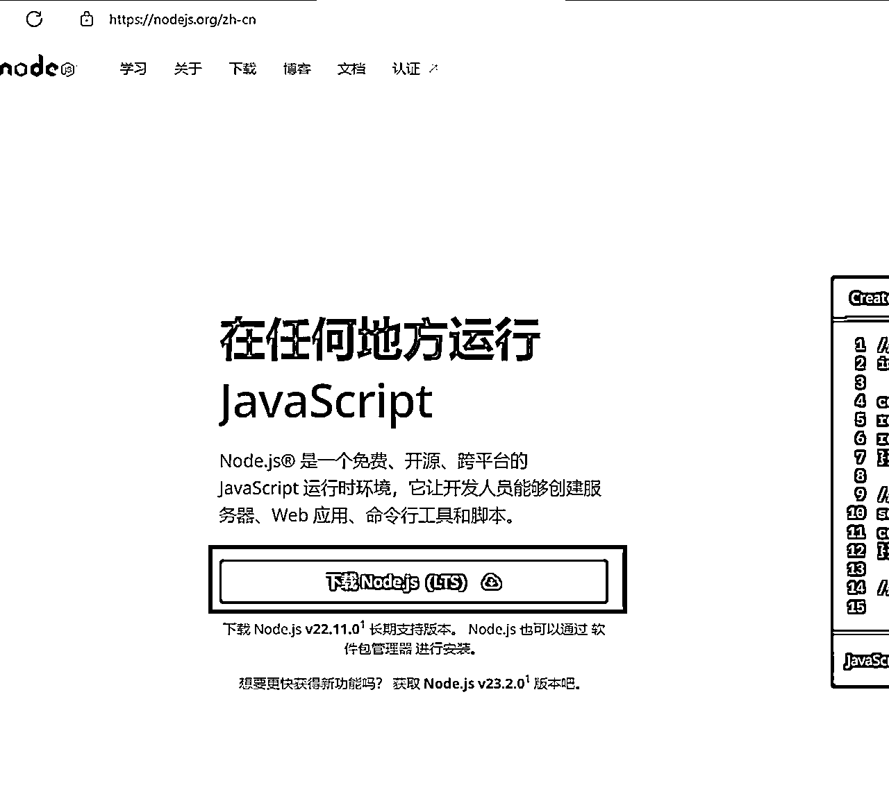

下载完是个安装文件，双击运行，后面无脑Next就行。

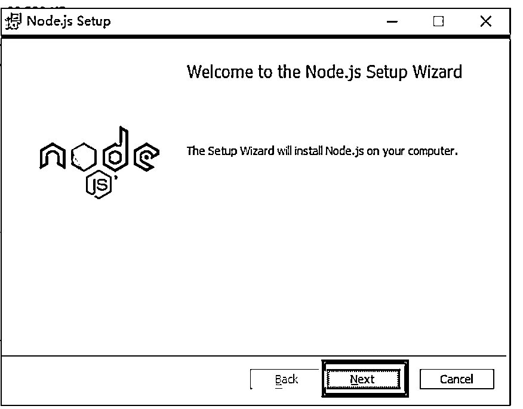

装完最后点“Finish”。

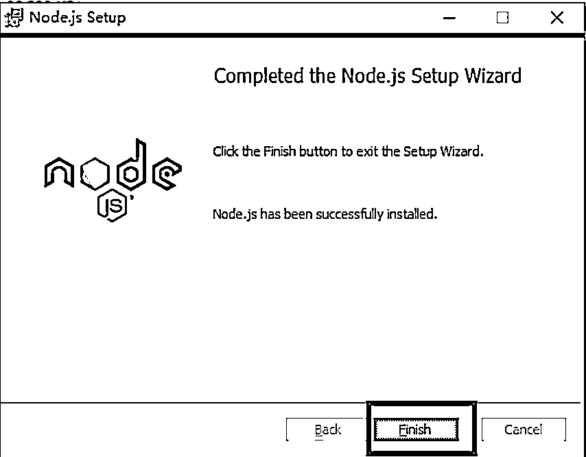

然后按键盘上的Win + R组合键，弹出个运行小窗，敲入cmd回车。


一个黑乎乎的窗口应声打开。


在窗口里分别敲node -v、npm -v然后回车，能看到版本号就证明装好了。

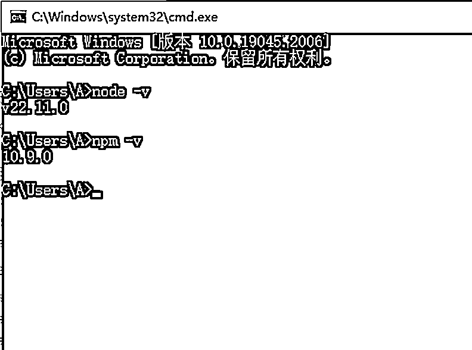

把“安装成功”这个结果回传给Cursor。


随后它让我们做某一步，说是完成后就能看到页面，于是跟着它继续点“Run”之类的按钮。


这时候它抛出一个询问：“是否允许运行？”，多半按一下回车就好；括号里的y代表yes，我们不玩花的，直接回车。

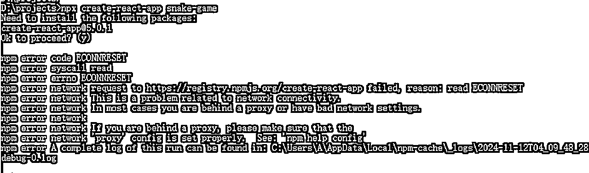

万一报错，千万别慌，把红色错误信息原样复制粘贴给Cursor，它会帮你诊断。

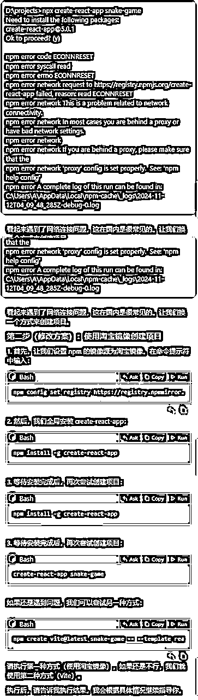

继续执行它的指示，一步都不走样。


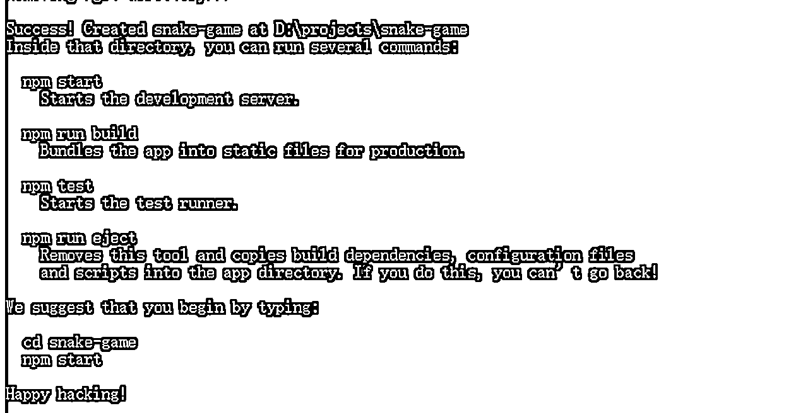

果然，Cursor自己又把刚才的报错处理掉了。如果还不放心，就把安装好了没有、以及随时遇到的怪问题都丢给它。

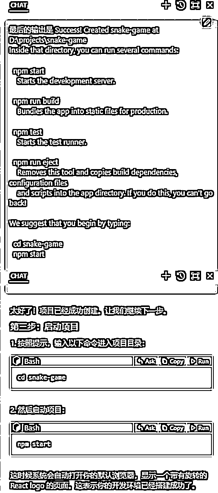

按部就班地跟到那个节点，网页窗口里忽地冒出那个小demo画面——成了！

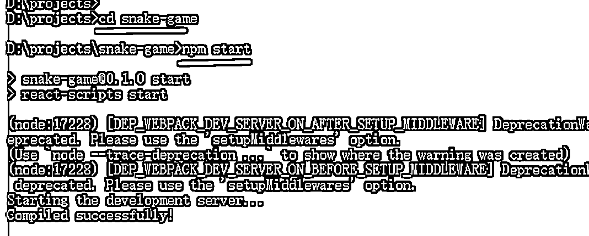


这会儿可以把命令行黑窗口关掉了，它使命完成。

但等等，有个关键提醒：当前这轮对话的作用到此为止，别赖着这个对话窗口继续问东问西——Cursor的聊天记录是按项目隔离的，后面我们得打开刚才落盘的地方，到工程里去开新对话。


打开软件里的文件面板，确认最顶端显示的是SNAKE-GAME这一项。


打开后发现，咦，之前聊天的记录不见了？不必诧异，这就是上文说的“按项目隔离”。不过它的任务已经完成：选定技术路线、把工程骨架搭好。从此以后，我们能在工程内让它改代码了。真想回味对话，左上角新建窗口也能找到记录。

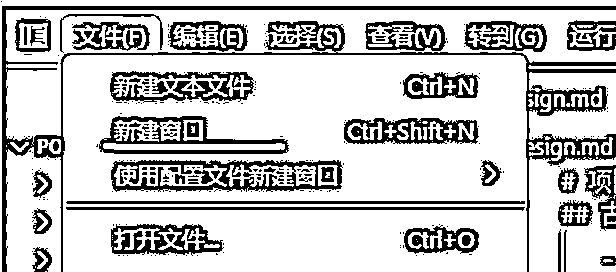

#### 需求讨论：谈清楚再动工

正式改功能之前，依然要先开一段“需求会”。

在右侧对话框输入：

“我们手上这份属于模板工程，帮我在工程最外层建一个design.md，把项目里的文件怎么组织、技术上有哪些关键点都总结进去，方便后续咱们聊方案时，你直接参考它就行。”


等它把全部代码文件扫一遍后会给出一份总结，我点了下“Apply”，文件自动生成，内容也填好了；再点一下“Accept”按钮确认改动。

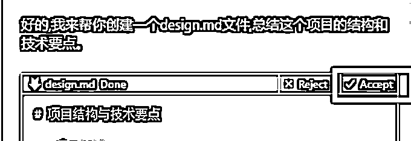

如果屏幕上的结构图有点儿乱，没关系，手动把内容复制进文件就行。

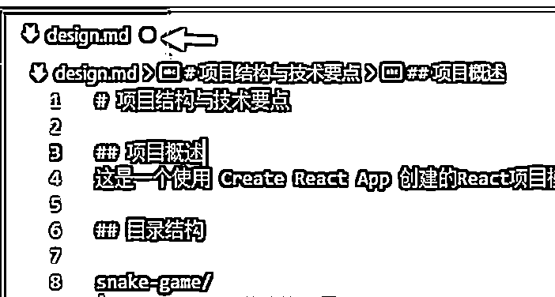

文件页签上顶着个圆点，那是“文档没存过盘”的意思，按Ctrl+S存一下盘。

接着另起一个对话窗口，把刚写好的design.md选中丢进对话，再敲：

“我打算做一只蛇类小demo，咱们一起把需求聊透。讨论期间先别动工，讨论出的结论都记到design.md里。开头先给我列一列做这类东西一般要关注哪些方面，这样我才知道该跟你聊什么。”

小白不都这样吗？自己只知道要做个啥，完全没概念做起来要考虑什么。那就让Cursor列提纲，我们照着提纲逐条提问。


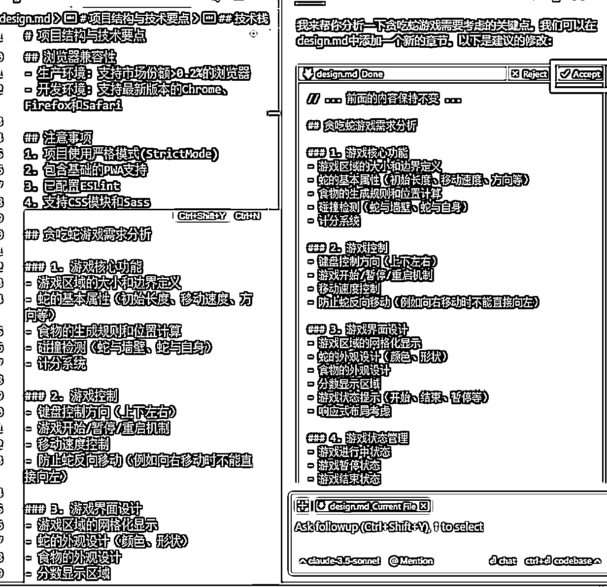

它列出的头一项是核心玩法，那咱们就从这条开始，一条一条过。我跟它说“一条一条确认”，它就会把那条展开来问。


聊到最后，它还会主动抛出几条优化建议。


看着顺眼的就点“Accept”收下；不满意的地方，尽管让它改，比如想让蛇撞墙后穿墙而非死掉；对于不想要的功能，在它答应改完后自己动手清掉就是。


有了模板，后面清单上剩下的要点，都照着这个套路逐一确认。


省略号省略的中间过程不表，这儿必须插一句：千万别把“Accept”当橡皮图章乱盖。AI给的全是提议，你好歹得清楚自己拒绝啥。

#### 编码：照着设计图纸施工

需求聊透后，终于可以动工写程序了。另起一个对话框，把design.md挂进来，然后敲：

“现在有一份拍板定稿的设计说明，请按上面列的条目，把现有模板逐步改造成真正能玩的成品。”

发消息时按住Ctrl再回车，会进入“全库检索”模式，让它把工程内所有代码读一遍再进行修改。

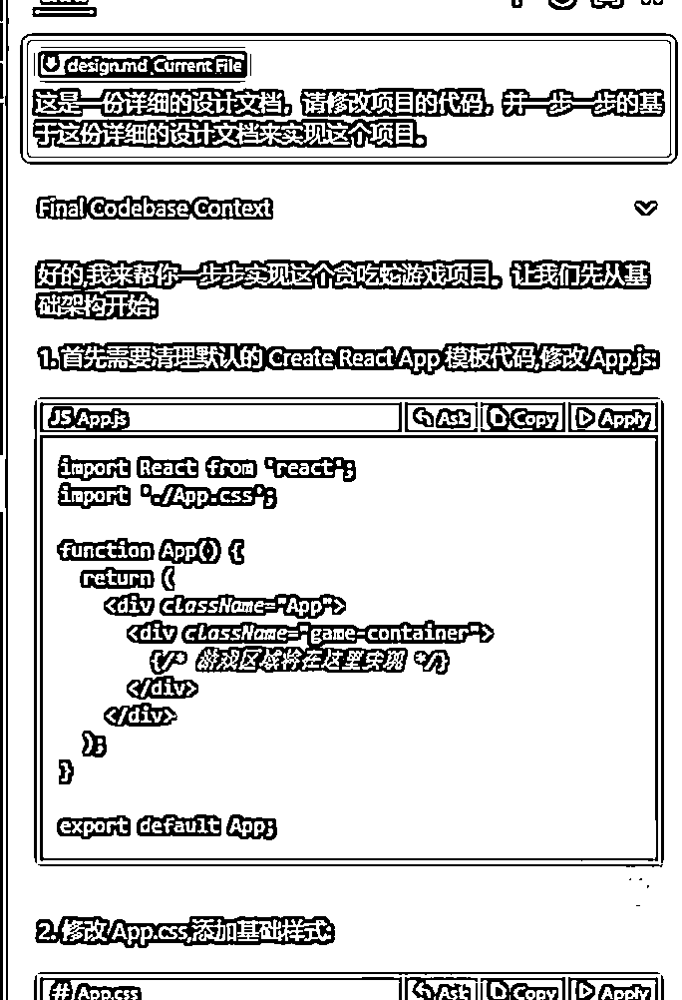

它给出的修改结果，只管一路点“Apply”，它会自己动手创建目录、生成文件。到这一步，它还会在末尾贴心地预告后续的施工项。

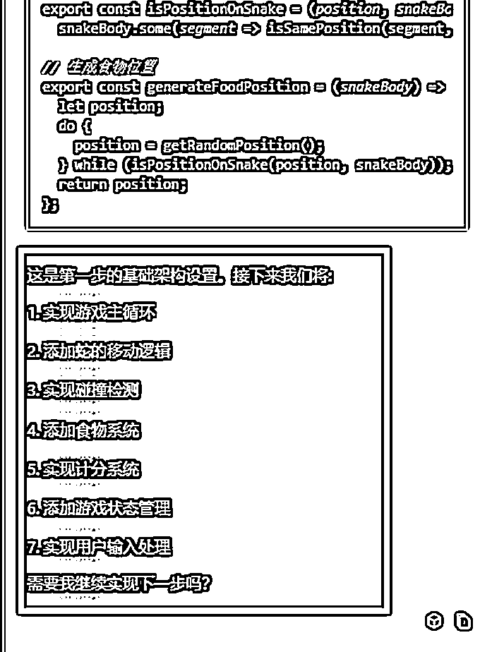

那就照旧，让它接着干，然后继续Apply所有改动。

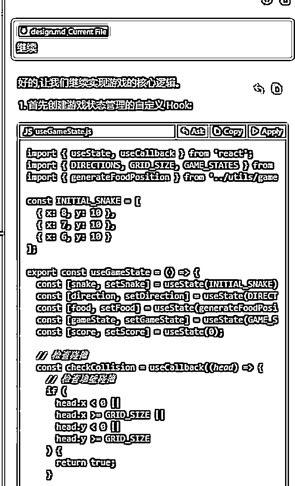

---

最后分享一句掏心窝的话：Cursor压根儿不是神，它更像一名手脚麻利但完全不懂拒绝的执行者。项目最后长成什么样，几乎全看你有没有耐心先跟它把需求聊透。

**永远别急着让它“直接上”，先让它帮你把方向和做法理顺；讨论也不是流程里可有可无的点缀，它就是这个活儿真正的起点。**

读到这里，要不要试着让一条憨头憨脑的贪吃版小蛇，在你自己的网页窗口里爬出来？半小时就够。

他最后告诉我，基础功能已经完成了。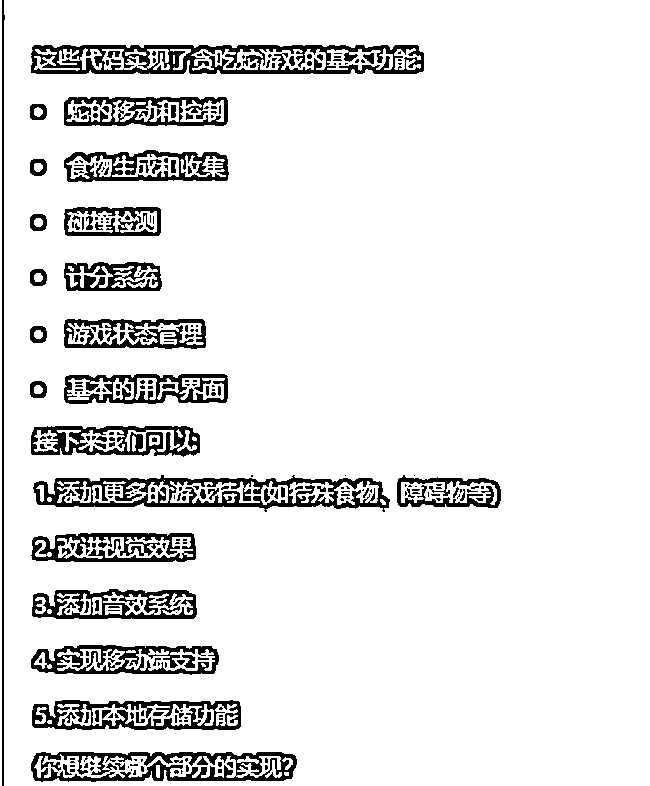
我早就等不及想试一下，所以没让他继续往后加东西，直接问：你给我的代码我已经全部放进项目里了，现在我想运行起来看效果，该怎么做？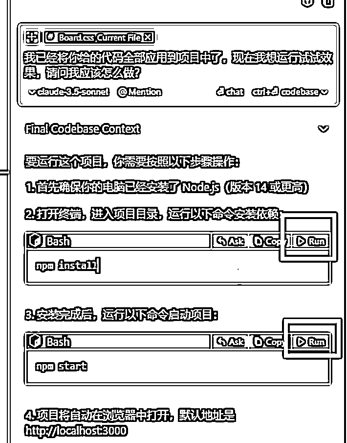
他回复说，直接点 Run 按钮就行。可我在运行时碰到一堆报错，于是把所有错误信息选中，点击 Add to Chat，发给 Cursor。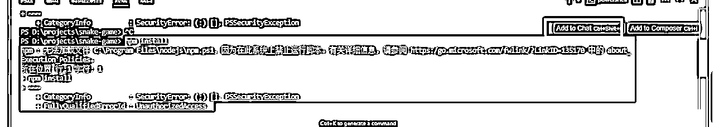

我毕竟是个纯小白，那一堆专业解释根本看不懂，不过至少知道 Cursor 本质上就是 VS Code，所以看到三个方案时，我直接选了第3个。其实你也可以继续追问，直到弄明白为止。
回到刚才的位置再点 Run，项目这次成功启动，我赶紧玩了一把。
后面大家遇到的问题肯定各不相同，但没关系，把现象发给 Cursor，它基本都能搞定。
比如我那会儿打开游戏窗口，发现里面根本没有蛇。
于是切回 Cursor，用 codebase 模式告诉它：“打开后发现游戏窗口上没有蛇。”
采纳了它给出的修改代码后，游戏就能正常玩了。保存文件时页面会自动刷新，要是没刷新，关掉程序重开也行。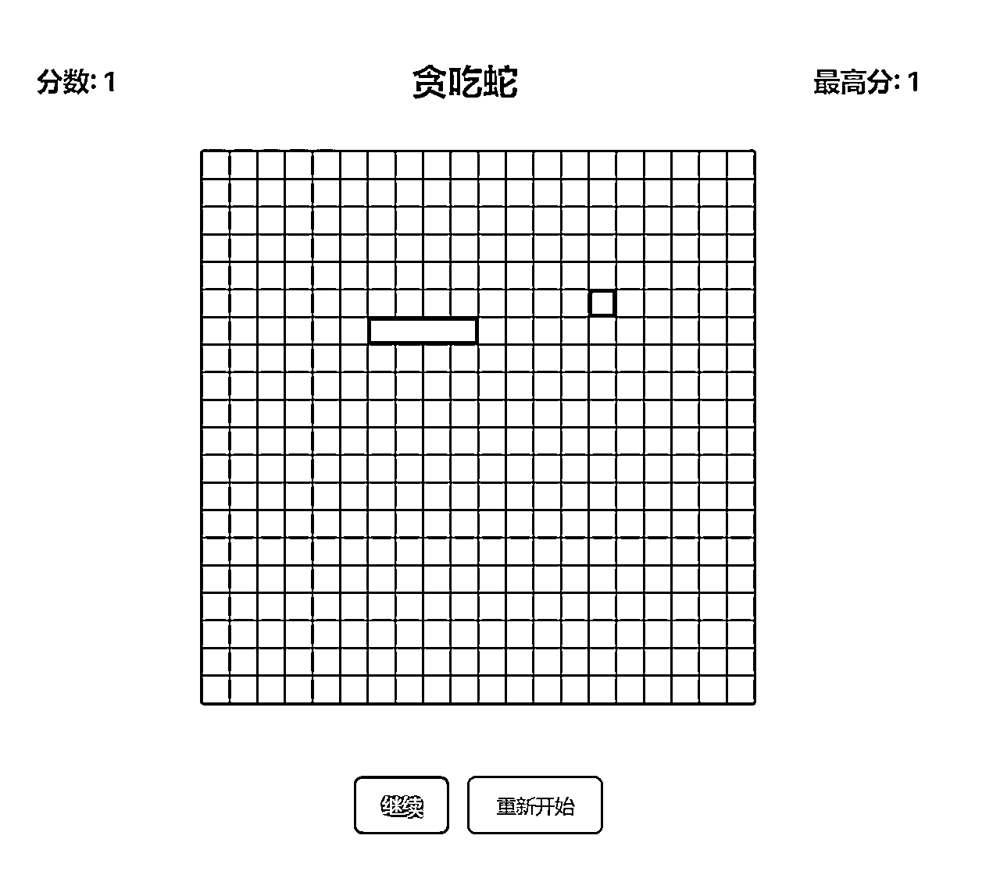
我又觉得页面有点丑，就选中设计文档，让它按文档重新设计样式，仍然用 codebase 模式。
然而再打开页面时，一点“开始”就白屏。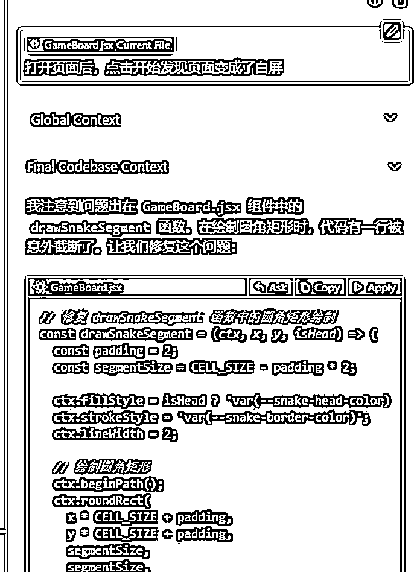
继续采纳它的修复，才恢复正常。
后面当然还可以让它根据文档继续完善功能，但你已经掌握了套路，我就不再演示了。

## 古诗划字连词游戏

下面我换一个项目“古诗划字连词游戏”来展示复杂项目的实现思路。
首先要说的是模块化思想。简单讲，就是把一个复杂功能或项目拆成一个个独立的小功能，每个小功能不依赖其他模块的代码。这样一来，我们每次只需让 Cursor 搞定一个小功能就行。
当初贪吃蛇实在太简单，我没做拆分，直接把它看成了一个整体功能。
这个古诗游戏其实是受到 strands 游戏的启发。strands 的玩法是：给你一个主题词，然后提示你里面藏着哪几个单词，你要把单词连起来。
我把它改成了：给出诗名，要求你把这首词的所有诗句按顺序连起来。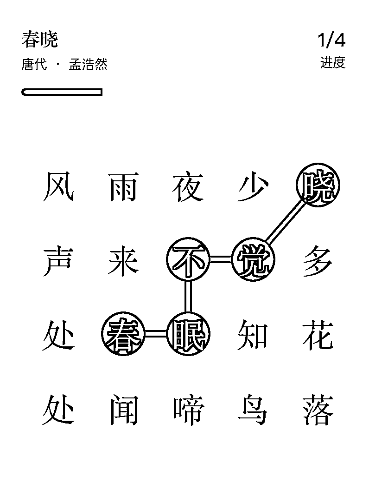
针对这个项目，我拆出了三个页面：首页、诗词选择页、游戏页。
你可能会觉得三个页面算不上复杂，但方法是一样的，以后想加更多页面都能套用。我总不能真拿一个巨型项目做演示，那样我写着头大，你看着也费劲。

### 开始实践

和之前一样，先确认技术选型。
我这样问它：想做一个在网页上运行的古诗划字连词游戏，玩法是把一首诗的所有汉字打散，让玩家正确连成诗句。用哪种技术来实现最合适？请推荐一个你最喜欢的技术和对应的脚手架。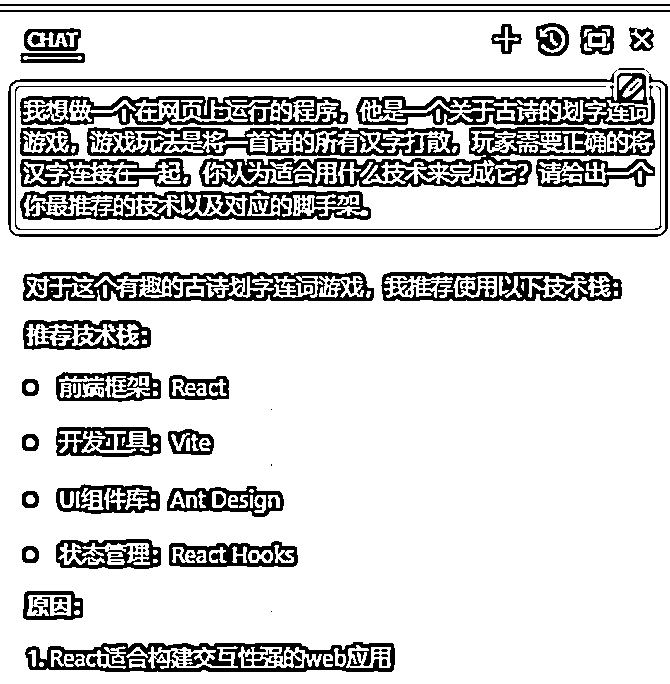
不管它回了什么，我都补上一句：我觉得很不错，但我没有编程经验，Windows 电脑上只有 Cursor 代码编辑器，没有任何其他环境。请一步一步告诉我怎么做，我做一步就回复“做完了”，你再告诉我下一步。另外，代码放到 D 盘的 projects 目录下。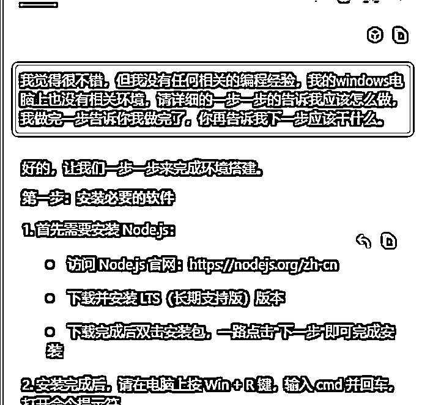
接下来它又让我装 Node.js，好在之前的案例已经装过，所以我直接说“安装好了~”。
然后我直接点 Run。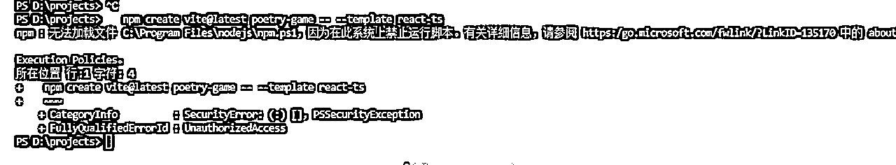
结果又碰到那个老问题，于是按老办法处理了一下。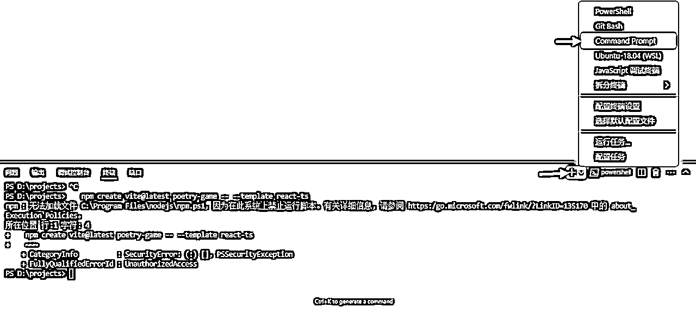

一路操作下来，并向它报告“第二步完成”。
继续点 Run。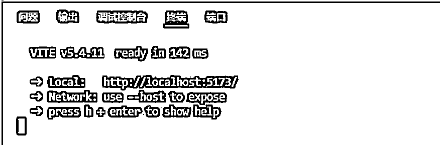
接着我去浏览器里访问了一下页面。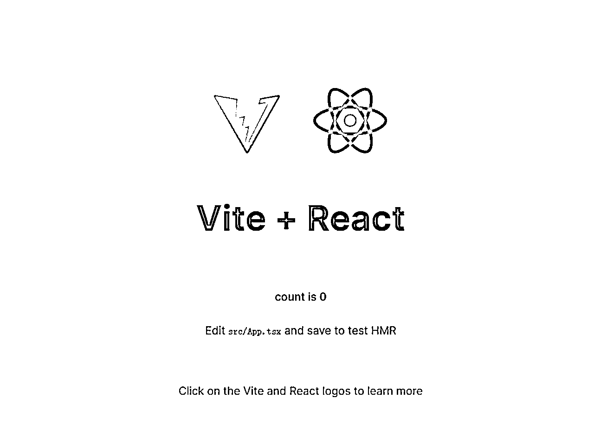
看起来没什么问题，于是用 Cursor 打开项目。
为了不浪费系统资源，我先按 Ctrl+C 终止程序，再打开项目文件夹。

#### 讨论需求并完成

还是打开右侧聊天框，我在 codebase 模式下告诉它：这是一个模板项目，请在项目根目录下创建 design.md 文件，把项目目录结构和技术要点总结进去，方便之后我和你对需求时参考。
点击 Apply，让内容写入 design.md。
其中目录那一段因为语法问题没法自动写入，只好手动复制粘贴进去，记得保存。

##### 首页

先来讨论需求。
打开一个新聊天窗口，继续和它聊。
我提出的需求是：我想做一个古诗划字连词游戏网站，玩法是把一首诗的所有汉字打散，玩家按正确顺序把它们连起来。这个网站分三个页面：首页、诗词选择页、游戏页。我们先讨论首页的设计，讨论结果请写进 design.md。暂时不要写代码，先告诉我需要考虑哪些点。
改动其实不大，就是把上一步的“游戏”改成“网站”，因为我要的是一个完整网站，而不只是一个游戏页面；同时先锁定首页来聊，这也是模块化的体现。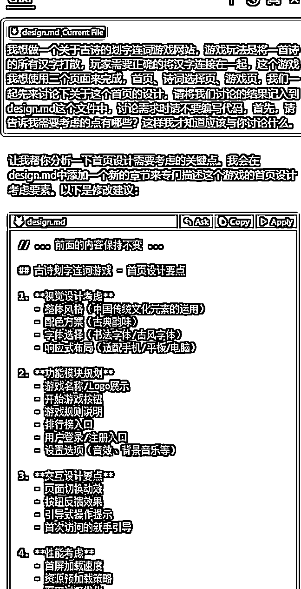
有些需求是可以现场删的，比如我直接放弃了用户登录和排行榜。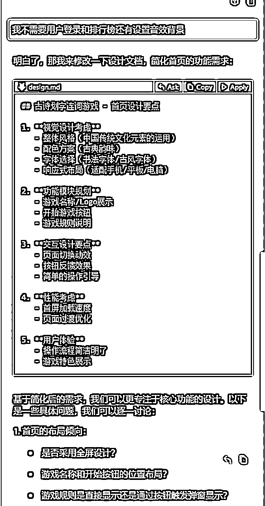
它很快给了三个建议方向。
我们先把布局聊透。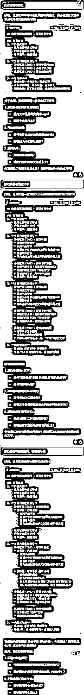
接着聊视觉风格。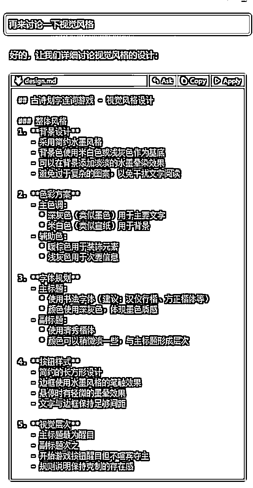
最后定交互方式。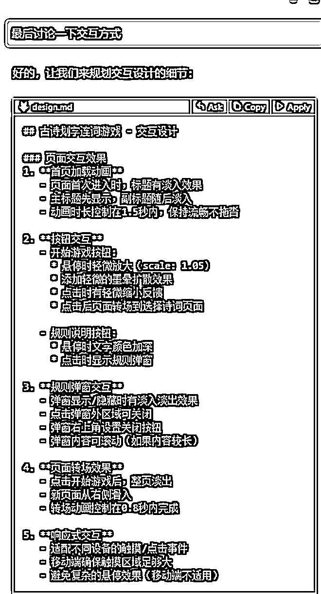
首页需求到这里就算聊完了，下面开始写代码。
同样开一个新窗口，选中 design.md，输入：这是一份关于首页的详细设计文档，请修改项目代码，并一步一步按文档实现首页。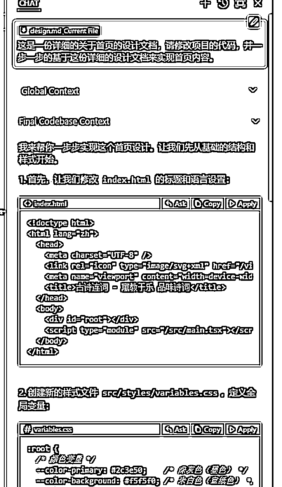
先运行看看效果。启动方式在最初选技术栈时它已经告诉过我了，忘了的话也可以再问一遍。
看起来还不错，于是继续按它建议的下一步编码。
再检查一遍效果。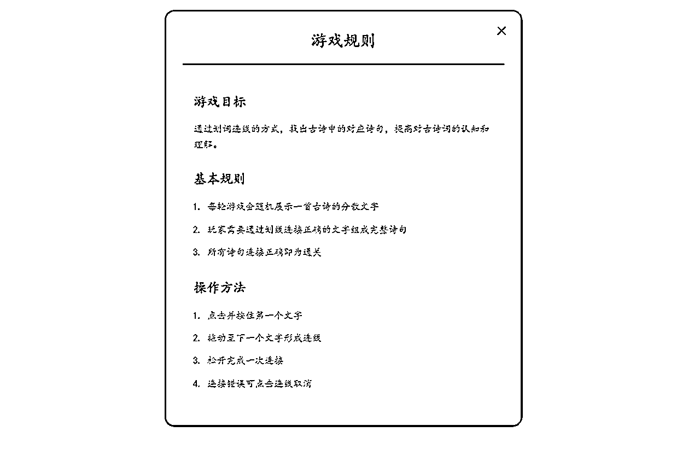
这次我卡在一个问题上：弹窗动画会连续弹三次。
我把这个现象发给 Cursor，让它帮我解决，用的是 codebase 模式。
每个人遇到的问题可能不一样，不过把问题发给 cursor 就好；要修 bug 的时候记得切到 codebase 模式。
关于第二点页面动画和第三点移动端适配，我暂时都不需要，所以让它在视觉设计上多下点功夫，让页面更好看。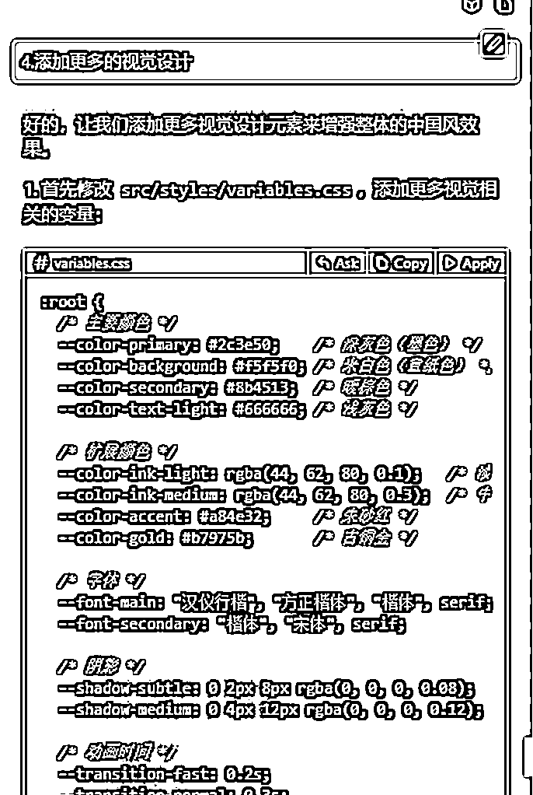
改完之后是不是舒服多了？
首页我觉得可以了，继续推进诗词选择页。

##### 诗词选择页

老规矩，先理清需求。
打开新窗口，用 codebase 模式输入：我们一起来讨论诗词选择页的设计。请先为诗词选择页创建代码文件夹和 README.md 文件，后续讨论结果都写入这个 README。文件夹用来放该页面的代码。创建完成后我们再开始。
这样做的意义是把一个功能点锁在独立文件夹里，之后不用让 cursor 读整个项目，只关注这个文件夹下的代码。
点击 Apply，它会自动把文件夹和文件建好，并把回复内容写入 README。
如果它回复里夹带了一些设计方案，直接删掉，只保留目录结构那部分。
然后像之前一样开始讨论，我对它说：现在可以开始讨论了。请把结果写到 @README.md 里，供后面写代码参考；同时可以参考 @design.md 中首页的设计思路，确保整体风格一致。首先请告诉我需要考虑哪些点？
这里用到了 Cursor 的 @ 功能。按 @ 后会弹出一串指令，选择 File，再选 README.md（注意别选成根目录那个），然后同样方式挂上 @design.md。
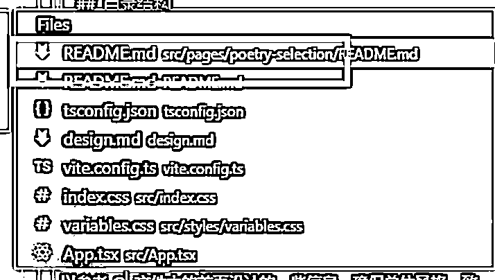
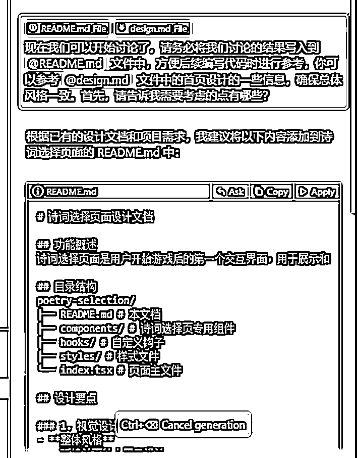
后续流程基本都差不多：反复让它完善每个要点，遇到不想要的设计就删掉。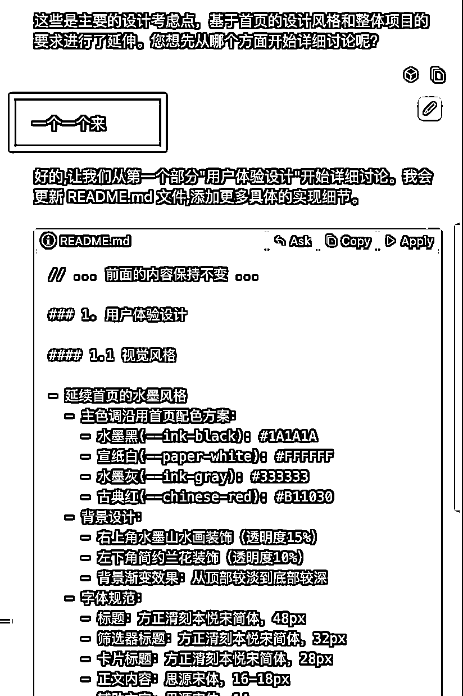

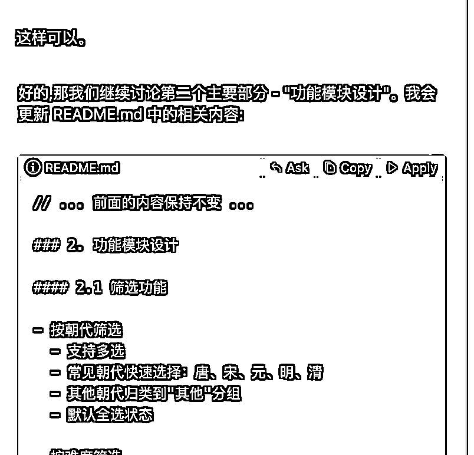


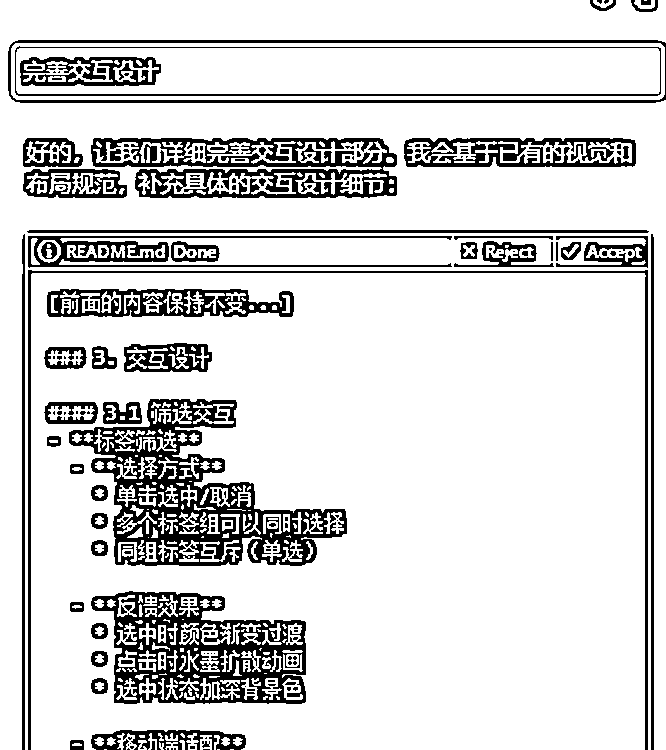


聊完需求，开始编码。
照例打开新窗口，说一句类似的话：这是一份详细的设计文档，请修改项目代码，并一步一步按文档实现功能。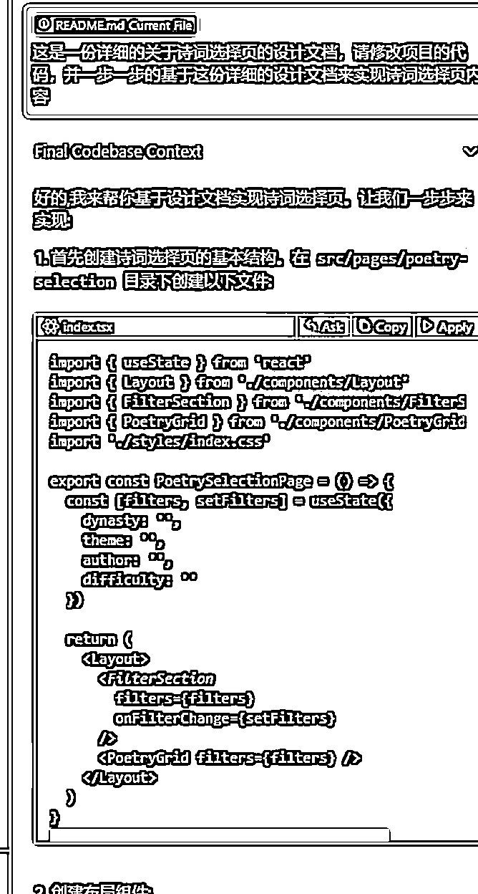
接下来你应该猜到了，就是不断让它写，直到自己觉得差不多。
然后还要把诗词选择页和首页关联起来：在首页点击“开始游戏”时进入诗词选择页。
我给它下达指令：请把诗词选择页和首页关联起来，点击“开始游戏”时跳转到诗词选择页。
此时运行项目大概率报错，毕竟写了不少新代码，但没关系，把报错信息发给 cursor 让它处理。

运行效果如下。
目前页面里只有两首诗，我不清楚要怎么加更多诗。但既然诗词选择页的代码都在同一个文件夹里，我可以这样操作：
按 @ 键，选 Folder，再选 poetry-selection（诗词选择页的代码文件夹），然后问它：我现在想增加更多诗词，请问应该怎么做？
可以看到，cursor 此时只读取这个文件夹里的内容，不会去翻整个项目。
最后它还给了一些建议。
我觉得第一点很实用：这样我就不用去关心代码逻辑了，可以直接在一个独立的数据文件里管理诗词。
现在想加诗的话，只要去熟悉的文件里新增条目即可。
后来我发现上下两行有重叠，又用同样的方式问 cursor。
在一个聊天框里选过文件夹之后，后续讨论它会自动读取该上下文。
效果很好。
到这里，诗词选择页基本完成。

##### 游戏页

游戏页我觉得你肯定也会做了。
先来讨论需求。
打开新窗口，输入（codebase）：我们一起来讨论游戏页的设计。请先为游戏页创建代码文件夹和 README.md，并把讨论结果写入 README。创建好之后我们再开始。
同样，只保留目录结构，其余设计内容删掉。
然后输入：现在可以开始讨论了，请把讨论结果写入 @README.md，可以参考 @design.md，风格保持一致。首先，告诉我需要考虑哪些点？
需要注意，游戏页和普通网页不一样，必须把玩法规则讲清楚，这个环节是它特有的；如果是普通页面，照抄诗词选择页那套流程就行。
游戏机制的部分要详细写。```
### 基本游戏机制

1\. **游戏布局**
- 游戏界面是一个方形网格
- 网格中随机分布着诗句的每个字
- 字符以圆形背景的形式显示
- 网格大小根据诗句字数自动计算

2\. **连线规则**
- 玩家可以通过鼠标拖动来连接相邻的字
- 只能连接相邻的字（包括斜向相邻）（9宫格内的字）
- 连线时会显示实时的墨迹效果
- 连线路径会有动画效果

3\. **判定机制**
- 当玩家完成一次连线后，系统会检查是否匹配诗句
- 如果匹配成功：
  * 连线会保持显示
  * 连过的字会变色标记
  * 进度条会更新
- 如果匹配失败：
  * 显示错误动画效果
  * 连线会消失
  * 可以继续尝试

4\. **游戏进度**
- 界面顶部显示当前进度
- 显示已完成数量/总数量
- 有进度条直观展示完成程度

5\. **辅助功能**
- 重新生成按钮：可以重新打乱字的位置
- 下一首按钮：完成当前诗后可以进入下一首
- 返回关卡按钮：可以返回选择其他诗词

### 特殊设计细节

1\. **字符布局算法**
- 确保同一首诗的字符相邻放置
- 使用随机算法保证每次布局都不同
- 保证所有诗句都可以被连出来

2\. **视觉反馈**
- 连线时有实时的墨迹效果
- 选中的字会高亮显示
- 已完成的诗句会保持显示
- 错误操作会有晃动动画

3\. **完成效果**
- 当诗句全部连完后，会显示完整的诗词
- 提供下一首操作选项
```

写完机制，后面的流程就进入熟悉节奏。
接着就是一轮又一轮地完善、确认、再完善。


通常把布局、视觉、交互、内容这四样做齐，就算达标。
其他额外功能看心情加。
最后是编码：
用 codebase 模式，输入：这是一份关于游戏页的详细设计文档，请修改项目代码，并逐步实现游戏页内容。
它同样在结尾给出了下一步建议。

 接着就是反复试、反复调，一直到你觉得满意为止。 到这里我判断差不多了，便进入下一步：给 Cursor 发指令（codebase 上下文），让它把游戏页面并入项目，同时支持从诗词选择页跳转过去。 意料之中，又报了错，老样子交给 Cursor 处理。 正常运行后一看，问题不少：文字顺序完全没变，标点一个不少，连线效果也跟设计稿对不上。 继续用老办法，@ 选中 games 目录，把这些问题反馈给 Cursor。 这回文字确实打乱了，但彼此还是没法连住。 老实说，这个玩法对 Cursor 来说难度过了头，不算好的案例。于是退而求其次，把这页改成诗词详情页，这部分由 @双菱 完成了，效果就在下面。 实践下来，Cursor 做网页很顺手，可一旦涉及逻辑严密的功能就比较费劲。我觉得游戏玩法得单独抽出来重新定义需求，以后我再研究怎样让它稳定产出游戏。这是上个周六日完成的，今天要我完全不看代码、不走脑筋地复刻一遍，确实不行，只能抱歉。 有人想玩，那就放出来给大家试试：https://poetrystrands.com/zh

### 今天吃什么

看来不少人对小程序感兴趣，这就补上！

#### 安装微信开发者工具

先启动 Cursor，把下面这句话发给它：“我没有任何编程经验，想在 Windows 上开发一款微信小程序，环境方面只有 Cursor 编辑器，别的都没有。请细致地告诉我怎么操作，每搞定一个环节我就向你汇报，由你安排后面的动作。” 当然，我也可以把步骤逐一列出来，但交给 Cursor 引导会更直观。Windows 版下载入口不算显眼，单独给你们标出来，其余照着 Cursor 的安排做即可。 装好后，在喜欢的路径下建一个英文命名的项目文件夹，英文不行就用翻译工具。 运行微信开发者工具，点击“创建项目”。如果注册过小程序，就填自己的 AppID；还没注册，先用测试号顶替。

#### 沟通需求

回到 Cursor，让它载入项目文件夹，然后发出同样的指令：“这是一个模板项目，请在项目根目录下创建 design.md，整理当前目录结构和技术要点到该文件中，便于后续我们讨论需求时随时参考。” 再新开一个窗口，发送这段说明：“我想做一款随机抽取美食的小程序，一共两个页面：首页用来随机抽美食，个人页用来维护自己的美食清单。我们先商讨首页的设计方案，请把讨论结果写进 design.md。期间先不要写代码，先列出需要思考的要点，这样我才知道该从哪里聊起。” 大家可以根据需要增加或删除条目。

#### 编写代码

接下来有个更顺手的操作方式，感谢土豆君提供。按 Ctrl + I 唤出 Composer 面板，再点“更多”→选择 Open composer as pane，把它放到右侧栏。 随后发送指令（codebase 上下文）：“这是一份详细的首页设计文档，请修改项目代码，并逐步依照该文档把首页做出来。”不过 Composer 里只能靠 @ 来激活这个上下文。 等代码全部生成后，直接点 accept all 接收。 回到微信开发者工具点“编译”就能看到效果。有时 UI 会自己刷新，但很多改动不会，所以建议每次改完都手动编一次。 这时可以叫它调整样式，也可以让它继续实现剩余功能。“开始随机”先随意放着，目前还在布局阶段，样式后面再调。 它提出要配图，我懒得去找，便问它能不能换个不依赖图片的样式。 我觉得效果尚可，就叫它继续做功能。 但点击“开始随机”和“筛选”都没反应，便一条条反馈给它，让它逐个排查修复。 接受修改后再检查效果。 这里就不继续演示剩余功能了，后面你应该能自己举一反三。

#### 手机上预览

点击“真机调试”， 选你的手机系统，扫码即可预览。

#### 发布小程序

正式发布需要一个已注册的 AppID，所以想上线的话，先跟着 Cursor 的指引去申请一个小程序账号。注册时已写入真实 AppID 的，项目里无需再改。 之后点“上传”， 版本说明随便填。 发布完成后进入小程序管理页面， 下拉能选“体验版”试玩；正式提交审核还要填不少资料，自己填就好。审核一过，微信里就能搜到了。

### 如何准确回退到心仪的代码版本

代码改乱了，想退回满意的那一版，怎么办？装 Git 可以直接问 Cursor，还是类似的指令：“请一步步带我在 Windows 上把 Git 装好，我完成一个环节会告诉你，你再说下一个。” 下载不畅或总是失败也别硬等，把问题抛给 Cursor。 按它给的地址打开 https://mirrors.huaweicloud.com/git-for-windows/v2.47.0.windows.2/  下载完按 Cursor 的提示继续安装即可。

### 结语

从这些尝试来看，Cursor 完成创造性任务，或者需求边界很明确的逻辑（比如“当 xx 时执行 xx”），都相当靠谱。游戏方面我再探索一下，看怎么才能让 Cursor 顺利做出来。

### 问题点

#### 点击 Run 按钮出错

 解决方式：把终端切换成 Command Prompt，再重新执行刚才的命令（如 d:、cd d:\ 这类）。

#### 注册 Cursor 失败

 清理一下 Cookie 就能解决。

#### 注册时看不到验证码

 返回列表页试试， 或者点击“纯文本”按钮查看。

#### 注册时返回服务器错误

多等几分钟重试，或者换谷歌浏览器，别开代理，保证网络环境干净。