# 大二那年开工作室赔光5万，我却觉得这笔学费值了
作者：龙哥

大家好，我是龙哥，02年出生，现在大四。不算什么成功人士，但一直在创业这条路上折腾。这次想聊聊我大二时踩过的一个大坑，希望能给同样在路上的你一点提醒。

## 从闲鱼里嗅到“商机”

大二上学期，我第一次接触到闲鱼，立刻被那庞大的流量震住了——有流量就等于有钱啊。于是我跑到知乎上搜“闲鱼副业”，发现了一种叫“无货源”的玩法，果断入局。自己摸索了一阵子，发现流量虽大，出单却不容易。为了让进度快一点，我主动去认识了不少教闲鱼的老师，最后选了一位最靠谱的，掏了700块学费。这里插一句：付费学项目之前，一定要先自己动手做一遍，别脑子一热就交钱。学完课程实操，第一周就开单了，给了我巨大的信心。第二个月月入过万，第三个月直接开了三家店，每个月GMV差不多20万，利润率在20%左右，因为我做的是高客单价。

## 我忽然开始怀疑：这就是我要干一辈子的事吗

三个月下来，人累得够呛。闲鱼的顾客很少自动下单，基本都要咨询老半天，我几乎24小时抱着手机回消息，吃饭、上厕所都不能放下。稍微回慢一点，客户就跑了。三家店让我身心俱疲，但一个月撑死也就赚四万，跟我师傅比差远了——人家一个月轻轻松松顶我好多倍。我忍不住想：为什么他能赚那么多，我不行？

## 于是我把目光投向了知识付费

我师傅闲鱼也做得好，但他同时还在做知识付费，688一个人，手把手带。我买了课之后，在千聊平台上看他的课程，发现每天都有大约20人下单买课。不算别的收入，光这一项每天就上万，而且几乎零成本。那一刻我彻底羡慕了：要是我也能这样该多好。

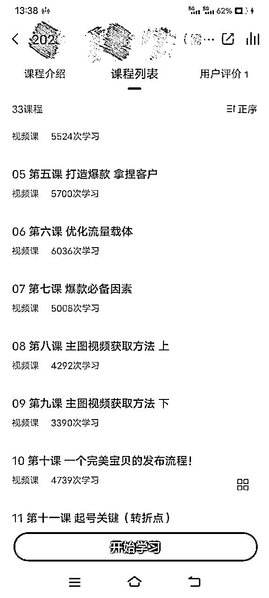

进入一个行业最快的办法，就是照着头部玩家抄作业。我一边卖闲鱼，一边研究师傅的玩法——怎么引流、怎么设计产品、怎么提供服务。可那阵子我自己执行力拉胯，没有最开始那股拼劲。课程录好了，引流来十几个人，最后转化是零。我开始怀疑自己，甚至心想：是不是一个人根本干不成？是不是得找一群人互相打气才行？说到底，就是在给自己找借口。然后，我萌生了开工作室的念头。第一次开，纯粹摸着石头过河。

## 找一个合伙人，就像找到知己

我当时觉得，创业一个人怎么创？雷军不是说过嘛，“一个人走得快，一群人走得远。”于是我开始找合伙人。大学生里创业的人本来就不多，想找到志同道合的可难了。后来通过校园墙，我认识了位大四学长，也是个爱瞎琢磨的人，特别有意思。我们找了间教室，把项目写在纸上，聊得投机得不得了，一拍即合。那一刻我真觉得遇到了知己。

## 从两个人扩到九个人，钱也凑齐了

我们俩重新写了招募贴，在校园墙一发，来了几十个人加我们，当时特别兴奋。我们设了线上问答和线下面试，在教室里用PPT给大家讲项目，最终筛出7个人。股份和出资也敲定了：我和学长各出1万，另外7个人有出8000的，也有出6000的。这我不得不佩服学长，他跟人家才见一面，就能靠情绪感染力让人掏钱。面试具体问了啥我记不清了，大概就是有没有决心、为什么要创业之类的。当时觉得，这几个人都挺靠谱。

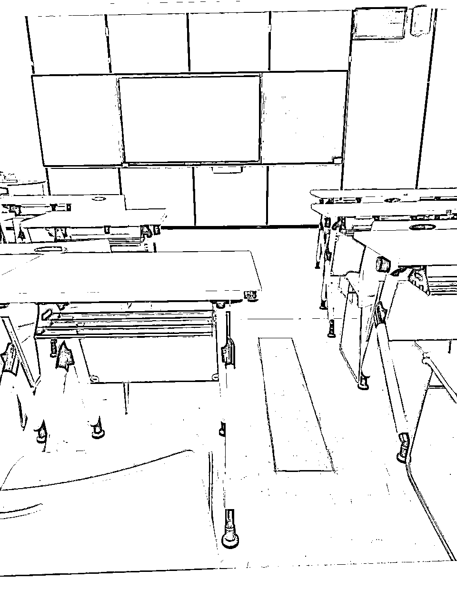

## 一开始，就像谈恋爱

工作室取名“铸就非凡”电商工作室，盼着有一天真能做出点名堂。我们得先有场地，于是去学校周边租了一间商用房，客厅特别大，周围环境也好。

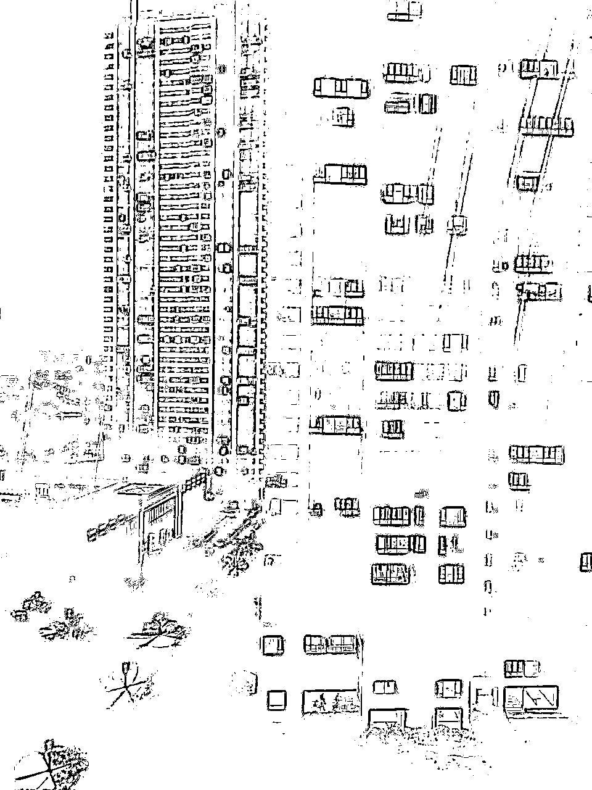

按需求分成了办公区、直播区、茶水区和开会区。一个月租金大概3000块，一季度一交。接着忙着买办公用品、布置房间，每天都兴奋得不行，忙到晚上9点才回学校。说真的，高考时我都没那么拼过。

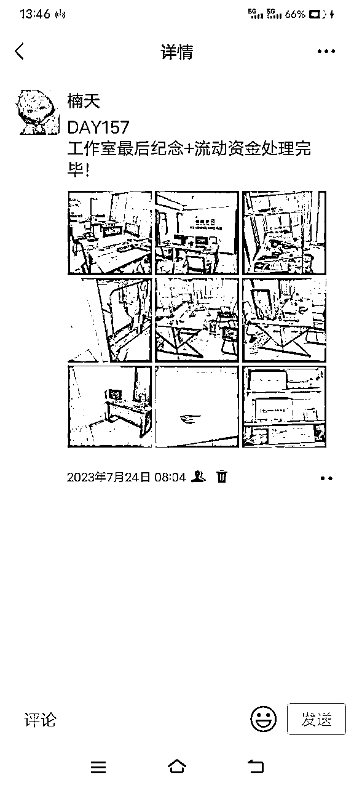

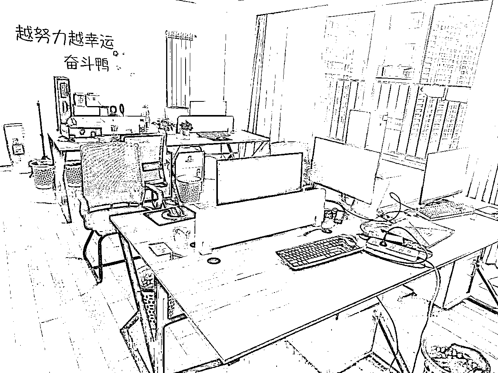

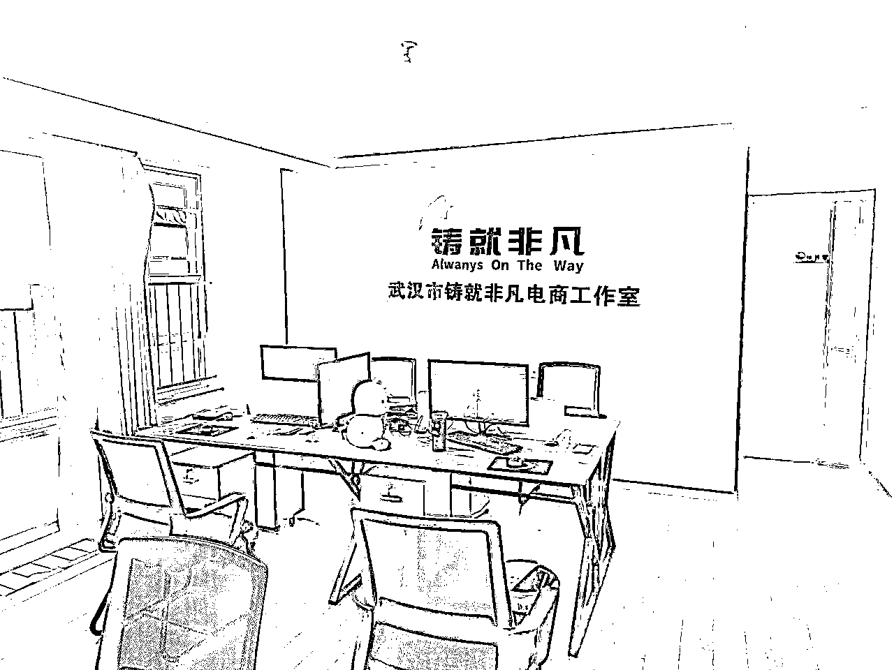

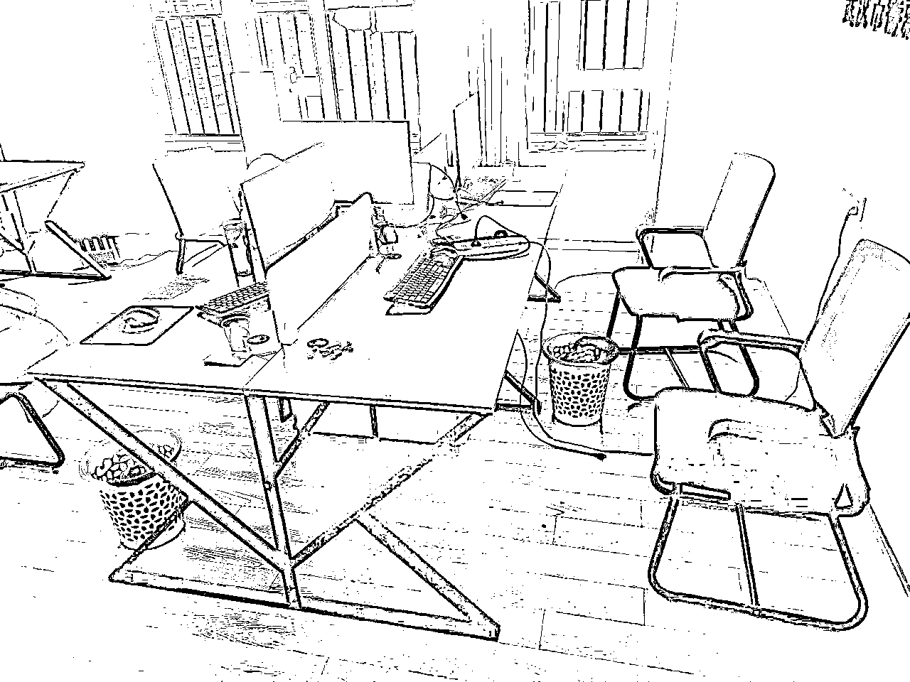

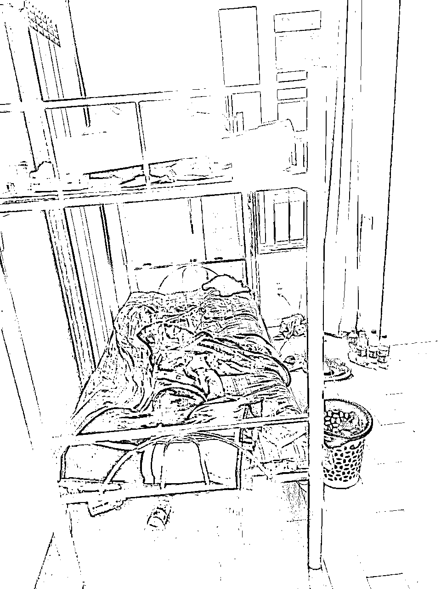

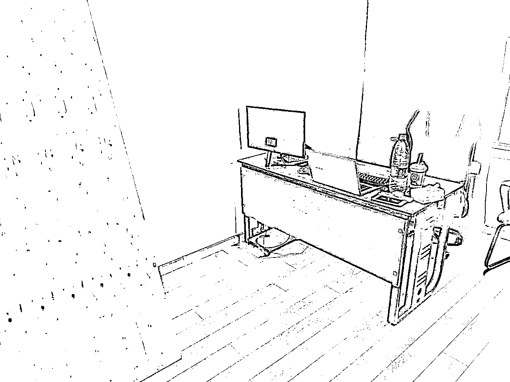

真希望时间能永远停在那段日子。

## 日子开始没那么甜了

甜蜜期一过，正事就来了。我们定的产品是闲鱼课程和一对一辅导，引流方式主要靠线下地推和抖音。大家对产品花了不少心思：我负责课程制作与录制，因为我有实操经验；有人负责小程序和海报；还有人负责拍视频记录创业日常并剪辑。另外还规划了校园代理招募、营业执照、大学生创业政策、电商货源这些内容，真没少费心血。到现在我电脑里还存着当时的成果，舍不得删——那也是我们奋斗过的证据。

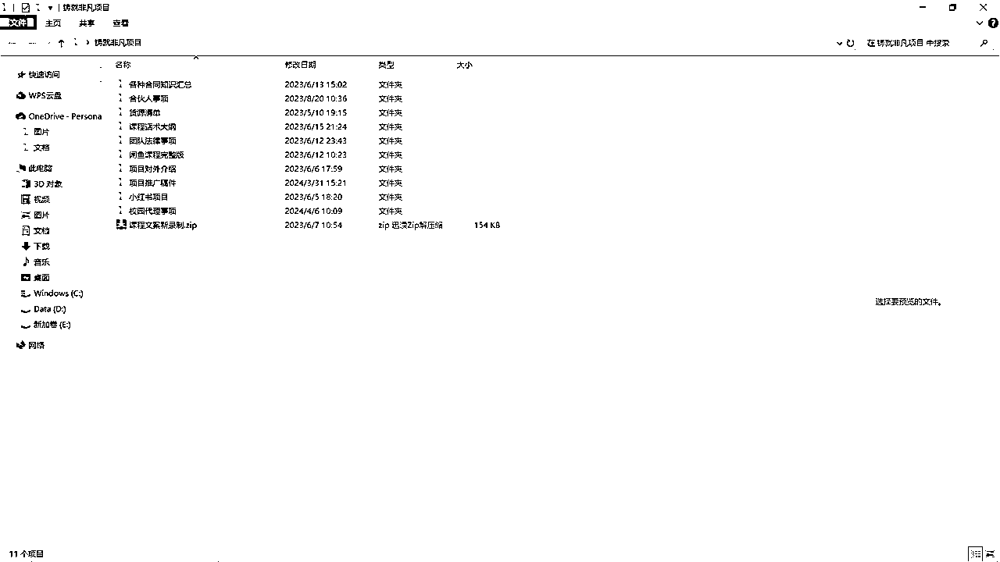

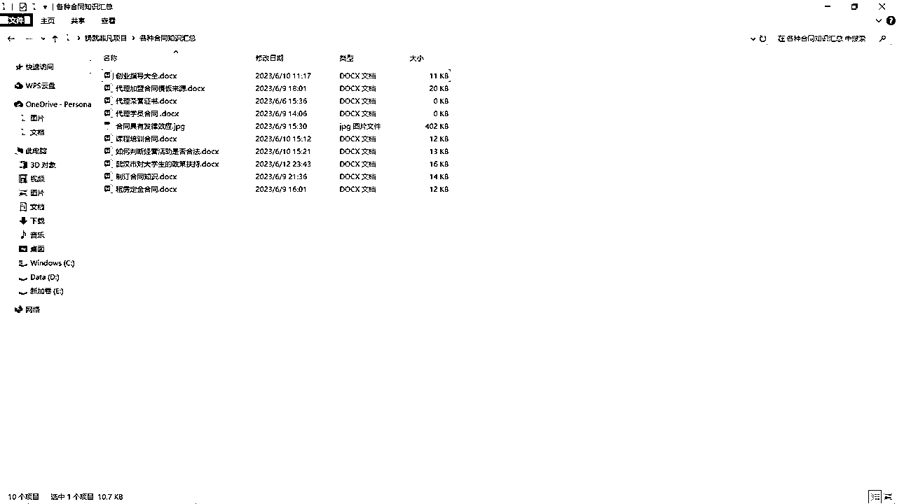

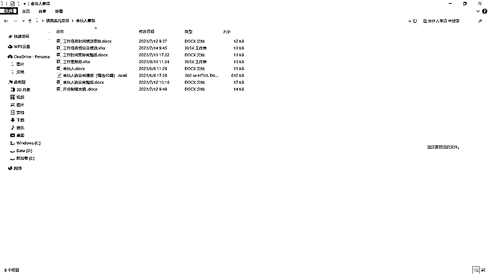

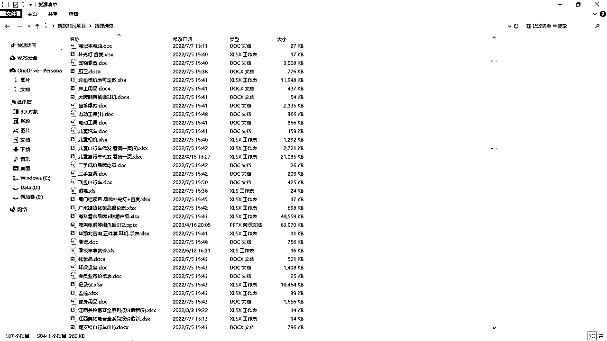

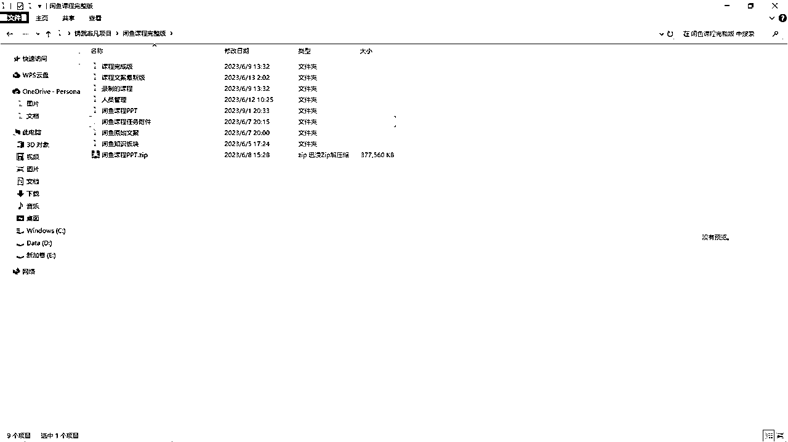

## 最后，散伙了

因为种种原因，工作室解散。清算资产那天，我跟学长大吵一架，从朋友变成了仇人。说好一周录完的课程，拖到解散还有两节没做完。

## 我反复复盘了很久，把这几个关键原因分享给你

先说学长——也就是除了我之外的核心合伙人。他这个人，口才一流，吹牛也一流，营销能力强，但技术很弱，是个精致的利己主义者，平时道义也谈不上。他不顾大家感受，强制熬夜加班：白天我们都很累了，回寝室还要开一小时线上会议，再布置加班任务，不干完不许睡。长时间下来，大家身体都吃不消。这事让我越来越不开心。我跟他反映过很多次，他就说：“心不狠怎么成功？”可他自己呢，半夜跟妹子聊天聊到凌晨。他还喜欢背刺，跟我私底下说其他合伙人的坏话，后来甚至想把两个干了一个月的新生合伙人踢出局，好让我俩股份更大，还美其名曰“免费劳动力”。钱是交到他手里的，之前说好做共同账户，最后也没做。结算时，他偷偷删掉账单里的内容，5万启动资金被花到只剩3000，还故意下套把损失算到其他合伙人头上。我不同意，于是开始漫长的扯皮。最初有多亲密，最后就有多狠，差点闹到派出所。

再说我自己。第一，我是项目发起人，在闲鱼上也做出了一点成绩，却没有坚定立场，太容易被别人带偏，还把财务交给一个人管，这个教训一辈子都忘不了。第二，缺乏创业经验，第一次开工作室，忙的方向就错了——一直在死磕产品，想让客户更喜欢，却没有好好搞流量，根本没能变现。抖音上线效果也不行。第三，太重感情，创业很残酷，不能盲目信任人，我把启动资金都交给学长就是例子。第四，能力不全面，不够自信，没能让自己主导大局。

然后是项目本身的问题。最关键的是，MVP跑得太慢。按当时的速度，启动资金很快就会被烧光，学生的压力就更大了。流量一直没认真做，净在研究些细枝末节的事，起个名字、做个海报都能磨半天，效率低得离谱。管理制度也严重不合理，后来越来越多的人不开心，陆续退出。

还有外部因素。其他合伙人都是学生，既要上学又没经验，扛不住这么长时间没有正反馈。我们也没去学习同行，一直在自己瞎摸索。工作室出了问题没有及时开会解决，反而一拖再拖，最后矛盾集中爆发。

有一次短学期实践，我上台讲工作室的经历，提起失败特别不好意思，很愧疚。但老师跟我说了一句话：“失败的是项目，而不是你。”那句话我一记记到现在，也是靠它坚持往前走。今天把这句话也送给你。

谢谢你看到最后，希望能给你提个醒，少走点弯路。