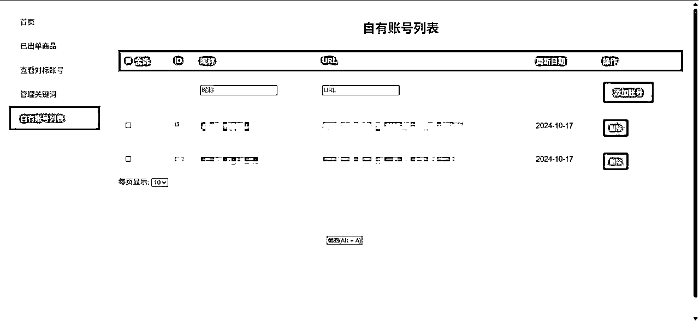
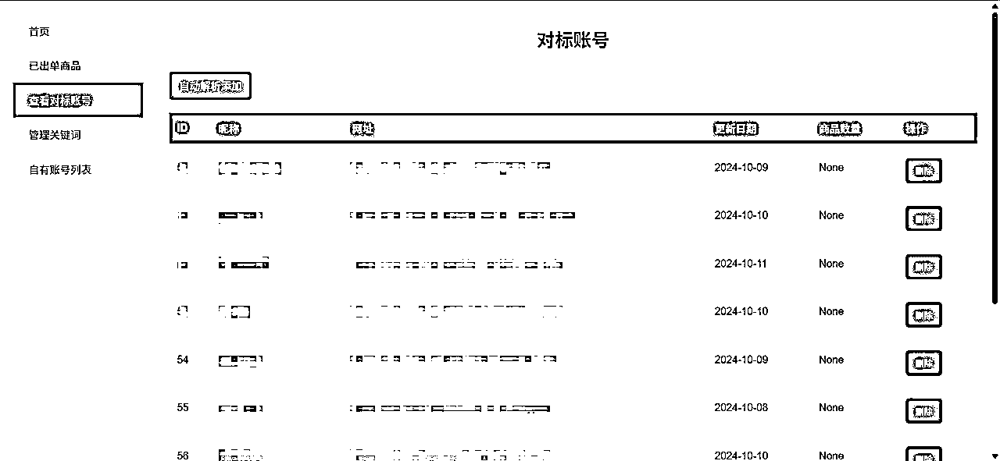
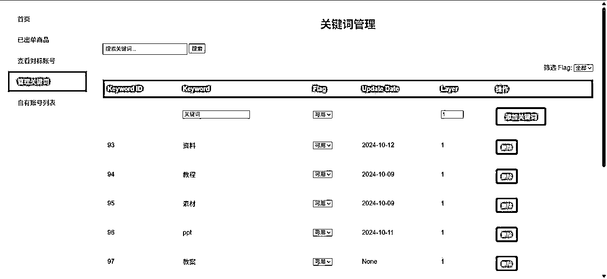
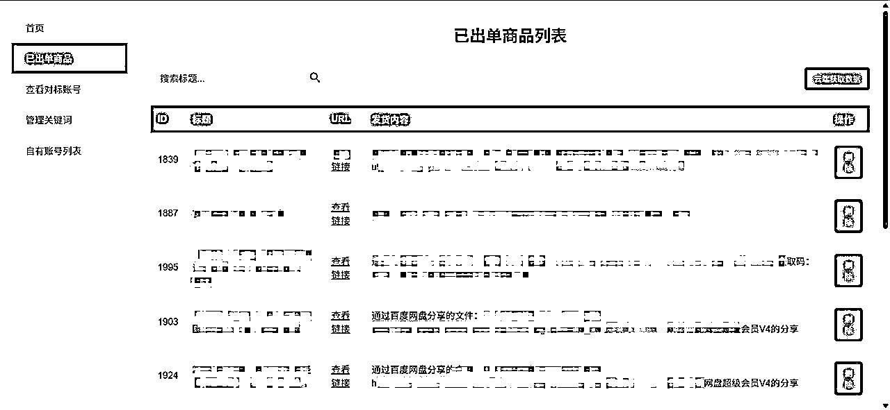
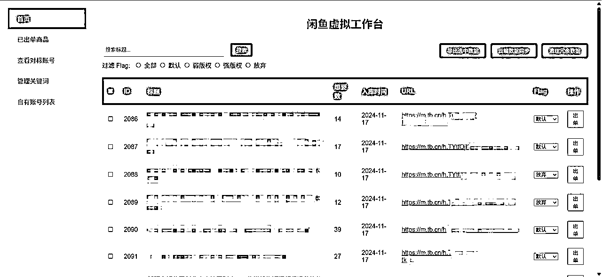
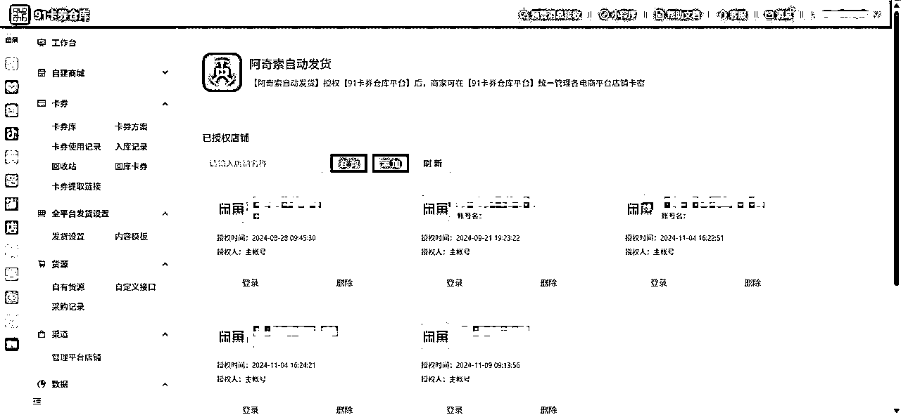
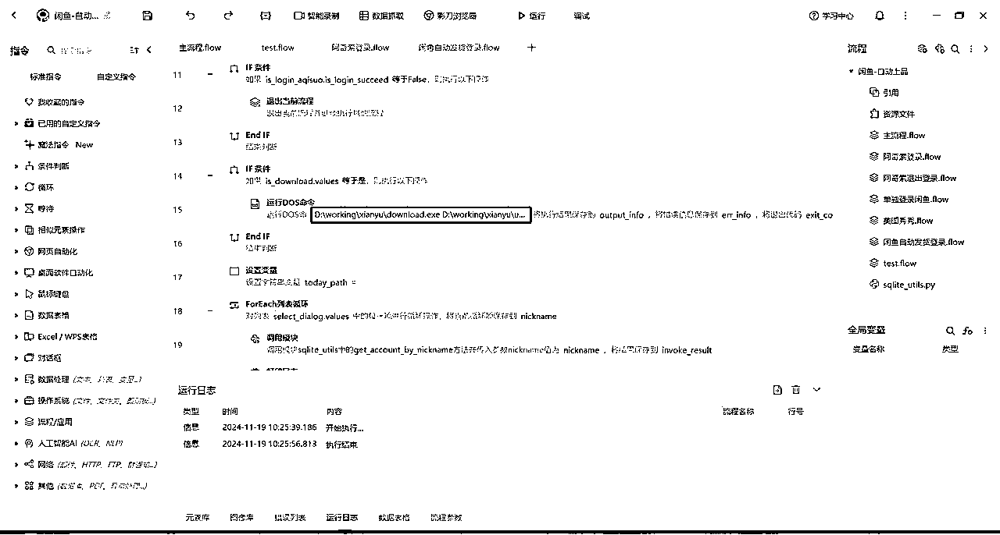
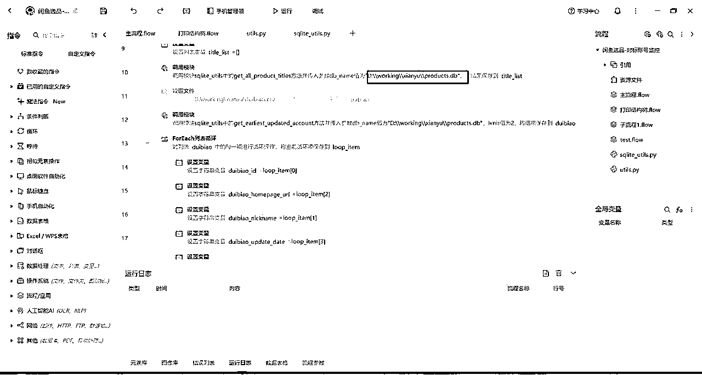
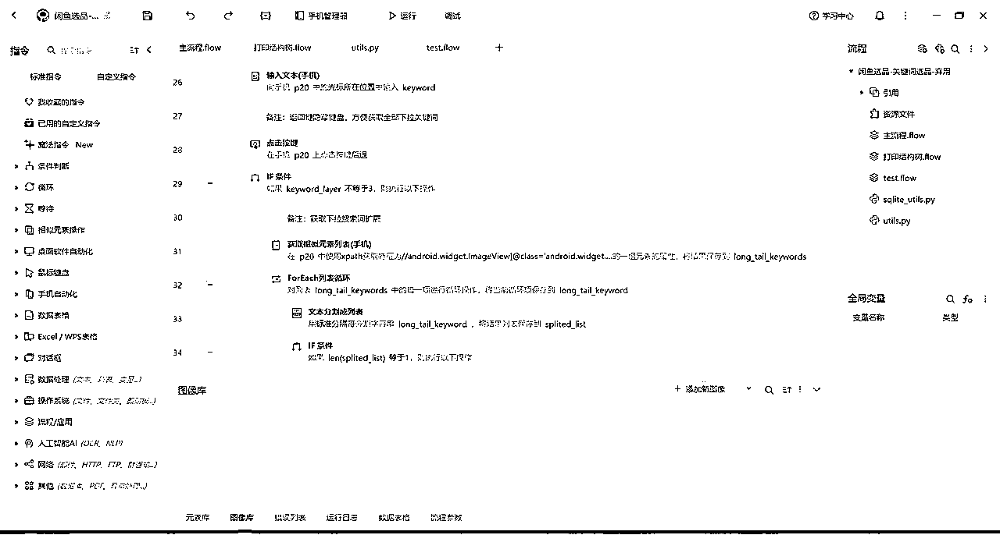

# 闲鱼虚拟项目自动化工具分享：从选品到上品，我踩过的坑和解法

马上又到新一期航海的报名时间了，这次看到有闲鱼虚拟项目，正好让我想起前段时间用Cursor和影刀给自己搓了一套自动化选品和上品的小工具，今天整理出来分享给大家。

先说个重要前提：后面分享的源码都不是下载下来就能跑的。因为里面有“硬编码”，像是数据库文件路径、影刀对闲鱼App版本和元素定位的依赖，这些都得按自己的环境简单改一下。好在有Cursor，拿它去review源码、快速学懂结构，不算难事。另外，如果你要用这套工具，一定记得遵守法律法规，别碰强版权的东西，因版权问题产生的后果跟工具作者没关系。

## 一、这套工具由哪几部分组成

整体上分成三大块：

- 工作台：用Cursor开发，用来管理对标账号、对标品、选品关键词，还有自己的闲鱼多账号。
- 自动选品：用影刀开发，里面又分两条线，一条是按选品关键词自动搜索筛选，一条是按对标账号自动筛选。
- 自动上品：结合Cursor写的代码和影刀，核心是调用阿奇索的功能把品自动挂上去。

### 1.1 工作台有哪些页面

**自有账号列表页**：管理闲鱼账号矩阵，给影刀的自动上品供数据。有了它，脚本才能对多账号做矩阵式批量上品。目前有个小缺陷，页面上没有做成登录信息维护，得自己直接改数据库。截图：

**对标账号页**：维护对标账号，供影刀按账号选品用。支持自动解析闲鱼账号主页的分享链接入库，也支持手动填昵称和URL。截图：

**关键词管理页**：维护采集到的选品关键词，供影刀按关键词选品用。关键词分三级，其中2、3级是在闲鱼搜索框里搜1级关键词时自动收集出来的下拉词。截图：

**已出单商品页**：维护已出单商品的发货内容，一般是网盘链接。这页支持云端同步，可以多人共用。比如我出过单的商品，买回来存到网盘后放进去，别人拿到系统也能获取所有共同沉淀的出单商品。当初做这个本来就是为了跟朋友一起用。截图：

**首页**：维护影刀自动选出来的品，可以继续人工筛选，把不符合需求的去掉，同样支持云端同步。每个品带一个Flag，自动选出来默认，人工筛选时可以标成强版权、弱版权等。在这个页面还能导出品链接，给影刀自动上品用。出单之后，也在这里录入发货内容。截图：

### 1.2 影刀自动上品是什么套路

自动上品主要用阿奇索。你的闲鱼账号需要先绑定阿奇索，并打开“允许绑定的91卡券账号直接登录本店铺”这个开关，绑定后就是下图这样：

影刀脚本（源码放文末了，可以导进自己的影刀直接用）能做到同时挂多个账号自动上品。它会自动解析对标品链接，拿到文案、价格、图片等信息——这部分是Cursor写的代码融到影刀里的。还支持自动调美图秀秀，对首图做简单去重。不过我拿多个账号实测下来，首图去重对曝光几乎没有帮助，所以我现在基本不做这一步了。这脚本主要还是自己用，里面有些硬编码，换电脑要自己改，挺简单的：

### 1.3 影刀自动选品：按对标账号做

这个脚本一样是影刀实现的，需要电脑连着手机，自动化闲鱼App。流程是：从工作台取要对标的账号，进这个账号的主页，把“想要”数大于等于10的品挨个抓下来入库。

它的短板在于对闲鱼App和手机浏览器依赖很强，闲鱼版本或手机型号品牌一变，可能就跑不起来了。好在源码文末也有，要改也不难。和上面一样，里面有硬编码，并不是拿来即用。

### 1.4 影刀自动选品：按关键词做

这个脚本的功能是自动打开手机闲鱼App，搜关键词，把“想要”数大于等于10的品筛出来入库，同时还会收集下拉词存进工作台。每次运行时会随机从工作台拿一部分关键词去搜。不过最近我基本不用它了，现在更习惯自己从工作台挑几个词去闲鱼里搜，找到对标的账号后让1.3的脚本来跑品。主要是那个脚本维护起来太费劲，放出来只当参考：

## 二、用Cursor和影刀开发时的一些思路复盘

因为开发过程拖了挺久，Cursor历史记录也不太好翻，加上中途反复试错、换想法，这里只能放大方向上的思路，你结合源码看会更容易理解。

### 2.1 整体想法

闲鱼虚拟项目跟普通电商一样，就是选品、上品、发货。发货这步完全可以交给阿奇索；选品和上品能自动化的就自动化。但我不想做强版权，所以没有把自动选品和自动上品直接打通，中间故意插了人工环节：从自动选品的列表里挑出弱版权的品，再丢给自动上品跑。

选品分两条路，在影刀脚本里也体现得很清楚：一条按对标账号，一条按关键词。上品则是解析对标品链接，把标题、文案、图片拿过来。去重这块我没做，因为自己测过对曝光影响不大，我更追求账号矩阵的批量化——每个号挂500个品时，做精细化运营实在太耗精力和时间了。解析完对标品，后面接阿奇索自动上架，这部分反而比较简单。

这部分写得不算细，但源码都在，借助Cursor review一下，再配合文档，基本能看懂，也方便以后自己改。

### 2.2 影刀自动选品的几个深坑

这块当时折腾久了。闲鱼有手机App、网页版、微信小程序，最初想拿网页版做自动化，但测下来发现网页版数据跟手机App对不上，尤其是关键词搜索结果差异很大；更麻烦的是网页版根本进不了闲鱼账号主页，所以没法做对标账号选品。微信小程序也有问题，里面拿到的链接只能在小程序内打开，封闭性太强了。最后只能选择手机App自动化。

**对标账号选品的流程大概是：**

获取对标账号 → 拉取已入库的对标品做去重 → 打开手机App浏览器输入对标账号网址 → 跳转闲鱼App → 下滑翻页循环获取主页商品 → 拿“想要”数 → 满足想要数大于10且标题不重复时，取分享链接入库。

看着简单，实际坑特别多：

- 分享链接拿多了会失败；
- 闲鱼文案本身没有标题和正文的区分，需要自己截前30个字符当标题；
- 对标账号主页有些品直接能看到“想要”数，有些看不到，所以经常要频繁进详情页才能拿；
- 看品看多了可能触发App防御，所以脚本里要适当加暂停；
- 有时App会弹一个“遮罩层”，肉眼能看到全部数据，但自动化就是取不到，需要手动点一下屏幕或按返回键，这种情况必须长时间暂停，防止继续触发防御；
- 之所以从浏览器打开网址再跳转App，是因为直接把分享链接放剪贴板再打开闲鱼，App识别几次后就不跳了，非常不稳定。

拿到脚本后，大概率要改手机App包名，以及各元素的定位逻辑，不同版本会有差异。不过脚本里写了一个“打印结构树”的子流程，可以用来导XML辅助定位按钮，不算太难。

**关键词选品的流程是：**

获取选品关键词 → 拉已入库的对标品做去重 → 搜索关键词 → 收集下拉词入库 → 在搜索结果页循环取品 → 把想要数大于等于10的保存进工作台。

这里有个折磨我很久的坑：两台完全相同的手机、相同的闲鱼版本，搜索结果页的元素定位方式居然不一样，导致程序要做大量兼容处理，跑起来效率极低，所以后来我慢慢放弃这个脚本了。

但关键词选品本身真的很有用，能采集到很多自己根本想不到的下拉词，也搜出来不少意外的品。初期靠它找词，可以多翻翻生财里虚拟项目的帖子，思路一下就打开了。

### 2.3 工作台是怎么演进的

当初做工作台，主要是让人工介入一个环节：自动选品选出来的品，需要有人再筛一遍，把强版权和非虚拟品踢掉。中间试过很多想法：

- 自动选品入库后，在工作台做一个“一键更新想要数”的功能。比如今天某品入库时想要数是10，过一天再更新一次，如果数涨了说明近期需求好，这样的品更容易出单。但试了几天，发现想要数增长的品并不多，就放弃了这个功能。代码现在还留着，只是前端按钮被屏蔽了。
- 另一个功能是：选一个自己的账号，把这个账号所有已上架品的标题拉出来，和新入库的对标品对比。自家还没上过的品，且每天平均想要数增量大于某个阈值，就选出来准备上架测品。这个功能现在也隐藏了，目前主打多账号矩阵大规模测品，所以没用上。后端代码还在，可以作为参考。
- 为了拿各种更新数据，这两个功能做过好多版本的尝试，用过阿奇索、闲管家，也试过selenium、playwright、undetected chromedriver这些，全部都是借助Cursor搞定的。

### 2.4 影刀自动上品的完整流程

整体的操作链路是：用户先选一个或多个需要上品的账号 → 读取urls.csv拿对标品链接 → 用download.exe解析链接信息（可选）→ 用美图秀秀处理首图（可选）→ 打开阿奇索登录页 → 等用户人工登录（因为有图形验证码，自动化硬刚没必要）→ 根据选好的账号自动登录阿奇索闲鱼自动发货 → 自动上架 → 类目、标题、描述、图片自动填 → 发货地随机（一二三线城市随机选）→ 循环发布后面的品。

真正的难点在浏览器自动化时的元素定位。影刀的自动定位有时候不准，需要自己写xpath，这时候把节点元素源码扔给Cursor，让它生成一个xpath，是个很好用的办法。源码就放在文档最后。

### 2.5 补充：云端同步API

工作台的云端同步，主要是同步选品和已出单商品。影刀自动选品时会自动把选出来的品传到云端，工作台再去同步，都靠这个API完成。功能很简单，谈不上完善，够用就好。源码在工作台.zip里。

## 三、源码和导入方法

第三部分把影刀源码、工作台源码都整理好了。影刀不是付费用户的话，正常不能直接用别人写的应用，但有个取巧的办法可以把别人做好的应用导入自己账号。具体怎么导入、怎么修改，文档里都写清楚了。

大概就是这些。希望这套思路和源码对做闲鱼虚拟项目的朋友有参考价值，也祝大家新一期航海玩得顺手。