# 用 ComfyUI 批量复刻短视频：从素材到成片的完整流程

想借鉴一条短视频的画面风格与节奏，能不能用 AI 批量完成制作？这篇教程以一条短视频为例，拆解一套基于 ComfyUI 和开源模型的操作流程。整体分为九步，尽量使用免费工具，适合批量生成：

1. 下载参考视频  
2. 批量截取视频关键帧  
3. 用 AI 分析关键帧并生成提示词  
4. 批量生成图片  
5. 将图片转成视频片段  
6. 制作音乐或音效  
7. 按需生成对白、旁白  
8. 对视频进行高清处理  
9. 使用剪映等软件完成剪辑  

## 一、获取参考视频

先准备一条想要借鉴的公开视频。下载站点通常只需粘贴 YouTube 视频链接，操作方式大同小异。建议收藏多个入口，避免个别网站无法访问：

1. https://addyoutube.com/  

2. https://youtube.iiilab.com/  
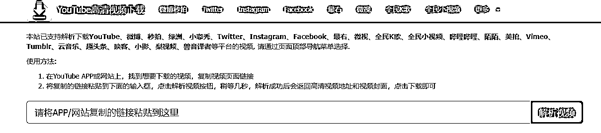

3. https://hhm.zzrjcp.com/  

4. https://youtube4kdownloader.com/  

5. https://ytshorts.savetube.me/1keen2  

6. https://y2down.cc/zh/  
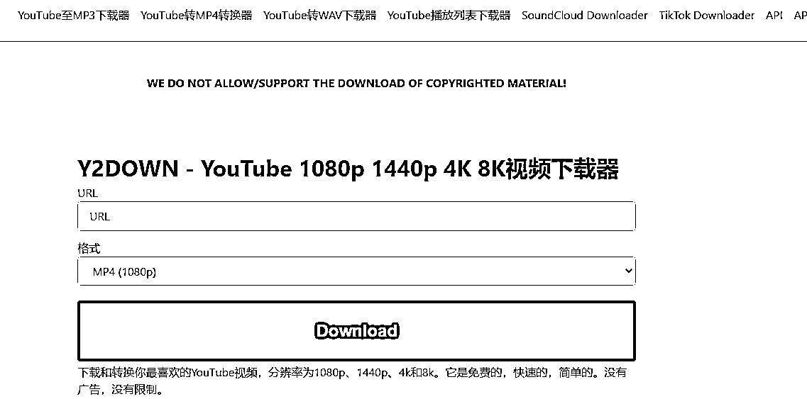

7. https://www.freemake.com/cn/free_video_downloader_best/  

本次示例是在 YouTube 搜索 CAT，选择一条 Shorts 视频作为参考。视频地址为：

https://www.youtube.com/shorts/-AXxWdR74k0  
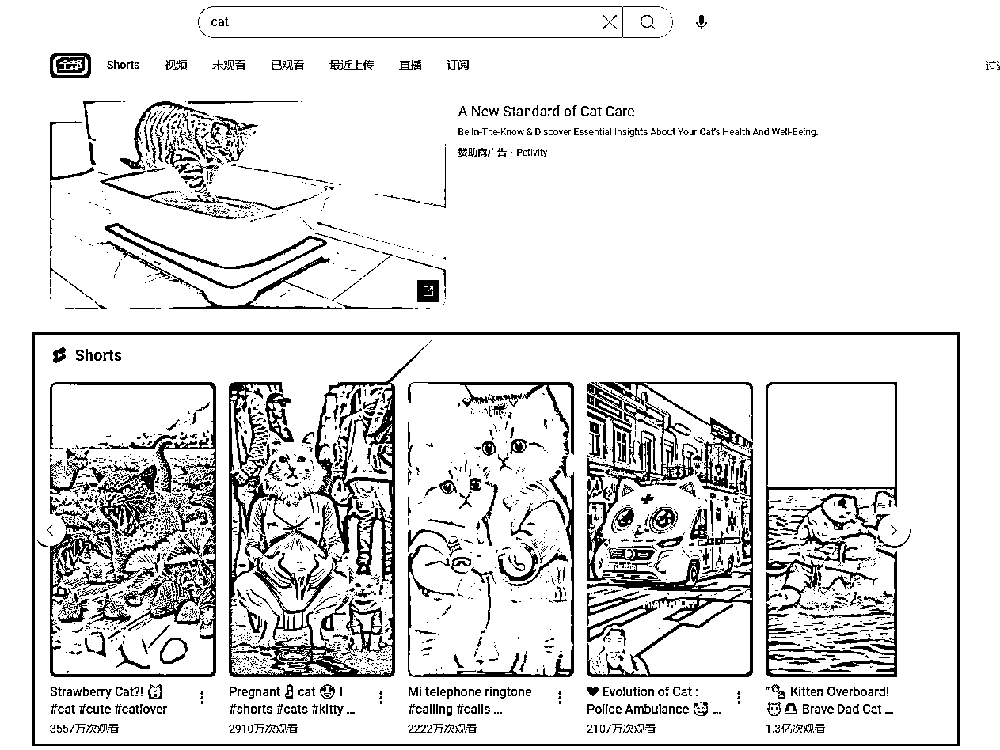

复制链接到任意下载网站即可保存视频，这里以 addyoutube 为例。  
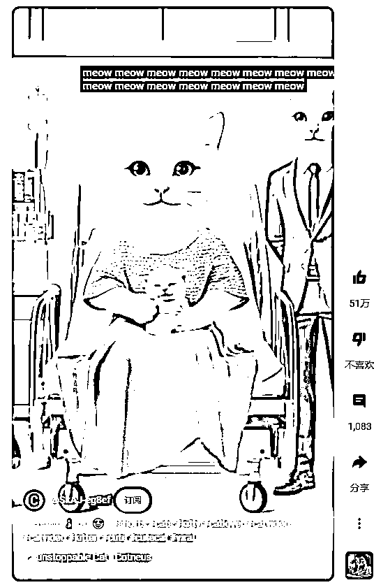

## 二、批量截取关键帧

关键帧能够帮助我们梳理参考视频中的画面内容与镜头变化。这里使用生财圈友 @老馬🐎内容出海 分享的工具：

https://pan.baidu.com/s/1QFVnSLKYSG9nUe4nFE-O1g?pwd=lai6

打开工具后，软件会自动创建输入、输出文件夹。把待处理的视频放进输入目录，参数先采用默认值，点击开始即可批量提取。  
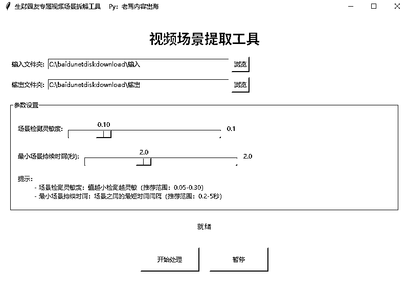  

处理完成后，输出文件夹里会出现多张截图。示例中第一张是黑屏，第二、第三张构图重复，剔除后可用关键帧共 8 张，对应第 3 至第 10 张。  
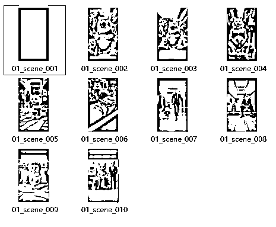

想获得更密集的截图，可以缩短截取间隔、调低灵敏度。不过间隔越密，重复构图也可能越多，建议根据具体视频调整参数。  
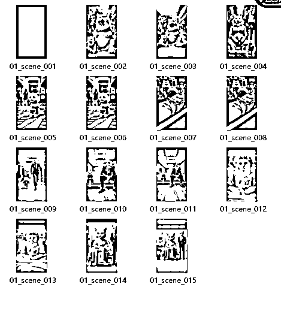

## 三、用 AI 反推画面提示词

把筛选好的 8 张图片统一命名，例如“视频名-序号”，之后就能批量分析图片内容，并将结果用于生成新图。

ChatGPT 等工具也可以完成图片提示词反推。考虑到使用成本与访问条件，本教程选择在本地 ComfyUI 中操作。ComfyUI 有多种图像描述模型可选，下面采用设置较简单、运行速度较快的一种；它的提示词分析效果属于中等水平。  
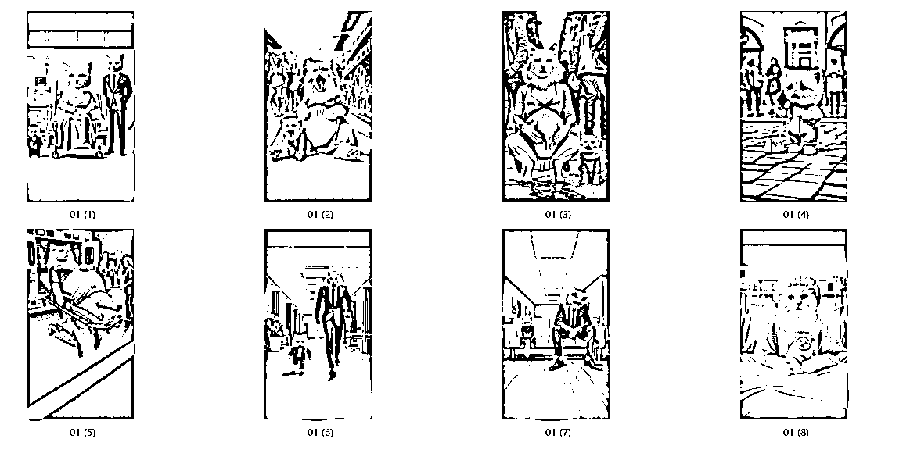

开始前请注意：

- 需要先按照教程搭建好 ComfyUI 工作流。
- LIBLIB 在线版的 WD14 反推节点存在显示问题，可能看不到生成的提示词，因此建议使用本地 ComfyUI。
- 在线版无法读取文件夹，也不支持多图批量处理，批量任务同样需要在本地运行。
- 若要批量反推，选择第一个 YES 选项。  
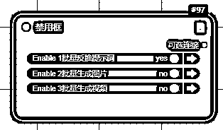

处理单张图片时，使用“加载图像”并上传图片；批量处理则选择“加载图像（文件夹）”，在左侧填写图片所在目录。  
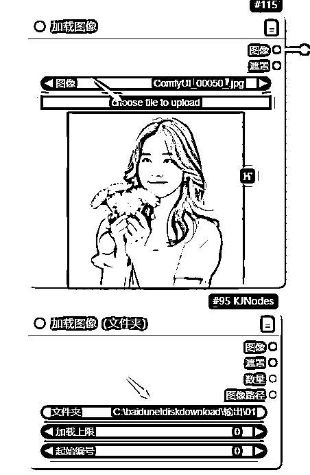

右侧可以选择任意模型，推荐优先尝试名称以 V3 结尾的版本。  
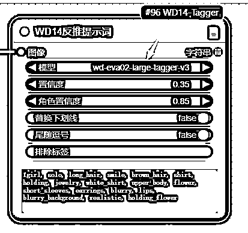

点击“执行队列”后，单张任务会显示对应提示词；批量任务则会输出文件夹内所有图片的描述结果。  
  
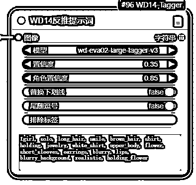  
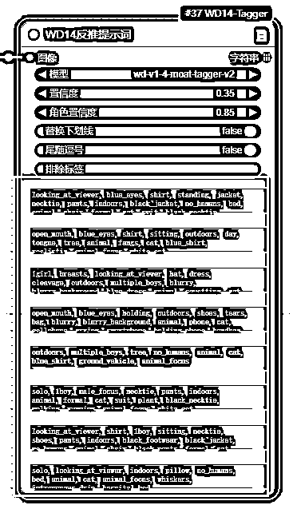

## 四、批量生成图片

拿到关键帧对应的提示词后，就可以把它们分别输入生成流程，批量制作新图片。本例继续使用免费的 ComfyUI。  
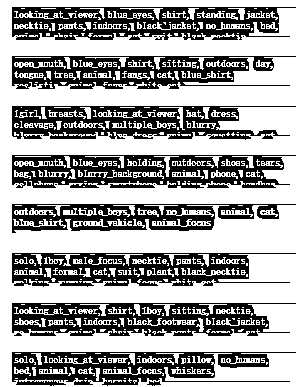

同样需要自行搭建工作流，且在线版不支持文件夹读取和多图批处理，因此建议本地操作。开始时点击 YES。  
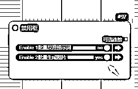

模型方面，Checkpoint 通常不必调整；LoRA 则可按目标画风挑选。本例使用 FLUX 系列的 3D 风格 LoRA，而参考画面原本偏皮克斯风格。  
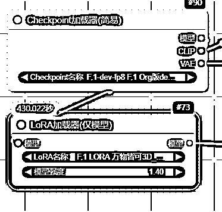

将 8 组不同提示词分别用于生成图片。示例提示词如下：

1. `looking_at_viewer, blue_eyes, shirt, standing, jacket, necktie, pants, indoors, black_jacket, no_humans, bed, animal, chair, formal, cat, suit, black_necktie, animal_focus, black_suit, white_cat, intravenous_drip, hospital_bed, hospital_gown`
2. `open_mouth, blue_eyes, shirt, sitting, outdoors, day, tongue, tree, animal, fangs, cat, blue_shirt, realistic, animal_focus, white_cat`
3. `1girl, breasts, looking_at_viewer, hat, dress, cleavage, outdoors, multiple_boys, blurry, blurry_background, blue_dress, animal, squatting, cat, green_dress, pregnant, puddle, aqua_dress`
4. `open_mouth, blue_eyes, holding, outdoors, shoes, tears, bag, blurry, blurry_background, animal, phone, cat, cellphone, crying, smartphone, holding_phone, handbag, overalls, animal_focus, white_cat`
5. `outdoors, multiple_boys, tree, no_humans, animal, cat, blue_shirt, ground_vehicle, animal_focus`
6. `solo, 1boy, male_focus, necktie, pants, indoors, animal, formal, cat, suit, plant, black_necktie, walking, running, animal_focus, white_cat`
7. `looking_at_viewer, shirt, 1boy, sitting, necktie, shoes, pants, indoors, black_footwear, black_jacket, no_humans, animal, chair, black_pants, formal, cat, suit, couch, black_necktie, wooden_floor, animal_focus, black_suit`
8. `solo, looking_at_viewer, indoors, pillow, no_humans, bed, animal, cat, animal_focus, whiskers, intravenous_drip, hospital_bed`

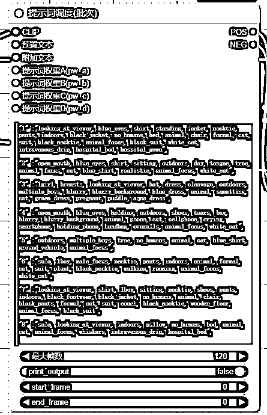

参数设置时，重点调整画面宽高，并将批次大小设为图片数量；其他选项可以先保持默认。  
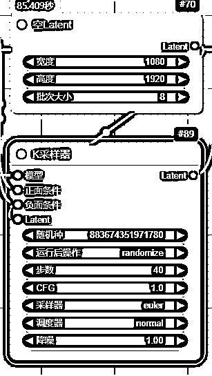

运行后即可得到 8 张对应不同提示词的图片。示例结果与原图存在明显差异，这是因为本次尝试更换了风格。  
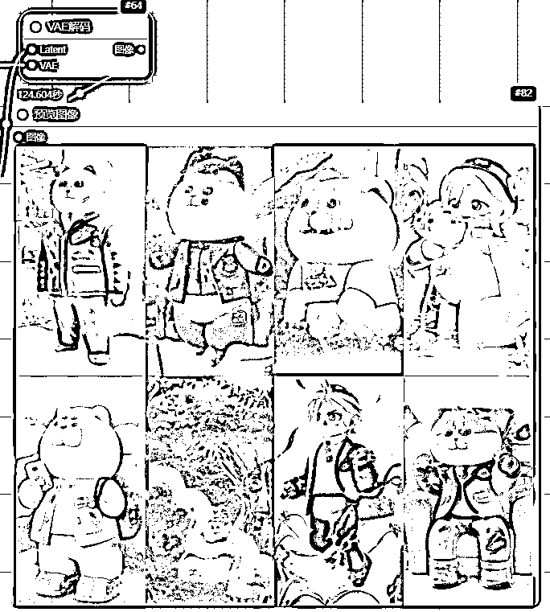

如果希望画面更接近原视频的皮克斯风格，可以把 LoRA 换成相应的皮克斯风格模型。  
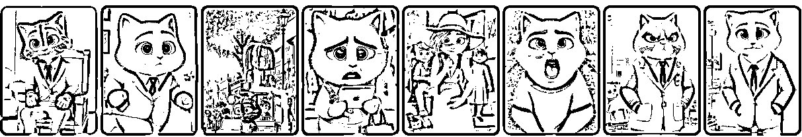

## 五、让图片动起来

准备好 8 张图片后，可以继续通过 ComfyUI 批量生成视频片段。工作流仍需自行搭建；由于 LIBLIB 在线版不支持文件夹和多图批处理，建议使用本地环境。  
  
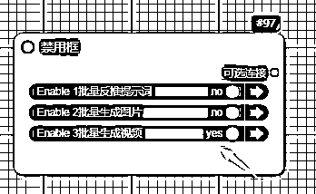

模型使用 SVD 视频模型，Checkpoint 无需额外调整。  
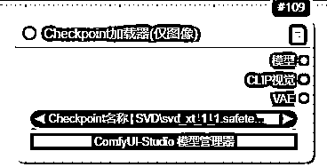

单张图片可通过上方节点上传；批量任务则通过下方的文件夹节点加载图片。  
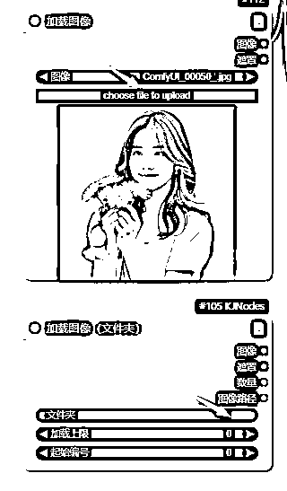

将视频宽度和高度设为与图片一致，并确保参与批处理的图片尺寸统一，其他参数暂时保留默认值。  
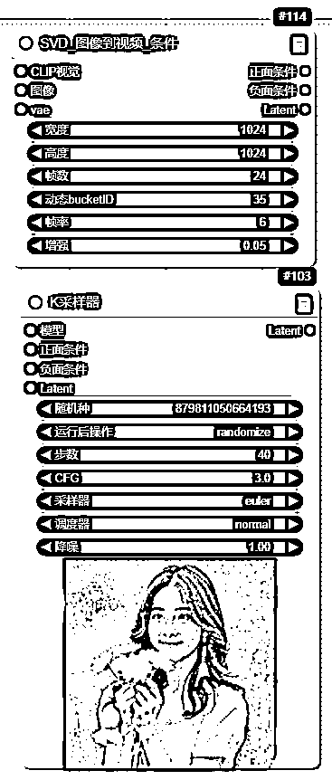

执行后会自动生成 8 段视频。示例中生成片段与对应图片的画面还原度较高。  
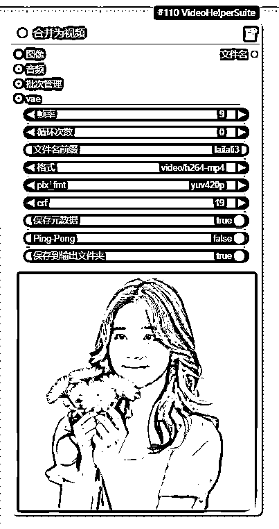

## 六、添加音乐或音效

视频片段完成后，可以配上音乐或音效。可以选择沿用参考视频的声音，也可以通过 ComfyUI 生成新的音频。

### 直接提取原视频音频

如果打算保留原视频里的背景音乐或音效，可将视频链接粘贴到下载站点，选择“下载音频”即可单独获取声音文件。本例使用 YouTube 链接，并以 youtube.iiilab.com 为示范。  
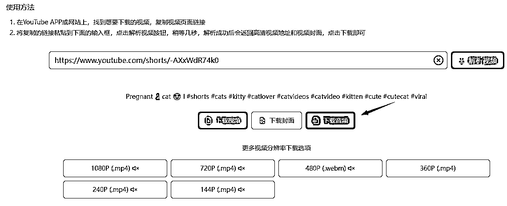

下载后即可获得音频素材。

### 用 AI 生成音乐或音效

先按照教程搭建对应工作流：上方加载 `stable_audio_open_1.0` 模型，下方加载 `t5_base` 模型。  
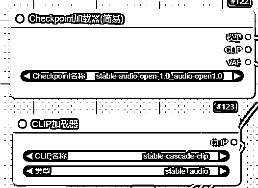

设置生成时长以及需要生成的音频数量。  
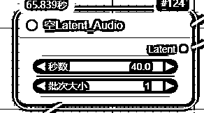

再填写音乐或音效描述词。  
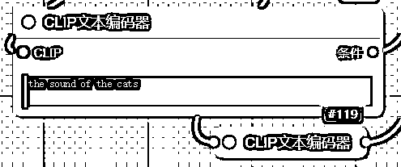

提示词示例：

- 轻松爵士：`Very relaxing and pleasant jazz music, suitable for vlogs.`
- 蛙鸣：`A summer night with many frogs croaking.`
- 雷雨声：`Thunder and lightning, accompanied by the sounds of the wind and waves`

参数可以先沿用默认设置。  
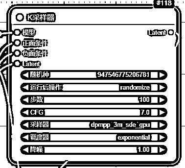

生成的音频会以文件形式保存，前往 LIBLIB 图库即可下载。  
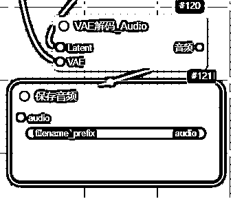

## 七、按需要制作对白或旁白

这一步不是必选项。如果视频本身没有对白，可以直接跳过。ComfyUI 可通过 ChatTTS 节点完成语音生成：

https://github.com/shadowcz007/Comfyui-ChatTTS

该节点支持创建和复用音色，也能生成多人对话。输入文本时，无须手动添加 `[speed_3]`、`[laugh_2]` 等控制标签。

## 八、视频剪辑与合成

最后需要把生成的视频片段和音乐、音效等素材剪辑在一起。这一步不可省略。由于 ComfyUI 暂时没有找到合适的自动剪辑方案，建议使用剪映或 CapCut 完成后期处理。想进一步提升剪辑能力，也可以参考生财有术此前的视频剪辑航海内容。